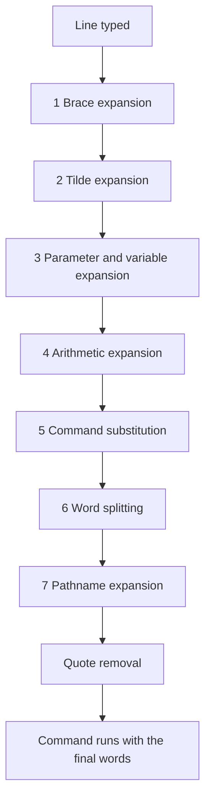

# Expansion and quoting: seeing the line as the shell sees it

> **Before this lesson:** you should know wildcards ([Manipulating files](#/lesson/linux-cli/manipulating-files)), how commands are looked up ([Working with commands](#/lesson/linux-cli/commands-and-help)) and pipes ([Redirection and pipelines](#/lesson/linux-cli/redirection-pipelines)).

## In plain words

Before the shell runs the line you typed, it quietly rewrites parts of it. A star becomes a list of file names; `$HOME` becomes the path of your home directory. This rewriting is called **expansion**.

Think of a personal assistant who reads your note before passing it on. You write "send this to the whole team", and the assistant replaces "the whole team" with twelve actual names. The recipient never sees your shorthand — only the names. In the same way, the program you run never sees the star you typed, only the file names the shell put in its place.

Usually that is exactly what you want. Sometimes it is not: you want a real star, or a real dollar sign, to arrive untouched. **Quoting** is how you tell the assistant "pass this part on exactly as written". There are three ways to quote, and they protect different amounts.

Why this matters for a job: most puzzling shell behaviour — a file name with a space that turns into two files, a variable that vanishes, a deletion that removes the wrong things — comes from expansion happening where it was not expected. Knowing these rules prevents a whole class of mistakes, some of them destructive.

## Motivation

Type `echo *` and you do not get a star. Type `echo $HOME` and you do not get the word HOME. Between the moment you press Enter and the moment a program starts, the shell rewrites your line — sometimes dramatically — and the program receives only the result. Nearly every "the shell is doing something weird" story (a file name with a space that became two files, a variable that vanished, a pattern that matched nothing or everything) is a story about this rewriting, called **expansion**, and about the tool that controls it, **quoting**.

Once you can predict what the shell will hand to a command, the weirdness disappears. This lesson walks through every kind of expansion in the order bash performs them and then shows the three quoting mechanisms that switch them off.

## `echo`: an X-ray of the command line

`echo` prints its arguments separated by single spaces. That makes it the perfect instrument: whatever the shell did to your line, `echo` shows you the outcome.

```bash
mira@forge:~/lab$ echo this    is    spaced
this is spaced
mira@forge:~/lab$ echo *
archive data figures latest.csv notes.txt README.md
```

In the first command the shell split the line into three words and discarded the extra spaces; `echo` never knew they were there. In the second, `echo` never saw a star — it received six file names.

## The seven expansions, in order



Steps 3 to 5 actually happen together, left to right, but the picture is accurate where it matters: braces come first, and word splitting and globbing are applied to the *results* of the earlier steps.

### 1. Brace expansion

Braces generate text. A comma list produces one word per alternative; a `..` range produces a sequence.

```bash
mira@forge:~/lab$ echo report_{draft,final}.md
report_draft.md report_final.md
mira@forge:~/lab$ echo img_{1..5}.png
img_1.png img_2.png img_3.png img_4.png img_5.png
mira@forge:~/lab$ echo {01..12}
01 02 03 04 05 06 07 08 09 10 11 12
mira@forge:~/lab$ echo {a..e} {10..0..5}
a b c d e 10 5 0
mira@forge:~/lab$ echo {train,test}/{images,labels}
train/images train/labels test/images test/labels
```

Brace expansion never consults the disk — the names need not exist — which is what makes it ideal for *creating* things:

```bash
mira@forge:~/lab$ mkdir -p dataset/{train,val,test}/{images,labels}
mira@forge:~/lab$ cp config.yaml{,.bak}          # expands to: cp config.yaml config.yaml.bak
mira@forge:~/lab$ mv results.{txt,md}            # expands to: mv results.txt results.md
```

The last two idioms rely on an empty alternative and save a great deal of retyping.

### 2. Tilde expansion

A `~` at the start of a word becomes a home directory:

```bash
mira@forge:~/lab$ echo ~ ~otto ~/projects
/home/mira /home/otto /home/mira/projects
```

### 3. Parameter expansion

A `$` followed by a name is replaced by that variable's value. `printenv` lists the variables your session starts with.

```bash
mira@forge:~/lab$ echo $USER works in $HOME using $SHELL
mira works in /home/mira using /bin/bash
mira@forge:~/lab$ echo "[$UZER]"
[]
```

The second command shows a trap: a misspelt or unset variable expands to **nothing**, silently. When a name is followed directly by other letters, wrap it in braces to mark where it ends: `${USER}_backup` rather than `$USER_backup` (which looks up a variable called `USER_backup`). A later lesson covers the many `${...}` operators for defaults, substrings and pattern removal.

### 4. Arithmetic expansion

`$(( expression ))` is replaced by its integer value. Operators are the usual `+ - * / %` plus `**` for powers; division truncates.

```bash
mira@forge:~/lab$ echo $(( 7 * 6 )) $(( 17 / 5 )) $(( 17 % 5 )) $(( 2 ** 10 ))
42 3 2 1024
mira@forge:~/lab$ echo "A day has $(( 24 * 60 * 60 )) seconds"
A day has 86400 seconds
```

### 5. Command substitution

`$(command)` runs the command and is replaced by its output, with trailing newlines removed. It lets one command's result become another's argument:

```bash
mira@forge:~/lab$ echo "Today is $(date +%F) on $(hostname)"
Today is 2026-11-20 on forge
mira@forge:~/lab$ ls -l $(which python3)
lrwxrwxrwx 1 root root 10 Aug  7 14:02 /usr/bin/python3 -> python3.12
mira@forge:~/lab$ tar -czf backup-$(date +%Y%m%d).tar.gz data
mira@forge:~/lab$ file $(ls -d /usr/bin/* | grep zip) | head -n 2
/usr/bin/bunzip2: symbolic link to bzip2
/usr/bin/bzip2:   ELF 64-bit LSB pie executable, x86-64, dynamically linked, stripped
```

Older scripts use backquotes for the same thing. The `$( )` form is preferred because it nests cleanly and is easier to read.

### 6. Word splitting

After the substitutions above, bash scans the **results of unquoted expansions** and splits them into separate words at spaces, tabs and newlines (the characters in the variable `IFS`). This is the step that bites:

```bash
mira@forge:~/lab$ f="Holiday Photos"
mira@forge:~/lab$ ls -d $f
ls: cannot access 'Holiday': No such file or directory
ls: cannot access 'Photos': No such file or directory
mira@forge:~/lab$ ls -d "$f"
'Holiday Photos'
```

The variable held one name; after unquoted expansion `ls` received two arguments.

### 7. Pathname expansion

Finally, any unquoted word containing `*`, `?` or `[` is treated as a pattern and replaced by the matching file names, as covered in the lesson on manipulating files.

```bash
mira@forge:~/lab$ echo [[:upper:]]* *.md .[!.]*
README.md README.md notes.md .env .gitignore
```

Globbing also applies to the *output* of earlier expansions, so a variable containing a star can explode:

```bash
mira@forge:~/lab$ msg="Rating: * * *"
mira@forge:~/lab$ echo $msg
Rating: archive data figures latest.csv notes.txt README.md archive data figures ...
mira@forge:~/lab$ echo "$msg"
Rating: * * *
```

## A tiny expansion engine

To make the ordering concrete, here is a simplified model of three of the steps — variables, then word splitting, then globbing — with a flag that plays the role of double quotes. Change `quoted` and watch the argument list change.

```python-run
import fnmatch, re

FILES = ["archive", "data", "notes.txt", "README.md", "Holiday Photos"]
VARS = {"f": "Holiday Photos", "pat": "*.md", "n": "3"}

def expand(word, quoted):
    # step 3: parameter expansion
    text = re.sub(r"\$(\w+)", lambda m: VARS.get(m.group(1), ""), word)
    if quoted:
        return [text]                      # double quotes: no splitting, no globbing
    out = []
    for piece in text.split():             # step 6: word splitting
        matches = sorted(f for f in FILES if fnmatch.fnmatchcase(f, piece)) \
                  if any(c in piece for c in "*?[") else []
        out.extend(matches or [piece])     # step 7: pathname expansion
    return out

for word, quoted in [("$f", False), ("$f", True), ("$pat", False),
                     ("$pat", True), ("x$missing", False), ("$missing", False)]:
    shown = f'"{word}"' if quoted else word
    args = expand(word, quoted)
    print(f"ls {shown:12} -> {len(args)} argument(s): {args}")
```

The final line is worth noticing: an unquoted variable that is empty produces **zero** arguments — it disappears from the command line entirely, while a quoted one yields one empty argument.

## Quoting: turning expansions off

There are three mechanisms, from weakest to strongest.

### Double quotes

Inside `"..."` the shell treats everything as literal text **except** `$`, backslash and the backquote. So parameter expansion, arithmetic expansion and command substitution still happen, but word splitting, pathname expansion, tilde expansion and brace expansion do not. The result is always exactly one word.

```bash
mira@forge:~/lab$ echo "$USER has $(ls | wc -l) entries; 2+2=$((2+2)); ~ {a,b} *"
mira has 6 entries; 2+2=4; ~ {a,b} *
```

Double quotes also preserve whitespace inside substituted text. Compare:

```bash
mira@forge:~/lab$ echo $(cal)
November 2026 Su Mo Tu We Th Fr Sa 1 2 3 4 5 6 7 8 9 10 11 12 13 14 15 16 17 18 19 20 21 ...
mira@forge:~/lab$ echo "$(cal)"
   November 2026
Su Mo Tu We Th Fr Sa
 1  2  3  4  5  6  7
 8  9 10 11 12 13 14
...
```

Unquoted, the calendar's newlines and runs of spaces were treated as word separators and `echo` received about forty separate arguments. Quoted, it received one argument with the layout intact.

### Single quotes

Inside `'...'` **nothing** is special. Every character is literal until the closing quote.

```bash
mira@forge:~/lab$ echo 'Price: $5 * 2 = $(( 5 * 2 )) in ~ for {a,b}'
Price: $5 * 2 = $(( 5 * 2 )) in ~ for {a,b}
```

This is the right choice for text that belongs to *another* program's language — `grep`, `sed` and `awk` patterns, `jq` filters, SQL — where `$`, `*` and backslashes must arrive untouched.

### Backslash

A backslash quotes the single character after it. It is handy for one awkward character, and inside double quotes it lets you include a literal `$` or `"`.

```bash
mira@forge:~/lab$ echo "The total is \$12.50 for \"basic\" tier"
The total is $12.50 for "basic" tier
mira@forge:~/lab$ touch My\ Notes.txt
mira@forge:~/lab$ echo It\'s done
It's done
```

A backslash at the very end of a line continues the command on the next line, which keeps long commands readable in scripts.

| Context | `$var`, `$(cmd)`, `$((n))` | `*`, `?`, `~`, `{a,b}` | Word splitting |
|---|---|---|---|
| Unquoted | expanded | expanded | yes |
| `"double quotes"` | expanded | literal | no |
| `'single quotes'` | literal | literal | no |
| `\` before one character | that character is literal | that character is literal | — |

> [!TIP]
> The rule that prevents most shell bugs: **put double quotes around every variable and command substitution** — `"$file"`, `"$(pwd)"` — unless you specifically want splitting or globbing. Leaving quotes off should be the exception you can justify, not the default.

> [!WARNING]
> Unquoted variables are how cleanup scripts delete the wrong things. If `target="My Old Stuff"`, then `rm -rf $target` removes `My`, `Old` and `Stuff` — three unrelated paths. And if `dir` is unset, `rm -rf $dir/*` becomes `rm -rf /*`. Quote the variable and guard against emptiness: `rm -rf "${dir:?not set}"/*` aborts with an error instead of expanding to the root.

### Combining quotes

Quoted and unquoted pieces written next to each other form one word, so you can switch styles mid-word. The usual trick for an apostrophe inside single-quoted text is to close the quote, add an escaped apostrophe, and reopen:

```bash
mira@forge:~/lab$ echo 'It'\''s a literal $HOME'
It's a literal $HOME
mira@forge:~/lab$ echo "Files matching: "*.md
Files matching: README.md notes.md
```

### `echo -e`, `$'...'` and `printf`

To embed control characters such as tab or newline, bash offers ANSI-C quoting, `$'...'`, where backslash escapes are interpreted:

```bash
mira@forge:~/lab$ echo $'name\tscore\nmira\t97'
name	score
mira	97
```

For anything beyond trivial output, prefer `printf`, which behaves identically everywhere, unlike `echo -e`:

```bash
mira@forge:~/lab$ printf '%-8s %5.1f%%\n' accuracy 97.25 recall 88.4
accuracy  97.2%
recall    88.4%
```

> [!INTERVIEW]
> Two popular questions. (1) "What is the difference between single and double quotes in bash?" — double quotes allow `$` expansions and command substitution but suppress word splitting and globbing; single quotes suppress everything. (2) "What is wrong with `for f in $(ls *.txt)`?" — the output of `ls` is word-split, so names containing spaces break into pieces, and globbing is applied again to the pieces. The fix is to let the shell glob directly: `for f in *.txt; do ...; done`, quoting `"$f"` inside the loop.

## Worked example: predicting the argument list

Suppose the directory contains `a.txt`, `b.txt` and `my file.txt`, and `name="my file.txt"`. What does each command receive?

```bash
mira@forge:~/demo$ printf '<%s>\n' *.txt
<a.txt>
<b.txt>
<my file.txt>
mira@forge:~/demo$ printf '<%s>\n' $name
<my>
<file.txt>
mira@forge:~/demo$ printf '<%s>\n' "$name"
<my file.txt>
mira@forge:~/demo$ printf '<%s>\n' '$name'
<$name>
mira@forge:~/demo$ printf '<%s>\n' "*.txt"
<*.txt>
mira@forge:~/demo$ printf '<%s>\n' {a,b}.txt "$USER"@$(hostname)
<a.txt>
<b.txt>
<mira@forge>
```

`printf '<%s>\n'` prints each argument on its own line inside angle brackets — a sharper probe than `echo`, because it shows where one argument ends and the next begins. Note that the glob in the first command handled the space correctly: file names produced by pathname expansion are never split again. Problems with spaces come from *unquoted variables and command substitutions*, not from globs.

## Pitfalls

- **Unquoted variables** split on spaces and glob on stars. Quote them.
- **Empty or misspelt variables** expand to nothing without warning. In scripts, `set -u` turns that into an error.
- **Single quotes when you wanted expansion.** `echo 'Hello $USER'` prints the dollar sign literally.
- **Double quotes when you wanted a glob.** `ls "*.txt"` looks for a file literally named `*.txt`.
- **`~` inside quotes** is not expanded: use `"$HOME/dir"`.
- **Brace expansion with variables** does not work for ranges: `{1..$n}` is not expanded because braces are processed before variables. Use `seq 1 "$n"` or a C-style `for` loop.
- **Parsing `ls` output** via command substitution. Use globs or `find`.

## Cheat sheet

| Expansion | Syntax | Example result |
|---|---|---|
| Brace list | `{a,b,c}` | `a b c` |
| Brace range | `{1..5}`, `{a..e}`, `{0..20..5}` | `1 2 3 4 5` |
| Tilde | `~`, `~user` | `/home/mira` |
| Variable | `$name`, `${name}` | value |
| Arithmetic | `$(( 6 * 7 ))` | `42` |
| Command substitution | `$(cmd)` | output of `cmd` |
| Pathname | `*`, `?`, `[a-z]` | matching file names |
| Suppress all but `$` forms | `"..."` | one word, expansions inside |
| Suppress everything | `'...'` | literal text |
| Escape one character | `\c` | literal `c` |
| Escape sequences | `$'a\tb\n'` | tab and newline |
| Show the argument list | `printf '<%s>\n' args...` | one argument per line |

## Summary

- The shell expands the line before the command starts: braces, tilde, variables, arithmetic, command substitution, then word splitting and pathname expansion on the results.
- `echo` and `printf '<%s>\n'` reveal what a command will actually receive.
- Double quotes keep `$`-expansions but stop splitting and globbing; single quotes stop everything; a backslash protects one character.
- Quote every variable and command substitution by default.
- Brace expansion generates text without touching the disk; globbing matches names that exist.

## Glossary

| Term | Meaning |
|---|---|
| expansion | the shell's rewriting of parts of a command line before running it |
| variable | a name that stands for a stored value, read with `$name` |
| brace expansion | `{a,b}` or `{1..5}`: generates several words from one |
| tilde expansion | `~` becomes the home directory |
| parameter expansion | `$name` is replaced by the variable's value |
| arithmetic expansion | `$(( … ))` is replaced by the result of a calculation |
| command substitution | `$( … )` is replaced by the output of a command |
| word splitting | cutting the result of an unquoted expansion into separate words at spaces |
| pathname expansion | replacing a wildcard pattern by matching file names |
| quoting | marking text so that the shell leaves it unchanged |
| escape | a backslash that makes the next character ordinary |

## Check yourself

```quiz
[
  {"q": "What does `echo {a,b}{1,2}` print?",
   "options": ["a1 b2", "a1 a2 b1 b2", "a1 b1 a2 b2", "{a,b}{1,2}"],
   "answer": 1,
   "explain": "Brace groups multiply, with the leftmost group varying slowest."},
  {"q": "With `d=\"My Docs\"`, how many arguments does `ls $d` pass to ls?",
   "options": ["One: My Docs", "Two: My and Docs", "Zero", "It is a syntax error"],
   "answer": 1,
   "explain": "The result of an unquoted expansion undergoes word splitting at the space. Quoting the variable keeps it as one argument."},
  {"q": "Which line prints the literal text `$HOME` rather than a directory path?",
   "options": ["echo \"$HOME\"", "echo $HOME", "echo '$HOME'", "echo ${HOME}"],
   "answer": 2,
   "explain": "Single quotes suppress every expansion; double quotes still expand the dollar forms."},
  {"q": "Inside double quotes, which of these is still expanded?",
   "options": ["*.txt", "~", "{a,b}", "$(date)"],
   "answer": 3,
   "explain": "Double quotes keep parameter expansion, arithmetic expansion and command substitution, and disable globbing, tilde and brace expansion."},
  {"q": "Why does `echo {1..$n}` with n=5 print `{1..5}` instead of `1 2 3 4 5`?",
   "options": ["Ranges need quotes", "Brace expansion happens before variable expansion, so the braces see a non-numeric range", "n must be exported first", "echo does not support ranges"],
   "answer": 1,
   "explain": "Braces are processed first; at that point the text is 1..$n, which is not a valid range, so it is left alone and only the variable is substituted afterwards."},
  {"q": "What is the safest way to write a command that removes the directory stored in the variable `target`?",
   "options": ["rm -rf $target", "rm -rf '$target'", "rm -rf \"$target\"", "rm -rf {target}"],
   "answer": 2,
   "explain": "Double quotes expand the variable but prevent splitting and globbing. Single quotes would pass the literal text $target."},
  {"q": "What does `cp settings.json{,.orig}` do?",
   "options": ["Fails: braces need two non-empty items", "Copies settings.json to settings.json.orig", "Copies every file ending in .orig", "Creates a directory called settings.json"],
   "answer": 1,
   "explain": "The empty first alternative yields settings.json and the second yields settings.json.orig, so the command becomes a copy to a backup name."},
  {"q": "A variable `v` is unset. How many arguments does `printf '<%s>' $v` receive after the format string, compared with `printf '<%s>' \"$v\"`?",
   "options": ["One and one", "Zero and one (an empty string)", "One and zero", "Zero and zero"],
   "answer": 1,
   "explain": "An unquoted empty expansion disappears completely; a quoted one remains as a single empty argument."}
]
```

> **Source:** Shotts, *The Linux Command Line*, ch. 7 (Seeing the World as the Shell Sees It). All examples and wording are original to this guide.
