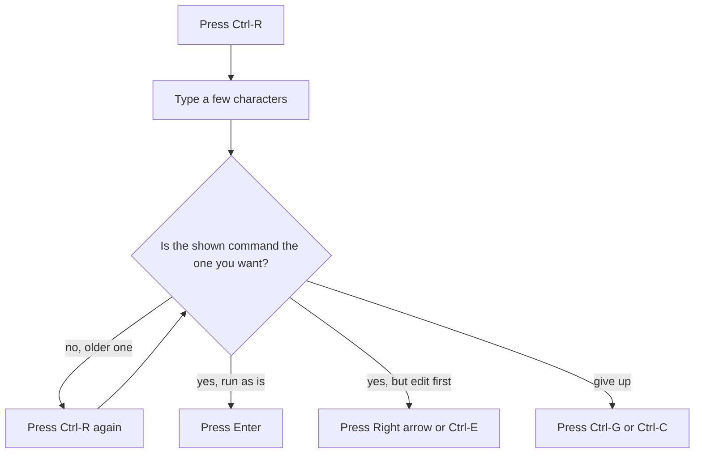

# Keyboard tricks, completion and history

> **Before this lesson:** you should be comfortable typing and running commands ([The shell, the prompt and navigation](#/lesson/linux-cli/shell-and-navigation)) and know what expansion is ([Expansion and quoting](#/lesson/linux-cli/expansion-quoting)).

## In plain words

Typing long commands letter by letter is slow and invites mistakes. The shell has three labour-saving features, and this lesson is about using them.

The first is **line editing**: keys that jump the cursor to the start or end of the line, or delete a whole word, so that fixing a typo does not mean holding down the arrow key. The second is **completion**: you type the first few letters of a command or file name, press the Tab key, and the shell fills in the rest — like a phone suggesting the end of a word, except that it only ever offers names that really exist. The third is **history**: the shell remembers the commands you have run and lets you search them and run them again.

Think of the difference between writing every letter by hand and using a word processor with copy, paste and autocomplete. The work is the same; the effort is not.

Why this matters for a job: people who use these keys work several times faster at a terminal and make fewer errors, because a name completed by the shell cannot be misspelt. History also acts as a record of what you did, which is valuable when you need to repeat or explain it.

## Motivation

Watch someone fluent at a terminal and you will notice they hardly type. A few letters and a `Tab`, and a forty-character path appears. A two-key chord, three letters, and a long `docker` command from last Tuesday is back on the line, ready to run. They fix a typo at the start of a line without touching the arrow keys.

None of this is talent. Bash reads your input through a library called **Readline**, which provides an editor for the single line you are typing, a completion engine, and a searchable record of everything you have typed before. Learning perhaps fifteen key combinations pays back the effort within a week, and — because Readline is used by the Python REPL, `psql`, `gdb` and many other tools — the same keys work far beyond bash.

## Editing the current line

### Moving the cursor

| Key | Moves the cursor |
|---|---|
| `Ctrl-A` | to the start of the line |
| `Ctrl-E` | to the end of the line |
| `Ctrl-F` / `Ctrl-B` | forward / back one character (same as the arrow keys) |
| `Alt-F` / `Alt-B` | forward / back one word |
| `Ctrl-L` | clears the screen and redraws the line at the top (like the `clear` command) |

The mnemonic is consistent: `Ctrl` works on characters, `Alt` on words. On keyboards where `Alt` is captured by the terminal's menus, press and release `Esc` and then the letter instead.

### Changing text

| Key | Effect |
|---|---|
| `Ctrl-D` | delete the character under the cursor (on an empty line: end the session) |
| `Ctrl-T` | swap the character under the cursor with the one before it |
| `Alt-T` | swap the word at the cursor with the one before it |
| `Alt-U` / `Alt-L` | upper-case / lower-case from the cursor to the end of the word |
| `Ctrl-_` or `Ctrl-X Ctrl-U` | undo the last edit |

### Cutting and pasting ("kill" and "yank")

Readline's names predate the modern vocabulary: to *kill* is to cut, to *yank* is to paste. Killed text goes to an internal buffer called the kill ring, separate from your desktop clipboard.

| Key | Effect |
|---|---|
| `Ctrl-K` | kill from the cursor to the end of the line |
| `Ctrl-U` | kill from the cursor back to the start of the line |
| `Ctrl-W` | kill the word before the cursor (up to whitespace) |
| `Alt-D` | kill from the cursor to the end of the current word |
| `Alt-Backspace` | kill back to the start of the current word |
| `Ctrl-Y` | yank the most recently killed text at the cursor |

A realistic use. You have typed a long command and realise you need to check something first:

```bash
mira@forge:~/lab$ rsync -av --exclude='*.ckpt' experiments/ backup:/srv/archive/experiments/
```

Press `Ctrl-U`. The line is cut and the prompt is empty. Run `ssh backup df -h /srv`. When the prompt returns, press `Ctrl-Y`: the `rsync` command is back, intact. A variant many people prefer is `Alt-#`, which turns the current line into a comment and enters it — so it is saved in history without running.

> [!TIP]
> `Ctrl-X Ctrl-E` opens the current command line in your text editor (whatever `$EDITOR` names). Edit a monstrous one-liner comfortably across several lines, save and quit, and bash runs the result. It is the escape hatch for anything too long to edit in place.

## Completion

Press `Tab` and bash tries to finish the word under the cursor. What it completes depends on where the word is and what it starts with:

| Position / prefix | Completes |
|---|---|
| first word of the line | command names (aliases, functions, builtins, programs on `PATH`) |
| any other word | file and directory names |
| word starting with `$` | variable names |
| word starting with `~` | user names |
| word starting with `@` | host names from `/etc/hosts` |

```bash
mira@forge:~/lab$ ls
archive  data  figures  final_report.md  final_results.csv  notes.txt
mira@forge:~/lab$ less no<Tab>
mira@forge:~/lab$ less notes.txt
mira@forge:~/lab$ less fi<Tab>
mira@forge:~/lab$ less fi<Tab><Tab>
figures/  final_report.md  final_results.csv
mira@forge:~/lab$ less final_re<Tab><Tab>
final_report.md  final_results.csv
```

Completion fills in as much as is unambiguous. `no` identifies one file, so the whole name appears. `fi` matches three, which share no further characters, so nothing happens on the first `Tab` (you may hear a beep); a second `Tab` lists the candidates. Type one more distinguishing letter and try again.

Completion is also a **correctness** tool. If `Tab` refuses to complete a path, the path does not exist as you have spelled it — you have found your typo before running anything. And when a name contains spaces or other special characters, completion inserts the necessary backslashes for you.

Most distributions ship the `bash-completion` package, which adds *programmable* completion: knowledge about specific commands. With it, `git ch<Tab>` offers `checkout`, `cherry-pick` and friends, `git checkout fea<Tab>` completes branch names, `ssh web<Tab>` completes hosts from your SSH configuration, `systemctl restart ng<Tab>` completes unit names, and `kill <Tab>` lists process IDs.

Other completion keys are occasionally useful:

| Key | Effect |
|---|---|
| `Alt-?` | list possible completions (same as a second `Tab`) |
| `Alt-*` | **insert all** possible completions on the line |

`Alt-*` is underrated: type `rm *.tmp`, press `Alt-*`, and the pattern is replaced by the actual names, so you see precisely what will be deleted before pressing Enter.

## History

Every command you run is appended to an in-memory list and, when the shell exits, written to `~/.bash_history`. By default bash keeps the last 1,000 entries (many distributions raise this).

```bash
mira@forge:~/lab$ history | tail -n 6
  812  cd ~/lab
  813  ls -ltr data/
  814  python clean.py data/data_01.csv > clean/data_01.csv
  815  git status
  816  docker compose -f deploy/compose.yaml up -d --build
  817  history | tail -n 6
mira@forge:~/lab$ history | grep rsync
  640  rsync -av --delete site/ web01:/var/www/site/
  701  rsync -avn data/ backup:/srv/archive/data/
```

Because `history` writes to standard output, the whole text-processing toolbox applies to it.

### Searching interactively

The single most valuable key in this lesson is `Ctrl-R`, *reverse incremental search*. Press it and start typing; bash shows the most recent command containing those characters and refines the match with each keystroke.

```bash
(reverse-i-search)`comp': docker compose -f deploy/compose.yaml up -d --build
```



| Key | Effect |
|---|---|
| `Ctrl-R` | start a reverse search; press again for the next older match |
| `Ctrl-S` | search forward again (may need `stty -ixon`, since terminals traditionally use this key to pause output) |
| `Ctrl-P` / `Ctrl-N` | previous / next history entry (same as up / down arrows) |
| `Alt-<` / `Alt->` | jump to the oldest entry / back to the line being typed |
| `Ctrl-O` | run the shown entry and then load the *next* one from history — replays a recorded sequence of commands with repeated `Ctrl-O` |
| `Alt-.` | insert the **last argument of the previous command**; press again to step further back |

`Alt-.` earns special mention because of how often consecutive commands act on the same thing:

```bash
mira@forge:~/lab$ mkdir -p experiments/2026-11-20/run-07
mira@forge:~/lab$ cd <Alt-.>
mira@forge:~/lab$ cd experiments/2026-11-20/run-07
```

### History expansion with `!`

Bash can also splice history into the line textually, using expressions that begin with an exclamation mark. They are expanded *before* everything else, and the resulting command is printed before it runs.

| Expression | Expands to |
|---|---|
| `!!` | the entire previous command |
| `!n` | history entry number *n* |
| `!-n` | the command *n* lines back |
| `!string` | the most recent command **starting with** *string* |
| `!?string?` | the most recent command **containing** *string* |
| `!$` | the last argument of the previous command |
| `!^` | the first argument of the previous command |
| `!*` | all the arguments of the previous command |
| `^old^new` | the previous command with the first *old* replaced by *new* |
| `!!:s/old/new/` | the same, in the general modifier syntax; `:gs` replaces all occurrences |

The standout is `sudo !!`, the cure for forgetting privileges:

```bash
mira@forge:~$ apt install ripgrep
E: Could not open lock file /var/lib/dpkg/lock-frontend - open (13: Permission denied)
mira@forge:~$ sudo !!
sudo apt install ripgrep
[sudo] password for mira:
mira@forge:~$ systemctl status ngimx
Unit ngimx.service could not be found.
mira@forge:~$ ^ngimx^nginx
systemctl status nginx
● nginx.service - A high performance web server and a reverse proxy server
mira@forge:~$ ls -l /etc/nginx/sites-available/weather.conf
-rw-r--r-- 1 root root 742 Nov 12 16:20 /etc/nginx/sites-available/weather.conf
mira@forge:~$ sudo vim !$
sudo vim /etc/nginx/sites-available/weather.conf
```

> [!WARNING]
> `!string` and `!n` run whatever they match **immediately**, and the most recent command starting with `rm` may not be the one you remember. Either prefer `Ctrl-R`, which shows the command before you commit, or append `:p` to *print without executing* (`!rm:p`), check it, and then press the up arrow. Alternatively run `shopt -s histverify`: with that option every history expansion is placed on the line for review instead of being executed straight away.

The `!` is special even inside double quotes in an interactive shell, which is why `echo "Done!"` sometimes answers `event not found`. Use single quotes (`echo 'Done!'`) or put the `!` last.

The following model implements a few of these expansions so you can see them as plain text substitution:

```python-run
history = [
    "cd ~/lab",
    "mkdir -p experiments/run-07",
    "git commit -m 'add loader'",
    "systemctl status ngimx",
]

def expand(line):
    prev = history[-1]
    args = prev.split()
    if line.startswith("^"):                      # ^old^new
        _, old, new = line.split("^")[:3]
        return prev.replace(old, new, 1)
    out = line.replace("!!", prev)
    out = out.replace("!$", args[-1]).replace("!^", args[1]).replace("!*", " ".join(args[1:]))
    if out.startswith("!") and out[1:].isdigit():  # !n (1-based)
        return history[int(out[1:]) - 1]
    if out.startswith("!") and len(out) > 1:       # !string -> most recent command starting with it
        for cmd in reversed(history):
            if cmd.startswith(out[1:]):
                return cmd
        return f"bash: {out}: event not found"
    return out

for typed in ["sudo !!", "^ngimx^nginx", "echo !$", "!2", "!git", "!docker", "journalctl -u !$"]:
    print(f"{typed:20} => {expand(typed)}")
```

### Controlling what history keeps

A few variables, usually set in `~/.bashrc`, tune the behaviour:

```bash
export HISTSIZE=50000                 # entries kept in memory
export HISTFILESIZE=100000            # lines kept in ~/.bash_history
export HISTCONTROL=ignoreboth         # skip duplicates and lines starting with a space
export HISTTIMEFORMAT='%F %T  '       # record and show a timestamp for each entry
export HISTIGNORE='ls:ll:pwd:clear'   # never record these exact commands
shopt -s histappend                   # append on exit instead of overwriting the file
```

With `HISTTIMEFORMAT` set, `history` becomes an audit trail — invaluable when reconstructing what you did during an incident:

```bash
mira@forge:~$ history | tail -n 3
  901  2026-11-20 11:02:14  kubectl get pods -n prod
  902  2026-11-20 11:02:31  kubectl logs api-7c9f -n prod --tail=200
  903  2026-11-20 11:04:09  history | tail -n 3
```

> [!WARNING]
> History is a plain text file in your home directory. A password or API token typed on a command line (`mysql -psecret`, `curl -H "Authorization: Bearer ..."`, `export AWS_SECRET_ACCESS_KEY=...`) is stored there in clear text. With `HISTCONTROL=ignorespace` or `ignoreboth`, **start the line with a space** and it is not recorded. If a secret is already in history, remove it with `history -d <number>` followed by `history -w`, and rotate the secret anyway. Better still, keep secrets out of command lines: let programs prompt for them or read them from a protected file.

One more quirk explains a common surprise: each shell writes its history only when it **exits**, so two terminals open at once do not see each other's commands. `history -a` appends the current session's new lines to the file immediately, and `history -n` reads lines other sessions have added.

> [!INTERVIEW]
> You may be asked for "command-line productivity tips" as a soft probe of real experience. Strong, specific answers: `Ctrl-R` for history search, `Alt-.` or `!$` to reuse the last argument, `sudo !!`, `Ctrl-A`/`Ctrl-E`/`Ctrl-W`/`Ctrl-U` for editing, `cd -`, and `Ctrl-X Ctrl-E` to edit a long command in an editor. Mentioning that a leading space keeps a command out of history shows security awareness.

## Recording a whole session

History stores commands, not their output. To capture everything that appears on screen, use `script`:

```bash
mira@forge:~$ script incident-2026-11-20.log
Script started, output log file is 'incident-2026-11-20.log'.
mira@forge:~$ uptime
 11:10:02 up 12 days,  5:36,  2 users,  load average: 6.41, 5.90, 3.12
mira@forge:~$ exit
Script done.
```

Everything between the two messages — commands and output — is in the file. It is a simple way to document a debugging session or a manual procedure for a write-up.

## Pitfalls

- **Running `!something` blind.** Verify with `:p` or use `Ctrl-R`.
- **`Ctrl-S` freezing the terminal.** In the default configuration it pauses output; press `Ctrl-Q` to resume. Nothing has crashed.
- **`Ctrl-D` at an empty prompt** logs you out. If that happens too easily, `set -o ignoreeof` requires `exit`.
- **Secrets in history.** Leading space, or better, never on the command line.
- **Lost history from simultaneous terminals** when `histappend` is off: the last shell to exit overwrites the file.
- **Exclamation marks inside double quotes** triggering history expansion at the prompt.
- **Relying on completion in scripts.** It is an interactive convenience only.

## Cheat sheet

| Goal | Key or command |
|---|---|
| Start / end of line | `Ctrl-A` / `Ctrl-E` |
| Back / forward a word | `Alt-B` / `Alt-F` |
| Delete previous word | `Ctrl-W` |
| Cut to start / end of line | `Ctrl-U` / `Ctrl-K` |
| Paste what was cut | `Ctrl-Y` |
| Undo | `Ctrl-_` |
| Clear screen | `Ctrl-L` |
| Edit line in an editor | `Ctrl-X Ctrl-E` |
| Complete / list completions | `Tab` / `Tab Tab` |
| Insert all completions | `Alt-*` |
| Search history backwards | `Ctrl-R` |
| Last argument of previous command | `Alt-.` or `!$` |
| Repeat previous command | `!!` (for example `sudo !!`) |
| Fix a typo in previous command | `^old^new` |
| Show without running | `!string:p` |
| List / search history | `history`, `history \| grep word` |
| Delete an entry | `history -d N` |
| Record a session | `script file` |

## Summary

- Readline gives you an editor for the command line: `Ctrl` keys act on characters and lines, `Alt` keys on words; kill and yank are cut and paste.
- `Tab` completes commands, paths, variables, users and hosts, and — with programmable completion — arguments of specific tools. A refusal to complete is a hint that something is misspelt.
- `Ctrl-R` searches history interactively; `Alt-.` and `!$` recall the last argument; `!!` and `^old^new` rerun or repair the previous command.
- History is configurable (`HISTSIZE`, `HISTCONTROL`, `HISTTIMEFORMAT`) and is plain text, so keep secrets out of it.
- `script` records a full session including output.

## Glossary

| Term | Meaning |
|---|---|
| Readline | the library that provides line editing in bash and many other programs |
| kill / yank | Readline's words for cut / paste |
| completion | the shell finishing a partly typed name when you press Tab |
| programmable completion | completion that knows the arguments of specific commands |
| history | the list of commands you have run |
| history expansion | shortcuts such as `!!` that insert earlier commands into the current line |
| incremental search | a search (Ctrl-R) that narrows as you type each letter |
| `HISTCONTROL` | a setting that decides which commands are left out of history |

## Check yourself

```quiz
[
  {"q": "You have typed a long command but need to run another one first. Which key cuts the whole line so you can paste it back later with Ctrl-Y?",
   "options": ["Ctrl-C", "Ctrl-U (with the cursor at the end of the line)", "Ctrl-L", "Ctrl-D"],
   "answer": 1,
   "explain": "Ctrl-U kills from the cursor back to the start of the line into the kill ring; Ctrl-Y yanks it back. Ctrl-C would discard the line."},
  {"q": "You press Tab after typing `cat rep` and nothing happens. Pressing Tab again prints `report_a.txt report_b.txt`. Why?",
   "options": ["Completion is broken", "The prefix is ambiguous, so bash completes nothing and lists the candidates on the second Tab", "The files are not readable", "cat does not support completion"],
   "answer": 1,
   "explain": "Bash fills in only what is unambiguous. When several names share the prefix, a second Tab shows the possibilities."},
  {"q": "A command failed with a permission error. What is the quickest way to rerun it with sudo?",
   "options": ["sudo !$", "sudo !!", "sudo ^", "sudo Ctrl-R"],
   "answer": 1,
   "explain": "!! expands to the entire previous command, so sudo !! reruns it with elevated privileges."},
  {"q": "After `tar -xzf data.tar.gz -C /srv/datasets/imagenet`, what does `cd !$` do?",
   "options": ["Changes to the home directory", "Changes to /srv/datasets/imagenet", "Reruns tar", "Prints an error because !$ is undefined"],
   "answer": 1,
   "explain": "!$ is the last argument of the previous command."},
  {"q": "What does `^staging^production` do?",
   "options": ["Searches history for both words", "Reruns the previous command with the first occurrence of staging replaced by production", "Renames a file", "Sets two environment variables"],
   "answer": 1,
   "explain": "The caret form is quick substitution on the previous command: first match of the old text is replaced, then the command runs."},
  {"q": "Why is `Ctrl-R` generally safer than `!rm`?",
   "options": ["Ctrl-R cannot find rm commands", "Ctrl-R shows the matched command and lets you inspect or edit it before running", "!rm only works for root", "There is no difference"],
   "answer": 1,
   "explain": "!string executes the most recent match immediately. The interactive search displays the command first; you choose whether to run, edit or cancel."},
  {"q": "With `HISTCONTROL=ignoreboth`, how do you keep a command containing a token out of your history?",
   "options": ["End it with a semicolon", "Start the line with a space", "Type it in upper case", "Run it twice"],
   "answer": 1,
   "explain": "ignoreboth combines ignoredups and ignorespace; lines beginning with a space are not recorded."},
  {"q": "Two terminals are open. Commands typed in the first do not appear in `history` in the second. What explains this?",
   "options": ["History is disabled", "Each shell keeps its own in-memory list and writes the file only on exit", "The second terminal uses a different user", "HISTSIZE is too small"],
   "answer": 1,
   "explain": "History is per-shell until written. history -a appends now and history -n reads new lines written by other sessions."}
]
```

> **Source:** Shotts, *The Linux Command Line*, ch. 8 (Advanced Keyboard Tricks). All examples and wording are original to this guide.
