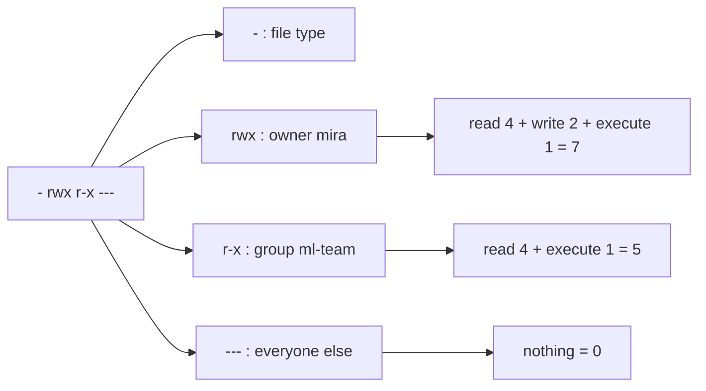

# Permissions, ownership and identity

> **Before this lesson:** you should be able to read the output of `ls -l` ([Exploring the system](#/lesson/linux-cli/exploring-the-system)) and create and copy files ([Manipulating files](#/lesson/linux-cli/manipulating-files)).

## In plain words

A Linux computer is built to be shared by many people and many programs at once. **Permissions** are the rules that say who may do what to each file.

Picture an office building. Every room has a named occupant and belongs to a department. For each room there are three sets of rules: what the occupant may do, what colleagues in the department may do, and what everyone else in the building may do. For a file those three are called the **owner**, the **group** and **others**, and the possible actions are reading it, changing it (writing) and running it as a program (executing).

That is the whole model: three kinds of people, three kinds of action — nine yes/no switches per file. The rest of the lesson is how to read those switches, how to change them, and how to borrow the building manager's master key (the administrator account, called **root**) for a single task.

Why this matters for a job: "Permission denied" is one of the most common error messages you will meet. Understanding the nine switches turns it from a mystery into a two-minute fix, and it is essential for keeping passwords, keys and other people's data safe.

## Motivation

`Permission denied` is probably the error message you will read most often in your career. A deployment fails because the service account cannot read its configuration. A teammate cannot open the dataset you copied to the shared drive. A script that worked yesterday now answers `bash: ./run.sh: Permission denied`. An SSH key is rejected with a complaint that its file is "too open".

Many people respond by typing `chmod 777` or prefixing everything with `sudo` until the error goes away. That works in the same way that removing your front door solves the problem of a lost key. Linux was designed from the start as a system shared by many users at once, and its permission model is small enough to understand completely in one sitting. Once you do, a permission error becomes a two-minute diagnosis: *who* is the process running as, *which* of the three permission classes applies to them, and *which* bit is missing.

## Identity: users and groups

Every process runs as a **user**, identified by a numeric user ID (uid), and belongs to one or more **groups** (gid). The `id` command shows who you are:

```bash
mira@forge:~$ id
uid=1000(mira) gid=1000(mira) groups=1000(mira),27(sudo),998(docker),1005(ml-team)
mira@forge:~$ id www-data
uid=33(www-data) gid=33(www-data) groups=33(www-data)
```

`mira` has uid 1000, a primary group also called `mira`, and membership of three more groups. Group membership is how shared access is normally granted: being in `docker` lets her talk to the Docker daemon, being in `ml-team` lets her into the team's directories. Accounts such as `www-data` are *service accounts* — identities that exist so a program (here a web server) can run with limited rights instead of as an all-powerful user.

The account database lives in plain text files: `/etc/passwd` (user name, uid, home directory, login shell), `/etc/group` (group names and members) and `/etc/shadow` (password hashes, readable only by root).

The user with uid 0, **root**, is special: permission checks are not applied to it.

## Reading the permission string

Every file and directory records an owning user, an owning group, and nine permission bits:

```bash
mira@forge:~/lab$ ls -l train.sh notes.txt
-rw-r--r-- 1 mira ml-team  812 Nov 20 11:30 notes.txt
-rwxr-x--- 1 mira ml-team 1490 Nov 20 11:31 train.sh
```

After the file-type character, the nine characters are three groups of three: what the **owner** may do, what members of the owning **group** may do, and what everybody else (**other**, sometimes called "world") may do.



The kernel decides which triplet applies with a strict first-match rule: if you *are* the owner, the owner bits apply and nothing else is consulted; otherwise, if you are in the owning group, the group bits apply; otherwise the other bits apply. (An oddity follows: an owner with `---` and group `rwx` is denied, even if they belong to the group.)

What the three letters mean depends on whether the entry is a file or a directory, and the directory column is where most confusion lives:

| Bit | On a file | On a directory |
|---|---|---|
| `r` read | view the contents | list the names inside (`ls`) |
| `w` write | change the contents | create, delete and rename entries inside — **regardless of who owns those entries** |
| `x` execute | run it as a program | enter it (`cd`) and access things inside by name |

Two consequences are worth stating outright:

- **Deleting a file is a change to its directory, not to the file.** If you have write permission on a directory you can remove a file in it even when the file itself is read-only and owned by someone else.
- **A directory needs `x` to be useful at all.** `r` without `x` lets you see names but not open anything; `x` without `r` lets you open files whose names you already know but not list them. To reach `/srv/data/train/a.csv` you need `x` on `/`, `/srv`, `/srv/data` and `/srv/data/train`, plus `r` on the file.

A script needs both `r` and `x` (the interpreter must read it); a compiled binary needs only `x`.

## `chmod` — changing the mode

Only the owner of a file (or root) can change its permissions. `chmod` accepts two notations.

### Octal notation

Each triplet is a three-bit binary number, written as one octal digit: read is 4, write is 2, execute is 1, and you add up what you want.

| Octal | Binary | Symbolic |
|---|---|---|
| 0 | 000 | `---` |
| 1 | 001 | `--x` |
| 2 | 010 | `-w-` |
| 3 | 011 | `-wx` |
| 4 | 100 | `r--` |
| 5 | 101 | `r-x` |
| 6 | 110 | `rw-` |
| 7 | 111 | `rwx` |

Three digits set owner, group and other in one go:

```bash
mira@forge:~/lab$ chmod 640 notes.txt
mira@forge:~/lab$ chmod 755 train.sh
mira@forge:~/lab$ ls -l train.sh notes.txt
-rw-r----- 1 mira ml-team  812 Nov 20 11:30 notes.txt
-rwxr-xr-x 1 mira ml-team 1490 Nov 20 11:31 train.sh
```

A handful of values cover nearly every case:

| Mode | String | Typical use |
|---|---|---|
| `644` | `rw-r--r--` | ordinary files: owner edits, everyone reads |
| `600` | `rw-------` | private files: SSH private keys, `.env` files with secrets |
| `640` | `rw-r-----` | owner edits, group reads, others nothing |
| `755` | `rwxr-xr-x` | programs, scripts and normal directories |
| `700` | `rwx------` | private directories such as `~/.ssh` |
| `750` | `rwxr-x---` | directory shared with a group |
| `775` / `664` | `rwxrwxr-x` / `rw-rw-r--` | group-writable collaboration |

### Symbolic notation

Symbolic notation *adjusts* the current mode instead of replacing it. A clause is **who**, an **operator** and **permissions**:

- who: `u` (user/owner), `g` (group), `o` (other), `a` (all); omitted means all
- operator: `+` add, `-` remove, `=` set exactly
- permissions: `r`, `w`, `x`

```bash
mira@forge:~/lab$ chmod u+x deploy.sh            # owner may now execute
mira@forge:~/lab$ chmod go-w shared.cfg          # group and others lose write
mira@forge:~/lab$ chmod o= secrets.env           # others get nothing at all
mira@forge:~/lab$ chmod u=rwx,g=rx,o= bin/tool   # same as 750
mira@forge:~/lab$ chmod +x run.sh                # add execute for everyone (subject to umask)
```

Use octal when you know the complete mode you want; use symbolic when you want to flip one bit without disturbing the rest. For whole trees, `-R` recurses, and the capital `X` is invaluable: it adds execute **only to directories and to files that are already executable**.

```bash
mira@forge:~/lab$ chmod -R u=rwX,g=rX,o= shared/
```

That makes every directory `750` and every plain file `640` in one pass — whereas `chmod -R 750 shared/` would wrongly mark every data file as executable.

Use this calculator to convert between the notations and to apply symbolic expressions; it is the same logic you will implement in the practice problems.

```python-run
def to_string(mode):
    return "".join(ch if mode >> (8 - i) & 1 else "-" for i, ch in enumerate("rwxrwxrwx"))

def chmod(mode, expr):
    shift = {"u": 6, "g": 3, "o": 0}
    value = {"r": 4, "w": 2, "x": 1}
    for clause in expr.split(","):
        i = 0
        while clause[i] in "ugoa":
            i += 1
        who = clause[:i] or "a"
        op, perms = clause[i], clause[i + 1:]
        bits = sum(value[p] for p in perms)
        for cls in ("ugo" if "a" in who else who):
            s = shift[cls]
            if op == "+":
                mode |= bits << s
            elif op == "-":
                mode &= ~(bits << s)
            else:                                   # "=" replaces the whole triplet
                mode = (mode & ~(7 << s)) | (bits << s)
    return mode

mode = 0o644
print(f"start        {mode:03o}  {to_string(mode)}")
for expr in ["u+x", "go-r", "g=rx", "a+r,o-r", "u=rwx,g=rx,o="]:
    mode = chmod(mode, expr)
    print(f"chmod {expr:14} {mode:03o}  {to_string(mode)}")
```

> [!WARNING]
> **Never fix a permission error with `chmod 777` or `chmod -R 777`.** Mode 777 lets any account on the machine — including a compromised web application — modify or replace the file. Applied recursively to a system directory it also breaks things outright: SSH refuses keys and home directories that are group- or world-writable, `sudo` refuses to run if its configuration has the wrong mode, and there is no command that restores the thousands of distinct original modes. Work out which class needs which bit and grant exactly that.

## `umask` — default permissions for new files

When a program creates a file it requests mode 666 (directories: 777). The process's **umask** then *removes* bits from that request. Each bit set in the mask is a bit cleared in the result.

```bash
mira@forge:~/lab$ umask
0022
mira@forge:~/lab$ touch new.txt; mkdir newdir; ls -ld new.txt newdir
drwxr-xr-x 2 mira mira 4096 Nov 20 11:52 newdir
-rw-r--r-- 1 mira mira    0 Nov 20 11:52 new.txt
mira@forge:~/lab$ umask 077
mira@forge:~/lab$ touch private.txt; ls -l private.txt
-rw------- 1 mira mira 0 Nov 20 11:53 private.txt
```

| umask | New files | New directories | Character |
|---|---|---|---|
| `022` | `644` | `755` | the usual default: others may read |
| `002` | `664` | `775` | collaborative: group may write |
| `027` | `640` | `750` | group reads, others excluded |
| `077` | `600` | `700` | fully private |

The operation is a bitwise "AND NOT", not subtraction — with umask `033` a new file is `644`, not `633`. A umask set at the prompt lasts for that shell session; to make it permanent, set it in a startup file.

## Special bits: setuid, setgid and sticky

A fourth, leading octal digit holds three less common bits.

| Bit | Octal | Shown as | Effect |
|---|---|---|---|
| setuid | `4000` | `s` in the owner's execute slot | an executable runs with the **file owner's** identity rather than the caller's |
| setgid | `2000` | `s` in the group's execute slot | on an executable: runs with the file's group. On a **directory**: new files inherit the directory's group |
| sticky | `1000` | `t` in the other execute slot | on a directory: only a file's owner (or the directory's owner, or root) may delete or rename it |

```bash
mira@forge:~$ ls -l /usr/bin/passwd
-rwsr-xr-x 1 root root 68208 Apr  9  2025 /usr/bin/passwd
mira@forge:~$ ls -ld /tmp
drwxrwxrwt 21 root root 4096 Nov 20 11:40 /tmp
mira@forge:~$ sudo chmod 2775 /srv/ml-team && ls -ld /srv/ml-team
drwxrwsr-x 6 root ml-team 4096 Nov 20 11:58 /srv/ml-team
```

`passwd` must update `/etc/shadow`, which only root can write; the setuid bit lets an ordinary user run that one carefully written program as root. `/tmp` is writable by everyone, and the sticky bit is what stops users deleting each other's temporary files. The setgid directory is the standard recipe for a team share: everything created inside automatically belongs to `ml-team`. A capital `S` or `T` means the special bit is set but the underlying execute bit is not — usually a mistake.

> [!WARNING]
> A setuid-root program is a doorway to full control of the machine; a bug in one is a privilege-escalation vulnerability. Never set the setuid bit on scripts or on programs you wrote for convenience. To audit a system, list all of them with `find / -perm -4000 -type f 2>/dev/null`.

## Becoming someone else: `su` and `sudo`

`su` ("substitute user") starts a shell as another user and asks for **that user's** password. `su -` gives a full login environment; `su -c 'command' user` runs one command.

`sudo` runs a single command as another user (root by default) and asks for **your own** password. Who may run what is defined in `/etc/sudoers`, so administrators can grant narrowly scoped rights without sharing the root password, and every use is logged.

```bash
mira@forge:~$ cat /etc/shadow
cat: /etc/shadow: Permission denied
mira@forge:~$ sudo head -n 1 /etc/shadow
[sudo] password for mira:
root:*:19850:0:99999:7:::
mira@forge:~$ sudo -l
User mira may run the following commands on forge:
    (ALL : ALL) ALL
mira@forge:~$ sudo -u postgres psql -c 'select version();'
mira@forge:~$ sudo -i          # an interactive root shell; leave it with exit
```

| | `su` | `sudo` |
|---|---|---|
| Password asked | the target user's | your own |
| Granularity | all or nothing | per user, per command |
| Audit trail | minimal | every command logged |
| Typical use | switch into a service account | run one administrative command |

## `chown` and `chgrp` — changing ownership

Changing a file's owner requires root; `chown` takes `owner`, `owner:group` or `:group`.

```bash
mira@forge:~$ sudo chown www-data /var/www/site/index.html
mira@forge:~$ sudo chown -R mira:ml-team /srv/ml-team/experiments
mira@forge:~$ sudo chown :docker /var/run/docker.sock
mira@forge:~$ chgrp ml-team results.csv        # the owner may switch to a group they belong to
```

A classic situation: you copied files with `sudo cp`, so the copies belong to root and your own programs cannot modify them. The fix is `sudo chown -R "$USER": path`, not opening the permissions.

`passwd` changes your password (`sudo passwd otto` sets someone else's).

## A diagnostic routine

When access is denied, ask four questions in order:

```bash
mira@forge:~$ id                                   # 1. who am I, and in which groups?
mira@forge:~$ ls -l /srv/models/prod/weights.bin   # 2. who owns the file, what is its mode?
-rw-r----- 1 deploy ml-team 4.1G Nov 19 22:10 /srv/models/prod/weights.bin
mira@forge:~$ namei -l /srv/models/prod/weights.bin  # 3. can I traverse every directory on the way?
f: /srv/models/prod/weights.bin
drwxr-xr-x root   root    /
drwxr-xr-x root   root    srv
drwxr-xr-x root   ml-team models
drwx------ deploy deploy  prod
-rw-r----- deploy ml-team weights.bin
```

`namei -l` prints the permissions of every component of a path, and here it exposes the culprit immediately: `prod` is `700`, so nobody but `deploy` can pass through it, however generous the file's own mode is. The fourth question — is the *process* running as who I think it is? — matters for services: `ps -o user= -p <pid>` tells you.

> [!TIP]
> A group you were added to a moment ago does not take effect in shells that are already running. Log out and back in (or run `newgrp groupname`) and confirm with `id` before concluding that the group change "did not work".

> [!INTERVIEW]
> Expect at least one of: "What does `chmod 755` mean?", "What is the difference between `chmod` and `chown`?", "Explain the sticky bit", "What is umask and what does 022 produce?", or the trap "Can you delete a file you have no write permission on?" (yes — if you have write and execute permission on the directory, since deletion modifies the directory). Decoding an octal mode aloud, bit by bit, is the single most commonly requested permissions skill.

## Pitfalls

- **Opening permissions instead of fixing ownership.** Check the owner first.
- **Forgetting directory `x`** along the path.
- **`chmod -R` with a file mode** that strips `x` from directories, making the tree unenterable; use capital `X`.
- **umask as subtraction.**
- **Scripts without the execute bit**: either `chmod +x script` or run it as `bash script`.
- **SSH rejecting keys**: `~/.ssh` must be `700` and private keys `600`.
- **File systems that ignore modes.** On FAT/exFAT USB sticks and some network or Windows-mounted drives, `chmod` appears to do nothing because permissions are fixed at mount time.

## Cheat sheet

| Task | Command |
|---|---|
| Who am I? | `id`, `whoami`, `groups` |
| Show mode, owner, group | `ls -l file`, `stat file` |
| Mode in octal | `stat -c '%a %U:%G %n' file` |
| Set an exact mode | `chmod 640 file` |
| Add / remove a bit | `chmod u+x file`, `chmod go-w file` |
| Sensible recursive modes | `chmod -R u=rwX,g=rX,o= dir` |
| Default mask for new files | `umask`, `umask 027` |
| Team directory with inherited group | `chmod 2775 dir` |
| Change owner and group | `sudo chown -R user:group path` |
| Run one command as root / as a user | `sudo cmd`, `sudo -u user cmd` |
| What may I run with sudo? | `sudo -l` |
| Permissions of each path component | `namei -l /full/path` |
| Find setuid programs | `find / -perm -4000 -type f 2>/dev/null` |

## Summary

- Every process has a user and groups; every file has an owner, a group and nine permission bits read as owner, group, other.
- `r`, `w`, `x` mean read, modify, run for files and list, change entries, traverse for directories.
- `chmod` sets modes in octal (4+2+1 per class) or symbolically (`u+x`, `go-w`); `umask` masks bits out of newly created files.
- setuid, setgid and sticky bits cover running as the file's owner, group inheritance in shared directories, and protected shared directories such as `/tmp`.
- `sudo` grants audited, per-command privilege; `chown` changes ownership.
- Diagnose a denial by identity, ownership, mode and path traversal — never by reaching for 777.

## Glossary

| Term | Meaning |
|---|---|
| user / uid | an account on the system / its number |
| group / gid | a named set of users / its number |
| owner | the user a file belongs to |
| others | everyone who is neither the owner nor in the file's group |
| read / write / execute | permission to view, to change, to run (or, for a directory, to list, to alter entries, to enter) |
| mode | the full set of a file's permission bits |
| octal notation | writing a mode as digits, each the sum of 4 (read), 2 (write) and 1 (execute) |
| umask | the permission bits removed from newly created files |
| root (superuser) | the administrator account, to which permission checks do not apply |
| `sudo` | a command that runs one command with another user's rights, usually root's |
| setuid / setgid / sticky bit | three special permission bits explained in this lesson |

## Check yourself

```quiz
[
  {"q": "What permissions does `chmod 640 report.txt` give?",
   "options": ["Owner read/write, group read, others none", "Owner read/write/execute, group read, others none", "Owner read, group write, others execute", "Everyone read/write"],
   "answer": 0,
   "explain": "6 = 4+2 (rw-), 4 = r--, 0 = ---."},
  {"q": "A file is `-r--r--r--` and owned by another user. The directory containing it is `drwxrwxrwx` without the sticky bit. Can you delete the file?",
   "options": ["No, the file is read-only", "No, you are not the owner", "Yes, because deleting only requires write and execute permission on the directory", "Only with chmod first"],
   "answer": 2,
   "explain": "Removing a name is a modification of the directory. The file's own permissions are irrelevant unless the directory has the sticky bit."},
  {"q": "With umask 027, what mode does a newly created regular file get?",
   "options": ["750", "640", "027", "666"],
   "answer": 1,
   "explain": "Files start from 666; removing the bits in 027 (group write, all of other) leaves 640."},
  {"q": "What does the `t` in `drwxrwxrwt` on /tmp mean?",
   "options": ["Files are deleted at reboot", "The directory is temporary", "Sticky bit: users can only delete or rename their own entries", "Only root can write there"],
   "answer": 2,
   "explain": "The sticky bit restricts deletion and renaming in a world-writable directory to each entry's owner."},
  {"q": "You are a member of group `ml-team`. The file is `-rw-r----- deploy ml-team` inside a directory `drwx------ deploy deploy`. Why can you not read it?",
   "options": ["The file lacks group read", "You cannot traverse the directory, which grants nothing to group or others", "Files in private directories are encrypted", "You need to be the owner to read any file"],
   "answer": 1,
   "explain": "Reaching a file requires execute permission on every directory in its path. The file's group-read bit never comes into play."},
  {"q": "Which command adds execute permission for the owner only, leaving all other bits unchanged?",
   "options": ["chmod 100 script.sh", "chmod u+x script.sh", "chmod a=x script.sh", "chown +x script.sh"],
   "answer": 1,
   "explain": "Symbolic u+x switches on one bit. chmod 100 would replace the whole mode with --x------."},
  {"q": "What is the key difference between `su` and `sudo`?",
   "options": ["su is for files, sudo for directories", "su asks for the target user's password and gives a full shell; sudo asks for your own password and runs specific permitted commands", "sudo works only for root", "They are aliases for the same program"],
   "answer": 1,
   "explain": "sudo provides fine-grained, logged delegation without sharing another account's password."},
  {"q": "Why is `chmod -R u=rwX,g=rX,o= project/` preferable to `chmod -R 750 project/`?",
   "options": ["It is faster", "Capital X adds execute only to directories and already-executable files, so data files do not become executable", "750 is not a valid mode for directories", "The symbolic form also changes ownership"],
   "answer": 1,
   "explain": "A recursive numeric mode marks every regular file executable. X grants traversal on directories while leaving plain files non-executable."}
]
```

> **Source:** Shotts, *The Linux Command Line*, ch. 9 (Permissions). All examples and wording are original to this guide.
