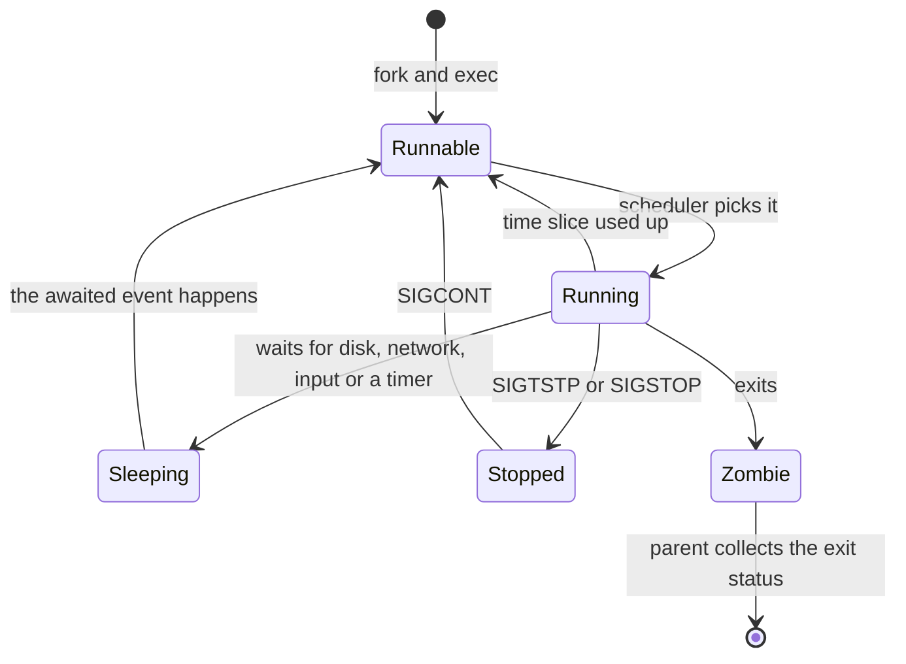

# Processes, jobs and signals

> **Before this lesson:** you should know pipes and redirection ([Redirection and pipelines](#/lesson/linux-cli/redirection-pipelines)) and users and permissions ([Permissions](#/lesson/linux-cli/permissions)).

## In plain words

A program stored on disk is like a recipe in a book: it does nothing until someone cooks it. A **process** is a recipe being cooked — a program that is currently running. The same program can be running several times at once, as several processes, the way one recipe can be on four stoves.

Your computer runs hundreds of processes at any moment. This lesson shows how to see them (who is in the kitchen?), how to tell which are using the most processor time or memory, how to let a long task carry on in the **background** while you do something else, and how to tell a process to stop.

Telling a process something is done with a **signal**: a short message such as "please finish up and leave" or "stop immediately". Pressing Ctrl-C sends one.

Why this matters for a job: finding out why a machine is slow, stopping a program that has hung, keeping a long calculation alive after you disconnect, and discovering which program occupies a network port are routine tasks — and standard interview questions.

## Motivation

A machine feels sluggish and you need to know what is hogging it. A training run was started in a terminal that you now want to close without killing the run. A program has frozen and ignores the keyboard. A port is "already in use" by something you cannot see. Each of these is a question about **processes** — running instances of programs — and Linux gives you a small, precise vocabulary for inspecting and controlling them.

This lesson covers how processes come into being, how to list them (`ps`, `top`), how to run things in the background and bring them back (`&`, `jobs`, `fg`, `bg`), and how to communicate with them using signals (`kill`). It is the foundation for the on-call material later in the track.

## How processes are organised

When the kernel finishes booting it starts a single program — on almost every modern distribution, `systemd` — which receives **process ID (PID) 1**. Every other process is started by some existing process, its **parent**, so all processes form a tree rooted at PID 1.

```bash
mira@forge:~$ pstree -p | head -n 12
systemd(1)─┬─cron(702)
           ├─dockerd(911)───containerd(934)
           ├─nginx(1203)─┬─nginx(1204)
           │             └─nginx(1205)
           ├─sshd(801)───sshd(4410)───sshd(4433)───bash(4434)─┬─pstree(5120)
           │                                                  └─python(4977)
           └─systemd-journal(388)
```

You can read your own situation in that picture: the SSH daemon accepted a connection, started a shell (`bash`, PID 4434) for it, and that shell is the parent of both `pstree` and a Python job.

Creating a process is a two-step dance. The parent **forks**, making a near-identical copy of itself; the child then **execs**, replacing its own program with the new one. The child inherits the parent's environment variables, working directory and open files — which is exactly how redirection and pipes get set up before a command starts. When the child finishes it leaves an **exit status** (0 for success, 1–255 for failure) that the parent collects.

Each process carries a PID, a parent PID (PPID), an owner, a state, a priority, and accounting such as memory use and consumed CPU time.

### Process states



| Code in `ps`/`top` | State | Meaning |
|---|---|---|
| `R` | running / runnable | on a CPU or ready for one |
| `S` | sleeping | waiting for an event; this is what most processes are doing most of the time |
| `D` | uninterruptible sleep | waiting on I/O, typically disk; cannot be signalled until it returns |
| `T` | stopped | paused by a signal such as the one `Ctrl-Z` sends |
| `Z` | zombie | finished, but its parent has not yet read its exit status |
| `I` | idle | an idle kernel thread |

A zombie uses no CPU or memory — only a slot in the process table. A few are harmless; thousands indicate a parent that never collects its children. You cannot kill a zombie (it is already dead); you fix or restart the parent.

## Listing processes with `ps`

Plain `ps` shows only the processes attached to your terminal:

```bash
mira@forge:~$ ps
    PID TTY          TIME CMD
   4434 pts/0    00:00:00 bash
   4977 pts/0    00:07:12 python
   5133 pts/0    00:00:00 ps
```

The form you will type most is `ps aux` — every process, with owner and resource figures:

```bash
mira@forge:~$ ps aux | head -n 6
USER         PID %CPU %MEM    VSZ   RSS TTY      STAT START   TIME COMMAND
root           1  0.0  0.0 168456 12980 ?        Ss   Nov08   0:14 /sbin/init
root         388  0.0  0.2 105220 71204 ?        Ss   Nov08   0:31 /usr/lib/systemd/systemd-journald
www-data    1204  0.3  0.1  57200 21100 ?        S    Nov08   9:02 nginx: worker process
mira        4434  0.0  0.0  11264  5320 pts/0    Ss   10:02   0:00 -bash
mira        4977 98.7  9.4 9812340 3071888 pts/0 Rl   11:20   7:12 python train.py --epochs 40
```

| Column | Meaning |
|---|---|
| `USER` | owner of the process |
| `PID` | process ID |
| `%CPU` | CPU time used divided by the time the process has existed (an average over its life, not "right now") |
| `%MEM` | share of physical memory in use |
| `VSZ` | virtual memory size in KiB — address space reserved, often far larger than what is used |
| `RSS` | resident set size in KiB — physical memory actually occupied |
| `TTY` | controlling terminal; `?` means none (a daemon) |
| `STAT` | state code plus flags: `s` session leader, `l` multi-threaded, `<` high priority, `N` low priority, `+` foreground |
| `START`, `TIME` | when it started; total CPU time consumed |
| `COMMAND` | the command line |

`ps` is highly configurable, and three variations are worth knowing:

```bash
mira@forge:~$ ps -ef --forest | tail -n 4                       # full listing as a tree
mira@forge:~$ ps aux --sort=-%mem | head -n 4                    # biggest memory users first
mira@forge:~$ ps -eo pid,ppid,user,pcpu,pmem,etime,cmd --sort=-pcpu | head -n 4
    PID    PPID USER     %CPU %MEM     ELAPSED CMD
   4977    4434 mira     98.7  9.4       07:19 python train.py --epochs 40
   1204    1203 www-data  0.3  0.1 11-23:01:44 nginx: worker process
    911       1 root      0.2  0.6 11-23:02:10 /usr/bin/dockerd -H fd://
```

`-o` chooses exactly the columns you want, which is the robust form for scripts. To find processes by name, `pgrep` is tidier than `ps | grep`:

```bash
mira@forge:~$ pgrep -a python
4977 python train.py --epochs 40
mira@forge:~$ pgrep -u www-data -c
2
```

## Watching live with `top`

`ps` is a snapshot. `top` refreshes every few seconds:

```bash
mira@forge:~$ top
top - 11:27:42 up 12 days,  5:54,  2 users,  load average: 1.08, 0.74, 0.39
Tasks: 213 total,   2 running, 211 sleeping,   0 stopped,   0 zombie
%Cpu(s): 12.4 us,  0.6 sy,  0.0 ni, 86.8 id,  0.1 wa,  0.0 hi,  0.1 si,  0.0 st
MiB Mem :  31909.4 total,  18301.2 free,   6490.5 used,   7117.7 buff/cache
MiB Swap:   2048.0 total,   2048.0 free,      0.0 used.  24893.0 avail Mem

    PID USER      PR  NI    VIRT    RES    SHR S  %CPU  %MEM     TIME+ COMMAND
   4977 mira      20   0 9812340   2.9g 412m  R  99.3   9.4   7:31.02 python
   1204 www-data  20   0   57200  21100  8040 S   0.3   0.1   9:02.41 nginx
```

The header is a compact health report:

- **load average** — the average number of processes running or waiting to run over the last 1, 5 and 15 minutes. Compare it with the number of CPU cores (`nproc`): a load of 8 is relaxed on 32 cores and saturated on 4.
- **Tasks** — counts by state; watch the zombie figure.
- **%Cpu(s)** — `us` user code, `sy` kernel, `ni` low-priority user code, `id` idle, `wa` waiting for I/O, `st` time stolen by a hypervisor. High `wa` points at slow storage rather than busy CPUs.
- **Mem** — `buff/cache` is memory the kernel is using as disk cache and will hand back on demand, so the figure that matters is **avail Mem**, not `free`.

Inside `top`: `P` sorts by CPU, `M` by memory, `1` shows each core, `c` shows full command lines, `k` sends a signal, `q` quits. In `top`, unlike `ps`, 100% means one full core, so a multi-threaded process can show 800%. Many people install `htop` for a friendlier colour version of the same thing.

## Foreground, background and job control

Start a long-running program and the shell waits for it; the prompt does not return. That program is in the **foreground**. Appending `&` starts it in the **background** instead:

```bash
mira@forge:~/lab$ python train.py --epochs 40 > train.log 2>&1 &
[1] 4977
mira@forge:~/lab$ jobs
[1]+  Running                 python train.py --epochs 40 > train.log 2>&1 &
```

The shell printed a **job number** in brackets and the PID. Job numbers belong to this shell only; refer to them with a percent sign.

| Action | How |
|---|---|
| start in the background | `command &` |
| list this shell's jobs | `jobs` (add `-l` for PIDs) |
| bring a job to the foreground | `fg %1` |
| suspend the foreground job | `Ctrl-Z` |
| resume a suspended job in the background | `bg %1` |
| interrupt the foreground job | `Ctrl-C` |

The combination that rescues you most often: you started something without `&` and want your prompt back *without* stopping the work.

```bash
mira@forge:~/lab$ tar -czf archive.tar.gz data/
^Z
[2]+  Stopped                 tar -czf archive.tar.gz data/
mira@forge:~/lab$ bg %2
[2]+ tar -czf archive.tar.gz data/ &
mira@forge:~/lab$ jobs
[1]-  Running                 python train.py --epochs 40 > train.log 2>&1 &
[2]+  Running                 tar -czf archive.tar.gz data/ &
```

`Ctrl-Z` paused the job; `bg` let it continue in the background. Background jobs should have their output redirected, otherwise their messages spill over whatever you type next.

### Surviving logout

Background jobs still belong to your terminal session. When the session ends — you close the window or the SSH connection drops — the kernel sends them a hang-up signal and they die. Three remedies, in increasing order of comfort:

```bash
mira@forge:~/lab$ nohup python train.py --epochs 40 > train.log 2>&1 &   # immune to hang-up from the start
mira@forge:~/lab$ disown %1                                               # detach a job that is already running
mira@forge:~/lab$ tmux new -s train                                       # a persistent terminal you can re-attach to
```

`tmux` is the professional answer for anything long-running over SSH, and has its own lesson later.

## Signals

A **signal** is a small asynchronous message the kernel delivers to a process. Keyboard shortcuts are one way of sending them: `Ctrl-C` sends an *interrupt*, `Ctrl-Z` a *terminal stop*. The `kill` command — despite its name — sends any signal to any process you own.

```bash
mira@forge:~$ kill 4977              # default signal: TERM
mira@forge:~$ kill -INT 4977         # by name
mira@forge:~$ kill -9 4977           # by number
mira@forge:~$ kill -STOP %1          # works on job specs too
mira@forge:~$ kill -l | head -n 2    # list all signals
 1) SIGHUP	 2) SIGINT	 3) SIGQUIT	 4) SIGILL	 5) SIGTRAP
 6) SIGABRT	 7) SIGBUS	 8) SIGFPE	 9) SIGKILL	10) SIGUSR1
```

| Number | Name | Default effect | Typical use |
|---|---|---|---|
| 1 | `HUP` | terminate | "terminal hung up"; by convention many daemons **reload their configuration** on it |
| 2 | `INT` | terminate | what `Ctrl-C` sends: a polite interrupt |
| 3 | `QUIT` | terminate and dump core | `Ctrl-\` — a harder interrupt |
| 9 | `KILL` | terminate immediately | cannot be caught, blocked or ignored |
| 15 | `TERM` | terminate | the default of `kill`: "please shut down cleanly" |
| 18 | `CONT` | resume | continue after a stop (what `bg` and `fg` send) |
| 19 | `STOP` | pause | cannot be caught or ignored |
| 20 | `TSTP` | pause | what `Ctrl-Z` sends; a program may handle it |
| 10, 12 | `USR1`, `USR2` | terminate | application-defined (rotate logs, dump stats…) |

The essential distinction is between signals a program can **handle** and the two it cannot. On `TERM` or `INT` a well-written program runs its handler: flush buffers, write a final checkpoint, close database connections, delete temporary files, then exit. `KILL` never reaches the program at all — the kernel removes it.

> [!WARNING]
> **`kill -9` is a last resort, not a habit.** A process killed with `KILL` gets no chance to clean up: a database may be left needing recovery, a half-written file stays corrupt, lock files and temporary files remain, and child processes can be orphaned. The correct escalation is `kill PID` (TERM), wait several seconds, check with `ps -p PID`, and only then `kill -9 PID`. Be especially careful with `kill -9 -1` or `killall` typed as root: the first targets *every* process you are allowed to signal.

Because a process in state `D` is stuck inside the kernel, even `KILL` takes effect only once the I/O call returns — which is why a process hung on a dead network file system can seem unkillable.

The model below shows why the order of escalation matters. It simulates a worker that handles `TERM` by saving its state, and compares it with a hard kill.

```python-run
class Worker:
    def __init__(self, pid):
        self.pid, self.state, self.buffer, self.saved = pid, "R", [], []
        self.handlers = {"TERM": self.graceful, "INT": self.graceful, "HUP": self.reload}

    def work(self, item):
        self.buffer.append(item)               # in-memory results, not yet on disk

    def graceful(self):
        self.saved += self.buffer; self.buffer = []
        self.state = "exited cleanly"

    def reload(self):
        print(f"  [{self.pid}] configuration re-read, still running")

def kill(proc, sig="TERM"):
    if sig == "KILL":                          # delivered by the kernel, never seen by the program
        proc.state = "killed"
    elif sig == "STOP":
        proc.state = "T"
    elif sig == "CONT":
        proc.state = "R"
    elif sig in proc.handlers:
        proc.handlers[sig]()
    print(f"kill -{sig:4} {proc.pid}: state={proc.state!r}, on disk={proc.saved}, lost={proc.buffer if proc.state == 'killed' else []}")

a, b = Worker(4977), Worker(4978)
for w in (a, b):
    for item in ("batch-1", "batch-2", "batch-3"):
        w.work(item)

kill(a, "HUP")
kill(a, "STOP"); kill(a, "CONT")
kill(a, "TERM")     # handler runs: results are saved
kill(b, "KILL")     # no handler: buffered results are gone
```

### Killing by name

```bash
mira@forge:~$ pkill -f "train.py --epochs 40"     # match against the full command line
mira@forge:~$ killall -u otto firefox              # every firefox owned by otto
mira@forge:~$ pgrep -fa "train.py"                 # ALWAYS preview what a pattern matches first
```

You can signal only your own processes; signalling anyone else's requires `sudo`.

> [!TIP]
> Before `pkill pattern`, run `pgrep -a pattern` with the same pattern. It lists exactly the processes that would be signalled — the process-control equivalent of running `ls` before `rm`.

## Priorities, and other inspection tools

`nice` starts a program at lower scheduling priority so that it yields to interactive work; `renice` adjusts one that is running. Values run from −20 (most favoured, root only) to 19 (most generous to others).

```bash
mira@forge:~$ nice -n 10 python preprocess.py &
mira@forge:~$ renice -n 15 -p 5210
```

A few more tools round out the kit: `uptime` (load averages), `free -h` (memory), `vmstat 1` (a line of CPU, memory and I/O statistics per second), `lsof -p PID` (files a process has open), `ss -ltnp` (which process is listening on which port), and the directory `/proc/PID/`, where the kernel exposes everything it knows about a process as readable files.

```bash
mira@forge:~$ sudo ss -ltnp | grep :8000
LISTEN 0  128  0.0.0.0:8000  0.0.0.0:*  users:(("uvicorn",pid=6021,fd=6))
mira@forge:~$ cat /proc/6021/status | grep -E 'State|VmRSS|Threads'
State:	S (sleeping)
VmRSS:	  184320 kB
Threads:	9
```

To halt or restart the whole machine: `sudo shutdown -h now`, `sudo shutdown -r +5 "Kernel update"`, or `sudo reboot` / `sudo poweroff`.

> [!INTERVIEW]
> Frequently asked: "Difference between `kill` and `kill -9`?" (TERM can be handled for a clean shutdown; KILL cannot be caught and risks leaving state inconsistent.) "What is a zombie process and how do you get rid of it?" (An exited child whose status the parent has not collected; fix or restart the parent — killing the zombie itself is impossible.) "A process is using port 8080 — how do you find it?" (`ss -ltnp | grep 8080` or `lsof -i :8080`.) "What does load average mean?" (Average run-queue length over 1, 5 and 15 minutes; interpret it relative to the core count.)

## Load monitors: `tload`, `xload` and their successors

Earlier you met the **load average**, the three numbers that say how busy the machine has been over the last one, five and fifteen minutes. Reading three numbers once is less informative than watching them move, so Unix grew small tools that draw them.

- **`tload`** draws a text graph of the load average in the terminal window and redraws it every few seconds (change the interval with `-d`, the vertical scale with `-s`). Run it in a spare terminal and you can see a spike appear when a build starts.
- **`xload`** does the same in a small window on a graphical X11 desktop. It belongs to the old X11 utilities (often installed separately as `x11-apps`) and does not work on a machine without a graphical session.

Both are historical. They only show one number, keep no history after you close them and cannot send an alert. In practice you will use something more capable:

| Need | Modern tool |
|---|---|
| A quick look | `uptime`, or `cat /proc/loadavg` |
| Interactive view with CPU, memory and load | `top`, `htop`, `btop` |
| Redraw a command every two seconds | `watch uptime` |
| Per-second system statistics | `vmstat 1` |
| History after the fact | `sar` from the `sysstat` package |
| Dashboards and alerts across many servers | a metrics agent (for example `node_exporter`) feeding Prometheus and Grafana |

The reading skill is unchanged: compare the load with the number of CPU cores (`nproc`). A rising load with idle CPUs often means processes are waiting for disk or network rather than computing, which is where `vmstat` and `top`'s wait column help.

## Pitfalls

- **Reaching for `-9` first.**
- **Closing the terminal on a background job** started without `nohup`, `disown` or `tmux`.
- **Reading `%CPU` in `ps` as current usage.** It is a lifetime average; use `top` for now.
- **Panicking about low "free" memory.** Look at "available".
- **Confusing job numbers and PIDs.** `kill 1` targets PID 1 (init); `kill %1` targets job 1.
- **`ps aux | grep name` matching the `grep` itself.** Use `pgrep`, or the trick `grep '[n]ame'`.
- **Loose patterns with `pkill -f`**, which can match your own editor session or shell.

## Cheat sheet

| Task | Command |
|---|---|
| All processes, with resource use | `ps aux` |
| Custom columns, sorted | `ps -eo pid,ppid,user,pcpu,pmem,cmd --sort=-pcpu` |
| Process tree | `pstree -p`, `ps -ef --forest` |
| Find by name | `pgrep -a name` |
| Live view | `top`, `htop` |
| Run in background | `cmd &` |
| Suspend / resume in background / foreground | `Ctrl-Z`, `bg %n`, `fg %n` |
| List jobs | `jobs -l` |
| Keep running after logout | `nohup cmd &`, `disown`, `tmux` |
| Ask a process to exit | `kill PID` |
| Force it | `kill -9 PID` |
| Reload a daemon's configuration | `kill -HUP PID` |
| Pause / continue | `kill -STOP PID`, `kill -CONT PID` |
| Kill by name | `pkill -f pattern`, `killall name` |
| Lower priority | `nice -n 10 cmd`, `renice -n 10 -p PID` |
| Who listens on a port? | `ss -ltnp` |

## Summary

- Processes form a tree under PID 1; each has a PID, parent, owner, state and resource usage.
- `ps` takes snapshots (`aux`, `-eo`, `--sort`), `top` shows a live view with load, CPU breakdown and memory.
- `&`, `Ctrl-Z`, `bg`, `fg` and `jobs` move work between foreground and background; `nohup`, `disown` or `tmux` keep it alive after logout.
- Signals are how processes are told to stop, pause, continue or reload. `TERM` and `INT` can be handled for a clean exit; `KILL` and `STOP` cannot be intercepted.
- Escalate gently: TERM, wait, then KILL.

## Glossary

| Term | Meaning |
|---|---|
| process | a running instance of a program |
| PID | process ID: the number that identifies a process |
| parent / child | the process that started another / the one that was started |
| daemon | a process that runs in the background without a terminal, such as a server |
| foreground / background | holding the terminal until finished / running while the prompt stays free |
| job | a command started from the current shell, numbered `%1`, `%2`, … |
| signal | a short message sent to a process, such as TERM or KILL |
| zombie | a finished process whose result its parent has not yet collected |
| load average | the average number of processes running or waiting to run |
| RSS | resident set size: the physical memory a process occupies |
| exit status | the number a process returns when it ends; 0 means success |
| `tload` | A terminal program that draws the load average as a text graph |
| `xload` | An X11 window program that graphs the load average on a graphical desktop |
| `sar` | A tool from the sysstat package that records and reports system statistics over time |

## Check yourself

```quiz
[
  {"q": "You started `python train.py` without `&` and want the prompt back while it keeps running. What do you do?",
   "options": ["Ctrl-C, then run it again", "Ctrl-Z, then bg", "Ctrl-D", "Type fg"],
   "answer": 1,
   "explain": "Ctrl-Z suspends the foreground job and bg resumes it in the background. Ctrl-C would terminate it."},
  {"q": "Why should `kill PID` normally be tried before `kill -9 PID`?",
   "options": ["Signal 9 is slower", "TERM can be caught, letting the program clean up; KILL cannot be handled at all", "kill -9 needs root", "kill without options sends no signal"],
   "answer": 1,
   "explain": "The default TERM signal allows a handler to flush data and release resources. KILL removes the process with no opportunity for cleanup."},
  {"q": "What is a zombie process?",
   "options": ["A process using 100% CPU", "A process that has exited but whose parent has not yet collected its exit status", "A process running without a terminal", "A process stopped with Ctrl-Z"],
   "answer": 1,
   "explain": "A zombie is only a leftover entry in the process table. It disappears when the parent reads its status or the parent itself ends."},
  {"q": "`top` shows a load average of 6.0 on a machine where `nproc` prints 16. How should you read that?",
   "options": ["The machine is badly overloaded", "On average 6 tasks want CPU and there are 16 cores, so there is spare capacity", "Six users are logged in", "Six processes are zombies"],
   "answer": 1,
   "explain": "Load is the average number of runnable (or uninterruptibly waiting) tasks; it must be judged against the number of cores."},
  {"q": "Which signal does Ctrl-C send to the foreground process?",
   "options": ["SIGKILL (9)", "SIGTERM (15)", "SIGINT (2)", "SIGHUP (1)"],
   "answer": 2,
   "explain": "Ctrl-C sends the interrupt signal, which programs may catch. Ctrl-Z sends TSTP."},
  {"q": "You launch a long job with `&` over SSH and then your connection drops. Why does the job usually die?",
   "options": ["Background jobs are limited to one hour", "The session's processes receive SIGHUP when the terminal goes away", "The network cable was unplugged", "The job ran out of memory"],
   "answer": 1,
   "explain": "A hang-up signal is delivered when the controlling terminal closes. nohup, disown or a tmux session prevent the job from being terminated."},
  {"q": "In `top`, memory shows 31 GiB total, 0.4 GiB free, 22 GiB buff/cache and 27 GiB available. Is the machine short of memory?",
   "options": ["Yes, only 0.4 GiB is free", "No; cache is reclaimable and 27 GiB is available to programs", "Yes, because cache counts as used", "It cannot be determined"],
   "answer": 1,
   "explain": "Linux uses spare RAM as disk cache and releases it on demand. The available figure is the meaningful one."},
  {"q": "What is the difference between `kill 1` and `kill %1`?",
   "options": ["None", "kill 1 signals the process with PID 1; kill %1 signals job number 1 of the current shell", "%1 means 1 percent of processes", "kill %1 sends signal 1"],
   "answer": 1,
   "explain": "A percent sign introduces a job specification, which is local to the shell. A bare number is a process ID."},
  {"q": "Which tool shows the load average as a graph inside a text terminal?", "options": ["xload", "tload", "top", "uptime"], "answer": 1, "explain": "tload draws a text graph. xload needs a graphical X11 session; uptime prints the numbers once."},
  {"q": "A server has 4 cores and a load average of 12 while the CPUs are mostly idle. What is a likely cause?", "options": ["Too many CPUs", "Processes are waiting on disk or network input and output", "The load average is broken", "tload is running"], "answer": 1, "explain": "Load counts processes that are running or waiting. A high load with idle CPUs often means waiting for I/O."}
]
```

> **Source:** Shotts, *The Linux Command Line*, ch. 10 (Processes). All examples and wording are original to this guide.
