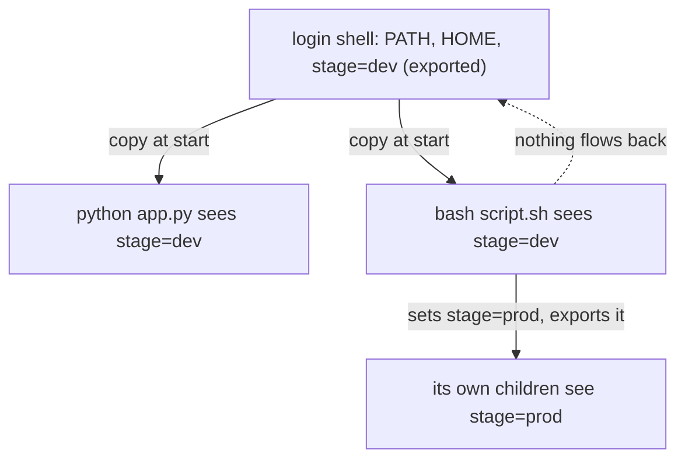
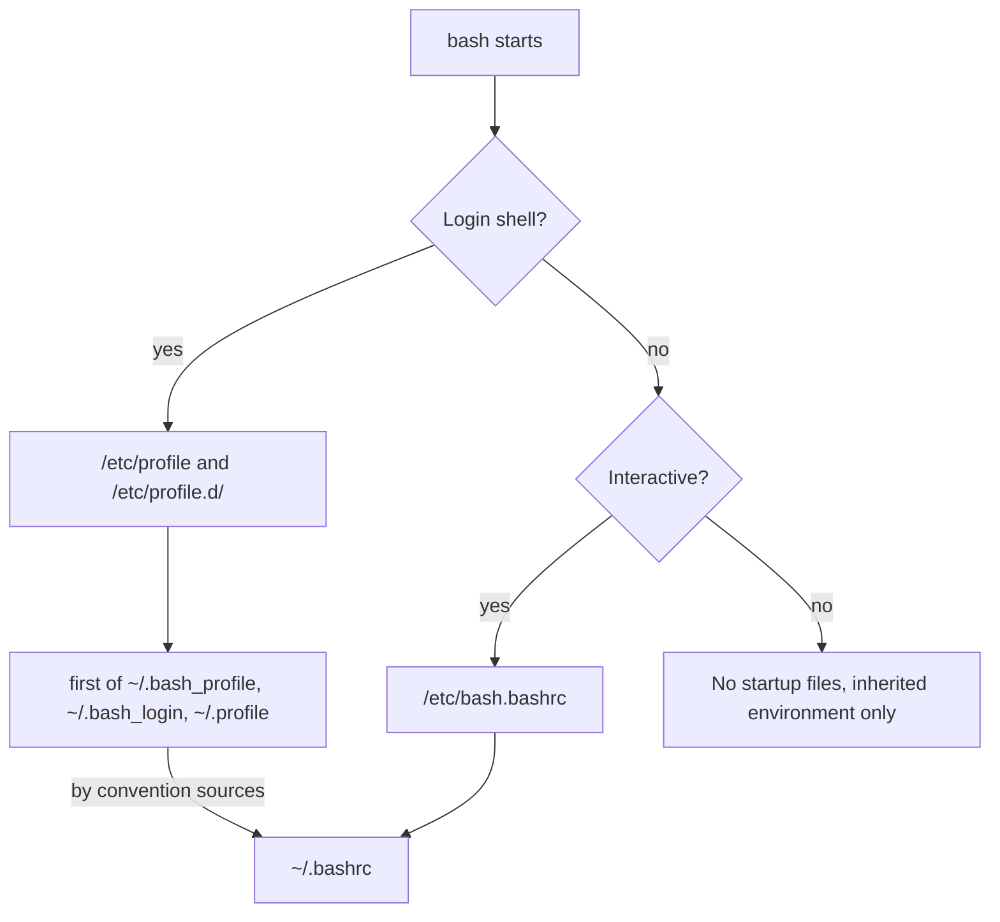

# The environment and startup files

> **Before this lesson:** you should know how commands are found through `PATH` ([Working with commands](#/lesson/linux-cli/commands-and-help)), what variables and quoting are ([Expansion and quoting](#/lesson/linux-cli/expansion-quoting)) and what a process is ([Processes](#/lesson/linux-cli/processes)).

## In plain words

Every program starts life with a small bundle of settings handed to it: who the user is, where the home directory is, which language to use, where to look for other programs. This bundle is called the **environment**, and each setting in it is an **environment variable** — a name with a value, such as `HOME=/home/mira`.

Think of the environment as the briefing sheet a temporary worker is given on arrival: your desk is here, the printer is there, your manager is this person. The worker does not ask again; they work from the sheet. And when that worker brings in a helper, the helper gets a *copy* of the sheet.

Where does the shell's own briefing sheet come from? From **startup files**: ordinary text files of commands that the shell reads when it starts. Editing them is how you make a setting permanent — a shortcut you like, an extra directory of programs, a preferred text editor.

Why this matters for a job: "it works in my terminal but not on the server" is very often a difference in environment. Software is commonly configured through environment variables, so knowing how they are set, inherited and inspected is essential for running programs reliably.

## Motivation

"It works in my terminal but not in cron." "I installed the tool but the shell says command not found." "The script runs fine by hand and fails under systemd." "My alias exists in one window and not in the other."

These are four versions of the same misunderstanding. Every process runs with a set of named values called its **environment**, and your interactive shell builds its environment by reading a specific sequence of **startup files**. Different ways of starting a shell read different files, so the same command can find itself in quite different surroundings. When you know what the environment contains, how it is inherited, and which file is read when, these mysteries become routine — and you gain the ability to customise your shell so that it works the way you want on every login.

## What is in the environment?

The shell keeps two kinds of data:

- **Shell variables** exist only inside the shell that defined them.
- **Environment variables** are shell variables marked for *export*: a copy is handed to every program the shell starts.

(The shell also holds aliases and functions, which are never passed to other programs.)

`printenv` shows the environment; `set` shows everything — shell variables, environment variables and functions — and is long enough to need a pager.

```bash
mira@forge:~$ printenv | sort | head -n 8
EDITOR=vim
HOME=/home/mira
LANG=en_US.UTF-8
LOGNAME=mira
OLDPWD=/home/mira/lab
PATH=/home/mira/.local/bin:/usr/local/sbin:/usr/local/bin:/usr/sbin:/usr/bin:/sbin:/bin
PWD=/home/mira
SHELL=/bin/bash
mira@forge:~$ printenv HOME
/home/mira
mira@forge:~$ echo "$TERM / $LANG"
xterm-256color / en_US.UTF-8
```

Variables you will meet constantly:

| Variable | Holds |
|---|---|
| `PATH` | colon-separated directories searched for commands |
| `HOME` | your home directory |
| `USER`, `LOGNAME` | your user name |
| `SHELL` | your login shell (not necessarily the one running now) |
| `PWD`, `OLDPWD` | current and previous working directory |
| `LANG`, `LC_ALL` | language, character encoding and sorting rules |
| `EDITOR`, `VISUAL` | the editor that tools such as `git` and `crontab -e` launch |
| `PAGER` | the pager used by `man` and others |
| `TERM` | the type of terminal, so programs know how to draw |
| `PS1` | the prompt string |
| `TZ` | time zone |
| `DISPLAY` | the graphical display, if any |

Applications define their own on top: `PYTHONPATH`, `VIRTUAL_ENV`, `CUDA_VISIBLE_DEVICES`, `AWS_PROFILE`, `DATABASE_URL`, `HTTP_PROXY` and thousands more. Configuring software through environment variables is so widespread that it has a name in the "twelve-factor app" guidelines.

## Shell variables versus exported variables

Assigning a variable (no spaces around `=`) creates a shell variable. A child process does not see it until you `export` it.

```bash
mira@forge:~$ stage=dev
mira@forge:~$ echo "$stage"
dev
mira@forge:~$ bash -c 'echo "child sees: [$stage]"'
child sees: []
mira@forge:~$ export stage
mira@forge:~$ bash -c 'echo "child sees: [$stage]"'
child sees: [dev]
mira@forge:~$ export API_URL=https://api.internal.example    # define and export in one step
```

Inheritance flows in **one direction only**: from parent to child, as a copy made at the moment the child starts. A child can change its copy, but nothing it does can alter the parent's environment.



This explains a classic puzzle: a script that does `cd /somewhere` or `export FOO=bar` appears to have no effect after it finishes. It ran in a child process; its changes died with it. To make a file's commands run *in the current shell*, **source** it:

```bash
mira@forge:~$ cat setenv.sh
export MODEL_DIR=/srv/models
cd /srv/models
mira@forge:~$ bash setenv.sh; echo "[$MODEL_DIR] $PWD"
[] /home/mira
mira@forge:~$ source setenv.sh; echo "[$MODEL_DIR] $PWD"
[/srv/models] /srv/models
```

`source file` (or its portable synonym, a single dot: `. file`) reads the file and executes its lines as though you had typed them. It is exactly what `source venv/bin/activate` does when you activate a Python virtual environment.

Two more forms complete the picture:

```bash
mira@forge:~$ LOG_LEVEL=debug python app.py      # set a variable for ONE command only
mira@forge:~$ env -i PATH=/usr/bin bash -c env    # run with an almost empty environment
PATH=/usr/bin
PWD=/home/mira
SHLVL=1
_=/usr/bin/env
mira@forge:~$ unset stage                         # remove a variable
```

The first, `NAME=value command`, is everywhere in ML and backend work (`CUDA_VISIBLE_DEVICES=0 python train.py`). The second, `env -i`, is the best way to reproduce "works in my shell, fails in cron": it shows how the command behaves when it inherits almost nothing.

The simulation below captures the copy-on-start rule; modify it to convince yourself that no assignment in a child reaches its parent.

```python-run
class Shell:
    def __init__(self, name, inherited=None):
        self.name = name
        self.vars = dict(inherited or {})          # everything inherited is already exported
        self.exported = set(self.vars)

    def assign(self, key, value, export=False):
        self.vars[key] = value
        if export:
            self.exported.add(key)

    def spawn(self, name):                          # fork + exec: the child gets a COPY of exported vars
        return Shell(name, {k: self.vars[k] for k in self.exported})

    def show(self, *keys):
        print(f"{self.name:10}", {k: self.vars.get(k, "") for k in keys})

login = Shell("login", {"HOME": "/home/mira"})
login.assign("stage", "dev")                 # shell variable only
login.assign("API_URL", "https://api", export=True)

child = login.spawn("child")
child.show("stage", "API_URL")               # stage is missing: it was never exported

child.assign("API_URL", "https://changed", export=True)
grandchild = child.spawn("grandchild")
grandchild.show("API_URL")                   # sees the child's version
login.show("stage", "API_URL")               # the parent is unaffected
```

## Which startup files are read, and when

Bash distinguishes two properties of a shell session:

- A **login shell** is the first shell of a session: you logged in at a console, over SSH, or with `su -`.
- An **interactive** shell is one with a prompt, reading commands from you. A shell running a script is **non-interactive**.

Opening a terminal window on a desktop gives an interactive *non-login* shell. Connecting with `ssh host` gives an interactive *login* shell. `ssh host some-command`, cron jobs and scripts are non-interactive.

| Session type | Files read, in order |
|---|---|
| Interactive login shell | `/etc/profile` (which usually runs everything in `/etc/profile.d/`), then the **first one found** of `~/.bash_profile`, `~/.bash_login`, `~/.profile` |
| Interactive non-login shell | `/etc/bash.bashrc` (on Debian/Ubuntu; `/etc/bashrc` on Red Hat family), then `~/.bashrc` |
| Non-interactive shell (scripts) | none of the above — only the file named in `BASH_ENV`, if set — plus whatever it inherits from its parent |



Notice the gap: a login shell does **not** read `~/.bashrc` on its own. That is why the default `~/.profile` or `~/.bash_profile` on most systems contains a few lines that pull it in:

```bash
# in ~/.profile (Debian/Ubuntu default)
if [ -n "$BASH_VERSION" ] && [ -f "$HOME/.bashrc" ]; then
    . "$HOME/.bashrc"
fi
```

With that bridge in place the practical rule is simple:

- Put **environment variables and `PATH` changes** — things child processes should inherit, set once per login — in `~/.profile` (or `~/.bash_profile`).
- Put **aliases, functions, prompt settings and shell options** — things each interactive shell needs — in `~/.bashrc`.

zsh users have the same split under different names: `~/.zprofile` for login shells, `~/.zshrc` for interactive ones.

> [!INTERVIEW]
> "What is the difference between `.bashrc` and `.bash_profile`?" The second is read by login shells, the first by interactive non-login shells; a login shell reads `.bashrc` only because the profile sources it. A good follow-up observation: cron jobs, systemd services and non-interactive SSH commands read *neither*, which is why a program that depends on a `PATH` entry or variable from your dot-files fails there.

## Editing a startup file safely

Startup files are ordinary text, so any editor will do — `nano` is the gentlest if you have not yet learned `vi`. A disciplined routine avoids locking yourself out:

```bash
mira@forge:~$ cp ~/.bashrc ~/.bashrc.bak-2026-11-20     # 1. keep a copy
mira@forge:~$ nano ~/.bashrc                             # 2. edit
mira@forge:~$ bash -n ~/.bashrc && echo "syntax ok"      # 3. check syntax without running
syntax ok
mira@forge:~$ source ~/.bashrc                           # 4. apply to the current shell
```

A typical set of additions, placed at the end of `~/.bashrc`:

```bash
# --- personal settings -------------------------------------------------
umask 0027                                  # new files: no access for others

export EDITOR=vim
export HISTSIZE=50000 HISTFILESIZE=100000
export HISTCONTROL=ignoreboth HISTTIMEFORMAT='%F %T  '
shopt -s histappend                         # do not overwrite history on exit

alias ll='ls -alFh'
alias gs='git status --short --branch'
alias k=kubectl

mkcd() { mkdir -p "$1" && cd "$1"; }        # a function: make a directory and enter it
```

and in `~/.profile`, for the environment:

```bash
# add my own bin directories to the front of PATH, once
case ":$PATH:" in
    *":$HOME/.local/bin:"*) ;;                       # already there: do nothing
    *) PATH="$HOME/.local/bin:$PATH" ;;
esac
export PATH
export PYTHONDONTWRITEBYTECODE=1
```

The `case` guard matters. A bare `PATH="$HOME/bin:$PATH"` in a file that is sourced repeatedly (every nested shell, every `source ~/.bashrc`) keeps prepending the same directory, and `PATH` grows without bound.

> [!WARNING]
> Three ways to hurt yourself in a startup file. (1) **Overwriting `PATH` instead of extending it** — `PATH=/opt/tool/bin` without `:$PATH` leaves a shell in which `ls`, `nano` and even `sudo` are "not found"; if that happens, run `export PATH=/usr/local/bin:/usr/bin:/bin` by hand and repair the file. (2) **A syntax error or an `exit`** in a login file can make every new session die instantly; keep one terminal open while testing so you always have a working shell to fix things from. (3) **Printing output** (`echo "Welcome"`) from `~/.bashrc` breaks non-interactive tools that run over SSH, such as `scp`, `rsync` and `sftp`.

> [!TIP]
> Guard interactive-only settings so that they never interfere with scripts or file transfers. Near the top of `~/.bashrc` most distributions already have: `case $- in *i*) ;; *) return;; esac` — "if this shell is not interactive, stop reading here". Keep anything that prints, or anything slow, below that line.

## Diagnosing environment problems

When something works in one context and not another, compare the environments directly rather than guessing.

```bash
mira@forge:~$ type -a python3                       # which one, and are there several?
python3 is /home/mira/.local/bin/python3
python3 is /usr/bin/python3
mira@forge:~$ echo "$PATH" | tr ':' '\n'            # one directory per line, in search order
/home/mira/.local/bin
/usr/local/sbin
/usr/local/bin
/usr/sbin
/usr/bin
/sbin
/bin
mira@forge:~$ shopt -q login_shell && echo login || echo "not login"
not login
mira@forge:~$ echo $-                               # contains i when the shell is interactive
himBHs
mira@forge:~$ tr '\0' '\n' < /proc/6021/environ | grep -E 'PATH|ENV'   # environment of a RUNNING process
PATH=/usr/local/sbin:/usr/local/bin:/usr/sbin:/usr/bin
APP_ENV=production
mira@forge:~$ diff <(printenv | sort) <(env -i bash -lc printenv | sort) | head
```

The `/proc/PID/environ` trick shows what a live service actually received, which is frequently not what you assumed. For cron, add a temporary job line `* * * * * env > /tmp/cron-env.txt` and read the result: you will usually find a `PATH` of only `/usr/bin:/bin` and almost nothing else.

A related matter is locale. `LANG` and the `LC_*` variables affect not only message language but also sort order and what counts as a letter. `LC_ALL=C sort file` forces plain byte-order sorting (and is noticeably faster on large inputs), a common trick in data pipelines that must behave identically on every machine.

## Pitfalls

- **Forgetting `export`.** The variable exists in your shell but your program does not see it.
- **Expecting a script to change the calling shell.** Source it instead, or have the script print values for the caller to capture.
- **Putting everything in `.bashrc` and wondering why cron or systemd ignores it.** Services need their environment given explicitly (an `Environment=` line in a unit file, or assignments at the top of the crontab).
- **Editing the wrong file.** If `~/.bash_profile` exists, bash never reads `~/.profile`.
- **Spaces around `=`.** `NAME = value` runs a command called `NAME`.
- **Secrets in dot-files.** They are readable by anything running as you and often end up in backups or dot-file repositories. Keep tokens in a separate file with mode `600` that is sourced, or in a secrets manager.
- **Changes not taking effect.** A startup file is read at startup; either `source` it or open a new shell.

## Cheat sheet

| Task | Command |
|---|---|
| Show the environment | `printenv`, `env` |
| Show one variable | `printenv NAME`, `echo "$NAME"` |
| Show all variables and functions | `set \| less` |
| Create a shell variable | `name=value` |
| Export to child processes | `export NAME` or `export NAME=value` |
| Set for one command only | `NAME=value command` |
| Remove a variable | `unset NAME` |
| Run with a clean environment | `env -i command` |
| Run a file in the current shell | `source file` or `. file` |
| Append a directory to PATH | `export PATH="$PATH:/new/dir"` |
| List PATH one entry per line | `echo "$PATH" \| tr ':' '\n'` |
| Syntax-check a startup file | `bash -n ~/.bashrc` |
| Is this a login shell? | `shopt -q login_shell && echo yes` |
| Environment of a running process | `tr '\0' '\n' < /proc/PID/environ` |

## Summary

- The environment is a set of `NAME=value` strings copied from parent to child when a process starts; changes never travel back up.
- Shell variables become environment variables only when exported. `source` runs a file in the current shell so that its changes persist.
- Login shells read `/etc/profile` and one of `~/.bash_profile`, `~/.bash_login`, `~/.profile`; interactive non-login shells read `~/.bashrc`; non-interactive shells read neither.
- Keep environment settings in the profile and interactive conveniences in `.bashrc`, extend `PATH` rather than replacing it, and back up before editing.
- To debug "works here, not there", inspect and compare the actual environments.

## Glossary

| Term | Meaning |
|---|---|
| environment | the set of `NAME=value` settings given to a program when it starts |
| environment variable | one such setting, passed on to programs the shell starts |
| shell variable | a variable known only inside the current shell |
| export | mark a shell variable so that it is passed on to child processes |
| inherit | receive a copy of the parent process's environment |
| startup file | a file of commands the shell reads when it starts, such as `~/.bashrc` |
| login shell | the first shell of a session, for example after connecting with SSH |
| interactive shell | a shell with a prompt, reading commands from a person |
| source | run a file's commands in the current shell so that its changes remain |
| locale | the language and regional settings of the system |

## Check yourself

```quiz
[
  {"q": "You run `region=eu-west` and then start `python app.py`, which reads the environment variable region and finds nothing. Why?",
   "options": ["Python cannot read environment variables", "The variable was not exported, so it stayed a shell variable", "Variable names must be upper case", "The assignment needs spaces around the equals sign"],
   "answer": 1,
   "explain": "Only exported variables are copied into the environment of child processes. Use export region=eu-west."},
  {"q": "A script contains `cd /srv/app` and `export MODE=prod`. After running it with `bash setup.sh`, your shell is in the same directory as before and MODE is empty. What explains this?",
   "options": ["The script failed silently", "The script ran in a child process, and a child cannot change its parent's directory or environment", "cd does not work in scripts", "export only works in .bashrc"],
   "answer": 1,
   "explain": "Environment and working directory belong to each process. Use source setup.sh to execute the lines in the current shell."},
  {"q": "Which file is read by an interactive shell started by opening a new terminal window on a desktop (a non-login shell)?",
   "options": ["~/.bash_profile", "~/.profile", "~/.bashrc", "/etc/profile"],
   "answer": 2,
   "explain": "Interactive non-login shells read the system bashrc and then ~/.bashrc. The profile files belong to login shells."},
  {"q": "Why does a cron job fail with 'command not found' for a tool that works at your prompt?",
   "options": ["Cron runs as a different operating system", "Cron runs commands in a non-interactive shell that does not read your startup files, so PATH is minimal", "Cron cannot run programs outside /bin", "Your alias for the tool is wrong"],
   "answer": 1,
   "explain": "Non-interactive shells read neither the profile nor .bashrc. Use absolute paths or set PATH in the crontab."},
  {"q": "What does `LOG_LEVEL=debug ./server` do?",
   "options": ["Permanently sets LOG_LEVEL in the shell", "Sets LOG_LEVEL only in the environment of that one command", "Runs two commands in sequence", "Creates a file called LOG_LEVEL"],
   "answer": 1,
   "explain": "An assignment placed before a command applies to that command's environment alone and leaves the shell unchanged."},
  {"q": "A colleague adds `PATH=/opt/tools/bin` to their .bashrc and suddenly `ls` is not found. What went wrong?",
   "options": ["The directory does not exist", "PATH was replaced rather than extended, removing the system directories", "PATH must be lower case", ".bashrc cannot modify PATH"],
   "answer": 1,
   "explain": "The line should have been PATH=/opt/tools/bin:$PATH (or with the new directory appended) so that the existing entries are kept."},
  {"q": "Both ~/.bash_profile and ~/.profile exist. Which does a bash login shell read?",
   "options": ["Both, in alphabetical order", "Only ~/.bash_profile, because bash reads the first one it finds", "Only ~/.profile", "Neither"],
   "answer": 1,
   "explain": "Bash looks for ~/.bash_profile, then ~/.bash_login, then ~/.profile, and reads only the first that exists."},
  {"q": "How can you inspect the environment that a running service with PID 6021 actually has?",
   "options": ["printenv 6021", "tr '\\0' '\\n' < /proc/6021/environ", "echo 6021 | env", "set -p 6021"],
   "answer": 1,
   "explain": "The kernel exposes each process's environment as NUL-separated strings in /proc/PID/environ; tr converts the separators to newlines."}
]
```

> **Source:** Shotts, *The Linux Command Line*, ch. 11 (The Environment). All examples and wording are original to this guide.
