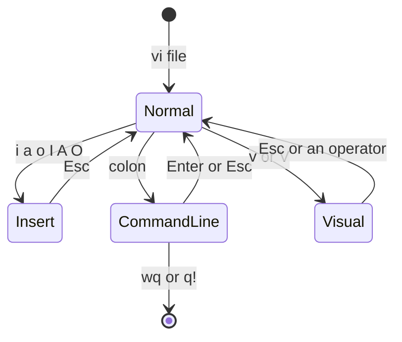

# A gentle introduction to vi, and customising the prompt

> **Before this lesson:** you should be able to view files with `less` ([Exploring the system](#/lesson/linux-cli/exploring-the-system)) and know what shell variables and `~/.bashrc` are ([The environment and startup files](#/lesson/linux-cli/environment-startup)).

## In plain words

To change what is in a text file you need a **text editor**. On a remote server there is no mouse and no window, so the editor has to work entirely from the keyboard. The one that is installed on every Linux and Unix system is called **vi** (its modern version is **Vim**).

vi surprises newcomers because it has **modes**. Think of a car's gear lever: the same pedals do different things in "drive" and in "reverse". In vi, one mode is for typing text and another is for giving commands — and in command mode the letter keys do not type letters; they move, delete and copy. Once you know which gear you are in, vi stops being confusing. This lesson teaches enough to open a file, change it, save it and leave, which is all you need to survive.

The second half is about the **prompt** — the short text the shell prints before each command. You can change it to show helpful facts, much as you might set a watch face to show the date as well as the time.

Why this matters for a job: sooner or later you must edit a settings file on a machine that has nothing but vi. Being able to do it calmly is a small but real professional requirement.

## Motivation

Sooner or later a program will drop you into an editor you did not ask for. You run `git commit` on a fresh server, or `crontab -e`, or `visudo`, and the screen fills with tildes. You type; nothing sensible happens. You press `Ctrl-C`; it beeps. Thousands of people have searched the web for "how to exit vim" from exactly this position.

`vi` (today almost always its descendant **Vim**) is worth an hour of your life for three reasons. It is **guaranteed to be there**: POSIX requires it, so minimal containers, rescue shells and network appliances that have no `nano` still have `vi`. It is **fast over poor connections**, because it needs only a keyboard and a character screen. And it is **efficient**: commands compose like a language, so a small vocabulary handles a great many edits.

This lesson is a survival course — enough to open a file, change it confidently, and get out. The site has a dedicated **Vim track** that goes much further (text objects, registers, macros, windows, configuration and plugins); follow it once the basics here feel natural.

The second half of the lesson covers a small but satisfying customisation: making your **prompt** tell you what you need to know.

## The one idea you must absorb: modes

In an ordinary editor, pressing `d` inserts the letter d. In vi, what a key does depends on the current **mode**.



| Mode | What keys do | How to get there |
|---|---|---|
| **Normal** (the starting mode) | every key is a command: move, delete, copy, paste | `Esc` from anywhere |
| **Insert** | keys insert text, as in any editor | `i`, `a`, `o` and friends |
| **Command-line** | type a line starting with `:` to save, quit, substitute, set options | `:` from normal mode |
| **Visual** | movement keys extend a selection | `v` (characters), `V` (lines) |

The rule that removes nearly all confusion: **when in doubt, press `Esc`**. Twice does no harm. You are then in normal mode, where the commands below work.

## Starting, saving and leaving

```bash
mira@forge:~$ vi notes.txt          # open (or create) a file
mira@forge:~$ vi +42 app/main.py    # open with the cursor on line 42
mira@forge:~$ vimtutor              # a 30-minute interactive tutorial shipped with Vim
```

A new, empty buffer shows a column of `~` characters marking lines beyond the end of the file. The essential command-line commands (each typed in normal mode, followed by Enter):

| Command | Effect |
|---|---|
| `:w` | write (save) |
| `:q` | quit — refuses if there are unsaved changes |
| `:wq` or `:x` or `ZZ` | save and quit |
| `:q!` | quit and **discard** all changes since the last save |
| `:w newname` | save under another name |
| `:e!` | reload the file from disk, discarding edits |

> [!TIP]
> The complete emergency procedure for "I am stuck in vi and I did not mean to change anything": press `Esc`, type `:q!`, press Enter. If you *did* mean to keep your changes, use `:wq` instead.

## Entering text

From normal mode, several keys switch to insert mode; they differ only in *where* the insertion starts.

| Key | Begins inserting |
|---|---|
| `i` | before the cursor |
| `a` | after the cursor |
| `I` | at the first non-blank character of the line |
| `A` | at the end of the line |
| `o` | on a new line **below** |
| `O` | on a new line **above** |

Type your text, then press `Esc` to return to normal mode. A good habit is to stay in insert mode only as long as it takes to type a phrase; every return to normal mode also marks an undo point.

## Moving around

Arrow keys work, but the home-row keys are faster once learned, and the larger movements are where the real gains are.

| Key | Moves |
|---|---|
| `h` `j` `k` `l` | left, down, up, right |
| `w` / `b` | forward / back one word |
| `e` | to the end of the word |
| `0` / `^` / `$` | start of line / first non-blank / end of line |
| `gg` / `G` | first / last line of the file |
| `17G` or `:17` | line 17 |
| `Ctrl-F` / `Ctrl-B` | page forward / back |
| `Ctrl-D` / `Ctrl-U` | half a page down / up |
| `%` | to the matching bracket |
| `fx` | forward to the next `x` on the line |

A number before a movement repeats it: `5j` goes down five lines, `3w` forward three words.

## Editing: operators and motions

Here is the idea that makes vi feel like a language. An **operator** says what to do; a **motion** says to how much text.

| Operator | Meaning |
|---|---|
| `d` | delete (and remember — vi's "cut") |
| `c` | change: delete, then enter insert mode |
| `y` | yank (copy) |

Combine them with the motions from the previous section:

| Command | Effect |
|---|---|
| `dw` | delete to the start of the next word |
| `d$` or `D` | delete to the end of the line |
| `dd` | delete the whole line (a doubled operator acts on the line) |
| `3dd` | delete three lines |
| `dG` | delete from here to the end of the file |
| `cw` | change the rest of the word |
| `cc` | change the whole line |
| `yy` | copy the line |
| `y$` | copy to the end of the line |
| `p` / `P` | paste after / before the cursor (or below / above, for whole lines) |
| `x` | delete the character under the cursor |
| `r` + char | replace one character |
| `J` | join the next line onto this one |
| `u` | undo |
| `Ctrl-R` | redo |
| `.` | **repeat the last change** |

Because deleted text is remembered, "move a line" is `dd`, move, `p`. "Duplicate a line" is `yy` `p`. And the dot command turns any edit into a repeatable action: change one word with `cw`, type the replacement, `Esc`, then move to the next place and press `.`.

To see that operator-plus-motion is a tiny grammar rather than a list of shortcuts, here is a toy interpreter for one line of text. Add an operator or a motion and every combination works at once.

```python-run
def motion_target(text, pos, motion):
    """Return the index a motion moves to, starting from pos."""
    if motion == "$":
        return len(text)
    if motion == "0":
        return 0
    if motion == "w":                       # start of the next word
        i = pos
        while i < len(text) and text[i] != " ":
            i += 1
        while i < len(text) and text[i] == " ":
            i += 1
        return i
    if motion == "b":                       # start of the previous word
        i = pos
        while i > 0 and text[i - 1] == " ":
            i -= 1
        while i > 0 and text[i - 1] != " ":
            i -= 1
        return i
    raise ValueError(motion)

def run(text, pos, command, register=""):
    op, motion = command[0], command[1:]
    if op == "p":                            # paste after the cursor
        return text[:pos + 1] + register + text[pos + 1:], pos, register
    target = motion_target(text, pos, motion)
    lo, hi = sorted((pos, target))
    if op == "y":                            # yank: copy only
        return text, pos, text[lo:hi]
    if op == "d":                            # delete: cut into the register
        return text[:lo] + text[hi:], lo, text[lo:hi]
    raise ValueError(op)

line, cursor, reg = "restart the nginx service now", 8, ""
print(f"{line!r}  cursor on {line[cursor]!r}")
for cmd in ["dw", "yw", "d$", "d0"]:
    new, c, r = run(line, cursor, cmd, reg)
    print(f"{cmd:3} -> {new!r:34} register={r!r}")
```

## Searching and replacing

| Command | Effect |
|---|---|
| `/text` Enter | search forward |
| `?text` Enter | search backward |
| `n` / `N` | next / previous match |
| `*` | search for the word under the cursor |
| `:s/old/new/` | replace the first *old* on the current line |
| `:s/old/new/g` | replace all on the current line |
| `:%s/old/new/g` | replace all in the whole file (`%` means every line) |
| `:%s/old/new/gc` | the same, asking for confirmation at each match |
| `:10,20s/old/new/g` | only on lines 10 to 20 |
| `:noh` | clear search highlighting |

The substitution syntax is the same as `sed`'s, which you will study in the text-processing lessons — learn it once, use it in both.

## A complete worked edit

You must change a port and remove a stale line in a configuration file:

```bash
mira@forge:~$ sudo cp /etc/weather/api.conf /etc/weather/api.conf.bak
mira@forge:~$ sudo vi /etc/weather/api.conf
```

Inside vi (each line is a sequence of keys):

```
/8080<Enter>        search for the old value; the cursor lands on its first digit
cw9090<Esc>         change that word to 9090 and return to normal mode
/debug_dump<Enter>  find the stale line
dd                  delete it
:set number         show line numbers to double-check the region
:wq                 save and quit
```

Notice the shape of the second step: put the cursor at the **start** of the thing to replace, then operate forward with `cw` (change word) or `C` (change to end of line). Positioning first and then applying an operator is the vi way; trying to fix text by backspacing in insert mode works but throws away most of the editor's power.

```bash
mira@forge:~$ diff /etc/weather/api.conf.bak /etc/weather/api.conf
4c4
< listen_port = 8080
---
> listen_port = 9090
11d10
< debug_dump = /tmp/dump.bin
```

> [!WARNING]
> Editing system configuration is where an editor can do real damage. Always copy the file first, as above, and prefer the purpose-built wrappers when they exist: `sudo visudo` for `/etc/sudoers` and `crontab -e` for crontabs both check syntax before installing your changes. A syntax error written directly into `/etc/sudoers` can lock every user out of `sudo`.

If vi announces a **swap file** (`Found a swap file by the name ".api.conf.swp"`), either another session is editing the same file or a previous session crashed. Choose `(R)ecover` if you lost a session, `(Q)uit` if someone else is in the file; delete the swap file only after you are sure it is stale.

> [!INTERVIEW]
> No one will ask you for advanced Vim in an interview, but "you are on a production box with only vi — change one line in a config file" is a realistic hands-on task. The competent minimum: open, search with `/`, edit with `i` or `cw`, `Esc`, `:wq`; know `:q!` to abandon, `u` to undo, and `dd` / `p` to move lines.

## Customising the prompt

The prompt is produced from the shell variable `PS1`. Look at the current value:

```bash
mira@forge:~$ echo "$PS1"
\u@\h:\w\$ 
```

Backslash codes are replaced each time the prompt is drawn:

| Code | Shows |
|---|---|
| `\u` | user name |
| `\h` / `\H` | host name up to the first dot / in full |
| `\w` / `\W` | working directory (with `~` for home) / only its last component |
| `\$` | `#` if you are root, otherwise a dollar sign |
| `\d`, `\t`, `\A`, `\@` | date; time as 24h HH:MM:SS, 24h HH:MM, 12h am/pm |
| `\!`, `\#` | history number; command number in this session |
| `\j` | number of background jobs |
| `\n` | a line break |
| `\[` … `\]` | bracket a sequence of **non-printing** characters |

Experiment freely — the change lasts only for the current shell, and you can save the original first:

```bash
mira@forge:~$ ps1_orig="$PS1"
mira@forge:~$ PS1='[\A] \u@\h \W \$ '
[11:42] mira@forge lab $ PS1='\w\n\$ '
~/lab
$ PS1="$ps1_orig"
mira@forge:~/lab$
```

### Colour

Colour is switched on and off with ANSI escape sequences of the form `\e[CODEm` (`\e` is the escape character, also written `\033`). Because these characters take up no space on screen, they must be wrapped in `\[` and `\]` so bash can calculate the visible length of the prompt correctly.

| Code | Effect | Code | Effect |
|---|---|---|---|
| `0` | reset everything | `1` | bold |
| `31` | red | `32` | green |
| `33` | yellow | `34` | blue |
| `35` | magenta | `36` | cyan |
| `41`–`46` | the same colours as backgrounds | `0;32` | combine with semicolons |

```bash
PS1='\[\e[1;32m\]\u@\h\[\e[0m\]:\[\e[1;34m\]\w\[\e[0m\]\$ '
```

That is the green-user, blue-directory prompt familiar from Ubuntu. Read it in pieces: start bold green, print `user@host`, reset, print a colon, start bold blue, print the directory, reset, print the prompt character.

> [!WARNING]
> Omitting the `\[ \]` wrappers around colour codes produces a maddening bug: long commands wrap onto the *same* line and overwrite the prompt, and recalled history lines display garbled. If line editing misbehaves after you changed `PS1`, unbalanced or missing wrappers are the cause.

### Information that earns its place

The most useful prompts add facts that prevent mistakes. Bash expands variables and command substitutions in `PS1` each time, provided the string is **single-quoted** when assigned (so the expansion happens at display time, not at assignment time).

```bash
# show the exit status of the previous command when it failed, and the git branch
git_branch() { git symbolic-ref --short HEAD 2>/dev/null | sed 's/.*/ (&)/'; }
PS1='$(s=$?; [ $s -ne 0 ] && printf "\[\e[31m\][%s]\[\e[0m\] " "$s")\u@\h:\w\[\e[33m\]$(git_branch)\[\e[0m\]\$ '
```

```bash
mira@forge:~/projects/weather-api (main)$ false
[1] mira@forge:~/projects/weather-api (main)$ cd /tmp
mira@forge:/tmp$
```

A red status appears only after a failure, and the branch only inside a repository. Other popular additions: the active Python virtual environment (activation scripts prepend `(venv)` for you), the Kubernetes context, and — strongly recommended — a **different colour for production hosts**:

```bash
case "$(hostname)" in
    prod-*) host_colour='\[\e[1;41m\]' ;;    # white on red: you are on production
    *)      host_colour='\[\e[1;32m\]' ;;
esac
PS1="${host_colour}\u@\h\[\e[0m\]:\w\\$ "
```

To keep a prompt, put its definition in `~/.bashrc`. Keep any commands it runs fast: the prompt is drawn after every command, and a slow `git` call in a huge repository makes the whole shell feel sluggish. If you would rather not hand-craft one, the cross-shell tool `starship` provides a well-designed prompt from a single configuration file.

`PS2` is the continuation prompt (default `> `) shown when a command is incomplete — for instance after an unclosed quote. If you see `>` and do not know why, press `Ctrl-C`.

## Pitfalls

- **Typing text in normal mode.** Each letter is a command; a stray sentence can delete and rearrange lines. Press `u` repeatedly to undo, or `:e!` to reload.
- **Caps Lock.** `J`, `D`, `U` and `ZZ` are very different commands from their lower-case versions.
- **`:q` refusing to quit.** There are unsaved changes; decide between `:wq` and `:q!`.
- **Editing a root-owned file without `sudo`.** Vim warns "readonly". Quit and reopen with `sudo`, or use `sudoedit file`.
- **`Ctrl-S` appearing to freeze the terminal.** It is flow control; press `Ctrl-Q`.
- **Prompt colours without `\[ \]`**, and `PS1` assigned in double quotes so that `$(...)` is evaluated only once.
- **Decorative prompts that hide information.** User, host and directory prevent real accidents; keep them.

## Cheat sheet

| Task | Keys |
|---|---|
| Back to normal mode | `Esc` |
| Insert before / after cursor, new line below | `i` / `a` / `o` |
| Save, quit, both | `:w`, `:q`, `:wq` |
| Quit without saving | `:q!` |
| Undo / redo / repeat | `u` / `Ctrl-R` / `.` |
| Delete line / word / to end of line | `dd` / `dw` / `D` |
| Copy line, paste | `yy`, `p` |
| Change word | `cw` |
| Start / end of line, top / bottom of file | `0` / `$`, `gg` / `G` |
| Go to line N | `:N` |
| Search, next | `/text`, `n` |
| Replace everywhere | `:%s/old/new/g` |
| Show line numbers | `:set number` |
| Current prompt | `echo "$PS1"` |
| Simple coloured prompt | `PS1='\[\e[32m\]\u@\h\[\e[0m\]:\w\$ '` |

## Summary

- vi is modal: normal mode for commands, insert mode for typing, `:` for file and global commands. `Esc` always returns to normal mode.
- Survival set: `i`, `Esc`, `:wq`, `:q!`, `u`, `dd`, `yy`, `p`, `/pattern`.
- Edits are operator + motion (`dw`, `c$`, `yG`), optionally with a count, and `.` repeats the last one.
- `:%s/old/new/g` performs file-wide substitution with the same syntax as `sed`.
- The prompt comes from `PS1`: backslash codes for user, host, directory and time; ANSI colours wrapped in `\[ \]`; command substitutions for live information such as exit status or git branch.
- Continue with the site's Vim track for the full language.

## Glossary

| Term | Meaning |
|---|---|
| text editor | a program for changing the contents of text files |
| mode | a state of the editor in which keys have a particular meaning |
| normal mode | vi's command mode: keys move the cursor and edit |
| insert mode | the mode in which typed keys become text |
| command-line mode | entered with `:`; used to save, quit and substitute |
| operator / motion | what to do (delete, change, copy) / how far (a word, a line) |
| yank / put | vi's words for copy / paste |
| buffer | the editor's in-memory copy of the file being edited |
| prompt | the text the shell prints when it is ready for a command |
| `PS1` | the shell variable that defines the prompt |
| escape sequence | a special run of characters that controls colour or cursor position |

## Check yourself

```quiz
[
  {"q": "You opened a file in vi by accident, typed some random keys and want to leave without changing anything. What is the reliable sequence?",
   "options": ["Ctrl-C then Enter", "Esc, then :q! and Enter", "Esc, then :wq and Enter", "Type exit"],
   "answer": 1,
   "explain": "Esc guarantees normal mode; :q! quits and discards every change made since the last save."},
  {"q": "In normal mode, what does `dd` followed by `p` on another line accomplish?",
   "options": ["Deletes two lines", "Moves a line: it is cut, then pasted below the cursor's new line", "Duplicates the line in place", "Undoes the deletion"],
   "answer": 1,
   "explain": "dd deletes the line into a register and p puts it back after the current line, which amounts to moving it."},
  {"q": "Which command replaces every occurrence of `http:` with `https:` in the whole file?",
   "options": [":s/http:/https:/", ":%s/http:/https:/g", ":g/http:/https:/", "/http:/https:/"],
   "answer": 1,
   "explain": "% addresses all lines and the g flag replaces every match on each line rather than only the first."},
  {"q": "What does `cw` do?",
   "options": ["Copies a word", "Deletes from the cursor to the end of the word and enters insert mode", "Closes the window", "Counts words"],
   "answer": 1,
   "explain": "c is the change operator: it deletes the text covered by the motion and switches to insert mode so you can type the replacement."},
  {"q": "Why must colour escape sequences in PS1 be enclosed in `\\[` and `\\]`?",
   "options": ["Otherwise the colours do not appear", "They tell bash the enclosed characters take no screen width, so line wrapping and editing are calculated correctly", "They make the prompt load faster", "They are required around every backslash code"],
   "answer": 1,
   "explain": "Bash needs to know the visible length of the prompt. Unmarked non-printing characters cause misplaced wrapping and garbled line editing."},
  {"q": "What does `\\w` display in a prompt?",
   "options": ["The current time", "The number of words typed", "The current working directory", "The user name"],
   "answer": 2,
   "explain": "Lower-case w is the full working directory with the home directory abbreviated to a tilde; upper-case W shows only the last component."},
  {"q": "You set `PS1=\"$(date +%T) \\$ \"` with double quotes and the time in the prompt never changes. Why?",
   "options": ["date is too slow for prompts", "The command substitution was evaluated once at assignment; single quotes are needed so it is evaluated each time the prompt is drawn", "PS1 cannot contain commands", "The clock is stopped"],
   "answer": 1,
   "explain": "In double quotes the shell expands the substitution immediately and stores fixed text. Single quotes store the expression itself for expansion at display time."},
  {"q": "The shell shows `> ` after you press Enter and seems to wait. What is happening?",
   "options": ["The command is running in the background", "The command is incomplete (for example an unclosed quote) and PS2 is asking for the rest", "The disk is full", "You are in vi insert mode"],
   "answer": 1,
   "explain": "PS2 is the continuation prompt. Finish the command or press Ctrl-C to abandon it."}
]
```

> **Source:** Shotts, *The Linux Command Line*, ch. 12 (A Gentle Introduction to vi) and ch. 13 (Customizing the Prompt). All examples and wording are original to this guide.
