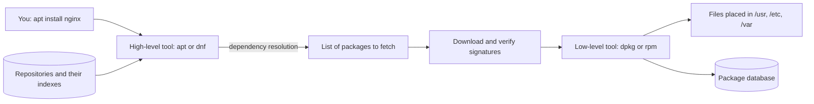

# Package management

> **Before this lesson:** you should know how to run commands with `sudo` ([Permissions](#/lesson/linux-cli/permissions)) and how commands are found ([Working with commands](#/lesson/linux-cli/commands-and-help)).

## In plain words

On a phone you install apps from an app store: you search, tap "install", and the store downloads the app and anything else it needs, and later offers updates. Linux has had the same idea for decades. The store is called a **repository**, an app is a **package**, and the program that talks to the store is the **package manager**.

A package is one file that contains a program together with a description of it: its name, its version, and a list of the other packages it needs in order to work. Those needed packages are its **dependencies**. If a photo editor needs a library for reading image files, the package manager notices and installs that library too.

One command installs a program; one more updates everything on the system — the operating system itself and every program on it — to current versions.

Why this matters for a job: setting up a server or a work machine starts with installing software. Knowing which version of a program is installed, where a file came from and what changed last week are also everyday diagnostic questions, and the package manager answers all of them.

## Motivation

On Windows or macOS you traditionally install software by downloading an installer from the vendor's web site and clicking through it. Each program then looks after its own updates, bundles its own copies of libraries, and leaves its own debris when removed.

Linux distributions work differently, and once you are used to it the difference is liberating. Software comes from **repositories** curated by the distribution: tens of thousands of programs, built consistently, cryptographically signed, and installable with one command that also fetches everything the program depends on. One more command updates the *entire* system — kernel, libraries, databases, editors — in a single consistent step.

For an engineer the package manager is also a diagnostic instrument. "Which package put this file here?", "Which version of OpenSSL is on this server?", "What changed on this box last Tuesday?" and "Why does this Dockerfile produce an 800 MB image?" are all package-management questions.

## The moving parts

**Package.** A single archive containing a program's files plus metadata: name, version, description, checksums, the list of other packages it needs, and optional scripts that run before or after installation (for example to create a service account).

**Repository.** A server holding packages and an index of them. A system is configured with several: the distribution's main repository, a security-updates repository, and perhaps third-party ones (Docker, NVIDIA, PostgreSQL).

**Dependency.** Programs share code through libraries. If the package `nginx` needs `libssl3`, it declares that as a dependency rather than carrying its own copy; the package manager installs both and remembers why.

**Two layers of tools.** A *low-level* tool installs and removes individual package files and maintains the database of what is installed. A *high-level* tool talks to repositories, searches metadata and **resolves dependencies**, then drives the low-level tool.



There are two dominant families.

| | Debian family | Red Hat family |
|---|---|---|
| Distributions | Debian, Ubuntu, Linux Mint, Raspberry Pi OS | Fedora, RHEL, CentOS Stream, Rocky, AlmaLinux, Amazon Linux |
| Package format | `.deb` | `.rpm` |
| Low-level tool | `dpkg` | `rpm` |
| High-level tool | `apt` (older scripts: `apt-get`, `apt-cache`) | `dnf` (older systems: `yum`) |
| Repository configuration | `/etc/apt/sources.list`, `/etc/apt/sources.list.d/` | `/etc/yum.repos.d/` |

Other families exist — `pacman` on Arch, `zypper` on openSUSE, `apk` on Alpine (ubiquitous in containers) — and the concepts transfer directly. If you are unsure what a machine runs, ask it:

```bash
mira@forge:~$ cat /etc/os-release | head -n 4
PRETTY_NAME="Ubuntu 24.04.1 LTS"
NAME="Ubuntu"
VERSION_ID="24.04"
VERSION="24.04.1 LTS (Noble Numbat)"
```

## Everyday tasks, side by side

### Refresh the index, then search

The high-level tool keeps a local copy of each repository's index. On Debian-family systems you refresh it explicitly; `dnf` refreshes automatically when its copy is stale.

```bash
mira@forge:~$ sudo apt update
Hit:1 http://archive.ubuntu.com/ubuntu noble InRelease
Get:2 http://security.ubuntu.com/ubuntu noble-security InRelease [126 kB]
Fetched 2,311 kB in 1s (1,897 kB/s)
Reading package lists... Done
14 packages can be upgraded. Run 'apt list --upgradable' to see them.
mira@forge:~$ apt search "json processor"
jq/noble 1.7.1-3build1 amd64
  lightweight and flexible command-line JSON processor
mira@forge:~$ apt show jq | head -n 8
Package: jq
Version: 1.7.1-3build1
Priority: optional
Section: utils
Maintainer: Ubuntu Developers <ubuntu-devel-discuss@lists.ubuntu.com>
Installed-Size: 111 kB
Depends: libjq1 (= 1.7.1-3build1), libc6 (>= 2.34)
Homepage: https://github.com/jqlang/jq
```

Note that `apt update` only downloads *lists*; it changes no installed software. The `Depends:` line shows the dependency mechanism in the open.

### Install

```bash
mira@forge:~$ sudo apt install jq tmux
Reading package lists... Done
Building dependency tree... Done
The following additional packages will be installed:
  libevent-core-2.1-7t64 libjq1 libonig5 libutempter0
The following NEW packages will be installed:
  jq libevent-core-2.1-7t64 libjq1 libonig5 libutempter0 tmux
0 upgraded, 6 newly installed, 0 to remove and 14 not upgraded.
Need to get 1,092 kB of archives.
After this operation, 3,241 kB of additional disk space will be used.
Do you want to continue? [Y/n]
```

Read that summary before answering — it is the package manager telling you exactly what it is about to do. Four extra libraries are being pulled in automatically. Pay particular attention to any line beginning "The following packages will be **REMOVED**".

### Update everything

```bash
mira@forge:~$ sudo apt update && sudo apt upgrade        # Debian family
mira@forge:~$ sudo dnf upgrade                            # Red Hat family
```

### Remove

```bash
mira@forge:~$ sudo apt remove tmux           # remove the program, keep its configuration files
mira@forge:~$ sudo apt purge tmux            # remove configuration too
mira@forge:~$ sudo apt autoremove            # remove dependencies nobody needs any more
```

### The comparison table

| Task | Debian / Ubuntu | Fedora / RHEL |
|---|---|---|
| Refresh repository index | `sudo apt update` | automatic (`dnf check-update`) |
| Search by keyword | `apt search text` | `dnf search text` |
| Show details | `apt show pkg` | `dnf info pkg` |
| Install from repository | `sudo apt install pkg` | `sudo dnf install pkg` |
| Install a downloaded file | `sudo apt install ./file.deb` | `sudo dnf install ./file.rpm` |
| Upgrade all packages | `sudo apt upgrade` | `sudo dnf upgrade` |
| Remove | `sudo apt remove pkg` | `sudo dnf remove pkg` |
| Remove orphaned dependencies | `sudo apt autoremove` | `sudo dnf autoremove` |
| List installed packages | `dpkg -l` or `apt list --installed` | `rpm -qa` or `dnf list installed` |
| Is a package installed? | `dpkg -s pkg` | `rpm -q pkg` |
| Files installed by a package | `dpkg -L pkg` | `rpm -ql pkg` |
| Which package owns a file? | `dpkg -S /path/file` | `rpm -qf /path/file` |
| Which package *would* provide a file? | `apt-file search name` | `dnf provides '*/name'` |
| Transaction history | `/var/log/apt/history.log` | `dnf history` |
| Clear downloaded package cache | `sudo apt clean` | `sudo dnf clean all` |

## Asking questions of the package database

The low-level tools answer the investigative questions, and none of them needs root.

```bash
mira@forge:~$ dpkg -l | grep -E 'openssl|libssl'
ii  libssl3t64:amd64   3.0.13-0ubuntu3.4   amd64   Secure Sockets Layer toolkit - shared libraries
ii  openssl            3.0.13-0ubuntu3.4   amd64   Secure Sockets Layer toolkit - cryptographic utility
mira@forge:~$ dpkg -S /usr/bin/curl
curl: /usr/bin/curl
mira@forge:~$ dpkg -L jq
/.
/usr
/usr/bin
/usr/bin/jq
/usr/share/doc/jq/copyright
/usr/share/man/man1/jq.1.gz
mira@forge:~$ dpkg -S "$(readlink -f "$(command -v python3)")"
python3.12-minimal: /usr/bin/python3.12
```

The first is how you answer a security advisory ("are we on a fixed version?"). The second and fourth trace a file back to its package — the fourth following the `python3` symlink first. The third lists what a package installed, which is the quickest way to find a tool's configuration file or the actual name of its executable. In `dpkg -l` output the leading `ii` means "desired state install, current state installed"; `rc` means removed but configuration files remain.

What happened recently?

```bash
mira@forge:~$ grep -A3 "Start-Date: 2026-11-18" /var/log/apt/history.log
Start-Date: 2026-11-18  06:25:14
Commandline: /usr/bin/unattended-upgrade
Upgrade: libssl3t64:amd64 (3.0.13-0ubuntu3.3, 3.0.13-0ubuntu3.4), openssl:amd64 (3.0.13-0ubuntu3.3, 3.0.13-0ubuntu3.4)
End-Date: 2026-11-18  06:25:21
```

When a service started misbehaving on a known date, this log (or `dnf history` and `dnf history info N`) is the first place to look for a changed dependency.

## How dependency resolution works

Resolving dependencies is a graph problem. Each package is a node, each "depends on" an edge, and installing a package means installing every node reachable from it, in an order that puts each dependency before the things that need it — a **topological order**. The model below performs exactly that walk, and also implements `autoremove`: a package installed only as a dependency is removed once nothing installed still needs it.

```python-run
REPO = {                                   # package -> what it depends on
    "nginx":      ["libssl3", "libpcre2", "nginx-common"],
    "nginx-common": [],
    "curl":       ["libcurl4"],
    "libcurl4":   ["libssl3", "zlib1g"],
    "libssl3":    ["libc6"],
    "libpcre2":   ["libc6"],
    "zlib1g":     ["libc6"],
    "libc6":      [],
}
installed = {"libc6": "manual"}            # package -> "manual" or "auto"

def install(pkg):
    order = []
    def visit(p):
        if p in installed or p in order:
            return
        for dep in REPO[p]:                # dependencies first: post-order = topological order
            visit(dep)
        order.append(p)
    visit(pkg)
    for p in order:
        installed[p] = "manual" if p == pkg else "auto"
    print(f"install {pkg:6} -> unpack in order: {order}")

def autoremove():
    while True:
        needed = {d for p in installed for d in REPO[p]}
        orphans = [p for p, how in installed.items() if how == "auto" and p not in needed]
        if not orphans:
            return
        for p in orphans:
            del installed[p]
        print("autoremove ->", sorted(orphans))

install("nginx")
install("curl")                            # libssl3 is already there: shared, not duplicated
del installed["nginx"]; print("remove nginx")
autoremove()                               # libssl3 survives because libcurl4 still needs it
print("still installed:", sorted(installed))
```

Real resolvers also handle version constraints, conflicts and alternatives, which makes the general problem far harder than a graph walk — but the picture of a dependency graph is the right one to carry in your head.

## Installing from outside the repositories

Occasionally you are handed a package file directly, or a vendor asks you to add their repository.

```bash
mira@forge:~$ sudo apt install ./vendor-agent_3.2.1_amd64.deb     # resolves dependencies from the repos
mira@forge:~$ sudo dpkg -i vendor-agent_3.2.1_amd64.deb           # low level: fails if dependencies are missing
mira@forge:~$ sudo apt -f install                                  # repair after such a failure
```

Prefer the `apt install ./file.deb` form (note the `./`, which tells `apt` it is a path rather than a package name), because it brings in dependencies. Adding a third-party repository takes two steps — install the vendor's signing key, then add a source list entry naming that key — after which the vendor's packages update along with everything else.

> [!WARNING]
> A package's installation scripts run **as root**. Installing a package, adding a repository, or running the popular `curl https://example.com/install.sh | sudo bash` pattern gives the publisher full control of the machine. Only add repositories from publishers you would trust with root access, verify signing keys from an independent source, and download-then-read any installer script instead of piping it straight into a shell.

## Beyond the system package manager

Distribution packages are the right source for system-level software, but several other layers sit on top, each with its own scope.

| Layer | Examples | Scope and typical use |
|---|---|---|
| Universal app formats | `snap`, `flatpak`, AppImage | self-contained desktop or server applications with bundled dependencies |
| Language package managers | `pip`/`uv` (Python), `npm` (JavaScript), `cargo` (Rust), `gem` (Ruby) | libraries for one language, usually per project |
| User-level managers | `conda`/`mamba`, Homebrew, `nix` | whole toolchains without root, in your home directory |
| Containers | Docker / OCI images | an entire user-space file system per application |
| Source builds | `./configure && make && sudo make install` | when nothing else provides the version you need; installs under `/usr/local` |

> [!WARNING]
> Do not run `sudo pip install` on a distribution's system Python. Many system tools are themselves Python programs that depend on the exact library versions the distribution shipped; overwriting those can break the package manager itself. Recent distributions refuse outright with an "externally-managed-environment" error. Install Python libraries into a **virtual environment** (`python3 -m venv .venv`) and command-line Python applications with `pipx` or `uv tool install`.

In **Dockerfiles**, three habits keep images small and builds reproducible:

```bash
RUN apt-get update \
 && apt-get install -y --no-install-recommends curl ca-certificates \
 && rm -rf /var/lib/apt/lists/*
```

`update` and `install` are in the **same** layer, so a cached stale index is never reused with a new package list; `--no-install-recommends` skips optional extras; and deleting the index afterwards keeps it out of the image. Scripts use `apt-get` rather than `apt` because its output and behaviour are guaranteed stable for non-interactive use, and `-y` to answer the confirmation prompt.

> [!TIP]
> To freeze a package at its current version so that upgrades skip it — a database server mid-migration, or an NVIDIA driver matched to a CUDA version — use `sudo apt-mark hold pkg` (undo with `unhold`) or, on the Red Hat side, the `dnf versionlock` plugin. Record why, because held packages also stop receiving security fixes.

> [!INTERVIEW]
> Common questions: "What is the difference between `apt update` and `apt upgrade`?" (refresh the index versus install newer versions), "between `apt` and `dpkg`?" (repository-aware dependency resolver versus the tool that unpacks individual `.deb` files), and "How do you find which package installed a given file?" (`dpkg -S path` or `rpm -qf path`). For DevOps roles expect "How would you check whether a server is affected by a vulnerability in library X?" — query the installed version, compare with the fixed version in the advisory, and remember that running processes keep using the old library until restarted.

That last point deserves emphasis: upgrading a library replaces the file on disk, but programs already running still have the old copy loaded. Tools such as `needrestart` (Debian family) or `dnf needs-restarting` list the services that must be restarted, and a file `/var/run/reboot-required` appears when a new kernel needs a reboot.

## Pitfalls

- **`apt install` without a preceding `apt update`** on a machine whose index is old: "Unable to locate package" or 404 errors for versions that no longer exist.
- **Not reading the transaction summary**, and approving the removal of something important.
- **Mixing package sources** for the same software (a system `nodejs` and a manually installed one in `/usr/local`), then being surprised by which one runs. `type -a name` and `dpkg -S` settle it.
- **`sudo pip install`** into the system Python.
- **Interrupting a package operation.** If one was killed, `sudo dpkg --configure -a` finishes it.
- **A full `/boot` or root file system** from accumulated old kernels and caches: `sudo apt autoremove --purge` and `sudo apt clean`.
- **Assuming a patched library is in use** without restarting the services that load it.

## Cheat sheet

| Goal | Debian / Ubuntu | Fedora / RHEL |
|---|---|---|
| Refresh and upgrade everything | `sudo apt update && sudo apt upgrade` | `sudo dnf upgrade` |
| Install / remove | `sudo apt install p` / `sudo apt remove p` | `sudo dnf install p` / `sudo dnf remove p` |
| Search / describe | `apt search t` / `apt show p` | `dnf search t` / `dnf info p` |
| Installed version | `dpkg -s p \| grep Version` | `rpm -q p` |
| Files of a package | `dpkg -L p` | `rpm -ql p` |
| Owner of a file | `dpkg -S /path` | `rpm -qf /path` |
| What can be upgraded | `apt list --upgradable` | `dnf check-update` |
| History | `less /var/log/apt/history.log` | `dnf history` |
| Hold a version | `sudo apt-mark hold p` | `sudo dnf versionlock add p` |
| Clean caches | `sudo apt clean` | `sudo dnf clean all` |
| Which distribution is this? | `cat /etc/os-release` | `cat /etc/os-release` |

## Summary

- Distributions deliver software as signed packages in repositories; a high-level tool (`apt`, `dnf`) resolves dependencies and a low-level tool (`dpkg`, `rpm`) installs files and records them.
- Routine work is refresh, search, install, upgrade, remove — and reading the summary before confirming.
- The package database answers "what version?", "which files?" and "who owns this file?", and the history log answers "what changed?".
- Dependencies form a graph; installation follows a topological order and `autoremove` prunes what is no longer needed.
- System packages, language package managers, user-level managers and containers each have their place; do not let them overwrite each other, and never install as root from sources you do not trust.

## Glossary

| Term | Meaning |
|---|---|
| package | a file containing a program plus information about it |
| repository | a server holding packages and an index of them |
| package manager | the tool that installs, updates and removes packages |
| dependency | another package that a package needs in order to work |
| distribution | a complete Linux system such as Ubuntu, Debian or Fedora |
| low-level / high-level tool | installs single package files (`dpkg`, `rpm`) / fetches from repositories and resolves dependencies (`apt`, `dnf`) |
| upgrade | replace installed packages by newer versions |
| signing key | a cryptographic key proving that a package comes from its publisher |
| virtual environment | a private set of Python libraries for one project |

## Check yourself

```quiz
[
  {"q": "What does `sudo apt update` do?",
   "options": ["Upgrades all installed packages", "Downloads fresh package indexes from the repositories without changing installed software", "Updates only the kernel", "Removes unused packages"],
   "answer": 1,
   "explain": "update refreshes the local copy of the repository metadata. apt upgrade is the command that installs newer versions."},
  {"q": "Which command tells you what package the file /usr/bin/rsync belongs to on Ubuntu?",
   "options": ["apt search /usr/bin/rsync", "dpkg -S /usr/bin/rsync", "dpkg -L /usr/bin/rsync", "which rsync"],
   "answer": 1,
   "explain": "dpkg -S searches the database of installed files for a path. dpkg -L goes the other way, listing the files of a named package."},
  {"q": "Why do package managers split work between a high-level and a low-level tool?",
   "options": ["For historical reasons only", "The low-level tool handles individual package files and the local database; the high-level tool adds repositories and dependency resolution", "The high-level tool is for graphical desktops", "The low-level tool is only for removal"],
   "answer": 1,
   "explain": "dpkg and rpm install single files and track what is installed; apt and dnf decide which set of packages is needed and fetch them."},
  {"q": "You remove a program and later run `sudo apt autoremove`. What does it delete?",
   "options": ["All configuration files on the system", "Packages that were installed automatically as dependencies and are no longer required by anything", "Every package not used in 30 days", "The package cache only"],
   "answer": 1,
   "explain": "The package manager records whether each package was requested explicitly or pulled in as a dependency, and autoremove prunes the unneeded automatic ones."},
  {"q": "Why is `sudo pip install somelib` on the system Python discouraged?",
   "options": ["pip cannot run under sudo", "It can overwrite library versions that distribution tools depend on, breaking them", "It installs into the wrong CPU architecture", "pip packages are never signed"],
   "answer": 1,
   "explain": "System utilities rely on the exact Python libraries shipped by the distribution. Use virtual environments or pipx for your own installs."},
  {"q": "In a Dockerfile, why are `apt-get update` and `apt-get install` put in the same RUN instruction?",
   "options": ["Docker allows only one RUN per file", "So a cached layer with an outdated index is never combined with a later install step", "It makes the image larger", "apt-get install requires an interactive terminal otherwise"],
   "answer": 1,
   "explain": "If update were cached in its own layer, a changed install line would run against a stale index and could fail or fetch outdated versions."},
  {"q": "A security fix for a shared library was installed an hour ago. Is the running web server protected?",
   "options": ["Yes, immediately", "Not until the web server process is restarted, because it still has the old library loaded", "Only after apt autoremove", "Only if the server was installed from source"],
   "answer": 1,
   "explain": "Upgrading replaces files on disk; processes started earlier continue to use the copy already mapped into memory."},
  {"q": "What is the safest form for installing a downloaded .deb file so its dependencies are also installed?",
   "options": ["sudo dpkg -i file.deb", "sudo apt install ./file.deb", "sudo apt install file", "sudo tar -xf file.deb -C /"],
   "answer": 1,
   "explain": "apt accepts a local path (note the leading ./) and resolves the package's dependencies from the configured repositories; dpkg -i alone does not."}
]
```

> **Source:** Shotts, *The Linux Command Line*, ch. 14 (Package Management). All examples and wording are original to this guide.
