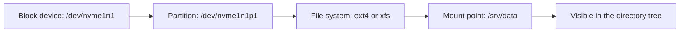

# Storage media: mounting, partitions and file systems

> **Before this lesson:** you should understand the directory tree ([Exploring the system](#/lesson/linux-cli/exploring-the-system)), permissions and `sudo` ([Permissions](#/lesson/linux-cli/permissions)) and processes ([Processes](#/lesson/linux-cli/processes)).

## In plain words

A disk is like an empty warehouse. Before goods can be stored in it, someone must mark out areas on the floor, put up shelves with a labelling system, and connect the warehouse to the road network so that lorries can reach it. A disk needs the same three preparations before files can be stored on it.

Marking out areas is called **partitioning**. Putting up the shelves and the labelling system is creating a **file system** — the structure that keeps track of file names and where each file's data lies. Connecting it to the road network is **mounting**: attaching the disk to a directory, so that everything on the disk appears under that directory.

On a desktop computer these steps happen automatically when you plug in a USB stick. On servers you do them by hand.

Why this matters for a job: attaching extra storage to a cloud machine, finding out why a disk is full, and copying an image onto a memory card are common tasks. This is also the one area of the command line where a single mistyped name can erase an entire disk, so learning it carefully is worthwhile.

## Motivation

A cloud provider attaches a new 500 GB volume to your training server, and nothing appears — no new directory, no extra space. A USB drive with the dataset is plugged into a headless machine. A disk alert fires at 3 a.m. saying `/var` is 97% full. A colleague asks you to write a bootable image to an SD card, and warns you to be *very* careful about which device you choose.

All of these involve the layer between raw hardware and the tidy directory tree you have been navigating. On a desktop, the system quietly does this work for you. On servers you do it by hand, and the commands involved include some of the few on Linux that can destroy every byte on a disk in a second. This lesson explains the layers, the safe inspection commands, and the dangerous ones with the precautions they demand.

## From device to directory: four layers



1. **Block device.** The kernel presents each disk as a file under `/dev`. It is "block" storage because it is read and written in fixed-size chunks at arbitrary positions.
2. **Partition.** A disk is usually divided into regions described by a partition table (GPT on modern systems, MBR on old ones). Each partition appears as its own device.
3. **File system.** A partition is only a long row of blocks until it is *formatted* with a file system — the data structure that provides names, directories, permissions and free-space tracking.
4. **Mount.** A file system becomes usable when it is attached to an existing directory, its **mount point**. From then on, paths under that directory lead into the device.

Device naming follows the bus the disk is on:

| Device name | What it is |
|---|---|
| `/dev/sda`, `/dev/sdb` … | SATA, SAS and USB disks, lettered in the order discovered |
| `/dev/sda1`, `/dev/sda2` | partitions 1 and 2 of `sda` |
| `/dev/nvme0n1` | first NVMe SSD; partitions are `/dev/nvme0n1p1`, `p2` … |
| `/dev/vda`, `/dev/xvda` | virtual disks in KVM and Xen/AWS guests |
| `/dev/mmcblk0`, `/dev/mmcblk0p1` | SD and eMMC cards |
| `/dev/sr0` | optical drive |
| `/dev/loop0` … | loop devices: ordinary files presented as block devices |
| `/dev/mapper/…`, `/dev/dm-0` | device-mapper volumes: LVM logical volumes, encrypted volumes |
| `/dev/md0` | software RAID arrays |

Because letters such as `sdb` depend on discovery order, they can change between boots. Stable identifiers exist for that reason — above all the file system **UUID**.

## Looking before touching

Three read-only commands tell you almost everything.

```bash
mira@forge:~$ lsblk -f
NAME        FSTYPE FSVER LABEL UUID                                 FSAVAIL FSUSE% MOUNTPOINTS
nvme0n1
├─nvme0n1p1 vfat   FAT32       7C1A-93BE                             504.9M     1% /boot/efi
└─nvme0n1p2 ext4   1.0         4d1b2c9e-7f30-4a61-9d0e-2b6a1f0c88aa  324.1G    26% /
nvme1n1
sda
└─sda1      exfat  1.0   DATA  64F2-11C9
mira@forge:~$ df -hT
Filesystem     Type   Size  Used Avail Use% Mounted on
/dev/nvme0n1p2 ext4   468G  121G  324G  28% /
/dev/nvme0n1p1 vfat   511M  6.1M  505M   2% /boot/efi
tmpfs          tmpfs   16G   12M   16G   1% /dev/shm
mira@forge:~$ findmnt /
TARGET SOURCE         FSTYPE OPTIONS
/      /dev/nvme0n1p2 ext4   rw,relatime,errors=remount-ro
```

`lsblk` draws the device tree: here `nvme1n1` is a bare disk with no partitions and no file system (the freshly attached volume), and `sda1` is a formatted but unmounted USB stick. `df` reports space on *mounted* file systems only. `findmnt` shows what is mounted where and with which options.

When you plug something in, the kernel log names the device it was given — the safest way to identify a removable disk:

```bash
mira@forge:~$ sudo dmesg --follow
[81422.118] usb 2-1: new SuperSpeed USB device number 5 using xhci_hcd
[81422.704] sd 6:0:0:0: [sda] 121184256 512-byte logical blocks: (62.0 GB/57.8 GiB)
[81422.731]  sda: sda1
[81422.733] sd 6:0:0:0: [sda] Attached SCSI removable disk
```

## Mounting and unmounting

```bash
mira@forge:~$ sudo mkdir -p /mnt/usb
mira@forge:~$ sudo mount /dev/sda1 /mnt/usb
mira@forge:~$ ls /mnt/usb
imagenet-subset.tar  README.txt
mira@forge:~$ sudo umount /mnt/usb          # note the spelling: umount, not unmount
```

`mount` normally detects the file-system type; `-t type` states it explicitly and `-o` passes options:

| Option | Meaning |
|---|---|
| `ro` / `rw` | read-only / read-write |
| `noexec` | refuse to execute programs from this file system |
| `nosuid`, `nodev` | ignore setuid bits and device files (sensible for removable media) |
| `noatime` | do not update access times on every read — fewer writes |
| `uid=1000,gid=1000` | for FAT/exFAT/NTFS, which store no Unix owners: pretend everything belongs to this user |
| `loop` | mount a file as if it were a device |
| `remount` | change options on a mounted file system, e.g. `mount -o remount,ro /mnt/usb` |

A mount point is an ordinary directory. If it already held files, they are hidden — not deleted — for as long as something is mounted on top.

**Why unmounting matters.** Writing to storage is slow, so the kernel keeps recent writes in memory (the *page cache*) and flushes them to the device in the background. `cp` can report success while megabytes are still waiting in RAM. Unmounting forces everything out and marks the file system clean. Pulling a drive without unmounting risks truncated files or a damaged file system.

```bash
mira@forge:~$ sudo umount /mnt/usb
umount: /mnt/usb: target is busy.
mira@forge:~$ sudo lsof +f -- /mnt/usb | head -n 3
COMMAND  PID USER   FD   TYPE DEVICE SIZE/OFF NODE NAME
bash    7331 mira  cwd    DIR    8,1    131072    1 /mnt/usb
mira@forge:~$ cd ~ && sudo umount /mnt/usb
```

"Target is busy" means some process has a file open there or — very often, as here — a shell is sitting in that directory. `sync` flushes pending writes without unmounting.

### Disk images

A complete file system can live inside a single file, an **image**. The loop option mounts one directly:

```bash
mira@forge:~$ sudo mount -o loop,ro ubuntu-24.04-live-server-amd64.iso /mnt/iso
mira@forge:~$ ls /mnt/iso | head -n 4
boot
casper
dists
EFI
```

## Mounting automatically: `/etc/fstab`

File systems that should be mounted at boot are listed in `/etc/fstab`, one per line with six fields:

```bash
mira@forge:~$ cat /etc/fstab
# <device>                                 <mount point> <type> <options>          <dump> <pass>
UUID=4d1b2c9e-7f30-4a61-9d0e-2b6a1f0c88aa  /             ext4   errors=remount-ro  0      1
UUID=7C1A-93BE                             /boot/efi     vfat   umask=0077         0      1
UUID=b3f0a2d4-55aa-4c0d-8e21-9c7e41d2f6b1  /srv/data     ext4   defaults,nofail    0      2
```

| Field | Meaning |
|---|---|
| device | what to mount — best given as `UUID=…` (get it from `lsblk -f` or `blkid`) |
| mount point | where |
| type | `ext4`, `xfs`, `vfat`, `nfs`, `tmpfs`, `swap` … |
| options | comma-separated mount options; `defaults` for the usual set |
| dump | legacy backup flag; leave `0` |
| pass | order of file-system checks at boot: `1` for the root, `2` for others, `0` to skip |

> [!WARNING]
> A wrong line in `/etc/fstab` can leave a server waiting forever at boot in emergency mode — awkward on a cloud machine with no console. Always (1) add `nofail` to non-essential volumes so that boot continues if the device is missing, (2) test the line **before rebooting** with `sudo mount -a`, which mounts everything listed and reports errors immediately, and (3) keep a copy of the previous file.

## Preparing a new disk

Here is the whole procedure for that newly attached, empty `nvme1n1`. Every step is identified first, because the next three commands are destructive.

> [!WARNING]
> **Partitioning, formatting and `dd` irreversibly erase their target, and they do not ask twice.** The only thing standing between you and wiping the system disk is the device name you type. Before each destructive command, run `lsblk -f` and confirm the target by **size, existing contents and mount point** — a disk with a mounted root file system is never the one you want. If a device has any data you might need, stop.

```bash
mira@forge:~$ lsblk /dev/nvme1n1                       # 1. confirm: right size, no partitions, not mounted
NAME    MAJ:MIN RM   SIZE RO TYPE MOUNTPOINTS
nvme1n1 259:3    0   500G  0 disk
mira@forge:~$ sudo parted -s /dev/nvme1n1 mklabel gpt mkpart data ext4 1MiB 100%   # 2. partition table + one partition
mira@forge:~$ sudo mkfs.ext4 -L data /dev/nvme1n1p1    # 3. create the file system
Creating filesystem with 131071488 4k blocks and 32768000 inodes
Filesystem UUID: b3f0a2d4-55aa-4c0d-8e21-9c7e41d2f6b1
Writing superblocks and filesystem accounting information: done
mira@forge:~$ sudo mkdir -p /srv/data                  # 4. mount point
mira@forge:~$ echo 'UUID=b3f0a2d4-55aa-4c0d-8e21-9c7e41d2f6b1 /srv/data ext4 defaults,nofail 0 2' | sudo tee -a /etc/fstab
mira@forge:~$ sudo mount -a && df -h /srv/data         # 5. test the fstab entry and verify
Filesystem      Size  Used Avail Use% Mounted on
/dev/nvme1n1p1  492G   28K  467G   1% /srv/data
mira@forge:~$ sudo chown mira:ml-team /srv/data        # 6. a new file system's root belongs to root
```

`fdisk /dev/nvme1n1` is the interactive alternative to `parted` (`p` print, `n` new, `d` delete, `w` write, `q` quit without saving — nothing changes on disk until `w`).

Choosing a file system:

| File system | Use it for |
|---|---|
| `ext4` | the dependable Linux default |
| `xfs` | large files and very large volumes; default on RHEL |
| `btrfs`, `zfs` | snapshots, checksums, built-in volume management |
| `vfat` (FAT32) | universal compatibility; no permissions; 4 GB per-file limit |
| `exfat` | removable media shared with Windows and macOS, without the 4 GB limit |
| `tmpfs` | a RAM-backed file system (`/dev/shm`, `/run`) — fast, vanishes on reboot |

### Checking and repairing

After a crash or power loss, a file system may need a consistency check with `fsck`. It must only ever be run on an **unmounted** (or read-only) file system; running it on a mounted read-write one causes the very corruption it is meant to fix.

```bash
mira@forge:~$ sudo umount /srv/data
mira@forge:~$ sudo fsck -f /dev/nvme1n1p1
/dev/nvme1n1p1: 11/32768000 files (0.0% non-contiguous), 2334389/131071488 blocks
```

Recovered fragments that `fsck` cannot place are put in the `lost+found` directory at the top of the file system.

## `dd`: copying raw blocks

`dd` copies bytes from an input (`if=`) to an output (`of=`) without caring what they mean. It can clone a whole disk, save a device to an image file, or write an image to a device.

```bash
mira@forge:~$ lsblk -o NAME,SIZE,MODEL,MOUNTPOINTS /dev/sda      # confirm the target FIRST
NAME    SIZE MODEL        MOUNTPOINTS
sda    57.8G Ultra Fit
└─sda1 57.8G
mira@forge:~$ sudo dd if=raspios-lite.img of=/dev/sda bs=4M status=progress conv=fsync
1887436800 bytes (1.9 GB, 1.8 GiB) copied, 61 s, 30.9 MB/s
450+0 records in
450+0 records out
mira@forge:~$ sudo dd if=/dev/sda of=usb-backup.img bs=4M status=progress   # device -> image file
```

`bs=4M` sets a sensible block size (the default of 512 bytes is very slow), `status=progress` shows a running total, and `conv=fsync` makes `dd` wait until the data has really reached the device before reporting completion.

> [!WARNING]
> `dd` has earned the nickname "disk destroyer". Swapping `if=` and `of=`, or typing `sda` when the USB stick was `sdb`, overwrites the wrong disk from its first byte with no confirmation and no undo. Write the command, stop, re-read the `of=` argument against `lsblk`, and only then press Enter. The target must be the whole device (`/dev/sda`), not a partition, when writing a full disk image, and none of its partitions should be mounted.

After writing or downloading an image, verify it with a checksum. The publisher provides the expected value; yours must match exactly:

```bash
mira@forge:~$ sha256sum ubuntu-24.04-live-server-amd64.iso
e240e4b801f7bb68c20d1356b60968ad0c33a41d00d828e74ceb3364a0317be9  ubuntu-24.04-live-server-amd64.iso
mira@forge:~$ sha256sum -c SHA256SUMS --ignore-missing
ubuntu-24.04-live-server-amd64.iso: OK
```

## Where did the space go? `df` versus `du`

`df` asks the file system how many blocks are in use. `du` walks a directory tree and adds up the files it finds. Use `df` to find *which file system* is full and `du` to find *what* fills it.

```bash
mira@forge:~$ df -h /var
Filesystem      Size  Used Avail Use% Mounted on
/dev/nvme0n1p2  468G  441G  3.2G 100% /
mira@forge:~$ sudo du -xh --max-depth=1 /var | sort -h | tail -n 4
2.1G	/var/cache
38G	/var/log
287G	/var/lib
328G	/var
mira@forge:~$ sudo du -xh --max-depth=1 /var/lib | sort -h | tail -n 2
281G	/var/lib/docker
287G	/var/lib
mira@forge:~$ df -i /
Filesystem       Inodes   IUsed    IFree IUse% Mounted on
/dev/nvme0n1p2 31227904 2260311 28967593    8% /
```

`-x` keeps `du` on one file system, `--max-depth=1` summarises one level, and `sort -h` understands the human-readable suffixes. Repeat one level down until you reach the culprit. `df -i` checks a different limit: a file system can run out of **inodes** (the maximum number of files) while having free bytes, which produces "No space left on device" errors that plain `df -h` cannot explain.

The roll-up `du` performs — charging each file to every directory above it — is simple to model, and is the subject of the practice problem attached to this module:

```python-run
files = {
    "var/log/syslog": 900, "var/log/nginx/access.log": 31_000, "var/log/nginx/error.log": 400,
    "var/lib/docker/overlay2/a1/layer.tar": 190_000, "var/lib/docker/overlay2/b2/layer.tar": 91_000,
    "var/lib/postgresql/base/16384": 6_000, "var/cache/apt/pkgcache.bin": 2_100,
}

totals = {}
for path, size in files.items():
    parts = path.split("/")[:-1]                 # the directories above the file
    for depth in range(1, len(parts) + 1):
        d = "/".join(parts[:depth])
        totals[d] = totals.get(d, 0) + size      # every ancestor is charged

def du(root, max_depth):
    base = root.count("/")
    rows = [(t, d) for d, t in totals.items()
            if (d == root or d.startswith(root + "/")) and d.count("/") - base <= max_depth]
    for total, d in sorted(rows):
        print(f"{total / 1000:8.1f}M  /{d}")

du("var", 1)
print("--- drill into the largest:")
du("var/lib", 2)
```

> [!INTERVIEW]
> A standard on-call scenario: "`df` says the disk is full but `du` adds up to much less. Why?" The usual cause is a file that was **deleted while a process still has it open** — commonly a rotated log. The directory entry is gone, so `du` cannot see it, but the blocks stay allocated until the process closes the file. Find such files with `sudo lsof +L1` (open files with zero links) and free the space by restarting or signalling the process. Other causes: data hidden underneath a mount point, and blocks reserved for root (about 5% on ext4).

> [!TIP]
> For interactive exploration, `ncdu /var` (install the `ncdu` package) gives a navigable, sorted view of disk usage — the fastest way to hunt down space on an unfamiliar machine.

## Pitfalls

- **Acting on the wrong device.** Identify by size and mounts with `lsblk` every time.
- **Device letters changing between boots.** Use UUIDs in `/etc/fstab`.
- **Editing `fstab` without testing** with `mount -a`.
- **Removing media without unmounting.**
- **`fsck` on a mounted file system.**
- **Files hidden under a mount point** silently consuming space on the parent file system.
- **A full disk from inodes, deleted-but-open files, or Docker images** rather than ordinary files.
- **Permissions on FAT/exFAT** that cannot be changed with `chmod`; use the `uid=`, `gid=` and `umask=` mount options.

## Cheat sheet

| Task | Command |
|---|---|
| Device tree with file systems and UUIDs | `lsblk -f` |
| Space per mounted file system | `df -hT` |
| Inode usage | `df -i` |
| What is mounted where | `findmnt`, `mount` |
| Identify a newly attached device | `sudo dmesg --follow` |
| Mount / unmount | `sudo mount /dev/X /mnt/p`, `sudo umount /mnt/p` |
| Who keeps it busy? | `sudo lsof +f -- /mnt/p` |
| Mount an image file | `sudo mount -o loop,ro file.iso /mnt/iso` |
| Test `/etc/fstab` | `sudo mount -a` |
| Partition a disk | `sudo fdisk /dev/X`, `sudo parted /dev/X` |
| Create a file system | `sudo mkfs.ext4 -L label /dev/Xn` |
| Check an unmounted file system | `sudo fsck -f /dev/Xn` |
| Write an image to a device | `sudo dd if=img of=/dev/X bs=4M status=progress conv=fsync` |
| Verify a download | `sha256sum -c SHA256SUMS` |
| Largest directories | `sudo du -xh --max-depth=1 /path \| sort -h` |
| Deleted files still held open | `sudo lsof +L1` |
| Flush cached writes | `sync` |

## Summary

- Storage is layered: device, partition, file system, mount point. `lsblk -f` shows all four at once.
- `mount` attaches a file system to a directory and `umount` flushes and detaches it; `/etc/fstab` makes mounts permanent and should use UUIDs, `nofail` and a `mount -a` test.
- Partitioning, `mkfs` and `dd` destroy data on their target — verify the device name against `lsblk` every time.
- `fsck` repairs unmounted file systems; checksums verify images.
- `df` shows which file system is full; `du` (with `sort -h`) shows what is using it; discrepancies point to deleted-but-open files, hidden data or inode exhaustion.

## Glossary

| Term | Meaning |
|---|---|
| block device | a storage device as the kernel presents it, such as `/dev/sda` |
| partition | a marked-out region of a disk |
| file system | the structure on a partition that organises files and directories |
| format | create a new, empty file system (erasing what was there) |
| mount / unmount | attach a file system to a directory / detach it safely |
| mount point | the directory at which a file system is attached |
| UUID | a unique identifier stored in a file system, used to refer to it reliably |
| `/etc/fstab` | the file listing what should be mounted at start-up |
| page cache | memory in which the kernel holds recent file data before writing it to disk |
| image | a single file containing the complete contents of a disk |
| checksum | a short fingerprint of a file, used to verify that a copy is identical |
| inode | the record a file system keeps for each file |

## Check yourself

```quiz
[
  {"q": "A new empty disk appears in `lsblk` as nvme1n1 with no partitions. In what order must you work to store files on it at /srv/data?",
   "options": ["mount, mkfs, partition", "partition, create a file system, mount", "mkfs, mount, partition", "mount only; Linux formats automatically"],
   "answer": 1,
   "explain": "A partition must exist before it can hold a file system, and a file system must exist before it can be mounted."},
  {"q": "Why should /etc/fstab refer to file systems by UUID rather than by names like /dev/sdb1?",
   "options": ["UUIDs are shorter", "Device letters depend on detection order and may change between boots, while a UUID identifies the file system itself", "The kernel cannot read /dev names at boot", "UUIDs make the disk faster"],
   "answer": 1,
   "explain": "Adding or removing a disk can shift the sdX letters; the UUID is stored inside the file system and stays the same."},
  {"q": "`sudo umount /mnt/usb` answers 'target is busy'. What is the most likely cause?",
   "options": ["The drive is write-protected", "A process has a file open there or a shell's working directory is inside it", "The file system is corrupt", "umount needs the device name instead"],
   "answer": 1,
   "explain": "A file system cannot be detached while in use. lsof shows the processes involved; often you only need to cd out of it."},
  {"q": "What is the danger in `sudo dd if=image.img of=/dev/sda bs=4M`?",
   "options": ["It is too slow", "If /dev/sda is not the intended device, its contents are overwritten immediately with no confirmation", "dd cannot write image files", "bs=4M is not a valid block size"],
   "answer": 1,
   "explain": "dd writes raw blocks to whatever of= names. Confirm the target with lsblk by size and mount points before running it."},
  {"q": "`df -h` shows / at 100% but `du -sh /` totals far less. Which explanation is the classic one?",
   "options": ["du counts in different units", "A large file was deleted while a process still has it open, so its blocks remain allocated", "df is cached for 24 hours", "The disk is failing"],
   "answer": 1,
   "explain": "Blocks are freed only when the last reference, including open file descriptors, goes away. lsof +L1 lists such files."},
  {"q": "Before rebooting after editing /etc/fstab, which command validates the new entries?",
   "options": ["sudo fsck -a", "sudo mount -a", "sudo lsblk -f", "sudo sync"],
   "answer": 1,
   "explain": "mount -a tries to mount every entry and reports mistakes immediately, while you still have a working session to fix them."},
  {"q": "Writes to a USB stick appear to finish instantly. Why is it still necessary to unmount before unplugging?",
   "options": ["To update the partition table", "Data may still be in the kernel's page cache; unmounting flushes it and marks the file system clean", "USB sticks overheat otherwise", "Unmounting encrypts the data"],
   "answer": 1,
   "explain": "The kernel buffers writes in memory. Removing the device early can lose that data or corrupt the file system."},
  {"q": "An application reports 'No space left on device' although `df -h` shows 40% used. What should you check next?",
   "options": ["df -i, because the file system may have run out of inodes", "free -h", "uptime", "lsblk -f"],
   "answer": 0,
   "explain": "Each file needs an inode. Millions of tiny files can exhaust the inode table while plenty of blocks remain free."}
]
```

> **Source:** Shotts, *The Linux Command Line*, ch. 15 (Storage Media). All examples and wording are original to this guide.
