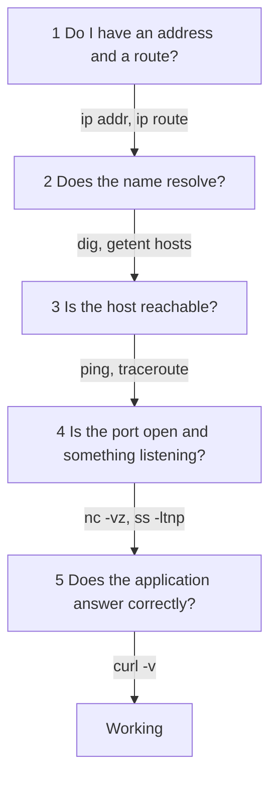

# Networking tools

> **Before this lesson:** you should know pipes ([Redirection and pipelines](#/lesson/linux-cli/redirection-pipelines)), processes ([Processes](#/lesson/linux-cli/processes)) and how to install software ([Package management](#/lesson/linux-cli/package-management)).

## In plain words

A **network** lets computers send messages to one another. To understand the commands in this lesson, picture the postal system.

Every computer on a network has an **IP address**, which works like a street address. Because numbers are hard to remember, there is a directory service called **DNS** (Domain Name System) that turns a name such as `example.net` into the address — like looking up a company in a phone book. One computer usually runs several services at once (a web site, a database), and each waits at a numbered door called a **port** — like flat numbers within one building. A message that has to travel far is passed along by a series of sorting offices called **routers**.

When a connection fails, it fails at one of those points: no address, the name not found, the building unreachable, the door closed, or nobody answering sensibly behind it. Each command in this lesson tests one of those points.

Why this matters for a job: almost all software today talks over a network. "The service cannot be reached" is among the most frequent problems an engineer faces, and a short ordered series of tests finds the cause quickly. Connecting to remote machines with SSH is daily routine.

## Motivation

"The service is down." Is it? Or is the name not resolving, or the route broken, or a firewall dropping packets, or the process listening on the wrong address, or the certificate expired, or the application answering with an error? "It's the network" and "it's not the network" are both said with great confidence and very little evidence.

The command line turns that argument into a short series of tests, each of which eliminates one layer. A handful of tools — `ip`, `ping`, `dig`, `traceroute`, `ss`, `nc`, `curl` — let you say precisely *where* a connection fails. Add `ssh` and `scp` for working on and copying to other machines, and you have the networking kit used daily by anyone who operates software.

## A mental model in five questions

A connection from your machine to `api.example.net` on port 443 succeeds only if every one of these has the answer yes:



Test them in order and stop at the first failure: that is your layer. The rest of the lesson takes the tools in the same order.

## 1. Your own interfaces and routes: `ip`

```bash
mira@forge:~$ ip -brief addr
lo               UNKNOWN        127.0.0.1/8 ::1/128
enp3s0           UP             192.168.10.24/24 fe80::5a11:22ff:fe33:4455/64
docker0          DOWN           172.17.0.1/16
mira@forge:~$ ip route
default via 192.168.10.1 dev enp3s0 proto dhcp metric 100
172.17.0.0/16 dev docker0 proto kernel scope link src 172.17.0.1 linkdown
192.168.10.0/24 dev enp3s0 proto kernel scope link src 192.168.10.24 metric 100
```

`lo` is the **loopback** interface: `127.0.0.1` (the name `localhost`) always means "this machine itself". `enp3s0` is a real network card, `UP`, with the address `192.168.10.24`. The `/24` is the prefix length: the first 24 bits identify the network, so every address `192.168.10.x` is a direct neighbour. The routing table says the same thing in the kernel's words — the `192.168.10.0/24` network is reached directly, and everything else goes to the **default gateway** `192.168.10.1`.

No address on the interface, or no `default` line, and nothing beyond the local network will work. (`ip` replaced the older `ifconfig` and `route`, which you will still see in tutorials.)

The arithmetic behind a prefix is worth being able to do. Python's standard library does it exactly:

```python-run
import ipaddress

def describe(cidr):
    net = ipaddress.ip_network(cidr, strict=False)
    hosts = max(net.num_addresses - 2, 0) if net.prefixlen < 31 else net.num_addresses
    print(f"{cidr:18} network {net.network_address}  mask {net.netmask}  "
          f"broadcast {net.broadcast_address}  usable hosts {hosts}")

for block in ["192.168.10.24/24", "10.0.0.0/8", "172.16.5.0/20", "10.20.30.40/30", "203.0.113.7/32"]:
    describe(block)

me = ipaddress.ip_interface("192.168.10.24/24")
for target in ["192.168.10.99", "192.168.11.5", "8.8.8.8"]:
    direct = ipaddress.ip_address(target) in me.network
    print(f"{target:15} -> {'same network: deliver directly' if direct else 'different network: send to the default gateway'}")
```

## 2. Names: `dig`, `host` and `getent`

Humans use names; packets use addresses. The Domain Name System translates, and a remarkable share of outages are DNS problems.

```bash
mira@forge:~$ dig +short api.example.net
203.0.113.50
mira@forge:~$ dig api.example.net

;; ANSWER SECTION:
api.example.net.	300	IN	A	203.0.113.50

;; Query time: 12 msec
;; SERVER: 127.0.0.53#53(127.0.0.53) (UDP)
mira@forge:~$ dig +short MX example.net
10 mail.example.net.
mira@forge:~$ dig +short -x 203.0.113.50          # reverse lookup: address -> name
api.example.net.
mira@forge:~$ dig @1.1.1.1 +short api.example.net  # ask a specific resolver
203.0.113.50
mira@forge:~$ getent hosts api.example.net        # resolve exactly as programs on this machine do
203.0.113.50    api.example.net
```

In the full answer, `300` is the **TTL** — the number of seconds resolvers may cache the record, and therefore how long a DNS change takes to spread. `A` is the record type:

| Record | Maps |
|---|---|
| `A` / `AAAA` | name → IPv4 / IPv6 address |
| `CNAME` | name → another name (an alias) |
| `MX` | domain → mail servers |
| `TXT` | arbitrary text (domain verification, SPF) |
| `NS` | domain → its authoritative name servers |
| `PTR` | address → name |

`dig` talks straight to DNS, whereas ordinary programs first consult `/etc/hosts` and follow `/etc/nsswitch.conf`. `getent hosts` uses that same path, so if `dig` and `getent` disagree, look for an entry in `/etc/hosts`. Comparing your default resolver with a public one (`@1.1.1.1`, `@8.8.8.8`) separates "the record is wrong" from "my resolver is stale".

## 3. Reachability: `ping` and `traceroute`

```bash
mira@forge:~$ ping -c 4 192.168.10.1
PING 192.168.10.1 (192.168.10.1) 56(84) bytes of data.
64 bytes from 192.168.10.1: icmp_seq=1 ttl=64 time=0.412 ms
64 bytes from 192.168.10.1: icmp_seq=2 ttl=64 time=0.388 ms
64 bytes from 192.168.10.1: icmp_seq=3 ttl=64 time=0.401 ms
64 bytes from 192.168.10.1: icmp_seq=4 ttl=64 time=0.395 ms

--- 192.168.10.1 ping statistics ---
4 packets transmitted, 4 received, 0% packet loss, time 3051ms
rtt min/avg/max/mdev = 0.388/0.399/0.412/0.008 ms
```

`ping` sends ICMP echo requests and reports each reply's round-trip time. Without `-c` it runs until `Ctrl-C`. The two numbers to read are **packet loss** (anything above 0% on a wired network deserves attention) and the spread of **round-trip times** (a large `mdev` means jitter).

A useful ladder: ping `127.0.0.1` (is my network stack alive?), then my own address, then the gateway (local network?), then a public address such as `1.1.1.1` (routing to the internet?), then a name (DNS?). The first rung that fails tells you the scope of the problem.

One caution: many hosts and firewalls deliberately ignore ping. **No reply does not prove a host is down**, and a reply does not prove your service works. It tests reachability and nothing else.

`traceroute` (or the similar `tracepath`, which needs no privileges) shows the routers a packet crosses on the way:

```bash
mira@forge:~$ traceroute -n api.example.net
traceroute to api.example.net (203.0.113.50), 30 hops max, 60 byte packets
 1  192.168.10.1    0.45 ms   0.41 ms   0.39 ms
 2  100.64.12.1     8.90 ms   9.12 ms   8.77 ms
 3  198.51.100.33  11.02 ms  10.95 ms  11.20 ms
 4  * * *
 5  203.0.113.50   14.31 ms  14.08 ms  14.40 ms
```

Each line is one hop with three timing probes; `-n` skips reverse lookups, which makes it faster. Stars mean a router chose not to answer — harmless if later hops respond, as here. If the trace stops answering at some point and never reaches the destination, the break is at or immediately beyond the last hop that replied. `mtr host` combines `ping` and `traceroute` into a continuously updating display and is excellent for spotting where loss begins.

## 4. Ports and listeners: `ss` and `nc`

A reachable host says nothing about a particular service. Two views matter: *from the client*, can I open the port? and *on the server*, what is listening?

```bash
mira@forge:~$ nc -vz api.example.net 443
Connection to api.example.net (203.0.113.50) 443 port [tcp/https] succeeded!
mira@forge:~$ nc -vz -w 3 db.internal 5432
nc: connect to db.internal (10.0.4.12) port 5432 (tcp) failed: Connection refused
mira@forge:~$ nc -vz -w 3 cache.internal 6379
nc: connect to cache.internal (10.0.4.30) port 6379 (tcp) timed out: Operation now in progress
```

The two failures mean different things, and telling them apart is one of the most valuable networking skills:

| Result | What happened | Usual cause |
|---|---|---|
| succeeded | the TCP handshake completed | something is listening and reachable |
| **Connection refused** | the host answered "nobody is listening here" | service not running, or listening on another port or address |
| **timed out** | no answer at all | a firewall or security group dropping packets, a wrong address, or a host that is down |

On the server side, `ss` ("socket statistics", the successor to `netstat`) lists listeners:

```bash
mira@forge:~$ sudo ss -ltnp
State  Recv-Q Send-Q Local Address:Port  Peer Address:Port Process
LISTEN 0      4096       127.0.0.1:5432       0.0.0.0:*     users:(("postgres",pid=812,fd=6))
LISTEN 0      511          0.0.0.0:80         0.0.0.0:*     users:(("nginx",pid=1203,fd=6))
LISTEN 0      128          0.0.0.0:22         0.0.0.0:*     users:(("sshd",pid=801,fd=3))
LISTEN 0      2048       127.0.0.1:8000       0.0.0.0:*     users:(("uvicorn",pid=6021,fd=6))
```

The flags read: **l**istening, **t**cp, **n**umeric, **p**rocess. The *Local Address* column answers a question that causes endless confusion. `0.0.0.0:80` means nginx accepts connections arriving on **any** interface. `127.0.0.1:8000` means uvicorn accepts connections **only from this same machine** — from anywhere else it looks exactly like "connection refused". A web application that works with `curl localhost:8000` on the server but not from your laptop is very often bound to loopback.

> [!TIP]
> "Works on the server, refused from outside" → check the bind address with `ss -ltnp` (is it `127.0.0.1`?). "Times out from outside" → check firewalls: the host's (`sudo ufw status`, `sudo nft list ruleset`) and the cloud provider's security group. Inside containers the same rule applies: a server must bind `0.0.0.0` for a published port to reach it.

## 5. The application: `curl` and `wget`

`curl` speaks HTTP (and much else) and shows you every step with `-v`:

```bash
mira@forge:~$ curl -sS -o /dev/null -w '%{http_code} in %{time_total}s\n' https://api.example.net/health
200 in 0.084s
mira@forge:~$ curl -v https://api.example.net/health 2>&1 | grep -E '^(\*|<|>)' | head -n 9
*   Trying 203.0.113.50:443...
* Connected to api.example.net (203.0.113.50) port 443
* SSL connection using TLSv1.3 / TLS_AES_256_GCM_SHA384
*  subject: CN=api.example.net
*  expire date: Feb 11 23:59:59 2027 GMT
> GET /health HTTP/2
> Host: api.example.net
< HTTP/2 200
< content-type: application/json
```

Lines starting with `*` are connection details (address tried, TLS version, certificate), `>` is what was sent, `<` is what came back. One command covers layers two to five. `curl -I url` fetches only the headers. A later lesson treats `curl` in depth, including JSON APIs.

For downloading files, `wget` is convenient because it saves to disk by default, resumes with `-c` and can mirror whole directory trees:

```bash
mira@forge:~$ wget -c https://downloads.example.org/datasets/weather-2025.tar.gz
weather-2025.tar.gz   100%[===================>]   1.21G  38.4MB/s    in 32s
mira@forge:~$ curl -fL -O https://downloads.example.org/datasets/weather-2025.tar.gz   # the curl equivalent
```

## Secure remote access: `ssh`, `scp`, `sftp`

Old protocols such as `telnet` and `ftp` send everything, passwords included, as readable text. They survive only in legacy corners. **SSH** replaced them: it encrypts the session, authenticates the server to you and you to the server.

```bash
mira@forge:~$ ssh otto@build01.example.net
The authenticity of host 'build01.example.net (198.51.100.20)' can't be established.
ED25519 key fingerprint is SHA256:Qk3vT2m0cWl8yJ1c7b2zN9s4LrXe5uH0aPq6dF8gM1w.
Are you sure you want to continue connecting (yes/no/[fingerprint])? yes
Warning: Permanently added 'build01.example.net' (ED25519) to the list of known hosts.
otto@build01:~$ exit
mira@forge:~$ ssh otto@build01.example.net 'df -h / | tail -n 1'
/dev/vda1        78G   31G   44G  42% /
mira@forge:~$ ssh -p 2222 deploy@198.51.100.21 'sudo systemctl is-active weather-api'
active
```

The first connection asks you to confirm the server's key fingerprint, which is then stored in `~/.ssh/known_hosts`. Given a command, `ssh` runs it remotely and returns the output locally — remote machines become one more stage in your pipelines:

```bash
mira@forge:~$ ssh build01 'journalctl -u weather-api --since "1 hour ago" --no-pager' | grep -c ERROR
17
```

> [!WARNING]
> If SSH suddenly prints **"WARNING: REMOTE HOST IDENTIFICATION HAS CHANGED!"**, do not reflexively delete the old key and reconnect. The message means the server's identity differs from the one you accepted before. The innocent explanation is that the machine was rebuilt or its address reassigned; the other explanation is that someone is intercepting the connection. Confirm with whoever administers the host before removing the stale entry with `ssh-keygen -R hostname`.

Copying files rides on the same protocol:

```bash
mira@forge:~$ scp model.onnx otto@build01:/srv/models/              # local -> remote
mira@forge:~$ scp otto@build01:/var/log/weather/app.log ./          # remote -> local
mira@forge:~$ scp -r configs/ otto@build01:~/staging/               # a directory
mira@forge:~$ sftp otto@build01                                      # interactive: ls, cd, get, put, bye
mira@forge:~$ rsync -avz --progress data/ otto@build01:/srv/data/   # incremental, resumable; preferred for large trees
```

The colon is what marks an argument as remote; forget it and `scp` cheerfully makes a local copy named `otto@build01`. Keys, agent forwarding, tunnels and the SSH configuration file are covered in the lesson on working with remote machines.

> [!INTERVIEW]
> Favourites: "A user cannot reach your web service — how do you troubleshoot?" (walk the five questions in order, naming a tool for each), "Difference between connection refused and timeout?" (active rejection because nothing listens, versus silent drop by a firewall or dead route), "What does binding to `0.0.0.0` versus `127.0.0.1` mean?", and "What happens when you type a URL and press Enter?" (DNS lookup, TCP handshake, TLS negotiation, HTTP request and response — each of which you can now demonstrate with a command).

## Legacy file transfer: `ftp` and `lftp`

**FTP** (File Transfer Protocol) is one of the oldest internet protocols. It sends the user name, the password and the files themselves unencrypted, so for anything private it has been replaced by `sftp` and `scp`, shown above. It survives in two places: public download servers that allow **anonymous** logins (user name `anonymous`, any password) for software and data, and old business systems that still exchange files over it. You are therefore likely to be asked about it.

The plain `ftp` command is a bare-bones interactive client. `lftp` is the comfortable one, and it speaks several protocols (`ftp://`, `ftps://`, `sftp://`, `http://`).

```bash
mira@forge:~$ lftp ftp://ftp.example.org
lftp ftp.example.org:~> cd pub/releases
lftp ftp.example.org:/pub/releases> ls
lftp ftp.example.org:/pub/releases> get tool-2.1.tar.gz
lftp ftp.example.org:/pub/releases> mget *.sig
lftp ftp.example.org:/pub/releases> bye
```

Inside, the commands mirror what a shell does remotely: `ls`, `cd`, `get` to download one file, `mget` for several with a wildcard, and `put`/`mput` to upload. What makes `lftp` worth knowing:

- **`mirror`** copies an entire directory tree. `mirror remote-dir local-dir` downloads; `mirror -R local-dir remote-dir` (reverse) uploads. Adding `-c` continues an interrupted run, and it skips files that are already up to date.
- **`pget -n 4 file`** downloads one file in four parallel pieces, which can help on a slow link.
- **Resume and retry.** It reconnects after drops and continues partial downloads, which plain `ftp` cannot.
- **Scripting.** `lftp -e "mirror /pub/data ./data; quit" ftp.example.org` runs commands non-interactively, so a cron job can use it.

When you have a choice, connect with `lftp sftp://user@host` to get the same convenience over an encrypted SSH connection.

## Pitfalls

- **Treating ping as proof.** It tests ICMP reachability only; many hosts block it.
- **Blaming the network before checking the listener.** `ss -ltnp` on the server takes five seconds.
- **Forgetting DNS caching.** A corrected record takes up to its TTL to be seen everywhere.
- **`/etc/hosts` overrides** left behind from testing and silently redirecting a name.
- **Confusing refused with timed out** and searching for a firewall problem that is really a stopped service, or the reverse.
- **Missing colon in `scp`.**
- **Clear-text protocols.** Never send credentials over `telnet`, `ftp` or plain `http`.
- **Scanning networks you do not own.** Port scanners such as `nmap` are legitimate tools on your own systems and can violate policy or law elsewhere.

## Cheat sheet

| Question | Command |
|---|---|
| My addresses | `ip -brief addr` |
| My routes and default gateway | `ip route` |
| Resolve a name | `dig +short name`, `getent hosts name` |
| Reverse lookup / specific resolver | `dig -x addr`, `dig @1.1.1.1 name` |
| Is the host reachable? | `ping -c 4 host` |
| Path to the host | `traceroute -n host`, `mtr host` |
| Can I open the port? | `nc -vz -w 3 host port` |
| What is listening here? | `sudo ss -ltnp` |
| Established connections | `ss -tn` |
| HTTP status and timing | `curl -sS -o /dev/null -w '%{http_code} %{time_total}\n' URL` |
| Full HTTP/TLS conversation | `curl -v URL` |
| Download a file | `wget -c URL`, `curl -fLO URL` |
| Remote shell / one command | `ssh user@host`, `ssh user@host 'cmd'` |
| Copy files | `scp file user@host:/path/`, `rsync -avz dir/ user@host:/path/` |
| Remove a stale host key | `ssh-keygen -R host` |

## Summary

- Diagnose in layers: local address and route, DNS, reachability, port, application — and stop at the first failure.
- `ip` shows interfaces and routes; `dig` and `getent` test name resolution; `ping`, `traceroute` and `mtr` test the path.
- `nc -vz` tests a port from the client, `ss -ltnp` shows listeners on the server; "refused" and "timed out" point to different causes, and the bind address decides who can connect.
- `curl -v` exposes the whole HTTP and TLS exchange; `wget` downloads.
- `ssh` gives encrypted remote shells and remote commands, with `scp`, `sftp` and `rsync` for files; take host-key warnings seriously.

## Glossary

| Term | Meaning |
|---|---|
| network interface | a connection point of a computer to a network, such as a network card |
| IP address | the numeric address of a computer on a network |
| loopback / localhost | the address `127.0.0.1`, meaning this computer itself |
| gateway | the router to which traffic for other networks is sent |
| DNS | Domain Name System: translates names into addresses |
| TTL | time to live: how long a DNS answer may be remembered |
| port | a number identifying one service on a computer |
| listen | wait for incoming connections on a port |
| firewall | a filter that allows or blocks network traffic |
| HTTP | the protocol used by web sites and web services |
| SSH | Secure Shell: encrypted login to and command execution on another computer |
| FTP | File Transfer Protocol: an old, unencrypted protocol for moving files between machines |
| Anonymous FTP | A public FTP server that accepts the user name `anonymous` so anyone may download |
| `lftp` | A feature-rich command-line client that supports FTP, FTPS, SFTP and HTTP, with mirroring and resume |
| `mirror` | The lftp command that copies a whole directory tree, skipping files that are already current |

## Check yourself

```quiz
[
  {"q": "`nc -vz db.internal 5432` returns 'Connection refused'. What does that tell you?",
   "options": ["A firewall is silently dropping the packets", "The host is reachable but nothing is accepting connections on that port and address", "DNS failed to resolve the name", "The cable is unplugged"],
   "answer": 1,
   "explain": "A refusal is an active reply from the host. A firewall drop or dead host would produce a timeout instead."},
  {"q": "A web app answers `curl http://localhost:8000` on the server but is refused from other machines. `ss -ltnp` shows it listening on 127.0.0.1:8000. What is the fix?",
   "options": ["Open port 8000 in the firewall", "Configure the app to bind 0.0.0.0 (or the server's external address) instead of loopback", "Restart the DNS resolver", "Use ping instead of curl"],
   "answer": 1,
   "explain": "A socket bound to 127.0.0.1 only accepts connections originating on the same machine."},
  {"q": "In `default via 192.168.10.1 dev enp3s0`, what is 192.168.10.1?",
   "options": ["The DNS server", "The default gateway, where packets for all non-local networks are sent", "This machine's own address", "The broadcast address"],
   "answer": 1,
   "explain": "The default route names the next hop used for any destination not covered by a more specific route."},
  {"q": "A host does not answer `ping` but its web site loads in a browser. What is the most likely explanation?",
   "options": ["The browser is using a cached copy", "ICMP echo is blocked or ignored while TCP port 443 is allowed", "The host has two network cards", "ping only works on local networks"],
   "answer": 1,
   "explain": "Many administrators filter ICMP. Lack of a ping reply does not show that a host or service is down."},
  {"q": "The A record of a name was changed ten minutes ago with a TTL of 3600, yet some clients still reach the old address. Why?",
   "options": ["The change failed", "Resolvers may keep serving the cached old record until its one-hour TTL expires", "A records cannot be changed", "The clients need to reboot"],
   "answer": 1,
   "explain": "TTL is the caching lifetime. Lowering it well before a planned change shortens the transition."},
  {"q": "What does `ssh otto@build01 'uptime'` do?",
   "options": ["Opens an interactive shell and types uptime for you", "Runs uptime on build01 and prints its output locally, then disconnects", "Copies the uptime program to build01", "Shows how long the SSH connection has been open"],
   "answer": 1,
   "explain": "With a command argument ssh executes it remotely and returns the output, which can be piped into local tools."},
  {"q": "Which command would you run ON the server to see which process is listening on TCP port 8080?",
   "options": ["ping -p 8080 localhost", "sudo ss -ltnp | grep :8080", "dig localhost 8080", "traceroute -p 8080 localhost"],
   "answer": 1,
   "explain": "ss -ltnp lists listening TCP sockets with numeric ports and the owning process."},
  {"q": "You run `scp report.pdf otto@build01` and no file arrives on the server. What happened?",
   "options": ["scp needs sudo", "Without a colon the destination is treated as a local file name, so a local copy called otto@build01 was created", "The file was too large", "scp only copies directories"],
   "answer": 1,
   "explain": "The colon after the host is what marks a remote path, as in otto@build01:/path/."},
  {"q": "Why is plain FTP unsuitable for sending private files over the internet?", "options": ["It cannot send large files", "It transmits credentials and data without encryption", "It only works on local networks", "It needs a graphical interface"], "answer": 1, "explain": "FTP sends everything in clear text. Use sftp, scp or FTPS instead."},
  {"q": "Which lftp command uploads a local directory tree to the server?", "options": ["mirror remote local", "mirror -R local remote", "pget -n 4 local", "mget local"], "answer": 1, "explain": "mirror downloads by default; -R reverses the direction so it uploads."}
]
```

> **Source:** Shotts, *The Linux Command Line*, ch. 16 (Networking). All examples and wording are original to this guide.
