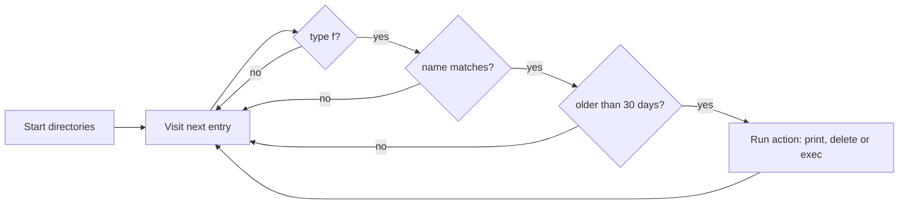

# Searching for files: locate, find and xargs

> **Before this lesson:** you should know wildcards ([Manipulating files](#/lesson/linux-cli/manipulating-files)), pipes ([Redirection and pipelines](#/lesson/linux-cli/redirection-pipelines)), quoting ([Expansion and quoting](#/lesson/linux-cli/expansion-quoting)) and permissions ([Permissions](#/lesson/linux-cli/permissions)).

## In plain words

A computer holds hundreds of thousands of files. Finding one by opening directory after directory is like looking for a book by walking every aisle of a library. This lesson introduces two better ways.

`locate` is the library **catalogue**: you look a title up in a prepared index and get the answer at once. The catalogue is only as fresh as its last update, so a book shelved this morning may not be in it yet.

`find` is a tireless **assistant who walks the shelves for you**. It is slower, but it sees what is there right now, and it can search by far more than the name: "every file bigger than a gigabyte", "everything changed in the last hour", "all files belonging to this user". It can also *do* something with each file it finds.

A third tool, `xargs`, takes a list of found files and hands them to another command to work on.

Why this matters for a job: locating the settings file a program really reads, discovering what is filling a disk, cleaning up old files automatically and applying a change to thousands of files are everyday tasks. `find` appears constantly in maintenance scripts and in interview questions.

## Motivation

"Where is the config file this service actually reads?" "Which files in this project changed in the last hour?" "Delete every `__pycache__` directory under here." "Find all checkpoints bigger than a gigabyte that nobody has touched in a month." "Which of these ten thousand source files mention the deprecated function?"

A Linux system holds hundreds of thousands of files, and a single research project can add millions. Browsing does not scale. This lesson covers the two classic search tools — `locate`, which answers instantly from an index of names, and `find`, which walks the tree and can test almost any property of a file — and then `xargs`, the adapter that turns a list of found files into arguments for any other command. `find` in particular rewards real study: it is one of the most capable programs on the system and one of the most frequently used in scripts and in incident response.

## `locate` — instant answers from an index

`locate` searches a database of path names built in advance (normally once a day by a scheduled `updatedb` job). Because it never touches the disk, it is immediate:

```bash
mira@forge:~$ locate sshd_config
/etc/ssh/sshd_config
/etc/ssh/sshd_config.d
/usr/share/man/man5/sshd_config.5.gz
mira@forge:~$ locate -i readme | wc -l
1873
mira@forge:~$ locate -b '\nginx.conf'
/etc/nginx/nginx.conf
mira@forge:~$ locate '*.service' | grep -c systemd
412
```

By default the pattern may match **anywhere in the full path**. `-i` ignores case; `-b` matches only the base name, and the leading backslash in the third example requests an exact base-name match; wildcards work if quoted.

The price of speed is staleness: a file created five minutes ago is not in the database, and a deleted one may still be reported. `sudo updatedb` refreshes it on demand. (On Debian-family systems the command comes from the package `plocate` or `mlocate` and may not be installed by default.) Use `locate` for "where on this machine is the thing called X?"; use `find` for everything else.

## `find` — walk the tree and test every entry

```
find  [where to start...]  [tests]  [actions]
```

`find` visits the starting directories and everything beneath them. For each entry it evaluates the expression from left to right; if all tests pass, the action runs. With no tests it matches everything, and with no action it prints the path.

```bash
mira@forge:~/proj$ find . | head -n 5
.
./README.md
./src
./src/app.py
./src/utils
mira@forge:~/proj$ find ~ | wc -l
214882
```

### Tests

**By type** — `-type` takes a letter: `f` regular file, `d` directory, `l` symbolic link.

**By name** — `-name` matches the **base name** against a shell pattern; `-iname` ignores case; `-path` matches the whole path.

```bash
mira@forge:~/proj$ find . -type d -name '__pycache__'
./src/__pycache__
./src/utils/__pycache__
./tests/__pycache__
mira@forge:~/proj$ find . -type f -iname '*.jp*g' | head -n 2
./docs/img/Architecture.JPG
./docs/img/loss-curve.jpeg
mira@forge:~/proj$ find . -path './node_modules/*' -name '*.md' | wc -l
1204
```

> [!WARNING]
> **Always quote the pattern.** In `find . -name *.log`, the shell expands `*.log` *before* `find` runs. If the current directory happens to contain `a.log`, `find` receives `-name a.log` and silently searches for that one name everywhere; if it contains two matches you get the baffling error "paths must precede expression". Write `-name '*.log'`.

**By size** — `-size` takes a number with a unit and an optional sign: `+` means more than, `-` means less than, no sign means exactly.

| Unit | Meaning |
|---|---|
| `c` | bytes |
| `k` | kibibytes (1024 bytes) |
| `M` | mebibytes |
| `G` | gibibytes |
| (none) | 512-byte blocks — rarely what you want |

```bash
mira@forge:~/proj$ find runs -type f -size +1G
runs/exp07/checkpoint_epoch40.pt
runs/exp09/checkpoint_epoch12.pt
mira@forge:~/proj$ find . -type f -empty
./logs/.keep
```

Sizes are **rounded up** to whole units before comparing, with a counter-intuitive consequence: `-size -1M` matches only empty files (anything from 1 byte upward rounds up to 1M, which is not less than 1). To mean "smaller than one mebibyte" write `-size -1024k`.

**By time** — every file has three timestamps: **m**odification of content, **c**hange of metadata (permissions, owner, name), and last **a**ccess. Each has a test measured in days (`-mtime`, `-ctime`, `-atime`) and one in minutes (`-mmin`, `-cmin`, `-amin`), with the same `+`/`-` convention.

```bash
mira@forge:~/proj$ find . -type f -mmin -60               # modified within the last hour
./src/app.py
./logs/train.log
mira@forge:~/proj$ find /var/log -name '*.gz' -mtime +30  # compressed logs older than 30 days
mira@forge:~/proj$ find . -newer requirements.txt -name '*.py'   # changed after another file
```

Ages are truncated to whole days first, so `-mtime +7` means "at least eight full days old" and `-mtime 0` means "within the last 24 hours". The practice problem for this module makes you implement both rounding rules.

**By owner and permission:**

```bash
mira@forge:~$ find /srv/shared -user otto -type f | wc -l
3310
mira@forge:~$ find /srv/shared ! -group ml-team                 # not owned by the team group
mira@forge:~$ find ~ -type f -perm -o+w                         # world-writable files
mira@forge:~$ sudo find / -xdev -type f -perm -4000 2>/dev/null # setuid programs
```

`-perm MODE` needs an exact match; `-perm -MODE` requires **all** the listed bits (others may be set too); `-perm /MODE` requires **any** of them.

**Limiting the walk:**

| Option | Effect |
|---|---|
| `-maxdepth N` | descend at most N levels (`-maxdepth 1` = this directory only) |
| `-mindepth N` | ignore the first N levels |
| `-xdev` (or `-mount`) | stay on one file system — do not wander into `/proc`, network mounts or other disks |
| `-prune` | do not descend into the directory that was matched |

`-prune` is how you skip heavy directories efficiently, and has an idiomatic shape:

```bash
mira@forge:~/proj$ find . \( -name .git -o -name node_modules -o -name .venv \) -prune -o -type f -name '*.py' -print
./src/app.py
./src/utils/io.py
./tests/test_app.py
```

Read it as: "if the entry is one of these directories, prune it; **otherwise**, if it is a Python file, print it."

### Combining tests

Tests written side by side are joined by an implicit AND. Use `-o` for OR, `!` (or `-not`) for negation and escaped parentheses for grouping. AND binds tighter than OR, and evaluation **short-circuits**: once the outcome is decided, the rest is skipped.

```bash
mira@forge:~/proj$ find . -type f \( -name '*.log' -o -name '*.tmp' \) -size +10M
mira@forge:~/proj$ find /srv/shared \( -type f ! -perm 0640 \) -o \( -type d ! -perm 0750 \)
```

The second command audits a tree for anything that deviates from the intended modes. The parentheses must be escaped (or quoted) because they are special to the shell.



Because tests run left to right and stop at the first failure, put cheap, selective tests such as `-name` and `-type` before expensive ones.

The following simulation evaluates a `find`-style expression over an in-memory tree, including the size and age rounding, so you can check your reading of a command before you run the real one:

```python-run
import fnmatch, math

TREE = [  # (path, type, size in bytes, age in hours)
    ("./runs", "d", 4096, 2), ("./runs/exp07/ckpt_40.pt", "f", 3_400_000_000, 900),
    ("./runs/exp09/ckpt_12.pt", "f", 2_100_000_000, 30), ("./runs/exp09/notes.txt", "f", 812, 30),
    ("./logs/train.log", "f", 52_000_000, 0.5), ("./logs/old.log.gz", "f", 9_000_000, 1100),
    ("./tmp/empty.tmp", "f", 0, 400), ("./tmp/one.tmp", "f", 1, 400),
]
UNITS = {"c": 1, "k": 1024, "M": 1024**2, "G": 1024**3}

def numeric(value, spec):
    n = int(spec.lstrip("+-"))
    return value > n if spec[0] == "+" else value < n if spec[0] == "-" else value == n

def find(name=None, ftype=None, size=None, mtime=None):
    for path, kind, nbytes, hours in TREE:
        if ftype and kind != ftype:
            continue
        if name and not fnmatch.fnmatchcase(path.rsplit("/", 1)[-1], name):
            continue
        if size and not numeric(math.ceil(nbytes / UNITS[size[-1]]), size[:-1]):   # round UP
            continue
        if mtime and not numeric(int(hours // 24), mtime):                          # round DOWN
            continue
        yield path

print("-name '*.pt' -size +1G -mtime +30 :", list(find(name="*.pt", size="+1G", mtime="+30")))
print("-name '*.log*' -mtime +30         :", list(find(name="*.log*", mtime="+30")))
print("-type f -size -1M  (surprise!)    :", list(find(ftype="f", size="-1M")))
print("-type f -size -1024k              :", list(find(ftype="f", size="-1024k")))
print("-type f -mtime 0                  :", list(find(ftype="f", mtime="0")))
```

### Actions

| Action | Effect |
|---|---|
| `-print` | print the path (the default when no action is given) |
| `-print0` | print the path followed by a NUL byte instead of a newline |
| `-ls` | print in `ls -l` style |
| `-printf FORMAT` | print chosen fields: `%p` path, `%f` base name, `%s` size, `%TY-%Tm-%Td` date, `%u` owner |
| `-delete` | delete the matched entry |
| `-exec CMD {} \;` | run CMD once **per file**, with `{}` replaced by the path |
| `-exec CMD {} +` | run CMD with **as many files as fit** on each command line |
| `-ok CMD {} \;` | like `-exec`, but ask for confirmation each time |
| `-quit` | stop at the first match |

```bash
mira@forge:~/proj$ find runs -name '*.pt' -printf '%s\t%TY-%Tm-%Td\t%p\n' | sort -rn | head -n 3
3400000000	2026-10-14	runs/exp07/ckpt_40.pt
2100000000	2026-11-19	runs/exp09/ckpt_12.pt
 880000000	2026-11-02	runs/exp03/ckpt_05.pt
mira@forge:~/proj$ find . -name '*.py' -exec grep -l 'load_legacy' {} +
./src/utils/io.py
./tests/test_io.py
mira@forge:~/proj$ find . -type f -name '*.sh' -exec chmod u+x {} \;
```

The `+` form is much faster — one `grep` process for thousands of files instead of thousands of processes — and is the right default. Use `\;` when the command accepts only one file at a time or when each file needs its own invocation.

> [!WARNING]
> `-delete` and `-exec rm` act immediately and permanently. Two rules. **First, run the command with `-print` in place of the action and read the list.** Second, be careful with ordering: an action is one more element of the expression, evaluated in sequence. `find . -delete -name '*.tmp'` deletes **everything** under the current directory, because `-delete` runs before the name test is ever considered. The destructive action goes **last**.

```bash
mira@forge:~/proj$ find . -type d -name '__pycache__' -print          # 1. preview
./src/__pycache__
./src/utils/__pycache__
./tests/__pycache__
mira@forge:~/proj$ find . -type d -name '__pycache__' -prune -exec rm -r {} +    # 2. then act
mira@forge:~/proj$ find /var/tmp/uploads -type f -mtime +14 -delete   # a typical cleanup job
```

## `xargs` — turning lines into arguments

Many commands take their work as **arguments**, not on standard input: `rm`, `cp`, `chmod`, `grep pattern FILES`. A pipe delivers a stream. `xargs` bridges the two: it reads items from its input and runs a command with those items appended as arguments, starting additional command lines whenever one would become too long for the operating system.

```bash
mira@forge:~/proj$ find . -name '*.py' | xargs wc -l | tail -n 1
  18422 total
mira@forge:~/proj$ echo a b c d e | xargs -n 2 echo item:
item: a b
item: c d
item: e
```

That batching is why `xargs` succeeds where a direct glob fails with `Argument list too long`.

### The whitespace problem and its cure

By default `xargs` splits its input on any whitespace and interprets quotes. A file called `final results.csv` therefore becomes two arguments, `final` and `results.csv` — and with `rm` at the other end, that can delete the wrong thing. The robust convention is to separate names with a NUL byte, the one character that cannot appear in a path:

```bash
mira@forge:~/proj$ find . -name '*.csv' -print0 | xargs -0 ls -l
-rw-r--r-- 1 mira mira  9120 Nov 18 14:02 ./data/final results.csv
-rw-r--r-- 1 mira mira 40211 Nov 19 09:30 ./data/raw.csv
```

> [!TIP]
> Make `-print0 | xargs -0` a fixed pair in your mind. Any pipeline that carries file names should use it (many tools cooperate: `grep -Z`, `sort -z`, `git ls-files -z`). If you are choosing between `find … | xargs cmd` and `find … -exec cmd {} +`, the `-exec` form is immune to the problem and needs no pipe at all.

### Options worth knowing

| Option | Effect |
|---|---|
| `-0` | items are NUL-separated |
| `-n N` | at most N items per command line |
| `-I {}` | run the command once per item, substituting `{}` wherever it appears |
| `-P N` | run up to N commands in parallel |
| `-r` | do not run the command at all if there is no input (GNU default behaviour is to run it once) |
| `-t` | print each command before running it |
| `-p` | ask before running each command |

```bash
mira@forge:~/proj$ find raw -name '*.wav' -print0 | xargs -0 -P 8 -I {} ffmpeg -loglevel error -i {} -ar 16000 {}.16k.wav
mira@forge:~/proj$ cat hosts.txt | xargs -I {} -P 4 ssh {} 'uptime'
mira@forge:~/proj$ git ls-files -z '*.py' | xargs -0 -r black --check
```

The first converts audio files eight at a time — a one-line parallel job runner. The `-I {}` form lets the item appear in the middle of the command or more than once.

> [!INTERVIEW]
> Typical prompts: "Find all files over 100 MB modified in the last week" (`find / -xdev -type f -size +100M -mtime -7`), "Delete files older than 30 days in a directory" (`find DIR -type f -mtime +30 -delete`, after previewing), "What is the difference between `-exec … \;` and `-exec … +`?" (one process per file versus batched arguments), and "Why `-print0` and `xargs -0`?" (file names may contain spaces or newlines; NUL is the only safe separator). Explaining the `-size -1M` rounding trap or the action-ordering trap marks you as someone who has really used the tool.

## Pitfalls

- **Unquoted patterns** expanded by the shell.
- **`-delete` placed before the tests.**
- **Operator precedence with `-o`.** `find . -name '*.a' -o -name '*.b' -print` prints only the `.b` files, because the implicit AND binds `-print` to the second test. Group with `\( … \)`.
- **Rounding surprises** in `-size` and `-mtime`.
- **Crossing into other file systems** (`/proc`, NFS, external disks) when searching from `/`; add `-xdev`.
- **Permission-denied noise**; append `2>/dev/null`.
- **Piping names through plain `xargs`.**
- **Trusting `locate` for recent files.**

## Cheat sheet

| Goal | Command |
|---|---|
| Fast name lookup | `locate name`, `locate -i name` |
| Refresh the index | `sudo updatedb` |
| Files by name | `find . -type f -name '*.ext'` |
| Case-insensitive | `find . -iname 'readme*'` |
| Only this directory | `find . -maxdepth 1 -type f` |
| Larger than 100 MiB | `find . -type f -size +100M` |
| Modified in the last hour / over 30 days ago | `find . -mmin -60` / `find . -mtime +30` |
| Newer than a file | `find . -newer ref` |
| Skip directories | `find . \( -name .git -o -name .venv \) -prune -o -type f -print` |
| Either of two names | `find . \( -name '*.a' -o -name '*.b' \) -print` |
| Custom output | `find . -printf '%s\t%p\n'` |
| Run a command on matches | `find . -name '*.py' -exec cmd {} +` |
| Delete matches (preview first!) | `find DIR -type f -mtime +30 -delete` |
| Safe hand-off to xargs | `find . -print0 \| xargs -0 cmd` |
| Parallel execution | `… \| xargs -0 -P 8 -n 1 cmd` |
| Item in the middle | `… \| xargs -I {} cmd {} dest/` |

## Summary

- `locate` consults a pre-built index of names: instant but possibly out of date.
- `find` walks directories and evaluates an expression per entry: tests for type, name, size, times, owner and permissions, combined with implicit AND, `-o`, `!` and parentheses, followed by actions.
- Quote patterns, know the rounding rules, preview before destructive actions, and put `-delete` last.
- `-exec … {} +` batches files into few command invocations; `-exec … {} \;` runs one per file.
- `xargs` converts an input stream into arguments, batching, substituting and parallelising as required; pair `-print0` with `-0` for safety with unusual file names.

## Glossary

| Term | Meaning |
|---|---|
| index (database) | a prepared list of file names that `locate` searches |
| test | a condition `find` checks for each file, such as `-name` or `-size` |
| action | what `find` does with a matching file, such as `-print` or `-delete` |
| expression | the whole sequence of tests and actions given to `find` |
| modification time (mtime) | when a file's contents last changed |
| recursive | covering a directory and everything beneath it |
| short-circuit | stopping the evaluation as soon as the result is decided |
| argument list | the words passed to a command when it starts |
| NUL character | a zero byte, used to separate file names because it cannot occur inside one |
| batch | a group of items handled together in one run of a command |

## Check yourself

```quiz
[
  {"q": "Why should the pattern in `find . -name '*.log'` be quoted?",
   "options": ["find requires quotes around every argument", "Otherwise the shell may expand the pattern against the current directory before find sees it", "Quotes make the search case-insensitive", "Unquoted patterns search only one level deep"],
   "answer": 1,
   "explain": "Pathname expansion happens in the shell. If a matching file exists in the current directory, find receives that name instead of the pattern."},
  {"q": "What does `find /var/log -type f -mtime +7` select?",
   "options": ["Files modified in the last 7 days", "Files whose age, in whole days, is greater than 7 — that is, at least 8 full days old", "Files exactly 7 days old", "Files larger than 7 blocks"],
   "answer": 1,
   "explain": "The age is truncated to whole 24-hour periods and +7 means strictly more than 7."},
  {"q": "What is the difference between `-exec gzip {} \\;` and `-exec gzip {} +`?",
   "options": ["No difference", "The first starts one gzip per file; the second passes many files to each gzip invocation", "The second runs in the background", "The first asks for confirmation"],
   "answer": 1,
   "explain": "The plus form batches arguments like xargs, which is far more efficient for large numbers of files."},
  {"q": "What happens with `find . -delete -name '*.tmp'`?",
   "options": ["Only .tmp files are deleted", "Everything under the current directory is deleted, because -delete is evaluated before the name test", "Nothing; it is a syntax error", "It asks for confirmation first"],
   "answer": 1,
   "explain": "The expression is evaluated left to right and -delete is an action that runs as soon as it is reached. Destructive actions belong at the end."},
  {"q": "Why use `find … -print0 | xargs -0 …` instead of a plain pipe to xargs?",
   "options": ["It is faster", "File names may contain spaces or newlines; NUL separation prevents them from being split into several arguments", "xargs cannot read newlines", "It sorts the output"],
   "answer": 1,
   "explain": "Default xargs splits on whitespace. NUL is the only byte that cannot occur in a path, so it is an unambiguous separator."},
  {"q": "`find . -type f -size -1M` returned only empty files. Why?",
   "options": ["The -size test is broken", "Sizes are rounded up to whole units, so any non-empty file counts as at least 1M, which is not less than 1", "M means megabits", "The files are sparse"],
   "answer": 1,
   "explain": "Use a smaller unit to express the bound precisely, for example -size -1024k."},
  {"q": "Which statement about `locate` is correct?",
   "options": ["It searches file contents", "It reads a periodically rebuilt database, so very recent files may be missing", "It requires root privileges", "It is slower than find because it checks every disk"],
   "answer": 1,
   "explain": "locate trades freshness for speed. updatedb rebuilds its index."},
  {"q": "In `find . -name '*.c' -o -name '*.h' -print`, which files are printed?",
   "options": ["Both .c and .h files", "Only .h files, because -print is ANDed with the second test only", "Only .c files", "No files"],
   "answer": 1,
   "explain": "Implicit AND binds tighter than -o. Wrap the alternatives in escaped parentheses so that -print applies to both."}
]
```

> **Source:** Shotts, *The Linux Command Line*, ch. 17 (Searching for Files). All examples and wording are original to this guide.
