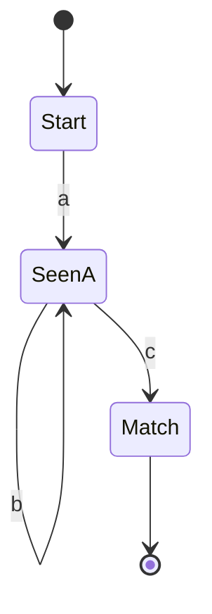

# Regular expressions with grep

> **Before this lesson:** you should know pipes ([Redirection and pipelines](#/lesson/linux-cli/redirection-pipelines)), quoting ([Expansion and quoting](#/lesson/linux-cli/expansion-quoting)) and wildcards ([Manipulating files](#/lesson/linux-cli/manipulating-files)).

## In plain words

The "find" box in a word processor looks for an exact word. A **regular expression** — often shortened to *regex* — looks for a *shape* of text instead. Not "the word error", but "a line that starts with a date", or "any three digits followed by a dash", or "the word error or the word warning".

Think of describing a suspect to the police. You do not give a name; you give a description: "tall, wearing a red coat, carrying an umbrella". Anyone fitting the description is picked out. A regular expression is such a description, written in a compact notation where a few characters have special meanings — a dot means "any one character", a star means "repeated any number of times", and so on.

The program that searches files with regular expressions is `grep`: give it a description and it prints every line that fits.

Why this matters for a job: searching logs for errors, finding where a function is used in a large codebase, and checking that input has the right form (is this a valid date?) are constant tasks. The same notation works in nearly every programming language and editor, so the effort of learning it is repaid for an entire career.

## Motivation

A wildcard such as `*.log` describes file *names*. A **regular expression** describes text *inside* files, and it is far more expressive: "a line that starts with a date", "an IPv4 address", "the word `error` but not `errors`", "any HTTP status from 500 to 599", "a function definition whose name begins with `test_`".

Regular expressions (regexes) are one of the highest-leverage things an engineer can learn, because the same notation works almost everywhere: `grep`, `sed`, `awk`, `less`, Vim, `find -regex`, every mainstream programming language, your editor's search box, log-query languages, and URL routers. Learn it once at the command line with `grep` and you will use it weekly for the rest of your career.

## `grep` in sixty seconds

`grep PATTERN FILE...` prints every line that contains a match for the pattern. Its name comes from an old editor command, *g/re/p*: globally search for a regular expression and print.

Create a small log to practise on:

```bash
mira@forge:~/lab$ cat app.log
2026-11-20 09:00:01 INFO  api started on port 8000
2026-11-20 09:00:07 INFO  GET /api/forecast?city=Oslo 200 12ms
2026-11-20 09:00:09 WARN  slow query took 1840ms
2026-11-20 09:00:12 ERROR GET /api/forecast?city=Lima 500 3ms
2026-11-20 09:00:12 ERROR upstream timeout from 10.0.4.12:5432
2026-11-20 09:00:15 INFO  GET /health 200 1ms
2026-11-20 09:00:19 error retry 2 failed for job a1f9
2026-11-20 09:00:22 INFO  POST /api/login 401 9ms
```

```bash
mira@forge:~/lab$ grep ERROR app.log
2026-11-20 09:00:12 ERROR GET /api/forecast?city=Lima 500 3ms
2026-11-20 09:00:12 ERROR upstream timeout from 10.0.4.12:5432
mira@forge:~/lab$ grep -ci error app.log
3
mira@forge:~/lab$ grep -n -i warn app.log
3:2026-11-20 09:00:09 WARN  slow query took 1840ms
mira@forge:~/lab$ grep -v INFO app.log | wc -l
4
```

The options you will use constantly:

| Option | Effect |
|---|---|
| `-i` | ignore case |
| `-v` | invert: print lines that do **not** match |
| `-c` | print only the count of matching lines |
| `-n` | prefix each line with its line number |
| `-l` / `-L` | print only the names of files with / without a match |
| `-r` / `-R` | search directories recursively (`-R` also follows symlinks) |
| `-w` | match whole words only |
| `-x` | the whole line must match |
| `-o` | print only the matched part, one match per line |
| `-h` / `-H` | hide / show file names in the output |
| `-A N`, `-B N`, `-C N` | show N lines of context after, before, or around each match |
| `-E` | extended regular expressions (see below) |
| `-F` | fixed strings: no regex at all, only literal text |
| `-q` | quiet: no output, only an exit status — for use in `if` |
| `--color=auto` | highlight the matched text (often on by default through an alias) |
| `--include='*.py'`, `--exclude-dir=.git` | restrict a recursive search |

`grep` exits with status 0 if it found something, 1 if not, and 2 on an error — which makes it a natural test in scripts:

```bash
mira@forge:~/lab$ grep -q "started on port" app.log && echo "service booted"
service booted
```

## Literals and metacharacters

Most characters in a pattern stand for themselves: the pattern `timeout` matches the letters t-i-m-e-o-u-t. A small set of **metacharacters** have special meaning:

```
^  $  .  [  ]  {  }  -  ?  *  +  (  )  |  \
```

To match one of these literally, put a backslash in front (`\.`, `\$`, `\?`).

> [!WARNING]
> Several regex metacharacters are also special to the **shell** — `*`, `?`, `$`, `|`, `(`, `)`, backslash. If the pattern is not quoted, the shell rewrites it before `grep` sees it, and the results range from confusing to destructive. **Always put the pattern in single quotes**: `grep 'a.*b' file`. Single quotes pass every character through untouched.

### Any character: `.`

A dot matches any single character.

```bash
mira@forge:~/lab$ grep -o 'c.ty' app.log | sort -u
city
mira@forge:~/lab$ grep -c '10.0.4.12' app.log        # dots are wildcards here...
1
mira@forge:~/lab$ grep -c '10\.0\.4\.12' app.log     # ...escape them to match real dots
1
```

Both counts are 1 on this file, but the first pattern would also match `10a0b4c12`. With IP addresses and file extensions, unescaped dots are a classic source of false positives.

### Anchors: `^` and `$`

`^` matches at the start of a line and `$` at the end. They match *positions*, not characters.

```bash
mira@forge:~/lab$ grep -c '^2026-11-20 09:00:1' app.log
4
mira@forge:~/lab$ grep 'ms$' app.log | wc -l
5
mira@forge:~/lab$ grep -c '^$' notes.txt          # count empty lines
7
mira@forge:~/lab$ grep -v '^#' /etc/ssh/sshd_config | grep -v '^$'    # config without comments or blanks
```

### Bracket expressions: `[...]`

Brackets match **one** character from a set. A leading `^` inside the brackets negates the set; a dash between two characters makes a range.

```bash
mira@forge:~/lab$ grep -o '[45][0-9][0-9] [0-9]*ms' app.log
500 3ms
401 9ms
mira@forge:~/lab$ grep '[Ee]rror' app.log | wc -l
1
mira@forge:~/lab$ grep -c ' [^2][0-9][0-9] [0-9]*ms$' app.log     # status not starting with 2
2
```

Inside brackets almost every metacharacter loses its power: `[.*]` matches a literal dot or star. Only `^` (first), `-` (between characters) and `]` need care.

Ranges such as `[a-z]` depend on the system's language settings — in some locales the range interleaves upper and lower case. The portable alternative is **POSIX character classes**, written inside the brackets:

| Class | Matches |
|---|---|
| `[:alpha:]` | letters |
| `[:digit:]` | digits |
| `[:alnum:]` | letters and digits |
| `[:upper:]`, `[:lower:]` | upper-case, lower-case letters |
| `[:space:]` | space, tab, newline and other whitespace |
| `[:punct:]` | punctuation |
| `[:xdigit:]` | hexadecimal digits |

```bash
mira@forge:~/lab$ grep -o 'job [[:xdigit:]]*' app.log
job a1f9
mira@forge:~/lab$ ls /usr/bin | grep -c '^[[:upper:]]'
3
```

Note the double brackets: the outer pair is the bracket expression, the inner `[:upper:]` is the class name.

## Basic versus extended syntax

POSIX defines two dialects. In **basic** regular expressions (BRE, the default for `grep` and `sed`), the characters `?`, `+`, `{`, `}`, `(`, `)` and `|` are ordinary unless preceded by a backslash. In **extended** regular expressions (ERE, `grep -E`, `sed -E`, `awk`), they are special without the backslash. ERE is easier to read; use `grep -E` whenever you need those operators.

| Feature | BRE (`grep`) | ERE (`grep -E`) |
|---|---|---|
| zero or more | `*` | `*` |
| one or more | `\+` | `+` |
| optional | `\?` | `?` |
| counted repetition | `\{2,4\}` | `{2,4}` |
| grouping | `\( \)` | `( )` |
| alternation | a backslash followed by a vertical bar | a vertical bar alone |

Many tools (Python, JavaScript, `grep -P`) use a third, richer dialect, PCRE, which adds shorthands such as `\d` (digit), `\w` (word character), `\s` (whitespace), `\b` (word boundary) and non-greedy quantifiers such as `*?`. GNU `grep` understands `\w`, `\s`, `\b` and `\<` / `\>` (start and end of word) in all modes, but **not** `\d` — a frequent stumbling block.

### Alternation and grouping

```bash
mira@forge:~/lab$ grep -E 'WARN|ERROR' app.log | wc -l
3
mira@forge:~/lab$ grep -E '^[0-9-]+ [0-9:]+ (WARN|ERROR) ' app.log | wc -l
3
mira@forge:~/lab$ grep -E 'GET /(health|api/login)' app.log
2026-11-20 09:00:15 INFO  GET /health 200 1ms
```

`|` has the lowest precedence, so `^WARN|ERROR` means "(a line starting with WARN) or (ERROR anywhere)". Parentheses limit the alternation to exactly the part you intend.

### Quantifiers

A quantifier says how many times the item before it may repeat. The item is one character, one bracket expression, or one parenthesised group.

| Quantifier | Meaning |
|---|---|
| `?` | zero or one |
| `*` | zero or more |
| `+` | one or more |
| `{n}` | exactly n |
| `{n,}` | n or more |
| `{n,m}` | between n and m |

```bash
mira@forge:~/lab$ grep -Eo '[0-9]+ms' app.log
12ms
1840ms
3ms
1ms
9ms
mira@forge:~/lab$ grep -E ' [0-9]{4,}ms' app.log               # four or more digits: slower than a second
2026-11-20 09:00:09 WARN  slow query took 1840ms
mira@forge:~/lab$ grep -Eo '([0-9]{1,3}\.){3}[0-9]{1,3}(:[0-9]+)?' app.log
10.0.4.12:5432
mira@forge:~/lab$ grep -Eio 'https?://[^ ]+' README.md | head -n 2
https://docs.example.org/weather
http://localhost:8000/health
```

Quantifiers are **greedy**: they match as much as possible. `".*"` applied to `say "a" and "b"` matches from the first quote to the *last* one. The standard cure is a negated bracket expression: `"[^"]*"` matches one quoted string at a time.

The interactive block below lets you test patterns against the sample log. Python's `re` module understands the ERE syntax used in this lesson, so what works here works with `grep -E`.

```python-run
import re

LOG = """2026-11-20 09:00:01 INFO  api started on port 8000
2026-11-20 09:00:07 INFO  GET /api/forecast?city=Oslo 200 12ms
2026-11-20 09:00:09 WARN  slow query took 1840ms
2026-11-20 09:00:12 ERROR GET /api/forecast?city=Lima 500 3ms
2026-11-20 09:00:12 ERROR upstream timeout from 10.0.4.12:5432
2026-11-20 09:00:15 INFO  GET /health 200 1ms
2026-11-20 09:00:19 error retry 2 failed for job a1f9
2026-11-20 09:00:22 INFO  POST /api/login 401 9ms""".splitlines()

def grep(pattern, flags=""):
    rx = re.compile(pattern, re.I if "i" in flags else 0)
    hits = [(n, line) for n, line in enumerate(LOG, 1) if bool(rx.search(line)) != ("v" in flags)]
    if "c" in flags:
        return [str(len(hits))]
    if "o" in flags:
        return [m.group(0) for _, line in hits for m in rx.finditer(line)]
    return [f"{n}:{line}" if "n" in flags else line for n, line in hits]

tests = [
    (r"ERROR", "c"), (r"error", "ic"), (r" [45][0-9]{2} ", "n"),
    (r"[0-9]+ms$", "o"), (r"^.{20}(WARN|ERROR)", "c"),
    (r"([0-9]{1,3}\.){3}[0-9]{1,3}", "o"), (r"city=[A-Za-z]+", "o"), (r"INFO", "vc"),
]
for pattern, flags in tests:
    print(f"grep -E{flags:3} {pattern!r:34} -> {grep(pattern, flags)}")
```

## How a regex engine thinks

It helps to picture a pattern as a small machine that reads the line one character at a time and tracks which states it could be in. Here is the machine for `ab*c`:



From the start it needs an `a`; then it may loop on any number of `b`s; a `c` completes the match. `grep` tries this machine at every position of every line and prints the line as soon as one attempt reaches the final state. Thinking in these terms explains two behaviours people find surprising: a pattern matches *anywhere* in the line unless anchored, and `x*` matches even where there is no `x` at all, because "zero repetitions" is a legal path.

## Worked examples you will reuse

```bash
# 1. Find where a function is defined, with file names and line numbers, skipping junk directories
mira@forge:~/proj$ grep -rn --include='*.py' --exclude-dir={.git,.venv} -E '^def (load|save)_' .
./src/utils/io.py:14:def load_config(path):
./src/utils/io.py:41:def save_checkpoint(model, path):

# 2. Which files mention a deprecated call? Names only.
mira@forge:~/proj$ grep -rl 'load_legacy(' src/ tests/
src/utils/io.py

# 3. Show an error with surrounding context
mira@forge:~/lab$ grep -n -B1 -A1 'upstream timeout' app.log
4-2026-11-20 09:00:12 ERROR GET /api/forecast?city=Lima 500 3ms
5:2026-11-20 09:00:12 ERROR upstream timeout from 10.0.4.12:5432
6-2026-11-20 09:00:15 INFO  GET /health 200 1ms

# 4. Count requests per status code
mira@forge:~/lab$ grep -Eo ' [1-5][0-9]{2} [0-9]+ms$' app.log | cut -d' ' -f2 | sort | uniq -c
      2 200
      1 401
      1 500

# 5. Lines that look like KEY=value, ignoring comments
mira@forge:~/proj$ grep -E '^[A-Z_][A-Z0-9_]*=' .env.example
DATABASE_URL=postgres://localhost/weather
LOG_LEVEL=info

# 6. Whole word, so that "cat" does not match "catalog"
mira@forge:~/proj$ grep -rnw 'cat' docs/ | head -n 1

# 7. A literal string full of metacharacters: use -F and skip escaping altogether
mira@forge:~/proj$ grep -rnF 'price * (1 + tax)' src/

# 8. Is the process running? (the bracket stops grep from matching its own command line)
mira@forge:~$ ps aux | grep '[u]vicorn'
```

> [!TIP]
> For searching source trees, `ripgrep` (`rg`) is a modern alternative worth installing: it is recursive by default, respects `.gitignore`, skips binary files and is very fast. The pattern language is the same, so everything in this lesson carries over. `git grep` is similar for tracked files.

> [!INTERVIEW]
> Common requests: "Count the lines containing ERROR in a log" (`grep -c ERROR file`), "search recursively for a string and show file names and line numbers" (`grep -rn 'text' dir`), "what do `^` and `$` mean?", "what is the difference between `grep`, `grep -E` and `grep -F`?", and "write a regex for X" — an IP address, an email-like string, a date. For the last kind, say out loud what your pattern deliberately does *not* validate (octets above 255, for instance); interviewers value awareness of limits over cleverness.

## Regexes beyond grep

The same patterns unlock other tools you already know:

```bash
mira@forge:~$ ls /usr/bin | grep -E '^(un)?(zip|xz|zstd)$'
unxz
unzip
unzstd
xz
zip
zstd
mira@forge:~$ find . -regextype posix-extended -regex '.*/img_[0-9]{4}\.(png|jpe?g)'
mira@forge:~$ less app.log              # then type  /ERROR|WARN   to search with a regex
mira@forge:~$ locate --regex '/nginx\.conf$'
```

Note that `find -regex` must match the **entire path**, unlike `grep`, which looks for a match anywhere.

## Pitfalls

- **Unquoted patterns** mangled by the shell. Single quotes, always.
- **Unescaped dots** matching any character.
- **Using ERE operators without `-E`.** `grep 'a+b'` looks for a literal plus sign; `grep 'WARN|ERROR'` looks for a literal bar.
- **`\d` in grep.** It is not supported by BRE or ERE; write `[0-9]` or use `grep -P`.
- **Greedy matching** swallowing more than intended; prefer negated sets such as `[^ ]+` or `[^"]*`.
- **Forgetting anchors.** `grep 'root'` matches `chroot` and `/root/` too; `grep '^root:'` matches the account line.
- **Glob habits.** In a regex, `*` means "repeat the previous item"; the glob `*` is spelled `.*`. A pattern beginning with `*` is almost certainly a mistake.
- **Over-ambitious patterns.** A regex that fully validates an email address or parses nested HTML or JSON is the wrong tool; use a real parser (`jq` for JSON).

## Cheat sheet

| Pattern | Matches |
|---|---|
| `abc` | the literal text |
| `.` | any one character |
| `^`, `$` | start, end of line |
| `[abc]`, `[a-z]`, `[^0-9]` | one of a set, a range, anything but |
| `[[:digit:]]`, `[[:space:]]`, `[[:alpha:]]` | POSIX classes |
| `x*`, `x+`, `x?` | zero or more, one or more, optional (`+` and `?` need `-E`) |
| `x{3}`, `x{2,5}`, `x{2,}` | counted repetition (`-E`) |
| `(ab)+`, `a\|b` | grouping, alternation (`-E`) |
| `\.`, `\$`, `\\` | a literal metacharacter |
| `\<word\>`, `\bword\b` | whole word (GNU) |
| `.*` | anything (greedy) |
| `[^ ]+` | a run of non-space characters |

| Task | Command |
|---|---|
| Case-insensitive count | `grep -ci pattern file` |
| Recursive with line numbers | `grep -rn 'pattern' dir` |
| Only file names | `grep -rl 'pattern' dir` |
| Only the matched text | `grep -Eo 'pattern' file` |
| Lines not matching | `grep -v 'pattern' file` |
| With context | `grep -C 3 'pattern' file` |
| Literal string | `grep -F 'a.b*c' file` |
| Either of two patterns | `grep -E 'one\|two' file` |
| Test in a script | `if grep -q 'pattern' file; then …` |

## Summary

- `grep` prints lines that match a pattern; `-i`, `-v`, `-c`, `-n`, `-r`, `-l`, `-o`, `-w` and the context options cover most needs.
- A regex is built from literals, the any-character dot, anchors, bracket expressions and POSIX classes, grouped with parentheses, alternated with `|` and repeated with quantifiers.
- Basic syntax needs backslashes for `+ ? { } ( ) |`; extended syntax (`-E`) does not; `-F` disables regexes entirely.
- Quote patterns in single quotes, escape literal dots, anchor when position matters, and remember that quantifiers are greedy.
- The notation transfers to `sed`, `awk`, `less`, `find`, editors and programming languages.

## Glossary

| Term | Meaning |
|---|---|
| regular expression (regex) | a pattern that describes a set of possible strings of text |
| pattern | the description given to `grep` to search for |
| match | a piece of text that fits the pattern |
| literal | a character that stands for itself |
| metacharacter | a character with a special meaning in a pattern, such as `.` or `*` |
| anchor | `^` or `$`: ties the match to the start or end of a line |
| bracket expression | `[...]`: matches one character from a set |
| character class | a named set such as `[:digit:]` |
| quantifier | says how many times the preceding item may repeat: `*`, `+`, `?`, `{n,m}` |
| alternation | a choice between patterns, written with a vertical bar |
| greedy | matching as much text as possible |
| BRE / ERE | basic / extended regular expressions, the two POSIX dialects |

## Check yourself

```quiz
[
  {"q": "What does `grep -c -i 'error' app.log` print?",
   "options": ["Every line containing error in any letter case", "The number of lines containing error in any letter case", "The number of times the word error occurs in total", "The line numbers of matches"],
   "answer": 1,
   "explain": "-c counts matching lines (not individual occurrences) and -i ignores case."},
  {"q": "Which pattern matches lines that consist of exactly three digits and nothing else (with grep -E)?",
   "options": ["[0-9]{3}", "^[0-9]{3}$", "^[0-9]*$", "[0-9][0-9][0-9]+"],
   "answer": 1,
   "explain": "Without anchors the three digits could occur anywhere inside a longer line; ^ and $ pin the match to the whole line."},
  {"q": "`grep 'WARN|ERROR' app.log` prints nothing although both words are in the file. Why?",
   "options": ["grep cannot search for two words", "In basic regular expressions | is a literal character; use grep -E or escape it as a backslash-bar", "The pattern needs double quotes", "The file must be sorted first"],
   "answer": 1,
   "explain": "Alternation is an extended-syntax operator. In the default basic syntax an unescaped bar is ordinary text."},
  {"q": "Why does the pattern `192.168.1.1` also match the text `192a168b1c1`?",
   "options": ["grep ignores punctuation", "An unescaped dot matches any single character", "Digits are treated as wildcards", "The pattern is too short"],
   "answer": 1,
   "explain": "Escape each dot with a backslash to require a literal dot, or use grep -F for a fixed string."},
  {"q": "What does `[^0-9]` match?",
   "options": ["A digit at the start of a line", "Any single character that is not a digit", "The literal characters ^, 0, - and 9", "Zero or more digits"],
   "answer": 1,
   "explain": "A caret as the first character inside brackets negates the set."},
  {"q": "Given the text `tag=\"a\" id=\"b\"`, what does the pattern `\".*\"` match?",
   "options": ["Only \"a\"", "From the first quote to the last quote: \"a\" id=\"b\"", "Only \"b\"", "Nothing"],
   "answer": 1,
   "explain": "The star is greedy and extends as far as it can. A negated set such as a quote, then non-quote characters, then a quote matches one quoted string at a time."},
  {"q": "Which option makes grep print only the names of files that contain a match?",
   "options": ["-n", "-o", "-l", "-h"],
   "answer": 2,
   "explain": "-l (lower-case L) lists file names once each instead of the matching lines."},
  {"q": "You need to find the literal text `a.b*c` in source files. Which is simplest and safest?",
   "options": ["grep 'a.b*c' file", "grep -F 'a.b*c' file", "grep -E 'a.b*c' file", "grep -v 'a.b*c' file"],
   "answer": 1,
   "explain": "-F treats the pattern as a fixed string, so the dot and star have no special meaning and need no escaping."}
]
```

> **Source:** Shotts, *The Linux Command Line*, ch. 19 (Regular Expressions). All examples and wording are original to this guide.
