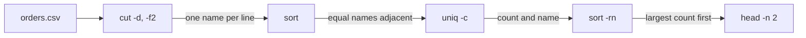

# Text processing I: cat, sort, uniq, cut, paste and join

> **Before this lesson:** you should be comfortable connecting commands with a pipe and sending output to a file, as taught in [Redirection and pipelines](#/lesson/linux-cli/redirection-pipelines). The pattern notation from [Regular expressions with grep](#/lesson/linux-cli/regular-expressions) helps in a few examples but is not required.

## In plain words

Imagine a kitchen with a row of single-purpose tools: one knife that only slices, one sieve that only strains, one scale that only weighs. None of them can cook a meal alone, but a cook who passes food from one to the next can prepare almost anything. Linux treats text the same way. There is one small program that only sorts lines, one that only removes repeated lines, one that only cuts out columns, one that only glues files side by side. This lesson introduces six of them.

Why does this matter for a job? Because an enormous amount of working data is plain text arranged in lines: log files written by servers, CSV exports (CSV means *comma-separated values*: a table saved as text, one row per line with commas between the cells), configuration files, lists of users, results of experiments. Being able to answer "how many distinct customers are in this file?" or "which ten products sold most?" in one line at the terminal — without opening a spreadsheet or writing a program — is one of the most practical skills an engineer or analyst can have.

Three terms used throughout:

- A **line** is a run of characters ending with a *newline*, the invisible character produced by the Enter key.
- A **field** (or column) is one piece of a line. Something separates fields from each other — a comma, a tab, a colon — and that separator is called the **delimiter**.
- A **filter** is a program that reads lines, changes or selects them, and writes the result. Filters do not modify the file they read; they print a new version, which you can look at, pipe onward, or redirect into a new file.

## The practice files

Every example below uses two tiny files so that you can check each result by eye. Create them yourself, or read along.

```bash
mira@forge:~/shop$ cat orders.csv
1004,cara,keyboard,2,49.90
1001,ana,monitor,1,189.00
1003,ben,mouse,3,19.50
1002,ana,keyboard,1,49.90
1005,dev,monitor,2,189.00
1006,ben,mouse,1,19.50
mira@forge:~/shop$ cat customers.csv
ana,Lisbon
ben,Oslo
cara,Lima
eli,Rome
```

`orders.csv` has five fields per line: order number, customer, product, quantity and unit price. `customers.csv` has two: customer and city.

## `cat` — show a file, and reveal what is hidden in it

You have already used `cat` to print a file. Its name is short for *concatenate*, which means "join end to end": given several files, it prints them one after another.

```bash
mira@forge:~/shop$ cat customers.csv orders.csv | wc -l
10
```

Here `cat` printed four lines and then six, and `wc -l` (word count, lines only) counted ten.

`cat` has options that make invisible things visible, which is the first step whenever a file "looks right but behaves wrongly":

| Option | Effect |
|---|---|
| `-n` | number every line |
| `-b` | number only non-blank lines |
| `-s` | squeeze several blank lines in a row into one |
| `-A` | show All: a `$` at each line end, `^I` for each tab character, `^M` for a carriage return |

```bash
mira@forge:~/shop$ cat -n customers.csv | head -n 2
     1	ana,Lisbon
     2	ben,Oslo
mira@forge:~/shop$ cat -A notes-from-windows.txt | head -n 2
name^Iscore^M$
ana^I97^M$
```

Line by line: `-n` put a number in front of each line. In the second command, `^I` shows that the gap between `name` and `score` is a tab, not spaces; the `$` marks where each line ends; and `^M` reveals a **carriage return**, an extra invisible character that Windows programs put before every newline. That stray character is a famous source of confusion: a script or data file with `^M` at the line ends fails in strange ways on Linux. The command `dos2unix file` removes them.

## `sort` — put lines in order

With no options, `sort` compares whole lines as text and prints them in dictionary order.

```bash
mira@forge:~/shop$ sort customers.csv
ana,Lisbon
ben,Oslo
cara,Lima
eli,Rome
mira@forge:~/shop$ sort orders.csv | head -n 3
1001,ana,monitor,1,189.00
1002,ana,keyboard,1,49.90
1003,ben,mouse,3,19.50
```

The original files are unchanged; `sort` printed sorted copies.

### The first surprise: text order is not number order

```bash
mira@forge:~/shop$ printf '9\n10\n100\n25\n' | sort
10
100
25
9
mira@forge:~/shop$ printf '9\n10\n100\n25\n' | sort -n
9
10
25
100
```

`printf` here prints four lines, one number each. Plain `sort` compares character by character, the way a dictionary does: `1` comes before `2` and before `9`, so `10` and `100` land first. The option `-n` (numeric) tells `sort` to read each line as a number.

| Option | Meaning |
|---|---|
| `-n` | compare as numbers |
| `-r` | reverse the order |
| `-h` | compare human-readable sizes such as `4K`, `12M`, `2G` |
| `-u` | unique: print only one of each set of equal lines |
| `-f` | fold case: treat upper and lower case as equal |
| `-t CHAR` | fields are separated by CHAR |
| `-k N` | sort by field N instead of the whole line |
| `-o FILE` | write the result to FILE (safe even if FILE is also the input) |
| `-s` | stable: lines that compare equal keep their original order |

### Sorting by a field

To sort the orders by customer name, tell `sort` what the delimiter is (`-t,`) and which field is the **key** — the part of the line that decides the order (`-k2,2` means "from field 2 to field 2").

```bash
mira@forge:~/shop$ sort -t, -k2,2 orders.csv
1001,ana,monitor,1,189.00
1002,ana,keyboard,1,49.90
1003,ben,mouse,3,19.50
1006,ben,mouse,1,19.50
1004,cara,keyboard,2,49.90
1005,dev,monitor,2,189.00
```

A newcomer's question at this point: why `-k2,2` and not `-k2`? Because `-k2` means "from field 2 **to the end of the line**", which silently brings the later fields into the comparison. Writing the start and the end is the dependable habit.

Several keys can be given; each may carry its own letters for numeric (`n`) or reverse (`r`). This sorts by product name, and within one product by quantity, largest first:

```bash
mira@forge:~/shop$ sort -t, -k3,3 -k4,4nr orders.csv
1004,cara,keyboard,2,49.90
1002,ana,keyboard,1,49.90
1005,dev,monitor,2,189.00
1001,ana,monitor,1,189.00
1003,ben,mouse,3,19.50
1006,ben,mouse,1,19.50
```

Read the keys in order: first compare field 3 as text; when two lines have the same product, compare field 4 as a number in reverse.

A real-world use combines `sort -h` with the disk-usage command `du`:

```bash
mira@forge:~$ du -sh ~/projects/* | sort -h | tail -n 3
1.2G	/home/mira/projects/notebooks
3.8G	/home/mira/projects/weather-api
41G	/home/mira/projects/datasets
```

> [!TIP]
> Sorting results can differ between machines because "dictionary order" depends on the language settings of the system (its *locale*). When an order must be identical everywhere — in a script, or before using `join` or `comm` — put `LC_ALL=C` in front: `LC_ALL=C sort file`. That selects plain byte order, which is also the fastest.

## `uniq` — collapse repeated lines

`uniq` reads lines and drops a line when it is identical to the one **directly before** it. That "directly before" is the whole secret of the command.

```bash
mira@forge:~/shop$ cut -d, -f3 orders.csv
keyboard
monitor
mouse
keyboard
monitor
mouse
mira@forge:~/shop$ cut -d, -f3 orders.csv | uniq
keyboard
monitor
mouse
keyboard
monitor
mouse
mira@forge:~/shop$ cut -d, -f3 orders.csv | sort | uniq
keyboard
monitor
mouse
```

The first command (explained fully in the next section) prints the product column. Piping it into `uniq` changed nothing, because no two *neighbouring* lines were equal. After `sort` brought equal lines together, `uniq` reduced each group to one line.

| Option | Meaning |
|---|---|
| `-c` | put a count in front of each line: how many times it occurred in a row |
| `-d` | print only lines that were repeated |
| `-u` | print only lines that were **not** repeated |
| `-i` | ignore case |
| `-f N` | skip the first N fields when comparing |

The count option gives the best-known pipeline on Unix. Built one step at a time:

```bash
mira@forge:~/shop$ cut -d, -f2 orders.csv | sort | uniq -c
      2 ana
      2 ben
      1 cara
      1 dev
mira@forge:~/shop$ cut -d, -f2 orders.csv | sort | uniq -c | sort -rn | head -n 2
      2 ana
      2 ben
```

Step by step: take the customer column; sort it so equal names are neighbours; replace each group with "count, name"; sort those lines as numbers, biggest first; keep the top two. This "sort, count, sort by count" shape answers every "what are the most common …?" question, for any column of any file.



The block below performs the same steps in Python, including a deliberately wrong version without the first sort, so you can see why the order of the steps matters.

```python-run
from itertools import groupby

orders = """1004,cara,keyboard,2,49.90
1001,ana,monitor,1,189.00
1003,ben,mouse,3,19.50
1002,ana,keyboard,1,49.90
1005,dev,monitor,2,189.00
1006,ben,mouse,1,19.50""".splitlines()

def cut(lines, delimiter, field):          # cut -d, -fN  (fields are numbered from 1)
    return [line.split(delimiter)[field - 1] for line in lines]

def uniq_c(lines):                         # uniq -c: count runs of ADJACENT equal lines
    return [(len(list(group)), value) for value, group in groupby(lines)]

names = cut(orders, ",", 2)
print("column 2:          ", names)
print("uniq -c, unsorted: ", uniq_c(names))            # wrong: ana and ben are split up
print("sort | uniq -c:    ", uniq_c(sorted(names)))    # right
ranked = sorted(uniq_c(sorted(names)), key=lambda pair: -pair[0])
print("... | sort -rn:    ", ranked[:2])
```

## `cut` — keep some columns

`cut` extracts parts of each line. In field mode you name the delimiter with `-d` and the wanted fields with `-f`.

```bash
mira@forge:~/shop$ cut -d, -f2 orders.csv | head -n 2
cara
ana
mira@forge:~/shop$ cut -d, -f1,3 orders.csv | head -n 2
1004,keyboard
1001,monitor
mira@forge:~/shop$ cut -d, -f3- orders.csv | head -n 2
keyboard,2,49.90
monitor,1,189.00
mira@forge:~/shop$ cut -d: -f1,7 /etc/passwd | head -n 2
root:/bin/bash
daemon:/usr/sbin/nologin
```

The field list accepts single numbers (`2`), lists (`1,3`), ranges (`2-4`) and open ranges (`3-` means "3 to the end", `-2` means "up to 2"). The last example uses the system's user list, whose fields are separated by colons: field 1 is the user name and field 7 the program started at login.

`cut` can also select by character position with `-c`, useful for fixed-width text:

```bash
mira@forge:~/shop$ date +%F
2026-11-20
mira@forge:~/shop$ date +%F | cut -c1-4
2026
```

Three limits to keep in mind, because each surprises newcomers:

- The delimiter is exactly **one** character. If no `-d` is given, it is the tab character.
- `cut` cannot reorder: `-f3,1` prints field 1 and then field 3, in their original order.
- Columns lined up with a varying number of spaces (the output of `ls -l` or `ps`) defeat `cut -d' '`, because every single space counts as a delimiter and produces empty fields. For such input, squeeze the spaces first with `tr -s ' '` (next lesson) or use `awk '{print $2}'`, which splits on runs of whitespace.

## `paste` — glue files side by side

`paste` is the opposite of `cut`: it joins line 1 of each file, then line 2 of each, and so on, separated by a tab (or by the character given with `-d`).

```bash
mira@forge:~/shop$ cut -d, -f2 orders.csv > who.txt
mira@forge:~/shop$ cut -d, -f5 orders.csv > price.txt
mira@forge:~/shop$ paste -d, price.txt who.txt | head -n 3
49.90,cara
189.00,ana
19.50,ben
```

The first two commands saved two columns into separate files. `paste` then put them back together in a new order — which is how you reorder columns with these tools, since `cut` alone cannot.

With `-s` (serial), `paste` joins all the lines of **one** file into a single line, a handy way to turn a column into a list:

```bash
mira@forge:~/shop$ cut -d, -f1 customers.csv | paste -sd,
ana,ben,cara,eli
mira@forge:~/shop$ cut -d, -f4 orders.csv | paste -sd+ | bc
10
```

The second command builds the text `2+1+3+1+2+1` and hands it to `bc`, a calculator program, which prints the total quantity.

Note that `paste` matches lines purely by position. If the files are in different orders, it will happily glue unrelated lines together.

## `join` — combine files on a shared key

`join` matches lines from two files that have the **same value in a chosen field**, the way a database joins two tables. Our orders mention customer names, and `customers.csv` says which city each customer lives in; `join` can attach the city to every order.

`join` has one firm requirement: **both files must be sorted on the field being matched**. So prepare sorted copies first.

```bash
mira@forge:~/shop$ sort -t, -k2,2 orders.csv > orders.by-name.csv
mira@forge:~/shop$ sort -t, -k1,1 customers.csv > customers.sorted.csv
mira@forge:~/shop$ join -t, -1 2 -2 1 orders.by-name.csv customers.sorted.csv
ana,1001,monitor,1,189.00,Lisbon
ana,1002,keyboard,1,49.90,Lisbon
ben,1003,mouse,3,19.50,Oslo
ben,1006,mouse,1,19.50,Oslo
cara,1004,keyboard,2,49.90,Lima
```

Reading the options: `-t,` sets the delimiter; `-1 2` says "in the first file, the key is field 2"; `-2 1` says "in the second file, the key is field 1". Each output line starts with the key, followed by the remaining fields of the first file and then those of the second.

Look at what is **missing**. The order from `dev` is gone, because `dev` is not in the customer file; and `eli`, who has no orders, does not appear either. By default `join` prints only keys found in both files. Options change that:

| Option | Meaning |
|---|---|
| `-1 N`, `-2 M` | key field in the first / second file (default: field 1) |
| `-t CHAR` | field delimiter (default: whitespace) |
| `-a 1` / `-a 2` | also print unmatched lines from file 1 / file 2 |
| `-v 1` / `-v 2` | print **only** the unmatched lines from that file |
| `-e TEXT` with `-o auto` | fill missing fields with TEXT |
| `-o 1.2,2.2` | choose exactly which fields to print, as *file.field* |

```bash
mira@forge:~/shop$ join -t, -1 2 -2 1 -v 1 orders.by-name.csv customers.sorted.csv
dev,1005,monitor,2,189.00
mira@forge:~/shop$ join -t, -1 2 -2 1 -o 1.1,2.2,1.3 orders.by-name.csv customers.sorted.csv | head -n 2
1001,Lisbon,monitor
1002,Lisbon,keyboard
```

The first command answers "which orders refer to an unknown customer?" — a real data-quality check. The second picks the order number, the city and the product.

> [!WARNING]
> `join` and `uniq` do not complain loudly when their input is not sorted — they quietly give incomplete or wrong answers. If a `join` returns fewer lines than you expected, check the sorting first, and sort both files with the same settings (`LC_ALL=C sort -t, -k1,1`). Also be careful when redirecting: `sort orders.csv > orders.csv` empties the file before `sort` reads it, destroying your data. Write to a new name, or use `sort -o orders.csv orders.csv`.

## Putting it together: revenue per city

A realistic question: how much money came from each city? Build the answer in stages, looking at each result before adding the next step.

```bash
mira@forge:~/shop$ join -t, -1 2 -2 1 -o 2.2,1.4,1.5 orders.by-name.csv customers.sorted.csv
Lisbon,1,189.00
Lisbon,1,49.90
Oslo,3,19.50
Oslo,1,19.50
Lima,2,49.90
mira@forge:~/shop$ join -t, -1 2 -2 1 -o 2.2,1.4,1.5 orders.by-name.csv customers.sorted.csv \
    | awk -F, '{ total[$1] += $2 * $3 } END { for (city in total) printf "%s,%.2f\n", city, total[city] }' \
    | sort -t, -k2,2nr
Lisbon,238.90
Lima,99.80
Oslo,78.00
```

The first command produces city, quantity and price for each order. The second adds an `awk` step: `awk` is a small language for column-based text; this program multiplies quantity by price, keeps a running total per city, and prints the totals at the end. The final `sort` orders the cities by revenue. The six tools of this lesson cannot do arithmetic per group on their own, and that is precisely where `awk` takes over.

> [!INTERVIEW]
> The most requested command-line exercise in interviews is some form of "print the top N most frequent values in a file" — IP addresses in a log, words in a text, error codes. The expected answer is `cut` (or `awk`) to isolate the value, then `sort | uniq -c | sort -rn | head -n N`. Be ready to explain why the first `sort` is needed (`uniq` only merges adjacent lines) and why the second needs `-n` (counts must compare as numbers) and `-r` (largest first).

## Pitfalls

- **`uniq` without `sort`** removes only neighbouring duplicates.
- **Numbers sorted as text.** Add `-n`, or `-h` for sizes like `12M`.
- **`-k2` instead of `-k2,2`**, which extends the key to the end of the line.
- **Forgetting `-t`** when fields are separated by commas or colons; by default `sort` and `join` split fields on whitespace.
- **Commas inside quoted CSV cells.** A cell such as `"Lisbon, Portugal"` contains the delimiter, and none of these tools understands the quotes. For such files use a CSV-aware tool (`csvkit`, `mlr`, or a few lines of Python with the `csv` module).
- **A header line** being sorted or counted along with the data. Skip it with `tail -n +2 file`.
- **Invisible carriage returns** from Windows making equal-looking lines differ. Check with `cat -A`.
- **Unsorted or differently sorted inputs to `join`.**

## Cheat sheet

| Task | Command |
|---|---|
| Number lines / show hidden characters | `cat -n file`, `cat -A file` |
| Sort as text / as numbers / reversed | `sort f`, `sort -n f`, `sort -r f` |
| Sort by the 3rd comma-separated field | `sort -t, -k3,3 f` |
| Two keys, second numeric descending | `sort -t, -k3,3 -k4,4nr f` |
| Sort human-readable sizes | `du -sh * \| sort -h` |
| Distinct lines | `sort f \| uniq` or `sort -u f` |
| Count occurrences, most common first | `sort f \| uniq -c \| sort -rn` |
| Only the duplicated lines | `sort f \| uniq -d` |
| Fields 1 and 3 | `cut -d, -f1,3 f` |
| Characters 1 to 4 | `cut -c1-4 f` |
| Files side by side | `paste -d, a b` |
| A column as one comma-separated line | `paste -sd, f` |
| Join on a key | `join -t, -1 2 -2 1 a.sorted b.sorted` |
| Lines of the first file with no partner | `join -v 1 a b` |
| Skip a header line | `tail -n +2 f` |

## Summary

- Text tools are filters: they read lines, print a transformed copy and leave the input untouched, so they chain naturally with pipes.
- `cat` joins files and, with `-A`, exposes tabs, line ends and carriage returns.
- `sort` orders lines; `-n`, `-r`, `-h`, `-t` and `-k start,end` control how. `uniq` merges adjacent duplicates and `-c` counts them, which is why it follows `sort`.
- `cut` selects fields or character positions; `paste` glues lines side by side or into one line; `join` combines two sorted files on a common field.
- For arithmetic per group, or for CSV with quoted cells, move on to `awk` or a CSV-aware tool.

## Glossary

| Term | Meaning |
|---|---|
| line | characters up to and including a newline |
| newline | the invisible character that ends a line |
| field / column | one piece of a line, between delimiters |
| delimiter | the character that separates fields (comma, tab, colon) |
| CSV | comma-separated values: a table stored as text |
| filter | a program that reads text, transforms it and prints the result |
| key | the field (or part of a line) used to sort or to match lines |
| concatenate | to join things end to end |
| carriage return | an extra line-ending character used by Windows, shown as `^M` |
| locale | the system's language settings, which influence sort order |
| adjacent | directly next to each other |

## Check yourself

```quiz
[
  {"q": "A file contains the lines b, a, b, a (one letter per line, in that order). What does `uniq` print for it?",
   "options": ["a and b", "b, a, b, a — unchanged", "b and a", "Nothing"],
   "answer": 1,
   "explain": "uniq only removes a line when it equals the line directly before it. No neighbouring lines are equal here, so nothing is removed. Sort first to bring equal lines together."},
  {"q": "Why does `sort` place 100 before 25 unless you add -n?",
   "options": ["sort is broken for large numbers", "Without -n the lines are compared character by character as text, and the character 1 comes before 2", "25 is treated as a negative number", "sort reads files from the bottom up"],
   "answer": 1,
   "explain": "Text comparison works like a dictionary. The -n option makes sort interpret each key as a number."},
  {"q": "Which command prints the second and fourth fields of a comma-separated file?",
   "options": ["cut -f2,4 file", "cut -d, -f2,4 file", "cut -c2,4 file", "paste -d, -f2,4 file"],
   "answer": 1,
   "explain": "-d sets the delimiter to a comma and -f lists the fields. Without -d, cut assumes fields are separated by tabs; -c would select characters, not fields."},
  {"q": "What does `sort -t, -k2,2 orders.csv` do?",
   "options": ["Sorts by the whole line and prints two columns", "Sorts the lines using only the second comma-separated field as the key", "Sorts the first two lines", "Removes the second field"],
   "answer": 1,
   "explain": "-t, declares the comma as the field separator and -k2,2 limits the sort key to field 2."},
  {"q": "What must be true of two files before `join` can combine them correctly?",
   "options": ["They must have the same number of lines", "Both must be sorted on the field used as the key", "They must be compressed", "They must use tabs as delimiters"],
   "answer": 1,
   "explain": "join reads both files in step and relies on the key order. Unsorted input silently produces missing matches."},
  {"q": "What does `cut -d, -f3,1 file` print for the line `x,y,z`?",
   "options": ["z,x", "x,z", "z", "An error"],
   "answer": 1,
   "explain": "cut selects fields but never reorders them; selected fields appear in their original order."},
  {"q": "You want the three most frequent values in the first column of data.csv. Which pipeline is correct?",
   "options": ["cut -d, -f1 data.csv | uniq -c | head -n 3", "cut -d, -f1 data.csv | sort | uniq -c | sort -rn | head -n 3", "sort data.csv | head -n 3", "cut -d, -f1 data.csv | sort -rn | head -n 3"],
   "answer": 1,
   "explain": "Sort to group equal values, count each group with uniq -c, sort the counts numerically in reverse, and keep the first three."},
  {"q": "`cat -A report.txt` shows `^M$` at the end of each line. What does that tell you?",
   "options": ["The file is empty", "The file has Windows-style line endings containing a carriage return", "The file uses tabs", "The file is compressed"],
   "answer": 1,
   "explain": "^M is a carriage return placed before each newline by Windows tools. It can make identical-looking lines compare as different; dos2unix removes it."}
]
```

> **Source:** Shotts, *The Linux Command Line*, ch. 20 (Text Processing). All examples and wording are original to this guide.
