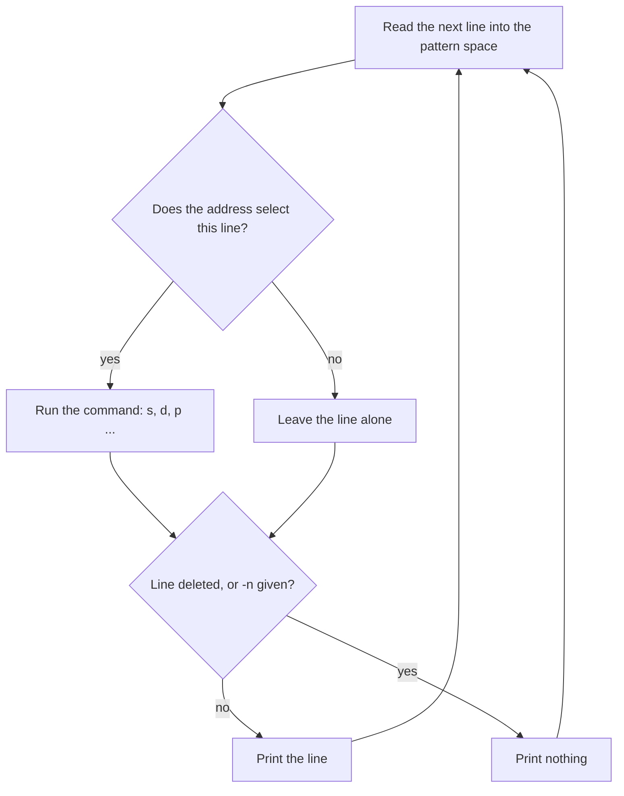

# Text processing II: comm, diff, patch, tr, sed and aspell

> **Before this lesson:** you should know how filters and pipes work ([Redirection and pipelines](#/lesson/linux-cli/redirection-pipelines)), how `sort` and `uniq` behave ([Text processing I](#/lesson/linux-cli/text-processing-1)), and the basics of patterns ([Regular expressions with grep](#/lesson/linux-cli/regular-expressions)).

## In plain words

The previous lesson was about *rearranging* text: sorting it, counting it, cutting columns out of it. This lesson is about two other everyday jobs.

The first is **comparing**. Think of two versions of a shopping list written on different days. You want to know what was added, what was crossed out and what stayed. Doing that by eye works for ten lines and fails for ten thousand. The commands `comm` and `diff` do it exactly, and `patch` can take the list of differences and apply it to an old copy to produce the new one — the way an editor's marked-up corrections can be applied to a manuscript.

The second is **editing without opening an editor**. Imagine handing an assistant a stack of 500 documents with the instruction "wherever it says *Old Street*, write *New Avenue*". You would not open each document yourself. `tr` swaps or deletes individual characters, and `sed` carries out instructions such as "replace this with that" or "delete lines 1 to 5" on a whole stream of text.

Why this matters for a job: comparing files is the basis of code review and version control (every "pull request" you will ever read is `diff` output), and automated editing is how configuration is adjusted on hundreds of servers, how data is cleaned before analysis, and how repetitive changes are made across a codebase.

Two terms first. A **stream** is text flowing through a program from input to output, one line after another. A **stream editor** changes that text as it flows past, following instructions given in advance, with no human pressing keys during the edit.

## Comparing

### The practice files

```bash
mira@forge:~/cmp$ cat old.txt
apple
banana
cherry
grape
mango
mira@forge:~/cmp$ cat new.txt
apple
blueberry
cherry
grape
kiwi
mango
```

Compared with the old list, the new one has `blueberry` in place of `banana` and an extra `kiwi`.

### `comm` — three columns for two sorted files

`comm` reads two files that are **already sorted** and prints three columns: lines found only in the first file, lines found only in the second, and lines found in both.

```bash
mira@forge:~/cmp$ comm old.txt new.txt
		apple
banana
	blueberry
		cherry
		grape
	kiwi
		mango
```

The columns are made by indentation with tab characters. `banana` has no indentation: it is only in the first file. `blueberry` and `kiwi` are indented once: only in the second. The lines indented twice are in both.

You can hide columns by number. `-12` hides columns 1 and 2, leaving the lines common to both; `-23` leaves what is only in the first file; `-13` what is only in the second.

```bash
mira@forge:~/cmp$ comm -12 old.txt new.txt
apple
cherry
grape
mango
mira@forge:~/cmp$ comm -23 old.txt new.txt
banana
mira@forge:~/cmp$ comm -13 old.txt new.txt
blueberry
kiwi
```

These three forms are the set operations of mathematics — intersection and the two differences — applied to lines. A practical example: which Python packages are installed on one server but not on another?

```bash
mira@forge:~$ comm -23 <(ssh web01 'pip freeze' | sort) <(ssh web02 'pip freeze' | sort)
gunicorn==22.0.0
uvloop==0.19.0
```

The notation `<(command)` is called **process substitution**: the shell runs the command and lets the outer program read its output as if it were a file. It saves creating temporary files.

### `diff` — the exact changes, in order

`comm` needs sorted input, so it cannot be used on text where order matters, such as source code or prose. `diff` compares any two text files line by line and reports the smallest set of changes that turns the first into the second.

```bash
mira@forge:~/cmp$ diff old.txt new.txt
2c2
< banana
---
> blueberry
4a5
> kiwi
```

This default layout is terse. Each block starts with a change command: `2c2` means "line 2 of the first file must be **c**hanged to give line 2 of the second"; `4a5` means "after line 4 of the first file, **a**dd line 5 of the second"; a `d` would mean delete. Lines beginning with `<` come from the first file, lines with `>` from the second.

Almost everybody uses the **unified format** instead, requested with `-u`. It shows the changes with a few surrounding lines of context, and it is what Git prints:

```bash
mira@forge:~/cmp$ diff -u old.txt new.txt
--- old.txt	2026-11-20 10:01:14.000000000 +0000
+++ new.txt	2026-11-20 10:03:52.000000000 +0000
@@ -1,5 +1,6 @@
 apple
-banana
+blueberry
 cherry
 grape
+kiwi
 mango
```

Line by line:

- `---` and `+++` name the old and the new file.
- `@@ -1,5 +1,6 @@` is a **hunk header**. A hunk is one region of change. It says: this region covers 5 lines starting at line 1 in the old file, and 6 lines starting at line 1 in the new file.
- A line starting with a space is unchanged context.
- A line starting with `-` exists only in the old file (removed).
- A line starting with `+` exists only in the new file (added).

Useful options:

| Option | Meaning |
|---|---|
| `-u` | unified format (add a number, as in `-U5`, for more context lines) |
| `-r` | compare two directories recursively |
| `-q` | report only *whether* files differ, not how |
| `-i` | ignore upper/lower case |
| `-w` / `-b` | ignore all whitespace / changes in the amount of whitespace |
| `-B` | ignore blank lines |
| `-N` | treat a missing file as empty (needed for patches that add files) |
| `-y` | side-by-side view |
| `--color` | colour the output |

```bash
mira@forge:~$ diff -rq config-staging/ config-prod/
Files config-staging/app.yaml and config-prod/app.yaml differ
Only in config-prod/: secrets.yaml
mira@forge:~$ diff <(ssh web01 'cat /etc/nginx/nginx.conf') <(ssh web02 'cat /etc/nginx/nginx.conf') && echo identical
identical
```

`diff` also reports through its **exit status** (the number every command hands back when it ends): 0 when the files are the same, 1 when they differ, 2 on an error. That is why `&& echo identical` works in the second command.

How does `diff` decide what changed? It finds the longest sequence of lines that the two files have in common, in the same order, and reports everything else as removed or added. The block below does this with Python's `difflib`, which uses the same idea:

```python-run
import difflib

old = ["apple", "banana", "cherry", "grape", "mango"]
new = ["apple", "blueberry", "cherry", "grape", "kiwi", "mango"]

print("Unified diff, as produced by diff -u:")
for line in difflib.unified_diff(old, new, "old.txt", "new.txt", lineterm=""):
    print("  " + line)

print("\nThe same information as edit instructions:")
for tag, i1, i2, j1, j2 in difflib.SequenceMatcher(None, old, new).get_opcodes():
    print(f"  {tag:8} old[{i1}:{i2}]={old[i1:i2]}  new[{j1}:{j2}]={new[j1:j2]}")

print("\ncomm-style sets (inputs must be sorted):")
print("  only in old :", sorted(set(old) - set(new)))
print("  only in new :", sorted(set(new) - set(old)))
print("  in both     :", sorted(set(old) & set(new)))
```

### `patch` — apply a diff

The output of `diff -u` is a complete recipe for turning the old file into the new one. Save it to a file and you have a **patch**: a small text file describing a change. `patch` reads it and performs the change. Before online code hosting existed, this is how all open-source collaboration worked, and it remains how Linux kernel changes travel.

```bash
mira@forge:~/cmp$ diff -u old.txt new.txt > fruit.patch
mira@forge:~/cmp$ cp old.txt work.txt
mira@forge:~/cmp$ patch work.txt < fruit.patch
patching file work.txt
mira@forge:~/cmp$ diff work.txt new.txt && echo "work.txt now equals new.txt"
work.txt now equals new.txt
mira@forge:~/cmp$ patch -R work.txt < fruit.patch       # -R reverses the patch
patching file work.txt
```

For a whole directory tree, create the patch with `diff -ruN old-dir new-dir > change.patch` and apply it from inside the tree with `patch -p1 < change.patch`. The `-p1` removes the first directory name from the paths written in the patch. Add `--dry-run` to see what would happen without changing anything.

> [!TIP]
> Day to day, Git creates and applies patches for you: `git diff` prints a unified diff of your uncommitted changes, `git diff > fix.patch` saves it and `git apply fix.patch` applies it. Everything you learned above about reading `-`, `+` and `@@` lines applies unchanged.

## Editing on the fly

### `tr` — translate or delete characters

`tr` works on single **characters**, not on words or lines. It reads standard input only (it takes no file name), so you feed it with a pipe or with `<`.

Its simplest form takes two sets of characters and replaces each character of the first set with the character at the same position in the second:

```bash
mira@forge:~$ echo "hello world" | tr 'a-z' 'A-Z'
HELLO WORLD
mira@forge:~$ echo "2026/11/20" | tr '/' '-'
2026-11-20
mira@forge:~$ echo "hello" | tr 'el' 'ip'
hippo
```

In the first command `a-z` is a range meaning all lower-case letters, and each is replaced by the matching upper-case letter. The third makes the character-by-character nature clear: every `e` becomes `i` and every `l` becomes `p`. `tr` is not replacing the *word* "el".

Three options cover the remaining uses:

| Option | Meaning |
|---|---|
| `-d SET` | delete every character in SET |
| `-s SET` | squeeze: replace a run of the same character from SET with one copy |
| `-c SET` | complement: act on every character **not** in SET |

```bash
mira@forge:~$ echo "Phone: (555) 010-7788" | tr -d '() -'
Phone:5550107788
mira@forge:~$ echo "too     many    spaces" | tr -s ' '
too many spaces
mira@forge:~$ tr -d '\r' < notes-from-windows.txt > notes.txt
mira@forge:~$ echo "$PATH" | tr ':' '\n' | head -n 3
/home/mira/.local/bin
/usr/local/sbin
/usr/local/bin
mira@forge:~$ tr -cs '[:alpha:]' '\n' < article.txt | tr 'A-Z' 'a-z' | sort | uniq -c | sort -rn | head -n 3
    412 the
    230 of
    198 and
```

The third command removes carriage returns (`\r`), the cure for Windows line endings. The fourth turns the colon-separated `PATH` into one directory per line (`\n` is the newline character). The last is a famous one-liner: it replaces every run of non-letters with a single newline — putting each word on its own line — lower-cases everything, and then counts words with the pipeline from the previous lesson.

`tr` also understands the named classes from the regular-expression lesson: `[:upper:]`, `[:lower:]`, `[:digit:]`, `[:space:]`, `[:punct:]`.

### `sed` — a stream editor

`sed` reads its input one line at a time, applies your editing commands to each line, and prints the result. The input file is not changed unless you ask for that explicitly.

By far the most used command is **substitution**:

```
s/pattern/replacement/flags
```

```bash
mira@forge:~$ echo "the cat sat on the mat" | sed 's/the/a/'
a cat sat on the mat
mira@forge:~$ echo "the cat sat on the mat" | sed 's/the/a/g'
a cat sat on a mat
```

The letter `s` means substitute. Between the first two slashes is what to look for; between the second and third is what to put there. The first command changed only the **first** match on the line — the default. The `g` flag (global) in the second changes every match on each line.

The pattern is a regular expression, which makes substitutions flexible. Add `-E` to use the extended syntax:

```bash
mira@forge:~$ echo "user=ana  id=1001" | sed -E 's/[0-9]+/####/'
user=ana  id=####
mira@forge:~$ echo "2026-11-20" | sed -E 's/([0-9]{4})-([0-9]{2})-([0-9]{2})/\3.\2.\1/'
20.11.2026
mira@forge:~$ echo "error: disk full" | sed 's/error/[&]/'
[error]: disk full
mira@forge:~$ echo "/usr/local/bin" | sed 's|/usr/local|/opt|'
/opt/bin
```

Three new ideas appear here. Parentheses in the pattern capture pieces of the match, and `\1`, `\2`, `\3` in the replacement insert those pieces — here reordering a date. An ampersand `&` in the replacement stands for the whole matched text. And the delimiter does not have to be a slash: whatever character follows the `s` is used, so `s|a|b|` avoids escaping every slash when working with paths.

#### Addresses: choosing which lines to edit

A command may be preceded by an **address** that selects the lines it applies to. Without an address, every line is selected.

| Address | Selects |
|---|---|
| `5` | line 5 |
| `$` | the last line |
| `2,6` | lines 2 through 6 |
| `10,$` | line 10 to the end |
| `/regex/` | every line matching the regular expression |
| `/start/,/end/` | from a line matching *start* through the next line matching *end* |
| `addr!` | every line **except** those selected |
| `1~2` | every second line starting at line 1 (GNU sed) |

Besides `s`, a few one-letter commands are worth knowing:

| Command | Effect |
|---|---|
| `d` | delete the line |
| `p` | print the line (used with `-n`, which turns off automatic printing) |
| `q` | quit — stop reading input |
| `i\text`, `a\text` | insert text before / append text after the line |
| `c\text` | replace the whole line with text |
| `y/abc/xyz/` | translate characters, like `tr` |

```bash
mira@forge:~/lab$ cat -n server.conf
     1	# weather api settings
     2	listen_port = 8080
     3	workers = 2
     4	# debug = true
     5	log_level = info
mira@forge:~/lab$ sed -n '2,3p' server.conf                 # print only lines 2 to 3
listen_port = 8080
workers = 2
mira@forge:~/lab$ sed '/^#/d' server.conf                   # delete comment lines
listen_port = 8080
workers = 2
log_level = info
mira@forge:~/lab$ sed '/^workers/s/2/8/' server.conf | sed -n '3p'    # substitute only on the workers line
workers = 8
mira@forge:~/lab$ sed -E 's/^# (debug = true)/\1/' server.conf | sed -n '4p'   # remove a comment marker
debug = true
mira@forge:~/lab$ sed -n '/ERROR/,/^$/p' app.log            # from each ERROR line to the next blank line
mira@forge:~/lab$ sed -e 's/8080/9090/' -e 's/info/debug/' server.conf | grep -E 'port|level'
listen_port = 9090
log_level = debug
```

With `-n`, `sed` prints nothing by itself, so `-n '2,3p'` shows exactly the chosen lines — a compact way to print a range. Several commands can be given with repeated `-e` options or separated by semicolons.



The "pattern space" in the diagram is `sed`'s name for its working copy of the current line.

Here is that cycle in a few lines of Python. Reading it is a good way to fix the model in your mind: an address is a yes/no question about a line, and a command is what happens when the answer is yes.

```python-run
import re

def sed(lines, script):
    """Understands  [N | N,M | $ | /regex/] followed by  d  or  s/old/new/[g]  (old is a regex)."""
    last = len(lines)
    m = re.match(r"(?:(\d+|\$)(?:,(\d+|\$))?|/([^/]*)/)?(.*)", script)
    first, second, regex, command = m.groups()
    num = lambda text: last if text == "$" else int(text)

    def selected(number, line):
        if regex is not None:
            return re.search(regex, line) is not None
        if first is None:
            return True                       # no address: every line
        lo = num(first)
        hi = num(second) if second else lo
        return lo <= number <= hi

    out = []
    for number, line in enumerate(lines, 1):
        if not selected(number, line):
            out.append(line)                  # untouched lines are still printed
        elif command == "d":
            continue                          # deleted: not printed
        else:
            _, old, new, flags = command.split("/")
            out.append(re.sub(old, new, line, count=0 if "g" in flags else 1))
    return out

conf = ["# weather api settings", "listen_port = 8080", "workers = 2", "# debug = true", "log_level = info"]
for script in ["s/8080/9090/", "/^#/d", "3s/2/8/", "2,3s/ = /=/", "$s/info/debug/", "s/e/E/", "s/e/E/g"]:
    print(f"sed '{script}'")
    for line in sed(conf, script):
        print("     " + line)
```

#### Editing files in place

To modify a file directly, use `-i`. This is where `sed` becomes powerful — and where care is needed.

> [!WARNING]
> `sed -i` rewrites the file immediately and there is no undo. A pattern that matches more than you intended — a missing anchor, a forgotten `g`, an unescaped dot — damages every line it touches, in every file you named. Protect yourself in three ways: **(1)** run the command without `-i` first and read the output (or pipe it into `diff file -` to see only the changes); **(2)** give `-i` a suffix, as in `sed -i.bak 's/a/b/' file`, which keeps the original as `file.bak`; **(3)** work in a directory under version control so that `git diff` shows exactly what changed. Be especially careful when combining it with `find` or a wildcard across many files.

```bash
mira@forge:~/lab$ sed 's/^workers = .*/workers = 8/' server.conf | diff server.conf -
3c3
< workers = 2
---
> workers = 8
mira@forge:~/lab$ sed -i.bak 's/^workers = .*/workers = 8/' server.conf
mira@forge:~/lab$ grep -rl 'old_api_name' src/ | xargs sed -i 's/\bold_api_name\b/new_api_name/g'
```

The first command previews the change by comparing the edited stream with the original. The last shows the standard way to rename something across a project: `grep -rl` lists the files that contain the text, and `sed -i` edits only those. The `\b` markers mean "word boundary", so that `old_api_name_v2` is left alone.

One portability note: on macOS, `sed -i` requires an argument, so the equivalent of a plain in-place edit is `sed -i '' 's/a/b/' file`.

### `aspell` — interactive spell checking

`aspell` checks the spelling of a text file and lets you fix each unknown word interactively.

```bash
mira@forge:~/docs$ aspell check README.md
```

The file is shown with the first unknown word highlighted and a numbered list of suggestions. Press a number to accept a suggestion, `i` to ignore the word once, `I` to ignore it everywhere, `a` to add it to your personal dictionary, `r` to type a replacement, and `x` to save and exit. A copy of the original is kept as `README.md.bak`.

For use in scripts, `aspell list` prints the misspelt words without any interaction:

```bash
mira@forge:~/docs$ aspell list < README.md | sort -u
enviroment
recieve
uvicorn
mira@forge:~/docs$ aspell --mode=markdown --lang=en_GB list < README.md | sort -u | wc -l
3
```

The mode options (`--mode=markdown`, `--mode=html`, `--mode=tex`) stop markup from being reported as spelling mistakes. A list like this can be turned into an automated check that fails when new unknown words appear in documentation.

> [!INTERVIEW]
> Expect `sed` in practical questions: "replace every occurrence of a string in a file" (`sed -i 's/old/new/g' file`), "print lines 10 to 20" (`sed -n '10,20p' file`), "delete blank lines" (`sed '/^$/d' file`), "what does the `g` flag do?". For comparison tools: "how do you read a unified diff?" and "what is the difference between `diff` and `comm`?" (`diff` works on any text and reports ordered changes; `comm` needs sorted input and reports set membership). Mentioning that you preview before using `-i` shows production habits.

## Pitfalls

- **`comm` on unsorted files** gives wrong columns. Sort both inputs the same way.
- **Reading `diff` backwards.** `-` lines are from the first file named, `+` from the second; the order of the arguments decides which is "old".
- **`tr` with words.** `tr 'cat' 'dog'` maps the letters c, a, t individually everywhere in the text.
- **Giving `tr` a file name.** It reads standard input only: `tr a b < file`.
- **Forgetting `g` in `sed`**, so only the first match per line changes.
- **Unescaped special characters** in a `sed` pattern: a dot matches any character, and slashes in paths end the pattern early — change the delimiter.
- **Double quotes around a `sed` script** let the shell alter `$` and backslashes before `sed` sees them. Use single quotes, switching to double quotes only when a shell variable must be inserted.
- **`sed -i` without a preview or backup.**
- **Invisible differences** — trailing spaces, tabs versus spaces, carriage returns — making `diff` report lines that look equal. `diff -w` ignores whitespace; `cat -A` reveals it.

## Cheat sheet

| Task | Command |
|---|---|
| Lines common to two sorted files | `comm -12 a b` |
| Lines only in the first / second | `comm -23 a b` / `comm -13 a b` |
| Differences in unified format | `diff -u old new` |
| Compare directory trees | `diff -rq dirA dirB` |
| Are two files identical? | `diff -q a b` or `cmp a b` |
| Create / apply / reverse a patch | `diff -u old new > p`, `patch file < p`, `patch -R file < p` |
| Upper-case | `tr 'a-z' 'A-Z'` |
| Delete characters | `tr -d '\r'` |
| Squeeze repeated spaces | `tr -s ' '` |
| One word per line | `tr -cs '[:alpha:]' '\n'` |
| Replace first / all matches per line | `sed 's/a/b/'`, `sed 's/a/b/g'` |
| Replace only on matching lines | `sed '/pattern/s/a/b/g'` |
| Print a range of lines | `sed -n '10,20p' file` |
| Delete blank lines / comments | `sed '/^$/d'`, `sed '/^#/d'` |
| Reuse the match / captured groups | `&`, `\1` with `sed -E` |
| Edit in place with a backup | `sed -i.bak 's/a/b/g' file` |
| List misspelt words | `aspell list < file \| sort -u` |

## Summary

- `comm` compares two sorted files as sets and prints three columns; `-12`, `-23` and `-13` select intersection and differences.
- `diff` reports ordered, line-level changes between any two text files; the unified format (`-u`) marks removed lines with `-`, added lines with `+` and groups them into hunks. `patch` applies such a description to a file.
- `tr` translates, deletes or squeezes individual characters from standard input.
- `sed` applies commands — above all `s/pattern/replacement/flags` — to the lines selected by an optional address; `-n` with `p` prints selected lines, `d` deletes them, and `-i` edits files in place.
- Preview every in-place edit, keep backups, and quote scripts in single quotes.

## Glossary

| Term | Meaning |
|---|---|
| stream | text flowing through a program from input to output |
| stream editor | a program that edits text as it flows past, following instructions given beforehand |
| set operations | intersection (in both), difference (in one but not the other) |
| process substitution | `<(command)`: lets a program read a command's output as if it were a file |
| unified format | the `diff -u` layout with `-`, `+` and context lines |
| hunk | one continuous region of change in a diff |
| patch | a saved diff that can be applied to a file to reproduce the change |
| exit status | the number a command returns when it ends; 0 means success |
| substitution | replacing matched text with other text (`s/…/…/`) |
| address | the part of a `sed` command that selects which lines it applies to |
| in-place editing | changing the file itself instead of printing a modified copy |
| word boundary | the position between a word character and a non-word character, written `\b` |

## Check yourself

```quiz
[
  {"q": "In the output of `diff -u old.txt new.txt`, what does a line beginning with a minus sign mean?",
   "options": ["The line was added in new.txt", "The line exists in old.txt but not in new.txt", "The line is identical in both files", "The line contains an error"],
   "answer": 1,
   "explain": "Minus lines come from the first file named and are absent from the second; plus lines are the opposite; lines starting with a space are unchanged context."},
  {"q": "What does `echo hello | tr 'el' 'ip'` print?",
   "options": ["hiplo", "hippo", "hello", "hipllo"],
   "answer": 1,
   "explain": "tr maps characters one by one: every e becomes i and every l becomes p. It does not replace the string el as a unit."},
  {"q": "What is the difference between `sed 's/a/b/'` and `sed 's/a/b/g'`?",
   "options": ["The first edits the file in place", "Without g only the first match on each line is replaced; with g every match on each line is replaced", "g makes the match case-insensitive", "There is no difference"],
   "answer": 1,
   "explain": "The g flag stands for global within the line. Without it, sed stops after the first replacement per line."},
  {"q": "Which command prints only lines 5 to 8 of a file?",
   "options": ["sed '5,8d' file", "sed -n '5,8p' file", "sed 's/5/8/' file", "tr 5-8 < file"],
   "answer": 1,
   "explain": "-n switches off automatic printing and the p command prints the addressed lines, so only lines 5 through 8 appear."},
  {"q": "Why must both inputs to `comm` be sorted?",
   "options": ["comm refuses to read unsorted files", "It compares the files in a single forward pass and assumes equal lines appear in the same order", "Sorting compresses the files", "It is only a convention"],
   "answer": 1,
   "explain": "comm walks both files together like a merge. With unsorted input, matching lines are missed and reported as unique."},
  {"q": "What is the safest way to try a risky `sed -i` substitution on an important file?",
   "options": ["Run it twice", "Run the command without -i first to inspect the result, and use -i.bak to keep a backup", "Use double quotes around the script", "Add the g flag"],
   "answer": 1,
   "explain": "Previewing shows exactly what would change, and a suffix after -i keeps the original file."},
  {"q": "In `sed -E 's/([a-z]+)@([a-z]+)/\\2 at \\1/'`, what do \\1 and \\2 refer to?",
   "options": ["Line numbers 1 and 2", "The text captured by the first and second pair of parentheses", "The first and second files", "Repeat counts"],
   "answer": 1,
   "explain": "Parentheses capture parts of the match; backslash-digit in the replacement inserts the corresponding captured text."},
  {"q": "What does `tr -d '\\r' < in.txt > out.txt` do?",
   "options": ["Deletes every letter r", "Removes carriage-return characters, converting Windows line endings to Unix ones", "Reverses each line", "Deletes blank lines"],
   "answer": 1,
   "explain": "Backslash-r denotes the carriage return. Deleting it leaves plain newline line endings."}
]
```

> **Source:** Shotts, *The Linux Command Line*, ch. 20 (Text Processing). All examples and wording are original to this guide.
