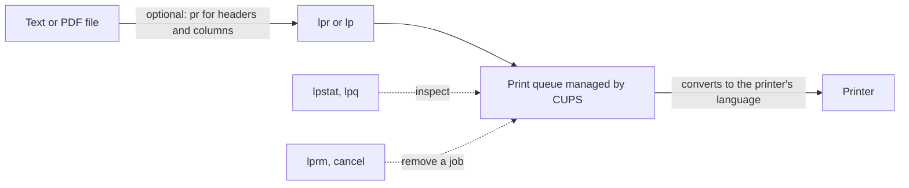
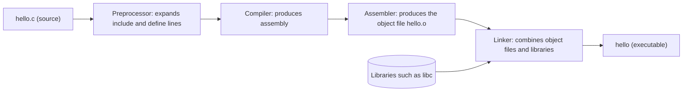

# Formatting output, printing and compiling programs

> **Before this lesson:** you should know pipes and redirection ([Redirection and pipelines](#/lesson/linux-cli/redirection-pipelines)), how quoting works ([Expansion and quoting](#/lesson/linux-cli/expansion-quoting)) and how software is normally installed ([Package management](#/lesson/linux-cli/package-management)).

## In plain words

This lesson gathers three jobs that sit at the *end* of a piece of work.

**Formatting** is making text presentable. Think of the difference between a pile of receipts and a neat table with aligned columns and totals. The numbers are the same; one is readable. Linux has small tools that number lines, wrap long lines, reflow paragraphs and — most importantly — line values up in columns with `printf`.

**Printing** is sending a document to a paper printer. On Linux a document is handed to a *print queue*, a waiting line of jobs, in the way you hand a letter to a post office rather than carrying it to the recipient yourself.

**Compiling** is turning a program written by a person into a program a computer can run. Think of a recipe written in English that must be translated into the exact button presses of a factory machine. The translator is called a *compiler*. Most software you install has already been translated for you, but sometimes — a newer version, an unusual computer, your own project — you must do it yourself.

Why these matter for a job: reports and script output that people can read at a glance are part of doing work well; `printf` is used in practically every shell script; and the build tool `make` appears in a large share of software projects — including ones that have nothing to do with compiling — as the standard way to say "run the steps needed to bring this up to date".

## Part 1 — Formatting text

### `nl` — number the lines

`nl` prints a file with line numbers in front of every non-blank line.

```bash
mira@forge:~/doc$ cat steps.txt
Install the packages.

Create the database.
Start the service.
mira@forge:~/doc$ nl steps.txt
     1	Install the packages.

     2	Create the database.
     3	Start the service.
mira@forge:~/doc$ nl -ba -w2 -s'. ' steps.txt
 1. Install the packages.
 2. 
 3. Create the database.
 4. Start the service.
```

In the first run the blank line got no number. In the second, `-ba` means "number **a**ll body lines, including blank ones", `-w2` sets the width of the number to two characters, and `-s'. '` sets the text placed after the number. Line numbers are valuable when discussing a file with someone ("look at line 3") or when reading error messages that mention line numbers.

### `fold` — wrap long lines at a fixed width

`fold` breaks every line that is longer than a given width. `-w` sets the width and `-s` tells it to break at a space instead of in the middle of a word.

```bash
mira@forge:~/doc$ echo "The quick brown fox jumped over the lazy dog near the river bank." | fold -w 24
The quick brown fox jump
ed over the lazy dog nea
r the river bank.
mira@forge:~/doc$ echo "The quick brown fox jumped over the lazy dog near the river bank." | fold -w 24 -s
The quick brown fox 
jumped over the lazy 
dog near the river bank.
```

The first result cut "jumped" and "near" in two; the second kept words whole.

### `fmt` — reflow paragraphs

`fold` only breaks lines. `fmt` is smarter: it joins short lines and breaks long ones so that each paragraph fills a target width, keeping blank lines between paragraphs.

```bash
mira@forge:~/doc$ cat note.txt
Backups run
every night at two.
They are copied to a second site
once they finish.

Restores are tested monthly.
mira@forge:~/doc$ fmt -w 50 note.txt
Backups run every night at two.  They are copied
to a second site once they finish.

Restores are tested monthly.
```

Useful options: `-w N` for the width, `-u` for uniform spacing (one space between words, two after a sentence), and `-p PREFIX` to reflow only lines that start with a prefix such as `# `, which tidies comment blocks in code without touching the code.

### `pr` — prepare pages

`pr` splits text into pages with a header (date, file name, page number) and can arrange it in columns. It was designed for paper, and its column feature is handy on screen too.

```bash
mira@forge:~/doc$ ls /usr/bin | head -n 12 | pr -3 -t -w 60
aa-enabled          addr2line           apropos
aa-exec             apt                 apt-cache
aa-features-abi     apt-add-repository  apt-cdrom
add-apt-repository  apt-config          apt-get
```

`-3` asks for three columns, `-t` omits the page header and footer, `-w 60` sets the total width. A similar tool, `column -t`, lines up existing columns and is what most people reach for when making tables on screen:

```bash
mira@forge:~/doc$ printf 'name score city\nana 97 Lisbon\nbenedict 8 Oslo\n' | column -t
name      score  city
ana       97     Lisbon
benedict  8      Oslo
```

### `printf` — exact control over output

`echo` prints its arguments and a newline, and that is all it can do. `printf` ("print formatted") takes a **format string** — a template — followed by values to drop into the template.

```bash
mira@forge:~$ printf "Hello, %s!\n" "Ana"
Hello, Ana!
```

Piece by piece: `%s` is a **placeholder** (officially a *conversion specification*) meaning "put a string here". The value `Ana` was put in its place. `\n` is an **escape sequence** meaning "newline"; unlike `echo`, `printf` does not add a newline for you, so you write it.

The common placeholders:

| Placeholder | Meaning | Example | Output |
|---|---|---|---|
| `%s` | string (text) | `printf '%s\n' abc` | `abc` |
| `%d` | whole number in decimal | `printf '%d\n' 42` | `42` |
| `%f` | number with a decimal point | `printf '%f\n' 3.14159` | `3.141590` |
| `%x` / `%o` | whole number in hexadecimal / octal | `printf '%x\n' 255` | `ff` |
| `%e` | scientific notation | `printf '%e\n' 12345.678` | `1.234568e+04` |
| `%%` | a literal percent sign | `printf '100%%\n'` | `100%` |

Between the `%` and the letter you can add a **width** (minimum number of characters), a **precision** (digits after the decimal point) and flags:

| Format | Meaning | Output for the value shown |
|---|---|---|
| `%5d` | at least 5 wide, right-aligned | `   42` |
| `%-5d` | at least 5 wide, left-aligned | `42   ` |
| `%05d` | pad with zeros | `00042` |
| `%+d` | always show the sign | `+42` |
| `%.2f` | two digits after the point | `3.14` |
| `%8.2f` | 8 wide in total, two after the point | `    3.14` |
| `%-10s` | text, left-aligned in 10 characters | `ana       ` |
| `%.3s` | at most the first 3 characters | `ana` from `anastasia` |

And the common escape sequences: `\n` newline, `\t` tab, `\\` a backslash, `\"` a double quote.

A feature that surprises newcomers and is extremely useful: when there are **more values than placeholders, the format is used again** for the remaining values.

```bash
mira@forge:~$ printf '%-10s %5s %8s\n' NAME QTY PRICE ana 3 19.50 benedict 12 189.00
NAME         QTY    PRICE
ana            3    19.50
benedict      12   189.00
mira@forge:~$ printf '%-10s|%6.1f%%\n' accuracy 97.25 recall 88.4
accuracy  |  97.2%
recall    |  88.4%
mira@forge:~$ printf 'run_%03d.log\n' 1 2 10
run_001.log
run_002.log
run_010.log
mira@forge:~$ printf '%s\t%s\n' host01 up host02 down | column -t
host01  up
host02  down
```

The first command printed three rows from one format, giving an aligned table. The third shows zero-padded numbers, which make file names sort correctly (`run_010` after `run_002`).

Python's `%` formatting uses the same placeholder language, so you can experiment here:

```python-run
rows = [("ana", 3, 19.5), ("benedict", 12, 189.0), ("cy", 104, 2.25)]

header = "%-10s %5s %9s" % ("NAME", "QTY", "PRICE")
print(header)
print("-" * len(header))
for name, qty, price in rows:
    print("%-10s %5d %9.2f" % (name, qty, price))      # same specs as shell printf

print()
for spec, value in [("%5d", 42), ("%-5d|", 42), ("%05d", 42), ("%+d", 42),
                    ("%.2f", 3.14159), ("%8.2f", 3.14159), ("%x", 255), ("%.3s", "anastasia"), ("%e", 12345.678)]:
    print(f"{spec:8} -> [{spec % value}]")
```

> [!TIP]
> Prefer `printf` to `echo` in scripts whenever the text may contain backslashes, may start with a dash, or needs alignment. `echo` behaves differently between shells for those cases, while `printf '%s\n' "$value"` prints any value exactly as it is.

> [!WARNING]
> Never put untrusted or variable text into the **format** position, as in `printf "$user_input"`. A percent sign inside the text is then treated as a placeholder and the output is mangled (in the C language the same mistake is a well-known security hole). Keep the format fixed and pass the data as an argument: `printf '%s\n' "$user_input"`.

### `groff` — a document formatter, briefly

`groff` is a typesetting system: it reads text containing formatting commands and produces a laid-out document. You use it without knowing every time you read a manual page — `man` runs `groff` on the page's source. You can see the machinery with:

```bash
mira@forge:~$ zcat /usr/share/man/man1/ls.1.gz | head -n 3
.\" DO NOT MODIFY THIS FILE!  It was generated by help2man 1.48.5.
.TH LS "1" "April 2024" "GNU coreutils 9.4" "User Commands"
.SH NAME
mira@forge:~$ zcat /usr/share/man/man1/ls.1.gz | groff -man -T utf8 | head -n 4
```

Lines starting with a dot are instructions (`.TH` title, `.SH` section heading). Today most people write documentation in Markdown instead, and convert between formats with `pandoc`, but `groff` remains the engine behind `man`.

### `csplit` — cut a file at patterns

You already know `split`, which cuts a file into pieces of a fixed size or line count. `csplit` cuts at *content*: wherever a line matches a pattern or reaches a line number. Think of tearing a long scroll at each chapter heading rather than every metre.

```bash
mira@forge:~$ csplit -f part- -z notes.md '/^## /' '{*}'
1043
2210
1876
mira@forge:~$ ls part-*
part-00  part-01  part-02
```

The first argument after the options is the file. `'/^## /'` is a regular expression: start a new piece at every line that begins with two hashes and a space. `'{*}'` means "repeat as many times as it keeps matching" (a number such as `'{3}'` repeats that many times). The numbers printed are the byte counts of each piece. Useful options: `-f` sets the file-name prefix (default `xx`), `-n` sets how many digits are in the numbering, and `-z` drops empty pieces. A plain number cuts at a line: `csplit data.txt 100` puts lines 1 to 99 in `xx00` and the rest in `xx01`.

### A note on `nroff` and `groff`

`groff` belongs to a family called **roff**, the oldest text formatters on Unix, descended from a 1960s program named RUNOFF. `troff` produces output for typesetters, and `nroff` produces plain text for terminals and line printers. `groff` is the GNU rewrite that does both. On modern systems `nroff` is usually a small wrapper that runs `groff` with a terminal-friendly device. The commands (`.TH`, `.SH`) in a manual page come from a **macro package** called `man`; `-man` on the command line loads it. You will not usually write roff, but knowing the family explains the odd names in `man` and in old documentation.

## Part 2 — Printing

On Linux, printing is handled by a service called **CUPS** (Common Unix Printing System). You do not talk to the printer directly; you submit a **print job** to a **queue**, and the service feeds jobs to the printer in order. Two families of commands exist for historical reasons and both work.



| Task | Berkeley style | System V style |
|---|---|---|
| print a file | `lpr file` | `lp file` |
| choose a printer | `lpr -P name file` | `lp -d name file` |
| number of copies | `lpr -# 2 file` | `lp -n 2 file` |
| list printers and the default | `lpstat -p -d` | `lpstat -p -d` |
| show the queue | `lpq` | `lpstat -o` |
| remove a job | `lprm 603` | `cancel 603` |

```bash
mira@forge:~$ lpstat -p -d
printer office-laser is idle.  enabled since Mon 16 Nov 2026 08:12:44
system default destination: office-laser
mira@forge:~$ pr -h "Deployment checklist" steps.txt | lpr
mira@forge:~$ lp -d office-laser -n 2 -o sides=two-sided-long-edge -o media=A4 report.pdf
request id is office-laser-604 (1 file(s))
mira@forge:~$ lpq
office-laser is ready and printing
Rank    Owner   Job     File(s)                         Total Size
active  mira    603     (stdin)                         1024 bytes
1st     mira    604     report.pdf                      284672 bytes
mira@forge:~$ cancel 604
```

Reading it: `lpstat` confirmed a printer exists and is the default. The second command sent text through `pr` (to add a page header) into `lpr`, which read it from standard input — printing commands are filters like any other. The third printed a PDF twice, double-sided on A4 paper. `lpq` showed two waiting jobs and `cancel` removed one by its job number.

Plain text often prints better after conversion to PostScript or PDF with a tool such as `a2ps` or `enscript`, which add fonts, borders and two-pages-per-sheet layouts. In server and cloud work you will rarely print at all — but "print to PDF" pipelines for reports use exactly these tools, with the output going to a file instead of a device.

## Part 3 — Compiling programs

### What compiling means

A computer's processor understands only **machine code**: numeric instructions specific to that kind of processor. People write **source code**, text in a programming language. Two approaches bridge the gap:

- An **interpreter** reads the source and carries it out directly, every time the program runs. Python, Bash and JavaScript work this way. No separate build step is needed.
- A **compiler** translates the source into a machine-code file once, in advance. C, C++, Rust and Go work this way. The result runs fast and needs no translator present at run time.

Building a C program involves several stages, normally run for you by one command:



An **object file** (`.o`) is the machine code for one source file, not yet runnable alone. A **library** is a collection of ready-made object code that many programs share — for example the code that implements printing to the screen. The **linker** joins your object files with the libraries they use to make the finished **executable**.

### Compiling by hand

Install the tools once (`sudo apt install build-essential` on Debian and Ubuntu, `sudo dnf group install "Development Tools"` on Fedora), then:

```bash
mira@forge:~/hello$ cat hello.c
#include <stdio.h>

int main(void) {
    printf("Hello from C\n");
    return 0;
}
mira@forge:~/hello$ gcc -Wall -O2 -o hello hello.c
mira@forge:~/hello$ ./hello
Hello from C
mira@forge:~/hello$ file hello
hello: ELF 64-bit LSB pie executable, x86-64, dynamically linked, not stripped
mira@forge:~/hello$ ldd hello
	linux-vdso.so.1 (0x00007ffd3a9f2000)
	libc.so.6 => /lib/x86_64-linux-gnu/libc.so.6 (0x00007f2b1c400000)
```

`gcc` is the GNU C compiler. `-Wall` turns on the common warnings (always use it), `-O2` asks for optimisation, `-o hello` names the output file. The program is run as `./hello` because the current directory is not on the command search path. `ldd` lists the shared libraries the executable needs when it runs; "library not found" errors when starting a program are diagnosed with it.

### `make` — rebuild only what changed

Real programs have hundreds of source files. Recompiling all of them after editing one would waste minutes or hours. `make` solves this. It reads a file named `Makefile` that lists **targets** (files to produce), their **prerequisites** (files they are made from) and the **recipe** (commands that make them). `make` compares modification times: a target is rebuilt only if it is missing or **older than one of its prerequisites**.

```bash
mira@forge:~/calc$ cat Makefile
CC = gcc
CFLAGS = -Wall -O2

calc: main.o mathops.o
	$(CC) -o calc main.o mathops.o

main.o: main.c mathops.h
	$(CC) $(CFLAGS) -c main.c

mathops.o: mathops.c mathops.h
	$(CC) $(CFLAGS) -c mathops.c

.PHONY: clean
clean:
	rm -f calc *.o
```

Each rule has the shape `target: prerequisites`, followed by recipe lines that **must begin with a tab character** (spaces cause the error "missing separator"). `CC` and `CFLAGS` are variables, used as `$(CC)`. The option `-c` tells the compiler to stop after producing the object file. `clean` is a *phony* target: it does not name a file, it is a named action.

```bash
mira@forge:~/calc$ make
gcc -Wall -O2 -c main.c
gcc -Wall -O2 -c mathops.c
gcc -o calc main.o mathops.o
mira@forge:~/calc$ make
make: 'calc' is up to date.
mira@forge:~/calc$ touch mathops.c          # pretend we edited this file
mira@forge:~/calc$ make
gcc -Wall -O2 -c mathops.c
gcc -o calc main.o mathops.o
```

The first run built everything. The second did nothing, because every target was newer than its prerequisites. After `mathops.c` changed, `make` recompiled only that file and re-linked — `main.c` was left alone.

The decision `make` takes for each target is small enough to model directly:

```python-run
rules = {                       # target -> prerequisites
    "calc":      ["main.o", "mathops.o"],
    "main.o":    ["main.c", "mathops.h"],
    "mathops.o": ["mathops.c", "mathops.h"],
}
mtime = {"main.c": 10, "mathops.c": 10, "mathops.h": 10}   # larger number = modified more recently
clock = [100]

def make(target, depth=0):
    """Bring a target up to date; return True if it was rebuilt."""
    if target not in rules:                      # a source file: nothing to build
        return False
    for dep in rules[target]:
        make(dep, depth + 1)                     # first make sure each prerequisite is current
    newest = max(mtime[d] for d in rules[target])
    if target not in mtime or mtime[target] < newest:
        clock[0] += 1
        mtime[target] = clock[0]
        print("  " * depth + f"build {target}  (from {', '.join(rules[target])})")
        return True
    return False

print("first make:");            make("calc")
print("second make:");           print("  nothing to do" if not make("calc") else "")
clock[0] += 1; mtime["mathops.c"] = clock[0]
print("after editing mathops.c:"); make("calc")
clock[0] += 1; mtime["mathops.h"] = clock[0]
print("after editing mathops.h:"); make("calc")
```

Editing the shared header `mathops.h` rebuilds both object files, because both list it as a prerequisite.

`make` is not tied to C. Many Python, data and infrastructure projects use a `Makefile` as a menu of project commands — `make test`, `make lint`, `make docker-build` — because it is installed everywhere and documents the steps in one place. Useful flags: `make -n` prints what would run without running it, `make -j8` runs up to eight recipes in parallel, and `make -C dir` works in another directory.

### Building software from source: the three-step ritual

Open-source programs distributed as source archives traditionally build with the same three commands:

```bash
mira@forge:~/src$ tar -xf diction-1.11.tar.gz && cd diction-1.11
mira@forge:~/src/diction-1.11$ less README INSTALL          # always read these first
mira@forge:~/src/diction-1.11$ ./configure --prefix=$HOME/.local
checking for gcc... gcc
checking whether the C compiler works... yes
config.status: creating Makefile
mira@forge:~/src/diction-1.11$ make -j"$(nproc)"
mira@forge:~/src/diction-1.11$ make install
mira@forge:~/src/diction-1.11$ which diction
/home/mira/.local/bin/diction
```

- `./configure` is a script shipped with the program. It examines your system — which compiler, which libraries are present — and writes a `Makefile` tailored to it. If something required is missing, it stops and names it; the fix is usually to install the matching *development package* (on Debian and Ubuntu these end in `-dev`, for example `libssl-dev`).
- `make` compiles.
- `make install` copies the results into place. The `--prefix` option chose where: here a directory in your home, which needs no administrator rights.

> [!WARNING]
> `sudo make install` runs a stranger's script with full administrator rights and scatters files across `/usr/local` that the package manager knows nothing about — it cannot upgrade or cleanly remove them later. Before doing it: check whether your distribution already offers a package; read the build instructions; prefer `--prefix=$HOME/.local` (no `sudo` needed) or build inside a container; and keep the source directory, because `sudo make uninstall`, where provided, needs it.

> [!INTERVIEW]
> For general software roles: "What is the difference between a compiled and an interpreted language?", "What does a linker do?" and "What is a Makefile for?" — the key idea for the last one is the dependency graph plus timestamps, so that only out-of-date targets are rebuilt. For shell work, expect to write a `printf` line that formats a table, or to explain `%5.2f`. A useful practical answer to "the program says a shared library is missing": run `ldd program`, find the line marked "not found", and install the package that provides it.

## Pitfalls

- **Forgetting `\n` in `printf`**, so the prompt appears on the same line as the output.
- **Variable text used as the format string.**
- **Spaces instead of a tab** before recipe lines in a Makefile.
- **Expecting `make` to notice a change it was not told about.** If a prerequisite is missing from a rule, edits to that file do not trigger a rebuild. `make clean && make` forces a full rebuild.
- **`./configure` failing on a missing header file.** Install the `-dev` (or `-devel`) package for that library.
- **Running the built program by name** when it is not on the search path; use `./program`.
- **Mixing source-built and packaged copies** of the same tool; `type -a name` shows which one runs.
- **Wide text sent straight to a printer** without `fold`, `fmt` or `pr`, so long lines are cut off at the paper edge.

## Cheat sheet

| Task | Command |
|---|---|
| Number lines | `nl -ba file` |
| Wrap at 72 characters on spaces | `fold -s -w 72 file` |
| Reflow paragraphs | `fmt -w 72 file` |
| Three columns without headers | `pr -3 -t file` |
| Align columns | `column -t file` |
| Formatted line | `printf '%-10s %5d %8.2f\n' name 3 19.5` |
| Zero-padded number | `printf '%03d\n' 7` |
| Print a value safely | `printf '%s\n' "$value"` |
| Print a file / to a named printer | `lpr file`, `lp -d printer file` |
| Queue status / remove a job | `lpq`, `lprm N` or `cancel N` |
| Compile one C file | `gcc -Wall -O2 -o prog prog.c` |
| Libraries an executable needs | `ldd prog` |
| Build with make / show what would run | `make`, `make -n` |
| Parallel build | `make -j"$(nproc)"` |
| Source build into your home | `./configure --prefix=$HOME/.local && make && make install` |

## Summary

- `nl`, `fold`, `fmt`, `pr` and `column` number, wrap, reflow, paginate and align text; `groff` typesets the manual pages.
- `printf` fills a format string with values: `%s`, `%d`, `%f` with optional width, precision and flags, plus escapes such as `\n` and `\t`. The format repeats for extra values.
- Printing submits jobs to a queue: `lpr`/`lp` send, `lpq`/`lpstat` inspect, `lprm`/`cancel` remove.
- A compiler translates source into machine code through preprocessing, compiling, assembling and linking. `make` rebuilds only targets older than their prerequisites, as described in a `Makefile`.
- Source packages usually build with `./configure`, `make`, `make install`; prefer packaged software and unprivileged install locations.

## Glossary

| Term | Meaning |
|---|---|
| format string | the template given to `printf`, containing text and placeholders |
| placeholder (conversion specification) | a `%` code such as `%s` or `%5.2f` that is replaced by a value |
| escape sequence | a backslash code for a special character, such as `\n` for newline |
| width / precision | minimum number of characters / digits after the decimal point |
| print queue | the waiting line of print jobs |
| CUPS | Common Unix Printing System, the Linux printing service |
| source code | a program as written by a person |
| machine code | numeric instructions a processor executes directly |
| compiler / interpreter | translates source ahead of time / carries out source directly |
| object file | compiled code for one source file, not yet a complete program |
| library | reusable compiled code shared by many programs |
| linker | the tool that combines object files and libraries into an executable |
| executable | a file that can be run as a program |
| Makefile | the file that tells `make` what to build, from what, and how |
| target / prerequisite / recipe | what to build / what it depends on / the commands that build it |
| `csplit` | A command that splits a file at lines matching a pattern or at given line numbers |
| roff | The family of Unix text formatters (`nroff`, `troff`, `groff`) behind manual pages |
| `nroff` / `troff` | The roff formatters that produce plain terminal text / typeset output |

## Check yourself

```quiz
[
  {"q": "What does `printf '%5d|\\n' 42` print?",
   "options": ["42   |", "   42|", "00042|", "42|"],
   "answer": 1,
   "explain": "%5d reserves at least five characters and right-aligns the number, so three spaces come before 42. A minus sign in the specification (%-5d) would left-align it."},
  {"q": "`printf '%s-%s\\n' a b c d` prints two lines, a-b and c-d. Why?",
   "options": ["printf always prints two lines", "When there are more arguments than placeholders, the format string is reused for the remaining arguments", "The dash splits the arguments", "It is an error that happens to work"],
   "answer": 1,
   "explain": "printf applies the format repeatedly until all arguments are consumed, which is how one format produces a whole table."},
  {"q": "What is the difference between `fold -w 60` and `fmt -w 60`?",
   "options": ["They are identical", "fold only breaks long lines; fmt also joins short lines to fill paragraphs to the width", "fmt numbers the lines", "fold works on paragraphs, fmt on characters"],
   "answer": 1,
   "explain": "fold cuts each long line at the width. fmt reflows whole paragraphs, merging and splitting lines as needed."},
  {"q": "After a successful `make`, you run `make` again without changing anything. What happens?",
   "options": ["Everything is recompiled", "Nothing is rebuilt, because every target is newer than its prerequisites", "It deletes the object files", "It reports an error"],
   "answer": 1,
   "explain": "make compares modification times and rebuilds a target only when it is missing or older than something it depends on."},
  {"q": "A Makefile fails with 'missing separator'. What is the usual cause?",
   "options": ["The compiler is not installed", "Recipe lines are indented with spaces instead of a tab character", "The target name is too long", "A missing semicolon in the C code"],
   "answer": 1,
   "explain": "make requires each recipe line to begin with a real tab. Editors that convert tabs to spaces produce this error."},
  {"q": "What does the linker do?",
   "options": ["Checks spelling in source code", "Combines object files and the libraries they use into one executable", "Downloads source code", "Converts tabs to spaces"],
   "answer": 1,
   "explain": "Each source file compiles to an object file; the linker resolves references between them and to libraries and produces the runnable program."},
  {"q": "What is the job of `./configure` in the configure / make / make install sequence?",
   "options": ["It compiles the program", "It inspects the system and generates a Makefile suited to it, stopping if requirements are missing", "It installs the program into /usr/local", "It removes old versions"],
   "answer": 1,
   "explain": "configure adapts the build to the machine: compiler, libraries, install location. make then performs the compilation."},
  {"q": "Which command shows the jobs waiting to be printed?",
   "options": ["lpr", "lpq", "pr", "fmt"],
   "answer": 1,
   "explain": "lpq (or lpstat -o) lists the queue. lpr submits a job and pr only formats text into pages."},
  {"q": "What does csplit -f part- -z notes.md '/^## /' '{*}' do?", "options": ["Splits the file every 100 lines", "Splits the file at every line starting with ## and names pieces part-00, part-01 and so on", "Joins several files", "Counts lines starting with ##"], "answer": 1, "explain": "csplit cuts at pattern matches. {*} repeats for every match, -f sets the prefix and -z discards empty pieces."},
  {"q": "Which formatter in the roff family produces plain text for terminals?", "options": ["troff", "nroff", "pr", "fmt"], "answer": 1, "explain": "nroff targets terminals and line printers; troff targets typesetters. groff does both."}
]
```

> **Source:** Shotts, *The Linux Command Line*, ch. 21 (Formatting Output), ch. 22 (Printing) and ch. 23 (Compiling Programs). All examples and wording are original to this guide.
