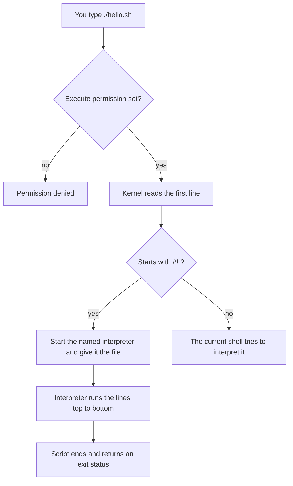

# Writing your first script and starting a project

> **Before this lesson:** you should be able to run commands and combine them with pipes ([Redirection and pipelines](#/lesson/linux-cli/redirection-pipelines)), understand quoting and `$` expansions ([Expansion and quoting](#/lesson/linux-cli/expansion-quoting)), know what the execute permission is ([Permissions](#/lesson/linux-cli/permissions)) and what `PATH` does ([The environment and startup files](#/lesson/linux-cli/environment-startup)).

## In plain words

Until now you have typed commands one at a time, like giving a helper spoken instructions: "fetch the mail", then "sort it", then "throw away the junk". A **shell script** is the same instructions written on a card. You hand over the card once, and the helper carries out every line, in order, as many times as you like — tomorrow, next week, at three in the morning while you sleep.

More precisely, a script is a plain text file containing commands. A program called an **interpreter** (here, the shell `bash`) reads the file from top to bottom and runs each line exactly as if you had typed it.

Why this matters for a job: any task you perform more than twice — setting up a project, checking the health of a server, preparing a dataset, deploying a new version — is a candidate for a script. Scripts make work repeatable (the same steps every time), shareable (a colleague can run the card), reviewable (the steps are written down) and automatable (a scheduler can run it without you). Nearly every software team has a directory of shell scripts holding its routine operations.

In this lesson you will write a first script, make it runnable, and then begin a small real project — a system report — introducing **variables** (named values) and **here documents** (blocks of text inside a script) along the way.

## Your first script, in three steps

### Step 1 — write the file

Open a text editor (`nano hello.sh` is the gentlest) and type these three lines:

```bash
#!/bin/bash
# My first script: print a greeting.
echo "Hello from a script!"
```

Line by line:

1. `#!/bin/bash` is the **shebang** (from "sharp" `#` and "bang" `!`). It must be the very first line. It tells the system which interpreter should read the rest of the file — here the program `/bin/bash`.
2. A line starting with `#` is a **comment**: a note for human readers that the shell ignores. Comments explain *why* something is done.
3. `echo` prints its argument, as you have seen at the prompt.

The `.sh` ending is a convention for people; Linux itself does not care about file extensions.

### Step 2 — make it executable

A new text file may be read and edited but not *run*. Add the execute permission:

```bash
mira@forge:~/scripts$ ls -l hello.sh
-rw-r--r-- 1 mira mira 76 Nov 20 13:02 hello.sh
mira@forge:~/scripts$ chmod +x hello.sh
mira@forge:~/scripts$ ls -l hello.sh
-rwxr-xr-x 1 mira mira 76 Nov 20 13:02 hello.sh
```

The permission string changed from `rw-` to `rwx`: the `x` means the file may now be executed.

### Step 3 — run it

```bash
mira@forge:~/scripts$ hello.sh
bash: hello.sh: command not found
mira@forge:~/scripts$ ./hello.sh
Hello from a script!
```

The first attempt failed, and the reason confuses nearly everyone at first. When you type a bare name, the shell looks for it only in the directories listed in the `PATH` variable. Your current directory is deliberately not in that list (otherwise a file named `ls` planted in a shared folder could be run by accident). Writing `./hello.sh` gives an explicit location — "the file `hello.sh` in this directory" — so no search is needed.

To run your scripts by bare name from anywhere, keep them in a directory that is on your `PATH`. The usual personal location is `~/.local/bin` (or `~/bin`):

```bash
mira@forge:~/scripts$ mkdir -p ~/.local/bin
mira@forge:~/scripts$ cp hello.sh ~/.local/bin/hello
mira@forge:~/scripts$ hello
Hello from a script!
```

Scripts meant for every user of a machine go in `/usr/local/bin`.

There is one more way to run a script: `bash hello.sh`. Here you start the interpreter yourself and hand it the file, so neither the shebang nor the execute permission is needed. It is handy for a quick test.



> [!TIP]
> Write `#!/usr/bin/env bash` as the shebang when a script must work on different systems. `env` finds `bash` wherever it is installed (on some systems that is not `/bin/bash`). And say `bash`, not `sh`, if you use any feature from these lessons: `sh` may be a smaller shell in which several of them do not exist.

## Layout that helps the next reader

A script is read far more often than it is written — by colleagues and by you in six months. Three habits cost nothing.

**Long option names.** At the prompt `ls -ad` is quick to type. In a script `ls --all --directory` explains itself.

**One idea per line.** A backslash at the very end of a line means "this command continues on the next line", and a pipe symbol at the end of a line also continues. Compare:

```bash
# hard to read
find /srv/data -type f -name '*.csv' -size +10M -mtime -7 -print0 | xargs -0 ls -lh | sort -k5 -h

# the same command, laid out
find /srv/data \
    -type f \
    -name '*.csv' \
    -size +10M \
    -mtime -7 \
    -print0 |
  xargs -0 ls -lh |
  sort -k5 -h
```

**Comments that say why.** `# remove old files` above an `rm` adds nothing; `# keep one week only: the disk fills in about ten days` is worth its line.

## Starting a project: a system report

A good first project produces something visible. We will build a script that writes a report about the machine it runs on, as a Markdown document (Markdown is a plain-text format in which `#` starts a heading). Work in small steps, running the script after each one.

### Stage 1 — fixed text

```bash
#!/bin/bash
# sys_report: print a report about this machine.

echo "# System report"
echo
echo "Generated by the sys_report script."
```

```bash
mira@forge:~/scripts$ chmod +x sys_report && ./sys_report
# System report

Generated by the sys_report script.
mira@forge:~/scripts$ ./sys_report > report.md
```

An `echo` with no argument prints an empty line. Because the script writes to standard output, it behaves like any other command: its output can be redirected to a file or piped into another program. That is the first design rule for scripts — print results to standard output and let the caller decide where they go.

### Stage 2 — variables

The word "System report" will be needed again, and typing it twice invites the two copies to drift apart. A **variable** is a name that holds a value. Create one by writing the name, an equals sign and the value; use it by putting `$` in front of the name.

```bash
#!/bin/bash
# sys_report: print a report about this machine.

title="System report"

echo "# $title"
echo
echo "Generated by the sys_report script."
```

Rules that trip up beginners, each of which produces a confusing error if broken:

- **No spaces around `=`.** `title = "x"` is read as "run a command called `title` with two arguments".
- Names may contain letters, digits and underscores, and must not start with a digit.
- A variable springs into existence when you assign it. If you misspell the name when using it, the shell does not complain — it substitutes **nothing**:

```bash
mira@forge:~$ greeting="hello"
mira@forge:~$ echo "[$greeting] [$greting]"
[hello] []
```

- When a variable name is followed directly by other letters or digits, wrap the name in braces so the shell knows where it ends: `"${title}_backup"`, not `"$title_backup"` (which would look up a variable called `title_backup`).
- Put double quotes around `"$variable"` when you use it, so that values containing spaces stay in one piece.

Every value in the shell is text; a variable can hold a number, but it is stored as the characters `4` and `2`.

**Constants and environment variables.** By convention, names written in capital letters are either **constants** (values the script must never change) or variables inherited from the environment such as `HOME`, `USER` and `HOSTNAME`. Ordinary working variables use lower case, which prevents an accidental clash with something like `PATH`. To have the shell enforce a constant, declare it read-only:

```bash
declare -r TITLE="System report"
TITLE="something else"       # bash: TITLE: readonly variable
```

### Stage 3 — command substitution

The report should contain live facts. Writing `$(command)` runs the command and inserts its output at that spot — this is **command substitution**, which you met in the expansion lesson. A variable can store the result.

```bash
#!/bin/bash
# sys_report: print a report about this machine.

declare -r TITLE="System report for $HOSTNAME"
now="$(date +"%Y-%m-%d %H:%M %Z")"
kernel="$(uname -r)"

echo "# $TITLE"
echo
echo "Generated $now by $USER."
echo "Kernel: $kernel"
```

```bash
mira@forge:~/scripts$ ./sys_report
# System report for forge

Generated 2026-11-20 13:40 UTC by mira.
Kernel: 6.8.0-49-generic
```

Line by line: `HOSTNAME` and `USER` come ready-made from the environment. `date +"..."` prints the current time in the given layout, and its output is stored in `now`. `uname -r` prints the version of the Linux kernel.

The block below imitates how the shell fills in variables, including the silent-empty behaviour and the brace rule. Change the template and the values and run it.

```python-run
import re

def expand(template, variables):
    """Replace $name and ${name}; an unknown name becomes an empty string, as in the shell."""
    def lookup(match):
        name = match.group(1) or match.group(2)
        return variables.get(name, "")
    return re.sub(r"\$\{(\w+)\}|\$(\w+)", lookup, template)

values = {"title": "System report", "USER": "mira", "HOSTNAME": "forge"}

for template in [
    "# $title for $HOSTNAME",
    "Generated by $USER.",
    "[$titel]                <- misspelt name: silently empty",
    "$title_backup          <- looks up a variable named title_backup",
    "${title}_backup        <- braces mark where the name ends",
]:
    print(expand(template, values))
```

### Stage 4 — here documents

Five `echo` lines are bearable; fifty are not. A **here document** feeds a block of lines to a command as its standard input. It starts with `<<` and a marker word of your choice, and ends at a line containing only that marker.

```bash
#!/bin/bash
# sys_report: print a report about this machine.

declare -r TITLE="System report for $HOSTNAME"
now="$(date +"%Y-%m-%d %H:%M %Z")"

cat <<_EOF_
# $TITLE

Generated $now by $USER.

## Uptime

$(uptime)

## Disk space

$(df -h / /home 2>/dev/null)

## Memory

$(free -h)
_EOF_
```

`cat` receives everything between the two `_EOF_` markers and prints it. The marker can be any word; `_EOF_` and `EOF` (short for "end of file") are traditional. Three properties make here documents pleasant:

- **Expansions still happen inside.** `$TITLE` and `$(uptime)` are replaced, as in double-quoted text.
- **Quote characters are ordinary text inside.** You can write `"quoted"` and `it's` without escaping anything.
- **Quoting the marker switches expansion off.** With `<<'_EOF_'` the block is passed through untouched, `$` signs included — the right choice when the block is itself code for another program.

```bash
mira@forge:~/scripts$ ./sys_report
# System report for forge

Generated 2026-11-20 13:52 UTC by mira.

## Uptime

 13:52:07 up 12 days,  8:18,  2 users,  load average: 0.21, 0.18, 0.11

## Disk space

Filesystem      Size  Used Avail Use% Mounted on
/dev/nvme0n1p2  468G  121G  324G  28% /

## Memory

               total        used        free      shared  buff/cache   available
Mem:            31Gi       6.4Gi        17Gi       310Mi       7.3Gi        24Gi
Swap:          2.0Gi          0B       2.0Gi
```

One more form: `<<-` (with a dash) strips leading **tab** characters from each line of the block, so the block can be indented to match the surrounding code. It strips tabs only, not spaces.

Here documents are not limited to `cat`. Any command that reads standard input can take one, which lets a script drive another program:

```bash
psql --quiet weather <<'_SQL_'
SELECT city, count(*) FROM forecasts GROUP BY city ORDER BY 2 DESC LIMIT 3;
_SQL_
```

> [!WARNING]
> A script runs its lines without asking, and it does **not** stop when a line fails — it carries straight on to the next one. That turns a small mistake into a large one: if `cd "$workdir"` fails because the variable was misspelt and is empty, a following `rm -rf *` deletes the contents of whatever directory you happened to be in. Until you learn full error handling in the [troubleshooting lesson](#/lesson/linux-cli/troubleshooting), follow three rules: test new scripts on copies of data, never on the only copy; chain dependent commands with `&&` (`cd "$workdir" && rm -rf ./*`); and put `echo` in front of a dangerous command during testing so that it is printed instead of executed.

## Exit status: how a script reports success

Every command hands back a number between 0 and 255 when it ends, the **exit status**. Zero means success; anything else means some kind of failure. The special variable `$?` holds the status of the most recent command.

```bash
mira@forge:~$ ls /etc/hostname
/etc/hostname
mira@forge:~$ echo $?
0
mira@forge:~$ ls /nope
ls: cannot access '/nope': No such file or directory
mira@forge:~$ echo $?
2
```

A script's exit status is that of its last command, unless you end it explicitly with `exit N`. Finish a successful script with `exit 0`, and leave with a non-zero number when something went wrong, so that whatever runs your script — another script, a scheduler, a deployment system — can tell the difference. The next lessons build on this heavily.

## A checklist before you trust a script

```bash
mira@forge:~/scripts$ bash -n sys_report && echo "syntax ok"      # parse without running
syntax ok
mira@forge:~/scripts$ shellcheck sys_report                       # a linter: finds common mistakes
mira@forge:~/scripts$ bash -x sys_report 2>&1 | head -n 4          # trace: show each command as it runs
+ declare -r 'TITLE=System report for forge'
++ date '+%Y-%m-%d %H:%M %Z'
+ now='2026-11-20 13:55 UTC'
+ cat
```

`bash -n` checks that the file can be parsed. `shellcheck` (install the package of that name) is a **linter** — a program that reads code and points out likely mistakes; it catches unquoted variables, misspelt names and dozens of other classic errors, and experienced people run it on every script. `bash -x` prints each command, after expansion, before running it.

> [!INTERVIEW]
> Beginner-level script questions that come up often: "What does the `#!` line do?" (it names the interpreter the kernel should start for the file), "Why do you need `./` to run a script in the current directory?" (the shell searches only `PATH`, which does not include the current directory), "What is the difference between `./script.sh`, `bash script.sh` and `source script.sh`?" (the first two run it in a new process — the first needs execute permission and uses the shebang; `source` runs the lines in your current shell, so variables and directory changes persist), and "What does an exit status of 0 mean?".

## Pitfalls

- **Spaces around `=`** in an assignment.
- **Forgetting `chmod +x`**, giving "Permission denied".
- **Running by bare name** from a directory that is not on `PATH`, giving "command not found".
- **A shebang that is not the first line**, or that has a blank line or spaces before it.
- **Windows line endings.** A script edited on Windows may fail with `/bin/bash^M: bad interpreter`; convert it with `dos2unix script`.
- **Misspelt variable names** silently becoming empty. `shellcheck`, or `set -u` (taught later), catches them.
- **Unquoted variables** breaking on values with spaces.
- **The end marker of a here document indented or followed by a space**, so the shell never finds the end and swallows the rest of the script.
- **Naming a script `test`.** A built-in command of that name exists and will run instead of yours.

## Cheat sheet

| Task | How |
|---|---|
| First line of a bash script | `#!/bin/bash` or `#!/usr/bin/env bash` |
| Comment | `# text` |
| Make executable | `chmod +x script` |
| Run from the current directory | `./script` |
| Run without execute permission | `bash script` |
| Personal script directory | `~/.local/bin` (must be on `PATH`) |
| Assign a variable | `name="value"` (no spaces around `=`) |
| Use a variable | `"$name"`, `"${name}_suffix"` |
| Constant | `declare -r NAME="value"` |
| Store a command's output | `now="$(date +%F)"` |
| Block of text with expansion | `cat <<EOF` … `EOF` |
| Block of text, literal | `cat <<'EOF'` … `EOF` |
| Continue a command on the next line | end the line with `\` |
| Status of the last command | `echo $?` |
| End with a status | `exit 0`, `exit 1` |
| Check syntax / lint / trace | `bash -n script`, `shellcheck script`, `bash -x script` |

## Summary

- A shell script is a text file of commands run top to bottom by an interpreter named in the shebang line.
- To run one: write it, `chmod +x` it, and call it by path (`./name`) or place it in a `PATH` directory.
- Variables are created by assignment with no spaces around `=` and read with `$name`; quote them, brace them when followed by text, and use capitals for constants.
- `$(command)` captures output; a here document passes a block of text, with expansions, to a command.
- Scripts report through their exit status; they do not stop on errors by themselves, so test with care, lint with `shellcheck` and trace with `bash -x`.

## Glossary

| Term | Meaning |
|---|---|
| script | a text file containing commands for an interpreter to run |
| interpreter | a program that reads source text and carries it out line by line |
| shebang | the first line `#!…` naming the interpreter |
| comment | text after `#` that the shell ignores |
| executable | a file with permission to be run as a program |
| variable | a name that holds a value |
| constant | a variable whose value must not change |
| assignment | giving a variable its value: `name=value` |
| command substitution | `$(command)`: replaced by the command's output |
| here document | a block of lines inside a script passed to a command as its input |
| exit status | the number (0 = success) a command returns when it ends |
| linter | a tool that examines code for likely mistakes without running it |
| standard output | the normal output stream of a program, by default the screen |

## Check yourself

```quiz
[
  {"q": "What is the purpose of the line `#!/bin/bash` at the top of a script?",
   "options": ["It is a comment with no effect", "It tells the system which interpreter should run the file", "It makes the file executable", "It imports bash functions"],
   "answer": 1,
   "explain": "The shebang names the program that will read and execute the rest of the file. Permission to execute is a separate matter, set with chmod."},
  {"q": "You created `backup.sh` in the current directory and made it executable. Typing `backup.sh` gives 'command not found'. Why?",
   "options": ["The script has a syntax error", "The shell searches only the directories in PATH, and the current directory is not among them", "Scripts must end in .bash", "It needs sudo"],
   "answer": 1,
   "explain": "A bare name is looked up in PATH. Give a path such as ./backup.sh, or put the script in a directory that is on PATH."},
  {"q": "What is wrong with the line `count = 5` in a bash script?",
   "options": ["Nothing", "The spaces make the shell run a command named count with the arguments = and 5", "Numbers must be quoted", "Variable names must be upper case"],
   "answer": 1,
   "explain": "An assignment must be written without spaces around the equals sign: count=5."},
  {"q": "A script contains `name=\"Ana\"` and later `echo \"Hello $nmae\"`. What is printed?",
   "options": ["Hello Ana", "Hello $nmae", "Hello followed by nothing, with no error", "An error about an undefined variable"],
   "answer": 2,
   "explain": "An unset variable expands to an empty string and the shell does not warn by default. Tools such as shellcheck or the option set -u catch the misspelling."},
  {"q": "Why write `\"${file}_old\"` instead of `\"$file_old\"`?",
   "options": ["Braces make the script faster", "Without braces the shell looks for a variable named file_old", "Braces add quotes automatically", "There is no difference"],
   "answer": 1,
   "explain": "Underscores and letters are valid in names, so the shell takes the longest possible name. Braces mark exactly where the name ends."},
  {"q": "In a here document started with `cat <<EOF`, what happens to `$HOME` written inside the block?",
   "options": ["It is printed literally", "It is replaced by the value of the variable", "It causes a syntax error", "It ends the document"],
   "answer": 1,
   "explain": "With an unquoted marker, expansions are performed inside the block. Quoting the marker (<<'EOF') turns them off."},
  {"q": "What does an exit status of 0 mean?",
   "options": ["The command failed", "The command succeeded", "The command printed nothing", "The command is still running"],
   "answer": 1,
   "explain": "By convention zero is success and any non-zero value signals a failure of some kind."},
  {"q": "By default, what does bash do when one command in the middle of a script fails?",
   "options": ["Stops the script immediately", "Continues with the next line", "Restarts the script", "Asks the user what to do"],
   "answer": 1,
   "explain": "Without explicit error handling a script keeps going after a failure, which is why dependent steps should be chained with && or guarded by checks."}
]
```

> **Source:** Shotts, *The Linux Command Line*, ch. 24 (Writing Your First Script) and ch. 25 (Starting a Project). All examples and wording are original to this guide.
