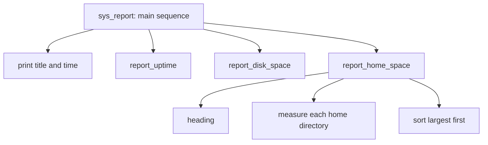

# Top-down design and shell functions

> **Before this lesson:** you should have written and run a small script with variables and a here document, as in [Writing your first script and starting a project](#/lesson/linux-cli/first-script-project). This lesson continues the `sys_report` script from there.

## In plain words

Suppose you must explain how to host a dinner. You would not begin with "pick up the knife with your right hand". You would begin with the big steps: *plan the menu, buy the food, cook, serve*. Then you would take one of those steps — "cook" — and break it into smaller ones: *make the soup, roast the vegetables, bake the dessert*. You keep splitting until every step is small enough to do without further thought. This way of working, from the big picture down to the details, is called **top-down design**.

In a script, each of those named steps becomes a **function**: a group of commands with a name. Once defined, the name can be used like any other command. A function is to a script what a recipe card is to the dinner plan — the plan says "make the soup", and the details live on their own card.

Why this matters for a job: scripts that run a business's routine operations grow. A 300-line script written as one unbroken list of commands is almost impossible to change safely. The same script built from small named functions can be read in a minute (the top level reads like a table of contents), tested piece by piece, and changed in one place. Writing in functions is the single habit that most separates maintainable scripts from throw-away ones.

## From a plan to a skeleton

In the previous lesson, `sys_report` printed a title and then several sections, all inside one here document. Before adding more, write down the plan as plain steps:

1. Print the title and the time.
2. Report how long the machine has been running.
3. Report disk space.
4. Report the space used by home directories.

Now turn each step into a function name and write the top level of the script **as if those functions already existed**:

```bash
#!/bin/bash
# sys_report: print a report about this machine.

declare -r TITLE="System report for $HOSTNAME"
now="$(date +"%Y-%m-%d %H:%M %Z")"

cat <<_EOF_
# $TITLE

Generated $now by $USER.

$(report_uptime)
$(report_disk_space)
$(report_home_space)
_EOF_
```

Each `$(report_…)` is a command substitution: it will run the function and insert whatever the function prints. The top level now reads like the plan. The next job is to define the three functions.

## Defining a function

A function definition has a name, a pair of parentheses, and a body in braces:

```bash
greet() {
    echo "Hello from a function"
}
```

Reading it: `greet` is the name; `()` says "this is a function definition" (nothing ever goes between these parentheses in bash); the commands between `{` and `}` are the **body**. Defining a function does not run anything — it only teaches the shell a new word. To run it, to **call** it, write its name:

```bash
mira@forge:~$ greet() { echo "Hello from a function"; }
mira@forge:~$ greet
Hello from a function
mira@forge:~$ type greet
greet is a function
greet ()
{
    echo "Hello from a function"
}
```

(An older, equivalent spelling is `function greet { … }`.) When a function is written on one line, the last command needs a semicolon before the closing brace, and there must be a space after the opening brace.

Two rules about placement:

- **A function must be defined before it is called.** The shell reads a script from the top; when it reaches a name it has not been taught yet, it reports "command not found". For this reason, scripts put all function definitions near the top and the main sequence at the bottom.
- **A function body may not be empty.** While sketching, put a harmless command inside. Such a placeholder is called a **stub**:

```bash
report_uptime() {
    echo "(report_uptime: not written yet)"
}
```

Stubs let you run the whole script from the first minute and fill in one function at a time, checking the output after each step. This is the core working method of top-down design: the script always runs, and it grows by replacing stubs with real code.

```bash
#!/bin/bash
# sys_report: print a report about this machine.

declare -r TITLE="System report for $HOSTNAME"
now="$(date +"%Y-%m-%d %H:%M %Z")"

report_uptime()     { echo "(report_uptime: not written yet)"; }
report_disk_space() { echo "(report_disk_space: not written yet)"; }
report_home_space() { echo "(report_home_space: not written yet)"; }

cat <<_EOF_
# $TITLE

Generated $now by $USER.

$(report_uptime)
$(report_disk_space)
$(report_home_space)
_EOF_
```

```bash
mira@forge:~/scripts$ ./sys_report
# System report for forge

Generated 2026-11-20 14:10 UTC by mira.

(report_uptime: not written yet)
(report_disk_space: not written yet)
(report_home_space: not written yet)
```



## Filling in the functions

Replace the stubs one by one, running the script after each change.

```bash
report_uptime() {
    cat <<_EOF_
## Uptime

$(uptime)
_EOF_
}

report_disk_space() {
    cat <<_EOF_
## Disk space

$(df -h --output=source,size,used,avail,pcent,target -x tmpfs -x devtmpfs)
_EOF_
}

report_home_space() {
    cat <<_EOF_
## Home directory space

$(du -sh /home/* 2>/dev/null | sort -rh)
_EOF_
}
```

What is new here: each function prints a heading and the output of one command. In `report_disk_space`, `df` is asked for specific columns and told to leave out temporary in-memory file systems (`-x tmpfs`). In `report_home_space`, `du -sh` prints one total per home directory; `2>/dev/null` discards "permission denied" messages for directories you may not read; and `sort -rh` puts the largest first.

```bash
mira@forge:~/scripts$ ./sys_report | tail -n 8
## Home directory space

38G	/home/mira
2.1G	/home/otto
```

## Giving a function information: arguments

A function becomes far more useful when it can work on different values each time. Whatever you write after the function's name when calling it is handed to the function as its **arguments**. Inside the body they are available as `$1` (the first), `$2` (the second) and so on; `$#` is how many were given, and `"$@"` is all of them.

```bash
heading() {
    echo
    echo "## $1"
    echo
}

mira@forge:~$ heading "Disk space"

## Disk space

```

Calling `heading "Disk space"` put the text `Disk space` into `$1` for the duration of that call. Now every section can be written without repeating the layout:

```bash
report_uptime() {
    heading "Uptime"
    uptime
}
```

A point that surprises newcomers: inside a function, `$1` means the **function's** first argument, not the script's. They are separate. (How a script receives arguments from its user is covered in the lesson on positional parameters.)

## Variables inside functions: local and global

By default, a variable assigned anywhere in a script is **global**: visible everywhere, including inside every function. That is convenient in a ten-line script and dangerous in a long one, because two functions that both use a variable named `count` or `file` or `i` silently overwrite each other's values.

The cure is the word `local`, which makes a variable exist only inside the function that declares it, for as long as that function is running.

```bash
#!/bin/bash
total=100

careless() {
    total=0                 # changes the GLOBAL variable
}

careful() {
    local total=0           # a separate variable, private to this function
    echo "inside careful: $total"
}

careful
echo "after careful:  $total"
careless
echo "after careless: $total"
```

```bash
mira@forge:~/scripts$ ./scope_demo
inside careful: 0
after careful:  100
after careless: 0
```

`careful` had its own `total`, so the global one kept its value of 100. `careless` wiped it out. The rule to adopt from the start: **declare every variable used inside a function with `local`**, unless you specifically intend to change a global.

The idea of "where is this name visible?" is called **scope**. The model below shows how the shell finds a variable: it looks in the running function's local names first and falls back to the global ones.

```python-run
globals_ = {"total": 100, "report_name": "weekly"}
call_stack = []                      # one dictionary of local variables per running function

def read(name):
    for frame in reversed(call_stack):      # innermost function first
        if name in frame:
            return frame[name]
    return globals_.get(name, "")           # unset variables are empty

def assign(name, value, local=False):
    if local:
        call_stack[-1][name] = value        # 'local name=value'
        return
    for frame in reversed(call_stack):      # plain assignment changes an existing local...
        if name in frame:
            frame[name] = value
            return
    globals_[name] = value                  # ...otherwise the global

def careful():
    call_stack.append({})
    assign("total", 0, local=True)
    print("  inside careful :", read("total"), "| report_name:", read("report_name"))
    call_stack.pop()                        # locals vanish when the function returns

def careless():
    call_stack.append({})
    assign("total", 0)
    call_stack.pop()

careful();  print("after careful  :", read("total"))
careless(); print("after careless :", read("total"))
```

## Getting results back from a function

Functions in bash differ from functions in languages such as Python in one important way: `return` does **not** hand back a value such as text or a large number. There are two separate channels.

**Channel 1 — the exit status (a small number meaning success or failure).** `return N` ends the function with status N, where 0 means success. If there is no `return`, the status is that of the last command in the body. This channel is for yes/no answers, and it lets a function be used directly in `if`, `&&` and `||`:

```bash
is_root() {
    [ "$(id -u)" -eq 0 ]            # status 0 if the user id is 0, otherwise 1
}

if is_root; then
    echo "running as administrator"
fi
is_root || echo "some sections need sudo and will be skipped"
```

(`id -u` prints the numeric user id; the bracket expression, covered fully in the next lesson, compares it with zero.)

**Channel 2 — printed output.** For any real data, the function prints it and the caller captures it with command substitution:

```bash
disk_percent() {
    local mount="$1"
    df --output=pcent "$mount" | tail -n 1 | tr -d ' %'
}

used="$(disk_percent /)"
echo "The root file system is ${used}% full."
```

Line by line: the function stores its argument in a local variable, asks `df` for the percentage column, keeps the last line (the first is a header), and deletes spaces and the percent sign so that a bare number remains. The caller stores that printed number in `used`.

> [!WARNING]
> Three traps around results. **(1)** `return` accepts only numbers from 0 to 255; `return 300` wraps around to 44 and `return "text"` is an error. Print data, return status. **(2)** `exit` inside a function ends the **whole script**, not only the function; use `return` to leave a function. **(3)** `$(function_call)` runs the function in a separate copy of the shell (a *subshell*), so any variables it changes are **not** changed in the caller — only its printed output comes back.

## The finished shape of a well-organised script

Putting the pieces together gives a layout worth copying for every script you write:

```bash
#!/bin/bash
# sys_report: print a Markdown report about this machine.

# ---- constants ---------------------------------------------------
declare -r TITLE="System report for $HOSTNAME"

# ---- helper functions --------------------------------------------
heading() {
    printf '\n## %s\n\n' "$1"
}

is_root() {
    [ "$(id -u)" -eq 0 ]
}

# ---- report sections ---------------------------------------------
report_uptime() {
    heading "Uptime"
    uptime
}

report_disk_space() {
    heading "Disk space"
    df -h --output=source,size,used,avail,pcent,target -x tmpfs -x devtmpfs
}

report_home_space() {
    heading "Home directory space"
    if is_root; then
        du -sh /home/* | sort -rh
    else
        du -sh "$HOME"
        echo "(run with sudo to include other users)"
    fi
}

# ---- main --------------------------------------------------------
main() {
    local now
    now="$(date +"%Y-%m-%d %H:%M %Z")"
    printf '# %s\n\nGenerated %s by %s.\n' "$TITLE" "$now" "$USER"
    report_uptime
    report_disk_space
    report_home_space
}

main "$@"
```

Things to notice:

- Constants first, then small helpers, then the section functions, then `main`, and on the very last line the single call that starts everything. Because the call is last, every function is defined by the time it is needed.
- `main "$@"` passes the script's own arguments on to `main`. Wrapping the top-level code in a `main` function means even its variables can be `local`.
- `report_home_space` makes a decision using the status of `is_root`. The `if … else … fi` construction is the subject of the next lesson; here it reads almost like English.
- Each function does one thing and is short enough to see on one screen.

```bash
mira@forge:~/scripts$ ./sys_report | head -n 9
# System report for forge

Generated 2026-11-20 14:31 UTC by mira.

## Uptime

 14:31:02 up 12 days,  8:57,  2 users,  load average: 0.12, 0.15, 0.10

## Disk space
```

## Functions in your interactive shell

Functions are not only for scripts. Defined in `~/.bashrc`, they become personal commands — a step up from aliases, because they can take arguments anywhere and contain logic.

```bash
# make a directory and move into it
mkcd() {
    mkdir -p "$1" && cd "$1"
}

# show the ten largest items in a directory (default: the current one)
biggest() {
    du -sh "${1:-.}"/* 2>/dev/null | sort -rh | head -n 10
}

# unpack an archive whatever its format
extract() {
    case "$1" in
        *.tar.gz|*.tgz) tar -xzf "$1" ;;
        *.tar.xz)       tar -xJf "$1" ;;
        *.zip)          unzip "$1" ;;
        *)              echo "extract: unknown format: $1" >&2; return 1 ;;
    esac
}
```

`mkcd` cannot be an alias (an alias cannot use its argument twice) and cannot be a script (a script runs in a child process, so its `cd` would not affect your shell). A function runs inside the current shell, which is exactly what is needed. `"${1:-.}"` means "the first argument, or a dot if none was given". `>&2` sends the error message to standard error, where diagnostics belong.

To share functions between several scripts, put them in one file and load it with `source`:

```bash
# in each script that needs them
source "$(dirname "$0")/lib/common.sh"
```

`$0` is the path of the running script and `dirname` strips the file name from it, so this loads `lib/common.sh` from the script's own directory no matter where the script is started from.

> [!TIP]
> Give functions verb-like names that say what they do (`report_disk_space`, `is_root`, `download_dataset`) and keep each to one purpose. If you need the word "and" to describe a function, it is probably two functions. Names starting with `is_` or `has_` suggest a yes/no answer delivered through the exit status.

> [!INTERVIEW]
> Likely questions: "How do you return a value from a bash function?" (print it and capture it with `$(…)`; `return` only sets an exit status from 0 to 255), "What does `local` do?" (limits a variable to the function, preventing accidental changes to globals), "Difference between `return` and `exit`?" (leave the function versus end the whole script), and "Alias, function or script — when would you use each?" (alias for a short fixed abbreviation; function when arguments or logic are needed or the current shell must be affected, as with `cd`; script for a stand-alone program other tools can call).

## Pitfalls

- **Calling a function before its definition** has been read.
- **Forgetting `local`**, so helper variables leak out and collide.
- **Using `return` to pass back text or numbers above 255.**
- **`exit` inside a function** ending the entire script unexpectedly.
- **Expecting a function called inside `$( … )` to change variables** in the caller.
- **Missing the semicolon or the space** in a one-line definition: `f() {echo hi}` is a syntax error; `f() { echo hi; }` is correct.
- **Naming a function after an existing command** (`ls`, `test`, `cd`) and thereby replacing it for the rest of the script.
- **Printing debugging messages to standard output** from a function whose output is captured: the messages become part of the "result". Send them to standard error with `>&2`.

## Cheat sheet

| Task | Syntax |
|---|---|
| Define a function | `name() { commands; }` |
| Call it | `name arg1 arg2` |
| First / second argument | `$1`, `$2` |
| Number of arguments / all of them | `$#`, `"$@"` |
| Private variable | `local var="value"` |
| Leave with a status | `return 0`, `return 1` |
| Capture printed output | `result="$(name arg)"` |
| Use the status in a decision | `if name; then …; fi`, `name \|\| echo failed` |
| Placeholder body | `name() { echo "TODO"; }` |
| Standard script ending | `main "$@"` |
| Message to standard error | `echo "problem" >&2` |
| Load functions from a file | `source path/to/lib.sh` |
| See a function's definition | `type name`, `declare -f name` |
| List defined functions | `declare -F` |

## Summary

- Top-down design starts from the task's main steps and refines each into smaller ones; in a script every step becomes a function, and stubs keep the script runnable while it grows.
- A function is defined with `name() { … }`, must be defined before use, receives arguments as `$1`, `$2`, …, and should declare its variables `local`.
- Functions communicate through two channels: the exit status (`return N`, for success or failure) and printed output (captured with `$(…)`, for data).
- A dependable script layout is constants, helpers, task functions, a `main` function, and `main "$@"` as the last line.
- In `~/.bashrc`, functions make personal commands that can take arguments and affect the current shell.

## Glossary

| Term | Meaning |
|---|---|
| top-down design | planning from the overall task down to ever smaller steps |
| function | a named group of commands that can be run by using the name |
| define / call | teach the shell the function / run it |
| body | the commands between the braces of a function |
| stub | a temporary, minimal body that lets unfinished code run |
| argument | a value written after the function's name and passed to it |
| positional parameter | `$1`, `$2`, …: the arguments by position |
| global variable | a variable visible everywhere in the script |
| local variable | a variable that exists only inside one function |
| scope | the region of a script in which a name is visible |
| exit status | a number from 0 to 255 reported when a command or function ends; 0 means success |
| subshell | a separate copy of the shell, for example the one that runs `$( … )` |
| standard error | the output stream intended for error and diagnostic messages |

## Check yourself

```quiz
[
  {"q": "In top-down design, what do you write first?",
   "options": ["The smallest helper functions", "The main steps of the task, leaving the details of each step for later", "The error messages", "The comments"],
   "answer": 1,
   "explain": "You begin with the overall sequence and refine each step afterwards, so the top level reads like a plan."},
  {"q": "A script calls `cleanup` on line 5 and defines `cleanup() { ... }` on line 20. What happens when it runs?",
   "options": ["It works; bash reads all definitions first", "Line 5 fails with 'command not found' because the definition has not been read yet", "The function runs twice", "Bash reorders the lines"],
   "answer": 1,
   "explain": "Bash reads a script top to bottom. A function exists only after its definition has been executed."},
  {"q": "Inside a function, what does `$1` refer to?",
   "options": ["The first argument given to the script", "The first argument given to the function when it was called", "The name of the function", "The exit status"],
   "answer": 1,
   "explain": "While a function runs, the positional parameters hold the function's own arguments, separate from the script's."},
  {"q": "Why should variables inside functions be declared with `local`?",
   "options": ["It makes them faster", "Otherwise they are global and can overwrite, or be overwritten by, variables of the same name elsewhere", "It is required syntax", "It exports them to other programs"],
   "answer": 1,
   "explain": "Without local, an assignment inside a function changes the script-wide variable, a common source of hard-to-find bugs."},
  {"q": "How should a bash function hand a piece of text, such as a file name, back to its caller?",
   "options": ["return \"$name\"", "Print it with echo or printf and let the caller capture it with command substitution", "exit \"$name\"", "It cannot be done"],
   "answer": 1,
   "explain": "return only sets a numeric status from 0 to 255. Data is passed back by printing it; the caller writes result=$(function)."},
  {"q": "What is the effect of `exit 1` inside a function?",
   "options": ["Only the function ends", "The entire script ends with status 1", "The function restarts", "Nothing; exit is ignored in functions"],
   "answer": 1,
   "explain": "exit terminates the shell process running the script. Use return to leave only the function."},
  {"q": "Why can `mkcd() { mkdir -p \"$1\" && cd \"$1\"; }` not be replaced by a separate script file doing the same?",
   "options": ["Scripts cannot create directories", "A script runs in a child process, so its cd would not change the directory of your interactive shell", "Scripts cannot use &&", "Functions are faster"],
   "answer": 1,
   "explain": "A function runs inside the current shell, so its cd takes effect there. A child process cannot change its parent's working directory."},
  {"q": "What is a stub?",
   "options": ["A function that deletes files", "A minimal placeholder body that lets the script run before the real code is written", "A kind of comment", "A variable without a value"],
   "answer": 1,
   "explain": "Stubs keep a half-built script runnable, so each function can be filled in and tested in turn."}
]
```

> **Source:** Shotts, *The Linux Command Line*, ch. 26 (Top-Down Design). All examples and wording are original to this guide.
