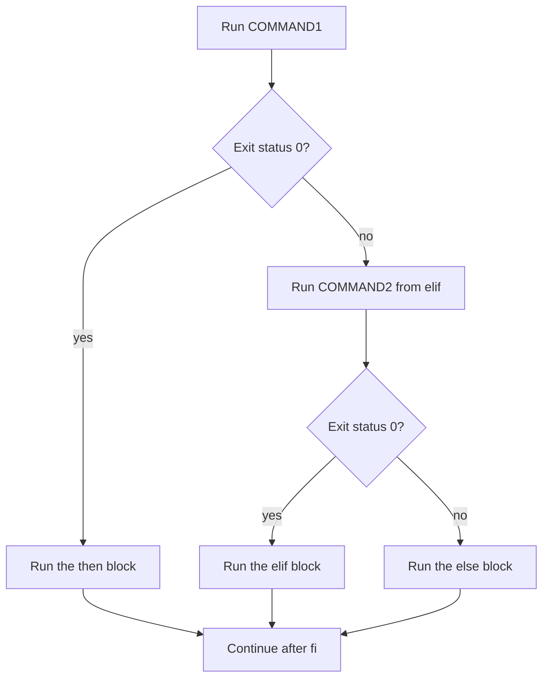

# Flow control: if, exit status and test

> **Before this lesson:** you should be able to write a script with variables and functions ([first script](#/lesson/linux-cli/first-script-project), [functions](#/lesson/linux-cli/functions-top-down)) and understand why variables are put in double quotes ([Expansion and quoting](#/lesson/linux-cli/expansion-quoting)).

## In plain words

Every script so far has been a straight road: line one, line two, line three, always the same. Real tasks have forks. "If the backup disk is plugged in, copy the files; otherwise send a warning." "If the file already exists, do not download it again." Choosing between paths is called **branching**, and the instructions that control which lines run are called **flow control**.

A thermostat is a good picture. It asks one yes/no question — is the room colder than 20 degrees? — and switches the heating on or off according to the answer. A script's `if` statement works the same way: it asks a yes/no question and runs one block of commands for "yes" and, optionally, another for "no".

What is unusual about the shell is *how* the question is asked. There are no built-in true and false values. Instead, the shell **runs a command and looks at whether it succeeded**. Understanding that one idea makes everything else in this lesson fall into place.

Why it matters for a job: a script that cannot check anything is dangerous. Checking that a file exists before reading it, that a download worked before unpacking it, that the right number of inputs was given — these checks are the difference between a script that fails safely with a clear message and one that damages data.

## Exit status: the shell's yes and no

When any command finishes, it reports a number from 0 to 255 called its **exit status**. By convention **0 means success** and every other number means some kind of failure. The special variable `$?` holds the status of the command that ran most recently.

```bash
mira@forge:~$ ls -d /usr/bin
/usr/bin
mira@forge:~$ echo $?
0
mira@forge:~$ ls -d /no/such/dir
ls: cannot access '/no/such/dir': No such file or directory
mira@forge:~$ echo $?
2
mira@forge:~$ grep -q mira /etc/passwd; echo $?
0
mira@forge:~$ grep -q nobody-like-this /etc/passwd; echo $?
1
```

The first `ls` worked: status 0. The second failed: status 2. `grep -q` (quiet) prints nothing and answers only through its status: 0 when the text was found, 1 when it was not.

A newcomer's natural objection: in most places, 0 means "no" or "false". Why is it "success" here? Because there is only one way to succeed and many ways to fail; using 0 for success leaves all the other numbers free to say *which* failure occurred. Manual pages often list what each number means.

Two tiny commands exist purely to produce a status: `true` always succeeds and `false` always fails.

## The `if` statement

```bash
if COMMAND; then
    commands to run when COMMAND succeeded (status 0)
else
    commands to run when it failed (any other status)
fi
```

`if` runs the command, looks at its exit status and chooses a branch. `then` starts the "yes" block, `else` (optional) starts the "no" block, and `fi` — "if" backwards — ends the statement. The simplest possible examples:

```bash
mira@forge:~$ if true; then echo "it worked"; else echo "it failed"; fi
it worked
mira@forge:~$ if false; then echo "it worked"; else echo "it failed"; fi
it failed
```

Any command can be the question. Here `grep -q` asks "does this user exist?":

```bash
#!/bin/bash
if grep -q "^otto:" /etc/passwd; then
    echo "User otto exists."
else
    echo "User otto does not exist."
fi
```

Line by line: `grep -q "^otto:"` searches the account file for a line beginning with `otto:`. If found, its status is 0 and the first `echo` runs; otherwise the second one does. There is no special "condition" syntax — the condition is an ordinary command.

For more than two paths, add `elif` ("else if") branches. They are tried in order and the first one that succeeds wins:

```bash
if COMMAND1; then
    …
elif COMMAND2; then
    …
else
    …
fi
```



## `test` and `[ ]`: commands made for asking questions

Most questions in scripts are about files, text and numbers: does this file exist? is this variable empty? is this number larger than that one? A command called `test` answers them. It evaluates an **expression** and exits with status 0 if the expression is true and 1 if it is false.

`test` has a second spelling that is used far more: a pair of square brackets.

```bash
test -f /etc/hostname      # these two lines
[ -f /etc/hostname ]       # do exactly the same thing
```

This is the detail that causes more beginner errors than any other: **`[` is a command**, not punctuation. Its name is `[`, its arguments are `-f`, `/etc/hostname` and a final `]`. Like the arguments of any command, they must be separated by spaces.

```bash
mira@forge:~$ [ -f /etc/hostname ]; echo $?
0
mira@forge:~$ [ -f /etc/nothing ]; echo $?
1
mira@forge:~$ [-f /etc/hostname]
bash: [-f: command not found
```

The third attempt, without spaces, asked the shell to run a command called `[-f`.

### Questions about files

| Expression | True when |
|---|---|
| `-e path` | the path exists (any kind of entry) |
| `-f path` | it exists and is a regular file |
| `-d path` | it exists and is a directory |
| `-L path` | it is a symbolic link |
| `-r path`, `-w path`, `-x path` | you may read / write / execute it |
| `-s path` | it exists and is not empty |
| `a -nt b` | file `a` is newer than file `b` |
| `a -ot b` | file `a` is older than file `b` |

```bash
#!/bin/bash
config="$HOME/.weatherrc"

if [ -f "$config" ]; then
    echo "Using settings from $config"
elif [ -d "$config" ]; then
    echo "$config is a directory, expected a file" >&2
    exit 1
else
    echo "No settings file; using defaults"
fi
```

Reading it: the first test asks whether the path is a regular file; if not, the second asks whether it is a directory (a mistake worth reporting, on standard error with `>&2`, followed by leaving the script with a failure status); otherwise the defaults apply.

### Questions about text

| Expression | True when |
|---|---|
| `-z "$s"` | the string is empty (**z**ero length) |
| `-n "$s"` | the string is not empty |
| `"$a" = "$b"` | the strings are equal |
| `"$a" != "$b"` | the strings differ |

```bash
answer="yes"
if [ "$answer" = "yes" ]; then
    echo "Proceeding."
fi

if [ -z "$EDITOR" ]; then
    echo "EDITOR is not set; falling back to nano."
fi
```

### Questions about whole numbers

Numbers use letter operators, because `<` and `>` already mean redirection to the shell.

| Expression | True when |
|---|---|
| `a -eq b` | equal |
| `a -ne b` | not equal |
| `a -lt b` | less than |
| `a -le b` | less than or equal |
| `a -gt b` | greater than |
| `a -ge b` | greater than or equal |

```bash
used="$(df --output=pcent / | tail -n 1 | tr -d ' %')"
if [ "$used" -ge 90 ]; then
    echo "WARNING: root file system is ${used}% full" >&2
fi
```

It matters which family you use, because text and numbers compare differently:

```bash
mira@forge:~$ [ 10 -gt 9 ] && echo "as numbers: 10 is greater"
as numbers: 10 is greater
mira@forge:~$ [ 007 -eq 7 ] && echo "as numbers: equal"
as numbers: equal
mira@forge:~$ [ 007 = 7 ] || echo "as text: different"
as text: different
```

### Why the quotes matter

Inside `[ ]`, an unquoted variable that is empty or contains spaces changes the *number of arguments* the `[` command receives, and the expression falls apart.

```bash
mira@forge:~$ name=""
mira@forge:~$ [ $name = "ana" ] && echo match
bash: [: =: unary operator expected
mira@forge:~$ [ "$name" = "ana" ] && echo match
mira@forge:~$ file="my notes.txt"
mira@forge:~$ [ -f $file ] && echo found
bash: [: my: binary operator expected
```

With `name` empty, the first command became `[ = "ana" ]` — a comparison with nothing on its left. With quotes it becomes `[ "" = "ana" ]`, a valid comparison that is false. **Always quote variables inside single brackets.**

The model below evaluates expressions the way `test` does and returns an exit status, so you can check your reading of a condition. Notice that it returns 0 for true.

```python-run
FILES = {"/etc/hostname": "file", "/tmp": "dir", "/home/mira/.weatherrc": "file"}

def test(*args):
    """Return the exit status of `[ args ]`: 0 means true, 1 means false."""
    args = list(args)
    if not args:
        return 1
    if args[0] == "!":
        return 1 - test(*args[1:])
    if len(args) == 1:
        result = args[0] != ""
    elif len(args) == 2:
        op, value = args
        result = {"-z": value == "", "-n": value != "", "-e": value in FILES,
                  "-f": FILES.get(value) == "file", "-d": FILES.get(value) == "dir"}[op]
    else:
        left, op, right = args
        if op in ("=", "!="):
            result = (left == right) == (op == "=")
        else:
            a, b = int(left), int(right)
            result = {"-eq": a == b, "-ne": a != b, "-lt": a < b,
                      "-le": a <= b, "-gt": a > b, "-ge": a >= b}[op]
    return 0 if result else 1

checks = [("-f", "/etc/hostname"), ("-d", "/etc/hostname"), ("!", "-e", "/nope"), ("-z", ""),
          ("10", "-gt", "9"), ("007", "-eq", "7"), ("007", "=", "7"), ("", "=", "ana")]
for expr in checks:
    status = test(*expr)
    print(f"[ {' '.join(repr(a) if a == '' else a for a in expr):22} ] -> status {status} ({'true' if status == 0 else 'false'})")
```

The practice problem *Evaluate a test Expression* extends this with the combining operators described next.

## Combining conditions

Three logical operations are available: AND (both must be true), OR (at least one), NOT (the opposite).

| | Inside `[ ]` | Between commands | Inside `[[ ]]` |
|---|---|---|---|
| AND | `-a` | `&&` | `&&` |
| OR | `-o` | `\|\|` | `\|\|` |
| NOT | `!` | `!` | `!` |

The most readable and reliable form joins separate bracket commands:

```bash
if [ -f "$file" ] && [ -r "$file" ]; then
    echo "$file exists and is readable"
fi

if [ "$1" = "-h" ] || [ "$1" = "--help" ]; then
    echo "usage: report [-h] FILE"
fi

if ! [ -d "$outdir" ]; then
    mkdir -p "$outdir"
fi
```

`&&` and `||` are not limited to `if`. `A && B` runs B only when A succeeded; `A || B` runs B only when A failed. They give compact one-line guards that you will see in every script:

```bash
mkdir -p "$outdir" && cd "$outdir"                      # enter only if creation worked
[ -d "$outdir" ] || mkdir "$outdir"                     # create only if missing
command -v jq >/dev/null || { echo "jq is required" >&2; exit 1; }
```

The last line is a common way to check that a needed program is installed: `command -v jq` succeeds when `jq` can be found; if it fails, the group in braces prints a message and ends the script.

> [!WARNING]
> Do not use `A && B || C` as a replacement for `if A; then B; else C; fi`. It looks equivalent, but if A succeeds and then **B fails**, C runs as well. For example `[ -d "$dir" ] && cd "$dir" || rm -rf ./tmp` would run the `rm` when the directory exists but cannot be entered. Use a real `if`/`else` whenever there are two branches, especially when either branch changes or deletes something.

## Two modern forms: `[[ ]]` and `(( ))`

Bash offers improved versions of the bracket test. They are part of the shell's own syntax instead of being ordinary commands, which removes several traps.

**`[[ expression ]]`** — an enhanced test for strings and files:

- Variables do not need quotes inside it; empty values and spaces cause no errors.
- `&&`, `||`, `<` and `>` work inside it.
- `==` with an unquoted right-hand side matches a **wildcard pattern**.
- `=~` matches a **regular expression**.

```bash
file="report.final.csv"
if [[ $file == *.csv ]]; then
    echo "a CSV file"
fi

read -r -p "How many copies? " n
if [[ $n =~ ^[0-9]+$ ]]; then
    echo "printing $n copies"
else
    echo "'$n' is not a whole number" >&2
fi

if [[ -n $name && $name != root ]]; then
    echo "hello, $name"
fi
```

The second example is the standard way to check that input is a number before using it in arithmetic: the pattern `^[0-9]+$` means "from start to end, one or more digits".

**`(( expression ))`** — arithmetic evaluation. Inside the double parentheses you write ordinary arithmetic with `<`, `>`, `==`, `<=`, `>=`, `!=`, and variable names need no `$`. The status is 0 (true) when the result is non-zero.

```bash
count=12
if (( count > 10 )); then
    echo "more than ten"
fi

if (( count % 2 == 0 )); then
    echo "$count is even"
fi
```

| Use | When |
|---|---|
| `[ ]` | the script must run under plain `sh` as well as bash |
| `[[ ]]` | bash scripts: string, pattern and file tests |
| `(( ))` | bash scripts: comparing or calculating whole numbers |

> [!TIP]
> In scripts that begin with `#!/bin/bash`, prefer `[[ ]]` for text and files and `(( ))` for numbers. They read more naturally and forgive missing quotes. Keep the single-bracket rules in your head anyway — you will meet `[ ]` in most existing scripts and in every script written for `sh`.

## A complete example

A script that checks its input thoroughly before doing anything, and reports problems clearly:

```bash
#!/bin/bash
# archive_logs DIR: compress yesterday's logs in DIR.

dir="$1"

if [[ -z $dir ]]; then
    echo "usage: archive_logs DIR" >&2
    exit 2
fi

if [[ ! -d $dir ]]; then
    echo "archive_logs: $dir is not a directory" >&2
    exit 1
elif [[ ! -w $dir ]]; then
    echo "archive_logs: no write permission in $dir" >&2
    exit 1
fi

count="$(find "$dir" -maxdepth 1 -name '*.log' -mtime +0 | wc -l)"

if (( count == 0 )); then
    echo "Nothing to archive in $dir."
    exit 0
fi

if find "$dir" -maxdepth 1 -name '*.log' -mtime +0 -exec gzip {} +; then
    echo "Compressed $count log file(s) in $dir."
else
    echo "archive_logs: compression failed" >&2
    exit 1
fi
```

```bash
mira@forge:~$ ./archive_logs
usage: archive_logs DIR
mira@forge:~$ echo $?
2
mira@forge:~$ ./archive_logs /var/log/weather
Compressed 3 log file(s) in /var/log/weather.
```

The structure — validate the input, leave early with a message and a non-zero status when something is wrong, then do the work and check that it succeeded — is the pattern to imitate. Messages about problems go to standard error and start with the script's name, so that they can be traced when the script runs inside a larger system. By convention, status 2 signals wrong usage and 1 a general failure.

> [!INTERVIEW]
> Common questions: "What does exit status 0 mean?", "What is the difference between `[ ]` and `[[ ]]`?" (the first is a command with ordinary argument rules, so variables must be quoted; the second is bash syntax with pattern and regex matching and safe handling of empty values), "How do you check whether a file exists? a directory? whether a variable is empty?" (`-f`, `-d`, `-z`), "Why `-eq` instead of `=` for numbers?" and "What is wrong with `if [ $x = 1 ]`?" (unquoted variable: an empty or multi-word value breaks the test).

## Pitfalls

- **No spaces around brackets**: `[-f file]` and `["$a"="$b"]` are errors.
- **Unquoted variables inside `[ ]`.**
- **Using `=` for numbers or `-eq` for text.** `[ "$a" -eq "$b" ]` on non-numbers reports "integer expression expected".
- **`>` inside `[ ]`** creating a file named after the right-hand value, because it is read as redirection. Use `-gt`, or `(( ))`.
- **Forgetting `then` or `fi`**, which produces "unexpected end of file" far from the real mistake.
- **Reading `$?` too late.** It changes after every command, including an `echo`; save it at once with `status=$?`.
- **Testing a command's printed output when you want its status.** Write `if grep -q …; then`, not `if [ "$(grep …)" ]; then`.
- **`A && B || C` used as if/else.**

## Cheat sheet

| Question | Expression |
|---|---|
| Does a file / directory exist? | `[ -f "$p" ]` / `[ -d "$p" ]` |
| Does anything exist at this path? | `[ -e "$p" ]` |
| Is the file non-empty / readable / executable? | `[ -s "$p" ]`, `[ -r "$p" ]`, `[ -x "$p" ]` |
| Is the variable empty / non-empty? | `[ -z "$v" ]` / `[ -n "$v" ]` |
| Are two strings equal / different? | `[ "$a" = "$b" ]` / `[ "$a" != "$b" ]` |
| Number comparisons | `-eq -ne -lt -le -gt -ge`, or `(( a < b ))` |
| Pattern match | `[[ $f == *.txt ]]` |
| Regular-expression match | `[[ $s =~ ^[0-9]+$ ]]` |
| Both / either / not | `[ A ] && [ B ]`, `[ A ] \|\| [ B ]`, `! [ A ]` |
| Is a program installed? | `command -v name >/dev/null` |
| Status of the last command | `$?` |
| Leave the script | `exit 0` (success), `exit 1` (failure) |

## Summary

- Every command returns an exit status; 0 means success. `if` runs a command and branches on that status, with optional `elif` and `else`, closed by `fi`.
- `test`, written `[ … ]`, is a command that turns questions about files, strings and integers into an exit status; it needs spaces around its parts and quotes around variables.
- Conditions combine with `&&`, `||` and `!`; the same operators chain commands outside `if`.
- Bash adds `[[ … ]]` (safer string tests, patterns, regular expressions) and `(( … ))` (arithmetic).
- Good scripts validate their inputs first, report errors on standard error and exit with a meaningful status.

## Glossary

| Term | Meaning |
|---|---|
| flow control | instructions that decide which commands run and in what order |
| branching | choosing between alternative blocks of commands |
| exit status | the number (0–255) a command reports when it finishes; 0 is success |
| condition | the question an `if` asks; in the shell, a command whose status is examined |
| expression | a combination of values and operators that `test` evaluates to true or false |
| operator | a symbol or word that compares or combines values, such as `-eq` or `&&` |
| integer | a whole number, with no fractional part |
| string | a piece of text |
| logical AND / OR / NOT | both true / at least one true / the opposite |
| standard error | the stream for error messages, selected with `>&2` |
| validate | to check that input is acceptable before using it |

## Check yourself

```quiz
[
  {"q": "In the shell, which exit status means that a command succeeded?",
   "options": ["1", "0", "-1", "255"],
   "answer": 1,
   "explain": "Zero is success. All other values, from 1 to 255, indicate some kind of failure."},
  {"q": "What does `if grep -q error app.log; then echo found; fi` actually test?",
   "options": ["Whether grep printed any text", "Whether grep's exit status was 0, meaning a match was found", "Whether app.log is empty", "Whether the word error is a valid command"],
   "answer": 1,
   "explain": "if runs the command and examines its exit status. grep returns 0 when at least one line matches; -q suppresses the output."},
  {"q": "Why does `[-f notes.txt]` produce 'command not found'?",
   "options": ["notes.txt does not exist", "[ is a command, so it must be separated from its arguments by spaces", "-f is not a valid test", "Brackets must be doubled"],
   "answer": 1,
   "explain": "Without the space the shell looks for a command literally named [-f. Write [ -f notes.txt ]."},
  {"q": "The variable `city` is empty. What happens with `[ $city = Oslo ]`?",
   "options": ["It is false, with no message", "An error such as 'unary operator expected', because the command becomes [ = Oslo ]", "It is true", "The script exits"],
   "answer": 1,
   "explain": "An unquoted empty variable disappears from the argument list. Quoting it keeps an empty argument in place and the comparison is then valid and false."},
  {"q": "Which expression correctly tests that the number in `n` is greater than 100 inside single brackets?",
   "options": ["[ \"$n\" > 100 ]", "[ \"$n\" -gt 100 ]", "[ \"$n\" => 100 ]", "[ \"$n\" gt 100 ]"],
   "answer": 1,
   "explain": "-gt is the integer greater-than operator. A bare > would be treated as output redirection to a file named 100."},
  {"q": "What does `[ -d \"$path\" ]` check?",
   "options": ["That the path is a regular file", "That the path exists and is a directory", "That the path is deleted", "That the variable is defined"],
   "answer": 1,
   "explain": "-d is true for directories; -f is the corresponding test for regular files and -e for anything that exists."},
  {"q": "What is an advantage of `[[ $name == a* ]]` over `[ \"$name\" = \"a*\" ]`?",
   "options": ["There is none", "Double brackets do pattern matching and handle unquoted or empty variables safely", "Double brackets work in every shell", "Single brackets cannot compare strings"],
   "answer": 1,
   "explain": "Inside double brackets, == with an unquoted pattern on the right matches wildcards. The single-bracket version compares with the literal text a*."},
  {"q": "Why is `A && B || C` not a safe substitute for if A; then B; else C; fi?",
   "options": ["It is a syntax error", "If A succeeds but B fails, C is executed as well", "C always runs first", "&& cannot be combined with ||"],
   "answer": 1,
   "explain": "The || applies to the result of the whole A && B list. A failing B therefore triggers C even though A was true."}
]
```

> **Source:** Shotts, *The Linux Command Line*, ch. 27 (Flow Control: Branching with if). All examples and wording are original to this guide.
