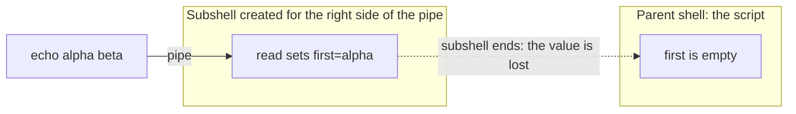

# Reading keyboard input and validating it

> **Before this lesson:** you should know variables and here documents ([first script](#/lesson/linux-cli/first-script-project)), functions ([Top-down design](#/lesson/linux-cli/functions-top-down)) and the `if` statement with `[[ ]]` tests ([Flow control: if](#/lesson/linux-cli/if-test)). Standard input and pipes come from [Redirection and pipelines](#/lesson/linux-cli/redirection-pipelines).

## In plain words

The scripts written so far are like a vending machine with one button: press it and the same thing comes out. A script becomes far more useful when it can ask a question and act on the answer — "Which file should I process?", "Are you sure you want to delete this? (y/n)" — like a receptionist who asks who you are visiting before pointing the way.

A program that stops, asks, and waits for the person at the keyboard is called **interactive**. In the shell, the command that does the asking is `read`: it waits for a line of text and stores it in a variable.

There is a second half to the job. People mistype, leave answers blank, and enter words where numbers are expected. A receptionist who accepted "banana" as a floor number would send visitors nowhere. Checking that an answer is acceptable before using it is called **validation**, and it is what keeps an interactive script from doing something foolish or harmful.

Why this matters for a job: confirmation prompts before destructive actions, setup scripts that ask for a few settings, and small menu-driven tools for teammates are everyday uses. The same `read` command is also the standard way to process a file or a command's output one line at a time, which appears in a large share of real scripts. And validating input — never trusting what arrives from outside — is one of the foundations of writing secure software in any language.

## `read`: the simplest case

```bash
#!/bin/bash
echo -n "What is your name? "
read name
echo "Hello, $name!"
```

```bash
mira@forge:~/scripts$ ./greet
What is your name? Ana
Hello, Ana!
```

Line by line: `echo -n` prints the question without moving to a new line (`-n` suppresses the newline), so the answer is typed on the same line. `read name` pauses the script until the person presses Enter, then stores what was typed in the variable `name`. Note that the variable is written without `$` here, because `read` needs the variable's *name* in order to fill it; `$name` would hand over its current value instead.

### Useful options

| Option | Effect |
|---|---|
| `-p "text"` | print a prompt first (replaces the separate `echo -n`) |
| `-r` | raw: do not treat backslashes as special — **use it always** |
| `-s` | silent: do not show what is typed (for passwords) |
| `-n N` | return after N characters, without waiting for Enter |
| `-t SEC` | time out: give up after SEC seconds (exit status greater than 0) |
| `-e` | allow line editing with the arrow keys while typing |
| `-i "text"` | with `-e`, pre-fill the answer with a suggested default |
| `-a NAME` | store the words in an array called NAME |
| `-d CHAR` | read up to CHAR instead of up to the end of the line |

```bash
read -r -p "Project name: " project
read -r -s -p "API token (hidden): " token; echo
read -r -n 1 -p "Continue? [y/n] " key; echo
if read -r -t 10 -p "Deploy to which host? (10 s) " host; then
    echo "Deploying to $host"
else
    echo; echo "No answer; cancelled." >&2
fi
```

Reading these four lines: the first asks with a prompt. The second hides the typing; because the Enter key is not shown either, a bare `echo` afterwards moves to a fresh line. The third returns as soon as one key is pressed. The fourth shows that `read` has an exit status like every other command — it fails when the time runs out or when the input ends — so it can be the condition of an `if`.

Why always `-r`? Without it, `read` treats a backslash as an escape character and silently removes it, which corrupts Windows-style paths and anything containing `\n` or `\t`. No ordinary script wants that.

If you give no variable name at all, the line is stored in a variable called `REPLY`.

## One line, several variables

Given more than one variable name, `read` splits the line into words and hands them out in order.

```bash
mira@forge:~$ read -r first second third
alpha beta gamma
mira@forge:~$ echo "1=$first 2=$second 3=$third"
1=alpha 2=beta 3=gamma
```

What if the number of words and the number of variables differ? Two rules:

- **Too few words:** the extra variables are left empty.
- **Too many words:** the **last** variable receives everything that remains.

```bash
mira@forge:~$ read -r first second
alpha beta gamma delta
mira@forge:~$ echo "1=[$first] 2=[$second]"
1=[alpha] 2=[beta gamma delta]
mira@forge:~$ read -r first second
alpha
mira@forge:~$ echo "1=[$first] 2=[$second]"
1=[alpha] 2=[]
```

### `IFS`: choosing what separates the words

By default `read` splits at spaces and tabs. The separators are taken from a shell variable called `IFS` (*internal field separator*). Changing it lets `read` take apart lines that use other delimiters. The clean way is to set it for the one `read` command only, by writing the assignment in front:

```bash
mira@forge:~$ line="otto:x:1001:1001:Otto Lind:/home/otto:/bin/bash"
mira@forge:~$ IFS=: read -r user pw uid gid fullname home shell <<< "$line"
mira@forge:~$ echo "$user has uid $uid and shell $shell"
otto has uid 1001 and shell /bin/bash
```

Two pieces of syntax deserve explanation. `IFS=: read …` sets the separator to a colon for this single command, leaving the rest of the script untouched. And `<<< "$line"` is a **here string**: it feeds the text on its right to the command as standard input, so `read` reads from the variable instead of from the keyboard.

The block below reproduces the splitting rules, including the "last variable takes the rest" behaviour.

```python-run
def shell_read(line, names, ifs=" \t"):
    """Assign words of `line` to `names` the way `read -r` does."""
    values, rest = [], line.strip(ifs) if ifs.strip() == "" else line
    for i, name in enumerate(names):
        last = i == len(names) - 1
        if rest == "":
            values.append("")                     # ran out of words
        elif last:
            values.append(rest)                   # final variable gets everything left
            rest = ""
        else:
            # cut at the first separator character
            cut = min((rest.find(c) for c in ifs if c in rest), default=-1)
            if cut == -1:
                values.append(rest); rest = ""
            else:
                values.append(rest[:cut])
                rest = rest[cut + 1:]
                if ifs.strip() == "":             # whitespace separators: skip runs of them
                    rest = rest.lstrip(ifs)
    return dict(zip(names, values))

print(shell_read("alpha beta gamma", ["first", "second", "third"]))
print(shell_read("alpha beta gamma delta", ["first", "second"]))
print(shell_read("alpha", ["first", "second"]))
print(shell_read("otto:x:1001:1001:Otto Lind:/home/otto:/bin/bash",
                 ["user", "pw", "uid", "gid", "fullname", "home", "shell"], ifs=":"))
print(shell_read("2026-11-20,Oslo,4.5", ["date", "rest"], ifs=","))
```

## Reading a file or a command's output line by line

`read` takes its input from standard input, which is the keyboard only by default. Redirect a file into a loop and `read` consumes it one line per turn. The `while` loop is the subject of the next lesson; for now, read it as "repeat as long as `read` succeeds".

```bash
#!/bin/bash
while IFS=, read -r date city temperature; do
    echo "On $date it was ${temperature} degrees in $city."
done < readings.csv
```

```bash
mira@forge:~/scripts$ cat readings.csv
2026-11-18,Oslo,-2.5
2026-11-19,Lisbon,17.0
mira@forge:~/scripts$ ./show_readings
On 2026-11-18 it was -2.5 degrees in Oslo.
On 2026-11-19 it was 17.0 degrees in Lisbon.
```

`done < readings.csv` connects the file to the whole loop. Each turn, `read` takes the next line and splits it at commas; when the file is used up, `read` fails and the loop ends. To keep a line completely intact, including leading spaces, use the full idiom `while IFS= read -r line; do … done < file` — the empty `IFS=` switches splitting off.

### The pipe trap

This looks reasonable and does not work:

```bash
mira@forge:~$ echo "alpha beta" | read -r first second
mira@forge:~$ echo "[$first] [$second]"
[] []
```

The explanation: each side of a pipe runs in its own separate copy of the shell, called a **subshell**. The `read` did fill the variables — inside that copy, which vanished as soon as the pipeline ended. Variables set in a subshell never reach the script that started it. Three working alternatives:

```bash
read -r first second <<< "alpha beta"                 # here string
read -r first second < <(echo "alpha beta")           # process substitution
echo "alpha beta" | { read -r first second; echo "[$first] [$second]"; }   # use them inside the same group
```

The same trap makes a counter updated inside `command | while read …` appear to stay at zero afterwards. Write `while read …; do …; done < <(command)` instead.



## Validating input

Never use an answer before checking it. A validator asks, in order: was anything entered at all? Does it have the right form? Is it within the allowed range? Does it refer to something that exists?

```bash
#!/bin/bash
# resize: ask for a percentage and validate it step by step.

read -r -p "Scale images to what percentage (1-400)? " pct

if [[ -z $pct ]]; then
    echo "resize: no value entered" >&2
    exit 1
fi

if [[ ! $pct =~ ^[0-9]+$ ]]; then
    echo "resize: '$pct' is not a whole number" >&2
    exit 1
fi

if (( pct < 1 || pct > 400 )); then
    echo "resize: $pct is outside the range 1-400" >&2
    exit 1
fi

echo "Scaling to ${pct}%."
```

```bash
mira@forge:~/scripts$ ./resize
Scale images to what percentage (1-400)? fifty
resize: 'fifty' is not a whole number
mira@forge:~/scripts$ ./resize
Scale images to what percentage (1-400)? 50
Scaling to 50%.
```

The order of the checks matters. The arithmetic test `(( pct < 1 … ))` would produce errors or wrong answers on text such as `fifty`, so the form is confirmed first with a regular expression: `^[0-9]+$` means "one or more digits and nothing else". Some patterns you will reuse:

| Check | Test |
|---|---|
| not empty | `[[ -n $v ]]` |
| whole number | `[[ $v =~ ^[0-9]+$ ]]` |
| number that may be negative | `[[ $v =~ ^-?[0-9]+$ ]]` |
| decimal number | `[[ $v =~ ^-?[0-9]+(\.[0-9]+)?$ ]]` |
| letters, digits, dash, underscore only | `[[ $v =~ ^[A-Za-z0-9_-]+$ ]]` |
| yes-like answer | `[[ $v =~ ^[Yy]([Ee][Ss])?$ ]]` |
| an existing file | `[[ -f $v ]]` |
| one of a fixed set | `[[ $v == @(dev\|staging\|prod) ]]` or a `case` statement |

It is friendlier to ask again than to quit. A function that keeps asking until the answer passes can be reused across scripts:

```bash
ask_number() {
    local prompt="$1" min="$2" max="$3" answer
    while true; do
        read -r -p "$prompt [$min-$max]: " answer
        if [[ $answer =~ ^[0-9]+$ ]] && (( answer >= min && answer <= max )); then
            echo "$answer"
            return 0
        fi
        echo "Please enter a whole number from $min to $max." >&2
    done
}

workers="$(ask_number "Number of workers" 1 64)"
echo "Starting $workers workers."
```

The function prints only the accepted answer on standard output, where the caller captures it; the complaint goes to standard error so that it is shown on the screen and not captured.

> [!WARNING]
> Treat everything typed by a person — or read from a file or the network — as untrusted text. **Never pass it to `eval`**, never build a command line as a string and execute it, and always quote the variable when using it. If a script did `eval "ls $answer"` and someone typed `; rm -rf ~`, the script would obediently delete their home directory. The safe pattern is: validate against a strict pattern of allowed characters, then use the value only as a quoted argument, as in `ls -- "$answer"` (the `--` stops a value beginning with a dash from being read as an option).

## Confirmation prompts

Before any destructive action, ask — and make "no" the answer when the person only presses Enter.

```bash
confirm() {
    local reply
    read -r -p "$1 [y/N] " reply
    [[ $reply =~ ^[Yy]([Ee][Ss])?$ ]]
}

if confirm "Delete all files in $cache_dir?"; then
    rm -rf -- "${cache_dir:?}"/*
else
    echo "Nothing deleted."
fi
```

The capital `N` in `[y/N]` is the widely understood sign that "no" is the default. The function's exit status is that of its last command, the pattern test, so it can be used directly in `if`. The `${cache_dir:?}` form makes the script stop with an error if the variable is empty, so the command can never become `rm -rf /*`.

## Menus

A menu lists choices and asks for one. With the tools you have, it is a here document, a `read` and a chain of tests:

```bash
#!/bin/bash
cat <<_EOF_
What would you like to see?
  1) Disk space
  2) Memory
  3) Uptime
  q) Quit
_EOF_
read -r -p "Choice: " choice

if [[ $choice == 1 ]]; then
    df -h /
elif [[ $choice == 2 ]]; then
    free -h
elif [[ $choice == 3 ]]; then
    uptime
elif [[ $choice == [qQ] ]]; then
    echo "Bye."
else
    echo "Unknown choice: $choice" >&2
    exit 1
fi
```

Bash also has a ready-made menu builder, `select`, which numbers the items, prints them, reads a choice and repeats until you `break` out:

```bash
PS3="Environment: "
select env in dev staging prod quit; do
    case "$env" in
        quit) break ;;
        "")   echo "Please type one of the numbers." ;;
        *)    echo "Selected $env"; break ;;
    esac
done
```

```bash
1) dev
2) staging
3) prod
4) quit
Environment: 2
Selected staging
```

`PS3` is the prompt that `select` shows. The `case` statement used inside is a tidier way to compare one value against several patterns and is taught two lessons ahead.

## Interactive or not? Design for both

The best command-line tools do not *require* a conversation. A script that insists on asking questions cannot be run by a scheduler, cannot be used in a pipeline and is tedious to repeat. The professional pattern is: accept values as arguments or environment variables, and ask only for what is missing — and only if a person is present to answer. The test `[[ -t 0 ]]` is true when standard input is a terminal (a keyboard) and false when it is a file or a pipe.

```bash
target="${1:-}"                       # first argument, or empty if none was given
if [[ -z $target ]]; then
    if [[ -t 0 ]]; then
        read -r -p "Target host: " target
    else
        echo "deploy: no target given and no terminal to ask on" >&2
        exit 2
    fi
fi
```

> [!TIP]
> Offer a default in the prompt and accept an empty answer as "use the default": `read -r -p "Port [8000]: " port; port="${port:-8000}"`. The expansion `${port:-8000}` means "the value of `port`, or 8000 if it is empty". People then press Enter through the common case, and the script still works when driven by another program.

> [!INTERVIEW]
> Questions in this area: "How do you read a file line by line in bash?" (`while IFS= read -r line; do …; done < file` — and be ready to say what `IFS=` and `-r` are for), "Why does a variable set inside `cmd | while read …` not keep its value after the loop?" (the loop runs in a subshell), "How would you prompt for a password without showing it?" (`read -r -s`), and "How do you check that input is a number?" (a regular-expression test such as `[[ $x =~ ^[0-9]+$ ]]`). A security-minded interviewer may ask why `eval` on user input is dangerous.

## Pitfalls

- **Writing `read $name`** with a dollar sign: it reads into whatever variable the *value* names, or fails.
- **Omitting `-r`**, so backslashes are swallowed.
- **Piping into `read`** and finding the variables empty afterwards.
- **Doing arithmetic on unvalidated input.**
- **Forgetting that the last variable takes the remainder** of the line.
- **Changing `IFS` globally** and breaking word splitting for the rest of the script; set it only in front of the `read` command.
- **Reading secrets with a plain `read`**, which displays them, or passing them as command-line arguments, where other users can see them in the process list.
- **Prompts written to standard output** in a script whose output is piped or captured; `read -p` writes its prompt to standard error, which avoids the problem.
- **A missing final newline** in a file: the last line is read but `read` reports failure, so a plain `while read` loop skips it. The robust form is `while IFS= read -r line || [[ -n $line ]]; do`.

## Cheat sheet

| Task | Command |
|---|---|
| Ask a question | `read -r -p "Name: " name` |
| Hidden input | `read -r -s -p "Password: " pw; echo` |
| Single key press | `read -r -n 1 -p "Continue? " key; echo` |
| With a time limit | `read -r -t 10 -p "Host: " host` |
| With a default | `read -r -p "Port [8000]: " p; p="${p:-8000}"` |
| Split on a delimiter | `IFS=, read -r a b c <<< "$line"` |
| Words into an array | `read -r -a words <<< "$line"` |
| Loop over the lines of a file | `while IFS= read -r line; do …; done < file` |
| Loop over a command's output | `while IFS= read -r line; do …; done < <(cmd)` |
| Is it a whole number? | `[[ $v =~ ^[0-9]+$ ]]` |
| Yes/no confirmation | `[[ $reply =~ ^[Yy]$ ]]` |
| Is a person at the keyboard? | `[[ -t 0 ]]` |
| Simple menu | `select item in a b c; do …; break; done` |

## Summary

- `read` waits for a line on standard input and stores it in one or more variables; `-r` should always be used, `-p` prompts, `-s` hides, `-t` limits the wait and `-n` limits the length.
- With several variables the line is split at the characters in `IFS`; extra words go to the last variable, missing ones leave variables empty.
- A `while read` loop with redirected input processes files and command output line by line; a pipe into `read` loses the values because of the subshell.
- Validate before use: non-empty, correct form (a regular expression), within range, existing — and re-ask or exit with a clear message on standard error.
- Confirm destructive actions with a default of "no", never `eval` input, and design scripts to accept arguments so they also work without a person present.

## Glossary

| Term | Meaning |
|---|---|
| interactive | a program that asks questions and waits for a person's answers |
| prompt | the text shown to ask for input |
| standard input | the stream a program reads from; the keyboard by default |
| `IFS` | internal field separator: the characters at which `read` splits a line |
| here string | `<<< "text"`: gives the text to a command as its input |
| process substitution | `<(command)`: lets a command's output be read like a file |
| subshell | a separate copy of the shell; its variables do not return to the parent |
| validation | checking that input is acceptable before using it |
| default | the value used when the person gives no answer |
| terminal | the keyboard-and-screen device a person types at |
| `eval` | a command that executes a string as shell code; dangerous with untrusted text |
| menu | a list of numbered choices from which the person picks one |

## Check yourself

```quiz
[
  {"q": "What does `read -r -p \"City: \" city` do?",
   "options": ["Prints the variable city", "Shows the prompt City: and stores the typed line in the variable city", "Reads a file named city", "Creates a file named City"],
   "answer": 1,
   "explain": "-p prints a prompt, -r keeps backslashes literal, and the line the person types is stored in the named variable."},
  {"q": "The person types `red green blue` in response to `read -r a b`. What do the variables hold?",
   "options": ["a=red, b=green", "a=red, b=green blue", "a=red green, b=blue", "a=red green blue, b is empty"],
   "answer": 1,
   "explain": "Words are assigned in order and the last variable receives everything that remains on the line."},
  {"q": "Why should `-r` nearly always be given to read?",
   "options": ["It makes reading faster", "Without it, backslashes in the input are treated as escape characters and removed", "It hides the input", "It reads recursively"],
   "answer": 1,
   "explain": "Raw mode keeps the input exactly as typed. Without it a path such as C:\\temp loses its backslash."},
  {"q": "After `echo \"42\" | read -r n`, why is `$n` empty in the script?",
   "options": ["echo does not write to pipes", "read ran in a subshell created for the pipeline, and its variable disappeared with it", "42 is not a valid value", "The variable needs to be exported"],
   "answer": 1,
   "explain": "Each part of a pipeline runs in its own subshell. Use a here string or process substitution so that read runs in the main shell."},
  {"q": "What does `IFS=: read -r user rest <<< \"$line\"` do?",
   "options": ["Permanently changes the field separator to a colon", "Splits the text in line at colons for this one read, putting the first field in user and the remainder in rest", "Reads from a file named line", "Removes all colons from line"],
   "answer": 1,
   "explain": "An assignment written before a command applies to that command only. The here string supplies the variable's text as input."},
  {"q": "Which test correctly checks that `$age` consists only of digits?",
   "options": ["[[ $age -eq number ]]", "`[[ $age =~ ^[0-9]+$ ]]`", "[[ -n $age ]]", "[[ $age == [0-9] ]]"],
   "answer": 1,
   "explain": "The regular expression requires one or more digits from the start to the end of the string. The last option would match exactly one digit."},
  {"q": "Why is `eval \"du -sh $answer\"` dangerous when answer comes from a person?",
   "options": ["du cannot be used with eval", "The text is executed as shell code, so input containing a semicolon and another command would run that command", "eval is slow", "It prints the answer on the screen"],
   "answer": 1,
   "explain": "eval re-parses the whole string. Validate input and pass it as a quoted argument instead."},
  {"q": "What is the standard way to process a file one line at a time?",
   "options": ["for line in $(cat file)", "while IFS= read -r line; do ...; done < file", "read file | while line", "cat file > read"],
   "answer": 1,
   "explain": "Redirecting the file into a while-read loop reads exactly one line per iteration, preserving spaces and backslashes. The for form splits on every space."}
]
```

> **Source:** Shotts, *The Linux Command Line*, ch. 28 (Reading Keyboard Input). All examples and wording are original to this guide.
