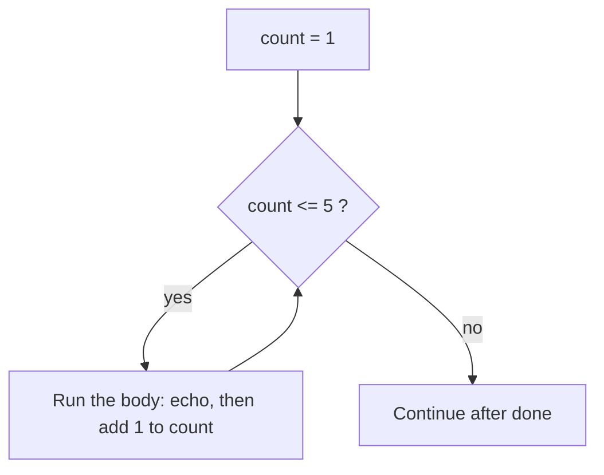

# Loops: while, until and for

> **Before this lesson:** you should understand exit status and the `if` statement ([Flow control: if](#/lesson/linux-cli/if-test)), reading input with `read` ([Reading keyboard input](#/lesson/linux-cli/reading-input)), and how wildcards and braces expand ([Expansion and quoting](#/lesson/linux-cli/expansion-quoting)).

## In plain words

Washing a stack of plates, you do not need a separate instruction for each plate. One instruction covers them all: "take the next plate, wash it, put it on the rack; repeat until the stack is empty." A **loop** is that kind of instruction in a program — a block of commands that is carried out again and again.

Each pass through the block is called an **iteration**. Every loop needs two things: the work to repeat (the **body**) and a rule for when to stop. The shell offers three kinds, differing only in how the stopping rule is expressed:

- `while` — keep going **as long as** something is true ("while there are plates, wash one").
- `until` — keep going **as long as something is not yet true** ("until the rack is full, wash one").
- `for` — do the body **once for each item in a list** ("for each plate in this stack, wash it").

Why this matters for a job: loops are what turn a script from a saved list of commands into something that saves hours. Convert every image in a folder, check every server in a list, retry a download until it works, wait for a service to start, process a log file line by line — each is a loop of three to six lines. Most automation you will write or read is built around one.

## `while`: repeat as long as a command succeeds

```bash
while COMMAND; do
    body
done
```

The shell runs COMMAND. If its exit status is 0 (success), the body runs and the shell comes back to try COMMAND again. The first time COMMAND fails, the loop ends and the script continues after `done`. As with `if`, the "condition" is an ordinary command.

The smallest useful example counts from 1 to 5:

```bash
#!/bin/bash
count=1

while (( count <= 5 )); do
    echo "Pass number $count"
    count=$(( count + 1 ))
done

echo "Finished."
```

```bash
mira@forge:~/scripts$ ./count
Pass number 1
Pass number 2
Pass number 3
Pass number 4
Pass number 5
Finished.
```

Line by line:

1. `count=1` sets a starting value. A variable that keeps track of the number of passes is called a **counter**.
2. `(( count <= 5 ))` is an arithmetic test: it succeeds while the counter is at most 5.
3. The body prints a line, then `count=$(( count + 1 ))` raises the counter by one. (`(( count++ ))` is a shorter way to write the same thing.)
4. When `count` reaches 6, the test fails and the loop ends.

Trace it by hand once — count is 1, test passes, print, count becomes 2, … — because this trace is exactly how to debug any loop.



What happens if the line that changes `count` is forgotten? The test stays true forever and the loop never ends: an **infinite loop**. Press `Ctrl-C` to stop a script stuck in one. An infinite loop is not always a mistake, as you will see below — but an accidental one is among the most common beginner bugs, so always ask of a loop: *what changes on each pass that will eventually make the condition fail?*

## `until`: repeat as long as a command fails

`until` is `while` with the test reversed: the body runs as long as the command **fails**, and the loop ends when it first succeeds.

```bash
count=1
until (( count > 5 )); do
    echo "Pass number $count"
    (( count++ ))
done
```

The output is identical to the previous script. Choose whichever reads more naturally. `until` shines when waiting for something to become true:

```bash
#!/bin/bash
# Wait for a web service to answer, checking once per second.
until curl --silent --fail http://localhost:8000/health > /dev/null; do
    echo "Service not ready yet; waiting..."
    sleep 1
done
echo "Service is up."
```

`curl --fail` exits with a failure status when the server does not answer properly; `sleep 1` pauses for one second. The sentence in the code — "until the health check succeeds, wait" — is almost plain English.

## Leaving early: `break` and `continue`

Two commands change the normal course of a loop:

- `break` leaves the loop at once; the script continues after `done`.
- `continue` abandons the **current pass** and jumps straight to the next test.

`break` makes deliberate infinite loops useful. `while true` never stops by itself (`true` always succeeds), so the body decides when to leave. Here is a retry loop — a pattern used constantly with networks, which fail now and then:

```bash
#!/bin/bash
attempt=1
max=5

while true; do
    if curl --silent --fail --output data.json https://api.example.net/data; then
        echo "Downloaded on attempt $attempt."
        break
    fi
    if (( attempt >= max )); then
        echo "Giving up after $max attempts." >&2
        exit 1
    fi
    echo "Attempt $attempt failed; retrying in $(( attempt * 2 )) s..." >&2
    sleep $(( attempt * 2 ))
    (( attempt++ ))
done
```

Reading it: try the download; on success, say so and `break`. Otherwise, if the limit has been reached, stop the whole script with an error. Otherwise wait — a little longer after each failure, a courtesy to the struggling server known as *backoff* — and go round again.

> [!WARNING]
> A loop that waits or retries **must have a limit** — a maximum number of attempts or a deadline — and should pause between attempts. `while ! command; do :; done` with no `sleep` spins as fast as the processor allows, can flood a server with thousands of requests per second, and never ends if the thing it waits for will never happen. When a loop performs a destructive action (deleting, overwriting, sending), run it first with `echo` in front of the dangerous command and read what it would do.

And `continue`, here skipping lines of a file that should be ignored:

```bash
while IFS= read -r host; do
    [[ -z $host || $host == \#* ]] && continue      # skip blank lines and comments
    echo "Checking $host"
done < hosts.txt
```

The test reads "if the line is empty or begins with `#`, skip to the next line".

## Reading input in a loop

You met this in the previous lesson; now the mechanism is clear. `read` succeeds while there is another line and fails at the end of the input, so it is a natural `while` condition.

```bash
#!/bin/bash
total=0
while IFS=, read -r date city temperature; do
    echo "$city: $temperature"
    (( total++ ))
done < readings.csv
echo "$total readings"
```

The redirection `< readings.csv` after `done` feeds the file to the entire loop. To loop over the output of a command and still keep variables such as `total` afterwards, feed the loop with process substitution instead of a pipe:

```bash
while IFS= read -r file; do
    (( total++ ))
done < <(find . -name '*.log')
```

(With a pipe, `find … | while read …`, the loop would run in a subshell and `total` would be lost when it ended, as explained in the previous lesson.)

## `for`: once for each item in a list

```bash
for VARIABLE in ITEM1 ITEM2 ITEM3; do
    body
done
```

The shell takes the items one at a time, stores the current one in the variable, and runs the body. There is no counter to manage and no condition to get wrong.

```bash
mira@forge:~$ for colour in red green blue; do echo "I like $colour"; done
I like red
I like green
I like blue
```

The real power comes from the fact that the list can be produced by any of the expansions you already know:

```bash
for n in {1..5}; do echo "Round $n"; done               # brace expansion: 1 2 3 4 5

for file in *.csv; do echo "Found $file"; done           # pathname expansion: every matching file

for host in web01 web02 db01; do ssh "$host" uptime; done

for user in $(cut -d: -f1 /etc/passwd); do echo "$user"; done    # command substitution: words of the output

for arg in "$@"; do echo "Argument: $arg"; done          # every argument given to the script
```

### Looping over files the safe way

Looping over files is the most common use of `for`, and there is a right way and a fragile way.

```bash
# RIGHT: let the shell match the files
for file in *.csv; do
    echo "Processing $file"
    wc -l "$file"
done

# FRAGILE: do not do this
for file in $(ls *.csv); do
    wc -l $file
done
```

The second form runs `ls`, takes its output as text and splits it at every space. A file called `sales 2026.csv` becomes two items, `sales` and `2026.csv`, neither of which exists. The first form hands each file name over whole, whatever characters it contains — provided you also write `"$file"` in quotes inside the body.

One more wrinkle: if **no** file matches, the pattern is left as it is, and the body runs once with the literal text `*.csv`. Guard against it:

```bash
for file in *.csv; do
    [[ -e $file ]] || continue          # nothing matched: skip
    echo "Processing $file"
done
```

(Alternatively, `shopt -s nullglob` near the top of the script makes unmatched patterns expand to nothing.)

A realistic example — make smaller copies of every photograph in a directory, keeping the originals:

```bash
#!/bin/bash
mkdir -p small

for photo in *.jpg; do
    [[ -e $photo ]] || continue
    out="small/${photo%.jpg}_small.jpg"
    if [[ -e $out ]]; then
        echo "skip  $photo (already done)"
        continue
    fi
    echo "shrink $photo -> $out"
    convert "$photo" -resize 25% "$out"
done
```

`${photo%.jpg}` is the file name with the ending `.jpg` removed (parameter expansion, covered in the strings lesson). The check for an existing output file makes the script safe to run again after an interruption: it resumes where it stopped instead of redoing everything. Scripts with that property are called **idempotent** — running them twice has the same effect as running them once — and it is a quality worth building in.

### The counting form

Bash also has a `for` loop in the style of the C language, with three parts in double parentheses: a starting action, a test, and a step performed after each pass.

```bash
for (( i = 0; i < 5; i++ )); do
    echo "i is $i"
done
```

This prints `i is 0` through `i is 4`. Use it when you need the number itself and the bounds are held in variables — brace expansion cannot do that, because `{1..$n}` is not expanded. The command `seq` is another option: `for i in $(seq 1 "$n")`.

## How the three loops relate

The simulation below runs the same count with all three kinds and then demonstrates `break` and `continue`, printing a trace of each test so that the flow is visible.

```python-run
def trace_while(limit):
    count, log = 1, []
    while True:
        ok = count <= limit                      # the test of:  while (( count <= limit ))
        log.append(f"test count={count} -> {'run body' if ok else 'stop'}")
        if not ok:
            break
        count += 1
    return log

print("while (( count <= 3 )):")
print("\n".join("  " + line for line in trace_while(3)))

print("\nuntil (( count > 3 )) runs the body for:", [c for c in range(1, 10) if not c > 3])
print("for n in {1..3} runs the body for:      ", list(range(1, 4)))

print("\nbreak and continue over the items a.csv, notes.txt, b.csv, STOP, c.csv:")
for item in ["a.csv", "notes.txt", "b.csv", "STOP", "c.csv"]:
    if item == "STOP":
        print("  break: leave the loop entirely")
        break
    if not item.endswith(".csv"):
        print(f"  continue: skip {item}")
        continue
    print(f"  process {item}")

print("\nWord splitting of $(ls) versus a glob, for the files 'a.csv' and 'sales 2026.csv':")
names = ["a.csv", "sales 2026.csv"]
print("  for f in $(ls *.csv) ->", " ".join(names).split())
print("  for f in *.csv       ->", names)
```

## Loops as part of a pipeline

A loop is a command like any other: its combined output can be redirected or piped, and it can receive input.

```bash
for host in web01 web02 web03; do
    printf '%s\t%s\n' "$host" "$(ssh "$host" 'df --output=pcent / | tail -n 1')"
done | sort -k2 -n -r > disk-usage.tsv
```

Everything the loop prints flows through `sort` and into one file. Redirecting once, after `done`, is cleaner and faster than appending with `>>` inside the body.

To run the passes of a loop at the same time instead of one after another, put `&` after the body's command to send it to the background, and `wait` after the loop to pause until all of them have finished:

```bash
for host in web01 web02 web03; do
    ssh "$host" 'sudo apt-get -qq update' &
done
wait
echo "All hosts refreshed."
```

> [!TIP]
> Before running a loop that changes many things, do a rehearsal: put `echo` in front of the command that acts — `echo mv "$f" "$new"` — and run the loop. You see every command exactly as it would be executed. When the list looks right, remove the `echo`. This is called a **dry run**.

> [!INTERVIEW]
> Typical tasks: "Write a loop that renames all `.txt` files to `.md`" (`for f in *.txt; do mv -- "$f" "${f%.txt}.md"; done`), "print the numbers 1 to 10" (`for i in {1..10}` or a C-style loop), "retry a command up to five times" and "read a file line by line". Typical questions: "What is the difference between `while` and `until`?", "What do `break` and `continue` do?", and "Why is `for f in $(ls)` a bad idea?" — word splitting breaks names containing spaces; use a glob.

## Pitfalls

- **Forgetting to change the variable the condition depends on**, giving an infinite loop.
- **`for f in $(ls …)`** and **unquoted `$f`** in the body.
- **An unmatched pattern** running the body once with the literal `*.ext`.
- **`{1..$n}`** not expanding; use the counting form or `seq`.
- **Variables set in a piped `while` loop** disappearing.
- **A command in the body that reads standard input** (notably `ssh` and `ffmpeg`) swallowing the rest of the file the loop is reading, so the loop ends after one pass. Give that command `< /dev/null` or, for `ssh`, the `-n` option.
- **Changing the list while looping over it**, such as creating files that match the pattern being looped over.
- **Off-by-one errors**: `<` versus `<=`, or starting at 0 versus 1. Trace the first and last pass by hand.
- **No limit and no `sleep`** in retry or waiting loops.

## Cheat sheet

| Task | Code |
|---|---|
| Repeat while a test holds | `while (( n < 10 )); do …; done` |
| Repeat until a command succeeds | `until cmd; do sleep 1; done` |
| Loop forever | `while true; do …; done` |
| Leave a loop / skip to the next pass | `break` / `continue` |
| Each item of a list | `for x in a b c; do …; done` |
| A range of numbers | `for i in {1..10}; do …; done` |
| Counting with variables | `for (( i = 0; i < n; i++ )); do …; done` |
| Each matching file | `for f in *.log; do [[ -e $f ]] \|\| continue; …; done` |
| Each argument of the script | `for arg in "$@"; do …; done` |
| Each line of a file | `while IFS= read -r line; do …; done < file` |
| Each line of a command's output | `while IFS= read -r line; do …; done < <(cmd)` |
| Run passes in parallel | `for …; do cmd & done; wait` |
| Add one to a counter | `(( count++ ))` |
| Rehearse a dangerous loop | put `echo` before the command |

## Summary

- A loop repeats a body; `while` continues as long as its command succeeds, `until` as long as it fails, and `for` runs once per item of a list.
- Something must change on every pass so that the loop can end; `break` leaves a loop, `continue` skips to the next pass, and waiting or retry loops need a limit and a pause.
- `while read` processes input line by line; feed it by redirection or process substitution, not a pipe, when variables must survive.
- `for` lists come from literals, brace ranges, globs, command substitution or `"$@"`. Loop over files with a glob, quote the variable and handle the no-match case.
- A loop's whole output can be piped or redirected, and its passes can run in parallel with `&` and `wait`.

## Glossary

| Term | Meaning |
|---|---|
| loop | a block of commands that is repeated |
| iteration | one pass through the body of a loop |
| body | the commands between `do` and `done` |
| counter | a variable that records how many passes have been made |
| condition | the command whose success or failure decides whether to continue |
| infinite loop | a loop whose condition never ends it |
| `break` / `continue` | leave the loop / skip the rest of the current pass |
| glob | a wildcard pattern such as `*.csv`, expanded by the shell into file names |
| word splitting | the shell's cutting of unquoted text into separate words at spaces |
| backoff | waiting longer after each failed attempt |
| idempotent | giving the same result whether run once or many times |
| dry run | a rehearsal that shows what would be done without doing it |

## Check yourself

```quiz
[
  {"q": "How many times does the body of `for x in a b c d; do echo $x; done` run?",
   "options": ["Once", "Three times", "Four times", "Forever"],
   "answer": 2,
   "explain": "A for loop runs its body once for each item in the list, and there are four items."},
  {"q": "A while loop begins with `count=1` and tests `(( count <= 5 ))`, but the body never changes count. What happens?",
   "options": ["The body runs five times", "The body never runs", "The loop runs forever because the condition never becomes false", "Bash reports an error"],
   "answer": 2,
   "explain": "Nothing makes the test fail, so the loop is infinite. Each pass must change something the condition depends on."},
  {"q": "What is the difference between `while` and `until`?",
   "options": ["until runs the body at least once", "while repeats as long as the command succeeds; until repeats as long as it fails", "until works only with numbers", "There is no difference"],
   "answer": 1,
   "explain": "They are mirror images: until stops when its command first succeeds, while stops when its command first fails."},
  {"q": "Inside a loop, what does `continue` do?",
   "options": ["Ends the script", "Leaves the loop", "Skips the rest of the current pass and moves to the next one", "Repeats the current pass"],
   "answer": 2,
   "explain": "continue jumps to the next iteration; break is the command that leaves the loop altogether."},
  {"q": "Why is `for f in *.txt` preferred over `for f in $(ls *.txt)`?",
   "options": ["It is shorter", "The glob gives each file name whole, while the output of ls is split at spaces, breaking names that contain them", "ls is not available in scripts", "The second form is slower but otherwise identical"],
   "answer": 1,
   "explain": "Command substitution output undergoes word splitting. Pathname expansion produces one intact word per file."},
  {"q": "A directory contains no .png files. What does `for f in *.png; do echo \"$f\"; done` print by default?",
   "options": ["Nothing", "The literal text *.png, once", "An error message", "Every file in the directory"],
   "answer": 1,
   "explain": "An unmatched pattern is left unchanged, so the body runs once with the pattern itself. Test with -e or enable nullglob."},
  {"q": "Why does `for i in {1..$n}` not count from 1 to n?",
   "options": ["Brace expansion happens before variables are substituted, so it does not see a number", "n must be exported", "Ranges cannot start at 1", "for cannot loop over numbers"],
   "answer": 0,
   "explain": "Use for (( i = 1; i <= n; i++ )) or seq when the bound is in a variable."},
  {"q": "What should every retry or waiting loop include?",
   "options": ["A function definition", "A maximum number of attempts or a deadline, and a pause between attempts", "A here document", "An until and a while together"],
   "answer": 1,
   "explain": "Without a limit the loop may never end; without a pause it hammers the processor and whatever service it is polling."}
]
```

> **Source:** Shotts, *The Linux Command Line*, ch. 29 (Flow Control: Looping with while / until) and ch. 33 (Flow Control: Looping with for). All examples and wording are original to this guide.
