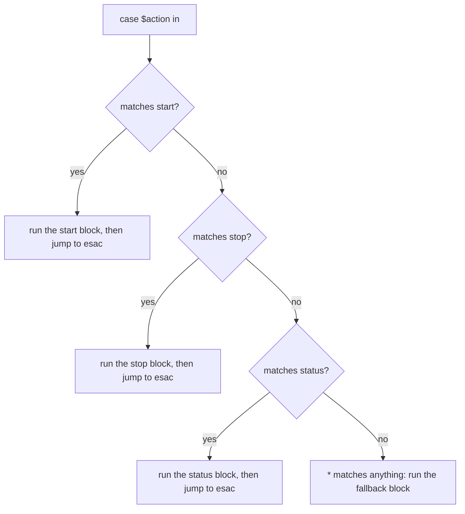

# case and positional parameters

> **Before this lesson:** you should know `if` and tests ([Flow control: if](#/lesson/linux-cli/if-test)), loops ([Loops: while, until and for](#/lesson/linux-cli/loops)), functions ([Top-down design](#/lesson/linux-cli/functions-top-down)) and wildcard patterns ([Manipulating files and directories](#/lesson/linux-cli/manipulating-files)).

## In plain words

This lesson is about how a script receives instructions from the person running it, and how it decides what to do with them.

Think about the commands you already use: `ls -l /tmp`, `cp report.txt backup/`. The words after the command name tell it *what to work on* and *how*. Those words are called **arguments**. Your own scripts can receive arguments in the same way, and inside the script they are available as numbered variables — `$1` for the first word, `$2` for the second, and so on — named **positional parameters** because each is identified by its position on the command line. It is like a form with numbered boxes: whatever the user writes in box 1 arrives in `$1`.

The second tool, `case`, is a tidy way to choose among many alternatives. Picture a post-office sorter looking at the first letters of a postcode and dropping each envelope into one of a row of bins. `case` takes one value, compares it with a list of patterns from top to bottom, and runs the commands beside the first pattern that fits.

Together they are how every real command-line tool is built: `case` examines the positional parameters to recognise options such as `-v` or `--output file`.

Why this matters for a job: a script that takes arguments can be reused, scheduled and called by other programs; one with hard-coded values has to be edited every time. Writing a small tool with a clear usage message, options and sensible error handling is a routine task for engineers of every kind.

## `case`: one value, many alternatives

In the lesson on reading input, a menu was handled with a chain of `if … elif … elif …`. Each branch repeated the same variable. `case` expresses the same choice with less noise.

```bash
case WORD in
    PATTERN1)
        commands
        ;;
    PATTERN2)
        commands
        ;;
    *)
        commands for anything else
        ;;
esac
```

The shell compares WORD with each pattern in turn. At the first match it runs that block up to the double semicolon `;;` and then jumps to `esac` ("case" backwards), ignoring the remaining patterns. The simplest example:

```bash
#!/bin/bash
read -r -p "Choose an action (start/stop/status): " action

case "$action" in
    start)
        echo "Starting the service..."
        ;;
    stop)
        echo "Stopping the service..."
        ;;
    status)
        echo "The service is running."
        ;;
    *)
        echo "Unknown action: $action" >&2
        exit 1
        ;;
esac
```

Line by line: the value of `action` is compared with the literal words `start`, `stop` and `status`. The closing parenthesis after each word ends the pattern. The final pattern `*` matches anything at all, so it catches every value not handled above — always include it, to report unexpected input instead of silently doing nothing.



### Patterns

The patterns are the same wildcard patterns used for file names — not regular expressions.

| Pattern | Matches |
|---|---|
| `start` | exactly the word `start` |
| `*` | anything (the catch-all; put it last) |
| `?` | any single character |
| `[abc]`, `[0-9]`, `[[:alpha:]]` | one character from a set, range or class |
| `*.txt` | anything ending in `.txt` |
| `y\|yes\|Y` | any one of several alternatives, separated by a vertical bar |
| `-h\|--help` | either spelling of an option |

```bash
read -r -p "Continue? " answer
case "$answer" in
    [Yy]|[Yy][Ee][Ss])  echo "Going ahead." ;;
    [Nn]|[Nn][Oo])      echo "Stopping."; exit 0 ;;
    "")                 echo "No answer given; assuming no."; exit 0 ;;
    *)                  echo "Please answer yes or no." >&2; exit 1 ;;
esac

case "$filename" in
    *.tar.gz|*.tgz)  tar -xzf "$filename" ;;
    *.zip)           unzip -q "$filename" ;;
    *.csv|*.tsv)     head -n 5 "$filename" ;;
    *)               file "$filename" ;;
esac
```

Short blocks may be written on one line, as here. Two points beginners often miss:

- **Order matters, because the first match wins.** If `*` were listed first, nothing below it could ever be reached. Put specific patterns above general ones.
- An empty string is matched by `""`, which is how the first example treats a bare press of Enter.

The model below mimics how `case` scans its patterns, so you can test the order and the alternatives:

```python-run
import fnmatch

def case(word, branches):
    """branches: list of (pattern, result). Alternatives are separated by | ; the first match wins."""
    for pattern, result in branches:
        for alternative in pattern.split("|"):
            if fnmatch.fnmatchcase(word, alternative):
                return f"{word!r:16} matched {alternative!r:12} -> {result}"
    return f"{word!r:16} matched nothing"

unpack = [("*.tar.gz|*.tgz", "tar -xzf"), ("*.zip", "unzip"), ("*.csv|*.tsv", "head"), ("*", "file")]
for name in ["data.tar.gz", "photos.zip", "sales.tsv", "notes.TXT", ""]:
    print(case(name, unpack))

print()
wrong_order = [("*", "fallback"), ("*.zip", "unzip")]       # the general pattern hides the specific one
print(case("photos.zip", wrong_order))

answers = [("[Yy]|[Yy][Ee][Ss]", "yes"), ("[Nn]|[Nn][Oo]", "no"), ("*", "unclear")]
for reply in ["y", "YES", "No", "maybe"]:
    print(case(reply, answers))
```

Modern bash has two extra block endings for the rare cases that need them: `;&` continues into the next block without testing its pattern, and `;;&` goes on testing the remaining patterns, so that one value can trigger several blocks.

## Positional parameters

### The numbered variables

When a script is started, the shell places the words of the command line into special variables:

| Variable | Holds |
|---|---|
| `$0` | the name (path) by which the script was called |
| `$1`, `$2`, … `$9` | the first to ninth argument |
| `${10}`, `${11}`, … | the tenth onward — the braces are required |
| `$#` | the number of arguments (not counting `$0`) |
| `"$@"` | all the arguments, each as a separate word |
| `"$*"` | all the arguments joined into one single word |

```bash
#!/bin/bash
# show_args: display what the script received.
echo "Script name : $0"
echo "How many    : $#"
echo "First       : $1"
echo "Second      : $2"
echo "Third       : $3"
```

```bash
mira@forge:~/scripts$ ./show_args apple "two words" cherry
Script name : ./show_args
How many    : 3
First       : apple
Second      : two words
Third       : cherry
mira@forge:~/scripts$ ./show_args only-one
Script name : ./show_args
How many    : 1
First       : only-one
Second      :
Third       :
```

Three observations. The quotes around `"two words"` made it a single argument. Arguments that were not supplied are empty, without any error. And `$#` reports how many there really were — the basis for checking that the script was used correctly.

Why the braces for `${10}`? Because `$10` is read as `$1` followed by the character `0`. The practice problem for this module asks you to implement exactly these rules.

The file-name part of `$0` is handy in messages; `basename` strips the directories:

```bash
prog="$(basename "$0")"
echo "usage: $prog SOURCE DEST" >&2
```

### Checking the arguments

A script should confirm it was given what it needs **before** doing any work, and print a short **usage message** — a one- or two-line reminder of how to call it — when it was not.

```bash
#!/bin/bash
# backup_file FILE DESTDIR: copy FILE into DESTDIR with today's date in the name.

prog="$(basename "$0")"

if (( $# != 2 )); then
    echo "usage: $prog FILE DESTDIR" >&2
    exit 2
fi

file="$1"
destdir="$2"

if [[ ! -f $file ]]; then
    echo "$prog: no such file: $file" >&2
    exit 1
fi
if [[ ! -d $destdir ]]; then
    echo "$prog: not a directory: $destdir" >&2
    exit 1
fi

cp -- "$file" "$destdir/$(basename "$file").$(date +%F)"
echo "Saved $destdir/$(basename "$file").$(date +%F)"
```

```bash
mira@forge:~/scripts$ ./backup_file notes.txt
usage: backup_file FILE DESTDIR
mira@forge:~/scripts$ ./backup_file notes.txt /srv/backup
Saved /srv/backup/notes.txt.2026-11-20
```

A habit worth copying: right after the checks, copy `$1` and `$2` into variables with meaningful names. `"$file"` and `"$destdir"` are far easier to read thirty lines later than `$1` and `$2`.

To make an argument optional, give it a default with the expansion `${N:-default}`, which means "argument N, or the default if it is missing or empty":

```bash
count="${1:-10}"          # first argument, or 10
outdir="${2:-$PWD/out}"   # second argument, or a directory named out in the current directory
```

### `"$@"` versus `"$*"` — and why the quotes matter

Both stand for "all the arguments", but they behave differently, and the difference causes real bugs. Suppose a script is called with two arguments: `"my report.txt"` and `notes.txt`.

| Written as | Result | Number of words |
|---|---|---|
| `$*` or `$@` (no quotes) | `my` `report.txt` `notes.txt` | 3 — split at spaces: wrong |
| `"$*"` | `my report.txt notes.txt` | 1 — everything glued together |
| `"$@"` | `my report.txt` and `notes.txt` | 2 — exactly as given: right |

**`"$@"` in double quotes is the one that preserves the arguments exactly**, and it is what you want nearly every time: to loop over the arguments, or to pass them all on to another command.

```bash
#!/bin/bash
# A wrapper: run rsync with our standard options plus whatever the user typed.
rsync --archive --human-readable --progress "$@"

# Process every file named on the command line
for file in "$@"; do
    echo "Checking $file"
done
```

As a convenience, `for file; do …; done` with no list at all loops over `"$@"`.

### `shift`: working through the arguments

`shift` throws away `$1` and moves every other argument down one place: the old `$2` becomes `$1`, the old `$3` becomes `$2`, and `$#` decreases by one. `shift 2` moves by two.

```bash
#!/bin/bash
while (( $# > 0 )); do
    echo "Now handling: $1   (remaining: $#)"
    shift
done
```

```bash
mira@forge:~/scripts$ ./walk a b c
Now handling: a   (remaining: 3)
Now handling: b   (remaining: 2)
Now handling: c   (remaining: 1)
```

Each pass deals with the first argument and discards it, until none remain. This loop, with a `case` inside, is the standard way to read options.

## Putting it together: a script with options

By convention, arguments beginning with a dash are **options** that adjust behaviour, and the rest are the things to work on (often called *operands*). Short options are a dash and a letter (`-v`); long options are two dashes and a word (`--verbose`). Some options take a value (`-o FILE`). A lone `--` means "no more options follow", which allows operands that start with a dash.

Here is a complete, realistic skeleton. Read it slowly; it is a template you can reuse for years.

```bash
#!/bin/bash
# logsum: summarise log files.

prog="$(basename "$0")"

usage() {
    cat <<_EOF_
usage: $prog [-v] [-n COUNT] [-o FILE] LOGFILE...
  -n, --lines COUNT   show the COUNT most frequent messages (default 10)
  -o, --output FILE   write the summary to FILE instead of the screen
  -v, --verbose       print progress messages
  -h, --help          show this help and exit
_EOF_
}

# ---- defaults ----
lines=10
output=""
verbose=false

# ---- read the options ----
while (( $# > 0 )); do
    case "$1" in
        -n|--lines)
            lines="$2"
            shift 2
            ;;
        -o|--output)
            output="$2"
            shift 2
            ;;
        -v|--verbose)
            verbose=true
            shift
            ;;
        -h|--help)
            usage
            exit 0
            ;;
        --)
            shift
            break
            ;;
        -*)
            echo "$prog: unknown option: $1" >&2
            usage >&2
            exit 2
            ;;
        *)
            break                   # first non-option: the log files start here
            ;;
    esac
done

# ---- validate ----
if (( $# == 0 )); then
    echo "$prog: no log file given" >&2
    usage >&2
    exit 2
fi
if [[ ! $lines =~ ^[0-9]+$ ]]; then
    echo "$prog: COUNT must be a whole number, got '$lines'" >&2
    exit 2
fi

# ---- work ----
summarise() {
    for logfile in "$@"; do
        [[ $verbose == true ]] && echo "reading $logfile" >&2
        cut -d' ' -f4- "$logfile"
    done | sort | uniq -c | sort -rn | head -n "$lines"
}

if [[ -n $output ]]; then
    summarise "$@" > "$output"
else
    summarise "$@"
fi
```

```bash
mira@forge:~/scripts$ ./logsum --help
usage: logsum [-v] [-n COUNT] [-o FILE] LOGFILE...
  -n, --lines COUNT   show the COUNT most frequent messages (default 10)
  ...
mira@forge:~/scripts$ ./logsum -v -n 2 app.log worker.log
reading app.log
reading worker.log
    412 connection reset by peer
    198 slow query
mira@forge:~/scripts$ ./logsum --colour app.log
logsum: unknown option: --colour
usage: logsum [-v] [-n COUNT] [-o FILE] LOGFILE...
```

How the option loop works, step by step for `./logsum -v -n 2 app.log worker.log`:

1. `$1` is `-v`: the case sets `verbose=true` and shifts once. The arguments are now `-n 2 app.log worker.log`.
2. `$1` is `-n`: its value is the *next* argument, `$2`, so `lines=2` and the script shifts twice. Remaining: `app.log worker.log`.
3. `$1` is `app.log`: it does not start with a dash, so the `*` branch runs `break` and the loop ends.
4. What is left in `"$@"` is exactly the list of log files, which is passed on unchanged.

Notice the design choices: defaults are set before the loop; the usage text lives in one function used both for `--help` (exit 0, printed normally) and for errors (exit 2, printed on standard error); progress messages go to standard error so that they do not mix with the results; and validation happens after all options are read.

Bash also has a built-in helper, `getopts`, that handles short options including combined ones such as `-vn 2`. It is worth learning once you are comfortable with the manual loop, which has the advantage of supporting long options and of showing plainly what is happening.

> [!WARNING]
> Arguments come from outside the script, so treat them as untrusted. Quote every use (`"$1"`, `"$@"`), since an unquoted argument with spaces or wildcard characters is split and expanded. Put `--` before file arguments passed to other commands (`rm -- "$file"`), so that a name such as `-rf` is not taken for an option. And never run a destructive command on an argument that has not been checked: `rm -rf "$1"/*` with `$1` empty becomes `rm -rf /*`. Check `$#`, test that the path is what you expect, or write `"${1:?missing directory}"`, which stops the script with that message when the argument is absent.

> [!TIP]
> Give every script three things: a `-h`/`--help` option, a usage message when called wrongly, and an exit status that distinguishes success (0) from failure (1) and from wrong usage (2). They take ten lines and are what make a script pleasant for the next person — who is often you, some months later.

> [!INTERVIEW]
> Frequent questions: "What do `$0`, `$1`, `$#`, `$@` and `$?` mean?", "What is the difference between `"$@"` and `"$*"`?" (separate words preserved versus one joined word), "What does `shift` do?", "How do you access the tenth argument?" (`${10}`), and "How would you parse command-line options in a bash script?" — describe the `while`/`case`/`shift` loop or `getopts`. Being able to sketch the loop from memory is a strong signal of real scripting experience.

## Pitfalls

- **Forgetting `;;`** at the end of a block, which is a syntax error.
- **Putting `*)` before more specific patterns.**
- **Expecting regular expressions** in `case` patterns; they are wildcards.
- **Writing `$10`** when `${10}` is meant.
- **Unquoted `$@` or `$*`**, which re-split the arguments.
- **Shifting by the wrong amount** for an option with a value, so the value is then read as an option or an operand.
- **Not checking that an option's value is present**: `logsum -n` with nothing after it leaves `$2` empty.
- **No usage message**, leaving users to read the source to find out how to call the script.
- **Confusing a function's parameters with the script's**: inside a function `$1` is the function's own first argument; pass the script's arguments along with `"$@"` when needed.

## Cheat sheet

| Item | Meaning |
|---|---|
| `$0` | name of the script as called |
| `$1` … `$9`, `${10}` | arguments by position |
| `$#` | number of arguments |
| `"$@"` | all arguments, each kept as a separate word |
| `"$*"` | all arguments as one word |
| `shift`, `shift N` | discard the first argument (or the first N) |
| `${1:-default}` | argument 1, or a default |
| `${1:?message}` | argument 1, or stop with an error |
| `basename "$0"` | the script's name without directories |
| `case "$x" in … esac` | choose a block by pattern |
| `a\|b)` | alternatives in one pattern |
| `*)` | the catch-all branch |
| `;;` | end of a block |
| `--` | marks the end of options |

| Task | Code |
|---|---|
| Require exactly two arguments | `(( $# == 2 )) \|\| { usage >&2; exit 2; }` |
| Loop over all arguments | `for arg in "$@"; do …; done` |
| Pass everything to another command | `othercmd "$@"` |
| Option loop | `while (( $# > 0 )); do case "$1" in …; esac; done` |

## Summary

- `case` compares one word with a list of wildcard patterns and runs the block of the first match; `|` joins alternatives, `*` catches everything else, `;;` ends a block and `esac` ends the statement.
- A script's arguments arrive in `$1`, `$2`, …, with `$0` for its name and `$#` for the count; missing arguments are empty.
- `"$@"` preserves each argument as given and is the right way to loop over or pass on arguments; `shift` discards them from the front.
- A `while` loop with `case` and `shift` reads options; defaults come before it and validation after it.
- Check the number and kind of arguments first, print a usage message on misuse, quote every parameter and exit with a meaningful status.

## Glossary

| Term | Meaning |
|---|---|
| argument | a word given to a command or script after its name |
| positional parameter | a variable such as `$1` that holds an argument by its position |
| option (flag) | an argument beginning with a dash that adjusts behaviour |
| operand | an argument that names something to work on, such as a file |
| usage message | a short text explaining how to call the program |
| default | the value used when the user gives none |
| pattern | a template with wildcards that a value is compared against |
| catch-all | the `*` branch that handles every value not matched earlier |
| `shift` | the command that removes the first positional parameter |
| wrapper | a script that calls another program, adding or adjusting arguments |
| untrusted input | data from outside the script that must be checked before use |

## Check yourself

```quiz
[
  {"q": "A script is run as `./deploy.sh staging 3 web`. What is the value of `$2`?",
   "options": ["staging", "3", "web", "./deploy.sh"],
   "answer": 1,
   "explain": "Arguments are numbered from 1 in the order they appear, so the second word after the script name is 3. The script name itself is in $0."},
  {"q": "For the same call, what does `$#` contain?",
   "options": ["4", "3", "0", "deploy.sh"],
   "answer": 1,
   "explain": "$# is the number of arguments, not counting the script name."},
  {"q": "In a `case` statement, what is the purpose of the `*)` branch?",
   "options": ["It must be first so that the other branches run", "It matches any value not matched by an earlier pattern", "It repeats the previous branch", "It ends the case statement"],
   "answer": 1,
   "explain": "The star matches everything, so placed last it handles unexpected values. Placed first it would hide all other branches."},
  {"q": "A script is called with the arguments `\"big file.txt\"` and `b.txt`. How many times does the body of `for f in \"$@\"` run?",
   "options": ["Once", "Twice", "Three times", "It depends on the directory contents"],
   "answer": 1,
   "explain": "Quoted, $@ expands to each original argument as one word, so there are two iterations. Unquoted it would be split into three words."},
  {"q": "What does `shift` do?",
   "options": ["Moves the script to another directory", "Discards $1 and renumbers the remaining arguments down by one", "Converts arguments to upper case", "Swaps `$1` and `$2`"],
   "answer": 1,
   "explain": "After shift, the old `$2` is `$1` and `$#` is one smaller, which lets a loop work through the arguments from the front."},
  {"q": "How do you refer to the eleventh argument?",
   "options": ["$11", "${11}", "$(11)", "`$1$1`"],
   "answer": 1,
   "explain": "Without braces, `$11` is read as `$1` followed by the character 1."},
  {"q": "What does `port=\"${1:-8080}\"` do?",
   "options": ["Subtracts 8080 from the first argument", "Uses the first argument, or 8080 if no argument (or an empty one) was given", "Always sets port to 8080", "Reports an error when the argument is missing"],
   "answer": 1,
   "explain": "The :- form supplies a default when the parameter is unset or empty."},
  {"q": "In the option loop, why does the branch for `-o|--output` use `shift 2`?",
   "options": ["To skip the next option", "Because the option and its value occupy two arguments, both of which have been consumed", "shift always needs a number", "To double the speed of the loop"],
   "answer": 1,
   "explain": "An option that takes a value uses `$1` (the option) and `$2` (the value), so both must be removed before the next pass."}
]
```

> **Source:** Shotts, *The Linux Command Line*, ch. 31 (Flow Control: Branching with case) and ch. 32 (Positional Parameters). All examples and wording are original to this guide.
