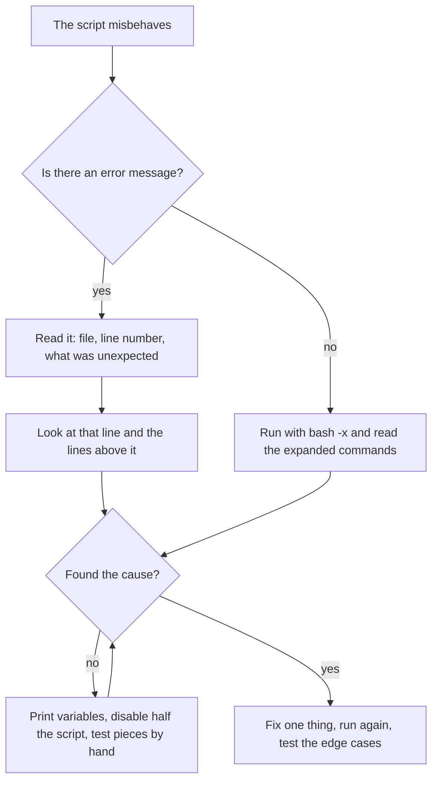

# Troubleshooting and defensive scripting

> **Before this lesson:** you should be able to write scripts with variables, functions, `if`, loops and arguments (the five lessons from [Writing your first script](#/lesson/linux-cli/first-script-project) to [case and positional parameters](#/lesson/linux-cli/case-positional)) and understand quoting ([Expansion and quoting](#/lesson/linux-cli/expansion-quoting)).

## In plain words

Every script you write will be wrong at first. That is not a sign of doing it badly; it is how programming works. The skill that separates a comfortable programmer from a frustrated one is not avoiding mistakes — it is *finding* them quickly and writing in a way that makes them harmless.

Think of a detective and a careful driver. The detective arrives after something has gone wrong and works from evidence: what exactly happened, where, and what was the last moment everything was still normal? That is **debugging** — finding and fixing the cause of a fault (the faults themselves are called **bugs**). The careful driver wears a seat belt, checks mirrors and keeps a safe distance, so that when something unexpected happens, nobody is hurt. That is **defensive programming** — writing a script so that when its assumptions turn out false, it stops safely with a clear message instead of ploughing on.

Why this matters for a job: scripts are trusted with real things — production servers, customers' data, backups. A script that keeps running after a failed step is how a "cleanup" job deletes the wrong directory or a deployment ships a half-built release. Employers care a great deal that you can explain how your script behaves when something goes wrong, and interviewers ask about it directly.

This lesson has two halves: reading error messages and tracing what a script does; then the habits and safety switches that prevent small errors from becoming disasters.

## Three kinds of error

| Kind | What it is | When you notice |
|---|---|---|
| **Syntax error** | the text breaks the grammar of the language, so the shell cannot understand it | as soon as the shell reads that part of the file |
| **Runtime error** | the grammar is fine, but a command fails while running: a file is missing, permission is denied | when that line executes, perhaps only in rare situations |
| **Logic error** | every command works, yet the script does the wrong thing | only when someone checks the result |

They get harder to find in that order. The shell reports syntax errors itself; runtime errors print a message but, by default, do not stop the script; logic errors are silent.

## Syntax errors and how to read them

Start with a correct script:

```bash
#!/bin/bash
# check_number: say whether a number is 1.
number=1
if [ "$number" = 1 ]; then
    echo "Number is equal to 1."
else
    echo "Number is not equal to 1."
fi
```

Now break it in the three classic ways and study the messages.

**A missing quote.** Remove the closing quote after `equal to 1.` on line 5:

```bash
mira@forge:~/scripts$ ./check_number
./check_number: line 7: unexpected EOF while looking for matching `"'
./check_number: line 9: syntax error: unexpected end of file
```

The message names line 7 and line 9 — but the mistake is on line 5. Why? After the unclosed quote, the shell treats everything that follows as part of the quoted text, including later lines, until it finds another quote character (on line 7) and becomes confused from there. **The line number in a syntax error is where the shell gave up, not necessarily where the mistake is.** Look at that line and then *upwards*.

**A missing keyword.** Delete the semicolon before `then` on line 4:

```bash
mira@forge:~/scripts$ ./check_number
./check_number: line 6: syntax error near unexpected token `else'
./check_number: line 6: `else'
```

Without the semicolon, `then` became one more argument of the `[` command, so the `if` never got its `then`; the shell noticed only when it met `else`. Again the report is two lines below the cause. A **token** is one unit of the language — a word, an operator or a keyword.

**An unexpected expansion.** Suppose `number` is empty and line 4 lacks the quotes: `if [ $number = 1 ]; then`.

```bash
mira@forge:~/scripts$ ./check_number
./check_number: line 4: [: =: unary operator expected
Number is not equal to 1.
```

This one is a runtime error, and the line number is right. After expansion the command became `[ = 1 ]`, which is not a valid test. Notice the second line of output: the script **carried on** and took the `else` branch. Quoting (`"$number"`) fixes it.

Useful first aid: `bash -n script` reads the whole file and reports syntax errors **without running anything**. An editor that colours syntax also reveals an unclosed quote at a glance, because everything after it turns the colour of quoted text.

## Finding logic errors: make the script show its work

A logic error leaves no message, so the task is to compare what the script *actually* does with what you believe it does. There are three techniques, from simplest to most powerful.

### 1. Print as you go

Add temporary lines that report progress and the values of variables. Send them to standard error (`>&2`) so they do not mix with the script's real output, and mark them so they are easy to remove.

```bash
echo "DEBUG: about to process dir=[$dir] count=[$count]" >&2
```

The square brackets are deliberate: they make an empty value or a stray space visible, as in `dir=[]` or `dir=[ /tmp]`.

### 2. Tracing with `set -x`

Bash can print every command immediately before running it, *after* all expansions have been done — you see exactly what the shell is about to execute. Switch it on for a whole run with `bash -x script`, or for a region inside the script with `set -x` … `set +x`.

```bash
#!/bin/bash
number=7
set -x
if [ "$number" -gt 5 ]; then
    result=$(( number * 2 ))
    echo "Result: $result"
fi
set +x
```

```bash
mira@forge:~/scripts$ ./trace_demo
+ '[' 7 -gt 5 ']'
+ result=14
+ echo 'Result: 14'
Result: 14
+ set +x
```

Each traced line starts with `+`. The first shows that `"$number"` had become `7` before the test ran. Tracing is the fastest way to find a variable that is unexpectedly empty or a pattern that expanded to something surprising. The marker comes from a variable called `PS4`; this setting makes the trace show the line number as well:

```bash
export PS4='+ line $LINENO: '
```

### 3. Test small pieces, and bracket the problem

- **Run fragments by hand.** Paste a suspicious line into an interactive shell with the variables set. A pipeline can be tested one stage at a time.
- **Comment out** sections (put `#` in front of the lines) to see whether the problem disappears. If it does, the fault is in what you disabled. Halving the script repeatedly corners a bug quickly.
- **Use stubs and `echo` for dangerous commands.** While testing, write `echo rm -rf "$dir"` so the command is displayed, not executed.
- **Test the awkward cases**, not only the expected one: no arguments, an empty file, a name containing spaces, a missing directory, a value of zero. Most bugs live at these edges.



## The dangerous default: a script does not stop on errors

Here is the most important fact in this lesson. Unless told otherwise, bash runs the next line no matter what happened on the previous one.

```bash
#!/bin/bash
# cleanup: remove temporary files of the build.
cd "$BUILD_DIR"
rm -rf *
echo "Cleaned."
```

If `BUILD_DIR` is not set, `cd ""` does nothing useful or fails — and `rm -rf *` then deletes everything in whatever directory the script was started from. Typing those two commands at a prompt, you would see the `cd` error and stop. The script does not.

> [!WARNING]
> Any line that deletes, overwrites, moves or sends data must not be reachable unless the lines it depends on succeeded **and** the variables it uses hold what you expect. The pattern `cd "$dir"` followed by `rm -rf *` (or `rm -rf "$dir"/*` with an unchecked variable) has destroyed more data than any other two lines of shell. Write `cd "$dir" || exit 1`, use `"${dir:?}"` so an empty variable stops the script, and prefer explicit paths to "whatever directory we are in".

A first repair, using what you already know:

```bash
#!/bin/bash
if [[ -z $BUILD_DIR || ! -d $BUILD_DIR ]]; then
    echo "cleanup: BUILD_DIR is not set or not a directory" >&2
    exit 1
fi
cd "$BUILD_DIR" || exit 1
rm -rf ./*
echo "Cleaned $BUILD_DIR."
```

Checking by hand everywhere is tiring, so bash provides safety switches.

## Strict mode: `set -euo pipefail`

Three options change the default behaviour. Many teams put them at the top of every script:

```bash
#!/usr/bin/env bash
set -euo pipefail
```

| Option | Long form | Effect |
|---|---|---|
| `-e` | `errexit` | stop the script as soon as a command fails (returns a non-zero status) |
| `-u` | `nounset` | treat the use of an unset variable as an error instead of substituting nothing |
| `-o pipefail` | | a pipeline fails if **any** command in it fails, not only the last |

With these three lines the cleanup script above would have stopped at once with `BUILD_DIR: unbound variable`. Each option deserves a short explanation, because each has rules a beginner needs.

**`-e` (stop on failure).** A failing command ends the script — *except* where failure is being tested on purpose: in the condition of `if`, `while` or `until`, after `!`, and in any command of a `&&` or `||` list other than the last. So `if grep -q x file; then` is fine even when `grep` finds nothing. When a command is allowed to fail, say so explicitly:

```bash
grep -c ERROR app.log || true          # a count of zero makes grep return 1; that is acceptable here
rm -f old.tmp                          # -f already ignores a missing file
if ! mkdir "$dir" 2>/dev/null; then    # handle the failure yourself
    echo "could not create $dir" >&2
fi
```

**`-u` (no unset variables).** A misspelt name becomes an immediate error instead of an empty string. For variables that may legitimately be absent, such as optional arguments, give a default: `"${1:-}"` means "argument 1, or empty", which satisfies `-u`.

**`pipefail`.** Normally the status of `a | b` is that of `b` alone. `curl … | tar -x` would count as a success even if the download failed halfway. With `pipefail`, the failure of `curl` fails the pipeline.

The model below runs the same three steps under both regimes, so the difference is concrete:

```python-run
def run(script, errexit=False, nounset=False):
    variables = {"HOME": "/home/mira"}
    log = []
    for name, action in script:
        if action[0] == "use":                       # a command that uses a variable
            var = action[1]
            if var not in variables:
                if nounset:
                    log.append(f"{name}: {var}: unbound variable -> script stops")
                    return log
                log.append(f"{name}: ${var} is unset, silently empty")
                status = 1 if action[2] == "fails-when-empty" else 0
            else:
                status = 0
        else:
            status = action[1]                       # ("status", n)
        log.append(f"{name}: exit status {status}")
        if status != 0 and errexit:
            log.append("  -> errexit: script stops here")
            return log
    log.append("script reached the end")
    return log

script = [
    ("cd \"$BUILD_DIR\"", ("use", "BUILD_DIR", "fails-when-empty")),
    ("rm -rf ./*       ", ("status", 0)),             # 'succeeds' - in the WRONG directory
    ("echo Cleaned     ", ("status", 0)),
]
for title, options in [("default bash", {}), ("set -e", {"errexit": True}),
                       ("set -eu", {"errexit": True, "nounset": True})]:
    print(f"--- {title}")
    print("\n".join("  " + line for line in run(script, **options)))
```

> [!TIP]
> Strict mode is a safety net, not a substitute for thinking: `-e` has enough exceptions that an important command should still be checked explicitly (`cmd || { echo "cmd failed" >&2; exit 1; }`). Use both. And run `shellcheck script` on everything you write — this free tool points out unquoted variables, unreachable branches, misuse of `[ ]` and dozens of other classic mistakes, each with an explanation, before you ever run the script.

## Cleaning up, whatever happens: `trap`

Scripts often create temporary files or acquire something that must be released. If the script stops early — because of an error under `set -e`, or because someone pressed `Ctrl-C` — the cleanup lines at the bottom never run. A **trap** tells the shell: "when this event happens, run this command first". The event `EXIT` fires whenever the script ends, for any reason.

```bash
#!/usr/bin/env bash
set -euo pipefail

workdir="$(mktemp -d)"                 # create a private temporary directory, e.g. /tmp/tmp.q1W8xZ
cleanup() {
    rm -rf -- "$workdir"
}
trap cleanup EXIT

echo "working in $workdir"
curl --silent --fail --output "$workdir/data.json" https://api.example.net/data
jq '.items | length' "$workdir/data.json"
```

Line by line: `mktemp -d` creates a new, uniquely named directory and prints its path — safer than inventing a name such as `/tmp/work`, which another program or user might also choose. The function `cleanup` removes it. `trap cleanup EXIT` registers that function to run when the script ends. If `curl` fails, strict mode stops the script and the trap still tidies up.

A trap can also help debugging. `ERR` fires when a command fails:

```bash
trap 'echo "error on line $LINENO (exit status $?)" >&2' ERR
```

## Defensive habits, collected

- **Quote every expansion**: `"$var"`, `"$@"`, `"$(command)"`.
- **Validate inputs early** and exit with a usage message (previous lesson).
- **Check that required programs exist**: `command -v jq >/dev/null || { echo "jq is required" >&2; exit 1; }`.
- **Guard dangerous variables**: `"${dir:?}"` aborts if the variable is unset or empty.
- **Never change directory without checking**: `cd "$dir" || exit 1`.
- **Use `--`** before file names handed to commands, so a name beginning with a dash is not read as an option.
- **Make scripts safe to run twice** (idempotent): `mkdir -p`, `rm -f`, "skip if already done" checks.
- **Offer a dry-run mode** for anything destructive, so that actions are printed instead of performed:

```bash
dry_run=false
[[ ${1:-} == --dry-run ]] && { dry_run=true; shift; }

run() {
    if [[ $dry_run == true ]]; then
        echo "would run: $*"
    else
        "$@"
    fi
}

run rm -rf -- "$old_release"
run systemctl restart weather-api
```

- **Write errors to standard error with the script's name**, and **exit non-zero** on failure, so that schedulers and other scripts can detect the problem.
- **Log what was done** for anything that runs unattended: a timestamped line per major step is invaluable the morning after.

```bash
log() { printf '%s %s\n' "$(date +'%F %T')" "$*" >&2; }
log "backup started"
```

## A worked debugging session

A colleague's script should count the lines in every text file but reports nothing for some files:

```bash
#!/bin/bash
for f in $(ls *.txt); do
    lines=$(wc -l < $f)
    echo "$f: $lines"
done
```

```bash
mira@forge:~/docs$ ./count_lines
./count_lines: line 3: meeting: No such file or directory
meeting:
./count_lines: line 3: notes.txt: No such file or directory
notes.txt:
todo.txt: 14
mira@forge:~/docs$ ls
'meeting notes.txt'  todo.txt
```

Step 1, read the messages: the script looked for files called `meeting` and `notes.txt`. Step 2, compare with reality: there is one file, `meeting notes.txt`. Step 3, confirm with a trace:

```bash
mira@forge:~/docs$ bash -x ./count_lines 2>&1 | head -n 4
++ ls 'meeting notes.txt' todo.txt
+ for f in $(ls *.txt)
++ wc -l
./count_lines: line 3: meeting: No such file or directory
```

The loop variable received `meeting` — the output of `ls` was split at the space. Step 4, fix one thing at a time: loop over the glob, quote the variable, add strict mode.

```bash
#!/usr/bin/env bash
set -euo pipefail
for f in *.txt; do
    [[ -e $f ]] || continue
    lines=$(wc -l < "$f")
    echo "$f: $lines"
done
```

Step 5, test the edges: a name with spaces, an empty file, a directory with no text files. Running `shellcheck` on the original would have flagged both mistakes before anyone ran it.

> [!INTERVIEW]
> Expect: "How do you debug a shell script?" (`bash -x` or `set -x`, `bash -n` for syntax, printing variables, `shellcheck`), "What does `set -e` do? `set -u`? `pipefail`?", "What happens by default when a command in a script fails?" (the script continues), "How do you make sure temporary files are removed even if the script fails?" (`trap … EXIT`, with `mktemp`), and a design question such as "How would you make this deployment script safe?" — validation, strict mode, checks before destructive steps, dry-run, logging, idempotence.

## Pitfalls

- **Trusting the line number** of a syntax error; look above it.
- **Fixing several things at once**, then not knowing which change mattered.
- **Assuming a failed command stops the script.**
- **Believing `set -e` catches everything**; commands in conditions and in `&&`/`||` chains are exempt, and `local x=$(cmd)` hides the failure of `cmd` (declare first, assign on a separate line).
- **Counters under `set -e`**: `(( count++ ))` returns a failure status when the old value was 0, which stops a strict script. Write `count=$(( count + 1 ))`.
- **Debug output on standard output**, corrupting the data the script produces.
- **Leaving tracing or debug lines** in the finished script.
- **Predictable temporary file names** in `/tmp`; use `mktemp`.
- **Testing only the happy path.**

## Cheat sheet

| Task | Command |
|---|---|
| Check syntax without running | `bash -n script` |
| Static analysis | `shellcheck script` |
| Trace a whole run | `bash -x script` |
| Trace a region | `set -x` … `set +x` |
| Line numbers in the trace | `PS4='+ line $LINENO: '` |
| Strict mode | `set -euo pipefail` |
| Allow one command to fail | `cmd \|\| true` |
| Stop if a variable is empty | `"${var:?message}"` |
| Safe change of directory | `cd "$dir" \|\| exit 1` |
| Require a program | `command -v prog >/dev/null \|\| exit 1` |
| Temporary directory | `tmp="$(mktemp -d)"` |
| Clean up on any exit | `trap 'rm -rf -- "$tmp"' EXIT` |
| Report where an error happened | `trap 'echo "line $LINENO" >&2' ERR` |
| Debug message | `echo "DEBUG: x=[$x]" >&2` |

## Summary

- Errors are of three kinds: syntax (reported when read, often some lines after the real mistake), runtime (a command fails) and logic (wrong behaviour with no message).
- Find problems by reading the message, tracing with `bash -x`, printing variables to standard error, and testing pieces and edge cases separately.
- By default a script continues after a failed command; `set -euo pipefail` makes it stop on failures, on unset variables and on failures inside pipelines.
- `trap … EXIT` with `mktemp` guarantees cleanup; `${var:?}`, `cd … || exit`, quoting and `--` protect destructive commands.
- Build in validation, dry-run, logging and idempotence, and run `shellcheck` on every script.

## Glossary

| Term | Meaning |
|---|---|
| bug | a fault that makes a program behave incorrectly |
| debugging | finding and fixing the cause of a bug |
| defensive programming | writing code that fails safely when its assumptions are wrong |
| syntax error | text that breaks the grammar of the language |
| runtime error | a failure that occurs while a correct-looking command is running |
| logic error | code that runs without complaint but does the wrong thing |
| token | one unit of the language: a word, operator or keyword |
| tracing | printing each command as it is executed |
| strict mode | the options `set -euo pipefail` |
| unset variable | a variable that has never been given a value |
| trap | an instruction to run a command when an event (such as exit) occurs |
| temporary file | a short-lived working file, best created with `mktemp` |
| edge case | an unusual input at the limits of what the script handles |
| static analysis | checking code for mistakes without running it, as `shellcheck` does |

## Check yourself

```quiz
[
  {"q": "By default, what does bash do when a command in the middle of a script fails?",
   "options": ["It stops the script", "It prints any error and continues with the next line", "It restarts the script", "It asks the user whether to continue"],
   "answer": 1,
   "explain": "A failing command sets a non-zero exit status but execution continues unless the script checks the status or uses set -e."},
  {"q": "A syntax error is reported on line 22. Where should you look for the mistake?",
   "options": ["Only on line 22", "On line 22 and the lines above it, because the shell reports where it became confused, not where the error was made", "At the end of the file", "In the shebang line"],
   "answer": 1,
   "explain": "A missing quote or keyword often goes unnoticed for several lines, so the reported line can be well below the real cause."},
  {"q": "What does running a script with `bash -x` show?",
   "options": ["Only syntax errors", "Each command, after expansion, right before it is executed", "The script's source code", "The list of defined variables"],
   "answer": 1,
   "explain": "The trace lines, prefixed with a plus sign, reveal the real values and arguments the shell is using."},
  {"q": "What is the effect of `set -u`?",
   "options": ["Variables become upper case", "Using a variable that has never been set is an error that stops the script", "The script runs as another user", "Unused variables are deleted"],
   "answer": 1,
   "explain": "Without it, an unset or misspelt variable silently expands to nothing, which can turn a harmless command into a dangerous one."},
  {"q": "With `set -o pipefail`, when does the pipeline `download | unpack` count as failed?",
   "options": ["Only if unpack fails", "If either download or unpack fails", "Never", "Only if both fail"],
   "answer": 1,
   "explain": "Normally only the last command's status counts. pipefail makes a failure anywhere in the pipeline fail the whole pipeline."},
  {"q": "Why is `trap cleanup EXIT` better than calling cleanup on the last line of the script?",
   "options": ["It runs faster", "The trap also runs when the script ends early because of an error or an interrupt", "It runs cleanup twice", "The last line of a script is never executed"],
   "answer": 1,
   "explain": "The EXIT trap fires however the script terminates, so temporary files are removed even after a failure."},
  {"q": "What does `rm -rf \"${dir:?}\"/*` protect against?",
   "options": ["Deleting hidden files", "The variable being unset or empty, which would otherwise turn the command into rm -rf /*", "Running without sudo", "Spaces in file names only"],
   "answer": 1,
   "explain": "The :? form makes the shell stop with an error when the variable has no value, instead of expanding to nothing."},
  {"q": "Why should debugging messages be written with `>&2`?",
   "options": ["It makes them red", "They go to standard error, so they do not mix with the script's real output when it is piped or redirected", "It hides them", "It saves them to a file named 2"],
   "answer": 1,
   "explain": "Keeping diagnostics on standard error leaves standard output clean for the data other programs may be reading."}
]
```

> **Source:** Shotts, *The Linux Command Line*, ch. 30 (Troubleshooting). All examples and wording are original to this guide.
