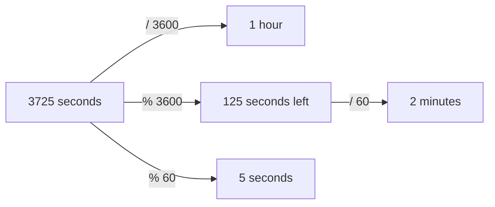

# Strings and numbers

> **Before this lesson:** you should know how variables and `$` expansions work ([Expansion and quoting](#/lesson/linux-cli/expansion-quoting), [first script](#/lesson/linux-cli/first-script-project)), tests with `[[ ]]` and `(( ))` ([Flow control: if](#/lesson/linux-cli/if-test)) and loops ([Loops](#/lesson/linux-cli/loops)).

## In plain words

Scripts spend most of their time handling two kinds of data. A **string** is a piece of text — a file name, a line from a log, a user's answer. A **number**, for the shell, means a whole number (an **integer**): a count, a size, a year.

Working with strings is like working with a paper label and a pair of scissors. You often need to trim something off the front ("remove the folder part and keep the file name"), trim something off the end ("remove `.jpg`"), cut out a middle piece, or swap one word for another. The shell has a compact notation for all of this, built into the way variables are read. It is called **parameter expansion**: instead of writing `$name`, you write `${name…}` with an extra instruction inside the braces.

Working with numbers is like using a pocket calculator that has no decimal point. The shell can add, subtract, multiply, divide and compare whole numbers, written between double parentheses. For fractions, it borrows a separate calculator program called `bc`.

Why this matters for a job: nearly every practical script renames files, builds output paths from input paths, supplies default values for missing settings, or counts things. Doing those jobs with the built-in notation — instead of starting extra programs such as `sed` or `cut` for each tiny edit — makes scripts shorter, faster and easier to get right. These expansions also appear in almost every script you will read, so recognising them on sight is essential.

## Part 1 — Parameter expansion

### The basic form, and why braces exist

`$name` gives a variable's value. `${name}` means exactly the same; the braces mark where the name ends, which matters when other characters follow directly:

```bash
mira@forge:~$ file="report"
mira@forge:~$ echo "$file_v2.txt"
.txt
mira@forge:~$ echo "${file}_v2.txt"
report_v2.txt
```

In the first command the shell looked for a variable named `file_v2`, found none, and substituted nothing. The braces fix that. Everything else in this part consists of extra instructions placed inside those braces.

### Handling missing values

Four operators deal with variables that are **unset** (never given a value) or empty. They begin with a colon.

| Form | Meaning |
|---|---|
| `${var:-word}` | the value of `var`; if it is unset or empty, use `word` instead (`var` itself is not changed) |
| `${var:=word}` | the same, and **also assign** `word` to `var` |
| `${var:?message}` | the value of `var`; if it is unset or empty, print `message` and **stop the script** |
| `${var:+word}` | the opposite: if `var` has a value, use `word`; otherwise use nothing |

```bash
mira@forge:~$ unset port
mira@forge:~$ echo "Listening on ${port:-8000}"
Listening on 8000
mira@forge:~$ echo "[$port]"
[]
mira@forge:~$ echo "Listening on ${port:=8000}"; echo "[$port]"
Listening on 8000
[8000]
mira@forge:~$ unset outdir; echo "${outdir:?output directory not set}"
bash: outdir: output directory not set
mira@forge:~$ verbose=1; echo "curl ${verbose:+--verbose} https://example.net"
curl --verbose https://example.net
```

Line by line: `:-` supplied a fallback for display while leaving `port` empty (shown by the `[]`). `:=` supplied it and stored it. `:?` refused to continue. `:+` inserted an option only because `verbose` had a value — a neat way to build optional parts of a command.

These are the everyday tools for defaults and safety:

```bash
log_level="${LOG_LEVEL:-info}"            # take a setting from the environment, or a default
target="${1:?usage: deploy TARGET}"       # a required argument with a built-in error message
rm -rf -- "${cache_dir:?}"/*              # never run with an empty variable
```

### Length and substrings

| Form | Meaning |
|---|---|
| `${#var}` | the number of characters in the value |
| `${var:offset}` | the part starting at position `offset` (counting from **0**) to the end |
| `${var:offset:length}` | `length` characters starting at `offset` |
| `${var: -n}` | the last `n` characters (note the space before the minus sign) |

```bash
mira@forge:~$ stamp="2026-11-20T14:05:09"
mira@forge:~$ echo "${#stamp}"
19
mira@forge:~$ echo "${stamp:0:4}"        # 4 characters from position 0: the year
2026
mira@forge:~$ echo "${stamp:5:2}"        # 2 characters from position 5: the month
11
mira@forge:~$ echo "${stamp:11}"         # from position 11 to the end: the time
14:05:09
mira@forge:~$ echo "${stamp: -2}"        # the last two characters
09
```

Positions start at zero: the first character is at position 0, the second at 1. A newcomer's reliable check is to count on your fingers once: in `2026-11-20…`, positions 0–3 hold `2026`, position 4 holds the dash, position 5 is where `11` begins.

### Removing a prefix or a suffix

This is the group you will use most, mainly for file names and paths. A **prefix** is a piece at the beginning, a **suffix** a piece at the end. The patterns are the same wildcards used for file names (`*`, `?`, `[…]`).

| Form | Removes |
|---|---|
| `${var#pattern}` | the **shortest** match of the pattern from the **front** |
| `${var##pattern}` | the **longest** match from the front |
| `${var%pattern}` | the shortest match from the **end** |
| `${var%%pattern}` | the longest match from the end |

A way to remember which symbol is which: on a US keyboard `#` is to the left of `$` and `%` is to the right, so `#` works on the left (front) and `%` on the right (end). One symbol is the shortest match; two symbols, the longest.

```bash
mira@forge:~$ path="/srv/data/archive/photos.2026.tar.gz"
mira@forge:~$ echo "${path##*/}"         # longest "anything then /" from the front -> file name
photos.2026.tar.gz
mira@forge:~$ echo "${path%/*}"          # shortest "/ then anything" from the end -> directory
/srv/data/archive
mira@forge:~$ echo "${path%.*}"          # shortest ".something" from the end -> drop last extension
/srv/data/archive/photos.2026.tar
mira@forge:~$ echo "${path%%.*}"         # longest ".something" from the end -> drop all extensions
/srv/data/archive/photos
mira@forge:~$ echo "${path##*.}"         # longest "anything then ." from the front -> last extension
gz
mira@forge:~$ echo "${path#*.}"          # shortest "anything then ." from the front
2026.tar.gz
```

Work through the first one slowly. The pattern `*/` means "any characters followed by a slash". Many prefixes of the path fit that: `/`, `/srv/`, `/srv/data/`, `/srv/data/archive/`. Two hash signs ask for the **longest**, `/srv/data/archive/`, and removing it leaves the file name.

The classic application is changing a file's extension inside a loop:

```bash
for src in *.jpeg; do
    [[ -e $src ]] || continue
    mv -- "$src" "${src%.jpeg}.jpg"       # holiday.jpeg -> holiday.jpg
done

for wav in recordings/*.wav; do
    base="${wav##*/}"                      # interview.wav
    ffmpeg -loglevel error -i "$wav" "mp3/${base%.wav}.mp3" < /dev/null
done
```

The model below implements the four operators, so you can experiment with patterns and see every candidate match:

```python-run
import fnmatch

def strip(value, op, pattern):
    """Emulate ${value#pat} ${value##pat} ${value%pat} ${value%%pat}."""
    cuts = range(len(value) + 1)
    if op in ("#", "##"):                                   # match a prefix value[:i]
        hits = [i for i in cuts if fnmatch.fnmatchcase(value[:i], pattern)]
        if not hits:
            return value
        return value[(min(hits) if op == "#" else max(hits)):]
    hits = [i for i in cuts if fnmatch.fnmatchcase(value[i:], pattern)]   # match a suffix value[i:]
    if not hits:
        return value
    return value[:(max(hits) if op == "%" else min(hits))]

path = "/srv/data/archive/photos.2026.tar.gz"
for op, pattern, meaning in [("##", "*/", "file name"), ("%", "/*", "directory"),
                             ("%", ".*", "without last extension"), ("%%", ".*", "without any extension"),
                             ("##", "*.", "last extension"), ("#", "*.", "after the first dot"),
                             ("%", ".zip", "pattern does not match: unchanged")]:
    print(f"${{path{op}{pattern}}}".ljust(18), "->", strip(path, op, pattern).ljust(38), f"({meaning})")
```

### Search and replace

| Form | Effect |
|---|---|
| `${var/pattern/text}` | replace the **first** match of the pattern with text |
| `${var//pattern/text}` | replace **all** matches |
| `${var/#pattern/text}` | replace only if the match is at the **start** |
| `${var/%pattern/text}` | replace only if the match is at the **end** |
| `${var//pattern}` | with no text: **delete** all matches |

```bash
mira@forge:~$ title="Annual Report 2026 Final Final"
mira@forge:~$ echo "${title/Final/Draft}"
Annual Report 2026 Draft Final
mira@forge:~$ echo "${title//Final/Draft}"
Annual Report 2026 Draft Draft
mira@forge:~$ echo "${title// /_}"                # every space becomes an underscore
Annual_Report_2026_Final_Final
mira@forge:~$ echo "${title// }"                  # delete every space
AnnualReport2026FinalFinal
mira@forge:~$ phone="+47 (555) 010-77"; echo "${phone//[^0-9]}"   # keep only the digits
4755501077
```

### Changing letter case

| Form | Effect |
|---|---|
| `${var^^}` | all letters to upper case |
| `${var,,}` | all letters to lower case |
| `${var^}` | first letter to upper case |
| `${var,}` | first letter to lower case |

```bash
mira@forge:~$ answer="YeS"
mira@forge:~$ echo "${answer,,} ${answer^^}"
yes YES
mira@forge:~$ name="ana"; echo "Hello, ${name^}."
Hello, Ana.
```

Lower-casing input before comparing it — `if [[ ${answer,,} == yes ]]` — is called **normalisation**: putting data into one standard form so that `Yes`, `YES` and `yes` are all treated alike.

> [!TIP]
> Prefer these built-in expansions to starting helper programs for small jobs. `"${path##*/}"` does the work of `basename "$path"` and `"${path%/*}"` that of `dirname "$path"` without launching anything, which is noticeably faster inside a loop that runs thousands of times. The helper programs remain a fine choice when clarity matters more than speed.

> [!WARNING]
> Building a path for a destructive command out of expansions demands a guard. If `name` is empty, `rm -rf "/srv/cache/${name}"` removes the entire cache directory, and `rm -rf "${dir%/}/"*` with `dir` empty expands to `rm -rf /*`. Use the `:?` form on every variable that feeds `rm`, `mv` or a redirection — `"${name:?}"` — and print the command with `echo` first when you are unsure.

## Part 2 — Arithmetic

### The two forms

Arithmetic is written between double parentheses. There are two closely related forms:

- `$(( expression ))` **produces a value**: the result is substituted into the command line. Use it to get a number.
- `(( expression ))` is a **command**: it performs the calculation (including assignments) and sets its exit status — success if the result is not zero. Use it in `if` and `while`, or to change a variable.

Inside either form, variable names are written without `$`, and spaces are free.

```bash
mira@forge:~$ echo $(( 7 + 5 ))
12
mira@forge:~$ width=1920; height=1080
mira@forge:~$ echo "Pixels: $(( width * height ))"
Pixels: 2073600
mira@forge:~$ (( total = width + height ))      # assignment inside the parentheses
mira@forge:~$ echo "$total"
3000
mira@forge:~$ if (( width > height )); then echo "landscape"; fi
landscape
```

### Operators

| Operator | Meaning | Example | Result |
|---|---|---|---|
| `+` `-` `*` | add, subtract, multiply | `$(( 6 * 7 ))` | `42` |
| `/` | divide, **discarding the fraction** | `$(( 17 / 5 ))` | `3` |
| `%` | remainder after division (*modulo*) | `$(( 17 % 5 ))` | `2` |
| `**` | power | `$(( 2 ** 10 ))` | `1024` |
| `++` `--` | add or subtract one | `(( count++ ))` | |
| `+=` `-=` `*=` `/=` | change a variable by an amount | `(( total += 5 ))` | |
| `<` `<=` `>` `>=` `==` `!=` | comparisons | `(( a >= b ))` | status |
| `&&` `\|\|` `!` | logical and, or, not | `(( a > 0 && b > 0 ))` | status |
| `cond ? x : y` | choose `x` if the condition holds, otherwise `y` | `$(( a > b ? a : b ))` | larger value |
| `( )` | grouping | `$(( (2 + 3) * 4 ))` | `20` |

The usual precedence applies: multiplication and division before addition and subtraction; parentheses override.

**Integer division is the first surprise.** The shell has no fractions: `7 / 2` is `3`, not `3.5`. The remainder operator gives back what division throws away, and the two together solve many everyday problems:

```bash
mira@forge:~$ seconds=3725
mira@forge:~$ echo "$(( seconds / 3600 ))h $(( seconds % 3600 / 60 ))m $(( seconds % 60 ))s"
1h 2m 5s
mira@forge:~$ for n in 1 2 3 4; do (( n % 2 == 0 )) && echo "$n is even" || echo "$n is odd"; done
1 is odd
2 is even
3 is odd
4 is even
mira@forge:~$ done_items=37; all=120; echo "$(( 100 * done_items / all ))% complete"
30% complete
```

Reading the first: 3725 seconds divided by 3600 is 1 whole hour; the remainder, 125 seconds, divided by 60 is 2 whole minutes; and 3725 modulo 60 leaves 5 seconds. In the third, note the order — **multiply before dividing**. `done_items / all * 100` would compute `37 / 120`, which is `0`, and then `0 * 100`.



### Number bases

A **base** is the number of different digits a notation uses. Everyday numbers are base 10 (decimal). Computers also use base 2 (binary), base 8 (octal — the notation of file permissions) and base 16 (hexadecimal, with the extra digits `a`–`f`). The shell reads other bases by prefix:

| Notation | Base | Example | Decimal value |
|---|---|---|---|
| `number` | 10 | `255` | 255 |
| `0number` | 8 (octal) | `0377` | 255 |
| `0xnumber` | 16 (hexadecimal) | `0xff` | 255 |
| `base#number` | any base from 2 to 64 | `2#11111111` | 255 |

```bash
mira@forge:~$ echo $(( 0xff )) $(( 0755 )) $(( 2#1010 ))
255 493 10
mira@forge:~$ printf '%x %o\n' 255 493        # convert back with printf
ff 755
```

> [!WARNING]
> A leading zero means **octal**. This turns innocent-looking data into errors: `$(( 08 + 1 ))` fails with "value too great for base", because 8 is not a valid octal digit, and `$(( 010 + 1 ))` silently yields 9. Dates and times are full of such values — month `08`, minute `09`. Force base ten by writing `10#` in front: `month="08"; echo $(( 10#$month + 1 ))` prints 9.

### When whole numbers are not enough: `bc`

For decimal fractions, pass the calculation to `bc`, an arbitrary-precision calculator. `scale` sets the number of digits after the decimal point.

```bash
mira@forge:~$ echo "scale=2; 7 / 2" | bc
3.50
mira@forge:~$ echo "scale=4; 22 / 7" | bc
3.1428
mira@forge:~$ used=13.5; total=31.2
mira@forge:~$ pct="$(echo "scale=1; 100 * $used / $total" | bc)"; echo "Memory used: ${pct}%"
Memory used: 43.2%
mira@forge:~$ if (( $(echo "$pct > 40.0" | bc) )); then echo "above threshold"; fi
above threshold
```

The last line shows how to *compare* decimals: `bc` prints 1 for true and 0 for false, and `(( … ))` turns that number into an exit status. `awk` is a popular alternative (`awk "BEGIN { printf \"%.1f\n\", 100 * $used / $total }"`), and for anything more than a line or two of mathematics, a Python script is the better tool.

### A worked script: a loan table

This example combines both halves of the lesson — defaults and validation by expansion, integer arithmetic, and `bc` for the fractions.

```bash
#!/usr/bin/env bash
# loan: monthly payment for PRINCIPAL at RATE percent per year over MONTHS months.
set -euo pipefail

principal="${1:?usage: loan PRINCIPAL RATE MONTHS}"
rate="${2:?usage: loan PRINCIPAL RATE MONTHS}"
months="${3:-12}"

if [[ ! $months =~ ^[0-9]+$ ]] || (( months == 0 )); then
    echo "loan: MONTHS must be a positive whole number" >&2
    exit 2
fi

payment="$(bc -l <<_EOF_
scale = 10
r = $rate / 1200
p = $principal * r / (1 - (1 + r) ^ (-$months))
scale = 2
p / 1
_EOF_
)"

printf 'Principal: %s   Rate: %s%%   Months: %d (%d years, %d months)\n' \
    "$principal" "$rate" "$months" "$(( months / 12 ))" "$(( months % 12 ))"
printf 'Monthly payment: %s\n' "$payment"
```

```bash
mira@forge:~/scripts$ ./loan 10000 6 30
Principal: 10000   Rate: 6%   Months: 30 (2 years, 6 months)
Monthly payment: 359.78
```

A here document feeds a small program to `bc -l` (the `-l` loads the mathematics library). Inside it, `r` is the monthly interest rate, the next line is the standard repayment formula, and dividing by 1 after setting `scale = 2` cuts the result to two decimal places (`bc` truncates; it does not round, which is why 359.789 is shown as 359.78). The shell supplies the pieces it is good at: argument handling and whole-number conversion of months to years.

> [!INTERVIEW]
> Common questions: "How do you get a file's extension or strip it in bash?" (`${f##*.}` and `${f%.*}`), "What do `#`, `##`, `%` and `%%` mean in an expansion?", "How do you give a variable a default value?" (`${var:-default}`), "How do you do arithmetic in bash, and what about decimals?" (`$(( ))` for integers; `bc` or `awk` for fractions), and the trap question "What does `echo $(( 10 / 4 ))` print?" (2 — integer division). Knowing the leading-zero octal pitfall is a mark of experience.

## Pitfalls

- **Omitting braces** when text follows a variable name.
- **Confusing `:-` (use a default) with `:=` (assign a default).** Positional parameters such as `$1` cannot be assigned with `:=`.
- **Forgetting that positions start at 0** in substrings.
- **Mixing up `#` (front) and `%` (end)**, or one symbol (shortest) and two (longest).
- **Expecting regular expressions**: patterns in expansions are wildcards.
- **Integer division**, and dividing before multiplying in percentage calculations.
- **Leading zeros read as octal.**
- **`(( count++ ))` under `set -e`**: it returns a failure status when the old value was 0. Use `count=$(( count + 1 ))`.
- **Comparing decimals with `(( ))` or `-gt`**, which accept whole numbers only.
- **Case conversion and negative offsets need bash 4 or newer**; the default `/bin/bash` on macOS is version 3.

## Cheat sheet

| Task | Expansion |
|---|---|
| Default if unset or empty | `${var:-default}` |
| Assign a default | `${var:=default}` |
| Stop with an error if unset or empty | `${var:?message}` |
| Value only if set | `${var:+text}` |
| Length | `${#var}` |
| Substring | `${var:offset:length}` |
| Last n characters | `${var: -n}` |
| File name from a path | `${path##*/}` |
| Directory from a path | `${path%/*}` |
| Remove the last extension | `${file%.*}` |
| The extension | `${file##*.}` |
| Replace first / all | `${var/a/b}`, `${var//a/b}` |
| Delete all matches | `${var//pattern}` |
| Upper / lower case | `${var^^}`, `${var,,}` |
| Arithmetic value | `$(( a * b + 1 ))` |
| Arithmetic test or update | `(( a > b ))`, `(( n += 1 ))` |
| Quotient and remainder | `$(( n / d ))`, `$(( n % d ))` |
| Force base ten | `$(( 10#$value ))` |
| Hexadecimal, octal, binary input | `0xff`, `0377`, `2#1111` |
| Decimal arithmetic | `echo "scale=2; 7 / 2" \| bc` |

## Summary

- `${var…}` forms edit a value as it is read: defaults (`:-`, `:=`, `:?`, `:+`), length and substrings, prefix removal (`#`, `##`), suffix removal (`%`, `%%`), replacement (`/`, `//`) and case conversion (`^^`, `,,`).
- Prefix and suffix removal use wildcard patterns; one symbol removes the shortest match and two the longest. They are the standard way to take paths and file names apart.
- `$(( … ))` yields the value of an integer expression and `(( … ))` evaluates one as a command; division discards the fraction and `%` gives the remainder.
- Numbers may be written in octal, hexadecimal or any base with `base#`; a leading zero means octal, so use `10#` on data such as dates.
- For decimals call `bc` (or `awk`), and guard every expansion that feeds a destructive command with `:?`.

## Glossary

| Term | Meaning |
|---|---|
| string | a piece of text |
| integer | a whole number, without a fractional part |
| parameter expansion | reading a variable with `${…}`, optionally transforming the value |
| unset | never assigned a value |
| default | the value used when none was supplied |
| substring | a part of a string |
| offset | a position within a string, counted from 0 |
| prefix / suffix | a piece at the beginning / at the end |
| pattern | a template containing wildcards such as `*` |
| normalisation | converting data to one standard form, such as lower case |
| modulo | the remainder left after integer division |
| base | how many distinct digits a number notation uses (10, 8, 16, 2) |
| octal / hexadecimal | base 8 / base 16 |
| `bc` | a calculator program that handles decimal fractions |

## Check yourself

```quiz
[
  {"q": "If the variable `stage` is unset, what does `echo \"${stage:-dev}\"` print, and what is the value of stage afterwards?",
   "options": ["Prints dev; stage is now dev", "Prints dev; stage is still unset", "Prints nothing; stage is unset", "Stops with an error"],
   "answer": 1,
   "explain": "The :- form substitutes a fallback without assigning it. The := form would also store the value in the variable."},
  {"q": "With `f=\"notes.backup.txt\"`, what is `${f%.*}`?",
   "options": ["notes", "notes.backup", "txt", "backup.txt"],
   "answer": 1,
   "explain": "A single percent sign removes the shortest match of the pattern from the end, here the final .txt."},
  {"q": "With `p=\"/home/ana/data/set1.csv\"`, which expansion gives `set1.csv`?",
   "options": ["`${p#*/}`", "`${p##*/}`", "`${p%/*}`", "`${p%%/*}`"],
   "answer": 1,
   "explain": "Two hash signs remove the longest prefix matching anything-then-slash, which is everything up to the last slash."},
  {"q": "What does `echo $(( 17 / 5 ))` print?",
   "options": ["3.4", "3", "4", "2"],
   "answer": 1,
   "explain": "Shell arithmetic works with whole numbers only, so the fractional part of the division is discarded."},
  {"q": "What does `echo $(( 17 % 5 ))` print?",
   "options": ["3", "2", "0.4", "85"],
   "answer": 1,
   "explain": "The percent sign is the remainder operator: 17 is 3 times 5 with 2 left over."},
  {"q": "A script reads the month as `08` and computes `$(( month + 1 ))`, which fails. Why?",
   "options": ["Months cannot be added", "A leading zero makes the shell read the number as octal, and 8 is not an octal digit", "The variable is unset", "Arithmetic needs quotes"],
   "answer": 1,
   "explain": "Write the base explicitly with the 10# prefix so that the value is read as decimal."},
  {"q": "What does `${title// /_}` do?",
   "options": ["Replaces the first space with an underscore", "Replaces every space with an underscore", "Deletes all underscores", "Splits the title into words"],
   "answer": 1,
   "explain": "A double slash means replace all matches; a single slash would replace only the first."},
  {"q": "Why does `$(( 100 * done / total ))` give a better percentage than `$(( done / total * 100 ))`?",
   "options": ["Multiplication is faster", "Dividing first truncates to 0 whenever done is less than total, so multiplying afterwards still gives 0", "The second form is a syntax error", "There is no difference"],
   "answer": 1,
   "explain": "Integer division discards the fraction immediately. Multiplying before dividing keeps the precision."}
]
```

> **Source:** Shotts, *The Linux Command Line*, ch. 34 (Strings and Numbers). All examples and wording are original to this guide.
