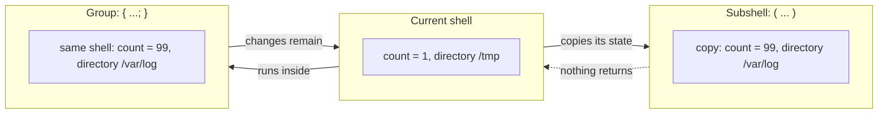

# Arrays and exotica: groups, subshells, traps and named pipes

> **Before this lesson:** you should be comfortable with loops ([Loops](#/lesson/linux-cli/loops)), functions ([Top-down design](#/lesson/linux-cli/functions-top-down)), parameter expansion ([Strings and numbers](#/lesson/linux-cli/strings-numbers)), processes and signals ([Processes, jobs and signals](#/lesson/linux-cli/processes)) and pipes ([Redirection and pipelines](#/lesson/linux-cli/redirection-pipelines)).

## In plain words

This lesson finishes the scripting part of the track with the tools that appear in larger, more serious scripts.

The first is the **array**. An ordinary variable is like a single labelled box holding one thing. An array is a row of numbered pigeonholes under one label: `files[0]`, `files[1]`, `files[2]`. It lets a script keep a *list* — of file names, of servers, of options to pass to a command — and it keeps each item intact even when an item contains spaces. A second kind, the **associative array**, uses names instead of numbers for the pigeonholes, like a telephone book: look up "ana" and get her number.

The rest are four mechanisms the source book groups under the cheerful heading "exotica" — less common, but each solves a problem nothing else solves well:

- **Group commands** treat several commands as one, so that their combined output can be redirected together.
- **Subshells** run commands in a sealed copy of the shell, like doing rough work on a photocopy so the original stays clean.
- **Traps** let a script react to events such as `Ctrl-C` — a fire drill plan that says what to do when the alarm sounds.
- **Named pipes** connect two separately started programs, like a pneumatic tube between two rooms.

Why this matters for a job: arrays are the correct way to build command lines piece by piece in a script, which every deployment or data-processing tool does. Traps are how scripts clean up after themselves and shut down politely when stopped. Background jobs with `wait` are how scripts do several things at once. These are the features that turn a working script into a dependable one.

## Part 1 — Indexed arrays

### Creating and reading

An **indexed array** holds values numbered from 0. Each value is an **element** and its number is its **index**. Create one by listing values in parentheses:

```bash
mira@forge:~$ fruits=(apple banana cherry)
mira@forge:~$ echo "${fruits[0]}"
apple
mira@forge:~$ echo "${fruits[2]}"
cherry
mira@forge:~$ echo "$fruits"
apple
```

Line by line: the assignment created three elements. `${fruits[0]}` reads the first one; counting starts at **zero**, so index 2 is the third. The braces are required when reading an element. The last line shows a trap for the unwary: the bare name `$fruits` gives only element 0, not the whole array.

To get everything, use the special index `@`:

| Expression | Gives |
|---|---|
| `"${fruits[@]}"` | every element, each as a separate word — the form to use |
| `${#fruits[@]}` | the number of elements |
| `"${!fruits[@]}"` | the list of indexes |
| `${#fruits[1]}` | the length of the text in element 1 |
| `"${fruits[@]:1:2}"` | a slice: 2 elements starting at index 1 |
| `"${fruits[-1]}"` | the last element |

```bash
mira@forge:~$ echo "${#fruits[@]} fruits: ${fruits[@]}"
3 fruits: apple banana cherry
mira@forge:~$ for fruit in "${fruits[@]}"; do echo "- $fruit"; done
- apple
- banana
- cherry
```

### Changing an array

```bash
mira@forge:~$ fruits+=(date)                 # append one element
mira@forge:~$ fruits[1]="blueberry"          # replace element 1
mira@forge:~$ fruits+=("dragon fruit" fig)   # append two; the first contains a space
mira@forge:~$ echo "${#fruits[@]}"
6
mira@forge:~$ unset 'fruits[0]'              # delete element 0
mira@forge:~$ echo "${!fruits[@]}"
1 2 3 4 5
mira@forge:~$ unset fruits                   # delete the whole array
```

Deleting an element leaves a gap: the indexes are now 1 to 5 with no 0. Bash arrays are *sparse*, meaning indexes need not be consecutive. For that reason, loop over `"${fruits[@]}"` (the values) or `"${!fruits[@]}"` (the existing indexes) instead of counting from 0 to the length.

### Why the quotes in `"${array[@]}"` matter

This is the point of arrays, so it is worth a careful look. Take an array whose second element contains a space:

```bash
mira@forge:~$ files=("report.txt" "my notes.txt")
mira@forge:~$ printf '<%s>\n' ${files[@]}        # unquoted: WRONG
<report.txt>
<my>
<notes.txt>
mira@forge:~$ printf '<%s>\n' "${files[@]}"      # quoted: right
<report.txt>
<my notes.txt>
mira@forge:~$ printf '<%s>\n' "${files[*]}"      # star: one single word
<report.txt my notes.txt>
```

`printf '<%s>\n'` prints each argument it receives on its own line, so it shows exactly how the shell divided things up. Unquoted, the element with a space was split in two. With `"${files[@]}"` each element stayed whole. This behaviour is the same as `"$@"` for a script's arguments, and for the same reason.

### Filling an array from other sources

```bash
logs=(/var/log/*.log)                         # from a wildcard: one element per file
args=("$@")                                   # from the script's arguments
mapfile -t lines < servers.txt                # from a file: one element per line
mapfile -t found < <(find . -name '*.py')     # from a command's output
IFS=, read -r -a fields <<< "ana,Lisbon,37"   # from a delimited string
```

`mapfile` (also called `readarray`) reads lines into an array; `-t` removes the newline from each. `read -a` splits one line into an array.

### The killer use: building a command safely

Suppose a script must run a program with options that depend on conditions. Gluing the options into one string and expanding it unquoted breaks as soon as any value contains a space. An array holds each argument separately:

```bash
#!/usr/bin/env bash
set -euo pipefail

cmd=(rsync --archive --human-readable)

[[ ${VERBOSE:-} ]] && cmd+=(--verbose)
[[ ${DRY_RUN:-} ]] && cmd+=(--dry-run)
cmd+=(--exclude ".git" --exclude "*.tmp")
cmd+=("$HOME/My Projects/" "backup:/srv/backup/projects/")

printf 'Running:'; printf ' %q' "${cmd[@]}"; printf '\n'
"${cmd[@]}"
```

Reading it: `cmd` starts as three words. Options are appended only when the matching variable is set. The source path contains a space and is still one element. `printf ' %q'` prints each element quoted the way the shell would need it, a faithful record for a log. Finally `"${cmd[@]}"` runs the command with every element as exactly one argument.

### A small worked example: sorting and summing

```bash
#!/usr/bin/env bash
scores=(72 95 61 88 79)

total=0
for s in "${scores[@]}"; do
    (( total += s ))
done
echo "count=${#scores[@]} total=$total average=$(( total / ${#scores[@]} ))"

mapfile -t sorted < <(printf '%s\n' "${scores[@]}" | sort -n)
echo "sorted: ${sorted[*]}"
echo "lowest=${sorted[0]} highest=${sorted[-1]}"
```

```bash
count=5 total=395 average=79
sorted: 61 72 79 88 95
lowest=61 highest=95
```

Bash has no built-in sort for arrays; the idiom prints one element per line, sorts with the `sort` program and reads the result back.

## Part 2 — Associative arrays

An **associative array** stores pairs: a **key** (a name) and a **value**. You look things up by key instead of by number. It must be declared with `declare -A` before use (and needs bash version 4 or newer).

```bash
declare -A capital
capital[norway]="Oslo"
capital[portugal]="Lisbon"
capital[peru]="Lima"

echo "${capital[peru]}"                    # Lima
echo "${#capital[@]} countries"            # 3 countries

for country in "${!capital[@]}"; do        # loop over the keys
    echo "$country -> ${capital[$country]}"
done

if [[ -v capital[italy] ]]; then           # does this key exist?
    echo "known"
else
    echo "italy is not in the table"
fi
```

`"${!capital[@]}"` lists the keys and `"${capital[@]}"` the values. The order of the keys is not predictable; pipe through `sort` when order matters.

The classic use is **counting**: one counter per distinct value.

```bash
#!/usr/bin/env bash
# Count requests per HTTP status code; the status is the 9th field of each log line.
declare -A hits

while read -r _ _ _ _ _ _ _ _ status _; do
    hits[$status]=$(( ${hits[$status]:-0} + 1 ))
done < access.log

for status in "${!hits[@]}"; do
    printf '%s %d\n' "$status" "${hits[$status]}"
done | sort
```

Each line's ninth word is read into `status` (the underscores are throw-away variable names for the fields not needed). The expression `${hits[$status]:-0}` reads the current count, or 0 the first time a status is seen. The Python block below does the same with a dictionary, which is what an associative array is, and also demonstrates the quoting rule for indexed arrays:

```python-run
log = """203.0.113.9 - - [20/Nov/2026:09:00:01 +0000] "GET /api HTTP/1.1" 200 512
198.51.100.4 - - [20/Nov/2026:09:00:01 +0000] "GET /health HTTP/1.1" 200 2
203.0.113.9 - - [20/Nov/2026:09:00:02 +0000] "POST /login HTTP/1.1" 401 87
192.0.2.77 - - [20/Nov/2026:09:00:03 +0000] "GET /api HTTP/1.1" 500 0
203.0.113.9 - - [20/Nov/2026:09:00:04 +0000] "GET /api HTTP/1.1" 200 512""".splitlines()

hits = {}                                   # declare -A hits
for line in log:
    status = line.split()[8]                # the 9th whitespace-separated field
    hits[status] = hits.get(status, 0) + 1  # hits[$status]=$(( ${hits[$status]:-0} + 1 ))
for status in sorted(hits):                 # "${!hits[@]}" piped through sort
    print(status, hits[status])

print()
files = ["report.txt", "my notes.txt"]      # files=("report.txt" "my notes.txt")
unquoted = " ".join(files).split()          # ${files[@]}    -> split again at spaces
quoted_at = list(files)                     # "${files[@]}"  -> one word per element
quoted_star = [" ".join(files)]             # "${files[*]}"  -> a single word
for label, words in [("${files[@]}", unquoted), ('"${files[@]}"', quoted_at), ('"${files[*]}"', quoted_star)]:
    print(f"{label:16} -> {len(words)} word(s): {words}")
```

## Part 3 — Group commands and subshells

Both let several commands act as a unit. They look alike and differ in one essential way.

```bash
{ command1; command2; command3; }      # group command: runs in the CURRENT shell
( command1; command2; command3 )       # subshell: runs in a COPY of the shell
```

The braces need a space after `{` and a semicolon (or newline) before `}`.

**Shared redirection** is the first use. Without grouping, each command needs its own redirection:

```bash
{
    echo "Report generated $(date)"
    df -h /
    free -h
} > report.txt

{ echo "name,size"; du -sb ./* | awk '{print $2 "," $1}'; } | column -s, -t
```

The whole block writes to one file, opened once; in the second line the group's combined output is piped onward.

**The difference** is what happens to changes made inside. A subshell receives a copy of everything — variables, the current directory, options — and whatever it changes is thrown away when it ends.

```bash
mira@forge:~$ count=1; cd /tmp
mira@forge:/tmp$ ( count=99; cd /var/log; echo "inside: $count in $PWD" )
inside: 99 in /var/log
mira@forge:/tmp$ echo "after subshell: $count in $PWD"
after subshell: 1 in /tmp
mira@forge:/tmp$ { count=99; cd /var/log; echo "inside: $count in $PWD"; }
inside: 99 in /var/log
mira@forge:/var/log$ echo "after group: $count in $PWD"
after group: 99 in /var/log
```

That isolation is useful on purpose. A very common idiom changes directory for one command without disturbing the rest of the script:

```bash
( cd build && make clean && make )     # the script's own directory is unchanged afterwards
```



Subshells also appear where you did not type parentheses: each part of a **pipeline** and every `$( … )` runs in one. That is why a variable set inside `cmd | while read …` is lost. **Process substitution** avoids the problem by presenting a command's output as a file name: `<(command)`.

```bash
count=0
while IFS= read -r line; do
    (( count += 1 ))
done < <(grep ERROR app.log)
echo "$count errors"                                 # the value survives

diff <(sort old.txt) <(sort new.txt)                 # compare two command outputs directly
```

## Part 4 — Traps

A **signal** is a notification the system delivers to a running program: `Ctrl-C` sends one called INT ("interrupt"); the `kill` command sends TERM ("terminate") by default. Normally either ends a script on the spot, leaving behind whatever it was in the middle of. `trap` registers a command to run when a signal arrives:

```bash
trap 'commands' SIGNAL...
```

Besides real signals, bash offers the pseudo-signal `EXIT`, which fires whenever the script ends for any reason.

```bash
#!/usr/bin/env bash
set -euo pipefail

workdir="$(mktemp -d)"

cleanup() {
    echo "Removing $workdir" >&2
    rm -rf -- "$workdir"
}
trap cleanup EXIT
trap 'echo "Interrupted by the user" >&2; exit 130' INT
trap 'echo "Asked to terminate" >&2; exit 143' TERM

echo "Working in $workdir (press Ctrl-C to test)"
for i in {1..30}; do
    echo "step $i" > "$workdir/progress"
    sleep 1
done
echo "Finished normally."
```

```bash
mira@forge:~/scripts$ ./long_job
Working in /tmp/tmp.Hk3pQz (press Ctrl-C to test)
^CInterrupted by the user
Removing /tmp/tmp.Hk3pQz
```

Line by line: `mktemp -d` creates a uniquely named temporary directory. The `EXIT` trap guarantees it is removed however the script ends. The `INT` and `TERM` traps print a message and call `exit` — which in turn triggers the `EXIT` trap. The numbers follow a convention: a script stopped by signal number N exits with status 128 + N (INT is 2, TERM is 15).

Two limits: the signals KILL and STOP cannot be trapped by any program, and a trap runs only after the command currently executing has finished.

> [!WARNING]
> Write cleanup code as if it could run at any moment — before a variable was set, or twice. `rm -rf "$workdir"` in a trap, with `workdir` empty because the script was interrupted before `mktemp` ran, becomes `rm -rf ""` at best and something worse if a slash follows. Create the temporary directory **before** installing the trap, use `"${workdir:?}"`, and make the cleanup safe to repeat. Never use a fixed, guessable name such as `/tmp/myscript.tmp` for temporary files: on a shared machine another user can create that name first and redirect your writes.

## Part 5 — Doing several things at once: background jobs and `wait`

Ending a command with `&` starts it in the background, and the script continues immediately. The special variable `$!` holds the process ID of the job most recently started that way. `wait` pauses until background jobs have finished, and `wait PID` returns that job's exit status.

```bash
#!/usr/bin/env bash
hosts=(web01 web02 web03 db01)
pids=()

for host in "${hosts[@]}"; do
    ssh -n "$host" 'sudo apt-get -qq update' > "update-$host.log" 2>&1 &
    pids+=("$!")
done

failed=0
for i in "${!pids[@]}"; do
    if wait "${pids[$i]}"; then
        echo "${hosts[$i]}: ok"
    else
        echo "${hosts[$i]}: FAILED (see update-${hosts[$i]}.log)" >&2
        failed=1
    fi
done
exit "$failed"
```

Four updates run at the same time instead of one after another. Two arrays kept in step — host names and process IDs — let the script report on each job by index. This is called running tasks **asynchronously** (not waiting for each to finish before starting the next) or in **parallel**.

> [!TIP]
> Limit how many jobs run at once, or a loop over a thousand items starts a thousand processes. Simple ways: `xargs -P 8`, GNU `parallel`, or in bash 4.3 and newer, call `wait -n` (wait for any one job to finish) whenever the number of running jobs — `jobs -rp | wc -l` — reaches your limit.

## Part 6 — Named pipes

An ordinary pipe `a | b` connects two commands started together on one line. A **named pipe**, also called a **FIFO** ("first in, first out"), is a pipe that has a name in the file system, so two programs started separately — even from different terminals — can be connected through it. It looks like a file but stores nothing: data written at one end is read at the other.

```bash
mira@forge:~$ mkfifo /tmp/jobs
mira@forge:~$ ls -l /tmp/jobs
prw-r--r-- 1 mira mira 0 Nov 20 16:40 /tmp/jobs
```

The leading `p` in the listing marks a pipe. Now, in one terminal, start a reader:

```bash
mira@forge:~$ while IFS= read -r job; do echo "processing: $job"; done < /tmp/jobs
```

It appears to hang: opening a pipe **blocks** (waits) until the other end is opened too. In a second terminal, write:

```bash
mira@forge:~$ { echo "resize photo-1.jpg"; echo "resize photo-2.jpg"; } > /tmp/jobs
```

The first terminal prints both lines and its loop ends when the writer closes the pipe. Remove the pipe afterwards with `rm /tmp/jobs`.

Named pipes are less common now that bash has process substitution, which creates and removes such connections automatically, but they remain the simple way to hand work to an already-running program, or to connect programs that insist on file names for both input and output.

> [!INTERVIEW]
> Likely questions: "How do you declare and loop over an array in bash?" and "Why `"${arr[@]}"` in quotes?" (each element stays one word, even with spaces); "What is the difference between `( … )` and `{ …; }`?" (subshell with isolated changes versus the current shell); "Why is a variable modified inside a `while` loop fed by a pipe unchanged afterwards?" (pipeline parts run in subshells; use process substitution); "How does a script clean up temporary files if it is interrupted?" (`trap … EXIT` with `mktemp`); and "Which signals cannot be trapped?" (KILL and STOP).

## Pitfalls

- **`$array` instead of `"${array[@]}"`**: you get only the first element.
- **Unquoted `${array[@]}`**, which splits elements at spaces.
- **Forgetting `declare -A`**: without it, text keys are treated as the number 0 and every assignment overwrites the same element.
- **Assuming indexes are consecutive** after `unset`.
- **Storing a command in a string** and running `$cmd`; use an array and `"${cmd[@]}"`.
- **Missing space or semicolon in `{ …; }`.**
- **Expecting variables to survive a subshell**, a pipeline or `$( … )`.
- **Trap commands in double quotes**: variables are then expanded when the trap is *set*, not when it runs. Use single quotes or a function.
- **Starting background jobs and exiting without `wait`**, leaving stray processes and unknown results.
- **A reader or writer blocked forever on a named pipe** because the other end never opens.

## Cheat sheet

| Task | Syntax |
|---|---|
| Create an array | `a=(one two "three four")` |
| One element / all elements | `"${a[1]}"` / `"${a[@]}"` |
| Number of elements | `${#a[@]}` |
| Indexes (or keys) | `"${!a[@]}"` |
| Append | `a+=(new)` |
| Remove an element / the array | `unset 'a[1]'` / `unset a` |
| Slice | `"${a[@]:1:2}"` |
| Lines of a file into an array | `mapfile -t a < file` |
| Run a command stored in an array | `"${cmd[@]}"` |
| Associative array | `declare -A m; m[key]=value; "${m[key]}"` |
| Does a key exist? | `[[ -v m[key] ]]` |
| Group with shared redirection | `{ cmd1; cmd2; } > file` |
| Isolated block | `( cd dir && cmd )` |
| Command output as a file | `<(cmd)` |
| Clean up on exit | `trap cleanup EXIT` |
| React to Ctrl-C | `trap 'echo stopped; exit 130' INT` |
| Background job and its PID | `cmd &` then `$!` |
| Wait for jobs | `wait`, `wait "$pid"` |
| Create a named pipe | `mkfifo name` |

## Summary

- Indexed arrays hold numbered lists: create with parentheses, read with `"${a[i]}"`, expand everything with `"${a[@]}"`, count with `${#a[@]}`, append with `+=`. Quoted `[@]` keeps every element whole, which makes arrays the right way to build command lines.
- Associative arrays, declared with `declare -A`, map keys to values and suit lookups and counting.
- `{ …; }` groups commands in the current shell; `( … )` runs them in a subshell whose changes disappear. Pipelines and `$( … )` create subshells too; process substitution `<( … )` avoids losing variables.
- `trap` runs commands on signals and on `EXIT`, giving reliable cleanup and polite shutdown; KILL and STOP cannot be trapped.
- `&`, `$!` and `wait` run work in parallel and collect results; named pipes connect separately started programs.

## Glossary

| Term | Meaning |
|---|---|
| array | a variable holding several values |
| element / index | one value in an array / its position number, starting at 0 |
| indexed array | an array whose elements are numbered |
| associative array | an array whose elements are found by a text key |
| key / value | the name used for lookup / the data stored under it |
| sparse | having gaps in the sequence of indexes |
| group command | `{ …; }`: several commands treated as one, in the current shell |
| subshell | a copy of the shell whose changes do not affect the original |
| process substitution | `<(cmd)`: a command's output presented as a file |
| signal | a notification sent to a running program, such as INT or TERM |
| trap | a command registered to run when a signal or exit occurs |
| asynchronous / parallel | started without waiting for earlier work to finish / running at the same time |
| named pipe (FIFO) | a pipe with a file-system name, connecting separately started programs |
| block | to wait until something becomes possible, such as the other end of a pipe opening |

## Check yourself

```quiz
[
  {"q": "After `colours=(red green blue)`, what does `echo \"${colours[1]}\"` print?",
   "options": ["red", "green", "blue", "red green blue"],
   "answer": 1,
   "explain": "Array indexes start at 0, so index 1 is the second element."},
  {"q": "Which expression gives the number of elements in the array `colours`?",
   "options": ["`${colours}`", "`${#colours[@]}`", "`${colours[#]}`", "`${!colours[@]}`"],
   "answer": 1,
   "explain": "The hash sign in front asks for a count when used with the @ index. The exclamation-mark form lists the indexes instead."},
  {"q": "An array holds the two elements `a.txt` and `my file.txt`. How many arguments does `ls \"${files[@]}\"` pass to ls?",
   "options": ["One", "Two", "Three", "It depends on the directory"],
   "answer": 1,
   "explain": "In double quotes, the @ form expands to one word per element, so the name containing a space stays whole."},
  {"q": "What must be done before using an associative array named `price`?",
   "options": ["Nothing", "Declare it with `declare -A price`", "Export it", "Create it with parentheses and numbers"],
   "answer": 1,
   "explain": "Without declare -A, bash treats the variable as an indexed array and evaluates text keys as the number 0."},
  {"q": "What is the difference between `( cd /tmp; ls )` and `{ cd /tmp; ls; }`?",
   "options": ["None", "The parentheses run in a subshell, so the script's directory is unchanged afterwards; the braces change the directory of the current shell", "Braces run in the background", "Parentheses cannot contain cd"],
   "answer": 1,
   "explain": "A subshell works on a copy of the shell's state, and changes to variables or the working directory vanish when it ends."},
  {"q": "What does `trap cleanup EXIT` do?",
   "options": ["Runs cleanup immediately", "Arranges for the function cleanup to run whenever the script ends, for any reason", "Prevents the script from exiting", "Runs cleanup only on Ctrl-C"],
   "answer": 1,
   "explain": "EXIT is a pseudo-signal raised when the shell terminates, whether normally, through an error or after a handled signal."},
  {"q": "After starting three commands with `&`, what does `wait` do?",
   "options": ["Sleeps for one second", "Pauses the script until the background jobs have finished", "Kills the background jobs", "Moves them to the foreground"],
   "answer": 1,
   "explain": "wait blocks until child processes complete; given a process ID it also returns that job's exit status."},
  {"q": "Which signal can a script NOT intercept with trap?",
   "options": ["INT", "TERM", "KILL", "HUP"],
   "answer": 2,
   "explain": "KILL (and STOP) are handled by the kernel and never delivered to the program, so no handler can run."}
]
```

> **Source:** Shotts, *The Linux Command Line*, ch. 35 (Arrays) and ch. 36 (Exotica). All examples and wording are original to this guide.
