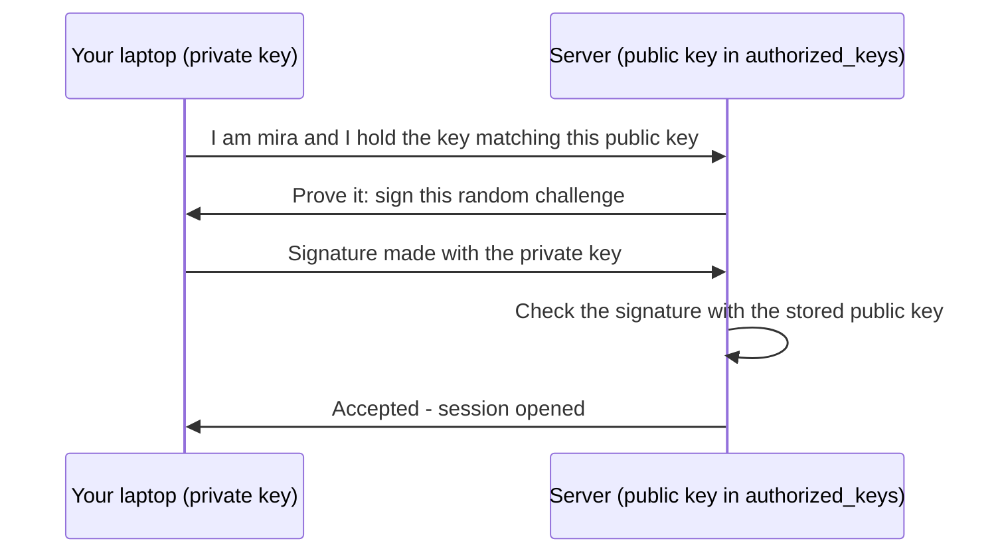
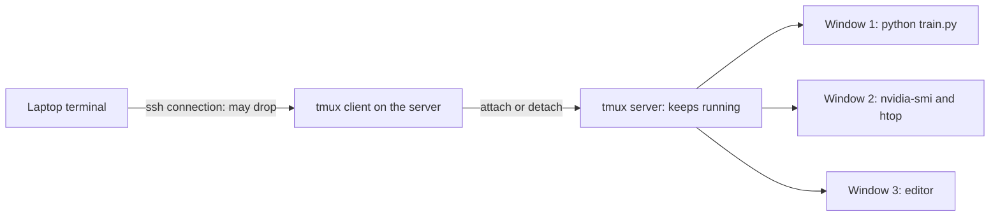

# ssh, keys and tmux: working on remote machines

> **Before this lesson:** you should know basic navigation and file commands ([The shell and navigation](#/lesson/linux-cli/shell-and-navigation)), permissions ([Permissions](#/lesson/linux-cli/permissions)), processes and signals ([Processes](#/lesson/linux-cli/processes)) and the networking basics, including a first look at `ssh` ([Networking tools](#/lesson/linux-cli/networking)).

## In plain words

Most of the computers you will work on are not on your desk. A model trains on a machine with powerful graphics cards in a data centre; a web service runs on rented servers in another country. You reach them with **SSH** (*Secure Shell*): a program that opens a command line on a distant computer, with everything travelling over the network in encrypted form — scrambled so that nobody listening in between can read it.

Think of SSH as a secure telephone line to a distant office, where an assistant carries out whatever you say. Two refinements make the picture complete.

First, how does the office know it is really you? You could say a password each time. Better is a **key pair**: imagine a special padlock and its one matching key. You hand copies of the padlock (the *public key*) to every office you deal with; you keep the key (the *private key*) and never give it to anyone. To let you in, an office snaps your padlock onto a box and asks you to open it. Only the holder of the private key can.

Second, what happens if the telephone line drops in the middle of a job that takes ten hours? Normally the work dies with the call. **tmux** fixes that. It is like a workbench that stays in the office: you can hang up, go home, call back tomorrow, and everything is laid out exactly as you left it, with the job still running.

Why this matters for a job: for machine-learning and backend engineers this is the daily way of working. Connecting to servers, copying data and results, reaching a notebook or dashboard that runs remotely, and keeping long jobs alive across a closed laptop are skills used every day and assumed in every team.

## Connecting

```bash
mira@laptop:~$ ssh mira@gpu01.lab.example.net
The authenticity of host 'gpu01.lab.example.net (198.51.100.40)' can't be established.
ED25519 key fingerprint is SHA256:p3Vn0cJt8yQe1ZrU6s4mWk2Hx9LbA7dF5gT0iYo3RzE.
Are you sure you want to continue connecting (yes/no/[fingerprint])? yes
Warning: Permanently added 'gpu01.lab.example.net' (ED25519) to the list of known hosts.
mira@gpu01.lab.example.net's password:
mira@gpu01:~$ hostname
gpu01
mira@gpu01:~$ exit
logout
Connection to gpu01.lab.example.net closed.
mira@laptop:~$
```

Reading the session: the form is `ssh USER@HOST`. On the very first connection SSH shows the server's **fingerprint** — a short code identifying that server — and asks you to confirm; it then remembers the server in the file `~/.ssh/known_hosts`. After the password, the prompt changes to show the remote machine's name: every command typed now runs *there*. `exit` (or `Ctrl-D`) ends the session and returns you to your own machine. Watching the prompt to know which machine you are on is a habit worth forming from the first day.

Give a command after the host and SSH runs that one command and returns:

```bash
mira@laptop:~$ ssh mira@gpu01.lab.example.net 'nvidia-smi --query-gpu=name,memory.used --format=csv'
name, memory.used [MiB]
NVIDIA RTX A6000, 21340 MiB
```

## Keys instead of passwords

Passwords can be guessed, must be typed constantly, and cannot be used by automated jobs. Keys solve all three.

### Step 1 — create a key pair (once per computer)

```bash
mira@laptop:~$ ssh-keygen -t ed25519 -C "mira@laptop"
Generating public/private ed25519 key pair.
Enter file in which to save the key (/home/mira/.ssh/id_ed25519):
Enter passphrase (empty for no passphrase):
Your identification has been saved in /home/mira/.ssh/id_ed25519
Your public key has been saved in /home/mira/.ssh/id_ed25519.pub
mira@laptop:~$ ls -l ~/.ssh
-rw------- 1 mira mira 411 Nov 20 17:02 id_ed25519
-rw-r--r-- 1 mira mira  97 Nov 20 17:02 id_ed25519.pub
```

`-t ed25519` chooses a modern, compact kind of key; `-C` adds a label so you can recognise the key later. Press Enter to accept the suggested file name. The **passphrase** is a password that locks the private key file itself: if your laptop is stolen, the thief cannot use the key without it. Set one.

Two files were created. `id_ed25519` is the **private key** — notice its permissions `rw-------`, readable by you alone. `id_ed25519.pub` is the **public key**, a single line of text that is safe to share.

### Step 2 — install the public key on the server

```bash
mira@laptop:~$ ssh-copy-id mira@gpu01.lab.example.net
Number of key(s) added: 1
```

This appends your public key to the file `~/.ssh/authorized_keys` on the server — the list of padlocks that account accepts. (Hosting services such as GitHub offer a web page where you paste the same public key.)

### Step 3 — connect

```bash
mira@laptop:~$ ssh mira@gpu01.lab.example.net
Enter passphrase for key '/home/mira/.ssh/id_ed25519':
mira@gpu01:~$
```

No account password was asked for — only the passphrase that unlocks your key, and that never leaves your laptop.



The private key itself is never sent. The laptop proves it holds the key by signing a random value, which the server checks with the public half.

### The agent: type the passphrase once

`ssh-agent` is a small helper program that keeps your unlocked key in memory, so that you enter the passphrase once per login session instead of on every connection.

```bash
mira@laptop:~$ eval "$(ssh-agent -s)"        # start the agent (many desktops do this for you)
Agent pid 4312
mira@laptop:~$ ssh-add ~/.ssh/id_ed25519
Enter passphrase for /home/mira/.ssh/id_ed25519:
Identity added: /home/mira/.ssh/id_ed25519 (mira@laptop)
mira@laptop:~$ ssh-add -l                     # list the keys the agent holds
256 SHA256:Zk1... mira@laptop (ED25519)
```

> [!WARNING]
> The private key is your identity. Anyone who obtains the file can log in as you wherever the public key is installed. **Never** copy a private key to a server, paste it into a chat or e-mail, or commit it to a Git repository; share only the `.pub` file. Keep `~/.ssh` at mode `700` and the private key at `600` — SSH refuses keys whose permissions are looser. If a private key may have been exposed, remove its public key from every `authorized_keys` file and create a new pair. Be equally careful with *agent forwarding* (`ssh -A`): it lets the remote machine use your agent, so enable it only for servers you fully trust.

## A configuration file that saves typing

Long host names, unusual ports and different user names are tedious to type. The file `~/.ssh/config` gives each server a short nickname:

```bash
mira@laptop:~$ cat ~/.ssh/config
Host gpu
    HostName gpu01.lab.example.net
    User mira
    IdentityFile ~/.ssh/id_ed25519

Host prod-api
    HostName 10.20.0.15
    User deploy
    Port 2222
    ProxyJump bastion

Host bastion
    HostName bastion.example.net
    User mira

Host *
    ServerAliveInterval 60
    AddKeysToAgent yes
```

Each `Host` block defines a nickname and the settings that apply to it. Now `ssh gpu` is the whole command. The settings also apply to every tool built on SSH: `scp`, `rsync`, `git`.

Two entries deserve explanation. `ProxyJump bastion` says "to reach `prod-api`, first connect to `bastion` and hop from there". A **bastion** (or jump host) is the single guarded door through which a private network may be entered; servers inside have no direct connection to the internet. `ServerAliveInterval 60` sends a tiny keep-alive message every 60 seconds so that idle connections are not dropped by network equipment.

## Copying files

Three tools, all using the same keys and the same nicknames:

```bash
mira@laptop:~$ scp results.csv gpu:/home/mira/experiments/          # laptop -> server
mira@laptop:~$ scp gpu:/home/mira/experiments/loss.png ./            # server -> laptop
mira@laptop:~$ scp -r configs/ gpu:experiments/                      # a whole directory
mira@laptop:~$ rsync -avP --exclude='.git' project/ gpu:project/     # only what changed; resumable
mira@laptop:~$ rsync -avP gpu:runs/exp12/checkpoints/ ./checkpoints/ # pull results back
```

The colon separates the host from the path on that host; a path without a leading slash is relative to your home directory there. For anything large or repeated, prefer `rsync`: it sends only differences, shows progress with `-P`, and continues where it stopped after an interruption.

## Port forwarding: reaching a remote web page

A program on the server — a Jupyter notebook, a TensorBoard dashboard, a database — often listens on a **port** (a numbered door for network connections) that is open only on the server itself. An SSH **tunnel** carries that port through the encrypted connection to your laptop.

```bash
mira@laptop:~$ ssh -L 8888:localhost:8888 gpu
mira@gpu01:~$ jupyter lab --no-browser --port 8888
```

`-L LOCAL:HOST:REMOTE` reads: "listen on port 8888 on my **L**aptop, and send anything arriving there through the SSH connection to `localhost:8888` as seen from the server". Now opening `http://localhost:8888` in the browser on your laptop shows the notebook that is running on the server.

| Form | Meaning |
|---|---|
| `ssh -L 8888:localhost:8888 gpu` | local forwarding: a remote service appears on your laptop |
| `ssh -L 5433:db.internal:5432 bastion` | reach a database that only the bastion can see, as `localhost:5433` |
| `ssh -N -f -L 6006:localhost:6006 gpu` | tunnel only (`-N` no remote command), in the background (`-f`) |
| `ssh -R 9000:localhost:3000 gpu` | remote forwarding: a service on your laptop appears on the server |
| `ssh -D 1080 gpu` | a general-purpose proxy through the server |

## tmux: sessions that survive disconnection

Here is the problem in one transcript. You start training over SSH, your Wi-Fi drops, and:

```bash
mira@gpu01:~$ python train.py --epochs 100
Epoch 1/100 ...
client_loop: send disconnect: Broken pipe
```

The training process belonged to that SSH session and was terminated with it. **tmux** (*terminal multiplexer*: one terminal showing several) runs your shells inside a small server process on the remote machine. Your SSH connection merely *views* them. When the connection dies, the tmux server and everything in it keeps running.

### The essential cycle

```bash
mira@gpu01:~$ tmux new -s train              # 1. create a session named "train"
```

The screen clears and a green status bar appears at the bottom. You are now inside tmux. Start the job:

```bash
mira@gpu01:~$ python train.py --epochs 100 2>&1 | tee train.log
Epoch 1/100 ...
```

Press `Ctrl-b`, release, then press `d`. This **detaches**: tmux disappears from view but keeps running.

```bash
[detached (from session train)]
mira@gpu01:~$ exit                           # log out; close the laptop; go home
```

Later — hours or days, from any computer:

```bash
mira@laptop:~$ ssh gpu
mira@gpu01:~$ tmux ls                        # 2. list sessions
train: 1 windows (created Fri Nov 20 17:40:11 2026)
mira@gpu01:~$ tmux attach -t train           # 3. re-attach
Epoch 37/100 ...
```

The training never noticed you were gone.



### The prefix key and the commands worth knowing

Every tmux command begins with a **prefix**: press `Ctrl-b`, let go, then press the command key.

| Keys (after `Ctrl-b`) | Action |
|---|---|
| `d` | detach, leaving everything running |
| `c` | create a new window (like a browser tab) |
| `n` / `p` | next / previous window |
| `0` … `9` | jump to a window by number |
| `,` | rename the current window |
| `%` | split the window into left and right **panes** |
| `"` | split into top and bottom panes |
| arrow keys | move between panes |
| `z` | zoom the current pane to full size, and back |
| `x` | close the current pane |
| `[` | scroll mode: use arrows or PageUp, `q` to leave |
| `s` | choose among sessions |
| `?` | list all key bindings |

Three levels to keep straight: a **session** is a whole workspace you attach to; it contains **windows**, each filling the screen; a window can be split into **panes**.

| Shell command | Action |
|---|---|
| `tmux new -s NAME` | create a named session |
| `tmux ls` | list sessions |
| `tmux attach -t NAME` (or `tmux a`) | attach |
| `tmux new -A -s NAME` | attach if it exists, otherwise create it |
| `tmux kill-session -t NAME` | end a session and everything in it |

A typical layout for a training run: one pane running the job, one showing `watch -n 2 nvidia-smi`, one following the log with `tail -f train.log`.

The model below captures the idea that makes tmux work — the job belongs to the tmux server, not to the connection:

```python-run
class Process:
    def __init__(self, name, parent):
        self.name, self.parent, self.alive = name, parent, True

def disconnect(processes, session_name):
    """When a connection drops, processes that belong to that login session receive a hang-up signal."""
    for p in processes:
        if p.parent == session_name:
            p.alive = False

for use_tmux in (False, True):
    processes = [Process("sshd session", "system")]
    if use_tmux:
        processes.append(Process("tmux server", "system"))          # runs independently of the login
        processes.append(Process("python train.py", "tmux server"))
        processes.append(Process("tmux client (the view)", "ssh login"))
    else:
        processes.append(Process("python train.py", "ssh login"))
    disconnect(processes, "ssh login")                               # the Wi-Fi drops
    print("with tmux:" if use_tmux else "without tmux:")
    for p in processes:
        print(f"   {p.name:26} {'still running' if p.alive else 'TERMINATED'}")
```

> [!TIP]
> Make it a reflex on any remote machine: the first command after logging in is `tmux new -A -s main`. Then nothing you start can be lost to a dropped connection. A closely related tool, `screen`, does the same job with different keys and is found on older systems; and for a single command, `nohup command > out.log 2>&1 &` is the minimal alternative when tmux is not installed.

## A complete remote-work routine

```bash
mira@laptop:~$ rsync -avP --exclude='.git' --exclude='data/' weather-model/ gpu:weather-model/
mira@laptop:~$ ssh -L 6006:localhost:6006 gpu
mira@gpu01:~$ tmux new -A -s exp12
mira@gpu01:~$ cd weather-model && source .venv/bin/activate
(.venv) mira@gpu01:~/weather-model$ python train.py --config configs/exp12.yaml 2>&1 | tee runs/exp12.log
# Ctrl-b c  -> new window
(.venv) mira@gpu01:~/weather-model$ tensorboard --logdir runs --port 6006
# Ctrl-b d  -> detach; the browser on the laptop shows http://localhost:6006 while the tunnel is open
mira@gpu01:~$ exit
# ...next morning...
mira@laptop:~$ ssh gpu 'tail -n 2 weather-model/runs/exp12.log'
Epoch 100/100  val_loss 0.0412
Training complete.
mira@laptop:~$ rsync -avP gpu:weather-model/runs/exp12/ ./runs/exp12/
```

Copy the code, connect with a tunnel, work inside tmux, detach, check from anywhere, bring the results home.

> [!INTERVIEW]
> Common questions: "How does SSH key authentication work?" (the server holds the public key; the client proves possession of the private key by signing a challenge; the private key never leaves the client), "Where is the public key placed on the server?" (`~/.ssh/authorized_keys`), "How do you keep a job running after you disconnect?" (`tmux` or `screen`; `nohup` as the minimal option), "How would you open a Jupyter notebook that runs on a remote server?" (local port forwarding with `ssh -L`), and "What is a bastion host?" Expect also "What permissions should a private key have?" (600).

## Pitfalls

- **Running a command on the wrong machine.** Read the prompt before anything destructive; colour production prompts differently.
- **Wrong permissions** on `~/.ssh` or the key, giving "Permissions are too open" and a refused key.
- **Copying the private key around** instead of creating one key pair per device.
- **Ignoring a "REMOTE HOST IDENTIFICATION HAS CHANGED" warning**; verify with the administrator before removing the old entry with `ssh-keygen -R host`.
- **Starting a long job outside tmux.**
- **Nested tmux**: running tmux locally and remotely means the prefix goes to the outer one; press the prefix twice to reach the inner.
- **Forgetting that a tunnel lives only as long as its SSH connection.**
- **A missing colon in `scp`**, which makes a local copy named like the host.
- **Binding a forwarded service to all interfaces** and exposing it to the network; keep tunnels on `localhost`.

## Cheat sheet

| Task | Command |
|---|---|
| Connect | `ssh user@host` |
| Run one remote command | `ssh host 'command'` |
| Create a key pair | `ssh-keygen -t ed25519 -C "label"` |
| Install the public key on a server | `ssh-copy-id user@host` |
| Load the key into the agent | `ssh-add ~/.ssh/id_ed25519` |
| Debug a connection | `ssh -v host` |
| Jump through a bastion | `ssh -J bastion target` |
| Copy a file / a tree | `scp file host:path/`, `rsync -avP dir/ host:dir/` |
| Forward a remote port to the laptop | `ssh -L 8888:localhost:8888 host` |
| Tunnel only, in the background | `ssh -N -f -L 6006:localhost:6006 host` |
| Forget a changed host key | `ssh-keygen -R host` |
| New / attach / list tmux sessions | `tmux new -s n`, `tmux attach -t n`, `tmux ls` |
| Attach or create | `tmux new -A -s main` |
| Detach | `Ctrl-b d` |
| New window, split panes | `Ctrl-b c`, `Ctrl-b %`, `Ctrl-b "` |
| Scroll back | `Ctrl-b [` then arrows, `q` to quit |

## Summary

- SSH gives an encrypted command line on another machine; `ssh host 'cmd'` runs a single command there.
- Key pairs replace passwords: the public key goes into the server's `authorized_keys`, the private key stays on your device, protected by a passphrase and file mode 600; `ssh-agent` remembers the unlocked key.
- `~/.ssh/config` defines nicknames, users, ports, keys and jump hosts for `ssh`, `scp`, `rsync` and `git` alike.
- `ssh -L` tunnels a remote port to your laptop, which is how remote notebooks and dashboards are viewed.
- tmux keeps sessions alive on the server: create, work, detach with `Ctrl-b d`, re-attach later; windows and panes organise the workspace.

## Glossary

| Term | Meaning |
|---|---|
| SSH | Secure Shell: encrypted remote login and command execution |
| encryption | scrambling data so that only the intended party can read it |
| host | a computer on a network |
| fingerprint | a short code that identifies a server's key |
| key pair | a matched public key and private key |
| public key | the half that may be shared and is installed on servers |
| private key | the secret half that proves your identity |
| passphrase | a password that locks the private key file |
| ssh-agent | a helper that holds unlocked keys in memory |
| bastion (jump host) | the gateway machine through which a private network is entered |
| port | a numbered endpoint for network connections on a machine |
| tunnel (port forwarding) | carrying a port's traffic through an SSH connection |
| tmux | terminal multiplexer: persistent sessions with windows and panes |
| session / window / pane | a tmux workspace / a full-screen tab in it / a split section of a window |
| detach / attach | leave a session running in the background / reconnect to it |
| prefix key | the key combination (`Ctrl-b`) that starts every tmux command |

## Check yourself

```quiz
[
  {"q": "In SSH key authentication, which key is placed on the server?",
   "options": ["The private key", "The public key", "Both keys", "The passphrase"],
   "answer": 1,
   "explain": "The public key is appended to ~/.ssh/authorized_keys on the server. The private key never leaves your own machine."},
  {"q": "What is the purpose of a passphrase on a private key?",
   "options": ["It is sent to the server as a password", "It encrypts the key file so that a stolen file cannot be used without it", "It makes connections faster", "It replaces the public key"],
   "answer": 1,
   "explain": "The passphrase protects the key at rest on your disk. ssh-agent can hold the unlocked key so you type it only once per session."},
  {"q": "You start a ten-hour training run over plain SSH and your network drops. What normally happens to the job?",
   "options": ["It keeps running", "It is terminated along with the session", "It is paused until you reconnect", "It restarts from the beginning"],
   "answer": 1,
   "explain": "Processes belonging to the login session receive a hang-up signal when the connection closes. Running inside tmux avoids this."},
  {"q": "Inside tmux, which key sequence detaches from the session while leaving it running?",
   "options": ["Ctrl-c", "Ctrl-b then d", "Ctrl-d", "Ctrl-z"],
   "answer": 1,
   "explain": "Ctrl-b is the default prefix and d means detach. Ctrl-d would close the shell and could end the session."},
  {"q": "What does `ssh -L 8888:localhost:8888 gpu` make possible?",
   "options": ["Copying files on port 8888", "Opening http://localhost:8888 on your laptop to reach a service listening on port 8888 on the server", "Running eight thousand commands", "Changing the SSH port of the server"],
   "answer": 1,
   "explain": "Local forwarding listens on a port of your machine and relays connections through SSH to the named host and port as seen from the server."},
  {"q": "What is the benefit of an entry in ~/.ssh/config such as `Host gpu` with HostName and User lines?",
   "options": ["It encrypts the connection", "It lets you type ssh gpu, and scp or rsync with gpu:, instead of the full user, host and options each time", "It installs your key on the server", "It disables passwords"],
   "answer": 1,
   "explain": "The configuration file defines aliases and per-host settings used by ssh and by every tool built on it."},
  {"q": "SSH refuses your key with 'UNPROTECTED PRIVATE KEY FILE'. What is the fix?",
   "options": ["Generate a longer key", "Restrict the file's permissions, for example chmod 600 on the private key", "Add the key to known_hosts", "Use sudo ssh"],
   "answer": 1,
   "explain": "SSH will not use a private key that other users could read. The key should be mode 600 and the .ssh directory 700."},
  {"q": "After reconnecting to the server, how do you return to a tmux session named train?",
   "options": ["tmux new -s train", "tmux attach -t train", "tmux kill-session -t train", "ssh train"],
   "answer": 1,
   "explain": "attach reconnects your terminal to the existing session; new -s would try to create a second session with that name."}
]
```

> **Source:** original material for this guide; background on `ssh` in Shotts, *The Linux Command Line*, ch. 16 (Networking), and on job control in ch. 10 (Processes).
