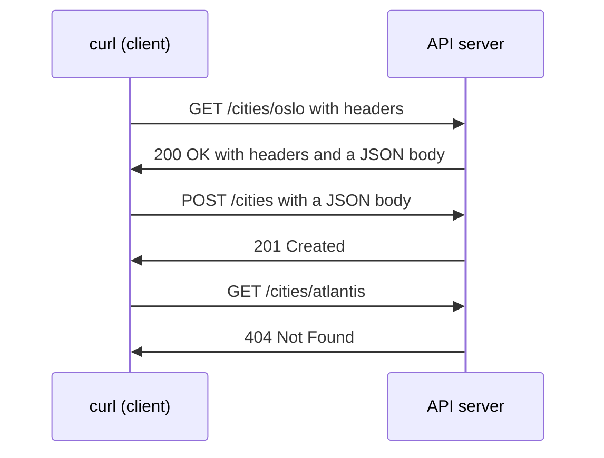
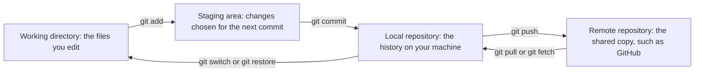

# curl, jq and git on the command line

> **Before this lesson:** you should know pipes and redirection ([Redirection and pipelines](#/lesson/linux-cli/redirection-pipelines)), quoting ([Expansion and quoting](#/lesson/linux-cli/expansion-quoting)), exit status ([Flow control: if](#/lesson/linux-cli/if-test)) and basic networking terms such as host and port ([Networking tools](#/lesson/linux-cli/networking)).

## In plain words

Three tools appear in the working day of almost every software and machine-learning engineer.

**curl** is a way of talking to web servers without a browser. A browser fetches a page and draws it; `curl` fetches the same thing and prints the raw reply. Think of it as posting a letter by hand and reading the answer yourself instead of having a secretary summarise it. Modern programs talk to each other the same way, through an **API** (*application programming interface*: a set of web addresses a service offers for other programs to use). `curl` lets you send those requests yourself, which is how APIs are tested and debugged.

**jq** reads the answers. Services usually reply in **JSON** (*JavaScript Object Notation*), a text format for structured data — names with values, lists, things nested inside things. A long JSON reply is like a filing cabinet tipped onto the floor. `jq` is the clerk who can say "from every folder, give me only the name and the price".

**git** records the history of a project. Think of a save-game system for files: at any moment you can save a labelled snapshot, look at what changed between snapshots, go back, or try an idea on a side track without disturbing the main line. It is also how people work on the same code without overwriting one another.

Why this matters for a job: checking whether a service is healthy, reproducing a bug report against an API, pulling data from a web service, and committing and sharing code are daily tasks. Being quick with these three tools is assumed in backend, data and machine-learning roles alike.

## Part 1 — curl

### The first request

```bash
mira@forge:~$ curl https://api.example.net/health
{"status":"ok","version":"2.4.1"}
```

`curl` followed by a **URL** (a web address) sends a request and prints the body of the reply. A few words that the rest of this part relies on:

- **HTTP** (*Hypertext Transfer Protocol*) is the set of rules for these conversations. A client sends a **request**; the server sends back a **response**.
- A request has a **method** — a verb saying what is wanted. `GET` reads something, `POST` creates or submits, `PUT` and `PATCH` change, `DELETE` removes.
- Both sides attach **headers**: lines of extra information such as "the body is JSON" or "here is my access token".
- The response starts with a three-digit **status code**: numbers beginning with 2 mean success (`200 OK`, `201 Created`), 3 a redirect, 4 a mistake by the client (`400 Bad Request`, `401 Unauthorized`, `404 Not Found`, `429 Too Many Requests`), 5 a failure on the server (`500`, `502`, `503`).



### Seeing more of the conversation

```bash
mira@forge:~$ curl -i https://api.example.net/health
HTTP/2 200
content-type: application/json
content-length: 33

{"status":"ok","version":"2.4.1"}
mira@forge:~$ curl -I https://api.example.net/health          # headers only
mira@forge:~$ curl -v https://api.example.net/health          # the whole exchange, for debugging
```

`-i` includes the response's status line and headers in front of the body. `-I` asks for the headers alone. `-v` (verbose) shows everything: the connection, what was sent (lines starting with `>`) and what came back (lines with `<`).

### The options used every day

| Option | Meaning |
|---|---|
| `-X METHOD` | choose the method (`POST`, `PUT`, `DELETE` …) |
| `-H 'Name: value'` | add a request header; repeat for several |
| `-d 'data'` | send a body (implies `POST`); `-d @file.json` reads it from a file |
| `--json 'data'` | send JSON and set the matching headers (curl 7.82 and newer) |
| `-o FILE` / `-O` | save the body to FILE / to the name used in the URL |
| `-L` | follow redirects |
| `-s` / `-S` | silent (no progress meter) / still show errors |
| `-f` | **fail**: exit with a non-zero status on HTTP errors (400 and above) |
| `-w 'format'` | print details afterwards, such as `%{http_code}` or `%{time_total}` |
| `-u user:pass` | basic authentication |
| `--max-time N`, `--retry N` | give up after N seconds / try again N times on temporary failures |
| `-G --data-urlencode 'k=v'` | add safely encoded query parameters to a GET |

### Reading data: GET

```bash
mira@forge:~$ curl -s 'https://api.example.net/cities?country=NO&limit=2'
{"items":[{"name":"Oslo","population":709037,"tags":["capital","coast"]},{"name":"Bergen","population":289330,"tags":["coast"]}],"total":2}
```

The part after `?` holds **query parameters**: `name=value` pairs joined by `&`. The URL is in **single quotes** because `?` and `&` mean something to the shell — an unquoted `&` would send the command to the background and cut the URL short.

### Sending data: POST with JSON

```bash
mira@forge:~$ curl -s -X POST https://api.example.net/cities \
      -H 'Content-Type: application/json' \
      -H "Authorization: Bearer $API_TOKEN" \
      -d '{"name": "Tromso", "population": 78745}'
{"id":"c_91f2","name":"Tromso","population":78745}
```

Line by line: `-X POST` chooses the method. The first header tells the server the body is JSON. The second carries an access **token** (a secret string that proves who you are), read from an environment variable — in double quotes so the variable is expanded. `-d` supplies the body, in single quotes so its inner double quotes survive untouched.

> [!WARNING]
> A token or password typed on the command line is saved in your shell history and is visible to other users of the machine in the process list. Keep secrets in an environment variable loaded from a file with mode 600, or in a `~/.netrc` file used with `curl --netrc`, and never paste a real token into a chat, a ticket or a repository. Separately: the popular installation shortcut `curl https://… | sudo bash` runs whatever that server sends, as administrator, without your reading it. Download the script, read it, then run it.

### Using curl in scripts

By default `curl` exits successfully even when the server answers "404 Not Found", because the *transfer* worked. In scripts, add `-f` so that HTTP errors count as failures, and `-sS` to silence the progress meter while keeping error messages:

```bash
if curl -fsS --max-time 5 https://api.example.net/health > /dev/null; then
    echo "service is healthy"
else
    echo "health check failed" >&2
fi

code="$(curl -s -o /dev/null -w '%{http_code}' https://api.example.net/cities/atlantis)"
echo "status: $code"                                         # status: 404

curl -s -o /dev/null -w 'dns %{time_namelookup}s  connect %{time_connect}s  total %{time_total}s\n' \
     https://api.example.net/health
```

The second command throws the body away and prints only the status code; the third prints timings, a quick way to see where a slow request spends its time. The combination `curl -fsSL URL -o file` is the standard careful download.

## Part 2 — jq

### JSON in two minutes

JSON is built from six things:

| Kind | Looks like |
|---|---|
| object | `{"name": "Oslo", "population": 709037}` — pairs of a **key** and a value, in braces |
| array | `["capital", "coast"]` — an ordered list, in square brackets |
| string | `"Oslo"` — text in double quotes |
| number | `709037`, `-2.5` |
| boolean | `true` or `false` |
| null | `null` — "no value" |

Objects and arrays may contain each other to any depth; that nesting is what makes long replies hard to read by eye.

### Pretty-printing and picking fields

Save the earlier reply to practise on:

```bash
mira@forge:~$ curl -s 'https://api.example.net/cities?limit=3' > cities.json
mira@forge:~$ jq . cities.json
{
  "items": [
    {
      "name": "Oslo",
      "population": 709037,
      "tags": ["capital", "coast"]
    },
    {
      "name": "Bergen",
      "population": 289330,
      "tags": ["coast"]
    },
    {
      "name": "Lima",
      "population": 10092000,
      "tags": ["capital"]
    }
  ],
  "total": 3
}
```

`jq` takes a **filter** — a small expression describing what to extract — and a file (or standard input). The simplest filter is a single dot, meaning "the whole input"; its effect is to print the data indented and coloured. (The real output puts each array element on its own line; it is condensed here.)

Now build up one step at a time:

```bash
mira@forge:~$ jq '.total' cities.json                 # a key of the top-level object
3
mira@forge:~$ jq '.items[0]' cities.json              # the first element of the array (counting from 0)
{
  "name": "Oslo",
  "population": 709037,
  "tags": ["capital", "coast"]
}
mira@forge:~$ jq '.items[0].name' cities.json         # a key inside that element
"Oslo"
mira@forge:~$ jq '.items[].name' cities.json          # the name of EVERY element
"Oslo"
"Bergen"
"Lima"
mira@forge:~$ jq -r '.items[].name' cities.json       # -r: raw text, without the quotes
Oslo
Bergen
Lima
```

Reading the filters: `.key` selects a key; `[0]` selects an element by position; empty brackets `[]` mean "each element in turn", producing several results. The option `-r` (raw) prints strings without JSON quotes — what you want when the output feeds other shell commands.

### The pipe inside jq, `select` and building new shapes

Inside a filter, a vertical bar passes each result on to the next step, exactly like a shell pipe.

```bash
mira@forge:~$ jq '.items[] | select(.population > 500000) | .name' cities.json
"Oslo"
"Lima"
mira@forge:~$ jq -r '.items[] | "\(.name) has \(.population) people"' cities.json
Oslo has 709037 people
Bergen has 289330 people
Lima has 10092000 people
mira@forge:~$ jq '.items | length' cities.json
3
mira@forge:~$ jq '[.items[] | {city: .name, big: (.population > 1000000)}]' cities.json
[
  {"city": "Oslo", "big": false},
  {"city": "Bergen", "big": false},
  {"city": "Lima", "big": true}
]
mira@forge:~$ jq -r '.items[] | [.name, .population] | @csv' cities.json
"Oslo",709037
"Bergen",289330
"Lima",10092000
mira@forge:~$ jq '.items | map(.population) | add' cities.json
11090367
```

Line by line: `select(condition)` keeps only the elements for which the condition is true. `"\(…)"` inserts values into a string. `length` counts. Braces build a new object and square brackets around a filter collect its results into an array. `@csv` turns an array into a line of CSV. `map(f)` applies a filter to every element of an array, and `add` sums them.

| Filter | Meaning |
|---|---|
| `.` | the whole input (pretty-print) |
| `.key`, `.a.b` | a field; a nested field |
| `.[0]`, `.[-1]`, `.[2:5]` | first element, last element, a slice |
| `.[]` | every element |
| `.key?` , `.key // "default"` | no error if missing; a fallback value |
| `f \| g` | feed the results of `f` into `g` |
| `select(cond)` | keep only matching values |
| `map(f)` | apply `f` to each element of an array |
| `length`, `keys`, `add`, `unique`, `sort_by(.k)`, `group_by(.k)` | common helpers |
| `{a: .x, b: .y}` | build an object |
| `@csv`, `@tsv` | format an array as a CSV or tab-separated line |

Useful options: `-r` raw output, `-c` compact output (one result per line), `-e` set the exit status from the result, and `--arg name value` to pass a shell value safely into the filter as `$name`:

```bash
mira@forge:~$ country="Lima"
mira@forge:~$ jq --arg n "$country" '.items[] | select(.name == $n) | .population' cities.json
10092000
```

The `$n` here belongs to `jq`, not to the shell; that is one reason the filter is in single quotes.

The same navigation in Python makes clear what each filter does:

```python-run
import json

reply = json.loads("""{"items": [
  {"name": "Oslo",   "population": 709037,   "tags": ["capital", "coast"]},
  {"name": "Bergen", "population": 289330,   "tags": ["coast"]},
  {"name": "Lima",   "population": 10092000, "tags": ["capital"]}
], "total": 3}""")

print(".total                      ->", reply["total"])
print(".items[0].name              ->", reply["items"][0]["name"])
print(".items[].name               ->", [c["name"] for c in reply["items"]])
print("select(.population > 500000)->", [c["name"] for c in reply["items"] if c["population"] > 500000])
print(".items | map(.population) | add ->", sum(c["population"] for c in reply["items"]))
print("select(.tags | index(\"coast\"))->", [c["name"] for c in reply["items"] if "coast" in c["tags"]])
print("{city: .name, big: ...}     ->", [{"city": c["name"], "big": c["population"] > 1_000_000} for c in reply["items"]])
```

### curl and jq together

```bash
mira@forge:~$ curl -fsS 'https://api.example.net/cities?limit=100' | jq -r '.items[] | select(.tags | index("capital")) | .name' | sort
Lima
Oslo
mira@forge:~$ token="$(curl -fsS -X POST https://api.example.net/login --json '{"user":"mira"}' | jq -r '.token')"
```

The first line fetches, filters and sorts in one pipeline. The second captures one field of a reply into a shell variable — the standard way for a script to use a value an API returned.

## Part 3 — git

### The idea

Git stores a project's history as a chain of **commits**. A commit is a snapshot of all the tracked files at one moment, with an author, a date and a message explaining the change. The folder holding the project and its history is a **repository** ("repo").

A change travels through three places:



The **staging area** is the step newcomers find odd. It exists so that you can choose which of your current changes belong in the next snapshot — commit a finished fix now, and leave half-done experiments out.

### First-time setup and a first commit

```bash
mira@forge:~$ git config --global user.name "Mira Okafor"
mira@forge:~$ git config --global user.email "mira@example.net"
mira@forge:~$ mkdir weather && cd weather
mira@forge:~/weather$ git init
Initialized empty Git repository in /home/mira/weather/.git/
mira@forge:~/weather$ echo "# Weather tools" > README.md
mira@forge:~/weather$ git status
On branch main
Untracked files:
        README.md
mira@forge:~/weather$ git add README.md
mira@forge:~/weather$ git commit -m "Add project README"
[main (root-commit) 3f2a9c1] Add project README
 1 file changed, 1 insertion(+)
```

Line by line: the two `config` commands record your name and e-mail, which are stamped on every commit (once per computer). `git init` turns the folder into a repository by creating a hidden `.git` directory. `git status` — the command to run constantly — reports that `README.md` is *untracked*: git sees it but is not yet recording it. `git add` stages it. `git commit -m "…"` saves the snapshot with a message; `3f2a9c1` is the beginning of the commit's **hash**, its unique identifier.

### The everyday cycle

```bash
mira@forge:~/weather$ nano fetch.py                       # edit files
mira@forge:~/weather$ git status                          # what changed?
mira@forge:~/weather$ git diff                            # exactly which lines? (not yet staged)
mira@forge:~/weather$ git add fetch.py                    # choose what goes in
mira@forge:~/weather$ git diff --staged                   # review what is about to be committed
mira@forge:~/weather$ git commit -m "Fetch forecasts with retry on timeout"
mira@forge:~/weather$ git log --oneline --graph -n 3      # the recent history
* 8d41e07 Fetch forecasts with retry on timeout
* 3f2a9c1 Add project README
```

`git diff` prints changes in the unified format from the lesson on `diff`: lines starting with `-` were removed, with `+` added. A good commit message says *what changed and why* in the imperative mood ("Add", "Fix", "Remove"), in about fifty characters.

### Branches

A **branch** is a movable label pointing at a commit; it lets a line of work develop separately. The main line is usually called `main`.

```bash
mira@forge:~/weather$ git switch -c add-cache            # create a branch and move onto it
mira@forge:~/weather$ # ...edit, add, commit as usual...
mira@forge:~/weather$ git switch main                    # back to the main line
mira@forge:~/weather$ git merge add-cache                # bring the branch's commits into main
mira@forge:~/weather$ git branch -d add-cache            # delete the finished branch label
```

If the same lines were changed on both sides, git stops with a **merge conflict** and marks the disputed region in the file between `<<<<<<<`, `=======` and `>>>>>>>`. Edit the file to the version you want, remove the markers, `git add` it and `git commit`.

### Working with a remote

A **remote** is a copy of the repository on a server, conventionally named `origin`.

```bash
mira@forge:~$ git clone git@github.com:example/weather.git        # download a repository and its history
mira@forge:~/weather$ git pull                                    # fetch and merge others' new commits
mira@forge:~/weather$ git switch -c fix-timeout
mira@forge:~/weather$ git push -u origin fix-timeout              # publish the branch; -u remembers the link
mira@forge:~/weather$ git fetch && git status                     # download news without changing your files
```

On hosting services the published branch then becomes a **pull request** (or merge request): a proposal, reviewed by teammates, to merge it into `main`.

### Undoing

| Situation | Command |
|---|---|
| Discard unstaged edits to a file | `git restore file` |
| Unstage a file, keeping the edits | `git restore --staged file` |
| Fix the last commit's message, or add a forgotten file | `git commit --amend` |
| Undo a commit that was already shared, by adding an opposite commit | `git revert HASH` |
| Put unfinished work aside for a moment, and bring it back | `git stash`, `git stash pop` |
| Look at an old version of a file | `git show HASH:path/file` |
| Find a commit you seem to have lost | `git reflog` |

> [!WARNING]
> Three git commands destroy work or history. `git restore file` and `git reset --hard` throw away uncommitted changes with no undo. `git clean -fd` deletes untracked files. And `git push --force` overwrites the shared history, deleting teammates' commits from the remote; if you must rewrite a branch that only you use, prefer `git push --force-with-lease`, which refuses when someone else has pushed. Also remember that **a secret committed once is in the history for good** — deleting the file in a later commit does not remove it. List secret files in `.gitignore` before the first commit, and if a secret is ever pushed, treat it as leaked and replace it.

A file named `.gitignore` lists patterns git should never track:

```bash
mira@forge:~/weather$ cat .gitignore
.venv/
__pycache__/
*.pyc
.env
data/
*.ckpt
```

> [!TIP]
> Useful in every repository: `git log --oneline --graph --all` to see the shape of the history; `git blame file` to see who last changed each line and in which commit; `git log -p -- path` for the history of one file; `git grep 'text'` to search tracked files; and `git bisect` to find, by repeated halving, the commit that introduced a bug.

> [!INTERVIEW]
> Expect: "What is the difference between `git fetch` and `git pull`?" (fetch downloads; pull also merges into your branch), "What is the staging area for?", "`merge` versus `rebase`?" (merge joins histories with a merge commit; rebase replays your commits on top of another branch for a straight line — never rebase commits others already use), "How do you undo a pushed commit?" (`git revert`), and "How would you test an API endpoint from the terminal and extract a field from the JSON?" (`curl -fsS … | jq -r '.field'`). You may also be asked what HTTP status classes mean and why `curl -f` matters in scripts.

## Pitfalls

- **Unquoted URLs** containing `&` or `?`.
- **Forgetting `-f`** in scripts, so HTTP errors pass as success.
- **Sending JSON without the `Content-Type` header**, which many servers reject.
- **Double quotes around a JSON body or a jq filter**, letting the shell eat `$` and quotes; use single quotes and `--arg`.
- **Forgetting `-r`** and getting quoted strings from jq in shell variables.
- **Committing everything with `git add .`** without checking `git status` — including secrets, data files and build output.
- **Working directly on `main`** in a shared repository; make a branch.
- **Pulling with uncommitted changes** and meeting conflicts; commit or stash first.
- **Panicking after a mistake.** Almost anything committed can be recovered through `git reflog`; stop, read `git status`, and ask before running a destructive command.

## Cheat sheet

| Task | Command |
|---|---|
| GET and print the body | `curl -s URL` |
| Show status and headers | `curl -i URL`, `curl -I URL` |
| POST JSON | `curl -X POST -H 'Content-Type: application/json' -d '{"k":"v"}' URL` |
| Send a token | `curl -H "Authorization: Bearer $TOKEN" URL` |
| Fail on HTTP errors, quietly | `curl -fsS URL` |
| Only the status code | `curl -s -o /dev/null -w '%{http_code}\n' URL` |
| Download a file | `curl -fL -o file URL` |
| Pretty-print JSON | `jq . file.json` |
| One field / nested / every element | `jq '.a'`, `jq '.a.b'`, `jq '.items[]'` |
| Raw strings | `jq -r '.items[].name'` |
| Filter elements | `jq '.items[] \| select(.n > 5)'` |
| Count | `jq '.items \| length'` |
| To CSV | `jq -r '.items[] \| [.a, .b] \| @csv'` |
| New repository / copy one | `git init`, `git clone URL` |
| See state and changes | `git status`, `git diff`, `git diff --staged` |
| Stage and commit | `git add file`, `git commit -m "message"` |
| History | `git log --oneline --graph` |
| New branch / switch / merge | `git switch -c name`, `git switch name`, `git merge name` |
| Share and update | `git push -u origin name`, `git pull` |
| Undo safely | `git restore`, `git revert HASH`, `git stash` |

## Summary

- `curl` sends HTTP requests: `-X` for the method, `-H` for headers, `-d` for a body, `-i`/`-v` to inspect, `-fsS` for scripts, `-w` to report status and timing. Quote URLs and keep tokens out of the command line.
- JSON consists of objects, arrays, strings, numbers, booleans and null; `jq` filters navigate it with `.key`, `[n]` and `[]`, chain with `|`, filter with `select`, reshape with `{}`, `[]` and `map`, and print raw text with `-r`.
- Git records snapshots: edit, `git add` to the staging area, `git commit` to the local history, `git push` to the remote; `status`, `diff` and `log` show where you are.
- Branches isolate lines of work and are combined by merging; remotes share work through `push`, `pull` and pull requests.
- Prefer the safe undo commands, keep secrets out of repositories, and avoid force-pushing shared branches.

## Glossary

| Term | Meaning |
|---|---|
| URL | a web address |
| HTTP | the protocol of requests and responses used on the web |
| API | a set of addresses a service offers for programs to call |
| request / response | the message a client sends / the server's reply |
| method | the verb of a request: GET, POST, PUT, PATCH, DELETE |
| header | a line of extra information attached to a request or response |
| status code | a three-digit number summarising the outcome of a request |
| query parameter | a `name=value` pair after `?` in a URL |
| token | a secret string that identifies and authorises a caller |
| JSON | a text format for structured data |
| object / array | key–value pairs in braces / an ordered list in brackets |
| filter | a jq expression that selects or transforms data |
| repository | a project folder together with its recorded history |
| commit | a saved snapshot with an author, date and message |
| hash | the unique identifier of a commit |
| staging area | the set of changes selected for the next commit |
| branch | a named line of development |
| remote | a copy of the repository on a server |
| merge conflict | overlapping changes git cannot combine automatically |
| pull request | a proposal to merge a branch, reviewed by others |

## Check yourself

```quiz
[
  {"q": "What does `curl -i https://api.example.net/health` show that plain `curl` does not?",
   "options": ["Only the body", "The response status line and headers in addition to the body", "The server's source code", "Nothing different"],
   "answer": 1,
   "explain": "-i includes the response headers; -I requests headers only and -v shows the full exchange in both directions."},
  {"q": "Why should a URL such as `https://x.example/search?q=a&page=2` be put in quotes on the command line?",
   "options": ["curl requires quotes", "The shell would treat the ampersand as 'run in the background' and cut the URL short", "Quotes make the request faster", "To hide it from history"],
   "answer": 1,
   "explain": "Characters such as & and ? are special to the shell. Single quotes pass the address through unchanged."},
  {"q": "In a script, why add `-f` to curl?",
   "options": ["To follow redirects", "So that HTTP error responses such as 404 or 500 make curl exit with a failure status", "To format the output", "To force a download"],
   "answer": 1,
   "explain": "Without -f, curl reports success whenever the transfer completes, even if the server answered with an error page."},
  {"q": "Given `{\"items\":[{\"name\":\"a\"},{\"name\":\"b\"}]}`, what does `jq -r '.items[].name'` print?",
   "options": ["[\"a\",\"b\"]", "a and b on separate lines, without quotes", "\"a\" only", "2"],
   "answer": 1,
   "explain": "The empty brackets iterate over the array, .name selects the field of each element, and -r prints raw strings."},
  {"q": "What does `select(.population > 500000)` do in a jq filter?",
   "options": ["Sorts by population", "Passes on only the values for which the condition is true", "Adds a population field", "Counts the elements"],
   "answer": 1,
   "explain": "select keeps an input when its condition holds and drops it otherwise, like a filter step in a pipeline."},
  {"q": "What is the role of `git add`?",
   "options": ["It uploads files to the server", "It places chosen changes in the staging area for the next commit", "It creates a new branch", "It saves a snapshot permanently"],
   "answer": 1,
   "explain": "Staging selects what the next commit will contain; git commit then records the snapshot."},
  {"q": "What is the difference between `git fetch` and `git pull`?",
   "options": ["They are the same", "fetch downloads new commits without changing your branch; pull downloads and merges them into it", "pull is for uploading", "fetch deletes local changes"],
   "answer": 1,
   "explain": "pull is fetch followed by a merge (or rebase) into the current branch."},
  {"q": "A commit containing a password was pushed to a shared repository. What is the essential first step?",
   "options": ["Delete the file in a new commit and forget about it", "Treat the password as leaked and change it, because it remains in the history", "Rename the repository", "Run git stash"],
   "answer": 1,
   "explain": "Removing a file in a later commit does not erase earlier snapshots. The secret must be replaced; cleaning history is a separate, secondary step."}
]
```

> **Source:** original material for this guide; file transfer and network clients are introduced in Shotts, *The Linux Command Line*, ch. 16 (Networking), and `diff` output in ch. 20 (Text Processing).
