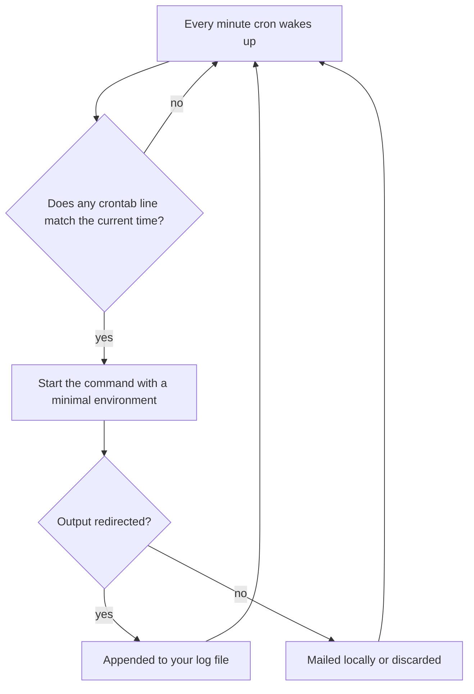

# Environments, cron, systemd and log inspection

> **Before this lesson:** you should understand environment variables and `PATH` ([The environment and startup files](#/lesson/linux-cli/environment-startup)), processes and signals ([Processes](#/lesson/linux-cli/processes)), writing a script ([first script](#/lesson/linux-cli/first-script-project)) and filters such as `grep`, `sort` and `uniq` ([Regular expressions](#/lesson/linux-cli/regular-expressions), [Text processing I](#/lesson/linux-cli/text-processing-1)).

## In plain words

Writing a program is half the work. The other half is *running* it dependably: with the right libraries, at the right times, restarted if it falls over, and leaving a record you can read when something goes wrong. This lesson covers the four tools that do those jobs on a Linux machine.

- A **virtual environment** is a private toolbox for one project. Imagine two kitchens that need different versions of the same knife; instead of fighting over one drawer, each kitchen gets its own. A Python virtual environment gives each project its own set of libraries so that they cannot break one another.
- **cron** is an alarm clock for commands. You write "every day at 02:30, run the backup", and the system does it whether or not anyone is logged in.
- **systemd** is the building's caretaker. It starts long-running programs (called **services**) when the machine boots, keeps watch, restarts them if they crash, and stops them in an orderly way.
- **Logs** are the diary each program keeps: one line for each thing worth noting, with the time. When something breaks, the diary is where you look.

Why this matters for a job: these are the first things you touch when you move code from "works on my laptop" to "runs on a server". Scheduling a nightly data job, turning an API into a service that survives reboots, and finding the error in last night's logs are standard tasks for backend and machine-learning engineers, and all of them are common interview topics.

## Part 1 — Python virtual environments

### The problem

Project A needs version 1 of a library; project B needs version 2. If both are installed into the one system-wide Python, the second installation replaces the first and one project breaks. Worse, the operating system's own tools depend on the system Python's libraries, so changing those can damage the system. A **virtual environment** (venv) is a directory containing its own Python and its own libraries, used by one project only.

### Create, activate, use, leave

```bash
mira@forge:~/weather$ python3 -m venv .venv
mira@forge:~/weather$ ls .venv
bin  include  lib  pyvenv.cfg
mira@forge:~/weather$ which python
/usr/bin/python
mira@forge:~/weather$ source .venv/bin/activate
(.venv) mira@forge:~/weather$ which python
/home/mira/weather/.venv/bin/python
(.venv) mira@forge:~/weather$ pip install requests
Successfully installed certifi-2026.10.5 charset-normalizer-3.4.0 idna-3.10 requests-2.32.3 urllib3-2.2.3
(.venv) mira@forge:~/weather$ deactivate
mira@forge:~/weather$
```

Line by line: `python3 -m venv .venv` creates the environment in a directory named `.venv` (the usual name). `source .venv/bin/activate` **activates** it for the current shell; the prompt gains `(.venv)` as a reminder. After activation, `which python` points inside the project. `pip install` then puts libraries into the environment, not the system. `deactivate` switches back.

What does activation really do? Almost nothing mysterious: it puts the environment's `bin` directory at the **front of `PATH`**, so the shell finds that `python` and `pip` first, and sets a variable `VIRTUAL_ENV`. That is why it must be run with `source` — a change to `PATH` made in a child process would not reach your shell.

```bash
(.venv) mira@forge:~/weather$ echo "$PATH" | tr ':' '\n' | head -n 2
/home/mira/weather/.venv/bin
/home/mira/.local/bin
```

The model below shows the whole trick: the same name, looked up along two different paths.

```python-run
installed = {
    "/usr/bin/python":                     "system Python 3.12 (libraries: system packages)",
    "/home/mira/weather/.venv/bin/python": "weather venv Python (libraries: requests 2.32)",
    "/home/mira/legacy/.venv/bin/python":  "legacy venv Python (libraries: requests 2.9)",
}

def which(name, path):
    for directory in path.split(":"):
        candidate = f"{directory}/{name}"
        if candidate in installed:
            return candidate
    return None

base = "/home/mira/.local/bin:/usr/local/bin:/usr/bin:/bin"

def activate(venv_dir, path):                 # what `source venv/bin/activate` does
    return f"{venv_dir}/bin:{path}"

for label, path in [("no venv active", base),
                    ("weather venv active", activate("/home/mira/weather/.venv", base)),
                    ("legacy venv active", activate("/home/mira/legacy/.venv", base))]:
    found = which("python", path)
    print(f"{label:20} -> {found}\n{'':24}{installed[found]}")
```

### Recording and rebuilding

An environment should be disposable: delete it and recreate it from a list of requirements.

```bash
(.venv) mira@forge:~/weather$ pip freeze > requirements.txt
(.venv) mira@forge:~/weather$ head -n 3 requirements.txt
certifi==2026.10.5
charset-normalizer==3.4.0
idna==3.10
mira@forge:~/weather$ rm -rf .venv && python3 -m venv .venv && .venv/bin/pip install -r requirements.txt
```

`pip freeze` lists every installed library with its exact version. Commit `requirements.txt` to version control and put `.venv/` in `.gitignore` — the directory is large, specific to one machine and rebuilt in a minute.

Notice the last command: `.venv/bin/pip` was called by its path, **without activating**. Activation is a convenience for people. Scripts, cron jobs and services should call the environment's interpreter directly — `/home/mira/weather/.venv/bin/python script.py` — which works anywhere.

> [!WARNING]
> Do not run `sudo pip install` on the system Python. It overwrites libraries that operating-system tools rely on and can break them, including the package manager; recent distributions refuse with an "externally-managed-environment" error for this reason. Use a virtual environment for projects, and `pipx` or `uv tool install` for stand-alone Python command-line programs.

Relatives you will meet: `uv` (a very fast tool that manages environments and dependencies), `conda`/`mamba` (environments that also manage non-Python software such as CUDA libraries), and `poetry`. The principle is the same in all of them: one isolated environment per project, rebuilt from a recorded list.

## Part 2 — cron

### The crontab

`cron` is a background program that wakes every minute and runs whatever is due. Each user has a table of scheduled jobs, the **crontab**.

```bash
mira@forge:~$ crontab -e      # edit your table in an editor
mira@forge:~$ crontab -l      # list it
```

Each line is five time fields followed by the command:

```
┌──────── minute        0-59
│ ┌────── hour          0-23
│ │ ┌──── day of month  1-31
│ │ │ ┌── month         1-12
│ │ │ │ ┌ day of week   0-7  (0 and 7 are Sunday)
│ │ │ │ │
30 2 * * *  /home/mira/bin/backup.sh
```

That line means "at minute 30 of hour 2, every day of the month, every month, every day of the week": 02:30 daily. A field may be:

| Form | Meaning | Example |
|---|---|---|
| `*` | every value | `*` in the hour field: every hour |
| `N` | exactly that value | `15` |
| `A-B` | a range | `1-5` in day of week: Monday to Friday |
| `A,B,C` | a list | `0,30` in minutes: on the hour and half past |
| `*/S` | every S-th value | `*/10` in minutes: every ten minutes |

| Schedule | Reads as |
|---|---|
| `* * * * *` | every minute |
| `*/15 * * * *` | every 15 minutes |
| `0 * * * *` | at the start of every hour |
| `30 2 * * *` | daily at 02:30 |
| `0 9 * * 1-5` | 09:00 on weekdays |
| `0 0 1 * *` | midnight on the first day of each month |
| `0 4 * * 0` | 04:00 every Sunday |
| `@reboot` | once, when the machine starts |
| `@daily`, `@hourly`, `@weekly` | shorthand for common schedules |

One peculiarity: if **both** the day-of-month and day-of-week fields are restricted, the job runs when **either** matches. `0 0 13 * 5` means "the 13th of the month, and also every Friday" — not "Friday the 13th". The practice problem *Does This Cron Expression Fire Now?* has you implement these rules.

### A job that works

A cron job runs in a nearly empty environment: no terminal, a minimal `PATH` (often only `/usr/bin:/bin`), none of your startup files, and your home directory as the working directory. The command that works at your prompt fails silently under cron for exactly these reasons. A dependable crontab entry looks like this:

```bash
SHELL=/bin/bash
PATH=/usr/local/bin:/usr/bin:/bin
MAILTO=""

# m  h  dom mon dow  command
30   2  *   *   *    cd /home/mira/weather && flock -n /tmp/nightly.lock .venv/bin/python nightly.py >> logs/nightly.log 2>&1
```

Reading the command: `cd` into the project so that relative paths work, and continue only if that succeeded (`&&`). `flock -n /tmp/nightly.lock` runs the job only if a previous run is not still going — it prevents two copies overlapping. The Python interpreter is the virtual environment's own, by path. `>> logs/nightly.log 2>&1` appends both normal output and errors to a log file; without it, the output is lost (or mailed to a local mailbox nobody reads).



> [!TIP]
> When a cron job "does nothing", check three things in order: did cron start it (`grep CRON /var/log/syslog` or `journalctl -u cron`), what did the job print (your log file), and does the command work in cron's environment — test with `env -i HOME="$HOME" PATH=/usr/bin:/bin /bin/sh -c 'your command'`. Use absolute paths, and remember that the percent sign is special in a crontab line: write `date +\%F`, not `date +%F`.

> [!WARNING]
> Running `crontab -r` deletes your entire crontab at once, without asking — and the `r` key sits beside `e` on the keyboard. Keep the table's contents in a file under version control (`crontab -l > crontab.txt`; reinstall with `crontab crontab.txt`). Be careful, too, with frequent jobs that delete or overwrite: a wrong path in a line that runs every minute does damage every minute until someone notices.

## Part 3 — systemd

### Services and units

A **service** (traditionally called a *daemon*) is a program meant to run continuously in the background: a web server, a database, your API. **systemd** is the program that starts and supervises them on most Linux distributions. It describes everything it manages in small text files called **units**; a service's unit file ends in `.service`.

You talk to systemd with `systemctl`:

```bash
mira@forge:~$ systemctl status nginx
● nginx.service - A high performance web server and a reverse proxy server
     Loaded: loaded (/usr/lib/systemd/system/nginx.service; enabled; preset: enabled)
     Active: active (running) since Thu 2026-11-19 08:12:03 UTC; 1 day 9h ago
   Main PID: 1203 (nginx)
      Tasks: 9 (limit: 38214)
     Memory: 14.2M
     CGroup: /system.slice/nginx.service
             ├─1203 "nginx: master process /usr/sbin/nginx -g daemon on; master_process on;"
             └─1204 "nginx: worker process"

Nov 19 08:12:03 forge systemd[1]: Started nginx.service - A high performance web server.
```

How to read it: **Loaded** shows where the unit file is and whether the service is **enabled** (will start at boot). **Active** shows the current state — `active (running)`, `inactive (dead)` or `failed` — and since when. Below come the main process ID, resource use, the processes belonging to the service, and the last few log lines.

| Command | Effect |
|---|---|
| `systemctl status NAME` | show state and recent log lines |
| `sudo systemctl start NAME` / `stop NAME` | start / stop now |
| `sudo systemctl restart NAME` | stop, then start |
| `sudo systemctl reload NAME` | re-read configuration without stopping (if the service supports it) |
| `sudo systemctl enable NAME` / `disable NAME` | start at boot / do not |
| `sudo systemctl enable --now NAME` | enable and start in one step |
| `systemctl is-active NAME`, `is-enabled NAME` | one-word answers, useful in scripts |
| `systemctl list-units --type=service --state=running` | what is running |
| `systemctl --failed` | what has failed |

Two pairs are often confused: **start/stop** act *now*; **enable/disable** decide what happens *at the next boot*. A service can be running but not enabled (it will be gone after a reboot), or enabled but stopped.

### Writing your own service

To run your API as a service, create a unit file:

```bash
mira@forge:~$ sudo nano /etc/systemd/system/weather-api.service
```

```ini
[Unit]
Description=Weather forecast API
After=network-online.target
Wants=network-online.target

[Service]
User=weather
WorkingDirectory=/srv/weather
EnvironmentFile=/etc/weather/api.env
ExecStart=/srv/weather/.venv/bin/uvicorn app:app --host 127.0.0.1 --port 8000
Restart=on-failure
RestartSec=5

[Install]
WantedBy=multi-user.target
```

Section by section:

- **`[Unit]`** — a description, and ordering: start after the network is up.
- **`[Service]`** — *how* to run. `User` names an unprivileged account to run as (never root unless unavoidable). `WorkingDirectory` sets the starting directory. `EnvironmentFile` loads `NAME=value` settings from a file — remember that services do not read your shell's startup files, so their environment must be given here. `ExecStart` is the command, with an **absolute path** to the virtual environment's program. `Restart=on-failure` restarts the program if it crashes, after `RestartSec` seconds.
- **`[Install]`** — where it hooks into boot; `multi-user.target` means the normal running state of a server.

Then tell systemd about it and start it:

```bash
mira@forge:~$ sudo systemctl daemon-reload                 # re-read unit files after any edit
mira@forge:~$ sudo systemctl enable --now weather-api
Created symlink /etc/systemd/system/multi-user.target.wants/weather-api.service → /etc/systemd/system/weather-api.service.
mira@forge:~$ systemctl is-active weather-api
active
mira@forge:~$ curl -fsS http://127.0.0.1:8000/health
{"status":"ok"}
```

The program should run in the foreground and write its log lines to standard output; systemd captures them. Do not put `&` or `nohup` in `ExecStart` — supervising the process is systemd's job.

systemd also has **timers**, a more capable alternative to cron: a `.timer` unit starts a `.service` unit on a schedule (`OnCalendar=*-*-* 02:30:00`), with logging, dependency handling and catch-up for runs missed while the machine was off (`Persistent=true`). List them with `systemctl list-timers`.

## Part 4 — Reading logs

### Where logs live

| Place | What it holds |
|---|---|
| the systemd **journal**, read with `journalctl` | output of every systemd service, the kernel and system messages |
| `/var/log/syslog` (Debian/Ubuntu) or `/var/log/messages` (Red Hat family) | general system log as text |
| `/var/log/auth.log` or `/var/log/secure` | logins, `sudo` use, SSH attempts |
| `/var/log/nginx/`, `/var/log/postgresql/` … | each application's own files |
| `dmesg` (also `journalctl -k`) | kernel messages: hardware, disks, out-of-memory kills |

Text logs are **rotated** by a tool called `logrotate`: the current file is renamed (`app.log.1`), older ones are compressed (`app.log.2.gz`) and the oldest deleted, so logs do not fill the disk. Read compressed ones with `zcat`, `zless` or `zgrep`.

### `journalctl`

```bash
mira@forge:~$ journalctl -u weather-api -n 20              # the last 20 lines of one service
mira@forge:~$ journalctl -u weather-api -f                 # follow new lines as they arrive (Ctrl-C to stop)
mira@forge:~$ journalctl -u weather-api --since "1 hour ago"
mira@forge:~$ journalctl -u weather-api --since "2026-11-20 02:00" --until "2026-11-20 03:00"
mira@forge:~$ journalctl -u weather-api -p err             # only messages of priority "error" and worse
mira@forge:~$ journalctl -b -p warning                     # warnings and worse since the last boot
mira@forge:~$ journalctl -k | grep -i "out of memory"      # kernel messages
mira@forge:~$ journalctl -u weather-api -o cat --no-pager | grep -c "timeout"
```

| Option | Meaning |
|---|---|
| `-u UNIT` | only this service |
| `-f` | follow, like `tail -f` |
| `-n N` | the last N lines |
| `--since`, `--until` | a time window ("yesterday", "10 min ago", or a date) |
| `-p LEVEL` | by priority: `emerg`, `alert`, `crit`, `err`, `warning`, `notice`, `info`, `debug` |
| `-b` | since the current boot (`-b -1`: the previous boot) |
| `-k` | kernel messages |
| `-o cat` / `-o json` | message text only / structured JSON |
| `--no-pager` | print directly instead of opening a pager (for pipes and scripts) |

### Text logs with the classic tools

Everything from the text-processing lessons applies.

```bash
mira@forge:~$ tail -n 50 /var/log/nginx/error.log                 # the most recent lines
mira@forge:~$ tail -F /var/log/weather/app.log                    # follow, surviving log rotation
mira@forge:~$ grep -n -i "error\|traceback" app.log | tail -n 5   # recent errors with line numbers
mira@forge:~$ grep -B2 -A8 "Traceback" app.log | less             # each traceback with context
mira@forge:~$ less +G app.log                                     # open at the end; ?ERROR searches backwards
mira@forge:~$ awk '$1 == "2026-11-20" && $2 >= "02:00" && $2 < "03:00"' app.log   # one hour's lines
mira@forge:~$ grep " 500 " access.log | awk '{print $7}' | sort | uniq -c | sort -rn | head -n 5
    412 /api/forecast
     37 /api/login
mira@forge:~$ zgrep -c "timeout" /var/log/weather/app.log.*.gz    # count in rotated, compressed logs
```

The second-to-last pipeline answers "which addresses produced the most server errors?": keep lines with status 500, print the seventh field (the path), then the familiar count-and-rank ending.

A method for any investigation: **fix the time window first** (when did it start?), find the **first** error in that window — later errors are often consequences — and read the lines directly before it. Then check what changed at that moment: a deployment, a configuration edit, a package upgrade, a full disk.

> [!INTERVIEW]
> Common questions: "What is a virtual environment and why use one?", "A script works when you run it by hand but not from cron — why?" (minimal environment and `PATH`, no startup files, different working directory, output discarded), "Write a cron expression for every weekday at 9 am" (`0 9 * * 1-5`), "How do you make a program start at boot and restart if it crashes?" (a systemd unit with `Restart=on-failure`, then `systemctl enable --now`), "Difference between `systemctl start` and `enable`?", and "How would you look at a service's logs from the last hour?" (`journalctl -u NAME --since "1 hour ago"`).

## Pitfalls

- **Installing libraries without activating** the environment, so they land elsewhere. Check `which python` and the prompt.
- **Committing `.venv/`** or forgetting to update `requirements.txt`.
- **Moving or renaming a venv directory**: it contains absolute paths; recreate it instead.
- **Cron lines with relative paths**, no output redirection, or an unescaped `%`.
- **Overlapping cron runs** of a slow job; use `flock`.
- **Time zones**: cron uses the system's local time; servers are usually set to UTC.
- **Editing a unit file without `daemon-reload`**, or starting a service without enabling it and losing it at the next reboot.
- **Expecting a service to see your shell's environment variables**; set them with `Environment=` or `EnvironmentFile=`.
- **Running services as root** when an unprivileged user would do.
- **Reading only the last error** in a log instead of the first one in the time window.

## Cheat sheet

| Task | Command |
|---|---|
| Create / activate / leave a venv | `python3 -m venv .venv`, `source .venv/bin/activate`, `deactivate` |
| Install and record libraries | `pip install pkg`, `pip freeze > requirements.txt` |
| Rebuild from the record | `pip install -r requirements.txt` |
| Use a venv without activating | `/path/.venv/bin/python script.py` |
| Edit / list the crontab | `crontab -e`, `crontab -l` |
| Daily at 02:30 | `30 2 * * * command >> log 2>&1` |
| Every 15 minutes / weekdays at 09:00 | `*/15 * * * *` / `0 9 * * 1-5` |
| Avoid overlapping runs | `flock -n /tmp/job.lock command` |
| Service state | `systemctl status NAME` |
| Start, stop, restart | `sudo systemctl start\|stop\|restart NAME` |
| Start at boot, and now | `sudo systemctl enable --now NAME` |
| After editing a unit file | `sudo systemctl daemon-reload` |
| Failed services | `systemctl --failed` |
| Logs of a service | `journalctl -u NAME -n 50`, `journalctl -u NAME -f` |
| Logs in a time window | `journalctl -u NAME --since "1 hour ago"` |
| Errors only | `journalctl -u NAME -p err` |
| Follow a text log | `tail -F file.log` |
| Search compressed logs | `zgrep pattern file.log.*.gz` |

## Summary

- A virtual environment is a per-project directory with its own Python and libraries; activation puts its `bin` first on `PATH`; record dependencies with `pip freeze` and call the environment's interpreter by path from automation.
- cron runs commands on a schedule given by five fields (minute, hour, day of month, month, day of week); jobs run in a minimal environment, so use absolute paths, set `PATH`, redirect output and guard against overlap.
- systemd supervises services described by unit files: `systemctl` starts, stops, enables and inspects them; a unit sets the user, directory, environment, command and restart policy.
- Logs live in the journal (`journalctl -u`, `-f`, `--since`, `-p`) and in text files under `/var/log`, which the standard text tools search.
- Investigate by time window, find the first error, and look for what changed.

## Glossary

| Term | Meaning |
|---|---|
| virtual environment (venv) | a private directory of Python and libraries for one project |
| activate | make a venv the default for the current shell by changing `PATH` |
| dependency | a library that a project needs in order to run |
| `requirements.txt` | a file listing a project's libraries and versions |
| cron | the service that runs commands on a schedule |
| crontab | a user's table of scheduled jobs |
| service (daemon) | a program that runs continuously in the background |
| systemd | the system that starts and supervises services |
| unit file | the text file describing a service to systemd |
| enable / start | arrange to run at boot / run now |
| timer | a systemd unit that starts a service on a schedule |
| log | a time-stamped record of what a program did |
| journal | systemd's central store of log messages |
| log rotation | renaming, compressing and deleting old log files to save space |
| priority (level) | how serious a log message is, from debug to emergency |

## Check yourself

```quiz
[
  {"q": "What does `source .venv/bin/activate` mainly change?",
   "options": ["It installs Python", "It puts the environment's bin directory first on PATH so that its python and pip are found first", "It copies system libraries into the project", "It starts a background service"],
   "answer": 1,
   "explain": "Activation adjusts PATH (and sets VIRTUAL_ENV) in the current shell, which is why it must be sourced rather than run as a separate program."},
  {"q": "Which crontab line runs a job at 09:00 from Monday to Friday?",
   "options": ["9 0 * * 1-5", "0 9 * * 1-5", "* 9 * * 1-5", "0 9 1-5 * *"],
   "answer": 1,
   "explain": "The fields are minute, hour, day of month, month, day of week: minute 0, hour 9, any date, weekdays 1 to 5."},
  {"q": "What does `*/10 * * * *` mean?",
   "options": ["Every 10 hours", "Every 10 minutes", "At 10 past every hour", "On the 10th of every month"],
   "answer": 1,
   "explain": "The step is in the minute field, so the job runs at minutes 0, 10, 20, 30, 40 and 50 of every hour."},
  {"q": "A script works at your prompt but fails from cron with 'command not found'. What is the most likely reason?",
   "options": ["Cron cannot run scripts", "Cron uses a minimal PATH and does not read your shell startup files", "The script needs a terminal colour", "Cron runs only as root"],
   "answer": 1,
   "explain": "Programs found through your interactive PATH are missing in cron's environment. Use absolute paths or set PATH in the crontab."},
  {"q": "What is the difference between `systemctl start api` and `systemctl enable api`?",
   "options": ["They are the same", "start runs the service now; enable makes it start automatically at boot", "enable runs it now; start schedules it", "start is for timers only"],
   "answer": 1,
   "explain": "The two are independent. enable --now does both in one command."},
  {"q": "In a unit file, what does `Restart=on-failure` do?",
   "options": ["Restarts the machine if the service fails", "Tells systemd to start the service again if it exits with an error or crashes", "Restarts the service every hour", "Prevents the service from being stopped"],
   "answer": 1,
   "explain": "systemd supervises the process and relaunches it after an abnormal exit, waiting RestartSec seconds between attempts."},
  {"q": "Which command shows the log lines of the service `weather-api` from the last 30 minutes?",
   "options": ["tail -n 30 weather-api", "journalctl -u weather-api --since \"30 min ago\"", "systemctl logs weather-api 30", "grep weather-api /etc/systemd"],
   "answer": 1,
   "explain": "journalctl -u selects a unit and --since limits the time window."},
  {"q": "When reading logs after an incident, why look for the FIRST error in the time window?",
   "options": ["It is the shortest", "Later errors are often consequences of the first, so the first is closest to the cause", "Only the first error is stored", "Errors are sorted alphabetically"],
   "answer": 1,
   "explain": "One failure commonly triggers a cascade. Establishing when it started and what happened right before it leads to the root cause."}
]
```

> **Source:** original material for this guide; the environment is covered in Shotts, *The Linux Command Line*, ch. 11, and processes and services in ch. 10.
