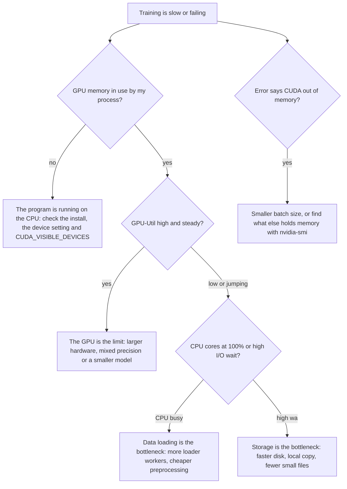
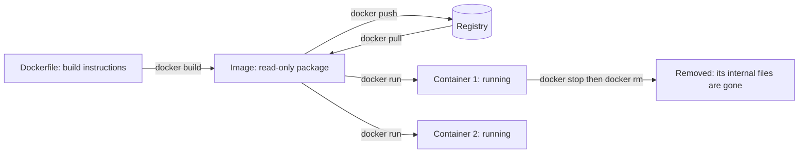

# nvidia-smi, resource monitoring and the Docker CLI

> **Before this lesson:** you should know how processes are listed and signalled ([Processes, jobs and signals](#/lesson/linux-cli/processes)), how disk space is measured ([Storage media](#/lesson/linux-cli/storage-media)), what ports and listeners are ([Networking tools](#/lesson/linux-cli/networking)) and what an environment variable is ([The environment and startup files](#/lesson/linux-cli/environment-startup)).

## In plain words

A computer has four things that programs compete for: **processor time** (how much calculating it can do), **memory** (its short-term working space), **disk** (long-term storage and how fast it can be read and written) and the **network**. Machines used for machine learning add a fifth: the **GPU** (*graphics processing unit*), a chip originally made for drawing games that turns out to be superb at the arithmetic neural networks need, and which has its own separate memory.

Monitoring is reading the dashboard of a car: speed, fuel, engine temperature. You glance at it to know whether things are normal and, when the car behaves oddly, to see which needle is in the red. The first half of this lesson is the dashboard of a Linux machine and of its GPUs.

The second half is **Docker**. Software often works on one computer and fails on another because the two differ in small ways: a library version, a missing tool, a setting. A **container** solves this the way shipping containers solved freight: pack the program together with everything it needs into one standard sealed box, and the box can be carried and run anywhere that has a crane — here, the Docker program.

Why this matters for a job: "Why is training slow?", "Why did the job die with *out of memory*?", "Is the GPU even being used?" are daily questions in machine-learning work, answered in seconds by the tools below. And almost every backend service and model server is delivered as a container today; starting one, reading its logs and getting a shell inside it are basic expected skills.

## Part 1 — The machine's dashboard

### A first look: `uptime`, `nproc`, `free`

```bash
mira@forge:~$ nproc
16
mira@forge:~$ uptime
 10:42:17 up 21 days,  3:05,  2 users,  load average: 3.20, 2.95, 1.10
mira@forge:~$ free -h
               total        used        free      shared  buff/cache   available
Mem:            62Gi        21Gi       2.1Gi       410Mi        39Gi        40Gi
Swap:          8.0Gi       512Mi       7.5Gi
```

Line by line. `nproc` prints the number of **CPU cores** — independent processors that can each run one thing at a time. `uptime` ends with the **load average**: the average number of programs running or waiting to run over the last 1, 5 and 15 minutes. Read it against the core count: a load of 3.2 on 16 cores means plenty of room; a load of 40 would mean programs queueing. The three numbers also show a trend — here the load has been rising (1.10 a quarter of an hour ago, 3.20 now).

`free -h` shows memory in readable units. The column that beginners misread is `free`: only 2.1 GiB! But Linux deliberately uses spare memory to keep recently read files ready (`buff/cache`), and gives that memory back the moment a program asks. The honest figure is **`available`**: 40 GiB can be used by programs. **Swap** is disk space used as overflow when memory runs out; it is far slower than memory, so a machine that is actively swapping feels frozen.

### The live view: `top` and `htop`

```bash
mira@forge:~$ top
top - 10:44:02 up 21 days,  3:07,  2 users,  load average: 3.41, 3.02, 1.21
Tasks: 311 total,   4 running, 307 sleeping,   0 stopped,   0 zombie
%Cpu(s): 19.8 us,  1.2 sy,  0.0 ni, 78.6 id,  0.3 wa,  0.0 hi,  0.1 si,  0.0 st
MiB Mem :  63900.1 total,   2150.4 free,  21620.0 used,  40129.7 buff/cache
MiB Swap:   8192.0 total,   7680.0 free,    512.0 used.  41020.3 avail Mem

    PID USER      PR  NI    VIRT    RES    SHR S  %CPU  %MEM     TIME+ COMMAND
  48211 mira      20   0   38.2g  14.1g   1.2g R 312.0  22.6  95:12.40 python
   2231 postgres  20   0    2.3g  640m   610m S   2.0   1.0  12:44.02 postgres
```

The `%Cpu(s)` line divides processor time into categories. The ones to know:

| Field | Meaning | What a high value suggests |
|---|---|---|
| `us` | user: running programs' own code | real computation |
| `sy` | system: work the kernel does on programs' behalf | heavy input/output or very many small operations |
| `id` | idle | spare capacity |
| `wa` | I/O wait: processors idle because they are waiting for disk or network storage | slow or overloaded storage, not a lack of processor |
| `st` | steal: time taken by other virtual machines on the same host | a crowded cloud host |

In the process list, `RES` is the physical memory a process really occupies (the number that matters), `VIRT` is address space it has reserved (usually much larger and usually harmless), and `%CPU` is per core — 312% means the process is using a little more than three cores.

Keys inside `top`: `P` sort by processor, `M` sort by memory, `1` show each core, `c` show full command lines, `q` quit. `htop` is a friendlier relative with coloured bars and mouse support, worth installing.

### Disk and network

```bash
mira@forge:~$ df -h /srv/data
Filesystem      Size  Used Avail Use% Mounted on
/dev/nvme1n1p1  1.8T  1.6T  130G  93% /srv/data
mira@forge:~$ du -sh /srv/data/* | sort -h | tail -n 3
88G	/srv/data/raw
410G	/srv/data/checkpoints
1.1T	/srv/data/cache
mira@forge:~$ iostat -xz 2 2 | tail -n 3
Device            r/s     w/s     rkB/s     wkB/s  r_await  w_await  %util
nvme1n1        2210.0    12.0  181000.0     96.0     0.41     1.10   96.4
mira@forge:~$ vmstat 2 3
procs -----------memory---------- ---swap-- -----io---- -system-- ------cpu-----
 r  b   swpd   free   buff  cache   si   so    bi    bo   in   cs us sy id wa st
 4  1 524288 2201600 310200 40780000   0    0 90400    48 9100 21000 19  1 78  2  0
```

`df` shows how full a file system is and `du … | sort -h` what fills it. `iostat` (from the package `sysstat`) reports per-disk activity every 2 seconds: `%util` near 100 means the disk is busy all the time, and `r_await`/`w_await` are the average milliseconds a request waits. `vmstat 2 3` prints three summary lines two seconds apart: `r` is programs wanting a processor, `b` programs blocked waiting for input/output, `si`/`so` memory being swapped in and out (anything steadily above zero is a warning), `bi`/`bo` blocks read and written.

For the network, `ss -ltnp` lists listening ports and their programs, and tools such as `nload`, `iftop` or `sar -n DEV 1` show traffic per interface.

`watch` reruns any command at an interval and shows the latest output, turning a snapshot into a live view: `watch -n 2 'df -h /srv/data'`.

## Part 2 — The GPU: `nvidia-smi`

`nvidia-smi` (NVIDIA System Management Interface) is the dashboard for NVIDIA graphics cards.

```bash
mira@forge:~$ nvidia-smi
Fri Nov 20 10:50:31 2026
+-----------------------------------------------------------------------------------------+
| NVIDIA-SMI 560.35.03              Driver Version: 560.35.03      CUDA Version: 12.6     |
|-----------------------------------------+------------------------+----------------------+
| GPU  Name                 Persistence-M | Bus-Id          Disp.A | Volatile Uncorr. ECC |
| Fan  Temp   Perf          Pwr:Usage/Cap |           Memory-Usage | GPU-Util  Compute M. |
|=========================================+========================+======================|
|   0  NVIDIA RTX A6000               Off |   00000000:3B:00.0 Off |                  Off |
| 46%   71C    P2            268W /  300W |   41210MiB /  49140MiB |     97%      Default |
|   1  NVIDIA RTX A6000               Off |   00000000:AF:00.0 Off |                  Off |
| 30%   38C    P8             22W /  300W |       4MiB /  49140MiB |      0%      Default |
+-----------------------------------------+------------------------+----------------------+
| Processes:                                                                              |
|  GPU   GI   CI        PID   Type   Process name                              GPU Memory |
|    0   N/A  N/A     48211      C   python                                      41196MiB |
+-----------------------------------------------------------------------------------------+
```

It looks dense, but five numbers per card carry almost all the information:

| Field | In the example | Meaning |
|---|---|---|
| index | `0`, `1` | the number programs use to refer to this card |
| **Memory-Usage** | `41210MiB / 49140MiB` | GPU memory in use out of the total — models and data batches live here |
| **GPU-Util** | `97%` | share of recent time the chip was busy computing |
| Temp, Pwr | `71C`, `268W / 300W` | temperature and power draw |
| Processes | PID `48211`, `41196MiB` | which program is using how much GPU memory |

Reading this screen: card 0 is working hard on one Python process; card 1 is idle. The header also shows the **driver** version (the software that lets the operating system talk to the card) and the highest version of **CUDA** (NVIDIA's computing toolkit) it supports.

Useful forms:

```bash
mira@forge:~$ watch -n 1 nvidia-smi                               # refresh every second
mira@forge:~$ nvidia-smi --query-gpu=index,utilization.gpu,memory.used,memory.total,temperature.gpu --format=csv
index, utilization.gpu [%], memory.used [MiB], memory.total [MiB], temperature.gpu
0, 97 %, 41210 MiB, 49140 MiB, 71
1, 0 %, 4 MiB, 49140 MiB, 38
mira@forge:~$ nvidia-smi --query-compute-apps=pid,used_memory --format=csv,noheader
48211, 41196 MiB
mira@forge:~$ nvidia-smi dmon -s um -c 3                          # a rolling line per second: utilisation and memory
mira@forge:~$ ps -o user,pid,etime,cmd -p 48211                   # who owns that process, and what is it?
USER         PID     ELAPSED CMD
mira       48211    03:41:55 python train.py --config configs/exp12.yaml
```

The `--query-gpu … --format=csv` form produces output made for scripts and for the text tools you know. Tools such as `nvtop` and `gpustat` give friendlier live views.

### Choosing which GPU a program uses

The environment variable `CUDA_VISIBLE_DEVICES` controls which cards a program can see. Set it for a single command:

```bash
mira@forge:~$ CUDA_VISIBLE_DEVICES=1 python train.py          # use only card 1 (the program sees it as card 0)
mira@forge:~$ CUDA_VISIBLE_DEVICES=0,1 python train.py        # both cards
mira@forge:~$ CUDA_VISIBLE_DEVICES="" python evaluate.py      # hide all cards: run on the processor
```

On a shared machine, look at `nvidia-smi` first and pick an idle card.

### Diagnosing the three classic problems



**"CUDA out of memory".** The card's memory is full. Check `nvidia-smi`: is another process — perhaps a forgotten notebook of your own — holding memory? If the card is yours alone, reduce the **batch size** (the number of examples processed at once).

**Low GPU utilisation.** A GPU sitting at 20–40% while training means it is being starved: something *before* it is too slow. Look at `top`: if the Python worker processes are pinned at 100% of their cores, data loading and preprocessing are the bottleneck; if `wa` is high, the disk is.

**Memory still used after the program ended.** A crashed run can leave a process behind. Find its PID in the `Processes` table, confirm with `ps` that it is yours, and end it with `kill PID` (and `kill -9 PID` only if it ignores that).

The block below turns that reasoning into a small function. Read it as a checklist written in code.

```python-run
def diagnose(gpu_util, gpu_mem_used, gpu_mem_total, cpu_user, io_wait, my_process_on_gpu):
    if not my_process_on_gpu:
        return "Not using the GPU at all: check the framework install and CUDA_VISIBLE_DEVICES."
    if gpu_mem_used / gpu_mem_total > 0.97:
        return "GPU memory nearly full: an out-of-memory error is near; reduce the batch size."
    if gpu_util >= 85:
        return "GPU is the bottleneck: this is the healthy case for training."
    if io_wait >= 15:
        return "GPU is starved and I/O wait is high: storage is the bottleneck."
    if cpu_user >= 85:
        return "GPU is starved and CPUs are busy: data loading or preprocessing is the bottleneck."
    return "GPU is starved but nothing else is busy: look for waiting, locks or tiny batches."

samples = [
    ("healthy run",          dict(gpu_util=97, gpu_mem_used=41210, gpu_mem_total=49140, cpu_user=20, io_wait=0,  my_process_on_gpu=True)),
    ("slow data loader",     dict(gpu_util=31, gpu_mem_used=20000, gpu_mem_total=49140, cpu_user=96, io_wait=1,  my_process_on_gpu=True)),
    ("network file system",  dict(gpu_util=18, gpu_mem_used=20000, gpu_mem_total=49140, cpu_user=12, io_wait=41, my_process_on_gpu=True)),
    ("about to crash",       dict(gpu_util=90, gpu_mem_used=48900, gpu_mem_total=49140, cpu_user=20, io_wait=0,  my_process_on_gpu=True)),
    ("running on CPU",       dict(gpu_util=0,  gpu_mem_used=4,     gpu_mem_total=49140, cpu_user=99, io_wait=0,  my_process_on_gpu=False)),
]
for name, readings in samples:
    print(f"{name:20} -> {diagnose(**readings)}")
```

> [!WARNING]
> On a shared GPU server, the processes in `nvidia-smi` may belong to colleagues. Before ending anything, run `ps -o user,pid,etime,cmd -p PID` to see whose it is and how long it has been running — a job that looks idle may be between stages of a three-day run. Kill only your own processes, ask about others, and never use `sudo kill` or `pkill python` to "free the GPU".

## Part 3 — Docker

### Images and containers

Two words must be kept apart.

- An **image** is a read-only package: a program plus the libraries, tools and files it needs. It is a recipe frozen at a point in time, built once and stored.
- A **container** is a running instance of an image — an isolated process with its own file system, network and process list. Many containers can be started from one image, and deleting a container does not touch the image.

Images are downloaded from a **registry** (an image library; Docker Hub is the default). An image name has the form `repository:tag`, where the **tag** is usually a version: `python:3.12-slim`, `postgres:16`.



A container is not a full virtual machine. It shares the host's Linux kernel and isolates only the processes inside it, which is why it starts in a fraction of a second.

### Running containers

```bash
mira@forge:~$ docker run hello-world
Unable to find image 'hello-world:latest' locally
latest: Pulling from library/hello-world
Status: Downloaded newer image for hello-world:latest

Hello from Docker!
This message shows that your installation appears to be working correctly.
```

What happened: Docker looked for the image locally, did not find it, downloaded ("pulled") it, created a container from it, ran its program, and the container stopped when the program finished.

An interactive shell in a fresh, disposable system:

```bash
mira@forge:~$ docker run --rm -it python:3.12-slim bash
root@9f1c2a7d4e10:/# python --version
Python 3.12.7
root@9f1c2a7d4e10:/# exit
```

`-it` means interactive with a terminal; `--rm` deletes the container when it exits; `bash` replaces the image's default command. The odd prompt shows you are root *inside the container*, on a machine named after the container's ID.

A long-running service in the background:

```bash
mira@forge:~$ docker run -d --name web -p 8080:80 nginx:1.27
c41f0d8a9b77e2b1...
mira@forge:~$ curl -sI http://localhost:8080 | head -n 1
HTTP/1.1 200 OK
```

| Option | Meaning |
|---|---|
| `-d` | detached: run in the background and print the container's ID |
| `--name NAME` | give the container a name to refer to it by |
| `-p HOST:CONTAINER` | publish a port: connections to the host's port go to the container's port |
| `-e NAME=value`, `--env-file FILE` | set environment variables inside the container |
| `-v HOSTDIR:CONTAINERDIR` | mount a host directory into the container (add `:ro` for read-only) |
| `-v VOLUME:CONTAINERDIR` | attach a named volume — storage managed by Docker that outlives containers |
| `--rm` | remove the container when it stops |
| `--gpus all` | give the container access to the GPUs (needs the NVIDIA container toolkit) |
| `--memory 4g`, `--cpus 2` | limit resources |
| `--restart unless-stopped` | restart automatically after a crash or reboot |

The port mapping `-p 8080:80` reads **host first, container second**: port 8080 on your machine leads to port 80 inside the container. The volume option reads the same way.

### Looking at and controlling containers

```bash
mira@forge:~$ docker ps
CONTAINER ID   IMAGE        COMMAND                  CREATED         STATUS         PORTS                  NAMES
c41f0d8a9b77   nginx:1.27   "/docker-entrypoint.…"   2 minutes ago   Up 2 minutes   0.0.0.0:8080->80/tcp   web
mira@forge:~$ docker logs --tail 3 web
172.17.0.1 - - [20/Nov/2026:11:02:41 +0000] "HEAD / HTTP/1.1" 200 0 "-" "curl/8.5.0" "-"
mira@forge:~$ docker exec -it web bash
root@c41f0d8a9b77:/# ls /etc/nginx/conf.d
default.conf
root@c41f0d8a9b77:/# exit
mira@forge:~$ docker stats --no-stream
CONTAINER ID   NAME   CPU %   MEM USAGE / LIMIT    MEM %   NET I/O
c41f0d8a9b77   web    0.00%   9.1MiB / 62.4GiB     0.01%   1.2kB / 0B
mira@forge:~$ docker stop web && docker rm web
```

| Command | Purpose |
|---|---|
| `docker ps` / `docker ps -a` | running containers / all, including stopped ones |
| `docker logs NAME` (`-f` follow, `--tail N`, `--since 10m`) | what the container's program printed |
| `docker exec -it NAME bash` | open a shell **inside a running container** (try `sh` if `bash` is missing) |
| `docker stats` | live processor and memory use per container |
| `docker inspect NAME` | every detail as JSON — pipe it into `jq` |
| `docker stop` / `start` / `restart NAME` | control it |
| `docker rm NAME` | delete a stopped container |
| `docker cp NAME:/path ./` | copy files out of (or into) a container |
| `docker images`, `docker pull IMG`, `docker rmi IMG` | list, download, delete images |

Two commands are often confused: `docker run` creates a **new** container from an image; `docker exec` runs a command in a container that **already exists and is running**.

### Data does not survive by default

Files written inside a container live in that container. Remove the container and they are gone. Anything that must persist — a database, uploaded files, trained model weights — belongs on a **volume** or a mounted host directory.

```bash
mira@forge:~$ docker run --rm --gpus all \
      -v "$PWD":/workspace -v /srv/data:/data:ro -w /workspace \
      -e WANDB_MODE=offline \
      pytorch/pytorch:2.5.1-cuda12.4-cudnn9-runtime \
      python train.py --data /data/imagenet-subset --out runs/exp12
```

This is the shape of a typical training command. The project directory is mounted at `/workspace` (and made the working directory with `-w`), so outputs written to `runs/exp12` land on the host and outlive the container. The dataset is mounted read-only. All GPUs are passed in. Everything else — Python, the framework, the CUDA libraries — comes from the image, identical on every machine.

### Building an image

A **Dockerfile** is a text file of instructions for building an image.

```dockerfile
FROM python:3.12-slim
WORKDIR /app
COPY requirements.txt .
RUN pip install --no-cache-dir -r requirements.txt
COPY . .
EXPOSE 8000
CMD ["uvicorn", "app:app", "--host", "0.0.0.0", "--port", "8000"]
```

Line by line: start `FROM` a base image; set the working directory; copy in the requirements list and install the libraries; copy the rest of the code; document the port; and give the default command. The requirements are copied and installed *before* the code because each instruction produces a cached **layer**: when only the code changes, the slow installation step is reused. Note `--host 0.0.0.0`: inside a container a server must listen on all interfaces, or a published port cannot reach it.

```bash
mira@forge:~/weather$ docker build -t weather-api:1.4 .
mira@forge:~/weather$ docker run -d --name api -p 8000:8000 --env-file .env weather-api:1.4
mira@forge:~/weather$ docker logs -f api
```

Applications made of several containers (an API, a database, a cache) are described in a `compose.yaml` file and run with `docker compose up -d`, `docker compose logs -f` and `docker compose down`.

### Cleaning up

Images, stopped containers and build caches accumulate, and `/var/lib/docker` is one of the most common reasons for a full disk.

```bash
mira@forge:~$ docker system df
TYPE            TOTAL     ACTIVE    SIZE      RECLAIMABLE
Images          41        6         96.3GB    81.2GB (84%)
Containers      9         2         1.1GB     1.0GB (93%)
Build Cache     212       0         38.7GB    38.7GB
mira@forge:~$ docker container prune        # remove stopped containers
mira@forge:~$ docker image prune            # remove untagged (dangling) images
mira@forge:~$ docker builder prune          # remove the build cache
```

> [!WARNING]
> `docker system prune -a --volumes` deletes every stopped container, every image not used by a running container and **every unused volume** — and volumes are where databases and other persistent data live. It cannot be undone. Read `docker system df` and `docker volume ls` first, prune the categories separately, and never add `--volumes` unless you know that nothing valuable is stored in one. Two further cautions: membership of the `docker` group is equivalent to administrator access on the host, and secrets must not be written into a Dockerfile or image, where anyone with the image can read them — pass them at run time.

> [!TIP]
> When a container exits immediately, `docker ps -a` shows its exit code and `docker logs NAME` shows why — the logs remain available after the container has stopped. To investigate an image that will not start, override its command and look around: `docker run --rm -it --entrypoint sh IMAGE`.

> [!INTERVIEW]
> Common questions: "What is the difference between an image and a container?", "A container and a virtual machine?" (a container shares the host kernel and isolates processes; a virtual machine runs a whole separate operating system), "`docker run` versus `docker exec`?", "How do you persist data?" (volumes or bind mounts), "How do you see why a container crashed?" (`docker ps -a`, `docker logs`), "What does `-p 8080:80` mean?". For machine-learning roles: "How do you check GPU usage?" (`nvidia-smi`), "Training is slow and GPU utilisation is 30% — what do you look at?" (data loading and I/O with `top`/`htop` and `iostat`), and "What causes CUDA out of memory?".

## Pitfalls

- **Reading `free` instead of `available`** and thinking memory is exhausted.
- **Judging load average without the core count.**
- **Confusing GPU memory with GPU utilisation**: memory can be full while the chip is idle, and the reverse.
- **Blaming the GPU for slowness** caused by data loading or storage.
- **Forgetting old notebooks or runs** that still hold GPU memory.
- **Port and volume mappings reversed**: it is always host first, container second.
- **A server inside a container listening on `127.0.0.1`**, unreachable through the published port.
- **Keeping important data in a container's own file system.**
- **Using the tag `latest` in production**, so that "the same" image silently changes. Pin an explicit version.
- **Never cleaning up**, until Docker fills the disk.

## Cheat sheet

| Task | Command |
|---|---|
| Cores, load, memory | `nproc`, `uptime`, `free -h` |
| Live processes | `top`, `htop` |
| Per-second system summary | `vmstat 1` |
| Disk activity | `iostat -xz 1` |
| Disk space and what uses it | `df -h`, `du -sh * \| sort -h` |
| Repeat a command | `watch -n 2 'command'` |
| GPU status / live | `nvidia-smi`, `watch -n 1 nvidia-smi` |
| GPU figures as CSV | `nvidia-smi --query-gpu=index,utilization.gpu,memory.used --format=csv` |
| Choose GPUs for a program | `CUDA_VISIBLE_DEVICES=1 python train.py` |
| Run a disposable interactive container | `docker run --rm -it IMAGE bash` |
| Run a background service | `docker run -d --name n -p 8080:80 IMAGE` |
| List containers | `docker ps`, `docker ps -a` |
| Logs | `docker logs -f --tail 100 NAME` |
| Shell inside a running container | `docker exec -it NAME bash` |
| Resource use per container | `docker stats` |
| Stop and remove | `docker stop NAME && docker rm NAME` |
| Build an image | `docker build -t name:tag .` |
| Mount code and data, use GPUs | `docker run --gpus all -v "$PWD":/workspace -w /workspace IMAGE cmd` |
| Disk used by Docker | `docker system df` |
| Careful cleanup | `docker container prune`, `docker image prune` |

## Summary

- A machine's health is read from load against core count, the breakdown of processor time (especially I/O wait), *available* memory and swap activity, and disk and network activity — with `uptime`, `free`, `top`/`htop`, `vmstat`, `iostat`, `df` and `du`.
- `nvidia-smi` shows each GPU's memory use, utilisation, temperature and the processes on it; `CUDA_VISIBLE_DEVICES` selects cards. Full memory means out-of-memory errors; low utilisation usually points to data loading or storage.
- A Docker image is a packaged program with its dependencies; a container is a running, isolated instance. `docker run` starts one (`-d`, `-p`, `-v`, `-e`, `--rm`, `--gpus`), and `ps`, `logs`, `exec`, `stats` and `inspect` examine it.
- Container data is temporary unless stored on a volume or a mounted directory; images are built from a Dockerfile in cached layers.
- Clean up deliberately, and treat Docker access and volume deletion with the care due to administrator rights.

## Glossary

| Term | Meaning |
|---|---|
| CPU core | one independent processor inside the machine |
| load average | average number of programs running or waiting to run |
| memory (RAM) | fast working space that is emptied when the machine is switched off |
| swap | disk space used as slow overflow when memory is full |
| I/O wait | time processors spend idle waiting for storage |
| bottleneck | the slowest part, which limits the speed of the whole |
| GPU | graphics processing unit: a chip suited to the arithmetic of neural networks |
| GPU memory | the GPU's own memory, where models and batches are held |
| utilisation | the share of time a device is busy |
| CUDA | NVIDIA's software toolkit for computing on GPUs |
| driver | software that lets the operating system use a hardware device |
| batch size | the number of examples a model processes at once |
| image | a read-only package of a program and everything it needs |
| container | a running, isolated instance of an image |
| registry | a server that stores and distributes images |
| tag | the version label of an image |
| volume | storage managed by Docker that outlives containers |
| bind mount | a host directory made visible inside a container |
| Dockerfile | the instructions for building an image |
| layer | one cached step of an image build |

## Check yourself

```quiz
[
  {"q": "`free -h` shows 2 GiB under free and 40 GiB under available on a 62 GiB machine. Is the machine about to run out of memory?",
   "options": ["Yes, only 2 GiB is left", "No; most memory is used as cache that is released on demand, and 40 GiB is available to programs", "Yes, because swap is in use", "It cannot be known"],
   "answer": 1,
   "explain": "Linux uses spare memory for caching files. The available column estimates how much programs can still obtain."},
  {"q": "`uptime` reports a load average of 12 on a machine with 32 cores. What does that mean?",
   "options": ["The machine is overloaded", "About 12 programs want processor time on average, well within what 32 cores can serve", "12 users are logged in", "The machine has been up for 12 days"],
   "answer": 1,
   "explain": "Load must be compared with the number of cores. Load above the core count means programs are waiting."},
  {"q": "In `nvidia-smi`, a card shows 47000MiB / 49140MiB memory and 3% GPU-Util. What is the situation?",
   "options": ["The GPU is working at full capacity", "GPU memory is almost full, but the chip is hardly computing", "The card is broken", "The driver is missing"],
   "answer": 1,
   "explain": "Memory use and utilisation are separate. A process may hold memory while idle or while waiting for data."},
  {"q": "Training runs at 25% GPU utilisation while `top` shows the data-loading processes each at 100% of a core. What is the likely bottleneck?",
   "options": ["The GPU", "Data loading and preprocessing on the CPU", "The network card", "The GPU fan"],
   "answer": 1,
   "explain": "The GPU is waiting for batches. Adding loader workers or making preprocessing cheaper raises utilisation."},
  {"q": "What does `CUDA_VISIBLE_DEVICES=1 python train.py` do?",
   "options": ["Uses one CPU core", "Lets the program see only GPU number 1", "Uses all GPUs except number 1", "Sets the batch size to 1"],
   "answer": 1,
   "explain": "The variable lists the GPU indexes a process may use. Inside the program the visible card is numbered from 0."},
  {"q": "What is the difference between a Docker image and a container?",
   "options": ["They are two names for the same thing", "An image is a stored read-only package; a container is a running instance created from it", "A container is a compressed image", "Images run on servers and containers on laptops"],
   "answer": 1,
   "explain": "Many containers can be started from one image, and removing a container leaves the image untouched."},
  {"q": "In `docker run -d -p 8080:80 nginx`, what does `-p 8080:80` do?",
   "options": ["Opens ports 80 to 8080", "Forwards port 8080 on the host to port 80 inside the container", "Forwards port 80 on the host to port 8080 in the container", "Limits the container to 8080 connections"],
   "answer": 1,
   "explain": "The mapping is written host first, container second."},
  {"q": "A database container is removed with `docker rm` and its data is gone. How should the data have been stored?",
   "options": ["In the image", "On a volume or a mounted host directory", "In an environment variable", "In the container's log"],
   "answer": 1,
   "explain": "A container's own file system disappears with the container. Volumes and bind mounts live outside it."}
]
```

> **Source:** original material for this guide; process monitoring with `top` and `ps` is introduced in Shotts, *The Linux Command Line*, ch. 10 (Processes), and disk usage in ch. 15 (Storage Media).
