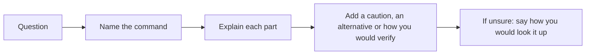

# The commands you are asked about

> **Before this lesson:** this is a review lesson. It assumes you have worked through the earlier modules, especially [Redirection and pipelines](#/lesson/linux-cli/redirection-pipelines), [Permissions](#/lesson/linux-cli/permissions), [Processes](#/lesson/linux-cli/processes), [Searching for files](#/lesson/linux-cli/finding-files), [Regular expressions with grep](#/lesson/linux-cli/regular-expressions) and [Text processing I](#/lesson/linux-cli/text-processing-1). Each section links back to the lesson that teaches the topic from zero.

## In plain words

A job interview for almost any engineering role — backend, data, machine learning, operations — includes a few questions about the Linux command line. They are rarely trick questions. The interviewer wants to know one thing: *have you really used a terminal to get work done, or have you only read about it?*

Think of a driving test. The examiner does not ask you to recite the highway code; they watch whether you check the mirror without being told. In the same way, interview answers that show habits — "I would look at the file with `ls -l` first", "I would preview the list before deleting" — are worth more than a perfect recitation of options.

This lesson collects the questions that come up again and again, grouped by topic. For each one you get a short model answer and the reasoning behind it, so that you can explain it in your own words. Nothing here is new; it is the earlier lessons seen from the interviewer's chair.

Why this matters for a job: these same thirty or so commands are what you will actually type in your first weeks. Preparing for the questions and preparing for the work are the same activity.

## How to answer a command-line question

A good answer has three parts, and takes under a minute:

1. **Say the command.** "I would use `grep -rn 'timeout' src/`."
2. **Say what the parts mean.** "`-r` searches the directory recursively, `-n` shows line numbers."
3. **Mention one caution or alternative.** "The pattern is in single quotes so the shell leaves it alone."

If you do not remember an option, say how you would find it: "I would check `man grep` or `grep --help`." That is a perfectly respectable answer — it is what experienced people do every day.



## Files and navigation

*Taught in [The shell and navigation](#/lesson/linux-cli/shell-and-navigation), [Exploring the system](#/lesson/linux-cli/exploring-the-system) and [Manipulating files](#/lesson/linux-cli/manipulating-files).*

**"What is the difference between an absolute and a relative path?"** An absolute path starts with `/` and is followed from the top of the file system; it means the same from anywhere. A relative path starts from the current directory, using `.` for "here" and `..` for "one level up".

**"Walk me through the output of `ls -l`."**

```bash
mira@forge:~$ ls -l deploy.sh
-rwxr-x--- 1 mira ml-team 1490 Nov 20 11:31 deploy.sh
```

Seven fields: type and permissions, number of hard links, owner, group, size in bytes, time of last modification, name. The first character is the type (`-` file, `d` directory, `l` symbolic link).

**"Hard link versus symbolic link?"** A file's content lives in a structure called an **inode**; a directory entry is a name pointing at an inode. A hard link is a second name for the same inode — equal in every way, limited to one file system, and the data survives until the last name is removed. A symbolic link is a small separate file that stores a path; it can cross file systems and point at directories, and it breaks if the target is moved.

**"How do you find the largest files or directories?"**

```bash
mira@forge:~$ du -sh /var/* 2>/dev/null | sort -h | tail -n 5
mira@forge:~$ find / -xdev -type f -size +1G 2>/dev/null
```

**"How do you look at a huge log file?"** Not with `cat`. Use `less file` (search with `/`, jump to the end with `G`), `tail -n 100 file` for the end, `tail -f file` to follow it as it grows, and `head` for the beginning.

## Permissions

*Taught in [Permissions, ownership and identity](#/lesson/linux-cli/permissions).*

**"What does `chmod 755 file` mean?"** Each digit is one class — owner, group, others — and is the sum of 4 (read), 2 (write), 1 (execute). So 7 is `rwx`, 5 is `r-x`: the owner may do everything; everyone else may read and execute.

| Mode | String | Typical use |
|---|---|---|
| `644` | `rw-r--r--` | ordinary file |
| `600` | `rw-------` | private file, such as an SSH key |
| `755` | `rwxr-xr-x` | script, program, directory |
| `700` | `rwx------` | private directory |

**"`chmod` versus `chown`?"** `chmod` changes *what may be done* (the permission bits); `chown` changes *who owns* the file (`chown user:group file`).

**"What do read, write and execute mean on a directory?"** Read lists the names; write creates, deletes and renames entries; execute allows entering the directory and reaching what is inside. That is why **a file can be deleted by someone who cannot write to it** — deletion changes the directory, not the file.

**"What is umask?"** A mask of permission bits *removed* from newly created files. With umask 022, new files are 644 and new directories 755.

**"Why is `chmod 777` a bad fix?"** It lets every account on the machine change the file. The correct fix is to find which user needs which permission — usually an ownership or group problem.

The decoder below is the calculation interviewers ask you to do aloud:

```python-run
def explain(mode):
    names = ["owner", "group", "others"]
    parts = []
    for who, digit in zip(names, f"{mode:0>3}"):
        d = int(digit)
        rights = [word for bit, word in ((4, "read"), (2, "write"), (1, "execute")) if d & bit]
        letters = "".join(ch if d & bit else "-" for bit, ch in ((4, "r"), (2, "w"), (1, "x")))
        parts.append(f"{who}: {letters} ({' + '.join(rights) or 'nothing'})")
    return f"{mode} -> " + "; ".join(parts)

for mode in ["755", "644", "600", "750", "777"]:
    print(explain(mode))

def umask_result(umask, kind):
    base = 0o666 if kind == "file" else 0o777
    return format(base & ~int(umask, 8), "03o")

print("\numask 022: new file", umask_result("022", "file"), "| new directory", umask_result("022", "dir"))
print("umask 077: new file", umask_result("077", "file"), "| new directory", umask_result("077", "dir"))
```

## Finding things: `grep` and `find`

*Taught in [Regular expressions with grep](#/lesson/linux-cli/regular-expressions) and [Searching for files](#/lesson/linux-cli/finding-files).*

**"What is the difference between `grep` and `find`?"** `grep` searches *inside* files for text; `find` searches the directory tree for files by their *properties* — name, type, size, age, owner.

**"Search every file under a directory for a string."**

```bash
mira@forge:~/proj$ grep -rn "connect_timeout" src/
src/db/pool.py:41:    connect_timeout = 5
```

`-r` recursive, `-n` line numbers. Add `-i` to ignore case, `-l` to list only file names, `-v` to invert, `-c` to count, `-w` for whole words, `-E` for extended regular expressions such as `'error|warn'`.

**"Find files by name, size or age."**

```bash
mira@forge:~$ find . -type f -name '*.log'                  # by name (quote the pattern)
mira@forge:~$ find /var/log -type f -mtime +30              # modified more than 30 days ago
mira@forge:~$ find . -type f -size +100M                    # larger than 100 MiB
mira@forge:~$ find . -type f -name '*.tmp' -mtime +7 -delete   # delete them (after previewing!)
```

**"`-exec … \;` versus `-exec … +`?"** With `\;` the command runs once per file; with `+` many file names are passed to each run, which is far faster.

**"Why `find … -print0 | xargs -0`?"** File names may contain spaces or newlines. A NUL character is the only separator that cannot occur in a name, so the pair is safe for any name.

## Pipelines and text

*Taught in [Redirection and pipelines](#/lesson/linux-cli/redirection-pipelines) and the two text-processing lessons.*

**"What do `>`, `>>`, `2>` and `2>&1` do?"** `>` sends standard output to a file, replacing its contents; `>>` appends; `2>` redirects standard error; `2>&1` sends standard error to wherever standard output currently goes. `cmd > out.log 2>&1` captures both — and the order matters, because redirections are applied left to right.

**"What is a pipe?"** `a | b` connects the output of `a` to the input of `b`; both run at once.

**"Print the ten most frequent IP addresses in an access log."** The single most common exercise:

```bash
mira@forge:~$ awk '{print $1}' access.log | sort | uniq -c | sort -rn | head -n 10
  30172 203.0.113.9
   8841 198.51.100.4
```

Explain every stage: take the first field; sort so that equal values are adjacent (required, because `uniq` only merges neighbours); count each run; sort numerically, largest first; keep ten.

**"Count the lines / the lines containing ERROR."** `wc -l file`; `grep -c ERROR file`.

**"Print the third column of a CSV file."** `cut -d, -f3 file` or `awk -F, '{print $3}' file`.

**"Replace a word everywhere in a file."** `sed 's/old/new/g' file` prints the result; `sed -i.bak 's/old/new/g' file` edits the file and keeps a backup. `g` means every occurrence on each line.

**"Print lines 10 to 20."** `sed -n '10,20p' file` or `head -n 20 file | tail -n 11`.

**"`cat file | grep x` — any comment?"** It works, but `grep x file` does the same with one process fewer; a small point that shows fluency.

## Processes and system state

*Taught in [Processes, jobs and signals](#/lesson/linux-cli/processes) and [Resource monitoring](#/lesson/linux-cli/gpu-monitoring-docker).*

**"How do you see what is running and what uses the most resources?"** `ps aux` for a snapshot, `top` or `htop` live; `ps aux --sort=-%mem | head` for the biggest memory users.

**"`kill` versus `kill -9`?"** Plain `kill PID` sends the TERM signal, a request the program can handle by saving its work and exiting cleanly. `kill -9` sends KILL, which the program cannot intercept — it ends at once, possibly leaving data half-written. Try TERM first.

**"What is a zombie process?"** A process that has finished but whose parent has not yet collected its exit status. It uses no memory or processor; it cannot be killed (it is already dead); it disappears when the parent collects it or ends.

**"What does load average mean?"** The average number of processes running or waiting to run, over 1, 5 and 15 minutes — to be compared with the number of cores from `nproc`.

**"Which process is using port 8080?"** `sudo ss -ltnp | grep :8080` (or `sudo lsof -i :8080`).

**"How do you keep a job running after you log out?"** Start it inside `tmux` (or `screen`), or with `nohup command &`.

**"How do you check disk space and memory?"** `df -h` for file systems, `du -sh dir` for a directory, `free -h` for memory — reading the *available* column, not *free*.

## Networking

*Taught in [Networking tools](#/lesson/linux-cli/networking), [ssh, keys and tmux](#/lesson/linux-cli/ssh-tmux) and [curl, jq and git](#/lesson/linux-cli/curl-jq-git).*

**"A service is unreachable. How do you troubleshoot?"** Layer by layer: does the name resolve (`dig`, `getent hosts`)? Is the host reachable (`ping`)? Is the port open (`nc -vz host port`)? Is something listening on the server (`ss -ltnp`)? Does the application answer (`curl -v`)? Then the service's logs.

**"Connection refused versus connection timed out?"** Refused: the host answered that nothing is listening on that port — the service is down or bound elsewhere. Timed out: no answer at all — usually a firewall, a wrong address or a dead host.

**"How does SSH key authentication work?"** Your public key is listed in `~/.ssh/authorized_keys` on the server; the client proves it holds the matching private key by signing a challenge. The private key never leaves your machine.

**"Test an HTTP endpoint from the terminal."** `curl -i URL` shows status, headers and body; `curl -fsS URL | jq .` for JSON.

## Shell and scripting

*Taught in [Expansion and quoting](#/lesson/linux-cli/expansion-quoting) and the scripting modules.*

**"Single quotes versus double quotes?"** Single quotes keep every character literal. Double quotes still expand `$variable`, `$(command)` and `$((arithmetic))` but prevent word splitting and wildcard expansion.

**"What do `$?`, `$#`, `$@`, `$0` and `$1` mean?"** Exit status of the last command; number of arguments; all arguments (each kept whole when written `"$@"`); the script's name; the first argument.

**"What does the first line `#!/bin/bash` do?"** It names the interpreter that should run the file.

**"What does `set -euo pipefail` do?"** Stop on the first failing command, treat unset variables as errors, and make a pipeline fail if any stage fails.

**"`&&` versus `;`?"** `a && b` runs `b` only if `a` succeeded; `a ; b` runs `b` regardless.

**"What is the difference between `.bashrc` and `.bash_profile`?"** The profile is read by login shells, `.bashrc` by interactive non-login shells; scripts and cron jobs read neither.

**"How do you loop over files safely?"** `for f in *.csv; do …"$f"…; done` — a glob, with the variable quoted — not `for f in $(ls)`, which breaks on names containing spaces.

## A live exercise, worked through

Interviewers often share a terminal and say something like: *"Here is an application log. Tell me which endpoint returns the most server errors, and when the errors started."*

```bash
mira@forge:~$ head -n 2 app.log
2026-11-20T02:13:55Z GET /api/forecast 200 12ms
2026-11-20T02:13:56Z POST /api/login 401 9ms
mira@forge:~$ wc -l app.log
184220 app.log
mira@forge:~$ awk '$4 >= 500' app.log | wc -l
1422
mira@forge:~$ awk '$4 >= 500 {print $3}' app.log | sort | uniq -c | sort -rn | head -n 3
   1391 /api/forecast
     22 /api/login
      9 /health
mira@forge:~$ awk '$4 >= 500 && $3 == "/api/forecast" {print $1}' app.log | head -n 1
2026-11-20T02:17:03Z
mira@forge:~$ awk '$4 >= 500 {print substr($1, 1, 16)}' app.log | uniq -c | head -n 4
      3 2026-11-20T02:17
     61 2026-11-20T02:18
     74 2026-11-20T02:19
     70 2026-11-20T02:20
```

What to say while typing: "First I look at the format — time, method, path, status, duration, separated by spaces. I count the lines to know the size. Field 4 is the status, so `$4 >= 500` selects server errors: 1,422 of them. Counting by path shows nearly all are on `/api/forecast`. The first one was at 02:17:03, and counting per minute shows the rate jumped at 02:18 — so I would now ask what changed around 02:17: a deployment, a dependency, a full disk."

That narration — look at the data, state assumptions, build the pipeline one stage at a time, draw a conclusion and name the next step — is what earns marks, far more than the exact options.

> [!TIP]
> Practise aloud. Open a terminal, pick any log file or CSV, and answer three questions of your own making while explaining each stage as if to a listener. Ten minutes of this is worth more than re-reading a cheat sheet, because the difficulty in interviews is speaking and typing at the same time.

> [!WARNING]
> In a live exercise on someone else's machine, show the same caution you would at work. Read before you write; preview with `ls` or `echo` before any `rm`, `mv` or `sed -i`; do not reach for `sudo`, `kill -9` or `chmod 777` as a first move. If a question invites a destructive command — "how would you free up disk space quickly?" — say what you would *check* first (what is using the space, whether it is safe to remove, whether a process still holds the file) before naming a deletion. Interviewers listen for exactly that.

> [!INTERVIEW]
> Three questions deserve a prepared answer because they are asked so often: (1) "Top N most frequent values in a file" — the `sort | uniq -c | sort -rn | head` pipeline and why each stage is there; (2) "Explain `chmod 755`" — decoding the octal digits aloud; (3) "The server is slow — what do you do?" — a structured walk through load, processor, memory, disk and logs, which is the subject of the [next lesson](#/lesson/linux-cli/debugging-slow-full-machine).

## Pitfalls

- **Reciting options without explaining them.** Understanding beats memory.
- **Pretending to remember.** "I would check the manual page" is better than a wrong flag.
- **Forgetting `sort` before `uniq`**, or `-n` when sorting numbers.
- **Unquoted patterns** in `find -name` and `grep`.
- **Offering `kill -9`, `chmod 777` or `rm -rf` first.**
- **Confusing `grep` (inside files) with `find` (for files).**
- **Silence.** Think aloud; partial reasoning earns credit.
- **Ignoring the data's format.** Look at a few lines with `head` before building a pipeline.

## Cheat sheet

| Question | Answer |
|---|---|
| Where am I / what is here? | `pwd`, `ls -la` |
| File type and details | `file f`, `ls -l f`, `stat f` |
| Read a long file / follow a log | `less f`, `tail -f f` |
| Search inside files | `grep -rn 'text' dir` |
| Find files by name, size, age | `find dir -name '*.x'`, `-size +100M`, `-mtime +7` |
| Count lines / matches | `wc -l f`, `grep -c pat f` |
| A column | `cut -d, -f2 f`, `awk '{print $2}' f` |
| Most frequent values | `sort \| uniq -c \| sort -rn \| head` |
| Replace text | `sed 's/a/b/g' f` |
| Permissions and ownership | `chmod 644 f`, `chown user:group f` |
| Disk and memory | `df -h`, `du -sh d`, `free -h` |
| Processes | `ps aux`, `top`, `kill PID` |
| Who listens on a port | `ss -ltnp` |
| Test a port / a URL | `nc -vz host port`, `curl -i URL` |
| Remote shell and copy | `ssh user@host`, `scp f host:path`, `rsync -av` |
| Archive and extract | `tar -czf a.tar.gz dir`, `tar -xzf a.tar.gz` |
| Help | `man cmd`, `cmd --help` |

## Summary

- Interview questions on the command line test real use: name the command, explain its parts, add a caution or an alternative, and say how you would look up what you do not remember.
- Be able to decode `ls -l` and octal permissions, explain links, redirection and pipes, and distinguish `grep` from `find`.
- Know the frequency pipeline by heart and be able to justify each stage.
- For processes and networks, know the gentle-before-forceful rule for signals, what load average and zombies are, and the layered way to diagnose an unreachable service.
- In live exercises, look at the data first, build step by step, think aloud and behave as carefully as you would on a production machine.

## Glossary

| Term | Meaning |
|---|---|
| absolute / relative path | a path from the root `/` / a path from the current directory |
| inode | the structure holding a file's data location and attributes |
| hard link / symbolic link | another name for the same inode / a small file that stores a path |
| octal mode | permissions written as three digits, each the sum of 4, 2 and 1 |
| umask | the bits removed from the permissions of new files |
| standard output / standard error | a program's normal output stream / its stream for error messages |
| pipe | a connection from one command's output to another's input |
| signal | a notification sent to a process, such as TERM or KILL |
| zombie | a finished process whose exit status has not been collected |
| load average | average number of processes running or waiting to run |
| port | a numbered endpoint for network connections |
| exit status | the number a command returns; 0 means success |
| glob | a wildcard pattern expanded by the shell into file names |
| regular expression | a pattern language for describing text |

## Check yourself

```quiz
[
  {"q": "Which command searches all files under the directory src for the text `retry_limit` and shows file names and line numbers?",
   "options": ["find src -name retry_limit", "grep -rn 'retry_limit' src", "ls -R src | retry_limit", "cat src | grep retry_limit"],
   "answer": 1,
   "explain": "grep searches inside files; -r makes it recursive and -n adds line numbers. find -name would look for a file with that name."},
  {"q": "What permissions does mode 640 give?",
   "options": ["Owner read and write; group read; others nothing", "Owner everything; group read and execute; others nothing", "Everyone read and write", "Owner read; group write; others execute"],
   "answer": 0,
   "explain": "6 is 4+2 (read and write), 4 is read, 0 is no permission."},
  {"q": "In `sort | uniq -c | sort -rn | head -n 5`, why is the first sort needed?",
   "options": ["To remove blank lines", "Because uniq only merges identical lines that are next to each other", "To convert text to numbers", "It is optional"],
   "answer": 1,
   "explain": "Sorting brings equal lines together so that uniq -c can count each distinct value as one run."},
  {"q": "What is the recommended first step to stop a misbehaving process?",
   "options": ["kill -9 PID", "kill PID, which sends TERM and lets the program shut down cleanly", "Reboot the machine", "chmod 000 on its executable"],
   "answer": 1,
   "explain": "TERM can be handled by the program for a tidy exit. KILL cannot be caught and is a last resort."},
  {"q": "A client gets 'connection timed out' when contacting a service. Which cause is most likely?",
   "options": ["The service answered with an error page", "Packets are being dropped, for example by a firewall, or the host is unreachable", "Nothing is listening on the port but the host is up", "The DNS name is too long"],
   "answer": 1,
   "explain": "A timeout means no reply at all. A host that is up with nothing listening would answer with connection refused."},
  {"q": "What does `cmd > out.log 2>&1` do?",
   "options": ["Sends only errors to out.log", "Sends both standard output and standard error to out.log", "Runs cmd twice", "Appends to out.log"],
   "answer": 1,
   "explain": "Standard output is redirected to the file first, then standard error is pointed at the same place."},
  {"q": "You cannot remember an option of tar during an interview. What is the best response?",
   "options": ["Guess confidently", "Say you would check man tar or tar --help, and describe what the option should do", "Refuse to answer", "Change the subject"],
   "answer": 1,
   "explain": "Knowing how to find information quickly is the real skill, and stating the intent shows that you understand the task."},
  {"q": "Why can a user delete a file they have no write permission on?",
   "options": ["They cannot, ever", "Deleting changes the directory, so write and execute permission on the directory is what counts", "Because rm ignores permissions", "Only if the file is empty"],
   "answer": 1,
   "explain": "Removing a name is a modification of the directory's list of entries; the file's own permission bits are not consulted."}
]
```

> **Source:** original review material for this guide, drawing on topics from Shotts, *The Linux Command Line*, ch. 3–10 and 16–20.
