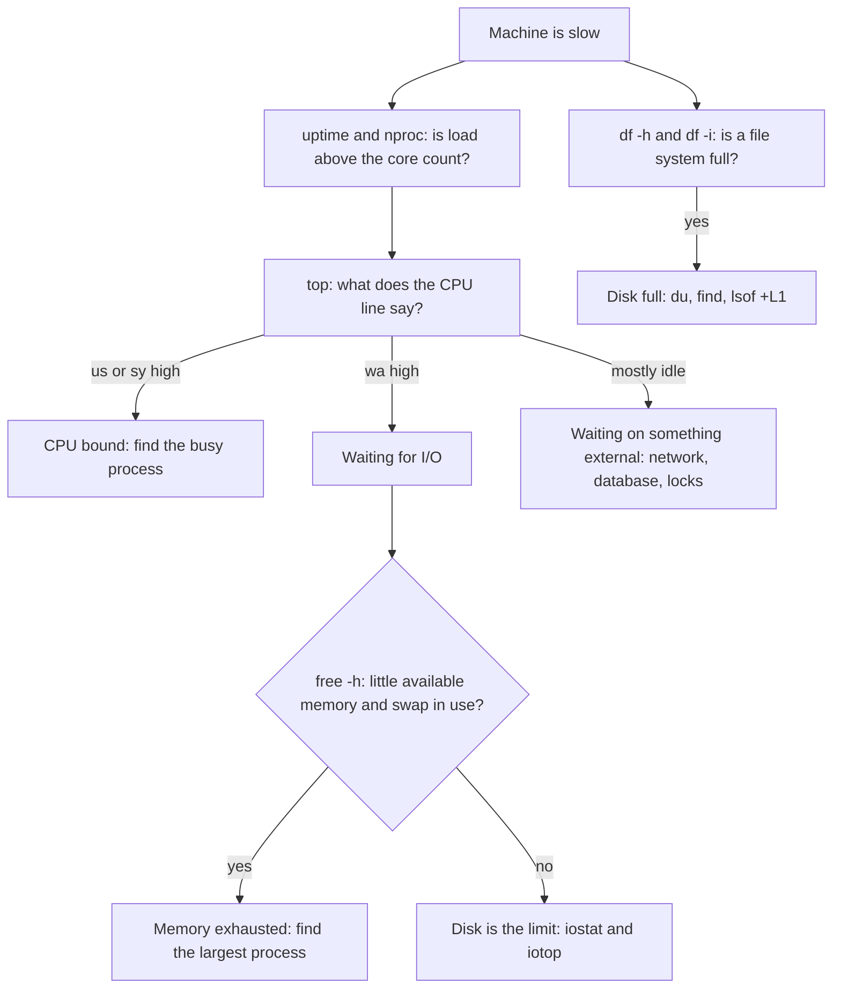

# Debugging a slow or full machine

> **Before this lesson:** you should know the monitoring commands from [Processes, jobs and signals](#/lesson/linux-cli/processes) and [nvidia-smi, resource monitoring and the Docker CLI](#/lesson/linux-cli/gpu-monitoring-docker), disk commands from [Storage media](#/lesson/linux-cli/storage-media), `find` from [Searching for files](#/lesson/linux-cli/finding-files) and log reading from [Environments, cron, systemd and log inspection](#/lesson/linux-cli/env-cron-systemd-logs).

## In plain words

Sooner or later a message arrives: "the server is really slow" or "the site is down — the disk is full". Often it arrives at an awkward hour, to the person who is **on call** — the engineer whose turn it is to respond to problems.

A doctor in an emergency room does not start with a rare-disease textbook. They follow a fixed routine: check breathing, pulse, blood pressure, temperature — the vital signs — in the same order every time, because the order prevents panic and catches the common causes first. Only then do they investigate the one sign that is abnormal.

A computer has vital signs too. A machine can be slow for only a handful of reasons: its **processors** are fully busy, its **memory** has run out, its **disk** is too slow or completely full, or it is **waiting for something else** — the network, a database, another service. This lesson gives you a routine that checks those in order, in about a minute, and then shows how to dig into whichever one is abnormal and how to fix it without making things worse.

Why this matters for a job: this is the standard "on-call" scenario and one of the most frequent interview questions for backend, operations and machine-learning roles ("The server is slow. What do you do?"). Interviewers and colleagues alike care less about a particular command than about seeing a calm, ordered method.

## Rule zero: look before you act

When something is broken there is pressure to *do* something: restart the service, reboot the machine, delete files. Resist it for sixty seconds.

- **A restart destroys evidence.** The process that was eating memory, the file that was growing, the connection that was stuck — all gone, and the problem returns tomorrow with no clue.
- **Reading is safe; writing is not.** Every command in the first-minute routine below only *reads*.
- **One change at a time.** If you change three things and it recovers, you do not know which one mattered.
- **Write down what you see and do**, with times. It is the raw material for explaining the incident afterwards.

> [!WARNING]
> The three most tempting reactions are the three most dangerous: `kill -9` on a process you have not identified, `rm -rf` on a directory you have not inspected, and `reboot`. A database killed mid-write may need recovery; a deleted directory may hold the only copy of something; a reboot hides the cause and, if the disk is full or a configuration is broken, the machine may not come back up at all. Identify first. Prefer reversible actions — stop a service, compress or move a file — over irreversible ones.

## The first minute

Run these in order. Together they show the four vital signs.

```bash
mira@web02:~$ uptime
 03:12:44 up 41 days,  6:02,  1 user,  load average: 18.42, 15.90, 9.71
mira@web02:~$ nproc
4
mira@web02:~$ free -h
               total        used        free      shared  buff/cache   available
Mem:            15Gi        14Gi       210Mi        88Mi       640Mi       420Mi
Swap:          4.0Gi       3.6Gi       400Mi
mira@web02:~$ df -h
Filesystem      Size  Used Avail Use% Mounted on
/dev/vda1        78G   52G   23G  70% /
/dev/vdb1       200G  118G   72G  63% /srv/data
mira@web02:~$ vmstat 1 5
procs -----------memory---------- ---swap-- -----io---- -system-- ------cpu-----
 r  b   swpd   free   buff  cache   si   so    bi    bo   in   cs us sy id wa st
 3 14 3774000 215000  11000 629000 9200 8800 10400  9100 2100 5400  9  6  4 81  0
 2 15 3775100 213800  11000 628400 8700 9100  9900  9400 2050 5200  8  7  3 82  0
mira@web02:~$ top -b -n 1 | head -n 12
mira@web02:~$ dmesg -T | tail -n 20
```

How to read each result — take them one at a time:

| Command | Look at | In this example | Meaning |
|---|---|---|---|
| `uptime` + `nproc` | load versus number of cores | load 18 on 4 cores, and rising (9.7 → 15.9 → 18.4) | far more work is queued than the machine can serve, and it is getting worse |
| `free -h` | **available** memory; swap used | 420 MiB available of 15 GiB; swap nearly full | memory is exhausted |
| `df -h` | any file system near 100% | 70% and 63% | disk space is fine |
| `vmstat 1 5` | `si`/`so`, `wa`, `r`, `b` | heavy swapping in and out; 81% I/O wait; 14 processes blocked | the machine is **thrashing**: moving memory to and from disk instead of working |
| `top` | the processes at the head of the list | (next section) | who is responsible |
| `dmesg -T` | recent kernel messages | (next section) | hardware errors, out-of-memory kills |

Notice how the signs fit together into one story: the load is high *not* because the processors are busy (`us` is only 9%) but because processes are stuck waiting for the disk (`wa` 81%), and the disk is busy because memory ran out and the system is swapping. One cause, three symptoms. Learning to connect the readings like this is the heart of the skill.



## Case 1 — The processors are busy

**Signs:** load above the core count, `us` (or `sy`) high, `wa` low, memory fine.

```bash
mira@web02:~$ ps -eo pid,ppid,user,pcpu,pmem,etime,cmd --sort=-pcpu | head -n 5
    PID    PPID USER     %CPU %MEM     ELAPSED CMD
  31877       1 app      398  3.1    02:14:09 python worker.py --queue images
   1204    1203 www-data  4.0  0.6 41-06:01:55 nginx: worker process
```

One process uses nearly four full cores (398%) and has done so for two hours. Now find out *what it is* before touching it:

```bash
mira@web02:~$ systemctl status 31877 | head -n 3        # which service does it belong to?
mira@web02:~$ ls -l /proc/31877/cwd                     # where was it started?
mira@web02:~$ journalctl -u image-worker --since "3 hours ago" | tail -n 20
```

Questions to ask: is this expected work (a batch job, a traffic peak) or a fault (an endless loop, a retry storm)? Did it start at the time of a deployment? Options, from gentle to forceful: let it finish; lower its priority with `renice +10 -p 31877` so that interactive work gets the processor first; ask it to stop with `kill 31877` (the TERM signal); restart its service with `systemctl restart`. Use `kill -9` only if it ignores TERM, and only once you know what it is.

## Case 2 — Memory has run out

**Signs:** little *available* memory, swap in use and active (`si`/`so` above zero), high `wa`, the whole machine sluggish, even over SSH.

```bash
mira@web02:~$ ps -eo pid,user,rss,pmem,etime,cmd --sort=-rss | head -n 4
    PID USER       RSS %MEM     ELAPSED CMD
  29410 app   12884120 78.9  5-02:41:10 /srv/api/.venv/bin/python -m uvicorn app:app
   2231 postgres 742000  4.5 41-06:01:02 postgres: checkpointer
```

`RSS` (resident set size) is the physical memory a process occupies, in kibibytes: this one holds about 12 GiB and has been running for five days. A process whose memory grows steadily over days has a **memory leak** — it keeps asking for memory and never gives it back.

When memory is completely exhausted, the kernel protects itself by ending a process. This is the **OOM killer** (*out of memory*). It leaves a record:

```bash
mira@web02:~$ dmesg -T | grep -i -E "out of memory|oom-kill|killed process"
[Fri Nov 20 02:58:13 2026] Out of memory: Killed process 28811 (python) total-vm:14811200kB, anon-rss:12411300kB
mira@web02:~$ journalctl -k --since "today" | grep -i oom
```

If a service "disappeared with no error in its own log", this is the first place to look: the program was given no chance to log anything.

Remedies: restarting the leaking service frees the memory at once (note the time and the size first, as evidence); the lasting fixes are to repair the leak, to limit the service (`MemoryMax=` in its systemd unit, or `--memory` for a container) so that it is restarted before it hurts its neighbours, or to give the machine more memory if the need is real.

## Case 3 — The disk is slow

**Signs:** high `wa`, memory fine, processes in state `D` (uninterruptible sleep, waiting for input/output).

```bash
mira@web02:~$ iostat -xz 1 3 | tail -n 2
Device            r/s     w/s     rkB/s     wkB/s  r_await  w_await  %util
vdb             12.0  1840.0     96.0  412000.0     0.80    38.20   99.6
mira@web02:~$ sudo iotop -o -b -n 1 | head -n 5
    PID  PRIO  USER     DISK READ  DISK WRITE  COMMAND
  30112 be/4  backup      0.00 B/s  398.21 M/s  tar -czf /srv/data/backup/nightly.tar.gz /srv/data/uploads
```

`%util` near 100 says the disk is saturated; `w_await` says each write waits 38 milliseconds. `iotop` names the process: the nightly backup, writing 400 MB per second onto the same disk the application uses. The fix here is scheduling and politeness — run it at a quieter hour, or under `ionice -c3` (lowest I/O priority) and `nice` — not killing a backup halfway.

## Case 4 — The disk is full

**Signs:** errors such as `No space left on device`, services failing to start, databases refusing writes, logins behaving oddly.

### Step 1 — which file system?

```bash
mira@web02:~$ df -h
Filesystem      Size  Used Avail Use% Mounted on
/dev/vda1        78G   78G     0 100% /
/dev/vdb1       200G  118G   72G  63% /srv/data
mira@web02:~$ df -i /
Filesystem      Inodes   IUsed   IFree IUse% Mounted on
/dev/vda1      5120000  412033 4707967    9% /
```

The root file system is full. `df -i` checks a second, separate limit: the number of **inodes** — one is needed for every file, whatever its size. A file system can report free space and still refuse new files because millions of tiny files used every inode. Here inodes are fine.

### Step 2 — what is using it?

Descend one level at a time, always following the biggest number:

```bash
mira@web02:~$ sudo du -xh --max-depth=1 / 2>/dev/null | sort -h | tail -n 4
3.9G	/usr
4.1G	/home
61G	/var
78G	/
mira@web02:~$ sudo du -xh --max-depth=1 /var | sort -h | tail -n 3
11G	/var/lib
49G	/var/log
61G	/var
mira@web02:~$ sudo du -ah /var/log | sort -h | tail -n 3
1.2G	/var/log/journal
46G	/var/log/weather/app.log
49G	/var/log
mira@web02:~$ sudo find / -xdev -type f -size +1G -printf '%s\t%TY-%Tm-%Td\t%p\n' 2>/dev/null | sort -rn | head -n 3
```

`-x` keeps `du` on this one file system (so the 200 GB data disk is not counted), `--max-depth=1` summarises one level, and `sort -h` understands the size suffixes. Three commands lead to a single 46 GB log file. The `find` line is a second route: list every file over 1 GiB, largest first, with its date.

### Step 3 — free space safely

A log file that a running program is still writing to must **not** be deleted with `rm` — see the trap below. Empty it in place:

```bash
mira@web02:~$ sudo tail -n 2000 /var/log/weather/app.log > /srv/data/app.log.tail   # keep recent evidence on another disk
mira@web02:~$ sudo truncate -s 0 /var/log/weather/app.log                            # empty it; the program keeps writing
mira@web02:~$ df -h / | tail -n 1
/dev/vda1        78G   32G   43G  43% /
```

Other usual sources of reclaimable space, each with its own safe command:

| Where | Command |
|---|---|
| systemd journal | `sudo journalctl --vacuum-size=500M` |
| package cache | `sudo apt clean` (or `sudo dnf clean all`) |
| old kernels and unused packages | `sudo apt autoremove --purge` |
| Docker images, containers, build cache | `docker system df`, then `docker image prune`, `docker builder prune` |
| old rotated logs | `sudo find /var/log -name '*.gz' -mtime +30 -delete` (preview with `-print` first) |
| temporary files | `sudo find /tmp -xdev -type f -mtime +7 -delete` |
| a user's caches | `du -sh ~/.cache/*` — for example `pip cache purge` |

### The deleted-but-open trap

Sometimes `df` says the disk is full while `du` finds far less. The usual reason: someone deleted a huge file with `rm`, but a running program still has it open. The name is gone — so `du` and `ls` cannot see it — yet the space stays allocated until that program closes the file.

```bash
mira@web02:~$ sudo lsof +L1 | head -n 3
COMMAND   PID USER   FD   TYPE DEVICE    SIZE/OFF NLINK    NODE NAME
python  29410  app    3w   REG  252,1 49392123904     0 1311024 /var/log/weather/app.log (deleted)
```

`lsof +L1` lists open files with a link count below one — that is, deleted ones. This process holds 49 GB of invisible space. To release it, restart the service that holds the file (`sudo systemctl restart weather-api`), which closes it.

The model below shows why the two tools disagree: `du` adds up files that have names; `df` asks the file system how many blocks are in use.

```python-run
files = {"app.log": 46, "access.log": 3, "journal": 1}      # name -> size in GB (files that have names)
open_handles = {"python (PID 29410)": "app.log"}            # process -> file it holds open
blocks_in_use = dict(files)                                 # what the file system has allocated

def report(label):
    du = sum(files.values())
    df = sum(blocks_in_use.values())
    print(f"{label:38} du sees {du:3d} GB | df sees {df:3d} GB | hidden: {df - du} GB")

report("start")

del files["app.log"]                                        # rm app.log - only the NAME is removed
report("after rm (program still running)")                  # blocks stay allocated: the file is still open

holder = [p for p, f in open_handles.items() if f == "app.log"]
print("   lsof +L1 would show:", holder)

open_handles.clear(); del blocks_in_use["app.log"]          # restart the program: the handle is closed
report("after restarting the program")

files["app.log"] = 46; blocks_in_use["app.log"] = 46        # alternative history: truncate instead of rm
files["app.log"] = 0;  blocks_in_use["app.log"] = 0
report("truncate -s 0 (no restart needed)")
```

### Step 4 — stop it happening again

Freeing space ends the incident; it does not fix the cause. Why did the log grow to 46 GB — a missing log-rotation rule, debug logging left switched on, an error repeated ten thousand times a second? Add a `logrotate` rule, cap the journal (`SystemMaxUse=` in `journald.conf`), and set an alert at 80% so that the next person hears about it before the disk is full.

## Case 5 — Nothing on this machine is busy

**Signs:** users report slowness, yet load is low, memory is fine and the disks are idle. The machine is not working hard — it is **waiting** for something outside itself.

```bash
mira@web02:~$ curl -s -o /dev/null -w 'dns %{time_namelookup}  connect %{time_connect}  first byte %{time_starttransfer}  total %{time_total}\n' http://localhost:8000/api/forecast?city=Oslo
dns 0.000  connect 0.001  first byte 4.812  total 4.813
mira@web02:~$ ss -tn state established | awk '{print $4}' | cut -d: -f1 | sort | uniq -c | sort -rn | head -n 3
    194 10.0.4.12
mira@web02:~$ nc -vz -w 3 10.0.4.12 5432
Connection to 10.0.4.12 5432 port [tcp/postgresql] succeeded!
mira@web02:~$ journalctl -u weather-api --since "15 min ago" | grep -i -E "timeout|pool|refused" | tail -n 3
Nov 20 03:20:11 web02 uvicorn[29410]: sqlalchemy.exc.TimeoutError: QueuePool limit of size 20 overflow 10 reached
```

The `curl` timing shows the connection is instant and the wait is all before the first byte of the reply: the application itself is slow to answer. The second command counts open connections per remote address — 194 to the database server. The log confirms it: the application has run out of database connections and requests are queueing. The slow part is the database (or the queries sent to it), and the investigation moves there. Other external causes show up the same way: slow name lookups (`time_namelookup`), an unreachable dependency, a network file system that has stopped answering.

## After the fire is out

1. **Confirm recovery** with the same commands that showed the problem — and from the user's side (`curl` the public address).
2. **Write a short record**: when it started, how it was noticed, what the readings were, what was done, when it recovered.
3. **Find the root cause** — the underlying reason, not the symptom. "The disk filled" is a symptom; "debug logging was enabled in release 2.4.1 and no rotation rule existed" is a cause.
4. **Prevent recurrence**: a rotation rule, a memory limit, an alert, a fix in the code.
5. **Keep it blameless.** The aim of a review after an incident (often called a *post-mortem*) is to improve the system, not to find someone at fault.

> [!TIP]
> Know what "normal" looks like before anything breaks. Run the first-minute commands on a healthy day and keep the output. Historical figures help too: the `sysstat` package records statistics every ten minutes, so `sar -u -f /var/log/sysstat/sa19` shows processor use for the 19th and `sar -r` memory — which answers "when did this start?" without guessing.

> [!INTERVIEW]
> "A server is slow — what do you do?" Give the method, not a list: (1) clarify what "slow" means and when it began; (2) check the vital signs in order — load against cores, processor breakdown including I/O wait, available memory and swap, disk space and inodes; (3) identify the responsible process with `top`/`ps`, read its logs and the kernel log; (4) ask what changed recently; (5) apply the least destructive fix and verify; (6) follow up on the root cause. For "the disk is full": `df -h` to find the file system, `du … | sort -h` to find the directory, mention `lsof +L1` for deleted-but-open files and `df -i` for inodes, and say why you would truncate a live log instead of deleting it. Those two details mark real experience.

## Pitfalls

- **Acting before reading**; restarting or rebooting first and losing the evidence.
- **Judging memory by "free"** instead of "available".
- **Judging load without the core count**, or assuming high load means busy processors when it is I/O wait.
- **Deleting a log that a process holds open** and wondering why no space was freed.
- **Checking bytes but not inodes.**
- **Running `du` without `-x`** and counting other mounted disks.
- **`rm -rf` on a directory because its name looks unimportant.**
- **Fixing the symptom and closing the incident**, so that it returns next week.
- **Changing several things at once.**

## Cheat sheet

| Question | Command |
|---|---|
| Load and its trend; core count | `uptime`, `nproc` |
| Memory and swap | `free -h` |
| Per-second overview (run queue, swap, I/O wait) | `vmstat 1 5` |
| Busiest processes by CPU / memory | `ps -eo pid,user,pcpu,pmem,etime,cmd --sort=-pcpu \| head`, `--sort=-rss` |
| Live view | `top`, `htop` |
| Kernel messages, OOM kills | `dmesg -T \| tail`, `journalctl -k \| grep -i oom` |
| Disk activity and who causes it | `iostat -xz 1`, `sudo iotop -o` |
| Which file system is full | `df -h`, `df -i` |
| Which directory | `sudo du -xh --max-depth=1 /path \| sort -h` |
| Files over 1 GiB | `sudo find / -xdev -type f -size +1G` |
| Deleted files still held open | `sudo lsof +L1` |
| Empty a live log safely | `sudo truncate -s 0 file` |
| Shrink the journal | `sudo journalctl --vacuum-size=500M` |
| What a process is and where it runs | `systemctl status PID`, `ls -l /proc/PID/cwd` |
| Where a request spends its time | `curl -s -o /dev/null -w '%{time_total}\n' URL` |
| Connections per remote address | `ss -tn state established` |
| History of resource use | `sar -u`, `sar -r` |

## Summary

- Slowness has few causes: busy processors, exhausted memory, slow or full disks, or waiting on something external. Check them in a fixed order, with read-only commands, before changing anything.
- Read load against the number of cores, look at I/O wait and swap activity, and connect the readings into one explanation.
- Identify the responsible process, find out what it is and what changed, then choose the gentlest remedy: let it finish, lower priority, TERM, restart — never an unexamined `kill -9`.
- For a full disk: `df -h` and `df -i`, then `du -x … | sort -h` level by level; truncate live logs instead of deleting them; use `lsof +L1` when `df` and `du` disagree.
- After recovery, verify, record, find the root cause and prevent a repeat.

## Glossary

| Term | Meaning |
|---|---|
| on call | being the person responsible for responding to problems at a given time |
| incident | an unplanned event that disrupts a service |
| vital signs | here: load, processor use, memory, disk — the first things to check |
| load average | average number of processes running or waiting to run |
| I/O wait | processor time spent idle while waiting for storage |
| swap | disk space used as overflow for memory |
| thrashing | a state in which the system spends its time swapping instead of working |
| RSS | resident set size: the physical memory a process occupies |
| memory leak | a program that keeps acquiring memory without releasing it |
| OOM killer | the kernel mechanism that ends a process when memory is exhausted |
| saturated | used to its full capacity, so that work queues up |
| inode | the record a file system keeps for each file; their number is limited |
| truncate | to cut a file's length, for example to zero, keeping the file itself |
| root cause | the underlying reason for a problem, as opposed to its symptoms |
| post-mortem | a blameless review written after an incident |

## Check yourself

```quiz
[
  {"q": "What should you do first when told that a production server is slow?",
   "options": ["Reboot it", "Run read-only commands to check load, memory, disk and the busiest processes", "Delete old log files", "Kill the largest process with kill -9"],
   "answer": 1,
   "explain": "Observation costs seconds and preserves the evidence. Restarts and deletions may hide the cause or make matters worse."},
  {"q": "Load average is 16 on a 4-core machine, the CPU line shows 5% user time and 85% wa. What is the most likely situation?",
   "options": ["The processors are busy computing", "Processes are queued waiting for disk input/output", "The machine is idle", "The network is down"],
   "answer": 1,
   "explain": "High load with low user time and high I/O wait means work is blocked on storage, often because of a saturated disk or swapping."},
  {"q": "`free -h` shows almost no available memory and swap is nearly full, with `vmstat` showing large si and so values. What is happening?",
   "options": ["The disk is full", "The system is thrashing: memory is exhausted and pages are constantly moved to and from swap", "The CPU is overheating", "Nothing unusual"],
   "answer": 1,
   "explain": "Sustained swap-in and swap-out activity means the workload does not fit in memory, and the machine becomes extremely slow."},
  {"q": "A service vanished without writing any error to its own log. Where should you look for an out-of-memory kill?",
   "options": ["In /etc/passwd", "In the kernel log, with dmesg -T or journalctl -k", "In the crontab", "In ~/.bashrc"],
   "answer": 1,
   "explain": "The kernel's OOM killer records the process it terminated in the kernel log. The victim gets no chance to log anything itself."},
  {"q": "`df -h` reports / at 100% but `du -sh /` totals only 30 GB of an 80 GB disk. What is the classic explanation?",
   "options": ["du is broken", "A large file was deleted while a process still has it open, so its space is still allocated", "The disk is encrypted", "df counts in different units"],
   "answer": 1,
   "explain": "Space is released only when the last open handle is closed. lsof +L1 lists such files; restarting the holder frees the space."},
  {"q": "Why is `truncate -s 0 app.log` preferred to `rm app.log` for a huge log that a running service writes to?",
   "options": ["truncate is faster to type", "Truncating frees the space immediately while the service keeps its open file; rm would leave the space allocated until the service restarts", "rm does not work on logs", "truncate also compresses the file"],
   "answer": 1,
   "explain": "Removing the name does not release blocks held by an open file descriptor. Emptying the file in place does."},
  {"q": "An application reports 'No space left on device' although `df -h` shows 40% used. What should you check?",
   "options": ["uptime", "df -i, for inode exhaustion", "nproc", "free -h"],
   "answer": 1,
   "explain": "Every file needs an inode. Enormous numbers of small files can use them all while bytes remain free."},
  {"q": "After freeing space on a disk filled by a runaway log, what remains to be done?",
   "options": ["Nothing; the incident is over", "Find why the log grew and prevent it: rotation, log level, an alert", "Reinstall the operating system", "Delete the application"],
   "answer": 1,
   "explain": "Clearing the symptom restores service, but without addressing the root cause the same incident will recur."}
]
```

> **Source:** original material for this guide; the underlying tools are introduced in Shotts, *The Linux Command Line*, ch. 10 (Processes), ch. 15 (Storage Media) and ch. 17 (Searching for Files).
