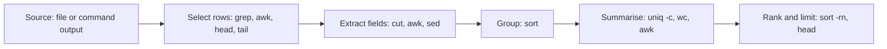

# One-liners explained piece by piece

> **Before this lesson:** you should know pipes ([Redirection and pipelines](#/lesson/linux-cli/redirection-pipelines)), the text filters ([Text processing I](#/lesson/linux-cli/text-processing-1) and [II](#/lesson/linux-cli/text-processing-2)), patterns ([Regular expressions with grep](#/lesson/linux-cli/regular-expressions)), `find` and `xargs` ([Searching for files](#/lesson/linux-cli/finding-files)) and loops ([Loops](#/lesson/linux-cli/loops)).

## In plain words

A **one-liner** is a complete small program typed on a single command line: several simple tools connected by pipes so that the output of each becomes the input of the next. Experienced people produce them so quickly that they can look like magic spells.

They are not spells. They are more like sentences in a foreign language. A long sentence is intimidating until you notice it is made of short, ordinary words in a regular order. The same holds here: every one-liner in this lesson is built from perhaps fifteen "words" you already know, and nearly all follow one of a few sentence patterns.

Another picture: an assembly line. Raw material enters at the left; each station does exactly one small job — select, cut, sort, count — and passes the piece along; the finished product drops out at the right. To understand any line, walk along the belt and look at what comes out of each station.

Why this matters for a job: these lines are how questions get answered in the middle of real work — "which customer sends the most requests?", "what changed in this directory today?", "how many errors per minute since the deployment?" — in seconds, without writing a program. Reading other people's one-liners is equally important: they are everywhere in documentation, in team chat and in scripts you will inherit.

## How to read (and write) any one-liner

1. **Split at the pipes.** Each `|` separates one station from the next.
2. **Run only the first stage** and look at its output. Add `| head` so that only a few lines appear.
3. **Add one stage at a time**, looking at the output after each addition.
4. **Say what each stage does in a short phrase**: "keep lines with ERROR", "take column 1", "count".

Writing one is the same procedure: begin with the data, and grow the line one station at a time. Nobody types a six-stage pipeline correctly in one go; they build it up with the up-arrow key.



Most analytical one-liners are some subset of these five stations, in this order.

### A two-minute introduction to `awk`

Several lines below use `awk`, a small language for text arranged in columns. Three facts are enough to read every example here:

- `awk` reads its input line by line and splits each line into fields at whitespace. `$1` is the first field, `$2` the second, `$NF` the last, and `$0` the whole line. `NR` is the current line number.
- A program has the form `condition { action }`. For each line, if the condition is true the action runs. Without a condition the action runs on every line; without an action the line is printed.
- `-F,` sets another field separator (here a comma). `END { … }` runs once after the last line.

```bash
mira@forge:~$ printf 'ana 30\nben 25\ncy 41\n' | awk '{print $1}'            # first field of every line
ana
ben
cy
mira@forge:~$ printf 'ana 30\nben 25\ncy 41\n' | awk '$2 > 28 {print $1}'    # only where field 2 exceeds 28
ana
cy
mira@forge:~$ printf 'ana 30\nben 25\ncy 41\n' | awk '{sum += $2} END {print sum}'   # add up field 2
96
```

Always put the `awk` program in **single quotes**, so that the shell does not try to interpret `$1` itself.

## The sample data

Most examples use this access log. Each line has: client address, time, method, path, status code, response size in bytes, and duration in milliseconds.

```bash
mira@forge:~/lab$ head -n 4 access.log
203.0.113.9 2026-11-20T09:00:01 GET /api/forecast 200 512 12
198.51.100.4 2026-11-20T09:00:01 GET /health 200 2 1
203.0.113.9 2026-11-20T09:00:02 POST /api/login 401 87 9
192.0.2.77 2026-11-20T09:00:03 GET /api/forecast 500 0 1840
```

## One-liner 1 — The busiest clients

**Question:** which five addresses sent the most requests?

```bash
mira@forge:~/lab$ awk '{print $1}' access.log | sort | uniq -c | sort -rn | head -n 5
  30172 203.0.113.9
   8841 198.51.100.4
    977 192.0.2.140
    212 192.0.2.77
     64 198.51.100.200
```

| Stage | What it does | What flows out |
|---|---|---|
| `awk '{print $1}' access.log` | keep the first field of every line | one address per line |
| `sort` | put equal addresses next to each other | the same lines, grouped |
| `uniq -c` | replace each run of equal lines with "count, value" | one line per distinct address |
| `sort -rn` | sort **n**umerically, **r**eversed | biggest count first |
| `head -n 5` | keep the first five lines | the answer |

The first `sort` is there because `uniq` only merges lines that are neighbours. The second needs `-n` because without it `977` would sort after `30172` (text order compares character by character). Change `$1` to another field and the same line answers a different question: `$4` gives the most requested paths, `$5` the distribution of status codes.

The block below runs each station as a separate Python step and prints what flows between them — the "walk along the belt" made literal.

```python-run
from itertools import groupby

log = """203.0.113.9 2026-11-20T09:00:01 GET /api/forecast 200 512 12
198.51.100.4 2026-11-20T09:00:01 GET /health 200 2 1
203.0.113.9 2026-11-20T09:00:02 POST /api/login 401 87 9
192.0.2.77 2026-11-20T09:00:03 GET /api/forecast 500 0 1840
203.0.113.9 2026-11-20T09:00:04 GET /api/forecast 200 512 14
198.51.100.4 2026-11-20T09:01:01 GET /health 200 2 1
192.0.2.77 2026-11-20T09:01:07 GET /api/forecast 500 0 2210""".splitlines()

def show(stage, lines, limit=4):
    print(f"--- after: {stage}")
    for line in lines[:limit]:
        print("   ", line)
    if len(lines) > limit:
        print(f"    ... ({len(lines)} lines)")

stage1 = [line.split()[0] for line in log];                      show("awk '{print $1}'", stage1)
stage2 = sorted(stage1);                                          show("sort", stage2)
stage3 = [f"{len(list(g)):7d} {k}" for k, g in groupby(stage2)];  show("uniq -c", stage3)
stage4 = sorted(stage3, key=lambda s: -int(s.split()[0]));        show("sort -rn", stage4)
show("head -n 2", stage4[:2])
```

## One-liner 2 — Errors per minute

**Question:** when did the server errors (status 500 and above) happen?

```bash
mira@forge:~/lab$ awk '$5 >= 500 {print substr($2, 1, 16)}' access.log | uniq -c
      3 2026-11-20T09:00
     61 2026-11-20T09:01
     74 2026-11-20T09:02
      2 2026-11-20T09:03
```

- `$5 >= 500` is the condition: only lines whose fifth field, the status, is at least 500.
- `substr($2, 1, 16)` takes 16 characters of the time field starting at position 1 — the date, hour and minute, dropping the seconds. (In `awk`, positions start at 1.)
- `uniq -c` counts runs. No `sort` is needed here: a log is already in time order, so equal minutes are already neighbours.

The idea — cut a timestamp down to the unit you care about, then count — gives "per hour" (13 characters) or "per day" (10 characters) with one changed number.

## One-liner 3 — Average and slowest response time per path

```bash
mira@forge:~/lab$ awk '{n[$4]++; t[$4] += $7; if ($7 > m[$4]) m[$4] = $7}
      END {for (p in n) printf "%-16s %7d requests  avg %7.1f ms  max %6d ms\n", p, n[p], t[p]/n[p], m[p]}' access.log | sort -k4 -rn
/api/forecast      31204 requests  avg   184.2 ms  max   9120 ms
/api/login          1877 requests  avg    11.4 ms  max    212 ms
/health             8841 requests  avg     1.0 ms  max      3 ms
```

This is longer, but it is three small ideas:

- `n[$4]++` uses the path (field 4) as the key of a lookup table `n` and adds one: a counter per path.
- `t[$4] += $7` adds the duration (field 7) to a running total per path; the `if` remembers the largest.
- `END { … }` runs after the last line: for each path, print the count, the total divided by the count, and the maximum, in aligned columns.

The tables `n`, `t` and `m` are **associative arrays**: lookup tables indexed by text. This "group and aggregate" shape is what the sort-and-count pipeline cannot do, and it is the main reason to learn a little `awk`. The final `sort -k4 -rn` orders by the fourth column of the output, the average.

## One-liner 4 — What is using the disk?

```bash
mira@forge:~$ sudo du -xh --max-depth=1 /var 2>/dev/null | sort -h | tail -n 5
1.9G	/var/cache
11G	/var/lib
49G	/var/log
61G	/var
```

| Piece | Meaning |
|---|---|
| `du -xh --max-depth=1 /var` | the size of each directory directly under `/var`; `-x` stays on one file system, `-h` prints readable units |
| `2>/dev/null` | throw away "permission denied" messages |
| `sort -h` | sort by size, understanding `K`, `M`, `G` |
| `tail -n 5` | the five largest (the total is last) |

Repeat it one level down on the biggest entry until you reach the culprit.

## One-liner 5 — Files changed recently, newest first

```bash
mira@forge:~/proj$ find . -type f -mmin -60 -not -path './.git/*' -printf '%TY-%Tm-%Td %TH:%TM  %p\n' | sort -r | head -n 5
2026-11-20 14:52  ./src/app.py
2026-11-20 14:47  ./tests/test_app.py
2026-11-20 14:10  ./README.md
```

- `-type f -mmin -60` selects regular files modified less than 60 minutes ago.
- `-not -path './.git/*'` leaves out Git's own files.
- `-printf '…  %p\n'` prints each file's modification date and time followed by its path. The date format (year, month, day) sorts correctly as plain text.
- `sort -r | head -n 5` gives the five newest.

## One-liner 6 — Search and replace across a project

**Task:** rename the function `load_legacy` to `load_dataset` in every Python file.

```bash
mira@forge:~/proj$ grep -rl --include='*.py' 'load_legacy' .                      # 1. which files?
./src/utils/io.py
./tests/test_io.py
mira@forge:~/proj$ grep -rn --include='*.py' 'load_legacy' . | head -n 3           # 2. look at the matches
mira@forge:~/proj$ grep -rlZ --include='*.py' 'load_legacy' . | xargs -0 sed -i 's/\bload_legacy\b/load_dataset/g'
mira@forge:~/proj$ git diff --stat                                                 # 3. review
 src/utils/io.py    | 4 ++--
 tests/test_io.py   | 2 +-
```

- `grep -rl` lists the **names** of files containing the text; `--include='*.py'` restricts it to Python files.
- `-Z` ends each name with a NUL character and `xargs -0` reads them that way, so names containing spaces are handled correctly.
- `xargs` turns the list of names into arguments for `sed`.
- `sed -i 's/…/…/g'` edits each file in place; `\b` marks a word boundary, so `load_legacy_v2` is left alone.

> [!WARNING]
> One-liners that end in `rm`, `sed -i`, `mv`, `xargs` with a changing command, or `> file` act on everything the earlier stages produced — and the earlier stages can easily produce more than you expected. **Run the line without its final, destructive stage first and read the list.** Then recall the line with the up-arrow and add the last stage, so the selection is guaranteed identical. Do such edits inside a Git repository (so that `git diff` shows the result and `git checkout` undoes it) or give `sed -i` a backup suffix. And never paste a line from the internet into a terminal without reading it stage by stage; a shortened or disguised line containing `rm -rf` or `curl … | sh` is a classic way to ruin a machine.

## One-liner 7 — Rename many files

**Task:** change every `.jpeg` ending to `.jpg`.

```bash
mira@forge:~/photos$ for f in *.jpeg; do echo mv -- "$f" "${f%.jpeg}.jpg"; done      # dry run: only prints
mv -- holiday 1.jpeg holiday 1.jpg
mv -- sunset.jpeg sunset.jpg
mira@forge:~/photos$ for f in *.jpeg; do mv -- "$f" "${f%.jpeg}.jpg"; done           # the real thing
```

- `for f in *.jpeg` runs the body once per matching file.
- `${f%.jpeg}` is the name with the ending `.jpeg` removed; `.jpg` is then added.
- `--` tells `mv` that no options follow, in case a name begins with a dash; the quotes keep names with spaces whole.
- The first version has `echo` in front, so it only **shows** the commands. This "dry run" habit catches mistakes before they happen.

## One-liner 8 — Processes: who is using the memory?

```bash
mira@forge:~$ ps -eo user,rss --no-headers | awk '{mem[$1] += $2} END {for (u in mem) printf "%-10s %6.1f GiB\n", u, mem[u]/1048576}' | sort -k2 -rn | head -n 3
mira         14.3 GiB
postgres      2.1 GiB
root          0.9 GiB
```

`ps -eo user,rss` prints the owner and the memory (in kibibytes) of every process. The `awk` program adds the memory per user and, at the end, prints each total converted to gibibytes (1 GiB = 1,048,576 KiB). `sort -k2 -rn` ranks by the second column.

Two shorter relatives:

```bash
mira@forge:~$ ps aux --sort=-%mem | head -n 4                 # the three largest processes (plus the header)
mira@forge:~$ pgrep -fa 'train.py' | wc -l                    # how many training processes are running?
```

## One-liner 9 — Set operations on lists

**Question:** which users are in yesterday's list but not in today's?

```bash
mira@forge:~/lab$ comm -23 <(sort yesterday.txt) <(sort today.txt)
otto
priya
mira@forge:~/lab$ comm -12 <(sort yesterday.txt) <(sort today.txt) | wc -l      # how many appear in both?
1841
mira@forge:~/lab$ sort yesterday.txt today.txt | uniq -d | wc -l                 # the same, another way
1841
```

`comm` compares two sorted files and prints three columns — only in the first, only in the second, in both. `-23` hides columns 2 and 3, leaving what is only in the first. `<(sort file)` is **process substitution**: it lets `comm` read the output of a command as if it were a file, so no temporary files are needed.

## One-liner 10 — JSON from an API

```bash
mira@forge:~$ curl -fsS 'https://api.example.net/cities?limit=200' | jq -r '.items[] | select(.population > 1000000) | [.name, .population] | @tsv' | sort -t$'\t' -k2 -rn | head -n 3
Lima	10092000
Bogota	7743955
Santiago	6257516
```

- `curl -fsS` fetches the data: fail on HTTP errors, no progress meter, but show real errors.
- `jq -r '…'` takes each element of `items`, keeps those with more than a million people, and prints name and population separated by a tab (`@tsv`), as raw text.
- `sort -t$'\t' -k2 -rn` sorts on the second tab-separated column, numerically, largest first. `$'\t'` is the shell's way of writing a tab character.

## One-liner 11 — Do something on every server

```bash
mira@forge:~$ for h in web01 web02 web03; do printf '%-6s %s\n' "$h" "$(ssh -n "$h" 'df --output=pcent / | tail -n 1')"; done
web01   41%
web02   97%
web03   38%
```

The loop visits each host; `ssh -n host 'command'` runs the command there (the `-n` stops `ssh` from consuming the loop's input); `$( … )` captures the answer; `printf` lines the results up. One line reveals that `web02` is nearly full.

A parallel version of the same idea, for long host lists:

```bash
mira@forge:~$ xargs -a hosts.txt -P 8 -I {} ssh -n {} 'echo "$(hostname): $(uptime | sed "s/.*load average: //")"'
```

`xargs -a hosts.txt` reads items from a file, `-I {}` substitutes each into the command, and `-P 8` runs up to eight at a time.

## One-liner 12 — Watch something change

```bash
mira@forge:~$ watch -n 5 'ls -lt /srv/runs/exp12/checkpoints | head -n 4'
mira@forge:~$ tail -f app.log | grep --line-buffered -E 'ERROR|WARN'
mira@forge:~$ while sleep 60; do printf '%s %s\n' "$(date +%T)" "$(grep -c ERROR app.log)"; done
14:01:07 212
14:02:07 219
```

`watch` reruns a command every few seconds and shows the latest output. The second line follows a growing log and shows only the worrying lines; `--line-buffered` makes `grep` pass each line on at once instead of saving them up. The third prints a time-stamped error count once a minute — a home-made monitor (stop it with `Ctrl-C`).

## A phrase book

| Purpose | Idiom |
|---|---|
| top N most frequent values | `… \| sort \| uniq -c \| sort -rn \| head -n N` |
| count distinct values | `… \| sort -u \| wc -l` |
| sum a column | `awk '{s += $3} END {print s}'` |
| average of a column | `awk '{s += $3} END {print s / NR}'` |
| rows where a column meets a condition | `awk '$5 >= 500'` |
| last field of each line | `awk '{print $NF}'` |
| skip a header line | `tail -n +2 file` |
| lines 20 to 30 | `sed -n '20,30p' file` |
| remove blank lines / comments | `grep -v '^$'`, `grep -v '^#'` |
| squeeze repeated spaces, then cut | `tr -s ' ' \| cut -d' ' -f3` |
| one item per line from a separated list | `tr ',' '\n'` |
| join lines with commas | `paste -sd,` |
| act on each found file, safely | `find … -print0 \| xargs -0 cmd` |
| run on N items in parallel | `xargs -P N -n 1 cmd` |
| compare two command outputs | `diff <(cmd1) <(cmd2)` |
| time-stamped file name | `backup-$(date +%F).tar.gz` |
| repeat a command every 2 s | `watch -n 2 'cmd'` |
| look at a sample mid-pipeline | `… \| tee /tmp/stage.txt \| …` |

> [!TIP]
> When a line stops being readable, stop adding to it. Once you need more than about five stages, variables, or the same line next week, move it into a script file with a name, comments and one stage per line. A one-liner is for answering a question now; a script is for answering it again.

> [!INTERVIEW]
> You may be handed a one-liner and asked "what does this do?", or given a small file and asked to produce a count or a ranking. Use the method from this lesson aloud: split at the pipes, describe each stage in a few words, state what flows between them. Expect follow-ups such as "why is `sort` there twice?", "what if a file name has a space in it?" (`-print0` with `xargs -0`, or quotes in a loop) and "how would you check it before running it on production?" (drop the destructive last stage, or put `echo` in front). Being able to translate between `cut`/`sort`/`uniq` and an equivalent `awk` program is a bonus.

## Pitfalls

- **Typing a long line in one go** instead of growing it stage by stage.
- **`uniq` without a preceding `sort`** (except on data that is already grouped).
- **Text sort where a numeric sort is needed**: remember `-n`, `-h` and `-k`.
- **Double quotes around `awk` or `jq` programs**, letting the shell eat `$1` and friends.
- **Parsing `ls` output**, or file names with spaces flowing through plain `xargs`.
- **A destructive final stage on an unchecked list.**
- **Buffered output** in a live pipeline: `tail -f | grep | awk` seems stuck because tools save output up when not writing to a terminal; use `grep --line-buffered` or `stdbuf -oL`.
- **Useless stages**: `cat file | grep x | wc -l` is `grep -c x file`.
- **Cleverness over clarity.** The line that a colleague can read is the better line.

## Cheat sheet

| Task | One-liner |
|---|---|
| Top 10 values of column 1 | `awk '{print $1}' f \| sort \| uniq -c \| sort -rn \| head` |
| Count lines matching a pattern | `grep -c 'pattern' f` |
| Events per minute from a timestamp in column 2 | `awk '{print substr($2,1,16)}' f \| uniq -c` |
| Sum / average of column 7 | `awk '{s+=$7} END {print s, s/NR}' f` |
| Largest directories | `du -xh --max-depth=1 /path \| sort -h \| tail` |
| Largest files | `find . -type f -printf '%s\t%p\n' \| sort -rn \| head` |
| Files changed in the last day | `find . -type f -mtime -1` |
| Replace text in many files | `grep -rlZ 'old' . \| xargs -0 sed -i 's/old/new/g'` |
| Rename by extension | `for f in *.a; do mv -- "$f" "${f%.a}.b"; done` |
| Lines in A but not in B | `comm -23 <(sort A) <(sort B)` |
| Field from JSON | `curl -fsS URL \| jq -r '.items[].name'` |
| Same command on several hosts | `for h in a b c; do ssh -n "$h" 'cmd'; done` |
| Follow a log, errors only | `tail -f f \| grep --line-buffered ERROR` |

## Summary

- A one-liner is a pipeline of small tools; read it by splitting at the pipes and describing each stage, and write it by adding one stage at a time while watching the output.
- Most analysis follows the pattern select → extract → group → summarise → rank; `sort | uniq -c | sort -rn | head` is its best-known form.
- `awk` adds conditions on fields, arithmetic and per-group totals with associative arrays; `jq` plays the same role for JSON.
- `find`, `xargs`, loops and process substitution extend pipelines to files, hosts and comparisons.
- Preview before any destructive final stage, keep file names safe with quotes or NUL separators, and turn a line into a script once it outgrows one screen.

## Glossary

| Term | Meaning |
|---|---|
| one-liner | a small program written as a single command line |
| pipeline | commands joined by pipes, each feeding the next |
| stage | one command within a pipeline |
| filter | a program that reads lines, transforms or selects them and prints the result |
| field | one column of a line, separated from the next by a delimiter |
| `awk` | a small language for processing text arranged in fields |
| aggregate | to combine many values into one, such as a count, sum or average |
| associative array | a lookup table indexed by text keys |
| process substitution | `<(cmd)`: a command's output used where a file name is expected |
| NUL separator | a zero byte used between file names because it cannot occur inside one |
| dry run | a rehearsal that prints what would be done without doing it |
| idiom | a short, commonly used combination of commands |
| buffering | holding output back and delivering it in chunks instead of line by line |

## Check yourself

```quiz
[
  {"q": "What is the most reliable way to understand an unfamiliar one-liner?",
   "options": ["Run it as root and see what happens", "Split it at the pipes and run it stage by stage, looking at the output after each stage", "Read it from right to left once", "Search for it on the internet"],
   "answer": 1,
   "explain": "Each stage is a simple transformation. Seeing the intermediate output makes the purpose of every stage clear, and nothing destructive runs until you understand it."},
  {"q": "In `awk '{print $4}' access.log | sort | uniq -c | sort -rn | head -n 3`, what does the output show?",
   "options": ["The first three lines of the file", "The three most frequent values of the fourth field, with their counts", "The three largest numbers in the file", "Lines 3 and 4"],
   "answer": 1,
   "explain": "Field 4 is extracted, equal values are grouped and counted, the counts are ranked and the top three kept."},
  {"q": "What does the awk program `$5 >= 500 {print $1}` do?",
   "options": ["Prints the fifth field 500 times", "For lines whose fifth field is at least 500, prints the first field", "Prints lines longer than 500 characters", "Adds 500 to field 5"],
   "answer": 1,
   "explain": "An awk rule is condition then action in braces. The action runs only for lines where the condition holds."},
  {"q": "Why should the program given to awk be in single quotes?",
   "options": ["awk requires them for all arguments", "So that the shell does not replace things like the dollar-one field reference before awk sees them", "To make it run faster", "Single quotes enable regular expressions"],
   "answer": 1,
   "explain": "Inside double quotes the shell would expand the positional parameter, usually to nothing, and awk would receive a different program."},
  {"q": "What does `awk '{s += $3} END {print s}' file` print?",
   "options": ["The third line", "The sum of the third field over all lines", "The number of lines", "The last value of field 3"],
   "answer": 1,
   "explain": "The first block adds field 3 to a running total for every line; the END block runs once afterwards and prints it."},
  {"q": "Before running `grep -rlZ 'old' . | xargs -0 sed -i 's/old/new/g'` on a project, what should you do?",
   "options": ["Nothing, it is always safe", "Run the grep part alone to see which files and lines would be affected, and work in a repository or keep backups", "Add sudo", "Remove the -0 option"],
   "answer": 1,
   "explain": "sed -i changes files immediately. Previewing the selection and having a way to undo are the standard precautions."},
  {"q": "What is the purpose of `<(sort a.txt)` in `comm -23 <(sort a.txt) <(sort b.txt)`?",
   "options": ["It redirects a.txt into sort permanently", "It lets comm read the sorted output of a command as if it were a file, without a temporary file", "It sorts the file in place", "It is a comment"],
   "answer": 1,
   "explain": "Process substitution supplies a command's output wherever a file name is expected; comm needs sorted inputs."},
  {"q": "`tail -f app.log | grep ERROR | awk '{print $1}'` shows nothing for a long time although errors occur. What is the usual cause?",
   "options": ["awk cannot read from pipes", "grep buffers its output when it is not writing to a terminal; use grep --line-buffered", "tail -f only works on small files", "The log is compressed"],
   "answer": 1,
   "explain": "In a pipeline many tools collect output in blocks. Line buffering makes each matching line flow through immediately."}
]
```

> **Source:** original material for this guide, combining tools introduced in Shotts, *The Linux Command Line*, ch. 6, 17, 19 and 20.
