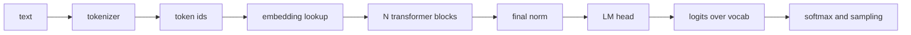

# From embeddings to scaled dot-product attention

Chopper's promise for this track: by the end you will not just *call* LLMs, you will be able to sketch
one on a whiteboard, implement its core in numpy, fine-tune one, wire it to tools over MCP, and keep a
long-running agent's context healthy. We start at the very bottom: how a stack of matrix
multiplications turns a sequence of token ids into a probability distribution over the next token.

The companion track **AI Engineering** (Huyen) explains *why* foundation models behave as they do and how
to evaluate them. Here we open the box.

## 1. The job of a language model

An autoregressive language model defines

$$
p(x_1, \dots, x_T) = \prod_{t=1}^{T} p(x_t \mid x_{<t})
$$

and is trained to maximise the log-likelihood of real text (equivalently, minimise next-token
cross-entropy). Everything inside the model exists to compute one thing well: a vector of
**logits** over the vocabulary for the next position, given all previous positions.

The pipeline, at the coarsest level:



- **Tokenizer** (module 2) maps text to integer ids from a vocabulary of size $V$ (32k to 260k today).
- **Embedding matrix** $E \in \mathbb{R}^{V \times d}$: row $i$ is the learned vector for token $i$.
  Lookup is just indexing: `X = E[ids]` gives a $(T, d)$ matrix.
- **Transformer blocks** repeatedly mix information *between* positions (attention) and transform
  each position *independently* (the feed-forward network).
- **LM head** $W_{out} \in \mathbb{R}^{d \times V}$ projects the final hidden state back to logits.
  Many models **tie** $W_{out} = E^\top$ to save parameters.

## 2. Embeddings: meaning as geometry

A one-hot vector of length $V$ carries no notion of similarity: "cat" and "kitten" are as far apart
as "cat" and "carburettor". An embedding layer learns a dense $d$-dimensional vector (say $d = 4096$)
per token, and training pushes tokens that behave similarly into nearby regions. Two facts worth
remembering:

1. An embedding lookup is mathematically a one-hot vector times a matrix, $\text{onehot}(i)^\top E$, but
   implemented as an index for speed.
2. Input token embeddings are *context-free*. The word "bank" has a single input vector; it is the
   attention layers that turn it into "river bank" or "savings bank" by mixing in context. The
   hidden states after a few layers are **contextual embeddings**.

## 3. Softmax and its numerical trap

Softmax turns arbitrary real scores into a probability distribution:

$$
\text{softmax}(z)_i = \frac{e^{z_i}}{\sum_j e^{z_j}}
$$

Exponentiating a score of 1000 overflows float32. Because softmax is invariant to adding a constant
to every input, we subtract the max first. Every production kernel (including FlashAttention's
"online softmax") relies on this trick.

```python-run
import numpy as np

def softmax(z, axis=-1):
    z = np.asarray(z, dtype=np.float64)
    z = z - z.max(axis=axis, keepdims=True)   # stability: shift so the max is 0
    e = np.exp(z)
    return e / e.sum(axis=axis, keepdims=True)

print(softmax([1.0, 2.0, 3.0]))
print(softmax([1000.0, 1001.0, 1002.0]))      # same answer, no overflow
with np.errstate(over="ignore", invalid="ignore"):
    naive = np.exp([1000.0, 1001.0]) / np.exp([1000.0, 1001.0]).sum()
print("naive:", naive)                        # nan: inf / inf
```

**Temperature** divides logits before softmax: $\text{softmax}(z / \tau)$. $\tau < 1$ sharpens,
$\tau > 1$ flattens, $\tau \to 0$ approaches argmax (greedy decoding). You will meet it again in
`generate()` in module 3.

## 4. The attention idea

We want each position to build a new representation as a *weighted average* of information from other
positions, where the weights depend on content. Attention phrases this as a soft dictionary lookup:

- every position emits a **query** $q$ ("what am I looking for?"),
- every position emits a **key** $k$ ("what do I contain?"),
- every position emits a **value** $v$ ("what will I hand over if chosen?").

The weight that position $i$ puts on position $j$ is a softmax over the similarity $q_i \cdot k_j$.
Queries, keys and values are linear projections of the same input $X \in \mathbb{R}^{T \times d}$:

$$
Q = XW_Q,\quad K = XW_K,\quad V = XW_V,\qquad W_Q, W_K \in \mathbb{R}^{d \times d_k},\; W_V \in \mathbb{R}^{d \times d_v}
$$

and **scaled dot-product attention** is

$$
\text{Attention}(Q, K, V) = \text{softmax}\!\left(\frac{QK^\top}{\sqrt{d_k}} + M\right) V
$$

where $M$ is an optional additive mask (0 where allowed, $-\infty$ where forbidden).

### Why divide by $\sqrt{d_k}$?

If the components of $q$ and $k$ are independent with mean 0 and variance 1, their dot product
$\sum_{i=1}^{d_k} q_i k_i$ has variance $d_k$. With $d_k = 128$ the raw scores have standard deviation
about 11, softmax saturates into an almost one-hot distribution, and gradients through it vanish.
Dividing by $\sqrt{d_k}$ restores unit variance. Let us verify empirically:

```python-run
import numpy as np
rng = np.random.default_rng(0)
for dk in [4, 64, 512]:
    q = rng.standard_normal((10000, dk)); k = rng.standard_normal((10000, dk))
    s = (q * k).sum(axis=1)
    print(f"d_k={dk:4d}  std raw={s.std():6.2f}  std scaled={(s/np.sqrt(dk)).std():.2f}")
```

### Shapes, carefully

| tensor | shape | meaning |
|---|---|---|
| $Q$ | $(T_q, d_k)$ | one query per output position |
| $K$ | $(T_k, d_k)$ | one key per input position |
| $V$ | $(T_k, d_v)$ | one value per input position |
| $QK^\top$ | $(T_q, T_k)$ | score of every query against every key |
| weights | $(T_q, T_k)$ | each **row** sums to 1 |
| output | $(T_q, d_v)$ | weighted mix of values |

In self-attention $T_q = T_k = T$. In **cross-attention** (encoder-decoder models) queries come from
the decoder and keys/values from the encoder, so $T_q \ne T_k$ is common.

## 5. Implementing attention in numpy

```python-run
import numpy as np

def softmax(z, axis=-1):
    z = z - z.max(axis=axis, keepdims=True)
    e = np.exp(z)
    return e / e.sum(axis=axis, keepdims=True)

def attention(Q, K, V, mask=None):
    dk = Q.shape[-1]
    scores = Q @ K.swapaxes(-1, -2) / np.sqrt(dk)      # (..., Tq, Tk)
    if mask is not None:
        scores = np.where(mask, scores, -1e9)            # mask: True = allowed
    w = softmax(scores, axis=-1)
    return w @ V, w

rng = np.random.default_rng(42)
T, d, dk = 4, 8, 4
X = rng.standard_normal((T, d))
Wq, Wk, Wv = (rng.standard_normal((d, dk)) * 0.5 for _ in range(3))
out, w = attention(X @ Wq, X @ Wk, X @ Wv)
np.set_printoptions(precision=3, suppress=True)
print("weights (rows sum to 1):\n", w)
print("row sums:", w.sum(axis=1))
print("output shape:", out.shape)
```

Notice there are no loops over positions: the $(T, T)$ score matrix is produced by one matmul. That is
why transformers train so well on GPUs, and also why attention costs $O(T^2 d)$ time and $O(T^2)$
memory for the score matrix (FlashAttention avoids *materialising* it, but the compute is still
quadratic).

## 6. Causal masking

A decoder-only LM must not peek at the future during training: position $t$ may attend only to
positions $\le t$. We enforce this with a lower-triangular mask. Because training then predicts all
$T$ next tokens *in parallel* from one forward pass (teacher forcing), causal masking is what makes
LM training efficient.

$$
M_{ij} = \begin{cases} 0 & j \le i \\ -\infty & j > i \end{cases}
$$

```python-run
import numpy as np

def softmax(z, axis=-1):
    z = z - z.max(axis=axis, keepdims=True); e = np.exp(z); return e / e.sum(axis=axis, keepdims=True)

T = 5
causal = np.tril(np.ones((T, T), dtype=bool))
print(causal.astype(int))

rng = np.random.default_rng(1)
scores = rng.standard_normal((T, T))
w = softmax(np.where(causal, scores, -np.inf))
np.set_printoptions(precision=2, suppress=True)
print(w)            # upper triangle is exactly 0; row 0 attends only to itself
```

> [!WARNING]
> Using `-np.inf` is fine as long as every row has at least one allowed position. If a row is fully
> masked (for example a padding query), `softmax` produces `nan` (because $-\infty - (-\infty)$ is
> undefined). Real implementations use a large negative finite number like `-1e9` or
> `torch.finfo(dtype).min`, or handle empty rows explicitly.

**Padding masks** are the other common mask. When batching sequences of different lengths you pad
them; keys at padding positions must get zero weight. In Hugging Face this is the
`attention_mask` tensor of 1s and 0s returned by the tokenizer, combined with the causal mask inside
the model. (Decoder-only models are usually **left-padded** for generation so that the last real token
is at the end of each row; more in module 3.)

## 7. What attention actually learns

Interpretability work has catalogued recurring head behaviours:

- **Previous-token heads** put nearly all weight on position $t-1$.
- **Induction heads** implement "find the previous occurrence of the current token and copy what came
  after it", a mechanism strongly linked to in-context learning.
- **Attention sinks**: many heads dump weight on the first token (often BOS) when they have nothing
  useful to attend to, because softmax weights must sum to 1. Streaming-inference systems therefore
  keep the first few tokens in the KV cache even when evicting the middle.

That last point is a nice example of internals explaining a practical engineering trick.

## 8. Cost model you should be able to recite

For a sequence of length $T$ and model width $d$:

- Projections $Q, K, V$, output: $O(T d^2)$.
- Scores and weighted sum: $O(T^2 d)$.
- For short contexts the $d^2$ terms (and the FFN) dominate; beyond roughly $T \approx d$ the
  quadratic term takes over. This is the root of long-context cost and of the "attention budget" we
  discuss in the context-engineering module.

> [!INTERVIEW]
> **"Implement attention and explain the scaling factor."** Write `softmax(Q K^T / sqrt(d_k) + mask) V`,
> state the shapes, explain the variance argument for $\sqrt{d_k}$, mention the max-subtraction trick
> for stable softmax, and note the $O(T^2)$ memory of the score matrix (and that FlashAttention tiles
> it with an online softmax to avoid materialising it). Bonus: explain why a fully masked row gives
> NaN with `-inf`.

## 9. Pitfalls checklist

- Softmax over the wrong axis. Weights must normalise over **keys** (last axis), so each query's row
  sums to 1.
- Forgetting to scale, or scaling by $d$ (model width) instead of $d_k$ (head width).
- Building the causal mask with `triu` instead of `tril` (or the wrong `k` offset), which lets tokens
  see the future: training loss looks wonderful, generation is garbage.
- Mixing additive masks (0 / $-\infty$) with boolean masks (True = keep) inconsistently. PyTorch's
  `scaled_dot_product_attention` treats a boolean `attn_mask` as True = *take part in attention*.

## Summary

- An LM maps token ids to embeddings, mixes them through attention and FFN blocks, and outputs
  next-token logits.
- Attention is a content-based weighted average: $\text{softmax}(QK^\top/\sqrt{d_k} + M)V$.
- Scaling by $\sqrt{d_k}$ keeps score variance near 1 so softmax does not saturate.
- Causal masks enforce autoregression and enable parallel training on all positions.
- Attention is $O(T^2)$ in sequence length, which shapes everything from FlashAttention to context
  engineering.

```quiz
[
  {"q": "Q has shape (6, 64), K has shape (10, 64), V has shape (10, 32). What is the shape of the attention output?",
   "options": ["(6, 32)", "(10, 32)", "(6, 10)", "(6, 64)"], "answer": 0,
   "explain": "Weights are (Tq, Tk) = (6, 10); multiplying by V (10, 32) gives one 32-dim value mix per query: (6, 32)."},
  {"q": "Why divide QK^T by sqrt(d_k)?",
   "options": ["To keep the variance of scores near 1 so softmax does not saturate", "To make the weights sum to 1", "To reduce memory", "To make attention causal"], "answer": 0,
   "explain": "A dot product of d_k unit-variance terms has variance d_k. Large scores push softmax towards one-hot and kill gradients."},
  {"q": "Over which axis is the attention softmax taken?",
   "options": ["The key axis, so each query's weights sum to 1", "The query axis", "The feature axis d_k", "The batch axis"], "answer": 0,
   "explain": "Each query distributes one unit of attention over all keys it may see."},
  {"q": "In a causal mask for position i, which keys are allowed?",
   "options": ["Positions j <= i", "Positions j >= i", "Only position i", "All positions"], "answer": 0,
   "explain": "Autoregressive models may only use the present and past; future positions get -infinity before softmax."},
  {"q": "softmax([1000, 1001]) computed naively in float64 returns NaN. What fixes it?",
   "options": ["Subtract the max logit before exponentiating", "Use float16", "Divide by sqrt(d_k)", "Add 1 to every logit"], "answer": 0,
   "explain": "Softmax is shift-invariant, so subtracting the max gives identical results with no overflow."},
  {"q": "Which statement about input token embeddings is true?",
   "options": ["They are context-free; attention layers make representations contextual", "They already differ per sentence", "They are one-hot vectors", "They are computed by attention"], "answer": 0,
   "explain": "The lookup gives the same vector for a token everywhere; contextualisation happens in the blocks."},
  {"q": "What happens to attention compute when the sequence length doubles (d fixed, long context)?",
   "options": ["The score computation roughly quadruples", "It doubles", "It stays constant", "It halves"], "answer": 0,
   "explain": "QK^T is T x T, so the quadratic term grows by 4x when T doubles."}
]
```

> **Source:** Vaswani et al., "Attention Is All You Need" (2017); Hugging Face LLM Course, ch. 1
> "How do Transformers work?" (https://huggingface.co/learn/llm-course/chapter1/4); Transformers docs,
> attention interface (https://huggingface.co/docs/transformers/attention_interface); Huyen,
> *AI Engineering*, ch. 2 "Understanding Foundation Models" (transformer architecture).
