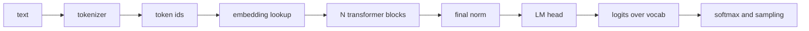

# From embeddings to scaled dot-product attention

> **Before this lesson:** basic Python only: variables, lists, functions and `for` loops. No machine
> learning is assumed. It helps to have seen a list of numbers multiplied by another list, but every
> piece of maths used here is explained when it first appears. This is the first lesson of the track.

## In plain words

A **large language model** (LLM) is a program that reads some text and guesses what comes next. Type
"The capital of France is" and it answers "Paris" because, having read an enormous amount of writing,
it has learned that this word is the most likely continuation. Chatbots, code assistants and search
summaries are all this one trick repeated: guess a word, add it to the text, guess again.

The part of the model that makes the guessing good is called **attention**. Picture a student
answering a comprehension question with the passage open in front of them. Before writing each word of
the answer, the student glances back over the passage and decides which earlier words matter for the
word being written now. Attention is that glance, done with arithmetic: every word looks at every
earlier word, scores how relevant each one is, and blends the relevant ones into its own
understanding.

Why this matters for a job: attention is the single most asked-about piece of a modern model in
machine-learning interviews ("implement attention on the whiteboard"), and it explains everyday
engineering facts such as why long prompts cost more and why a model can only read a limited amount of
text at once. Chopper's promise for this track: by the end you will be able to sketch a model on a
whiteboard, build its core in a few lines of Python, adapt one to your own data, connect it to outside
tools and keep a long-running assistant on track. This lesson starts at the bottom of that ladder.

The companion track **AI Engineering** explains why these models behave as they do and how to
evaluate them. Here we open the box and look at the parts.

## 1. The job of a language model

### Text becomes numbers first

A computer cannot do arithmetic on letters, so the first step is to turn text into numbers.

- A **token** is a small piece of text: a whole short word such as `the`, or a fragment of a longer
  word such as `ing`. Module 2 explains how the pieces are chosen.
- The **vocabulary** is the fixed list of every token the model knows. Its size is written $V$ and is
  between about 32,000 and 260,000 entries in today's models.
- A **token id** is the position of a token in that list, a whole number from 0 to $V-1$.
- The **tokenizer** is the program that cuts text into tokens and replaces each one with its id.

So the sentence "the cat sat" might become the three ids `[1996, 4937, 2938]`. From here on the model
sees only numbers.

### One guess at a time

The model's output for a piece of text is a list of $V$ scores, one per vocabulary entry, saying how
strongly it believes each token comes next. These raw scores are called **logits**. A logit can be any
number, positive or negative; a bigger logit means "more likely". Section 3 shows how logits become
percentages.

A model that produces text one token at a time, each time feeding its own earlier output back in as
input, is called **autoregressive** ("auto" = self, "regressive" = depending on earlier values). In
symbols, the chance of a whole sentence $x_1, \dots, x_T$ (here $T$ is the number of tokens) is the
product of the chances of each token given the ones before it:

$$
p(x_1, \dots, x_T) = \prod_{t=1}^{T} p(x_t \mid x_{<t})
$$

Read the right-hand side as: "the chance of token 1, times the chance of token 2 given token 1, times
the chance of token 3 given tokens 1 and 2, and so on". The symbol $\prod$ means "multiply all of
these together" and $x_{<t}$ means "every token before position $t$".

**Training** is the process of adjusting the model's internal numbers, called **parameters** or
**weights**, until its guesses match real text. The training program shows the model billions of
real sentences and nudges the parameters so that the true next token receives a higher score each
time. The measure being improved is called **cross-entropy**: a number that is small when the model
gave the true next token a high probability and large when it did not. Everything inside the model
exists to do one thing well: produce good logits for the next position, given all earlier positions.

### The whole pipeline in one picture



Reading the boxes from left to right:

- **Tokenizer**: text to token ids, as described above.
- **Embedding lookup**: each id is swapped for a list of numbers that represents that token (section 2).
- **Transformer blocks**: the repeated unit of the model. A **transformer** is the model design
  introduced in 2017 that nearly every LLM uses. Each block does two things: it mixes information
  *between* positions (attention, this lesson) and then transforms each position *on its own* with a
  small calculation called the feed-forward network (next lesson). A model stacks $N$ of these
  blocks, where $N$ is often between 12 and 100.
- **Final norm**: a rescaling step that keeps the numbers in a sensible range (next lesson).
- **LM head** (language-model head): the last step, which converts the model's internal list of
  numbers for a position back into $V$ logits.

Two words of vocabulary for the maths that follows. A **vector** is a list of numbers, such as
`[0.2, -1.3, 0.7]`; its **dimension** is how many numbers it holds. A **matrix** is a grid of numbers
with rows and columns; you can think of it as a list of vectors stacked on top of each other. The
notation $E \in \mathbb{R}^{V \times d}$ means "E is a matrix of ordinary decimal numbers with $V$
rows and $d$ columns".

With that notation: the **embedding matrix** $E \in \mathbb{R}^{V \times d}$ has one row per
vocabulary entry, and row $i$ is the learned vector for token $i$. In numpy (the Python library for
arrays of numbers) the lookup is the indexing expression `X = E[ids]`, which picks out one row per
token and gives a matrix with $T$ rows and $d$ columns. The LM head is another matrix,
$W_{out} \in \mathbb{R}^{d \times V}$, that turns a $d$-dimensional vector back into $V$ logits. Many
models reuse the embedding matrix turned on its side for this, $W_{out} = E^\top$ (the small $\top$
means "transpose": swap rows and columns). Sharing the matrix this way is called **weight tying** and
saves millions of parameters.

## 2. Embeddings: meaning as geometry

The most direct way to turn a token id into a vector is a **one-hot vector**: a list of $V$ zeros with
a single 1 at the token's position. The trouble is that one-hot vectors say nothing about meaning.
"cat" and "kitten" are exactly as different from each other as "cat" and "carburettor", because each
pair differs in the same two slots.

An **embedding** fixes this. It is a much shorter vector (for example $d = 4096$ numbers instead of
$V = 100{,}000$) in which every slot can hold any decimal value, and whose values are learned during
training. Tokens that are used in similar ways end up with similar vectors, so "cat" and "kitten" sit
close together and "carburettor" sits far away. Meaning has become distance, which is why this section
is titled "meaning as geometry".

Two facts are worth remembering:

1. Mathematically, an embedding lookup equals a one-hot vector multiplied by the matrix,
   $\text{onehot}(i)^\top E$, because multiplying by a vector that is zero everywhere except slot $i$
   picks out row $i$. Real code uses an index because it is far faster and gives the same result.
2. The embedding that goes into the first block is **context-free**: the word "bank" gets the same
   vector whether the sentence is about rivers or savings. The attention layers are what turn it into
   "river bank" or "savings bank" by blending in the surrounding words. The vectors that come out
   after several blocks are called **contextual embeddings** or **hidden states**.

## 3. Softmax and its numerical trap

Logits are raw scores. To choose a token we want **probabilities**: numbers between 0 and 1 that add
up to 1, like percentages. The function that converts one into the other is **softmax**:

$$
\text{softmax}(z)_i = \frac{e^{z_i}}{\sum_j e^{z_j}}
$$

In words: raise the constant $e \approx 2.718$ to the power of each score (this makes every value
positive and makes big scores much bigger than small ones), then divide each result by the total so
that they add up to 1. The symbol $\sum_j$ means "add up over every position $j$".

There is a trap. Computers store decimals with limited room; the common 32-bit format (**float32**)
cannot hold anything larger than about $3 \times 10^{38}$, and $e^{1000}$ is far beyond that. The
result becomes "infinity", and infinity divided by infinity is the error value `nan` ("not a
number"). The escape is a property of softmax: adding the same constant to every score does not
change the output, because the constant cancels in the division. So we subtract the largest score from
all of them first. The biggest score becomes 0, $e^0 = 1$, and nothing overflows.

```python-run
import numpy as np

def softmax(z, axis=-1):
    z = np.asarray(z, dtype=np.float64)
    z = z - z.max(axis=axis, keepdims=True)   # stability: shift so the max is 0
    e = np.exp(z)
    return e / e.sum(axis=axis, keepdims=True)

print(softmax([1.0, 2.0, 3.0]))
print(softmax([1000.0, 1001.0, 1002.0]))      # same answer, no overflow
with np.errstate(over="ignore", invalid="ignore"):
    naive = np.exp([1000.0, 1001.0]) / np.exp([1000.0, 1001.0]).sum()
print("naive:", naive)                        # nan: inf / inf
```

**Reading this code line by line**

- `import numpy as np` loads the numpy library and gives it the short name `np`.
- `def softmax(z, axis=-1):` defines a function. `axis=-1` means "work along the last direction of
  the array", which for a plain list is the list itself.
- `np.asarray(z, dtype=np.float64)` turns the Python list into a numpy array of 64-bit decimals.
- `z - z.max(axis=axis, keepdims=True)` subtracts the largest score. `keepdims=True` keeps the result
  shaped so that the subtraction lines up correctly when `z` has several rows.
- `np.exp(z)` raises $e$ to each value; the last line of the function divides by the total.
- The first `print` shows roughly `[0.09 0.245 0.665]`: three probabilities adding to 1, the largest
  for the largest score. The second `print` shows the *same* numbers for `[1000, 1001, 1002]`,
  because those scores are the first ones shifted by a constant.
- The final lines compute the formula without the subtraction. `np.errstate(...)` silences numpy's
  overflow warning so the output stays readable. The result is `[nan nan]`: that is the trap.

Every production implementation uses the subtraction trick, including FlashAttention, a widely used
fast attention routine, whose "online softmax" applies the same idea piece by piece.

**Temperature** is a number $\tau$ (the Greek letter tau) that the logits are divided by before
softmax: $\text{softmax}(z / \tau)$. A temperature below 1 makes the gaps between scores larger, so
the top choice wins more often. A temperature above 1 shrinks the gaps, so unlikely tokens are chosen
more often. As $\tau$ approaches 0 the model always picks the single highest score, which is called
**greedy decoding**. You will meet temperature again as a setting of `generate()` in module 3.

## 4. The attention idea

After the embedding lookup we have one vector per token, and none of them knows anything about its
neighbours. We want each position to build a better vector for itself as a **weighted average** of
the vectors at other positions: a blend in which relevant positions count for a lot and irrelevant
ones count for almost nothing. The weights should depend on *content*, on what the tokens are.

Attention sets this up like a lookup in a library. Suppose you walk in with a question, each book has
a label on its spine, and each book has contents:

- every position produces a **query** $q$: "what am I looking for?",
- every position produces a **key** $k$: "what do I contain?" (the label on the spine),
- every position produces a **value** $v$: "what will I hand over if I am chosen?" (the contents).

How well does a query match a key? We measure it with the **dot product**: multiply the two vectors
slot by slot and add the results. For $q = [1, 2]$ and $k = [3, 4]$ the dot product is
$1 \cdot 3 + 2 \cdot 4 = 11$. The dot product is large when two vectors point the same way, near zero
when they are unrelated and negative when they point in opposite directions, so it works as a
similarity score. The weight that position $i$ gives to position $j$ is the softmax of the scores
$q_i \cdot k_j$ over all $j$. A real library lookup returns one book; this is a *soft* lookup that
returns a blend of every book, weighted by how well each label matches.

Where do queries, keys and values come from? Each is the input matrix $X$ (one row per token,
$d$ columns) multiplied by its own learned matrix. Multiplying by a matrix this way is called a
**linear projection**: it re-expresses each row as a new vector, possibly of a different length.

$$
Q = XW_Q,\quad K = XW_K,\quad V = XW_V,\qquad W_Q, W_K \in \mathbb{R}^{d \times d_k},\; W_V \in \mathbb{R}^{d \times d_v}
$$

Here $d_k$ is the length of each query and key vector and $d_v$ the length of each value vector. Put
together, **scaled dot-product attention** is

$$
\text{Attention}(Q, K, V) = \text{softmax}\!\left(\frac{QK^\top}{\sqrt{d_k}} + M\right) V
$$

Read it from the inside out. $QK^\top$ computes the dot product of every query with every key in one
matrix multiplication, giving a grid of scores. Dividing by $\sqrt{d_k}$ is the "scaled" part,
explained next. $M$ is an optional **mask**: a grid added to the scores that holds 0 where looking is
allowed and $-\infty$ (minus infinity) where it is forbidden. Softmax turns each row of scores into
weights. Multiplying by $V$ forms the weighted average of the values.

### Why divide by $\sqrt{d_k}$?

A dot product adds up $d_k$ separate products, and a sum of many random terms spreads out more the
more terms there are. Statisticians measure spread with the **variance** (and its square root, the
**standard deviation**). If each slot of $q$ and $k$ is an independent random number with average 0
and variance 1, then $\sum_{i=1}^{d_k} q_i k_i$ has variance $d_k$. With $d_k = 128$ the raw scores
typically range over about $\pm 11$. Feed scores that far apart to softmax and one weight becomes
almost 1 while the rest become almost 0.

That is a problem for training. Training works by computing a **gradient**: for every parameter, a
number that says which way and how strongly to nudge it to reduce the error. When softmax is pinned
at "one weight is 1, the rest are 0" (we say it has **saturated**), small changes to the scores no
longer change the output, the gradients shrink to nearly zero and learning stalls. Dividing by
$\sqrt{d_k}$ brings the variance of the scores back to 1 whatever the vector length. The next demo
measures this:

```python-run
import numpy as np
rng = np.random.default_rng(0)
for dk in [4, 64, 512]:
    q = rng.standard_normal((10000, dk)); k = rng.standard_normal((10000, dk))
    s = (q * k).sum(axis=1)
    print(f"d_k={dk:4d}  std raw={s.std():6.2f}  std scaled={(s/np.sqrt(dk)).std():.2f}")
```

`rng.standard_normal((10000, dk))` draws 10,000 random vectors of length `dk`. `(q * k).sum(axis=1)`
is the dot product of each pair. The printed "std raw" grows as $\sqrt{d_k}$ (about 2, 8 and 22.6),
while "std scaled" stays at about 1.00 on every row. That is the whole argument, checked by
experiment.

### Shapes, carefully

The **shape** of an array is its size in each direction, written like $(T, d)$ for $T$ rows and $d$
columns. Most attention bugs are shape bugs, so it pays to know this table by heart. $T_q$ is the
number of queries and $T_k$ the number of keys.

| tensor | shape | meaning |
|---|---|---|
| $Q$ | $(T_q, d_k)$ | one query per output position |
| $K$ | $(T_k, d_k)$ | one key per input position |
| $V$ | $(T_k, d_v)$ | one value per input position |
| $QK^\top$ | $(T_q, T_k)$ | score of every query against every key |
| weights | $(T_q, T_k)$ | each **row** sums to 1 |
| output | $(T_q, d_v)$ | weighted mix of values |

When the queries, keys and values all come from the same sequence, the operation is called
**self-attention** and $T_q = T_k = T$. In **cross-attention** the queries come from one sequence and
the keys and values from another. It appears in translation-style models that have two halves, an
**encoder** that reads the input and a **decoder** that writes the output: the decoder's queries look
at the encoder's keys and values, so $T_q \ne T_k$ is common. Lesson 3 returns to these families.

## 5. Implementing attention in numpy

```python-run
import numpy as np

def softmax(z, axis=-1):
    z = z - z.max(axis=axis, keepdims=True)
    e = np.exp(z)
    return e / e.sum(axis=axis, keepdims=True)

def attention(Q, K, V, mask=None):
    dk = Q.shape[-1]
    scores = Q @ K.swapaxes(-1, -2) / np.sqrt(dk)      # (..., Tq, Tk)
    if mask is not None:
        scores = np.where(mask, scores, -1e9)            # mask: True = allowed
    w = softmax(scores, axis=-1)
    return w @ V, w

rng = np.random.default_rng(42)
T, d, dk = 4, 8, 4
X = rng.standard_normal((T, d))
Wq, Wk, Wv = (rng.standard_normal((d, dk)) * 0.5 for _ in range(3))
out, w = attention(X @ Wq, X @ Wk, X @ Wv)
np.set_printoptions(precision=3, suppress=True)
print("weights (rows sum to 1):\n", w)
print("row sums:", w.sum(axis=1))
print("output shape:", out.shape)
```

**Reading this code line by line**

- `dk = Q.shape[-1]` reads the length of each query vector (the last entry of the shape).
- `K.swapaxes(-1, -2)` swaps the last two directions of `K`, which is the transpose $K^\top$. The
  `@` operator is matrix multiplication, so `Q @ K.swapaxes(-1, -2)` is $QK^\top$.
- `np.where(mask, scores, -1e9)` keeps a score where the mask is `True` and replaces it with a huge
  negative number where it is `False`, so softmax gives that position a weight of practically 0.
- `w @ V` forms the weighted average. The function returns both the output and the weights.
- The lines below the function build a random test: `T = 4` tokens, each a vector of length `d = 8`,
  projected to queries, keys and values of length `dk = 4`. The parenthesised `for` expression
  creates the three projection matrices in one line.
- Output: a 4-by-4 grid of weights, a `row sums` line of four 1s (each token hands out exactly 100%
  of its attention) and `output shape: (4, 4)`: one blended value vector per token.

There are no loops over positions: the whole $(T, T)$ grid of scores comes from one matrix
multiplication. This is why transformers train well on a **GPU** (graphics processing unit), a chip
built to do huge numbers of multiplications at the same time. It is also why attention is expensive.
The notation $O(T^2 d)$, read "order T squared times d", describes how the work grows: doubling the
number of tokens $T$ makes the score grid four times larger. The grid also needs $O(T^2)$ memory.
FlashAttention avoids holding the whole grid in memory at once (avoids **materialising** it), but the
amount of arithmetic is still quadratic.

## 6. Causal masking

A model that writes text left to right must not look at tokens that come later, because when it is
really generating those tokens do not exist yet. Such a model is called **decoder-only** (it has only
the writing half of the encoder-decoder design), and every chat model is one. During training we
enforce "no peeking" with a **causal mask**: position $t$ may attend only to positions up to and
including $t$.

$$
M_{ij} = \begin{cases} 0 & j \le i \\ -\infty & j > i \end{cases}
$$

Laid out as a grid, the allowed entries form a triangle in the lower left, so this is called a
lower-triangular mask. It buys a large efficiency win. Because no position can see its own future,
one pass through the model yields a valid next-token guess at *every* position at once: position 1
predicts token 2, position 2 predicts token 3, and so on, each from the real earlier tokens. Feeding
the real text as input while predicting it shifted by one is called **teacher forcing**. A sentence
of 1,000 tokens therefore gives 1,000 training examples for the price of one pass.

```python-run
import numpy as np

def softmax(z, axis=-1):
    z = z - z.max(axis=axis, keepdims=True); e = np.exp(z); return e / e.sum(axis=axis, keepdims=True)

T = 5
causal = np.tril(np.ones((T, T), dtype=bool))
print(causal.astype(int))

rng = np.random.default_rng(1)
scores = rng.standard_normal((T, T))
w = softmax(np.where(causal, scores, -np.inf))
np.set_printoptions(precision=2, suppress=True)
print(w)            # upper triangle is exactly 0; row 0 attends only to itself
```

`np.tril(np.ones((T, T), dtype=bool))` builds a grid of `True` values and keeps only the lower
triangle (`tril` = "triangle, lower"). The first print shows that triangle as 1s and 0s. The second
shows the attention weights after masking: every entry above the diagonal is exactly 0, and row 0 is
`[1. 0. 0. 0. 0.]` because the first token has nothing but itself to look at.

> [!WARNING]
> Using `-np.inf` is fine as long as every row has at least one allowed position. If a row is fully
> masked (for example a padding query), `softmax` produces `nan` (because $-\infty - (-\infty)$ is
> undefined). Real implementations use a large negative finite number like `-1e9` or
> `torch.finfo(dtype).min`, or handle empty rows explicitly.

**Padding masks** are the other common mask. To process several sentences together in a **batch**
(a group handled in one go), they must all have the same length, so shorter ones are filled up with a
dummy token called a **pad token**. No real token should pay attention to padding, so keys at padded
positions must receive zero weight. In the Hugging Face libraries this is the `attention_mask` array
of 1s (real token) and 0s (padding) that the tokenizer returns; the model combines it with the causal
mask internally. Decoder-only models are usually padded on the **left** for generation, so that the
last real token sits at the end of every row, where the next token will be added. Module 3 covers
this.

## 7. What attention actually learns

An attention layer contains several independent attention calculations side by side, called
**heads** (next lesson). Researchers who study what trained models do internally, a field called
**interpretability**, have found recurring behaviours:

- **Previous-token heads** put nearly all their weight on position $t-1$, the token immediately
  before.
- **Induction heads** carry out "find the last place the current token appeared and copy what
  followed it". This mechanism is closely linked to **in-context learning**, a model's ability to
  pick up a pattern from examples given in the prompt.
- **Attention sinks**: softmax weights must add up to 1, so a head with nothing useful to look at
  still has to put its weight somewhere. Many heads park it on the very first token, often a special
  start marker called **BOS** (beginning of sequence). Systems that drop old tokens to save memory
  during long generations therefore keep the first few tokens in the **KV cache** (the saved keys and
  values of earlier tokens, lesson 3) even when they discard the middle.

That last item is a case of internals explaining a practical engineering trick.

## 8. Cost model you should be able to recite

For a sequence of $T$ tokens and vectors of length $d$ (the **model width**):

- Computing the projections $Q$, $K$, $V$ and the output: $O(T d^2)$. Each of the $T$ tokens is
  multiplied by a $d \times d$ matrix.
- Computing the scores and the weighted sum: $O(T^2 d)$. Each of the $T$ tokens is compared with
  all $T$ tokens.
- For short inputs the $d^2$ terms (and the feed-forward network) are the larger share. Beyond
  roughly $T \approx d$ the quadratic term takes over. This is the root of the cost of long prompts
  and of the "attention budget" discussed in the context-engineering module.

> [!INTERVIEW]
> **"Implement attention and explain the scaling factor."** Write `softmax(Q K^T / sqrt(d_k) + mask) V`,
> state the shapes, explain the variance argument for $\sqrt{d_k}$, mention the max-subtraction trick
> for stable softmax, and note the $O(T^2)$ memory of the score matrix (and that FlashAttention tiles
> it with an online softmax to avoid materialising it). Bonus: explain why a fully masked row gives
> NaN with `-inf`.

## 9. Pitfalls checklist

- Softmax over the wrong axis. Weights must normalise over **keys** (last axis), so each query's row
  sums to 1.
- Forgetting to scale, or scaling by $d$ (model width) instead of $d_k$ (head width).
- Building the causal mask with `triu` instead of `tril` (or the wrong `k` offset), which lets tokens
  see the future: training loss looks wonderful, generation is garbage.
- Mixing additive masks (0 / $-\infty$) with boolean masks (True = keep) inconsistently. PyTorch's
  `scaled_dot_product_attention` treats a boolean `attn_mask` as True = *take part in attention*.

## Summary

- An LM maps token ids to embeddings, mixes them through attention and FFN blocks, and outputs
  next-token logits.
- Attention is a content-based weighted average: $\text{softmax}(QK^\top/\sqrt{d_k} + M)V$.
- Scaling by $\sqrt{d_k}$ keeps score variance near 1 so softmax does not saturate.
- Causal masks enforce autoregression and enable parallel training on all positions.
- Attention is $O(T^2)$ in sequence length, which shapes everything from FlashAttention to context
  engineering.

## Glossary

- **Token / token id**: a small piece of text / its position number in the vocabulary.
- **Vocabulary**: the fixed list of all tokens a model knows; its size is $V$.
- **Vector / matrix**: a list of numbers / a grid of numbers with rows and columns.
- **Embedding**: the learned vector that stands for a token; similar tokens get similar vectors.
- **Logits**: the raw scores a model gives to every possible next token before they are turned into
  probabilities.
- **Softmax**: the function that turns scores into probabilities that add up to 1.
- **Temperature**: a number the logits are divided by to make sampling more or less adventurous.
- **Autoregressive**: producing output one token at a time, each depending on the earlier ones.
- **Parameters (weights)**: the numbers inside a model that training adjusts.
- **Gradient**: for each parameter, the direction and size of the nudge that reduces the error.
- **Dot product**: slot-by-slot multiply-and-add of two vectors; a similarity score.
- **Query, key, value**: the three vectors each position produces for attention: what it seeks, what
  it offers as a label, and what it hands over.
- **Self-attention / cross-attention**: attention within one sequence / from one sequence to another.
- **Mask**: a grid that forbids attention to certain positions.
- **Causal mask**: the mask that hides future positions from each token.
- **Padding**: dummy tokens added so sequences in a batch share a length.
- **Teacher forcing**: training on the real text shifted by one position, all positions at once.
- **BOS**: the special "beginning of sequence" token.

## Check yourself

```quiz
[
  {"q": "Q has shape (6, 64), K has shape (10, 64), V has shape (10, 32). What is the shape of the attention output?",
   "options": ["(6, 32)", "(10, 32)", "(6, 10)", "(6, 64)"], "answer": 0,
   "explain": "Weights are (Tq, Tk) = (6, 10); multiplying by V (10, 32) gives one 32-dim value mix per query: (6, 32)."},
  {"q": "Why divide QK^T by sqrt(d_k)?",
   "options": ["To keep the variance of scores near 1 so softmax does not saturate", "To make the weights sum to 1", "To reduce memory", "To make attention causal"], "answer": 0,
   "explain": "A dot product of d_k unit-variance terms has variance d_k. Large scores push softmax towards one-hot and kill gradients."},
  {"q": "Over which axis is the attention softmax taken?",
   "options": ["The key axis, so each query's weights sum to 1", "The query axis", "The feature axis d_k", "The batch axis"], "answer": 0,
   "explain": "Each query distributes one unit of attention over all keys it may see."},
  {"q": "In a causal mask for position i, which keys are allowed?",
   "options": ["Positions j <= i", "Positions j >= i", "Only position i", "All positions"], "answer": 0,
   "explain": "Autoregressive models may only use the present and past; future positions get -infinity before softmax."},
  {"q": "softmax([1000, 1001]) computed naively in float64 returns NaN. What fixes it?",
   "options": ["Subtract the max logit before exponentiating", "Use float16", "Divide by sqrt(d_k)", "Add 1 to every logit"], "answer": 0,
   "explain": "Softmax is shift-invariant, so subtracting the max gives identical results with no overflow."},
  {"q": "Which statement about input token embeddings is true?",
   "options": ["They are context-free; attention layers make representations contextual", "They already differ per sentence", "They are one-hot vectors", "They are computed by attention"], "answer": 0,
   "explain": "The lookup gives the same vector for a token everywhere; contextualisation happens in the blocks."},
  {"q": "What happens to attention compute when the sequence length doubles (d fixed, long context)?",
   "options": ["The score computation roughly quadruples", "It doubles", "It stays constant", "It halves"], "answer": 0,
   "explain": "QK^T is T x T, so the quadratic term grows by 4x when T doubles."}
]
```

> **Source:** Vaswani et al., "Attention Is All You Need" (2017); Hugging Face LLM Course, ch. 1
> "How do Transformers work?" (https://huggingface.co/learn/llm-course/chapter1/4); Transformers docs,
> attention interface (https://huggingface.co/docs/transformers/attention_interface); Huyen,
> *AI Engineering*, ch. 2 "Understanding Foundation Models" (transformer architecture).
