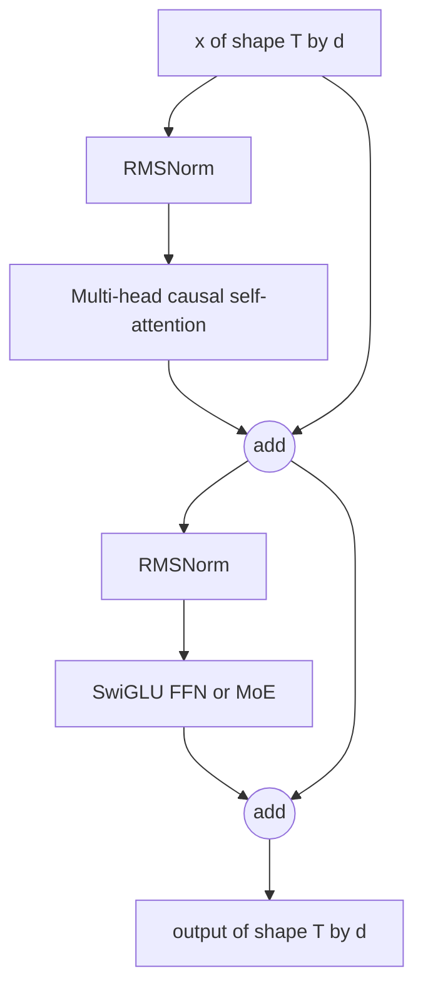

# The transformer block: multi-head, norms, residuals, FFN and MoE

One attention operation is a single "view" of the sequence. A transformer block wraps attention with
the machinery that lets dozens or hundreds of these layers stack and still train: multiple heads,
residual connections, normalisation and a position-wise feed-forward network. This lesson assembles a
complete modern (Llama-style) decoder block in numpy.

## 1. The block at a glance



In equations (pre-norm form):

$$
h = x + \text{Attn}(\text{Norm}(x)), \qquad y = h + \text{FFN}(\text{Norm}(h))
$$

Every sub-layer reads from and writes back to the **residual stream** $x$; nothing replaces it. That
picture, a shared bus that layers add small updates to, is the most useful mental model for both
training dynamics and interpretability.

## 2. Multi-head attention

Instead of one attention with $d_k = d$, we run $h$ heads in parallel, each with head width
$d_h = d / h$, then concatenate and project:

$$
\text{head}_i = \text{Attention}(XW_Q^{(i)}, XW_K^{(i)}, XW_V^{(i)}),\qquad
\text{MHA}(X) = [\text{head}_1; \dots; \text{head}_h]\,W_O
$$

Different heads can specialise (syntax, coreference, previous token, induction...). Total compute is
about the same as one big head because each head is $h$ times narrower.

In practice nobody stores $h$ separate matrices. We use one $d \times d$ projection per Q/K/V and then
**reshape**: $(T, d) \to (T, h, d_h) \to (h, T, d_h)$. Merging is the inverse. Getting this reshape
right is a classic interview and debugging question (and one of this module's problems).

```python-run
import numpy as np

def split_heads(x, h):                 # (T, d) -> (h, T, d/h)
    T, d = x.shape
    return x.reshape(T, h, d // h).transpose(1, 0, 2)

def merge_heads(x):                    # (h, T, dh) -> (T, h*dh)
    h, T, dh = x.shape
    return x.transpose(1, 0, 2).reshape(T, h * dh)

x = np.arange(2 * 8).reshape(2, 8)     # T=2 tokens, d=8
s = split_heads(x, 4)
print("split shape", s.shape)
print("head 0 sees features 0-1 of each token:\n", s[0])
print("round trip ok:", np.array_equal(merge_heads(s), x))

# A common bug: reshape straight to (h, T, dh) without the transpose
wrong = x.reshape(4, 2, 2)
print("wrong head 0:\n", wrong[0], "  <- token 0's features masquerading as 2 tokens")
```

### MQA and GQA: shrinking the KV cache

During generation we cache $K$ and $V$ for every past token (the **KV cache**, next lesson). Its size
is $2 \times L \times T \times h_{kv} \times d_h$ values per sequence. To cut it:

- **Multi-query attention (MQA)**: all query heads share one K/V head ($h_{kv} = 1$).
- **Grouped-query attention (GQA)**: query heads are split into $g$ groups, each sharing a K/V head
  ($1 < h_{kv} < h$). Llama 3 70B uses 64 query heads and 8 KV heads, an 8x smaller cache with small
  quality loss.
- **Multi-head latent attention (MLA)**, used by DeepSeek-V2/V3, compresses K/V into a low-rank latent
  vector and reconstructs per-head keys/values on the fly.

## 3. Residual connections

Without residuals, a 100-layer network must learn to pass the identity through every layer, and
gradients must flow through 100 Jacobians. With $y = x + f(x)$, the gradient has a direct path
$\partial y / \partial x = I + \partial f / \partial x$, so deep stacks remain trainable. Residuals
also mean each layer only needs to learn a *correction*.

## 4. Normalisation: LayerNorm and RMSNorm

**LayerNorm** normalises each token vector across its features, then applies a learned scale and
shift:

$$
\text{LN}(x) = \gamma \odot \frac{x - \mu}{\sqrt{\sigma^2 + \epsilon}} + \beta,\quad
\mu = \frac{1}{d}\sum_i x_i,\; \sigma^2 = \frac{1}{d}\sum_i (x_i - \mu)^2
$$

Note it uses the **population** variance (divide by $d$, not $d-1$) and normalises per token, not per
batch (unlike BatchNorm), so it behaves identically at train and inference time and for batch size 1.

**RMSNorm** (Llama, Mistral, Qwen, Gemma...) drops the mean-centering and the bias:

$$
\text{RMSNorm}(x) = \gamma \odot \frac{x}{\sqrt{\frac{1}{d}\sum_i x_i^2 + \epsilon}}
$$

It is cheaper and empirically just as good.

**Pre-norm vs post-norm.** The original transformer normalised *after* the residual add
(post-norm), which needs careful learning-rate warm-up. GPT-2 onwards normalise the *input* of each
sub-layer (pre-norm) and add a final norm before the LM head. Pre-norm keeps the residual stream
un-normalised and trains much more stably at depth. Some recent models (Gemma 2/3, OLMo 2) add extra
norms after sub-layers or on Q/K ("QK-norm") to tame logit growth.

```python-run
import numpy as np

def layer_norm(x, gamma, beta, eps=1e-5):
    mu = x.mean(axis=-1, keepdims=True)
    var = x.var(axis=-1, keepdims=True)          # population variance
    return gamma * (x - mu) / np.sqrt(var + eps) + beta

def rms_norm(x, gamma, eps=1e-6):
    return gamma * x / np.sqrt((x ** 2).mean(axis=-1, keepdims=True) + eps)

x = np.array([[1.0, 2.0, 3.0, 4.0], [10.0, 10.0, 10.0, 10.0]])
g, b = np.ones(4), np.zeros(4)
np.set_printoptions(precision=4, suppress=True)
print("LayerNorm:\n", layer_norm(x, g, b))      # constant row -> zeros (eps prevents 0/0)
print("RMSNorm:\n", rms_norm(x, g))             # constant row -> ones
```

## 5. The feed-forward network (FFN / MLP)

After attention mixes positions, the FFN processes each position independently with a two-layer MLP,
typically expanding to about $4d$:

$$
\text{FFN}(x) = W_2\,\sigma(W_1 x)
$$

Modern LLMs use a **gated** variant, **SwiGLU**:

$$
\text{SwiGLU}(x) = W_2\big(\text{SiLU}(W_1 x) \odot W_3 x\big),\qquad \text{SiLU}(z) = z\,\sigma(z)
$$

Because there are three matrices instead of two, the hidden size is usually reduced to about
$\tfrac{8}{3}d$ to keep the parameter count comparable. FFNs hold roughly two-thirds of a dense
model's parameters, and interpretability work suggests they act like key-value memories that store
much of the model's factual knowledge.

## 6. Mixture of Experts (MoE)

An MoE layer replaces the single FFN with $E$ expert FFNs and a small **router** that picks the top-$k$
experts for each token:

$$
g = \text{softmax}(\text{TopK}(W_r x)),\qquad \text{MoE}(x) = \sum_{e \in \text{TopK}} g_e\,\text{FFN}_e(x)
$$

- **Total vs active parameters.** Mixtral 8x7B has about 47B total parameters but uses about 13B per
  token (top-2 of 8). DeepSeek-V3 has 671B total and 37B active, with 256 routed experts plus a shared
  expert. Compute per token scales with *active* parameters; memory scales with *total*.
- **Load balancing.** Without help, the router collapses onto a few experts. Training adds an
  auxiliary load-balancing loss (or, in DeepSeek-V3, a bias-adjustment scheme) to spread tokens.
- **Serving implications.** All experts must be resident in memory, and batching is lumpier because
  different tokens hit different experts (expert parallelism).

```python-run
import numpy as np
rng = np.random.default_rng(0)
T, d, E, k = 6, 8, 4, 2
x = rng.standard_normal((T, d))
Wr = rng.standard_normal((d, E))
experts = [rng.standard_normal((d, d)) * 0.3 for _ in range(E)]   # toy 1-layer experts

logits = x @ Wr
top = np.argsort(-logits, axis=1)[:, :k]                # top-k expert ids per token
out = np.zeros_like(x)
for t in range(T):
    sel = logits[t, top[t]]
    g = np.exp(sel - sel.max()); g /= g.sum()           # softmax over the selected experts only
    for w, e in zip(g, top[t]):
        out[t] += w * np.tanh(x[t] @ experts[e])
print("experts chosen per token:\n", top)
print("tokens per expert:", np.bincount(top.ravel(), minlength=E))
```

## 7. Putting a block together

```python-run
import numpy as np
rng = np.random.default_rng(7)

def softmax(z, axis=-1):
    z = z - z.max(axis=axis, keepdims=True); e = np.exp(z); return e / e.sum(axis=axis, keepdims=True)
def rms_norm(x, eps=1e-6):
    return x / np.sqrt((x ** 2).mean(-1, keepdims=True) + eps)
def silu(z):
    return z / (1 + np.exp(-z))

T, d, h = 5, 16, 4
dh = d // h
P = {n: rng.standard_normal(s) / np.sqrt(s[0]) for n, s in
     dict(Wq=(d, d), Wk=(d, d), Wv=(d, d), Wo=(d, d), W1=(d, 43), W3=(d, 43), W2=(43, d)).items()}

def block(x):
    a = rms_norm(x)
    q, k, v = (a @ P[n] for n in ("Wq", "Wk", "Wv"))
    split = lambda m: m.reshape(T, h, dh).transpose(1, 0, 2)          # (h, T, dh)
    q, k, v = split(q), split(k), split(v)
    scores = q @ k.transpose(0, 2, 1) / np.sqrt(dh)
    scores = np.where(np.tril(np.ones((T, T), bool)), scores, -1e9)  # causal
    att = softmax(scores) @ v                                         # (h, T, dh)
    x = x + att.transpose(1, 0, 2).reshape(T, d) @ P["Wo"]            # residual 1
    b = rms_norm(x)
    x = x + (silu(b @ P["W1"]) * (b @ P["W3"])) @ P["W2"]            # residual 2 (SwiGLU)
    return x

x = rng.standard_normal((T, d))
y = x
for layer in range(4):        # weights shared here just to keep the demo short
    y = block(y)
print("in ", x.shape, "out", y.shape, " norm of update:", round(float(np.linalg.norm(y - x)), 3))
```

Real models also add positional information (next lesson), use separate weights per layer, and apply
a final norm plus the LM head.

## 8. Counting parameters

For a dense decoder with width $d$, $L$ layers, vocabulary $V$, standard MHA and a 4x GELU MLP:

- attention: $4d^2$ per layer ($W_Q, W_K, W_V, W_O$),
- MLP: $8d^2$ per layer ($d \to 4d \to d$),
- total: about $12 L d^2 + V d$ (plus $Vd$ again if the LM head is untied).

GPT-3 175B: $d = 12288$, $L = 96$ gives $12 \times 96 \times 12288^2 \approx 174$B. Being able to do
this in your head is a great sanity check when reading model cards.

> [!INTERVIEW]
> **"Why pre-norm? Why RMSNorm? Why SwiGLU?"** Pre-norm leaves an identity path through the residual
> stream so gradients flow at depth without warm-up gymnastics. RMSNorm drops mean-centering and bias:
> fewer ops, same quality. SwiGLU's multiplicative gate consistently lowers loss at equal compute;
> its hidden size is shrunk to about 8/3 d to keep parameters equal. For MoE, be ready to distinguish
> total vs active parameters and explain load balancing.

## Summary

- Multi-head attention runs $h$ narrow heads in parallel via reshape/transpose, then projects with $W_O$.
- GQA/MQA share K/V heads to shrink the KV cache.
- Residual connections make depth trainable; pre-norm RMSNorm is the modern default.
- FFNs (usually SwiGLU) hold most dense parameters; MoE swaps them for routed experts, decoupling
  total from active parameters.
- Parameter count of a dense model is roughly $12Ld^2 + Vd$.

```quiz
[
  {"q": "To split a (T, d) projection into h heads, which sequence is correct?",
   "options": ["reshape to (T, h, d/h) then transpose to (h, T, d/h)", "reshape directly to (h, T, d/h)", "transpose to (d, T) then reshape", "slice tokens into h groups"], "answer": 0,
   "explain": "Each head owns a contiguous slice of features for every token. Reshaping straight to (h, T, dh) groups tokens instead of features."},
  {"q": "What does grouped-query attention reduce, compared with standard MHA?",
   "options": ["The size of the KV cache", "The number of query heads", "The vocabulary size", "The FFN width"], "answer": 0,
   "explain": "Several query heads share one K/V head, so far fewer keys and values are cached per token."},
  {"q": "How does RMSNorm differ from LayerNorm?",
   "options": ["It skips mean subtraction and has no bias", "It normalises across the batch", "It uses sample variance with d-1", "It is applied only at the output"], "answer": 0,
   "explain": "RMSNorm divides by the root mean square of the features and multiplies by a learned gain."},
  {"q": "Mixtral 8x7B routes each token to 2 of 8 experts. Compared with a dense 47B model it has...",
   "options": ["similar memory needs but much lower compute per token", "much lower memory and compute", "higher compute per token", "the same compute and memory"], "answer": 0,
   "explain": "All experts must be loaded (total params drive memory), but only about 13B parameters are active per token."},
  {"q": "Approximately how many parameters does a dense decoder with L=32, d=4096 have, ignoring embeddings?",
   "options": ["About 6.4 billion", "About 640 million", "About 64 billion", "About 1.3 billion"], "answer": 0,
   "explain": "12 x 32 x 4096^2 = 12 x 32 x 16.8M which is roughly 6.4B (Llama 2 7B is in this range once embeddings are added)."},
  {"q": "Why is the hidden size of a SwiGLU FFN often about 8/3 d instead of 4d?",
   "options": ["It has three weight matrices, so the width is reduced to keep parameters comparable", "SiLU needs fewer units", "To fit the KV cache", "It is required by RMSNorm"], "answer": 0,
   "explain": "Three d x m matrices with m = 8/3 d use about the same parameters as two d x 4d matrices."},
  {"q": "What is the main benefit of a residual connection y = x + f(x)?",
   "options": ["An identity path for gradients, so deep stacks train", "It normalises activations", "It reduces parameters", "It adds positional information"], "answer": 0,
   "explain": "The Jacobian is I + df/dx, so gradients do not vanish through many layers."}
]
```

> **Source:** Hugging Face LLM Course ch. 1 (https://huggingface.co/learn/llm-course/chapter1/6);
> Transformers model docs for Llama and Mixtral (https://huggingface.co/docs/transformers/model_doc/llama,
> https://huggingface.co/docs/transformers/model_doc/mixtral); Zhang & Sennrich 2019 (RMSNorm);
> Shazeer 2020 (GLU variants); Ainslie et al. 2023 (GQA); Huyen, *AI Engineering*, ch. 2 (model
> architecture, model size, MoE) and ch. 9 (KV cache, attention optimisations).
