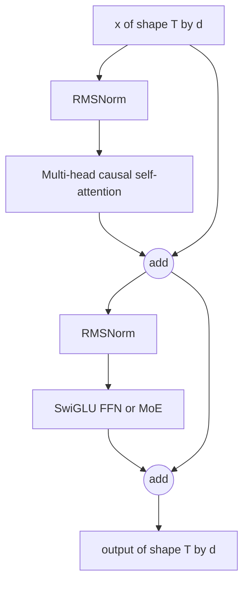

# The transformer block: multi-head, norms, residuals, FFN and MoE

> **Before this lesson:** you should know what a token, an embedding, softmax and scaled dot-product
> attention are, and how to read an array shape such as $(T, d)$. All of that is taught in the
> previous lesson, [From embeddings to scaled dot-product attention](#/lesson/llm-practice/attention-from-scratch).

## In plain words

The previous lesson built one attention operation: every token looks back over the earlier tokens
and blends in what is relevant. One such look is not enough to understand a sentence. A real model
repeats the operation dozens of times, and each repetition is packaged in a unit called a
**transformer block**. A model is a tall stack of identical blocks, like floors of an office tower.

Think of a document passing down a row of editors. Each editor reads the current draft, pencils a
few corrections in the margin and passes the same sheet on. No editor rewrites the page from
scratch; each one adds a little. A transformer block works the same way: it reads the current vector
for every token, works out a small improvement and *adds* it. The extra machinery in a block (several
attention "heads", a rescaling step called normalisation, the add-on connections and a small
per-token calculator) exists so that a hundred editors in a row still produce something sensible.

Why it matters for a job: the block is the unit you count when you estimate a model's size, memory
use and speed. Interviewers ask "why pre-norm?", "what is the difference between total and active
parameters?" and "split this array into heads" precisely because the answers show whether you can
read a model description and predict what it will cost to run. This lesson assembles a complete
modern block (the design used by the Llama family of open models) in numpy.

## 1. The block at a glance



Read the diagram from top to bottom. The input `x` is a matrix with one row per token ($T$ rows) and
$d$ numbers per row. It goes through a normalisation step (RMSNorm, section 4), then attention with
several heads (section 2), and the result is **added** to the original `x`. The sum goes through a
second normalisation and a small network called the FFN (section 5), and that result is added again.
The two circles marked "add" are the editors' pencil marks.

In equations:

$$
h = x + \text{Attn}(\text{Norm}(x)), \qquad y = h + \text{FFN}(\text{Norm}(h))
$$

Each of the two calculations inside a block (attention, and the FFN) is called a **sub-layer**. Each
sub-layer reads the running vector and writes a small update back onto it; nothing ever replaces it.
That running vector is called the **residual stream**. Picturing it as a shared notice board that
every layer reads and pins small notes to is the most useful mental model, both for understanding
training and for the research field that studies what models do internally.

## 2. Multi-head attention

A single attention operation gives each token one set of weights over the other tokens, so it can
focus on one kind of relationship at a time. Language has several at once: which noun a pronoun
refers to, which word came immediately before, which verb goes with which subject. **Multi-head
attention** (MHA) runs several independent attention operations side by side, each called a **head**,
and joins their results.

If the model width is $d$ and there are $h$ heads, each head works with shorter vectors of length
$d_h = d / h$ (the **head width**). With $d = 512$ and $h = 8$, each head uses vectors of length 64.
The outputs of all heads are placed end to end (**concatenated**) to make a vector of length $d$
again, and one more learned matrix $W_O$ mixes them:

$$
\text{head}_i = \text{Attention}(XW_Q^{(i)}, XW_K^{(i)}, XW_V^{(i)}),\qquad
\text{MHA}(X) = [\text{head}_1; \dots; \text{head}_h]\,W_O
$$

The superscript $(i)$ says that head number $i$ has its own query, key and value matrices. Different
heads end up specialising in different relationships. The total amount of arithmetic is about the
same as one big head, because each head is $h$ times narrower.

Real code does not store $h$ separate small matrices. It uses one $d \times d$ matrix each for
queries, keys and values, and then cuts every token's vector of length $d$ into $h$ consecutive
slices. In numpy that cutting is done with two operations:

- **reshape** changes how the same numbers are grouped without moving them: $(T, d) \to (T, h, d_h)$
  says "for each token, treat its $d$ numbers as $h$ groups of $d_h$";
- **transpose** reorders the directions of an array: $(T, h, d_h) \to (h, T, d_h)$ puts the head
  direction first, so that each head is a complete $(T, d_h)$ matrix ready for attention.

Merging is the same two steps in reverse. Getting this pair right is a classic interview and
debugging question, and one of this module's practice problems.

```python-run
import numpy as np

def split_heads(x, h):                 # (T, d) -> (h, T, d/h)
    T, d = x.shape
    return x.reshape(T, h, d // h).transpose(1, 0, 2)

def merge_heads(x):                    # (h, T, dh) -> (T, h*dh)
    h, T, dh = x.shape
    return x.transpose(1, 0, 2).reshape(T, h * dh)

x = np.arange(2 * 8).reshape(2, 8)     # T=2 tokens, d=8
s = split_heads(x, 4)
print("split shape", s.shape)
print("head 0 sees features 0-1 of each token:\n", s[0])
print("round trip ok:", np.array_equal(merge_heads(s), x))

# A common bug: reshape straight to (h, T, dh) without the transpose
wrong = x.reshape(4, 2, 2)
print("wrong head 0:\n", wrong[0], "  <- token 0's features masquerading as 2 tokens")
```

**Reading this code line by line**

- `T, d = x.shape` unpacks the two sizes of the input.
- `x.reshape(T, h, d // h)` groups each token's numbers into `h` slices; `//` is whole-number
  division. `.transpose(1, 0, 2)` reorders the three directions so the old direction 1 (heads) comes
  first.
- `merge_heads` undoes it: transpose back to `(T, h, dh)`, then reshape to `(T, h * dh)`.
- `np.arange(2 * 8).reshape(2, 8)` creates the numbers 0 to 15 arranged as 2 tokens of 8 numbers, so
  you can see where each number goes.
- Output: `split shape (4, 2, 2)`; head 0 holds `[[0 1] [8 9]]`, the first two numbers of token 0
  and the first two of token 1; and `round trip ok: True`.
- The last two lines show the classic bug. Reshaping straight to `(4, 2, 2)` without the transpose
  gives head 0 the values `[[0 1] [2 3]]`: four numbers that all belong to token 0, wrongly treated
  as if they were two tokens. The shapes look right, the program runs, and the model learns nothing
  useful.

### MQA and GQA: shrinking the KV cache

When a model generates text it stores the keys and values of every earlier token so that it does not
have to recompute them for each new token. This store is the **KV cache** (the next lesson explains
it fully). Its size per sequence is $2 \times L \times T \times h_{kv} \times d_h$ numbers: 2 for
keys and values, $L$ layers, $T$ tokens, $h_{kv}$ heads that have their own keys and values, and
$d_h$ numbers per head. For long texts this is many gigabytes, so designers shrink $h_{kv}$:

- **Multi-query attention (MQA)**: all query heads share one K/V head ($h_{kv} = 1$).
- **Grouped-query attention (GQA)**: query heads are split into $g$ groups, each sharing a K/V head
  ($1 < h_{kv} < h$). Llama 3 70B uses 64 query heads and 8 KV heads, an 8x smaller cache with small
  quality loss.
- **Multi-head latent attention (MLA)**, used by DeepSeek-V2/V3, compresses K/V into a low-rank latent
  vector and reconstructs per-head keys/values on the fly.

("Low-rank" means the information is squeezed through a much shorter vector; lesson 13 on LoRA
explains the idea in detail.)

## 3. Residual connections

A **residual connection** is the "add" in the diagram: instead of outputting $f(x)$, a sub-layer
outputs $x + f(x)$. The word residual means "what is left over": the sub-layer only has to learn the
difference between its input and the desired output.

To see why this matters, imagine a network of 100 layers without it. During training, the error
signal (the gradient from the previous lesson) has to travel backwards from the output through all
100 layers to reach the first one. Each layer multiplies the signal by some factor. Multiply 100
factors that are each a little below 1 and the result is practically zero; a little above 1 and it
explodes. Either way the early layers cannot learn. The plain network also has to work hard to pass
information through unchanged, since every layer transforms whatever it receives.

With $y = x + f(x)$, the rate at which $y$ changes when $x$ changes is

$$
\partial y / \partial x = I + \partial f / \partial x
$$

where $\partial$ ("partial derivative") denotes that rate of change and $I$ is the identity, the
"multiply by 1" matrix. The $I$ term is a direct path: the signal can flow straight down the stack
through the additions, however badly behaved $f$ is. (The grid of rates of change
$\partial f / \partial x$ is called a **Jacobian** in the interview callout below.) This is why
stacks of a hundred blocks train at all.

## 4. Normalisation: LayerNorm and RMSNorm

As vectors pass through many layers their numbers can drift to be very large or very small, which
makes training unstable. **Normalisation** rescales each vector to a standard size before it enters a
sub-layer.

**LayerNorm** (layer normalisation) treats each token's vector on its own. It computes the average
$\mu$ of the vector's $d$ numbers and their spread $\sigma^2$ (the variance), subtracts the average,
divides by the standard deviation, and then applies a learned scale $\gamma$ and learned shift
$\beta$ (two vectors of length $d$ that training adjusts):

$$
\text{LN}(x) = \gamma \odot \frac{x - \mu}{\sqrt{\sigma^2 + \epsilon}} + \beta,\quad
\mu = \frac{1}{d}\sum_i x_i,\; \sigma^2 = \frac{1}{d}\sum_i (x_i - \mu)^2
$$

The symbol $\odot$ means "multiply slot by slot", and $\epsilon$ is a tiny constant such as
$10^{-5}$ that prevents division by zero. Two details are often asked about. First, the variance
divides by $d$, not by $d - 1$; this is called the **population** variance. Second, the statistics
come from one token's vector, not from the whole batch. An older technique, BatchNorm, averages over
all the examples being processed together, which makes it behave differently in training and in use,
and badly when there is only one example. LayerNorm behaves identically in both situations.

**RMSNorm** (root-mean-square normalisation), used by Llama, Mistral, Qwen, Gemma and most recent
open models, removes the subtraction of the average and the shift $\beta$:

$$
\text{RMSNorm}(x) = \gamma \odot \frac{x}{\sqrt{\frac{1}{d}\sum_i x_i^2 + \epsilon}}
$$

It divides the vector by the square root of the average of its squared entries. That is fewer
operations per token, and measured quality is the same.

**Pre-norm versus post-norm.** The 2017 transformer normalised *after* each addition (post-norm).
That arrangement trains only with a careful schedule that starts with a very small **learning rate**
(the size of each training nudge) and raises it gradually, a procedure called **warm-up**. From GPT-2
onwards, models normalise the *input* of each sub-layer instead (pre-norm, as in the diagram above)
and add one final norm before the LM head. Pre-norm leaves the residual stream itself untouched, so
the direct path from section 3 stays clean, and deep stacks train much more stably. Some recent models
(Gemma 2 and 3, OLMo 2) add further norms after sub-layers or on the queries and keys ("QK-norm") to
stop the attention scores growing too large.

```python-run
import numpy as np

def layer_norm(x, gamma, beta, eps=1e-5):
    mu = x.mean(axis=-1, keepdims=True)
    var = x.var(axis=-1, keepdims=True)          # population variance
    return gamma * (x - mu) / np.sqrt(var + eps) + beta

def rms_norm(x, gamma, eps=1e-6):
    return gamma * x / np.sqrt((x ** 2).mean(axis=-1, keepdims=True) + eps)

x = np.array([[1.0, 2.0, 3.0, 4.0], [10.0, 10.0, 10.0, 10.0]])
g, b = np.ones(4), np.zeros(4)
np.set_printoptions(precision=4, suppress=True)
print("LayerNorm:\n", layer_norm(x, g, b))      # constant row -> zeros (eps prevents 0/0)
print("RMSNorm:\n", rms_norm(x, g))             # constant row -> ones
```

`x.mean(axis=-1, keepdims=True)` is the average of each row and `x.var(...)` its population
variance. The test input has two rows: `[1, 2, 3, 4]` and a constant row of 10s. LayerNorm turns the
first into about `[-1.34, -0.45, 0.45, 1.34]` (average 0, spread 1) and the constant row into all
zeros, since subtracting the average leaves nothing; `eps` keeps `0 / 0` from happening. RMSNorm
turns the first row into about `[0.37, 0.73, 1.10, 1.46]` and the constant row into all ones,
because it only rescales and does not centre.

## 5. The feed-forward network (FFN / MLP)

Attention moves information *between* tokens. The second sub-layer, the **feed-forward network**
(FFN), then works on each token's vector separately, with no communication between positions. It is
a small **multi-layer perceptron** (MLP), the classic neural network made of matrix multiplications
with a simple curve applied in between:

$$
\text{FFN}(x) = W_2\,\sigma(W_1 x)
$$

$W_1$ stretches the vector from length $d$ to a larger **hidden size**, typically about $4d$; $\sigma$
is an **activation function**, a fixed curve applied to every number (without it, two matrix
multiplications in a row would collapse into one and add no power); $W_2$ brings the vector back to
length $d$.

Modern LLMs use a variant called **SwiGLU** that adds a **gate**: a second projection of the input
that multiplies the first one slot by slot, letting the network turn individual numbers up or down:

$$
\text{SwiGLU}(x) = W_2\big(\text{SiLU}(W_1 x) \odot W_3 x\big),\qquad \text{SiLU}(z) = z\,\sigma(z)
$$

Here $\sigma(z) = 1/(1+e^{-z})$ is the sigmoid curve, which squashes any number into the range 0 to
1, and SiLU is the smooth activation built from it. Because SwiGLU has three matrices where the plain
FFN has two, its hidden size is usually reduced to about $\tfrac{8}{3}d$ so that the parameter count
stays comparable. FFNs hold roughly two-thirds of the parameters of a **dense** model (one in which
every parameter is used for every token), and interpretability research suggests they act like
key-value memories that store much of the model's factual knowledge.

## 6. Mixture of Experts (MoE)

A **mixture of experts** layer replaces the single FFN with several FFNs, called **experts**, plus a
small **router**: one matrix $W_r$ that scores, for each token, how suitable each expert is. Only
the best $k$ experts (the "top-$k$") run for that token, and their outputs are averaged using the
router's scores as weights:

$$
g = \text{softmax}(\text{TopK}(W_r x)),\qquad \text{MoE}(x) = \sum_{e \in \text{TopK}} g_e\,\text{FFN}_e(x)
$$

Picture a hospital front desk that sends each patient to two of eight specialists. The hospital
needs all eight on staff, but each patient costs only two consultations.

- **Total vs active parameters.** Mixtral 8x7B has about 47B total parameters but uses about 13B per
  token (top-2 of 8). DeepSeek-V3 has 671B total and 37B active, with 256 routed experts plus a shared
  expert. Compute per token scales with *active* parameters; memory scales with *total*.
- **Load balancing.** Without help, the router collapses onto a few experts. Training adds an
  auxiliary load-balancing loss (or, in DeepSeek-V3, a bias-adjustment scheme) to spread tokens.
- **Serving implications.** All experts must be resident in memory, and batching is lumpier because
  different tokens hit different experts (expert parallelism).

```python-run
import numpy as np
rng = np.random.default_rng(0)
T, d, E, k = 6, 8, 4, 2
x = rng.standard_normal((T, d))
Wr = rng.standard_normal((d, E))
experts = [rng.standard_normal((d, d)) * 0.3 for _ in range(E)]   # toy 1-layer experts

logits = x @ Wr
top = np.argsort(-logits, axis=1)[:, :k]                # top-k expert ids per token
out = np.zeros_like(x)
for t in range(T):
    sel = logits[t, top[t]]
    g = np.exp(sel - sel.max()); g /= g.sum()           # softmax over the selected experts only
    for w, e in zip(g, top[t]):
        out[t] += w * np.tanh(x[t] @ experts[e])
print("experts chosen per token:\n", top)
print("tokens per expert:", np.bincount(top.ravel(), minlength=E))
```

`logits = x @ Wr` is the router's score for every token and expert, a $(6, 4)$ grid.
`np.argsort(-logits, axis=1)[:, :k]` sorts each row from highest to lowest score and keeps the first
`k` positions, which are the ids of the chosen experts. The loop then applies softmax to the two
chosen scores and adds up the two experts' outputs with those weights. The first print lists two
expert ids per token; the second counts how many tokens each expert received. With random weights
the counts are uneven, which is the load-balancing problem in miniature.

## 7. Putting a block together

The next demo is the whole block in about 25 lines. Every piece has appeared above; the comments on
the right mark the stages.

```python-run
import numpy as np
rng = np.random.default_rng(7)

def softmax(z, axis=-1):
    z = z - z.max(axis=axis, keepdims=True); e = np.exp(z); return e / e.sum(axis=axis, keepdims=True)
def rms_norm(x, eps=1e-6):
    return x / np.sqrt((x ** 2).mean(-1, keepdims=True) + eps)
def silu(z):
    return z / (1 + np.exp(-z))

T, d, h = 5, 16, 4
dh = d // h
P = {n: rng.standard_normal(s) / np.sqrt(s[0]) for n, s in
     dict(Wq=(d, d), Wk=(d, d), Wv=(d, d), Wo=(d, d), W1=(d, 43), W3=(d, 43), W2=(43, d)).items()}

def block(x):
    a = rms_norm(x)
    q, k, v = (a @ P[n] for n in ("Wq", "Wk", "Wv"))
    split = lambda m: m.reshape(T, h, dh).transpose(1, 0, 2)          # (h, T, dh)
    q, k, v = split(q), split(k), split(v)
    scores = q @ k.transpose(0, 2, 1) / np.sqrt(dh)
    scores = np.where(np.tril(np.ones((T, T), bool)), scores, -1e9)  # causal
    att = softmax(scores) @ v                                         # (h, T, dh)
    x = x + att.transpose(1, 0, 2).reshape(T, d) @ P["Wo"]            # residual 1
    b = rms_norm(x)
    x = x + (silu(b @ P["W1"]) * (b @ P["W3"])) @ P["W2"]            # residual 2 (SwiGLU)
    return x

x = rng.standard_normal((T, d))
y = x
for layer in range(4):        # the same weights are reused in each layer to keep the demo short
    y = block(y)
print("in ", x.shape, "out", y.shape, " norm of update:", round(float(np.linalg.norm(y - x)), 3))
```

**Reading the block function**

- `P` is a dictionary of weight matrices filled with small random numbers. `W1` and `W3` map to a
  hidden size of 43, which is about $\tfrac{8}{3} \times 16$.
- `a = rms_norm(x)` is the pre-norm. The next line computes queries, keys and values, and `split`
  cuts them into 4 heads exactly as in section 2.
- `scores` is $QK^\top/\sqrt{d_h}$ for all heads at once; `np.where` with `np.tril` applies the causal
  mask from the previous lesson.
- `x = x + ...` appears twice. Those are the two residual additions: the first adds the merged
  attention output, the second adds the SwiGLU FFN output.
- The loop runs the block four times. The printed shapes are both `(5, 16)`: a block never changes
  the shape of the residual stream, which is what allows blocks to be stacked.

Real models also add information about word order (next lesson), use separate weights in every
layer, and apply a final norm and the LM head at the top.

## 8. Counting parameters

Being able to estimate a model's parameter count from its description is a useful check. Take a
dense decoder with width $d$, $L$ layers, vocabulary size $V$, standard multi-head attention and a
plain FFN that expands to $4d$ with the GELU activation:

- attention: $4d^2$ per layer ($W_Q, W_K, W_V, W_O$),
- MLP: $8d^2$ per layer ($d \to 4d \to d$),
- total: about $12 L d^2 + V d$ (plus $Vd$ again if the LM head is untied).

GPT-3: $d = 12288$ and $L = 96$ give $12 \times 96 \times 12288^2 \approx 174$ billion, which matches
its published size of 175 billion. Doing this in your head is a good sanity check when reading a
**model card** (the description page published with a model).

> [!INTERVIEW]
> **"Why pre-norm? Why RMSNorm? Why SwiGLU?"** Pre-norm leaves an identity path through the residual
> stream so gradients flow at depth without warm-up gymnastics. RMSNorm drops mean-centering and bias:
> fewer ops, same quality. SwiGLU's multiplicative gate consistently lowers loss at equal compute;
> its hidden size is shrunk to about 8/3 d to keep parameters equal. For MoE, be ready to distinguish
> total vs active parameters and explain load balancing.

## Summary

- Multi-head attention runs $h$ narrow heads in parallel via reshape/transpose, then projects with $W_O$.
- GQA/MQA share K/V heads to shrink the KV cache.
- Residual connections make depth trainable; pre-norm RMSNorm is the modern default.
- FFNs (usually SwiGLU) hold most dense parameters; MoE swaps them for routed experts, decoupling
  total from active parameters.
- Parameter count of a dense model is roughly $12Ld^2 + Vd$.

## Glossary

- **Transformer block**: the repeated unit of a model: attention plus a feed-forward network, each
  wrapped in normalisation and a residual connection.
- **Sub-layer**: one of the two calculations inside a block.
- **Residual connection**: adding a sub-layer's output to its input instead of replacing it.
- **Residual stream**: the running per-token vector that every block reads and adds to.
- **Head**: one of several attention operations run side by side on slices of the vectors.
- **Reshape / transpose**: regroup the numbers of an array / reorder its directions.
- **KV cache**: stored keys and values of earlier tokens, kept so they are not recomputed.
- **MQA / GQA**: multi-query and grouped-query attention, in which query heads share keys and values.
- **Normalisation**: rescaling a vector to a standard size.
- **LayerNorm / RMSNorm**: normalise by subtracting the mean and dividing by the standard
  deviation / divide by the root mean square only.
- **Pre-norm / post-norm**: normalise the input of each sub-layer / normalise after the addition.
- **Learning rate, warm-up**: the size of each training step, and starting it small.
- **FFN (MLP)**: the per-token network of two or three matrices with an activation between them.
- **Activation function**: a fixed curve applied to every number, such as SiLU or GELU.
- **SwiGLU**: the gated FFN used in most current LLMs.
- **Mixture of experts (MoE)**: several FFNs with a router that runs only a few per token.
- **Total / active parameters**: all the parameters stored / those used for one token.

## Check yourself

```quiz
[
  {"q": "To split a (T, d) projection into h heads, which sequence is correct?",
   "options": ["reshape to (T, h, d/h) then transpose to (h, T, d/h)", "reshape directly to (h, T, d/h)", "transpose to (d, T) then reshape", "slice tokens into h groups"], "answer": 0,
   "explain": "Each head owns a contiguous slice of features for every token. Reshaping straight to (h, T, dh) groups tokens instead of features."},
  {"q": "What does grouped-query attention reduce, compared with standard MHA?",
   "options": ["The size of the KV cache", "The number of query heads", "The vocabulary size", "The FFN width"], "answer": 0,
   "explain": "Several query heads share one K/V head, so far fewer keys and values are cached per token."},
  {"q": "How does RMSNorm differ from LayerNorm?",
   "options": ["It skips mean subtraction and has no bias", "It normalises across the batch", "It uses sample variance with d-1", "It is applied only at the output"], "answer": 0,
   "explain": "RMSNorm divides by the root mean square of the features and multiplies by a learned gain."},
  {"q": "Mixtral 8x7B routes each token to 2 of 8 experts. Compared with a dense 47B model it has...",
   "options": ["similar memory needs but much lower compute per token", "much lower memory and compute", "higher compute per token", "the same compute and memory"], "answer": 0,
   "explain": "All experts must be loaded (total params drive memory), but only about 13B parameters are active per token."},
  {"q": "Approximately how many parameters does a dense decoder with L=32, d=4096 have, ignoring embeddings?",
   "options": ["About 6.4 billion", "About 640 million", "About 64 billion", "About 1.3 billion"], "answer": 0,
   "explain": "12 x 32 x 4096^2 = 12 x 32 x 16.8M which is roughly 6.4B (Llama 2 7B is in this range once embeddings are added)."},
  {"q": "Why is the hidden size of a SwiGLU FFN often about 8/3 d instead of 4d?",
   "options": ["It has three weight matrices, so the width is reduced to keep parameters comparable", "SiLU needs fewer units", "To fit the KV cache", "It is required by RMSNorm"], "answer": 0,
   "explain": "Three d x m matrices with m = 8/3 d use about the same parameters as two d x 4d matrices."},
  {"q": "What is the main benefit of a residual connection y = x + f(x)?",
   "options": ["An identity path for gradients, so deep stacks train", "It normalises activations", "It reduces parameters", "It adds positional information"], "answer": 0,
   "explain": "The Jacobian is I + df/dx, so gradients do not vanish through many layers."}
]
```

> **Source:** Hugging Face LLM Course ch. 1 (https://huggingface.co/learn/llm-course/chapter1/6);
> Transformers model docs for Llama and Mixtral (https://huggingface.co/docs/transformers/model_doc/llama,
> https://huggingface.co/docs/transformers/model_doc/mixtral); Zhang & Sennrich 2019 (RMSNorm);
> Shazeer 2020 (GLU variants); Ainslie et al. 2023 (GQA); Huyen, *AI Engineering*, ch. 2 (model
> architecture, model size, MoE) and ch. 9 (KV cache, attention optimisations).
