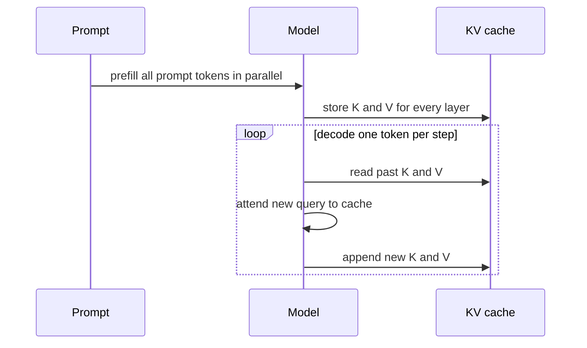

# Positional encodings, RoPE, KV cache and architecture families

Attention as we built it is **permutation-equivariant**: shuffle the input tokens and the outputs shuffle
the same way. "Dog bites man" and "man bites dog" would look identical apart from the order of rows.
This lesson covers how models inject order, how generation is made fast with a KV cache, and how the
three architecture families (encoder-only, decoder-only, encoder-decoder) differ.

## 1. Proof that attention ignores order

```python-run
import numpy as np
rng = np.random.default_rng(0)
def softmax(z): z = z - z.max(-1, keepdims=True); e = np.exp(z); return e / e.sum(-1, keepdims=True)
T, d = 4, 6
X = rng.standard_normal((T, d)); W = [rng.standard_normal((d, d)) for _ in range(3)]
def attn(X):
    Q, K, V = (X @ w for w in W)
    return softmax(Q @ K.T / np.sqrt(d)) @ V
perm = np.array([2, 0, 3, 1])
print(np.allclose(attn(X)[perm], attn(X[perm])))   # True: permuting input just permutes output
```

(A causal mask breaks this symmetry a little, since position 0 can only see itself, but that is a weak
and indirect signal. Explicit position information works far better.)

## 2. Absolute positions: sinusoidal and learned

The original transformer added a fixed **sinusoidal** vector to each token embedding:

$$
PE_{(pos, 2i)} = \sin\!\left(\frac{pos}{10000^{2i/d}}\right),\qquad
PE_{(pos, 2i+1)} = \cos\!\left(\frac{pos}{10000^{2i/d}}\right)
$$

Each pair of dimensions is a sinusoid with its own wavelength, ranging geometrically from $2\pi$ to
$10000 \cdot 2\pi$. Low dimensions tick fast (fine position), high dimensions slowly (coarse
position), like the hands of a clock. Because $\sin(a+b)$ and $\cos(a+b)$ are linear functions of
$\sin a, \cos a$, the encoding of position $pos + k$ is a fixed rotation of the encoding of $pos$, which
makes relative offsets easy for the model to read.

BERT and GPT-2 instead used **learned** absolute position embeddings: a $(T_{max}, d)$ table. Simple
and effective, but the model cannot handle positions beyond $T_{max}$ at all.

```python-run
import numpy as np
def sinusoidal(T, d):
    pos = np.arange(T)[:, None]
    i = np.arange(0, d, 2)[None, :]
    angle = pos / (10000 ** (i / d))
    pe = np.zeros((T, d))
    pe[:, 0::2] = np.sin(angle)
    pe[:, 1::2] = np.cos(angle)
    return pe
pe = sinusoidal(50, 16)
np.set_printoptions(precision=3, suppress=True)
print(pe[:3, :6])
sim = pe @ pe.T
print("similarity of pos 10 to pos 8..12:", sim[10, 8:13])   # peaks at 10, decays with distance
```

## 3. Rotary position embedding (RoPE)

Almost every open LLM today (Llama, Qwen, Mistral, Gemma, DeepSeek) uses **RoPE**. Instead of adding a
vector to the embedding, RoPE *rotates* queries and keys inside each attention layer by an angle
proportional to their position.

Pair up dimensions $(x_{2i}, x_{2i+1})$ and treat each pair as a 2-D vector. For position $m$ and
frequency $\theta_i = \text{base}^{-2i/d}$ (base usually 10000; Llama 3 uses 500000):

$$
\begin{pmatrix} x'_{2i} \\ x'_{2i+1} \end{pmatrix} =
\begin{pmatrix} \cos m\theta_i & -\sin m\theta_i \\ \sin m\theta_i & \cos m\theta_i \end{pmatrix}
\begin{pmatrix} x_{2i} \\ x_{2i+1} \end{pmatrix}
$$

The magic: the dot product of a rotated query at position $m$ and a rotated key at position $n$
depends only on the **relative offset** $m - n$:

$$
\langle R_m q, R_n k \rangle = \langle q, R_{n-m} k \rangle
$$

So RoPE gives relative-position attention while being applied to Q and K independently (cheap, and
compatible with KV caching, since a cached key's rotation never changes).

```python-run
import numpy as np

def rope(x, positions, base=10000.0):
    """x: (T, d) with d even; rotate interleaved pairs (2i, 2i+1)."""
    T, d = x.shape
    theta = base ** (-np.arange(0, d, 2) / d)            # (d/2,)
    ang = positions[:, None] * theta[None, :]            # (T, d/2)
    cos, sin = np.cos(ang), np.sin(ang)
    x1, x2 = x[:, 0::2], x[:, 1::2]
    out = np.empty_like(x)
    out[:, 0::2] = x1 * cos - x2 * sin
    out[:, 1::2] = x1 * sin + x2 * cos
    return out

rng = np.random.default_rng(0)
q = rng.standard_normal((1, 8)); k = rng.standard_normal((1, 8))
for m, n in [(5, 2), (105, 102), (1005, 1002)]:
    s = (rope(q, np.array([m])) @ rope(k, np.array([n])).T).item()
    print(f"q at {m:4d}, k at {n:4d}: score = {s:.6f}")   # identical: only m - n matters
print("norm preserved:", np.allclose(np.linalg.norm(rope(q, np.array([77]))), np.linalg.norm(q)))
```

> [!NOTE]
> Two layouts exist in the wild. The original RoFormer/GPT-J layout rotates **interleaved** pairs
> $(0,1), (2,3), \dots$; the Hugging Face Llama implementation (`rotate_half`) rotates the **first half
> against the second half**, pairing dimension $i$ with $i + d/2$. They are equivalent up to a fixed
> permutation of the weight matrices, but mixing them when porting checkpoints silently destroys a
> model. This is a real bug people hit when converting weights.

### Extending context: interpolation, NTK and YaRN

A model trained with 4k context has never seen rotation angles beyond position 4096. To stretch it:

- **Position interpolation** scales positions down ($m \to m \cdot L_{train}/L_{new}$) so angles stay
  in the trained range; needs a short fine-tune.
- **NTK-aware scaling** increases the RoPE base instead, stretching low frequencies more than high ones.
- **YaRN** combines per-frequency interpolation with an attention-temperature fix; widely used
  (`rope_scaling` in a model's `config.json`).
- **ALiBi** (an alternative to RoPE) adds a linear distance penalty to attention scores and
  extrapolates gracefully.

## 4. Generation and the KV cache

Generation is a loop: run the model, sample a token, append it, repeat. Naively each step
re-processes the whole prefix, so producing $n$ tokens costs $O(n^2)$ forward work. But with causal
attention, the keys and values of past tokens never change. We **cache** them:



This creates the two phases every inference engineer talks about:

- **Prefill**: process the prompt in parallel; compute-bound; determines time-to-first-token (TTFT).
- **Decode**: one token at a time; memory-bandwidth-bound (reading all weights and the cache for each
  token); determines time-per-output-token (TPOT).

KV cache size per sequence = $2 \times L \times h_{kv} \times d_h \times T \times \text{bytes}$. For
Llama 3 8B ($L = 32$, $h_{kv} = 8$, $d_h = 128$, bf16) that is $2 \cdot 32 \cdot 8 \cdot 128 \cdot 2$
bytes = 128 KiB per token, so a 128k-token context needs 16 GiB just for cache. vLLM's
**PagedAttention** manages this memory in fixed-size blocks like OS pages to avoid fragmentation, and
**prefix caching** reuses the cache for shared prompt prefixes (the engine-side cousin of provider
prompt caching in module 9). The AI Engineering track's inference-optimisation chapter goes deeper on
batching, quantisation and speculative decoding.

```python-run
import numpy as np
rng = np.random.default_rng(3)
d = 8
Wq, Wk, Wv = (rng.standard_normal((d, d)) for _ in range(3))
def softmax(z): z = z - z.max(); e = np.exp(z); return e / e.sum()

tokens = rng.standard_normal((6, d))
# Full recompute of the last position
Q, K, V = tokens @ Wq, tokens @ Wk, tokens @ Wv
full = softmax(Q[-1] @ K.T / np.sqrt(d)) @ V
# Incremental with a cache
Kc, Vc = [], []
for x in tokens:
    Kc.append(x @ Wk); Vc.append(x @ Wv)
    q = x @ Wq
    out = softmax(q @ np.array(Kc).T / np.sqrt(d)) @ np.array(Vc)
print("cached == recomputed:", np.allclose(out, full))
```

## 5. The three architecture families

| family | attention | pretraining objective | examples | best at |
|---|---|---|---|---|
| encoder-only | bidirectional | masked LM (predict hidden tokens) | BERT, RoBERTa, DeBERTa, ModernBERT | classification, NER, embeddings, rerankers |
| decoder-only | causal | next-token prediction | GPT, Llama, Qwen, Mistral, Gemma, Claude | generation, chat, reasoning, tools |
| encoder-decoder | bidirectional encoder + causal decoder with cross-attention | span corruption / denoising | T5, BART, Whisper, NLLB | translation, summarisation, speech-to-text |

Why did decoder-only win for general-purpose LLMs? One objective that uses every token as a training
signal, trivially scalable, and any task can be phrased as text continuation. Encoders remain the
workhorse for embeddings and rerankers (modules 4 and 5) because bidirectional attention gives better
representations per parameter.

In Hugging Face terms (module 3): `AutoModelForMaskedLM` and `AutoModelForSequenceClassification` for
encoders, `AutoModelForCausalLM` for decoders, `AutoModelForSeq2SeqLM` for encoder-decoders.

## 6. From hidden state to next token, end to end

```python-run
import numpy as np
rng = np.random.default_rng(11)
V, d, T = 20, 8, 5
E = rng.standard_normal((V, d)) * 0.5                 # embeddings, tied with the LM head
ids = np.array([3, 14, 7, 7, 1])
h = E[ids]                                            # (T, d) lookup
# pretend the transformer blocks ran here
h = h / np.sqrt((h ** 2).mean(-1, keepdims=True) + 1e-6)   # final RMSNorm
logits = h @ E.T                                      # (T, V): next-token logits at every position
p = np.exp(logits[-1] - logits[-1].max()); p /= p.sum()
print("most likely next ids:", np.argsort(-p)[:3], " p:", np.round(np.sort(p)[::-1][:3], 3))
# training loss = mean cross-entropy of position t predicting ids[t+1]
lp = logits - logits.max(-1, keepdims=True); lp = lp - np.log(np.exp(lp).sum(-1, keepdims=True))
loss = -lp[np.arange(T - 1), ids[1:]].mean()
print("next-token cross-entropy:", round(float(loss), 3), " (uniform would be", round(np.log(V), 3), ")")
```

Note the **shift**: logits at position $t$ are scored against token $t+1$. In Hugging Face you pass
`labels=input_ids` and the model shifts internally; positions labelled `-100` are ignored (used for
padding and for masking prompts in SFT, module 6).

> [!INTERVIEW]
> **"Why do we need a KV cache, and why is decode memory-bound?"** Past keys/values are unchanged
> under causal attention, so caching them turns $O(n^2)$ recomputation into $O(n)$ incremental work.
> Each decode step must stream every weight and the whole cache from HBM to compute just one token per
> sequence, so arithmetic intensity is low; batching many sequences together raises it. Size the
> cache with $2 L h_{kv} d_h T$ bytes-per-value, and mention GQA, quantised caches and PagedAttention
> as mitigations.

## Summary

- Attention is order-blind; positions are injected by absolute embeddings (sinusoidal, learned) or by
  rotating Q and K (RoPE), which yields relative-position scores.
- RoPE context is extended with interpolation, NTK-aware scaling or YaRN.
- Generation = prefill (parallel, compute-bound) + decode (sequential, bandwidth-bound) with a KV cache.
- Encoders (bidirectional) power embeddings and classification; decoders (causal) power generation;
  encoder-decoders use cross-attention for seq2seq.

```quiz
[
  {"q": "Why does a transformer need positional information at all?",
   "options": ["Self-attention is permutation-equivariant, so it cannot tell token order otherwise", "To make softmax stable", "To reduce memory", "Because embeddings are one-hot"], "answer": 0,
   "explain": "Permuting inputs permutes outputs identically; without positions, word order is invisible."},
  {"q": "With RoPE, the attention score between a query at position m and a key at position n depends on...",
   "options": ["Only the offset m - n (and the content vectors)", "Only m", "m + n", "Nothing positional"], "answer": 0,
   "explain": "Rotations compose: R_m^T R_n = R_(n-m), so the dot product sees only relative distance."},
  {"q": "Which phase of LLM inference is typically memory-bandwidth-bound?",
   "options": ["Decode", "Prefill", "Tokenization", "Softmax"], "answer": 0,
   "explain": "Decode generates one token per sequence per step while reading all weights and the KV cache."},
  {"q": "KV cache per token for L=32 layers, 8 KV heads, head dim 128, bf16 is...",
   "options": ["128 KiB", "16 KiB", "1 MiB", "4 KiB"], "answer": 0,
   "explain": "2 (K and V) x 32 x 8 x 128 values x 2 bytes = 131072 bytes = 128 KiB."},
  {"q": "Which model family is the usual choice for a cross-encoder reranker or a sentence embedding model?",
   "options": ["Encoder-only (BERT-like)", "Decoder-only", "Encoder-decoder", "Diffusion"], "answer": 0,
   "explain": "Bidirectional attention gives strong representations per parameter; many embedders and rerankers are BERT-family."},
  {"q": "When porting RoPE weights between implementations, what common silent bug occurs?",
   "options": ["Interleaved-pair vs half-split rotation layouts are mixed up", "The vocabulary changes", "LayerNorm becomes RMSNorm", "Causal masks flip"], "answer": 0,
   "explain": "Both layouts are valid but need consistently permuted Q/K weights; mixing them corrupts attention."},
  {"q": "In Hugging Face causal LM training, what does a label of -100 mean?",
   "options": ["Ignore this position in the loss", "Predict token id 100", "Padding token id", "End of sequence"], "answer": 0,
   "explain": "-100 is the ignore_index of the cross-entropy loss; used for padding and prompt masking."}
]
```

> **Source:** Vaswani et al. 2017; Su et al., "RoFormer" (2021); Peng et al., "YaRN" (2023); Kwon et
> al., "PagedAttention" (2023); Transformers docs on KV cache and generation
> (https://huggingface.co/docs/transformers/kv_cache); HF LLM Course ch. 1.6 "Transformer
> architectures" (https://huggingface.co/learn/llm-course/chapter1/6); Huyen, *AI Engineering*,
> ch. 2 and ch. 9 "Inference Optimization".
