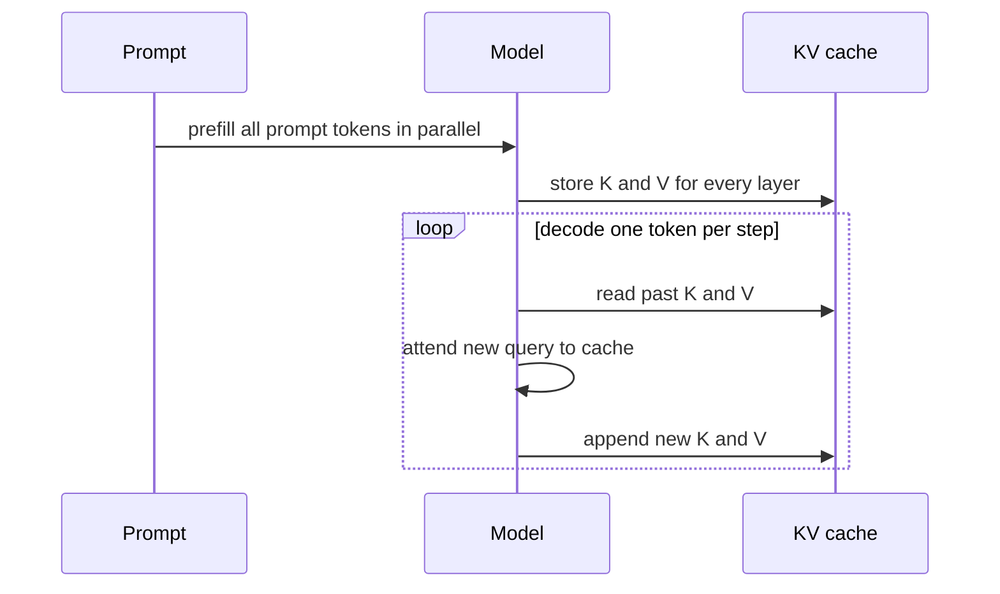

# Positional encodings, RoPE, KV cache and architecture families

> **Before this lesson:** you should be comfortable with attention as queries, keys and values, the
> causal mask, and the layout of a transformer block. These come from
> [From embeddings to scaled dot-product attention](#/lesson/llm-practice/attention-from-scratch) and
> [The transformer block](#/lesson/llm-practice/transformer-block). School-level sine and cosine
> help in sections 2 and 3, and are re-explained there.

## In plain words

Attention, as built so far, has a surprising blind spot: it cannot tell what order the words are
in. It treats a sentence like a bag of Scrabble tiles tipped onto a table. "Dog bites man" and "man
bites dog" contain the same tiles, so the model would see the same thing. The first half of this
lesson is about stamping a seat number on each tile so that order becomes visible. The method nearly
every current model uses is called **RoPE**, and it works by turning each vector through an angle
that depends on its position, like setting the hands of a clock.

The second half covers two practical topics. One is the **KV cache**, the note-keeping trick that
stops a model from re-reading the whole conversation every time it writes one more word; it is the
reason generation is fast enough to use and the reason long conversations eat memory. The other is
the family tree of transformer designs: models that only read, models that only write, and models
that do both.

Why this matters for a job: questions such as "how much memory will a 100,000-token conversation
need?", "why is the first word slow and the rest fast?" and "which kind of model should I use for
search?" are answered with the material here, and all three are standard interview questions for
machine-learning and AI engineering roles.

## 1. Proof that attention ignores order

The technical name for the blind spot is that attention is **permutation-equivariant**. A
*permutation* is a reordering; *equivariant* means "the output changes in the matching way". Shuffle
the input rows and you get the same output rows, shuffled identically. No output row is any
different because its token came first or last.

```python-run
import numpy as np
rng = np.random.default_rng(0)
def softmax(z): z = z - z.max(-1, keepdims=True); e = np.exp(z); return e / e.sum(-1, keepdims=True)
T, d = 4, 6
X = rng.standard_normal((T, d)); W = [rng.standard_normal((d, d)) for _ in range(3)]
def attn(X):
    Q, K, V = (X @ w for w in W)
    return softmax(Q @ K.T / np.sqrt(d)) @ V
perm = np.array([2, 0, 3, 1])
print(np.allclose(attn(X)[perm], attn(X[perm])))   # True: permuting the input only permutes the output
```

**Reading this code**

- `attn(X)` is the attention function from lesson 1 without a mask, using three random matrices
  `W` for queries, keys and values. `K.T` is the transpose of `K`.
- `perm = np.array([2, 0, 3, 1])` is a new order for the four tokens. `X[perm]` reorders the input
  rows; `attn(X)[perm]` reorders the output rows.
- `np.allclose(a, b)` is `True` when two arrays are equal up to tiny rounding differences. It prints
  `True`: attending and then shuffling equals shuffling and then attending.

A causal mask breaks this symmetry a little, since position 0 can see only itself, position 1 sees
two tokens, and so on. That is a weak and indirect hint. Giving the model explicit position
information works far better.

## 2. Absolute positions: sinusoidal and learned

The first solution is to make a vector that encodes "I am at position 7" and add it to the token's
embedding before the first block. The 2017 transformer built these vectors from sine and cosine
waves, so they are called **sinusoidal** position encodings. Sine and cosine are the functions that
trace a smooth wave between -1 and 1 as their input grows; one full up-and-down cycle is called a
**wavelength**.

$$
PE_{(pos, 2i)} = \sin\!\left(\frac{pos}{10000^{2i/d}}\right),\qquad
PE_{(pos, 2i+1)} = \cos\!\left(\frac{pos}{10000^{2i/d}}\right)
$$

Here $pos$ is the position (0, 1, 2, ...), $d$ is the vector length and $i$ counts pairs of slots:
slots 0 and 1 form pair 0, slots 2 and 3 form pair 1, and so on. Each pair holds a sine and a cosine
of the same wave. The division by $10000^{2i/d}$ makes each successive pair's wave longer than the
last, from a wavelength of $2\pi \approx 6.3$ positions for the first pair up to about
$10000 \cdot 2\pi$ positions for the last.

A clock is the right picture. The second hand moves fast and tells you fine detail; the hour hand
moves slowly and tells you roughly where you are in the day. Together they identify the time
exactly. The early pairs are the second hand (they tell neighbouring positions apart), the late
pairs are the hour hand (they tell position 100 from position 5,000).

There is a second benefit. School trigonometry says $\sin(a+b)$ and $\cos(a+b)$ can be written as
fixed combinations of $\sin a$ and $\cos a$. So the encoding of position $pos + k$ is the encoding of
$pos$ turned through a fixed angle, the same for every $pos$. "Three tokens to the right" looks the
same everywhere in the sentence, which makes relative distances easy for the model to read.

Two early famous models, BERT and GPT-2, used **learned** absolute position embeddings instead: a
table with one trainable vector per position, of shape $(T_{max}, d)$, looked up exactly like a token
embedding. This works well and is easy to build, but the table has a fixed number of rows, so the
model cannot process any position beyond $T_{max}$.

```python-run
import numpy as np
def sinusoidal(T, d):
    pos = np.arange(T)[:, None]
    i = np.arange(0, d, 2)[None, :]
    angle = pos / (10000 ** (i / d))
    pe = np.zeros((T, d))
    pe[:, 0::2] = np.sin(angle)
    pe[:, 1::2] = np.cos(angle)
    return pe
pe = sinusoidal(50, 16)
np.set_printoptions(precision=3, suppress=True)
print(pe[:3, :6])
sim = pe @ pe.T
print("similarity of pos 10 to pos 8..12:", sim[10, 8:13])   # peaks at 10, decays with distance
```

**Reading this code**

- `np.arange(T)[:, None]` is a column of positions 0 to T-1; `[:, None]` adds a second direction so
  that it can be combined with a row. `np.arange(0, d, 2)[None, :]` is the row `0, 2, 4, ...`.
- `pos / (10000 ** (i / d))` combines the column and the row into a grid with one angle for every
  position and pair. Numpy stretches the two shapes to match automatically; this is called
  **broadcasting**.
- `pe[:, 0::2] = np.sin(angle)` fills the even slots (0, 2, 4, ...) and `pe[:, 1::2]` the odd slots.
  The slice `0::2` means "start at 0, take every second one".
- Output: the first three rows of the table (row 0 is alternating 0s and 1s, because
  $\sin 0 = 0$ and $\cos 0 = 1$), then the dot product of position 10 with positions 8 to 12. The
  largest value is at position 10 itself and the values fall away on both sides: nearby positions
  have similar encodings.

## 3. Rotary position embedding (RoPE)

Almost every open LLM today (Llama, Qwen, Mistral, Gemma, DeepSeek) uses **RoPE**, short for rotary
position embedding. It differs from the previous scheme in two ways. It does not add anything to the
embedding at the bottom of the model; instead it acts inside every attention layer. And what it does
there is *rotate* the query and key vectors by an angle proportional to their position.

Here is the idea in two dimensions. A pair of numbers $(x, y)$ is an arrow on graph paper from the
origin to that point. Rotating the arrow by an angle keeps its length and changes only its
direction. RoPE takes a query or key vector, groups its slots into pairs $(x_{2i}, x_{2i+1})$, treats
each pair as such an arrow, and turns it. For a token at position $m$, pair $i$ is turned by the
angle $m\theta_i$, where $\theta_i = \text{base}^{-2i/d}$ is that pair's own speed (the base is
usually 10000; Llama 3 uses 500000). The rotation written as a matrix is:

$$
\begin{pmatrix} x'_{2i} \\ x'_{2i+1} \end{pmatrix} =
\begin{pmatrix} \cos m\theta_i & -\sin m\theta_i \\ \sin m\theta_i & \cos m\theta_i \end{pmatrix}
\begin{pmatrix} x_{2i} \\ x_{2i+1} \end{pmatrix}
$$

So a token at position 5 has its first pair turned five steps, a token at position 6 six steps, and
so on: the same clock as before, now applied by turning the hands.

The payoff comes from a fact about arrows: the dot product of two arrows depends on their lengths and
on the angle *between* them. If the query at position $m$ has been turned by $m\theta$ and the key at
position $n$ by $n\theta$, the angle between them has changed by $(m - n)\theta$. Only the difference
survives. Writing $R_m$ for "rotate as position $m$" and $\langle a, b \rangle$ for a dot product:

$$
\langle R_m q, R_n k \rangle = \langle q, R_{n-m} k \rangle
$$

The attention score therefore depends on the content of the two tokens and on how far apart they
are (the **relative offset** $m - n$), not on where in the text the pair sits. That is what language
needs: an adjective relates to the noun two words later in the same way on page 1 and on page 50.
RoPE also rotates queries and keys separately, which is cheap and fits the KV cache of section 4: a
stored key was rotated according to its own position, which never changes.

```python-run
import numpy as np

def rope(x, positions, base=10000.0):
    """x: (T, d) with d even; rotate interleaved pairs (2i, 2i+1)."""
    T, d = x.shape
    theta = base ** (-np.arange(0, d, 2) / d)            # (d/2,)
    ang = positions[:, None] * theta[None, :]            # (T, d/2)
    cos, sin = np.cos(ang), np.sin(ang)
    x1, x2 = x[:, 0::2], x[:, 1::2]
    out = np.empty_like(x)
    out[:, 0::2] = x1 * cos - x2 * sin
    out[:, 1::2] = x1 * sin + x2 * cos
    return out

rng = np.random.default_rng(0)
q = rng.standard_normal((1, 8)); k = rng.standard_normal((1, 8))
for m, n in [(5, 2), (105, 102), (1005, 1002)]:
    s = (rope(q, np.array([m])) @ rope(k, np.array([n])).T).item()
    print(f"q at {m:4d}, k at {n:4d}: score = {s:.6f}")   # identical: only m - n matters
print("norm preserved:", np.allclose(np.linalg.norm(rope(q, np.array([77]))), np.linalg.norm(q)))
```

**Reading this code**

- `theta` is the list of speeds, one per pair; `ang` is the angle for every position and pair.
- `x1, x2 = x[:, 0::2], x[:, 1::2]` separates the first and second member of every pair. The next
  two assignments are the rotation matrix above written out: new first member
  $x_1\cos - x_2\sin$, new second member $x_1\sin + x_2\cos$.
- The loop places a query and a key at three pairs of positions, (5, 2), (105, 102) and
  (1005, 1002). In every case the offset is 3, and the three printed scores are identical to six
  decimal places. `.item()` turns a 1-by-1 array into a plain number.
- The last line prints `norm preserved: True`: the length of the vector (its **norm**) is unchanged,
  because rotation does not stretch anything.

> [!NOTE]
> Two layouts exist in the wild. The original RoFormer/GPT-J layout rotates **interleaved** pairs
> $(0,1), (2,3), \dots$; the Hugging Face Llama implementation (`rotate_half`) rotates the **first half
> against the second half**, pairing dimension $i$ with $i + d/2$. They are equivalent up to a fixed
> permutation of the weight matrices, but mixing them when porting checkpoints silently destroys a
> model. This is a real bug people hit when converting weights.

(A **checkpoint** is a saved copy of a model's weights. "Porting" one means loading it into a
different program than the one that trained it.)

### Extending context: interpolation, NTK and YaRN

The **context window** (or context length) is the largest number of tokens a model can take in at
once. A model trained with a 4,096-token window has never seen the rotation angles that belong to
position 5,000, and it behaves badly when shown them. Several methods stretch the window:

- **Position interpolation** shrinks the positions ($m \to m \cdot L_{train}/L_{new}$, where $L$
  is a context length) so that all angles stay inside the range seen in training. It needs a short
  extra round of training (a **fine-tune**).
- **NTK-aware scaling** raises the RoPE base instead, which stretches the slow waves more than the
  fast ones.
- **YaRN** combines a different amount of interpolation for each wave speed with a correction to the
  attention temperature. It is widely used and appears as `rope_scaling` in a model's `config.json`
  file.
- **ALiBi** is an alternative to RoPE: it subtracts a penalty from each attention score in proportion
  to the distance between the two tokens, and it copes well with lengths longer than those seen in
  training.

## 4. Generation and the KV cache

Generating text is a loop: run the model on the text so far, pick the next token, append it, repeat.
Done in the most direct way, every turn of the loop processes the entire text again, so writing $n$
tokens costs on the order of $n^2$ token-computations.

Most of that work is repeated. Under a causal mask a token can see only earlier tokens, so appending
a new token at the end cannot change anything computed for the earlier ones. In particular their keys
and values stay the same for ever. So we store them the first time, in the **KV cache**, and at each
step compute only the new token's query, key and value, compare the query against the stored keys,
and append the new key and value to the store.



This creates the two phases that every engineer who runs models talks about. Running a trained model
to get output is called **inference**.

- **Prefill**: the whole prompt is processed in one parallel pass. The speed limit is raw arithmetic
  (it is **compute-bound**). Prefill decides the **time to first token** (TTFT): how long the user
  waits before anything appears.
- **Decode**: one token per step. Each step must read every weight of the model and the whole cache
  out of memory to produce a single token, so the speed limit is how fast memory can be read
  (**memory-bandwidth-bound**). Decode decides the **time per output token** (TPOT).

How big is the cache? For one sequence it is
$2 \times L \times h_{kv} \times d_h \times T \times \text{bytes per number}$. Take Llama 3 8B: $L = 32$
layers, $h_{kv} = 8$ key-value heads, $d_h = 128$, and numbers stored in the 2-byte format bf16
(bfloat16). That is $2 \cdot 32 \cdot 8 \cdot 128 \cdot 2 = 131{,}072$ bytes, or 128 KiB, per token.
A 128,000-token context therefore needs about 16 GiB for the cache alone, on top of the model itself.
(KiB and GiB are 1,024 bytes and $1{,}024^3$ bytes.)

Two engine features manage this memory. **PagedAttention**, from the vLLM serving engine, hands out
cache memory in fixed-size blocks, the way an operating system hands out memory pages, so that
sequences of different lengths do not leave unusable gaps (**fragmentation**). **Prefix caching**
reuses the stored keys and values when many requests begin with the same text, such as a shared
instruction block; it is the engine-side relative of the provider prompt caching covered in module 9.
The AI Engineering track's chapter on inference optimisation goes further into batching,
quantisation and speculative decoding.

```python-run
import numpy as np
rng = np.random.default_rng(3)
d = 8
Wq, Wk, Wv = (rng.standard_normal((d, d)) for _ in range(3))
def softmax(z): z = z - z.max(); e = np.exp(z); return e / e.sum()

tokens = rng.standard_normal((6, d))
# Full recompute of the last position
Q, K, V = tokens @ Wq, tokens @ Wk, tokens @ Wv
full = softmax(Q[-1] @ K.T / np.sqrt(d)) @ V
# Incremental with a cache
Kc, Vc = [], []
for x in tokens:
    Kc.append(x @ Wk); Vc.append(x @ Wv)
    q = x @ Wq
    out = softmax(q @ np.array(Kc).T / np.sqrt(d)) @ np.array(Vc)
print("cached == recomputed:", np.allclose(out, full))
```

**Reading this code**

- The "full recompute" lines process all six tokens at once and take the output for the last
  position, `Q[-1]`.
- The "incremental" loop feeds the tokens one at a time. `Kc` and `Vc` are Python lists acting as
  the cache; each step appends one key and one value, then attends the new query `q` to everything
  stored so far.
- After the loop `out` is the output for the last token. The script prints
  `cached == recomputed: True`: the cache gives exactly the same answer with far less work.

## 5. The three architecture families

Transformers come in three designs. They differ in which tokens each token may look at and in the
task used to train them. **Pretraining** is the first, large-scale training on general text; its
**objective** is the task the model is asked to solve during it. **Bidirectional** attention means
no causal mask: every token sees the whole text, left and right.

| family | attention | pretraining objective | examples | best at |
|---|---|---|---|---|
| encoder-only | bidirectional | masked LM (predict hidden tokens) | BERT, RoBERTa, DeBERTa, ModernBERT | classification, NER, embeddings, rerankers |
| decoder-only | causal | next-token prediction | GPT, Llama, Qwen, Mistral, Gemma, Claude | generation, chat, reasoning, tools |
| encoder-decoder | bidirectional encoder + causal decoder with cross-attention | span corruption / denoising | T5, BART, Whisper, NLLB | translation, summarisation, speech-to-text |

A few terms in the table: **masked LM** (masked language modelling) hides some tokens and asks the
model to fill them in, like a cloze test; **NER** is named-entity recognition, tagging names of
people and places; a **reranker** scores how well a document answers a question (module 5);
**span corruption** removes whole stretches of text for the model to restore.

Why did decoder-only models become the standard for general-purpose LLMs? Their single objective
turns every token of every document into a training example; the design scales up without changes;
and any task can be phrased as "continue this text". Encoders remain the standard tool for
embeddings and rerankers (modules 4 and 5), because seeing both directions produces better
representations for the same number of parameters.

In Hugging Face code (module 3) the families map to loader classes: `AutoModelForMaskedLM` and
`AutoModelForSequenceClassification` for encoders, `AutoModelForCausalLM` for decoders, and
`AutoModelForSeq2SeqLM` for encoder-decoders ("seq2seq" = sequence to sequence).

## 6. From hidden state to next token, end to end

This last demo joins the three lessons of the module: look up embeddings, (pretend to) run the
blocks, normalise, project to logits, read off the most likely next token, and compute the training
loss.

```python-run
import numpy as np
rng = np.random.default_rng(11)
V, d, T = 20, 8, 5
E = rng.standard_normal((V, d)) * 0.5                 # embeddings, tied with the LM head
ids = np.array([3, 14, 7, 7, 1])
h = E[ids]                                            # (T, d) lookup
# pretend the transformer blocks ran here
h = h / np.sqrt((h ** 2).mean(-1, keepdims=True) + 1e-6)   # final RMSNorm
logits = h @ E.T                                      # (T, V): next-token logits at every position
p = np.exp(logits[-1] - logits[-1].max()); p /= p.sum()
print("most likely next ids:", np.argsort(-p)[:3], " p:", np.round(np.sort(p)[::-1][:3], 3))
# training loss = mean cross-entropy of position t predicting ids[t+1]
lp = logits - logits.max(-1, keepdims=True); lp = lp - np.log(np.exp(lp).sum(-1, keepdims=True))
loss = -lp[np.arange(T - 1), ids[1:]].mean()
print("next-token cross-entropy:", round(float(loss), 3), " (uniform would be", round(np.log(V), 3), ")")
```

**Reading this code**

- `E` is a random embedding table for a 20-token vocabulary; `h = E[ids]` looks up five tokens.
- `logits = h @ E.T` uses the same matrix as the LM head (weight tying, lesson 1). The result has
  one row of 20 logits per position.
- `p` is the softmax of the *last* row: the model's belief about the token after the sequence.
  `np.argsort(-p)[:3]` lists the three most likely ids.
- The last three lines compute the training loss. `lp` holds log-probabilities.
  `lp[np.arange(T - 1), ids[1:]]` picks, for each position `t`, the log-probability the model gave to
  the token that really came next, `ids[t+1]`. The loss is the negative average. It prints about 4.59,
  which is worse than $\ln 20 \approx 3.0$, the loss of a model that spreads its guess evenly over
  all 20 tokens. That is expected: these weights are random and confidently wrong. Training would
  push the number down.

Notice the **shift**: the logits at position $t$ are marked against token $t+1$. With the Hugging
Face library you pass `labels=input_ids` and the model does the shifting internally. Positions whose
label is `-100` are left out of the loss; this is used for padding and for hiding the prompt part of
an example during supervised fine-tuning (module 6).

> [!INTERVIEW]
> **"Why do we need a KV cache, and why is decode memory-bound?"** Past keys/values are unchanged
> under causal attention, so caching them turns $O(n^2)$ recomputation into $O(n)$ incremental work.
> Each decode step must stream every weight and the whole cache from the GPU's memory (HBM,
> high-bandwidth memory) to compute a single token per sequence, so little arithmetic is done per
> byte read; batching many sequences together raises that ratio. Size the cache with
> $2 L h_{kv} d_h T$ bytes-per-value, and mention GQA, quantised caches and PagedAttention as
> mitigations.

## Summary

- Attention is order-blind; positions are injected by absolute embeddings (sinusoidal, learned) or by
  rotating Q and K (RoPE), which yields relative-position scores.
- RoPE context is extended with interpolation, NTK-aware scaling or YaRN.
- Generation = prefill (parallel, compute-bound) + decode (sequential, bandwidth-bound) with a KV cache.
- Encoders (bidirectional) power embeddings and classification; decoders (causal) power generation;
  encoder-decoders use cross-attention for seq2seq.

## Glossary

- **Permutation-equivariant**: reordering the inputs reorders the outputs identically; nothing else
  changes.
- **Positional encoding**: any method that tells the model where each token sits in the sequence.
- **Sinusoidal encoding**: fixed position vectors built from sine and cosine waves of many
  wavelengths.
- **Learned position embedding**: a trainable table with one vector per position.
- **RoPE**: rotary position embedding; rotates queries and keys by an angle proportional to
  position so that scores depend on relative distance.
- **Relative offset**: the distance $m - n$ between two positions.
- **Context window**: the largest number of tokens a model can take in at once.
- **Checkpoint**: a saved copy of a model's weights.
- **Inference**: running a trained model to get output.
- **KV cache**: stored keys and values of earlier tokens, reused at every generation step.
- **Prefill / decode**: processing the prompt in one pass / generating one token per step.
- **TTFT / TPOT**: time to first token / time per output token.
- **PagedAttention**: cache memory handed out in fixed-size blocks to avoid fragmentation.
- **Encoder-only, decoder-only, encoder-decoder**: models that read with full two-way attention,
  models that write left to right, and models with both halves joined by cross-attention.
- **Pretraining objective**: the task a model is trained on first, such as next-token prediction.

## Check yourself

```quiz
[
  {"q": "Why does a transformer need positional information at all?",
   "options": ["Self-attention is permutation-equivariant, so it cannot tell token order otherwise", "To make softmax stable", "To reduce memory", "Because embeddings are one-hot"], "answer": 0,
   "explain": "Permuting inputs permutes outputs identically; without positions, word order is invisible."},
  {"q": "With RoPE, the attention score between a query at position m and a key at position n depends on...",
   "options": ["Only the offset m - n (and the content vectors)", "Only m", "m + n", "Nothing positional"], "answer": 0,
   "explain": "Rotations compose: R_m^T R_n = R_(n-m), so the dot product sees only relative distance."},
  {"q": "Which phase of LLM inference is typically memory-bandwidth-bound?",
   "options": ["Decode", "Prefill", "Tokenization", "Softmax"], "answer": 0,
   "explain": "Decode generates one token per sequence per step while reading all weights and the KV cache."},
  {"q": "KV cache per token for L=32 layers, 8 KV heads, head dim 128, bf16 is...",
   "options": ["128 KiB", "16 KiB", "1 MiB", "4 KiB"], "answer": 0,
   "explain": "2 (K and V) x 32 x 8 x 128 values x 2 bytes = 131072 bytes = 128 KiB."},
  {"q": "Which model family is the usual choice for a cross-encoder reranker or a sentence embedding model?",
   "options": ["Encoder-only (BERT-like)", "Decoder-only", "Encoder-decoder", "Diffusion"], "answer": 0,
   "explain": "Bidirectional attention gives strong representations per parameter; many embedders and rerankers are BERT-family."},
  {"q": "When porting RoPE weights between implementations, what common silent bug occurs?",
   "options": ["Interleaved-pair vs half-split rotation layouts are mixed up", "The vocabulary changes", "LayerNorm becomes RMSNorm", "Causal masks flip"], "answer": 0,
   "explain": "Both layouts are valid but need consistently permuted Q/K weights; mixing them corrupts attention."},
  {"q": "In Hugging Face causal LM training, what does a label of -100 mean?",
   "options": ["Ignore this position in the loss", "Predict token id 100", "Padding token id", "End of sequence"], "answer": 0,
   "explain": "-100 is the ignore_index of the cross-entropy loss; used for padding and prompt masking."}
]
```

> **Source:** Vaswani et al. 2017; Su et al., "RoFormer" (2021); Peng et al., "YaRN" (2023); Kwon et
> al., "PagedAttention" (2023); Transformers docs on KV cache and generation
> (https://huggingface.co/docs/transformers/kv_cache); HF LLM Course ch. 1.6 "Transformer
> architectures" (https://huggingface.co/learn/llm-course/chapter1/6); Huyen, *AI Engineering*,
> ch. 2 and ch. 9 "Inference Optimization".
