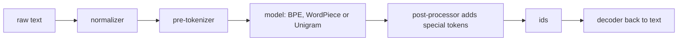

# Subword tokenizers: BPE, WordPiece, Unigram, byte-level

> **Before this lesson:** basic Python (strings, lists, dictionaries, loops). You should also know
> that a model reads **token ids**, not letters, and that each id selects a row of an embedding
> table; that is covered in
> [From embeddings to scaled dot-product attention](#/lesson/llm-practice/attention-from-scratch).

## In plain words

Before a language model can read a sentence, a separate small program called the **tokenizer**
chops the sentence into pieces and replaces each piece with a number. The model never sees letters.
It sees only those numbers.

Think of a set of rubber stamps in a print shop. Having one stamp for every word in every language
would need millions of stamps. Having one stamp per letter needs very few stamps, but printing a page
takes for ever. The practical kit has a stamp for each very common word ("the", "and"), plus stamps
for common fragments ("ing", "tion", "un"), plus single letters as a last resort. Any word can be
printed, and common text is printed quickly. A **subword tokenizer** is that kit, and this lesson
shows how the kit is chosen automatically from a large pile of text.

Why this matters for a job: you are billed per token, the model's reading limit is counted in
tokens, and many puzzling behaviours come from tokenization. A model that cannot count the letter r
in "strawberry", makes slips in long arithmetic, costs twice as much for Japanese as for English, or
answers differently when the prompt ends with a space is showing you its tokenizer. "Explain BPE" is
also a routine interview question. This lesson builds the main algorithms from scratch and then
shows the Hugging Face `tokenizers` library that packages them.

## 1. Why subwords?

Recall from lesson 1: a **token** is one piece of text, the **vocabulary** is the full list of
pieces the model knows, and a token's **id** is its position in that list. The first design decision
is what a "piece" should be. There are three choices:

| unit | vocab size | sequence length | out-of-vocabulary? |
|---|---|---|---|
| words | huge (millions with inflections, names) | short | yes: unseen words become `[UNK]` |
| characters / bytes | tiny (about 100 to 256) | very long (bad for $O(T^2)$ attention) | no |
| **subwords** | 30k to 260k | moderate | no, if the base alphabet covers all bytes |

Some terms in the table. **Out-of-vocabulary** (OOV) describes a piece of text that is not in the
vocabulary. A word-level tokenizer has to replace such a word with a catch-all token written `[UNK]`
("unknown"), and the model then has no idea what the word was. A **byte** is a number from 0 to 255;
computers store all text as bytes. "Sequence length" is how many tokens a text turns into; long
sequences are expensive because attention cost grows with the square of the length (lesson 1).

Subword tokenizers take the middle road. Frequent words stay whole ("the", "function"); rare words
are split into reusable pieces ("tokenization" might become "token" + "ization"). The vocabulary size
is a **hyperparameter**: a setting chosen by the designers, not learned by training. A bigger
vocabulary needs a bigger embedding table but produces shorter sequences. Some real sizes: GPT-2 had
50,257 tokens, Llama 2 32,000, Llama 3 128,256, GPT-4o's `o200k_base` about 200,000 and Gemma 3
about 262,000. Larger vocabularies pack text in many languages, and program code, into fewer tokens.

Every tokenizer is a pipeline of stages:



- **Normalizer**: tidies the raw text. **Unicode** is the worldwide standard that assigns a number
  to every character in every script. Some characters can be written in more than one way (é as one
  character, or as e followed by a separate accent mark), and normalisation forms called NFC and NFKC
  pick one spelling so that identical-looking text gives identical tokens. Some normalizers also
  lowercase the text (the "uncased" BERT models) or strip accents.
- **Pre-tokenizer**: makes a first rough cut into "words", usually at spaces and punctuation, so that
  no token learned later can straddle two words. GPT-style models use a **regex** (regular
  expression, a pattern-matching rule) that also separates digits.
- **Model**: the learned algorithm (BPE, WordPiece or Unigram, below) that turns each rough word into
  subword ids. "Model" here means the tokenizer's own algorithm, not the neural network.
- **Post-processor**: adds **special tokens**, markers such as `[CLS]`, `[SEP]` or
  `<|begin_of_text|>` that the neural network expects around the text (next lesson), and builds the
  attention mask from lesson 1.
- **Decoder**: the reverse direction, turning ids back into readable text.

## 2. Byte-Pair Encoding (BPE)

**Byte-pair encoding** is the most widely used algorithm. It began in 1994 as a way to compress
files and was adapted for language models by Sennrich and colleagues in 2016. The idea is to grow
the vocabulary from the bottom up by repeatedly gluing together the two symbols that most often
appear side by side. A text collection used for this is called a **corpus**.

**Training** (learning the vocabulary) has four steps:

1. Write each word as a sequence of single characters (or bytes), and count how often each word
   occurs in the corpus.
2. Count every pair of neighbouring symbols, adding the word's count each time the pair appears.
3. Take the most frequent pair and merge it into one new symbol everywhere. Write the merge down.
4. Go back to step 2 until the vocabulary has reached the size you want.

A tiny example by hand. Suppose the corpus is "low" five times and "lower" twice. Initially the
symbols are `l o w` (x5) and `l o w e r` (x2). The pair `(l, o)` occurs 7 times, `(o, w)` 7 times,
`(w, e)` twice and `(e, r)` twice. We merge `(l, o)` into `lo` (a tie is broken alphabetically).
Now `(lo, w)` occurs 7 times, so the second merge makes `low`. After two merges the common word is
a single symbol.

**Encoding** (using the vocabulary on new text) replays the recorded merges on the new word, *in
the order they were learned*. The order number of a merge is called its **rank**. Training and
encoding are different procedures. A frequent bug is to encode by grabbing the longest vocabulary
entry that matches at each position, which can give different tokens from replaying the merges.

```python-run
from collections import Counter

def train_bpe(words, num_merges):
    vocab = Counter(tuple(w) for w in words)           # word (as symbol tuple) -> frequency
    merges = []
    for _ in range(num_merges):
        pairs = Counter()
        for sym, f in vocab.items():
            for a, b in zip(sym, sym[1:]):
                pairs[(a, b)] += f
        if not pairs:
            break
        best = min(pairs, key=lambda p: (-pairs[p], p))   # most frequent, ties -> lexicographic
        merges.append(best)
        new_vocab = Counter()
        for sym, f in vocab.items():
            out, i = [], 0
            while i < len(sym):
                if i + 1 < len(sym) and (sym[i], sym[i + 1]) == best:
                    out.append(sym[i] + sym[i + 1]); i += 2
                else:
                    out.append(sym[i]); i += 1
            new_vocab[tuple(out)] += f
        vocab = new_vocab
    return merges, vocab

corpus = "low low low low low lower lower newest newest newest newest newest newest widest widest widest".split()
merges, vocab = train_bpe(corpus, 6)
for i, m in enumerate(merges):
    print(i, m)
print(dict(vocab))

def encode(word, merges):
    sym = list(word)
    rank = {m: r for r, m in enumerate(merges)}
    while True:
        cands = [(rank[(a, b)], i) for i, (a, b) in enumerate(zip(sym, sym[1:])) if (a, b) in rank]
        if not cands:
            return sym
        _, i = min(cands)                               # apply the earliest-learned merge first
        sym[i:i + 2] = [sym[i] + sym[i + 1]]

print(encode("lowest", merges), encode("newer", merges))
```

**Reading this code**

- `Counter` is a dictionary that counts things. `Counter(tuple(w) for w in words)` turns each word
  into a tuple of characters, `('l', 'o', 'w')`, and counts how many times each occurs.
- Inside the loop, `zip(sym, sym[1:])` walks over neighbouring pairs: it lines the sequence up
  against itself shifted by one. `pairs[(a, b)] += f` adds the word's frequency for that pair.
- `min(pairs, key=lambda p: (-pairs[p], p))` selects the pair with the highest count; the minus
  sign turns "smallest" into "largest", and the second element `p` breaks ties alphabetically so the
  result is the same on every run.
- The `while` loop rebuilds each word with the chosen pair glued together.
- The first printed block lists the six merges in rank order. They start with `('e', 's')` and
  `('es', 't')`, because "est" ends both "newest" and "widest" and is the most common pattern, then
  build `lo` and `low`. The dictionary that follows shows each word after merging.
- `encode` replays the merges on a new word. It lists every neighbouring pair that has a rank,
  applies the one learned earliest (`min(cands)`), and repeats until no known pair is left.
- Final line: `['low', 'est'] ['n', 'e', 'w', 'e', 'r']` or similar pieces, depending on the merges
  learned.

"lowest" never appeared in the corpus, yet it is encoded into pieces the tokenizer knows. This is
the property that makes subword tokenizers free of unknown words.

### Byte-level BPE

If the starting alphabet is "the characters seen in the corpus", a character never seen in training
(a new emoji, a rare Chinese character) still has no token. **Byte-level BPE** closes the gap. It
runs BPE over the bytes of the text instead of its characters. **UTF-8** is the standard way of
storing Unicode text as bytes: plain English letters take one byte each, accented letters two, most
Chinese, Japanese and Korean (CJK) characters three, and emoji four. Since every possible text is
some sequence of the 256 byte values, a vocabulary that starts with all 256 can represent *any*
string with no unknowns. GPT-2, RoBERTa, Llama 3 and OpenAI's `tiktoken` library all work this way.
GPT-2 displays bytes as printable stand-in characters, which is why its vocabulary files show `Ġ`
for a space and `Ċ` for a newline.

GPT-style models also use a regex pre-tokenizer that cuts text into chunks before BPE runs:
contractions such as `'s`, runs of letters, runs of up to three digits, punctuation and whitespace.
Limiting digits to groups of three at most (or to single digits, as Llama 1 and 2 and Gemma do)
makes arithmetic more regular than letting BPE learn arbitrary chunks such as "1997".

```python-run
s = "naïve café 🤖"
b = s.encode("utf-8")
print(len(s), "characters ->", len(b), "bytes:", list(b))
print("the robot emoji alone is", len("🤖".encode()), "bytes, so a byte-level vocab can always fall back to 4 ids")
```

`s.encode("utf-8")` converts the string to its bytes. The output says 12 characters became 17 bytes:
`ï` and `é` take two bytes each and the robot emoji takes four. However unusual a character is, a
byte-level tokenizer can always fall back to its individual bytes.

## 3. WordPiece

**WordPiece** is the algorithm of BERT and its relatives (DistilBERT, ELECTRA). It is close to BPE,
with two differences.

- **Training score.** BPE merges the most frequent pair. WordPiece merges the pair with the highest
  value of $\frac{\text{freq}(ab)}{\text{freq}(a)\,\text{freq}(b)}$: how often the pair occurs
  together, divided by how often each part occurs at all. A pair scores highly when its parts are
  rarely seen apart. Two very common symbols that sometimes happen to meet are not merged; two
  symbols that almost always travel together are.
- **Encoding** is **greedy longest-match-first**: starting at the beginning of the word, take the
  longest vocabulary entry that matches, then continue from where it ended. Pieces that do not start
  a word carry the prefix `##`, so `"playing"` becomes `["play", "##ing"]`. If at any point nothing
  matches, the **whole word** becomes `[UNK]`.

```python-run
def wordpiece(word, vocab, unk="[UNK]"):
    tokens, start = [], 0
    while start < len(word):
        end, cur = len(word), None
        while start < end:
            piece = word[start:end] if start == 0 else "##" + word[start:end]
            if piece in vocab:
                cur = piece; break
            end -= 1
        if cur is None:
            return [unk]                 # whole word becomes unknown
        tokens.append(cur); start = end
    return tokens

vocab = {"un", "##aff", "##able", "play", "##ing", "##ed", "p", "##l", "##a", "##y"}
for w in ["unaffable", "playing", "played", "plays"]:
    print(w, "->", wordpiece(w, vocab))
```

**Reading this code**

- `start` marks where the next piece must begin. The inner `while` tries the longest possible piece
  first (`end = len(word)`) and shortens it one character at a time (`end -= 1`) until it finds one
  in the vocabulary.
- `piece = word[start:end] if start == 0 else "##" + word[start:end]` adds the `##` prefix to every
  piece except the first.
- If no piece matches (`cur is None`), the function gives up and returns `["[UNK]"]`.
- Output: `unaffable -> ['un', '##aff', '##able']`, `playing -> ['play', '##ing']`,
  `played -> ['play', '##ed']`, `plays -> ['[UNK]']`.

"plays" becomes `[UNK]` because there is no `##s` in this small vocabulary, even though "play"
matched. Newcomers often expect `['play', '[UNK]']`; the all-or-nothing rule is a common surprise.

## 4. Unigram LM and SentencePiece

**Unigram** (Kudo, 2018) goes in the opposite direction from BPE: top-down. It starts with a very
large list of candidate pieces and removes the least useful ones until the list is the right size.

To decide what "useful" means, it gives every piece $x$ a probability $p(x)$ and scores a way of
splitting a text by multiplying the probabilities of the pieces used, as if each piece were drawn
independently of its neighbours. (A "unigram" model is one that looks at single items with no
context.) Training repeatedly finds the pieces whose removal lowers the score of the corpus the
least, and drops them. To encode, it finds the split with the highest probability using the
**Viterbi algorithm**, a standard method for finding the best path through a set of choices without
trying every combination. Because the method is built on probabilities, it can also *sample*
different valid splits of the same text during training, a trick called **subword regularisation**
that makes models more robust.

**SentencePiece** is a library, not an algorithm. It implements both BPE and Unigram, and brings two
ideas of its own:

1. It treats the input as a raw stream, including spaces, replacing the space with the visible
   metasymbol `▁` (U+2581). No language-specific pre-tokenizer is needed, which matters for Chinese,
   Japanese and Thai, where words are not space-separated.
2. Decoding is lossless: concatenate the pieces and replace `▁` with a space.

T5, ALBERT, XLNet and mBART use SentencePiece Unigram; Llama 1/2, Mistral and Gemma use SentencePiece
BPE with **byte fallback** (unknown characters fall back to `<0xNN>` byte tokens).

| algorithm | direction | encode | used by |
|---|---|---|---|
| BPE | bottom-up merges by frequency | replay merges by rank | GPT family, Llama, Qwen, Mistral |
| WordPiece | bottom-up merges by likelihood score | greedy longest match, `##` | BERT family |
| Unigram | top-down pruning | Viterbi most-probable split | T5, ALBERT, XLM-R |

## 5. Hands-on with `tokenizers` and `transformers`

Two Hugging Face libraries appear below. `transformers` loads models and their tokenizers by name
from the Hugging Face Hub, a website that hosts models (module 3). `tokenizers` is the fast engine
underneath, written in the Rust programming language. The next blocks are static: they need a
network connection and installed packages, so they do not run in this page.

```python
from transformers import AutoTokenizer

tok = AutoTokenizer.from_pretrained("Qwen/Qwen3-0.6B")
enc = tok("Tokenizers are fun!", return_offsets_mapping=True)
print(enc["input_ids"])
print(tok.convert_ids_to_tokens(enc["input_ids"]))   # ['Token', 'izers', 'Ġare', 'Ġfun', '!']
print(enc["offset_mapping"])                          # char spans: vital for highlighting citations
print(tok.decode(enc["input_ids"]))
```

Line by line: `AutoTokenizer.from_pretrained(name)` downloads the tokenizer that belongs to the
named model. Calling `tok(text, ...)` encodes the text and returns a dictionary; `input_ids` is the
list of ids. `convert_ids_to_tokens` shows the pieces as text, where `Ġ` marks a leading space.
`offset_mapping` gives, for each token, the start and end character positions in the original
string, which is how an application highlights the exact words a token came from. `decode` turns the
ids back into the original string.

Training a byte-level BPE tokenizer from scratch:

```python
from tokenizers import Tokenizer, models, trainers, pre_tokenizers, decoders

tok = Tokenizer(models.BPE())
tok.pre_tokenizer = pre_tokenizers.ByteLevel(add_prefix_space=False)
tok.decoder = decoders.ByteLevel()
trainer = trainers.BpeTrainer(vocab_size=8000, special_tokens=["<|endoftext|>", "<|pad|>"],
                              initial_alphabet=pre_tokenizers.ByteLevel.alphabet())
tok.train(["corpus_part1.txt", "corpus_part2.txt"], trainer)
tok.save("my-tokenizer.json")
```

Here `Tokenizer(models.BPE())` creates an empty BPE tokenizer. The `pre_tokenizer` and `decoder`
lines select byte-level handling in both directions. `BpeTrainer` holds the training settings: the
target vocabulary size, the special tokens to reserve, and the 256-byte starting alphabet.
`tok.train(files, trainer)` runs the merge-learning loop from section 2 over the listed text files,
and `save` writes everything to one JSON file.

To adapt an existing tokenizer to a new subject area while keeping its normalizer and pre-tokenizer,
call `old_tokenizer.train_new_from_iterator(text_iterator, vocab_size=...)`. Be careful: a **new**
tokenizer assigns new ids, and a trained model's embedding rows are tied to the old ids. So a new
tokenizer is only usable when training a model from the beginning. For an existing model you may add
a few tokens and train the new embedding rows, but you cannot swap the vocabulary.

## 6. Practical consequences

- **Cost and context are measured in tokens**, and the ratio of tokens to words varies: about 1.3
  tokens per English word for modern tokenizers, often 2 to 4x more for many Indic, African or
  Southeast Asian languages. Users of those languages pay more for worse effective context.
- **Character-level tasks are hard** because "strawberry" might be one or three tokens; the model
  must have memorised its spelling.
- **Leading spaces matter.** `"Paris"` and `" Paris"` are different tokens. Prompts ending in a
  trailing space can push the model into an unusual token boundary ("token healing" in some
  libraries re-tokenises the prompt boundary to fix this).
- **Never compare token counts across tokenizers.** A 128k context in one model is not the same amount
  of text as 128k in another.
- **Glitch tokens.** Tokens that were in the tokenizer's training data but almost never in the model's
  (the infamous `SolidGoldMagikarp`) have barely-trained embeddings and trigger bizarre outputs.

> [!INTERVIEW]
> **"BPE vs WordPiece vs Unigram?"** BPE: bottom-up, merge most frequent pair, encode by replaying
> merges in rank order. WordPiece: bottom-up with a likelihood score, encode greedily longest-match with
> `##` continuation and whole-word `[UNK]`. Unigram: top-down pruning of a big vocab under a unigram
> LM, encode with Viterbi, supports sampling. Then mention byte-level BPE (no OOV ever) and
> SentencePiece (whitespace as `▁`, language-agnostic, lossless).

## Summary

- Subwords balance vocabulary size against sequence length and eliminate OOV words.
- BPE learns merges by frequency; encoding replays merges by rank; byte-level BPE covers every string.
- WordPiece uses a likelihood score and greedy longest-match encoding with `##` continuations.
- Unigram prunes top-down and segments with Viterbi; SentencePiece makes tokenization language-agnostic.
- Tokenization explains costs across languages, spelling and arithmetic failures, and whitespace
  sensitivity.

## Glossary

- **Tokenizer**: the program that converts text to token ids and back.
- **Subword**: a piece of text between a letter and a word in size.
- **Out-of-vocabulary (OOV)**: text that has no entry in the vocabulary.
- **`[UNK]`**: the catch-all token that replaces text the tokenizer cannot represent.
- **Corpus**: the collection of text a tokenizer or model is trained on.
- **Hyperparameter**: a setting chosen by people before training, such as vocabulary size.
- **Normalizer / pre-tokenizer / post-processor**: the stages that tidy text, cut it into rough
  words, and add special tokens.
- **BPE (byte-pair encoding)**: builds a vocabulary by repeatedly merging the most frequent
  neighbouring pair.
- **Merge rank**: the order in which a merge was learned; encoding replays merges in this order.
- **Byte-level BPE**: BPE whose starting alphabet is the 256 byte values, so nothing is unknown.
- **UTF-8**: the standard encoding of Unicode text as one to four bytes per character.
- **WordPiece**: BERT's algorithm; scores merges by a ratio and encodes by longest match with `##`.
- **Unigram**: starts with many candidate pieces and prunes; encodes with the Viterbi algorithm.
- **SentencePiece**: a library implementing BPE and Unigram that treats the space as the symbol `▁`.
- **Byte fallback**: representing an unknown character by tokens for its raw bytes.
- **Glitch token**: a token with a barely trained embedding that triggers strange output.

## Check yourself

```quiz
[
  {"q": "In BPE training, which pair is merged at each step?",
   "options": ["The most frequent adjacent pair, weighted by word frequency", "The longest vocabulary entry", "The pair maximising freq(ab)/(freq(a)freq(b))", "A random pair"], "answer": 0,
   "explain": "Classic BPE is purely frequency-driven. The ratio score belongs to WordPiece."},
  {"q": "Why can a byte-level BPE tokenizer encode any string without an unknown token?",
   "options": ["Its base alphabet is all 256 bytes of UTF-8", "It has a huge vocabulary", "It lowercases everything", "It uses Viterbi decoding"], "answer": 0,
   "explain": "Any text is a sequence of bytes, and every byte is in the base vocabulary."},
  {"q": "WordPiece vocab contains play and ##ing but not ##s. How is 'plays' tokenized?",
   "options": ["[UNK]", "['play', '##s']", "['play', 's']", "['p', 'l', 'a', 'y', 's']"], "answer": 0,
   "explain": "If any part of the word cannot be matched, BERT's WordPiece maps the entire word to [UNK]."},
  {"q": "What does SentencePiece's ▁ symbol represent?",
   "options": ["A space, so whitespace becomes part of the token stream", "Unknown character", "End of sentence", "A byte fallback"], "answer": 0,
   "explain": "Encoding spaces as a visible symbol makes the process language-agnostic and decoding lossless."},
  {"q": "How does a Unigram tokenizer choose the segmentation of a word at inference time?",
   "options": ["Viterbi search for the most probable segmentation", "Replaying merges", "Greedy longest match", "Splitting into characters"], "answer": 0,
   "explain": "Unigram assigns each piece a probability and finds the best-scoring split with dynamic programming."},
  {"q": "You train a brand-new tokenizer for an existing pretrained model. What breaks?",
   "options": ["Token ids no longer correspond to the model's learned embeddings", "Nothing, tokenizers are interchangeable", "Only the chat template", "Only the special tokens"], "answer": 0,
   "explain": "Embeddings are indexed by id; a new vocabulary means the model would be reading noise."},
  {"q": "Why do many LLM tokenizers split numbers into groups of at most 3 digits (or single digits)?",
   "options": ["To make arithmetic tokenization consistent across numbers", "To save vocabulary", "Because digits are bytes", "To support RoPE"], "answer": 0,
   "explain": "Arbitrary learned chunks like '1997' vs '19','98' make place-value reasoning inconsistent."}
]
```

> **Source:** Hugging Face LLM Course, ch. 6 "The Tokenizers library" (BPE, WordPiece, Unigram
> sections: https://huggingface.co/learn/llm-course/chapter6/5, /6, /7, /8); Tokenizers docs
> (https://huggingface.co/docs/tokenizers); Sennrich et al. 2016; Kudo 2018; Kudo & Richardson 2018
> (SentencePiece); Huyen, *AI Engineering*, ch. 2 (tokenization, vocabulary size).
