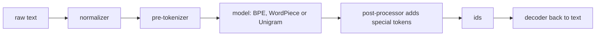

# Subword tokenizers: BPE, WordPiece, Unigram, byte-level

Every LLM quirk you have ever been puzzled by (it cannot count the r's in "strawberry", arithmetic on
long numbers is shaky, Japanese costs twice as much as English, a trailing space changes the answer)
traces back, at least partly, to tokenization. The model never sees characters; it sees integer ids
from a fixed vocabulary. This lesson builds the main algorithms from scratch and shows how the Hugging
Face `tokenizers` library assembles them.

## 1. Why subwords?

Three options for the unit of text:

| unit | vocab size | sequence length | out-of-vocabulary? |
|---|---|---|---|
| words | huge (millions with inflections, names) | short | yes: unseen words become `[UNK]` |
| characters / bytes | tiny (about 100 to 256) | very long (bad for $O(T^2)$ attention) | no |
| **subwords** | 30k to 260k | moderate | no, if the base alphabet covers all bytes |

Subword tokenizers keep frequent words whole ("the", "function") and break rare ones into reusable
pieces ("tokenization" might become "token" + "ization"). The vocabulary size is a hyperparameter
trading embedding-table size against sequence length: GPT-2 had 50,257 tokens, Llama 2 32,000, Llama 3
128,256, GPT-4o's `o200k_base` about 200k, Gemma 3 about 262k. Bigger vocabularies compress
multilingual text and code better.

Every tokenizer is a pipeline:



- **Normalizer**: Unicode normalisation (NFC/NFKC), lowercasing (BERT-uncased), accent stripping.
- **Pre-tokenizer**: split into "words" so merges never cross them, e.g. on whitespace and
  punctuation, or GPT-style regex that also separates digits.
- **Model**: the learned algorithm that turns each pre-token into subword ids.
- **Post-processor**: adds `[CLS]`/`[SEP]` or `<|begin_of_text|>` and builds attention masks.

## 2. Byte-Pair Encoding (BPE)

BPE (Sennrich et al. 2016, adapted from a 1994 compression algorithm) **learns merges bottom-up**:

1. Start with each word as a sequence of characters (or bytes). Count word frequencies.
2. Count every adjacent symbol pair, weighted by word frequency.
3. Merge the most frequent pair everywhere into a new symbol; record the merge.
4. Repeat until the vocabulary reaches the target size.

To **encode** new text, apply the learned merges *in the order they were learned* (the rank). Training
and encoding are different algorithms; a frequent bug is encoding by greedily matching the longest
vocab entry, which can give different tokens than replaying merges.

```python-run
from collections import Counter

def train_bpe(words, num_merges):
    vocab = Counter(tuple(w) for w in words)           # word (as symbol tuple) -> frequency
    merges = []
    for _ in range(num_merges):
        pairs = Counter()
        for sym, f in vocab.items():
            for a, b in zip(sym, sym[1:]):
                pairs[(a, b)] += f
        if not pairs:
            break
        best = min(pairs, key=lambda p: (-pairs[p], p))   # most frequent, ties -> lexicographic
        merges.append(best)
        new_vocab = Counter()
        for sym, f in vocab.items():
            out, i = [], 0
            while i < len(sym):
                if i + 1 < len(sym) and (sym[i], sym[i + 1]) == best:
                    out.append(sym[i] + sym[i + 1]); i += 2
                else:
                    out.append(sym[i]); i += 1
            new_vocab[tuple(out)] += f
        vocab = new_vocab
    return merges, vocab

corpus = "low low low low low lower lower newest newest newest newest newest newest widest widest widest".split()
merges, vocab = train_bpe(corpus, 6)
for i, m in enumerate(merges):
    print(i, m)
print(dict(vocab))

def encode(word, merges):
    sym = list(word)
    rank = {m: r for r, m in enumerate(merges)}
    while True:
        cands = [(rank[(a, b)], i) for i, (a, b) in enumerate(zip(sym, sym[1:])) if (a, b) in rank]
        if not cands:
            return sym
        _, i = min(cands)                               # apply the earliest-learned merge first
        sym[i:i + 2] = [sym[i] + sym[i + 1]]

print(encode("lowest", merges), encode("newer", merges))
```

Notice "lowest" was never in the corpus, yet it encodes into known pieces. That is the OOV-free
property in action.

### Byte-level BPE

If the base alphabet is Unicode characters, an emoji or rare CJK character not seen in training still
breaks things. **Byte-level BPE** (GPT-2, RoBERTa, Llama 3, GPT-4's `tiktoken`) runs BPE over the
256 possible **bytes** of the UTF-8 encoding, so *any* string is representable with zero unknowns.
GPT-2 maps bytes to printable stand-in characters, which is why you see `Ġ` (a space) and `Ċ`
(a newline) in its vocab files.

GPT-style models also use a **regex pre-tokenizer** that splits text into chunks such as
contractions, runs of letters, runs of up to three digits, punctuation and whitespace, before BPE.
Splitting digits into groups of at most three (or single digits, as in Llama 1/2 and Gemma) makes
arithmetic more consistent than letting BPE learn arbitrary chunks like "1997".

```python-run
s = "naïve café 🤖"
b = s.encode("utf-8")
print(len(s), "characters ->", len(b), "bytes:", list(b))
print("the robot emoji alone is", len("🤖".encode()), "bytes, so a byte-level vocab can always fall back to 4 ids")
```

## 3. WordPiece

WordPiece (BERT, DistilBERT, ELECTRA) is BPE's sibling with two differences:

- **Training score.** Instead of raw pair frequency, it merges the pair maximising
  $\frac{\text{freq}(ab)}{\text{freq}(a)\,\text{freq}(b)}$, preferring pairs whose parts rarely appear
  apart (a likelihood-gain criterion).
- **Encoding** is **greedy longest-match-first**: at each position take the longest vocabulary entry
  that matches. Non-initial pieces carry a `##` prefix (`"playing"` becomes `["play", "##ing"]`). If any
  part of a word cannot be matched, the **whole word** becomes `[UNK]`.

```python-run
def wordpiece(word, vocab, unk="[UNK]"):
    tokens, start = [], 0
    while start < len(word):
        end, cur = len(word), None
        while start < end:
            piece = word[start:end] if start == 0 else "##" + word[start:end]
            if piece in vocab:
                cur = piece; break
            end -= 1
        if cur is None:
            return [unk]                 # whole word becomes unknown
        tokens.append(cur); start = end
    return tokens

vocab = {"un", "##aff", "##able", "play", "##ing", "##ed", "p", "##l", "##a", "##y"}
for w in ["unaffable", "playing", "played", "plays"]:
    print(w, "->", wordpiece(w, vocab))
```

"plays" becomes `[UNK]` because no `##s` exists, even though "play" matched. That all-or-nothing rule
surprises people.

## 4. Unigram LM and SentencePiece

**Unigram** (Kudo 2018) works **top-down**: start with a huge candidate vocabulary, model text as a
sequence of independently drawn pieces with probabilities $p(x)$, and repeatedly prune the pieces whose
removal hurts corpus likelihood least. Encoding picks the **most probable segmentation** with Viterbi,
and because it is probabilistic it supports *subword regularisation* (sampling alternative
segmentations during training as augmentation).

**SentencePiece** is a library (not an algorithm) that implements both BPE and Unigram, with two big
ideas:

1. It treats the input as a raw stream, including spaces, replacing the space with the visible
   metasymbol `▁` (U+2581). No language-specific pre-tokenizer is needed, which matters for Chinese,
   Japanese and Thai, where words are not space-separated.
2. Decoding is lossless: concatenate the pieces and replace `▁` with a space.

T5, ALBERT, XLNet and mBART use SentencePiece Unigram; Llama 1/2, Mistral and Gemma use SentencePiece
BPE with **byte fallback** (unknown characters fall back to `<0xNN>` byte tokens).

| algorithm | direction | encode | used by |
|---|---|---|---|
| BPE | bottom-up merges by frequency | replay merges by rank | GPT family, Llama, Qwen, Mistral |
| WordPiece | bottom-up merges by likelihood score | greedy longest match, `##` | BERT family |
| Unigram | top-down pruning | Viterbi most-probable split | T5, ALBERT, XLM-R |

## 5. Hands-on with `tokenizers` and `transformers`

Static code (needs network and the `tokenizers` / `transformers` packages):

```python
from transformers import AutoTokenizer

tok = AutoTokenizer.from_pretrained("Qwen/Qwen3-0.6B")
enc = tok("Tokenizers are fun!", return_offsets_mapping=True)
print(enc["input_ids"])
print(tok.convert_ids_to_tokens(enc["input_ids"]))   # ['Token', 'izers', 'Ġare', 'Ġfun', '!']
print(enc["offset_mapping"])                          # char spans: vital for highlighting citations
print(tok.decode(enc["input_ids"]))
```

Training a byte-level BPE tokenizer from scratch with the Rust-backed `tokenizers` library:

```python
from tokenizers import Tokenizer, models, trainers, pre_tokenizers, decoders

tok = Tokenizer(models.BPE())
tok.pre_tokenizer = pre_tokenizers.ByteLevel(add_prefix_space=False)
tok.decoder = decoders.ByteLevel()
trainer = trainers.BpeTrainer(vocab_size=8000, special_tokens=["<|endoftext|>", "<|pad|>"],
                              initial_alphabet=pre_tokenizers.ByteLevel.alphabet())
tok.train(["corpus_part1.txt", "corpus_part2.txt"], trainer)
tok.save("my-tokenizer.json")
```

To adapt an existing tokenizer to a new domain while keeping its normaliser and pre-tokeniser, use
`old_tokenizer.train_new_from_iterator(text_iterator, vocab_size=...)` (HF LLM Course, chapter 6).
Note that a **new** tokenizer means new ids, so the model's embeddings no longer match: you can only
do this when pretraining from scratch, or you must add tokens and train the new embedding rows.

## 6. Practical consequences

- **Cost and context are measured in tokens**, and the ratio of tokens to words varies: about 1.3
  tokens per English word for modern tokenizers, often 2 to 4x more for many Indic, African or
  Southeast Asian languages. Users of those languages pay more for worse effective context.
- **Character-level tasks are hard** because "strawberry" might be one or three tokens; the model
  must have memorised its spelling.
- **Leading spaces matter.** `"Paris"` and `" Paris"` are different tokens. Prompts ending in a
  trailing space can push the model into an unusual token boundary ("token healing" in some
  libraries re-tokenises the prompt boundary to fix this).
- **Never compare token counts across tokenizers.** A 128k context in one model is not the same amount
  of text as 128k in another.
- **Glitch tokens.** Tokens that were in the tokenizer's training data but almost never in the model's
  (the infamous `SolidGoldMagikarp`) have barely-trained embeddings and trigger bizarre outputs.

> [!INTERVIEW]
> **"BPE vs WordPiece vs Unigram?"** BPE: bottom-up, merge most frequent pair, encode by replaying
> merges in rank order. WordPiece: bottom-up with a likelihood score, encode greedily longest-match with
> `##` continuation and whole-word `[UNK]`. Unigram: top-down pruning of a big vocab under a unigram
> LM, encode with Viterbi, supports sampling. Then mention byte-level BPE (no OOV ever) and
> SentencePiece (whitespace as `▁`, language-agnostic, lossless).

## Summary

- Subwords balance vocabulary size against sequence length and eliminate OOV words.
- BPE learns merges by frequency; encoding replays merges by rank; byte-level BPE covers every string.
- WordPiece uses a likelihood score and greedy longest-match encoding with `##` continuations.
- Unigram prunes top-down and segments with Viterbi; SentencePiece makes tokenization language-agnostic.
- Tokenization explains costs across languages, spelling and arithmetic failures, and whitespace
  sensitivity.

```quiz
[
  {"q": "In BPE training, which pair is merged at each step?",
   "options": ["The most frequent adjacent pair, weighted by word frequency", "The longest vocabulary entry", "The pair maximising freq(ab)/(freq(a)freq(b))", "A random pair"], "answer": 0,
   "explain": "Classic BPE is purely frequency-driven. The ratio score belongs to WordPiece."},
  {"q": "Why can a byte-level BPE tokenizer encode any string without an unknown token?",
   "options": ["Its base alphabet is all 256 bytes of UTF-8", "It has a huge vocabulary", "It lowercases everything", "It uses Viterbi decoding"], "answer": 0,
   "explain": "Any text is a sequence of bytes, and every byte is in the base vocabulary."},
  {"q": "WordPiece vocab contains play and ##ing but not ##s. How is 'plays' tokenized?",
   "options": ["[UNK]", "['play', '##s']", "['play', 's']", "['p', 'l', 'a', 'y', 's']"], "answer": 0,
   "explain": "If any part of the word cannot be matched, BERT's WordPiece maps the entire word to [UNK]."},
  {"q": "What does SentencePiece's ▁ symbol represent?",
   "options": ["A space, so whitespace becomes part of the token stream", "Unknown character", "End of sentence", "A byte fallback"], "answer": 0,
   "explain": "Encoding spaces as a visible symbol makes the process language-agnostic and decoding lossless."},
  {"q": "How does a Unigram tokenizer choose the segmentation of a word at inference time?",
   "options": ["Viterbi search for the most probable segmentation", "Replaying merges", "Greedy longest match", "Splitting into characters"], "answer": 0,
   "explain": "Unigram assigns each piece a probability and finds the best-scoring split with dynamic programming."},
  {"q": "You train a brand-new tokenizer for an existing pretrained model. What breaks?",
   "options": ["Token ids no longer correspond to the model's learned embeddings", "Nothing, tokenizers are interchangeable", "Only the chat template", "Only the special tokens"], "answer": 0,
   "explain": "Embeddings are indexed by id; a new vocabulary means the model would be reading noise."},
  {"q": "Why do many LLM tokenizers split numbers into groups of at most 3 digits (or single digits)?",
   "options": ["To make arithmetic tokenization consistent across numbers", "To save vocabulary", "Because digits are bytes", "To support RoPE"], "answer": 0,
   "explain": "Arbitrary learned chunks like '1997' vs '19','98' make place-value reasoning inconsistent."}
]
```

> **Source:** Hugging Face LLM Course, ch. 6 "The Tokenizers library" (BPE, WordPiece, Unigram
> sections: https://huggingface.co/learn/llm-course/chapter6/5, /6, /7, /8); Tokenizers docs
> (https://huggingface.co/docs/tokenizers); Sennrich et al. 2016; Kudo 2018; Kudo & Richardson 2018
> (SentencePiece); Huyen, *AI Engineering*, ch. 2 (tokenization, vocabulary size).
