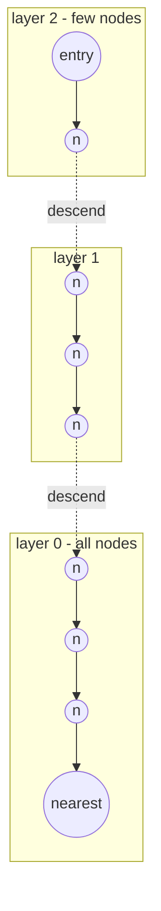

# ANN indexes (HNSW, IVF, PQ) and vector databases

> **Before this lesson:** you should know what an embedding is, how cosine similarity, dot product
> and Euclidean distance compare vectors, what exact top-k search is and what recall@k measures. All
> of this is in
> [Embeddings and similarity: from sentence-transformers to Matryoshka](#/lesson/llm-practice/embeddings-similarity).
> Comfort with numpy arrays and Python dictionaries is enough for the code.

## In plain words

The previous lesson found the closest vectors by comparing the query with every stored vector. That
is perfect for a few hundred thousand documents and hopeless for a few hundred million. An **index**
is an extra data structure, built once in advance, that lets a search skip most of the data. **ANN**
(approximate nearest neighbour) indexes accept that they will occasionally miss one of the true
nearest vectors in exchange for answering hundreds of times faster.

Think of finding the nearest coffee shop in a country. Exact search measures the distance to every
coffee shop in the country. An ANN index uses shortcuts: take the motorway to the right city, then
the main road to the right district, then walk the last few streets (a graph index, HNSW); or look
only in the two or three postcode areas nearest to you (a partition index, IVF); or carry a
pocket-sized map with rounded-off positions instead of the full survey (compression, PQ).

Why it matters for a job: every RAG system, recommender and semantic search product over a large
collection sits on one of these indexes, usually inside a **vector database** (a database built to
store vectors and search them by similarity). "Explain HNSW and its parameters" is a standard
interview question for AI-engineering roles, and choosing between pgvector, FAISS and a dedicated
vector database is a common design discussion.

## Why approximate?

Exact search compares the query with every vector. With $N$ vectors of $d$ numbers each that is
$O(Nd)$ work per query, meaning the cost grows in proportion to both. At 100 million vectors that is
too slow and too expensive. **Approximate nearest neighbour (ANN)** indexes give up a little recall
(typically finding 95 to 99 percent of the true top-k) for orders-of-magnitude speedups ("an order of
magnitude" is a factor of ten). This lesson builds the three core ideas (graphs, partitions,
compression) in numpy and maps them to the vector databases you will meet.

## 1. Measuring an ANN index

Three things are measured, and they pull against each other:

- **Recall@k**: fraction of the true top-k (from exact search) that the index returns. The quality axis.
- **QPS / latency** (p50, p99): the speed axis. QPS is queries per second; p50 is the median latency
  and p99 the latency that 99 percent of queries beat, which exposes the slow outliers.
- **Memory** per vector and **build time** / update cost: how much RAM the index needs and how long it
  takes to build or to add new vectors.

Every index exposes knobs (settings) that trade recall for speed. Always plot a recall-vs-QPS curve on
your data rather than trusting defaults (this is what the ann-benchmarks project, a public comparison
of ANN libraries, does).

## 2. Graph indexes: HNSW

A **graph** in computer science is a set of **nodes** (here, one per stored vector) joined by
**edges** or links (here, "these two vectors are close"). Each node's linked nodes are its
**neighbours** in the graph.

**Navigable small-world graphs** connect each vector to a handful of near neighbours (plus a few long
links). "Small world" refers to the property, familiar from social networks, that any two nodes are
joined by a short chain of links. To search, start at an **entry point** (a fixed starting node) and
greedily walk to whichever neighbour is closer to the query, until no neighbour improves. A greedy
walk can get stuck at a **local minimum**: a node that is closer than all its neighbours but is not the
true nearest. A **beam** (a candidate list of size `ef` that keeps several promising nodes, not only
one) makes this robust to local minima.

**HNSW** (Hierarchical Navigable Small World, Malkov & Yashunin) stacks several such graphs like a
**skip list** (a layered list in which upper levels skip over many items at once, like express trains
that stop only at major stations): the top layers contain few nodes with long hops for fast coarse
navigation; layer 0 contains everything with short links. Search descends greedily through upper
layers, then does a beam search with `ef_search` on layer 0. The diagram shows the idea: enter at the
top, move along a layer, drop down, repeat.



Parameters:

- `M`: links per node (16 to 64). Higher: better recall, more memory.
- `ef_construction`: beam width while building (100 to 500). Higher: better graph, slower build.
- `ef_search` (or `ef`): beam width at query time; must be at least $k$. The main recall/latency knob.

Strengths: excellent recall/latency, supports **incremental inserts** (adding vectors one at a time
without rebuilding). Weaknesses: memory hungry (graph plus full vectors in RAM), deletes are awkward
(the usual approach is a **tombstone**, a mark saying "deleted, skip me", because removing a node
would cut paths through the graph), and the build is slow for billions of vectors.

### Beam search on a graph (HNSW layer-0 search)

The routine below needs one data structure you may not have met. A **heap** is a list kept in a
special order so that the smallest item can always be found and removed quickly; Python's `heapq`
module provides it. A heap that returns the smallest item first is a **min-heap**. Python has no
built-in max-heap, so the standard trick is to store negated values: the "smallest" negated distance
is the largest real distance.

The core routine, `search_layer`, keeps a min-heap of candidates to expand (so the closest unexplored
node comes out first) and a max-heap of the best `ef` results so far (so the *worst* of the current
results sits on top, ready to be replaced). It stops when the closest unexpanded candidate is farther
than the worst result, because then no remaining candidate can improve the answer.

```python-run
import heapq
import numpy as np

rng = np.random.default_rng(0)
N, d = 2000, 16
X = rng.standard_normal((N, d))

# Build a simple kNN graph (each node linked to its 8 nearest neighbours) as a stand-in for HNSW layer 0
sq = (X ** 2).sum(1)
dist2 = sq[:, None] + sq[None, :] - 2 * X @ X.T
np.fill_diagonal(dist2, np.inf)
graph = np.argsort(dist2, axis=1)[:, :8]

def search_layer(q, entry, ef):
    dist = lambda i: float(np.sum((X[i] - q) ** 2))
    visited = {entry}
    d0 = dist(entry)
    candidates = [(d0, entry)]          # min-heap: closest first
    results = [(-d0, entry)]            # max-heap via negation: worst result on top
    evals = 1
    while candidates:
        dc, c = heapq.heappop(candidates)
        if dc > -results[0][0]:
            break                        # nearest unexpanded is worse than our worst result
        for nb in graph[c]:
            nb = int(nb)
            if nb in visited:
                continue
            visited.add(nb)
            dn = dist(nb); evals += 1
            if len(results) < ef or dn < -results[0][0]:
                heapq.heappush(candidates, (dn, nb))
                heapq.heappush(results, (-dn, nb))
                if len(results) > ef:
                    heapq.heappop(results)
    return sorted((-d, i) for d, i in results), evals

qs = X[:100] + 0.3 * rng.standard_normal((100, d))
for ef in [10, 20, 50]:
    rec, ev = [], []
    for q in qs:
        res, n_eval = search_layer(q, entry=1999, ef=ef)
        true = set(np.argsort(((X - q) ** 2).sum(1))[:10])
        rec.append(len(true & {i for _, i in res[:10]}) / 10); ev.append(n_eval)
    print(f"ef={ef:3d}  recall@10={np.mean(rec):.3f}  distance evals={np.mean(ev):6.0f} of {N}")
```

**Reading this code line by line**

- The first block builds a stand-in graph. `dist2` is the grid of squared distances between all
  2,000 vectors, computed with the identity $\|a-b\|^2 = \|a\|^2 + \|b\|^2 - 2a \cdot b$ from the
  previous lesson. `np.fill_diagonal(dist2, np.inf)` stops each node counting itself as a neighbour,
  and `np.argsort(dist2, axis=1)[:, :8]` keeps the 8 nearest nodes of each node as its links.
- In `search_layer`, `visited` records every node whose distance was already computed, so no node is
  measured twice. `candidates` starts with the entry point; `results` holds the same node with its
  distance negated.
- `heapq.heappop(candidates)` takes the closest unexpanded node. `-results[0][0]` is the worst
  distance among the current results (top of the max-heap, un-negated). If the candidate is worse
  than that, the loop stops.
- Otherwise every unvisited neighbour is measured. It is added to both heaps if the results list is
  not yet full or if it beats the current worst result; when the results exceed `ef` entries, the
  worst one is dropped with `heappop`.
- `evals` counts distance computations, the main cost of any search.
- The test runs 100 noisy queries from the same fixed entry node (1999) and compares the returned top
  10 with the exact top 10.

The output: with `ef=10`, recall@10 is about 0.66 after only about 85 distance computations out of
2,000; `ef=20` gives 0.77 for about 128; `ef=50` gives 0.89 for about 233. Notice recall rising with
`ef` while still touching only a fraction of the dataset. A real HNSW adds the upper layers (to find a
good entry point quickly) and a neighbour-selection **heuristic** (a rule of thumb) that keeps diverse
links rather than eight links all pointing the same way. This module's `llm-greedy-graph-search`
problem asks you to implement `search_layer`.

## 3. Partition indexes: IVF

The second idea is to divide the space into regions and search only the regions near the query.
Regions are found with **k-means**, the classic clustering algorithm: choose $k$ starting points
called **centroids**, assign every vector to its nearest centroid, move each centroid to the average
of the vectors assigned to it, and repeat a few times. Each resulting group is a **cell** or cluster.

**Inverted file (IVF)** indexes cluster the vectors with k-means into `nlist` cells. ("Inverted file"
is an old search-engine term for a table that maps each key, here a centroid, to the list of items
filed under it.) Each vector is stored in the list of its nearest centroid. At query time, find the
`nprobe` closest centroids and search only their lists exactly.

```python-run
import numpy as np
rng = np.random.default_rng(1)
N, d, nlist = 20000, 32, 64
# clustered data, like real embeddings
centers = rng.standard_normal((40, d)) * 3
X = centers[rng.integers(0, 40, N)] + rng.standard_normal((N, d))

def kmeans(X, k, iters=10):
    C = X[rng.choice(len(X), k, replace=False)].copy()
    for _ in range(iters):
        a = np.argmin(((X[:, None, :] - C[None]) ** 2).sum(-1), axis=1)
        for j in range(k):
            m = X[a == j]
            if len(m):
                C[j] = m.mean(0)
    return C, a

C, assign = kmeans(X[:5000], nlist)       # train on a sample, as FAISS does
assign = np.argmin(((X[:, None, :] - C[None]) ** 2).sum(-1), axis=1)
lists = {j: np.where(assign == j)[0] for j in range(nlist)}

def ivf_search(q, nprobe, k=10):
    probe = np.argsort(((C - q) ** 2).sum(1))[:nprobe]
    cand = np.concatenate([lists[j] for j in probe])
    dd = ((X[cand] - q) ** 2).sum(1)
    return cand[np.argsort(dd)[:k]], len(cand)

qs = X[rng.choice(N, 100, replace=False)] + 0.5 * rng.standard_normal((100, d))
for nprobe in [1, 4, 16]:
    rec, scanned = [], []
    for q in qs:
        got, n = ivf_search(q, nprobe)
        true = set(np.argsort(((X - q) ** 2).sum(1))[:10])
        rec.append(len(true & set(got)) / 10); scanned.append(n)
    print(f"nprobe={nprobe:2d}  recall@10={np.mean(rec):.3f}  scanned={np.mean(scanned):7.0f} of {N}")
```

**Reading this code line by line**

- The data is 20,000 vectors scattered around 40 hidden centres, because real embeddings form
  clusters too.
- In `kmeans`, `C` starts as `k` randomly chosen vectors. The expression
  `((X[:, None, :] - C[None]) ** 2).sum(-1)` uses **broadcasting** (numpy's rule for combining arrays
  of different shapes by repeating them) to get the distance from every vector to every centroid at
  once; `np.argmin(..., axis=1)` assigns each vector to its closest centroid. Each centroid then moves
  to the mean of its members. Ten rounds is plenty for a demo.
- Like FAISS, the centroids are **trained** on a sample (5,000 vectors), then all 20,000 are
  assigned. `lists` maps each cell number to the array of vector ids in it: that dictionary *is* the
  inverted file.
- `ivf_search` ranks the centroids by distance to the query, keeps the `nprobe` closest, joins their
  lists into one candidate array, and runs exact search on those candidates only.

The output: `nprobe=1` scans about 400 vectors (2 percent of the data) and reaches recall 0.83;
`nprobe=4` scans about 1,400 and reaches 1.000; `nprobe=16` scans about 5,500 for no further gain.

Rules of thumb: `nlist` about $\sqrt{N}$ to $4\sqrt{N}$; `nprobe` is the recall knob. Vectors near a
cell boundary are the source of misses (the true neighbour sits right across the border, in a cell that
was not probed), which is why probing several cells helps. IVF uses less memory than HNSW, builds
fast, but needs a training step and degrades if the data distribution **drifts** (new data no longer
looks like the data the centroids were trained on).

## 4. Compression: product quantisation (PQ)

The third idea attacks memory rather than speed: store each vector in a few bytes instead of a few
thousand.

**PQ** (product quantisation) splits each $d$-dim vector into $m$ sub-vectors (consecutive slices)
and replaces each with the id of its nearest centroid from a per-subspace **codebook** (a list of
representative sub-vectors learned by k-means) of 256 entries, so each id fits in 1 byte. A 768-dim
float32 vector (3072 bytes) with $m = 96$ becomes 96 bytes: 32x smaller. Distances are computed with
**asymmetric distance computation** (ADC): "asymmetric" because the query stays exact while the
database vectors are compressed. Precompute a table of distances from each query sub-vector to every
codebook entry, then each database distance is $m$ table lookups and additions, no multiplication
at all.

```python-run
import numpy as np
rng = np.random.default_rng(2)
N, d, m, ks = 5000, 32, 8, 16                # 8 sub-vectors of 4 dims, 16 centroids each (4 bits)
X = rng.standard_normal((N, d)); sub = d // m

codebooks, codes = [], np.zeros((N, m), dtype=np.int64)
for j in range(m):
    S = X[:, j * sub:(j + 1) * sub]
    C = S[rng.choice(N, ks, replace=False)].copy()
    for _ in range(8):                        # tiny k-means per subspace
        a = np.argmin(((S[:, None] - C[None]) ** 2).sum(-1), 1)
        for c in range(ks):
            if (a == c).any(): C[c] = S[a == c].mean(0)
    codebooks.append(C); codes[:, j] = np.argmin(((S[:, None] - C[None]) ** 2).sum(-1), 1)

q = rng.standard_normal(d)
table = np.stack([((codebooks[j] - q[j * sub:(j + 1) * sub]) ** 2).sum(1) for j in range(m)])  # (m, ks)
approx = table[np.arange(m), codes].sum(1)    # ADC: m lookups per vector
exact = ((X - q) ** 2).sum(1)
top_true = set(np.argsort(exact)[:10])
cand = np.argsort(approx)[:100]
rescored = cand[np.argsort(exact[cand])[:10]]
print("bytes per vector: float32", d * 4, "-> PQ", m * 0.5, "(4-bit codes)")
print("recall@10 PQ only:", len(top_true & set(np.argsort(approx)[:10])) / 10,
      " PQ + rescore top-100:", len(top_true & set(rescored)) / 10)
```

**Reading this code line by line**

- The demo is deliberately small: 32 dimensions cut into 8 slices of 4, with only 16 centroids per
  slice, so each code fits in 4 bits (half a byte).
- The `for j in range(m)` loop runs a tiny k-means on slice `j` of every vector, stores the 16
  centroids in `codebooks`, and records in `codes[:, j]` which centroid each vector's slice is
  nearest to. After the loop, every vector is represented by 8 small numbers.
- `table` has one row per slice and one column per centroid: the squared distance from the query's
  slice to that centroid.
- `table[np.arange(m), codes]` looks up, for every vector, the 8 table entries named by its codes, and
  `.sum(1)` adds them: the approximate distance. That is ADC.
- The last lines compare against exact distances, then **rescore**: take the 100 best by approximate
  distance and re-rank those 100 with exact distances.

The output reports 128 bytes per vector shrinking to 4. The recall of PQ alone is low here (0.3)
because the codebooks are tiny and the random data has no structure to exploit; rescoring the top 100
doubles it to 0.6. Real deployments use 256 centroids per slice, data with real cluster structure, and
a larger rescoring pool, and reach far higher recall. The lesson to take away is the shape of the
trade-off: compression costs accuracy, and rescoring a short list buys most of it back.

Combinations are common: **IVF-PQ** (partition, then compress the **residuals**, the difference
between each vector and its cell's centroid, which are smaller and easier to compress) for
billion-scale on one machine; **HNSW + PQ/SQ** (SQ is scalar quantisation, from the previous lesson);
**DiskANN** (a graph called Vamana stored on an **SSD**, a fast solid-state disk, with compressed
vectors kept in RAM to guide the walk).

## 5. Choosing an index

| situation | index |
|---|---|
| under about 1M vectors, or exactness required | Flat (brute force), maybe on GPU |
| low latency, high recall, fits in RAM, frequent inserts | HNSW |
| large, memory constrained, batch builds | IVF-Flat / IVF-PQ |
| billions, single node, SSD | DiskANN, IVF-PQ |
| heavy metadata filtering | engine with filter-aware HNSW (Qdrant, Weaviate, pgvector iterative scans) |

**Filtering** is a real-world trap. Real queries rarely ask only "what is similar?"; they ask "what
is similar *and* belongs to customer 7 *and* was written this year?". The extra conditions apply to
**metadata**, the ordinary fields stored next to each vector. A **tenant** is one customer in a system
that serves many customers from the same database. Post-filtering (search top-100, then drop rows
failing `tenant_id = 7`) can return zero results if customer 7's documents are rare;
pre-filtering by brute force over the matching subset can be slow when the subset is large. Good
engines integrate the filter into graph traversal or switch strategy based on **selectivity** (the
fraction of rows that pass the filter).

## 6. The vector database landscape

A **library** is code you call inside your own program; a **database** is a separate service that
stores data durably (it survives restarts), handles many clients, updates and access control. The
distinction matters because a library leaves all of those jobs to you.

- **FAISS** (Meta): a C++/Python *library*, not a database. Every index type above, GPU support,
  index factory strings like `"IVF4096,PQ64"`. You manage persistence, metadata and updates.
- **pgvector**: an extension for Postgres, the popular open-source relational database
  (`vector` type, HNSW and IVFFlat indexes, `<=>` cosine distance, `<#>` negative inner product,
  `<->` L2 operators). Huge advantage: vectors live next to your **relational data** (ordinary tables
  with rows and columns), **transactions** (groups of changes that succeed or fail together) and
  access control. Often the right default.
- **Chroma**: developer-friendly embedded/local store for prototypes and small apps.
- **Qdrant** (Rust), **Weaviate**, **Milvus/Zilliz**, **Pinecone** (managed), **LanceDB**
  (embedded, columnar), **Elasticsearch/OpenSearch** and **Vespa** (search engines with vector support,
  strong for hybrid search), **Redis**, **MongoDB Atlas**, **Turbopuffer** (object-storage based).

The four static snippets below do the same job, store document vectors and fetch the top matches for
a query, in four systems. Read them side by side to see what changes and what stays the same.

```python
# FAISS
import faiss, numpy as np
index = faiss.index_factory(384, "HNSW32", faiss.METRIC_INNER_PRODUCT)
index.hnsw.efSearch = 64
index.add(doc_vectors.astype("float32"))          # normalised vectors
scores, ids = index.search(query_vectors.astype("float32"), 10)
```

In FAISS, `index_factory(384, "HNSW32", faiss.METRIC_INNER_PRODUCT)` builds an HNSW index for
384-dimensional vectors with `M = 32` links per node, ranked by inner product (so the vectors should
be normalised first). `efSearch` sets the query-time beam width. `add` inserts the vectors (FAISS
requires `float32`), and `search(queries, 10)` returns two arrays: the scores and the row numbers of
the top 10 for each query. Ids are row numbers; mapping them back to your documents is your job.

```sql
-- pgvector
CREATE EXTENSION IF NOT EXISTS vector;
CREATE TABLE chunks (id bigserial PRIMARY KEY, doc_id text, tenant int, body text, embedding vector(384));
CREATE INDEX ON chunks USING hnsw (embedding vector_cosine_ops) WITH (m = 16, ef_construction = 200);
SET hnsw.ef_search = 100;
SELECT id, body, 1 - (embedding <=> $1) AS cosine
FROM chunks WHERE tenant = 7
ORDER BY embedding <=> $1 LIMIT 10;
```

In SQL: `CREATE EXTENSION` switches pgvector on; the table stores each chunk's text, its tenant and a
384-number `embedding` column; `CREATE INDEX ... USING hnsw (embedding vector_cosine_ops)` builds an
HNSW index for cosine distance with `m = 16` and `ef_construction = 200`; `SET hnsw.ef_search = 100`
sets the beam width for this session. In the query, `$1` is a placeholder for the query vector that
the application passes in, `<=>` is cosine *distance* (so `1 - distance` is the cosine similarity),
`WHERE tenant = 7` is the metadata filter, and `ORDER BY ... LIMIT 10` asks for the ten closest.

```python
# Qdrant
from qdrant_client import QdrantClient, models
client = QdrantClient(":memory:")
client.create_collection("docs", vectors_config=models.VectorParams(size=384, distance=models.Distance.COSINE))
client.upsert("docs", points=[models.PointStruct(id=i, vector=v.tolist(), payload={"tenant": 7})
                              for i, v in enumerate(doc_vectors)])
hits = client.query_points("docs", query=qv.tolist(), limit=5,
                           query_filter=models.Filter(must=[models.FieldCondition(
                               key="tenant", match=models.MatchValue(value=7))])).points
```

In Qdrant, `QdrantClient(":memory:")` runs a throwaway in-process instance, handy for tests. A
**collection** is Qdrant's name for a table of vectors; it is created with the vector size and the
distance. `upsert` ("update or insert") adds points, each with an id, a vector and a **payload** (its
metadata). `query_points` searches with a filter that requires `tenant == 7`, applied during the
search rather than afterwards.

```python
# Chroma
import chromadb
col = chromadb.Client().create_collection("docs", metadata={"hnsw:space": "cosine"})
col.add(ids=["a", "b"], documents=["LoRA adapters", "KV cache"], metadatas=[{"src": "x"}, {"src": "y"}])
print(col.query(query_texts=["low-rank finetuning"], n_results=1))   # uses a default embedder
```

Chroma is the most compact: you pass raw `documents` and Chroma embeds them with a built-in default
model, then `query(query_texts=[...])` embeds the question the same way and returns the closest
document ("LoRA adapters" for "low-rank finetuning"). That convenience is why it is popular for
prototypes; in production you usually choose the embedding model yourself.

> [!INTERVIEW]
> **"Explain HNSW and its knobs."** A multi-layer proximity graph: sparse upper layers for long jumps,
> dense layer 0 for fine search. Greedy descent finds an entry point, then a best-first beam of size
> `ef_search` on layer 0. `M` controls degree (memory/recall), `ef_construction` graph quality,
> `ef_search` the query-time recall/latency trade-off. Compare with IVF (cluster, probe `nprobe`
> cells) and PQ (compress sub-vectors to byte codes, ADC lookups), and mention filtered search.

## Summary

- ANN trades a little recall for big speedups; measure recall@k vs QPS on your own data.
- HNSW: layered graph, beam search with `ef`; fast and accurate but memory heavy.
- IVF: k-means partitions, probe `nprobe` lists; cheaper memory, needs training.
- PQ: byte codes per sub-vector with ADC; combine with IVF or rescoring.
- Pick infrastructure by scale, filtering and operational needs: pgvector is a strong default, FAISS is
  a library, dedicated vector DBs add scale and filtering features.

## Glossary

- **Index**: a data structure built in advance so searches can skip most of the data.
- **ANN (approximate nearest neighbour)**: search that may miss a few true neighbours in exchange for
  large speedups.
- **QPS / p50 / p99**: queries per second / median latency / the latency 99% of queries beat.
- **Graph / node / edge**: points joined by links; here, vectors joined to nearby vectors.
- **Local minimum**: a node closer than all its neighbours but not the true nearest.
- **Beam (`ef`)**: the list of best candidates kept during a graph search.
- **HNSW**: a layered navigable small-world graph searched from the top layer down.
- **`M` / `ef_construction` / `ef_search`**: links per node / build-time beam / query-time beam.
- **Heap (min-heap, max-heap)**: a structure that hands back the smallest (or largest) item quickly.
- **Tombstone**: a "deleted" mark left in place of a removed item.
- **k-means / centroid / cell**: the clustering algorithm / a cluster's centre / the region of
  vectors nearest one centroid.
- **IVF (inverted file)**: an index that stores vectors in per-centroid lists and probes the nearest
  `nprobe` lists.
- **Product quantisation (PQ) / codebook**: compressing slices of a vector to centroid ids / the list
  of centroids for one slice.
- **ADC**: computing distances from an exact query to compressed vectors with a lookup table.
- **Residual**: a vector minus its cell's centroid.
- **Metadata / tenant / selectivity**: extra fields stored with a vector / one customer of a shared
  system / the fraction of rows passing a filter.
- **Pre-filtering / post-filtering**: applying the filter before / after the similarity search.
- **Vector database**: a database service that stores vectors and searches them by similarity.

## Check yourself

```quiz
[
  {"q": "In HNSW, which parameter is the main query-time recall versus latency knob?",
   "options": ["ef_search", "M", "nlist", "ef_construction"], "answer": 0,
   "explain": "ef_search is the beam width at query time; M and ef_construction are fixed at build time."},
  {"q": "In an IVF index, increasing nprobe...",
   "options": ["scans more cells: higher recall, slower queries", "adds more centroids", "compresses vectors further", "rebuilds the index"], "answer": 0,
   "explain": "nprobe is how many nearest partitions are searched exhaustively."},
  {"q": "A 768-dim float32 vector compressed with PQ using m=96 sub-vectors and 256 centroids each takes...",
   "options": ["96 bytes", "768 bytes", "3072 bytes", "12 bytes"], "answer": 0,
   "explain": "Each sub-vector is stored as one 1-byte centroid id: 96 bytes versus 3072."},
  {"q": "What is asymmetric distance computation (ADC) in PQ?",
   "options": ["Precompute query-to-codebook distances, then sum table lookups per database code", "Compress the query too", "Use cosine for queries and L2 for documents", "Search two indexes"], "answer": 0,
   "explain": "The query stays full-precision; each database distance becomes m lookups."},
  {"q": "Why can post-filtering vector search results by metadata return too few results?",
   "options": ["The top-k candidates may contain few or no rows that pass the filter", "Filters change the embeddings", "HNSW cannot store metadata", "It disables normalisation"], "answer": 0,
   "explain": "Selective filters need filter-aware traversal or pre-filtering to guarantee k results."},
  {"q": "Which is a library rather than a database?",
   "options": ["FAISS", "Qdrant", "pgvector-enabled Postgres", "Pinecone"], "answer": 0,
   "explain": "FAISS provides indexes but no persistence layer, metadata store or server."},
  {"q": "When is brute-force (flat) search a perfectly reasonable choice?",
   "options": ["Up to around a million vectors or when exact results are required", "Never in production", "Only with PQ", "Only above a billion vectors"], "answer": 0,
   "explain": "A single matrix-vector product over a million vectors is fast, especially on GPU."}
]
```

> **Source:** Malkov & Yashunin, "Efficient and robust approximate nearest neighbor search using HNSW"
> (2016); Jégou et al., "Product Quantization for Nearest Neighbor Search" (2011); FAISS wiki
> (https://github.com/facebookresearch/faiss/wiki); pgvector README (https://github.com/pgvector/pgvector);
> Qdrant and Chroma docs; Huyen, *AI Engineering*, ch. 6 (vector search algorithms: LSH, HNSW, PQ, IVF,
> Annoy).
