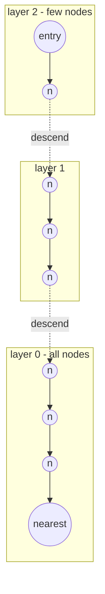

# ANN indexes (HNSW, IVF, PQ) and vector databases

Exact search compares the query with every vector: $O(Nd)$ per query. At 100 million vectors that is
too slow and too expensive. **Approximate nearest neighbour (ANN)** indexes give up a little recall
(typically finding 95 to 99 percent of the true top-k) for orders-of-magnitude speedups. This lesson
builds the three core ideas (graphs, partitions, compression) in numpy and maps them to the vector
databases you will meet.

## 1. Measuring an ANN index

- **Recall@k**: fraction of the true top-k (from exact search) that the index returns. The quality axis.
- **QPS / latency** (p50, p99): the speed axis.
- **Memory** per vector and **build time** / update cost.

Every index exposes knobs that trade recall for speed. Always plot a recall-vs-QPS curve on your data
rather than trusting defaults (this is what the ann-benchmarks project does).

## 2. Graph indexes: HNSW

**Navigable small-world graphs** connect each vector to a handful of near neighbours (plus a few long
links). To search, start at an entry point and greedily walk to whichever neighbour is closer to the
query, until no neighbour improves. A beam (candidate list of size `ef`) makes this robust to local
minima.

**HNSW** (Hierarchical NSW, Malkov & Yashunin) stacks several such graphs like a skip list: the top
layers contain few nodes with long hops for fast coarse navigation; layer 0 contains everything with
short links. Search descends greedily through upper layers, then does a beam search with `ef_search`
on layer 0.



Parameters:

- `M`: links per node (16 to 64). Higher: better recall, more memory.
- `ef_construction`: beam width while building (100 to 500). Higher: better graph, slower build.
- `ef_search` (or `ef`): beam width at query time; must be at least $k$. The main recall/latency knob.

Strengths: excellent recall/latency, supports incremental inserts. Weaknesses: memory hungry (graph
plus full vectors in RAM), deletes are awkward (tombstones), build is slow for billions.

### Beam search on a graph (HNSW layer-0 search)

The core routine, `search_layer`, keeps a min-heap of candidates to expand and a max-heap of the best
`ef` results so far. It stops when the closest unexpanded candidate is farther than the worst result.

```python-run
import heapq
import numpy as np

rng = np.random.default_rng(0)
N, d = 2000, 16
X = rng.standard_normal((N, d))

# Build a simple kNN graph (each node linked to its 8 nearest neighbours) as a stand-in for HNSW layer 0
sq = (X ** 2).sum(1)
dist2 = sq[:, None] + sq[None, :] - 2 * X @ X.T
np.fill_diagonal(dist2, np.inf)
graph = np.argsort(dist2, axis=1)[:, :8]

def search_layer(q, entry, ef):
    dist = lambda i: float(np.sum((X[i] - q) ** 2))
    visited = {entry}
    d0 = dist(entry)
    candidates = [(d0, entry)]          # min-heap: closest first
    results = [(-d0, entry)]            # max-heap via negation: worst result on top
    evals = 1
    while candidates:
        dc, c = heapq.heappop(candidates)
        if dc > -results[0][0]:
            break                        # nearest unexpanded is worse than our worst result
        for nb in graph[c]:
            nb = int(nb)
            if nb in visited:
                continue
            visited.add(nb)
            dn = dist(nb); evals += 1
            if len(results) < ef or dn < -results[0][0]:
                heapq.heappush(candidates, (dn, nb))
                heapq.heappush(results, (-dn, nb))
                if len(results) > ef:
                    heapq.heappop(results)
    return sorted((-d, i) for d, i in results), evals

qs = X[:100] + 0.3 * rng.standard_normal((100, d))
for ef in [10, 20, 50]:
    rec, ev = [], []
    for q in qs:
        res, n_eval = search_layer(q, entry=1999, ef=ef)
        true = set(np.argsort(((X - q) ** 2).sum(1))[:10])
        rec.append(len(true & {i for _, i in res[:10]}) / 10); ev.append(n_eval)
    print(f"ef={ef:3d}  recall@10={np.mean(rec):.3f}  distance evals={np.mean(ev):6.0f} of {N}")
```

Notice recall rising with `ef` while still touching only a fraction of the dataset. A real HNSW adds the
upper layers (to find a good entry point quickly) and a neighbour-selection heuristic that keeps
diverse links. This module's `llm-greedy-graph-search` problem asks you to implement `search_layer`.

## 3. Partition indexes: IVF

**Inverted file (IVF)** indexes cluster the vectors with k-means into `nlist` cells. Each vector is
stored in the list of its nearest centroid. At query time, find the `nprobe` closest centroids and
search only their lists exactly.

```python-run
import numpy as np
rng = np.random.default_rng(1)
N, d, nlist = 20000, 32, 64
# clustered data, like real embeddings
centers = rng.standard_normal((40, d)) * 3
X = centers[rng.integers(0, 40, N)] + rng.standard_normal((N, d))

def kmeans(X, k, iters=10):
    C = X[rng.choice(len(X), k, replace=False)].copy()
    for _ in range(iters):
        a = np.argmin(((X[:, None, :] - C[None]) ** 2).sum(-1), axis=1)
        for j in range(k):
            m = X[a == j]
            if len(m):
                C[j] = m.mean(0)
    return C, a

C, assign = kmeans(X[:5000], nlist)       # train on a sample, as FAISS does
assign = np.argmin(((X[:, None, :] - C[None]) ** 2).sum(-1), axis=1)
lists = {j: np.where(assign == j)[0] for j in range(nlist)}

def ivf_search(q, nprobe, k=10):
    probe = np.argsort(((C - q) ** 2).sum(1))[:nprobe]
    cand = np.concatenate([lists[j] for j in probe])
    dd = ((X[cand] - q) ** 2).sum(1)
    return cand[np.argsort(dd)[:k]], len(cand)

qs = X[rng.choice(N, 100, replace=False)] + 0.5 * rng.standard_normal((100, d))
for nprobe in [1, 4, 16]:
    rec, scanned = [], []
    for q in qs:
        got, n = ivf_search(q, nprobe)
        true = set(np.argsort(((X - q) ** 2).sum(1))[:10])
        rec.append(len(true & set(got)) / 10); scanned.append(n)
    print(f"nprobe={nprobe:2d}  recall@10={np.mean(rec):.3f}  scanned={np.mean(scanned):7.0f} of {N}")
```

Rules of thumb: `nlist` about $\sqrt{N}$ to $4\sqrt{N}$; `nprobe` is the recall knob. Vectors near a
cell boundary are the source of misses, which is why probing several cells helps. IVF uses less
memory than HNSW, builds fast, but needs a training step and degrades if the data distribution drifts
from the centroids.

## 4. Compression: product quantisation (PQ)

**PQ** splits each $d$-dim vector into $m$ sub-vectors and replaces each with the id of its nearest
centroid from a per-subspace codebook of 256 entries (1 byte). A 768-dim float32 vector (3072 bytes)
with $m = 96$ becomes 96 bytes: 32x smaller. Distances are computed with **asymmetric distance
computation** (ADC): precompute a table of distances from each query sub-vector to every codebook
entry, then each database distance is just $m$ table lookups and adds.

```python-run
import numpy as np
rng = np.random.default_rng(2)
N, d, m, ks = 5000, 32, 8, 16                # 8 sub-vectors of 4 dims, 16 centroids each (4 bits)
X = rng.standard_normal((N, d)); sub = d // m

codebooks, codes = [], np.zeros((N, m), dtype=np.int64)
for j in range(m):
    S = X[:, j * sub:(j + 1) * sub]
    C = S[rng.choice(N, ks, replace=False)].copy()
    for _ in range(8):                        # tiny k-means per subspace
        a = np.argmin(((S[:, None] - C[None]) ** 2).sum(-1), 1)
        for c in range(ks):
            if (a == c).any(): C[c] = S[a == c].mean(0)
    codebooks.append(C); codes[:, j] = np.argmin(((S[:, None] - C[None]) ** 2).sum(-1), 1)

q = rng.standard_normal(d)
table = np.stack([((codebooks[j] - q[j * sub:(j + 1) * sub]) ** 2).sum(1) for j in range(m)])  # (m, ks)
approx = table[np.arange(m), codes].sum(1)    # ADC: m lookups per vector
exact = ((X - q) ** 2).sum(1)
top_true = set(np.argsort(exact)[:10])
cand = np.argsort(approx)[:100]
rescored = cand[np.argsort(exact[cand])[:10]]
print("bytes per vector: float32", d * 4, "-> PQ", m * 0.5, "(4-bit codes)")
print("recall@10 PQ only:", len(top_true & set(np.argsort(approx)[:10])) / 10,
      " PQ + rescore top-100:", len(top_true & set(rescored)) / 10)
```

Combinations are common: **IVF-PQ** (partition, then compress the residuals) for billion-scale on one
machine; **HNSW + PQ/SQ**; **DiskANN** (Vamana graph on SSD with compressed vectors in RAM).

## 5. Choosing an index

| situation | index |
|---|---|
| under about 1M vectors, or exactness required | Flat (brute force), maybe on GPU |
| low latency, high recall, fits in RAM, frequent inserts | HNSW |
| large, memory constrained, batch builds | IVF-Flat / IVF-PQ |
| billions, single node, SSD | DiskANN, IVF-PQ |
| heavy metadata filtering | engine with filter-aware HNSW (Qdrant, Weaviate, pgvector iterative scans) |

**Filtering** is a real-world trap. Post-filtering (search top-100, then drop rows failing
`tenant_id = 7`) can return zero results; pre-filtering by brute force over the matching subset can be
slow. Good engines integrate the filter into graph traversal or switch strategy based on selectivity.

## 6. The vector database landscape

- **FAISS** (Meta): a C++/Python *library*, not a database. Every index type above, GPU support,
  index factory strings like `"IVF4096,PQ64"`. You manage persistence, metadata and updates.
- **pgvector**: a Postgres extension (`vector` type, HNSW and IVFFlat indexes, `<=>` cosine,
  `<#>` negative inner product, `<->` L2 operators). Huge advantage: vectors live next to your
  relational data, transactions and access control. Often the right default.
- **Chroma**: developer-friendly embedded/local store for prototypes and small apps.
- **Qdrant** (Rust), **Weaviate**, **Milvus/Zilliz**, **Pinecone** (managed), **LanceDB**
  (embedded, columnar), **Elasticsearch/OpenSearch** and **Vespa** (search engines with vector support,
  strong for hybrid search), **Redis**, **MongoDB Atlas**, **Turbopuffer** (object-storage based).

```python
# FAISS
import faiss, numpy as np
index = faiss.index_factory(384, "HNSW32", faiss.METRIC_INNER_PRODUCT)
index.hnsw.efSearch = 64
index.add(doc_vectors.astype("float32"))          # normalised vectors
scores, ids = index.search(query_vectors.astype("float32"), 10)
```

```sql
-- pgvector
CREATE EXTENSION IF NOT EXISTS vector;
CREATE TABLE chunks (id bigserial PRIMARY KEY, doc_id text, tenant int, body text, embedding vector(384));
CREATE INDEX ON chunks USING hnsw (embedding vector_cosine_ops) WITH (m = 16, ef_construction = 200);
SET hnsw.ef_search = 100;
SELECT id, body, 1 - (embedding <=> $1) AS cosine
FROM chunks WHERE tenant = 7
ORDER BY embedding <=> $1 LIMIT 10;
```

```python
# Qdrant
from qdrant_client import QdrantClient, models
client = QdrantClient(":memory:")
client.create_collection("docs", vectors_config=models.VectorParams(size=384, distance=models.Distance.COSINE))
client.upsert("docs", points=[models.PointStruct(id=i, vector=v.tolist(), payload={"tenant": 7})
                              for i, v in enumerate(doc_vectors)])
hits = client.query_points("docs", query=qv.tolist(), limit=5,
                           query_filter=models.Filter(must=[models.FieldCondition(
                               key="tenant", match=models.MatchValue(value=7))])).points
```

```python
# Chroma
import chromadb
col = chromadb.Client().create_collection("docs", metadata={"hnsw:space": "cosine"})
col.add(ids=["a", "b"], documents=["LoRA adapters", "KV cache"], metadatas=[{"src": "x"}, {"src": "y"}])
print(col.query(query_texts=["low-rank finetuning"], n_results=1))   # uses a default embedder
```

> [!INTERVIEW]
> **"Explain HNSW and its knobs."** A multi-layer proximity graph: sparse upper layers for long jumps,
> dense layer 0 for fine search. Greedy descent finds an entry point, then a best-first beam of size
> `ef_search` on layer 0. `M` controls degree (memory/recall), `ef_construction` graph quality,
> `ef_search` the query-time recall/latency trade-off. Compare with IVF (cluster, probe `nprobe`
> cells) and PQ (compress sub-vectors to byte codes, ADC lookups), and mention filtered search.

## Summary

- ANN trades a little recall for big speedups; measure recall@k vs QPS on your own data.
- HNSW: layered graph, beam search with `ef`; fast and accurate but memory heavy.
- IVF: k-means partitions, probe `nprobe` lists; cheaper memory, needs training.
- PQ: byte codes per sub-vector with ADC; combine with IVF or rescoring.
- Pick infrastructure by scale, filtering and operational needs: pgvector is a strong default, FAISS is
  a library, dedicated vector DBs add scale and filtering features.

```quiz
[
  {"q": "In HNSW, which parameter is the main query-time recall versus latency knob?",
   "options": ["ef_search", "M", "nlist", "ef_construction"], "answer": 0,
   "explain": "ef_search is the beam width at query time; M and ef_construction are fixed at build time."},
  {"q": "In an IVF index, increasing nprobe...",
   "options": ["scans more cells: higher recall, slower queries", "adds more centroids", "compresses vectors further", "rebuilds the index"], "answer": 0,
   "explain": "nprobe is how many nearest partitions are searched exhaustively."},
  {"q": "A 768-dim float32 vector compressed with PQ using m=96 sub-vectors and 256 centroids each takes...",
   "options": ["96 bytes", "768 bytes", "3072 bytes", "12 bytes"], "answer": 0,
   "explain": "Each sub-vector is stored as one 1-byte centroid id: 96 bytes versus 3072."},
  {"q": "What is asymmetric distance computation (ADC) in PQ?",
   "options": ["Precompute query-to-codebook distances, then sum table lookups per database code", "Compress the query too", "Use cosine for queries and L2 for documents", "Search two indexes"], "answer": 0,
   "explain": "The query stays full-precision; each database distance becomes m lookups."},
  {"q": "Why can post-filtering vector search results by metadata return too few results?",
   "options": ["The top-k candidates may contain few or no rows that pass the filter", "Filters change the embeddings", "HNSW cannot store metadata", "It disables normalisation"], "answer": 0,
   "explain": "Selective filters need filter-aware traversal or pre-filtering to guarantee k results."},
  {"q": "Which is a library rather than a database?",
   "options": ["FAISS", "Qdrant", "pgvector-enabled Postgres", "Pinecone"], "answer": 0,
   "explain": "FAISS provides indexes but no persistence layer, metadata store or server."},
  {"q": "When is brute-force (flat) search a perfectly reasonable choice?",
   "options": ["Up to around a million vectors or when exact results are required", "Never in production", "Only with PQ", "Only above a billion vectors"], "answer": 0,
   "explain": "A single matrix-vector product over a million vectors is fast, especially on GPU."}
]
```

> **Source:** Malkov & Yashunin, "Efficient and robust approximate nearest neighbor search using HNSW"
> (2016); Jégou et al., "Product Quantization for Nearest Neighbor Search" (2011); FAISS wiki
> (https://github.com/facebookresearch/faiss/wiki); pgvector README (https://github.com/pgvector/pgvector);
> Qdrant and Chroma docs; Huyen, *AI Engineering*, ch. 6 (vector search algorithms: LSH, HNSW, PQ, IVF,
> Annoy).
