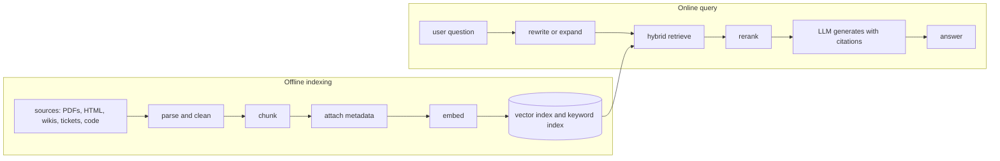

# Ingestion, parsing and chunking strategies

The AI Engineering track explains *why* RAG exists (models lack private and fresh knowledge,
hallucinate less when grounded, and context windows are finite). Here we build one. Most RAG quality
problems are not in the LLM at all: they are in **ingestion** (garbage text extracted from PDFs),
**chunking** (answers split across chunks, or buried in giant ones) and **retrieval** (next lesson).
Fix the pipeline from the bottom up.

## 1. The two pipelines



The offline half runs on a schedule or on change events and must be **idempotent**: re-ingesting the
same document should update, not duplicate, its chunks.

## 2. Parsing: text quality is retrieval quality

- **HTML**: strip navigation, footers and cookie banners (trafilatura, readability), keep headings and
  lists, convert to Markdown so structure survives.
- **PDF**: the hard one. Text-layer extraction (pypdf, PyMuPDF) loses reading order in multi-column
  layouts, mangles tables and hyphenation, and returns nothing for scans. Layout-aware parsers
  (Docling, Unstructured, Marker, LlamaParse, Azure Document Intelligence) or vision-language models
  produce Markdown with tables. For visually rich documents, **ColPali**-style retrieval embeds page
  *images* directly.
- **Tables**: keep them whole and serialise to Markdown or HTML; add a natural-language summary chunk
  so questions like "which plan includes SSO?" match.
- **Code**: chunk by function/class using a parser (tree-sitter), keeping the file path and signature.
- **Conversations / tickets**: keep thread structure and timestamps; strip signatures and quoted replies.

Always inspect a random sample of parsed output by eye. Many "the model hallucinated" bugs are "the
parser dropped the second column".

**Cleaning**: normalise Unicode and whitespace, remove boilerplate repeated on every page (headers,
page numbers), **deduplicate** (exact hashes plus near-duplicate detection with MinHash), and redact
PII or secrets if the index will be shared more broadly than the source.

## 3. Why chunk at all?

1. Embedding models have a maximum input length (often 512 tokens) and a single vector represents a
   long text poorly.
2. Retrieval precision: returning a 30-page document for a one-line fact wastes the context budget and
   distracts the model (module 9).
3. Citations: smaller units make "which passage supports this claim?" answerable.

But chunks that are too small lose context ("it increased by 4%": what did?). Chunk size is a real
trade-off, and the right value depends on your documents and questions. Typical starting points: 200
to 800 tokens with 10 to 20 percent overlap. Then **measure** (lesson 12).

## 4. Chunking strategies

### Fixed-size by tokens, with overlap

The baseline: a sliding window of `size` tokens advancing by `size - overlap`. Overlap reduces the
chance that a fact straddling a boundary is lost from both chunks.

```python-run
def chunk_tokens(tokens, size, overlap):
    if size <= 0 or overlap < 0 or overlap >= size:
        return []
    step, chunks, start = size - overlap, [], 0
    while start < len(tokens):
        chunks.append(tokens[start:start + size])
        if start + size >= len(tokens):
            break                       # last window already reached the end
        start += step
    return chunks

toks = "the kv cache stores keys and values so decode does not recompute the prefix".split()
for c in chunk_tokens(toks, size=6, overlap=2):
    print(c)
```

Always count in the **embedding model's tokens**, not characters or words; this module's
`llm-chunk-overlap` problem formalises the edge cases.

### Recursive / structure-aware splitting

Split on the strongest boundary first, falling back to weaker ones only when a piece is still too
big: sections (headings), then paragraphs (`\n\n`), then lines, then sentences, then words. This is
LangChain's `RecursiveCharacterTextSplitter` idea, and Markdown/HTML header splitters do the same
using document structure. Chunks then align with how humans wrote the document.

```python-run
import re

def recursive_split(text, max_words, seps=("\n## ", "\n\n", ". ", " ")):
    if len(text.split()) <= max_words:
        return [text.strip()] if text.strip() else []
    if not seps:
        w = text.split()
        return [" ".join(w[i:i + max_words]) for i in range(0, len(w), max_words)]
    sep, rest = seps[0], seps[1:]
    parts = text.split(sep)
    out, buf = [], ""
    for i, p in enumerate(parts):
        piece = (sep.lstrip("\n") if i and sep.startswith("\n## ") else "") + p
        cand = (buf + (" " if buf and sep == ". " else "\n" if buf else "") + piece) if buf else piece
        if len(cand.split()) <= max_words:
            buf = cand
        else:
            if buf:
                out.append(buf.strip())
            if len(piece.split()) > max_words:
                out.extend(recursive_split(piece, max_words, rest)); buf = ""
            else:
                buf = piece
    if buf.strip():
        out.append(buf.strip())
    return out

doc = """# LoRA guide
## Idea
LoRA freezes the base weights. It learns a low-rank update BA. The rank r is small.

## Hyperparameters
Use r between 8 and 64. Alpha scales the update. Target all linear layers for best quality.

## Merging
After training you can merge BA into W so inference has no extra latency."""
for c in recursive_split(doc, max_words=20):
    print("---\n" + c)
```

### Semantic chunking

Embed each sentence, and start a new chunk where the similarity between consecutive sentences drops
sharply (a topic shift). It can help with unstructured prose but costs an embedding call per sentence
and gives inconsistent chunk sizes; studies have found it often does not beat good recursive splitting.
Treat it as an experiment, not a default.

### Context-enriched chunks

The biggest wins usually come from making each chunk **self-explanatory**:

- **Header path prefixing**: prepend `"LoRA guide > Hyperparameters:"` to the chunk text before
  embedding.
- **Contextual retrieval** (Anthropic, 2024): ask an LLM to write a one or two sentence situating
  context for each chunk given the whole document ("This chunk is from ACME's Q2 2023 10-Q; it
  discusses revenue growth versus Q1"), prepend it, then embed and BM25-index the result. Anthropic
  reported a 35 percent reduction in retrieval failures from contextual embeddings and 49 percent
  combined with contextual BM25, rising to 67 percent with reranking. Prompt caching makes the
  per-chunk LLM calls affordable because the document is the shared prefix.
- **Late chunking**: run a long-context embedder over the whole document, then pool token embeddings
  per chunk, so each chunk vector "saw" the full document.

### Parent-child (small-to-big) retrieval

Index **small** chunks (precise matching) but return their **parent** section or a window of
neighbouring chunks to the LLM (enough context to answer). Store `parent_id` and `position` in each
chunk's metadata to make this cheap.

## 5. Metadata: the underrated half

Every chunk should carry metadata such as:

```json
{"chunk_id": "handbook.pdf#p12#c3", "doc_id": "handbook.pdf", "title": "Employee handbook",
 "section": "Leave > Parental", "page": 12, "position": 3, "parent_id": "handbook.pdf#p12",
 "source_url": "https://intranet/handbook.pdf", "updated_at": "2026-03-01", "lang": "en",
 "acl": ["group:all-staff"], "content_hash": "sha256:9f1c...", "embed_model": "bge-small-en-v1.5"}
```

It enables:

- **Filtering**: tenant, access control (never retrieve what the user may not read: enforce ACLs at
  retrieval time, not in the prompt), product, language, date ranges.
- **Citations**: title, URL and page for the answer's references.
- **Freshness**: prefer recent versions; delete or supersede old ones.
- **Incremental updates**: `content_hash` lets re-ingestion skip unchanged chunks and delete orphaned
  ones; `embed_model` tells you what to re-embed after a model change.
- **Self-querying**: an LLM can translate "policies changed after March" into a metadata filter.

```python-run
import hashlib, json

def upsert_plan(old_index, new_chunks):
    """Return which chunk ids to embed (new/changed) and which to delete (gone)."""
    new = {c["chunk_id"]: hashlib.sha256(c["text"].encode()).hexdigest()[:12] for c in new_chunks}
    to_embed = [cid for cid, h in new.items() if old_index.get(cid) != h]
    to_delete = [cid for cid in old_index if cid not in new]
    return to_embed, to_delete

old = {"a#1": hashlib.sha256(b"LoRA freezes weights").hexdigest()[:12], "a#2": "stale", "a#3": "x"}
chunks = [{"chunk_id": "a#1", "text": "LoRA freezes weights"},
          {"chunk_id": "a#2", "text": "LoRA rank is usually 8 to 64"},
          {"chunk_id": "a#4", "text": "QLoRA quantises the base to 4-bit"}]
print(json.dumps(dict(zip(["embed", "delete"], upsert_plan(old, chunks)))))
```

## 6. Ingestion code sketch

```python
from sentence_transformers import SentenceTransformer
import chromadb, hashlib

embedder = SentenceTransformer("BAAI/bge-small-en-v1.5")
col = chromadb.PersistentClient("rag_db").get_or_create_collection("kb", metadata={"hnsw:space": "cosine"})

def ingest(doc_id, title, sections):          # sections: list of (heading_path, text)
    ids, texts, metas = [], [], []
    for s_idx, (path, text) in enumerate(sections):
        for c_idx, chunk in enumerate(recursive_split(text, max_words=250)):
            enriched = f"{title} > {path}\n{chunk}"
            ids.append(f"{doc_id}#{s_idx}#{c_idx}")
            texts.append(enriched)
            metas.append({"doc_id": doc_id, "section": path, "position": c_idx,
                          "hash": hashlib.sha256(enriched.encode()).hexdigest()})
    vecs = embedder.encode(texts, normalize_embeddings=True, batch_size=64)
    col.upsert(ids=ids, documents=texts, embeddings=vecs.tolist(), metadatas=metas)
```

## 7. Pitfalls

- Chunking by characters while the embedder truncates by tokens: the tail of long chunks silently
  disappears from the vector.
- No overlap and no header context: answers that span a boundary become unretrievable.
- Re-ingesting creates duplicates because chunk ids are random UUIDs instead of deterministic.
- Losing tables and multi-column order in PDF extraction.
- Enforcing permissions only in the prompt ("do not reveal HR docs") instead of filtering retrieval.

> [!INTERVIEW]
> **"How would you choose a chunk size?"** It depends on document structure and question type; start
> with structure-aware splitting at a few hundred tokens with about 15 percent overlap, keep chunks
> within the embedder's max length, prepend header/context, consider small-to-big retrieval, then
> sweep sizes against a labelled query set measuring recall@k and end-to-end answer quality. Mention
> contextual retrieval and that parsing quality often matters more than the chunker.

## Summary

- RAG has an offline indexing pipeline and an online query pipeline; make ingestion idempotent.
- Parsing quality (especially PDFs and tables) caps everything downstream.
- Chunking trades precision against context: fixed windows with overlap, structure-aware recursive
  splits, semantic splits, context enrichment, parent-child retrieval.
- Rich metadata powers filtering, ACLs, citations, freshness and incremental updates.

```quiz
[
  {"q": "Tokens = 10, chunk size = 4, overlap = 1. How many chunks does the sliding window produce?",
   "options": ["3", "4", "2", "5"], "answer": 0,
   "explain": "Step is 3: windows start at 0, 3, 6; the window at 6 covers tokens 6-9 and reaches the end."},
  {"q": "Why is overlap used in fixed-size chunking?",
   "options": ["So facts spanning a boundary appear whole in at least one chunk", "To increase the index size", "To make embeddings normalised", "To speed up ingestion"], "answer": 0,
   "explain": "Overlap gives boundary-straddling content a second chance to be captured intact."},
  {"q": "What does contextual retrieval add to each chunk before indexing?",
   "options": ["An LLM-written sentence situating the chunk within its document", "A random id", "The full document", "A summary of the whole corpus"], "answer": 0,
   "explain": "The situating context makes isolated chunks self-explanatory for both embeddings and BM25."},
  {"q": "Where should document access control be enforced in a RAG system?",
   "options": ["At retrieval time via metadata filters", "In the system prompt", "In the reranker", "After generation"], "answer": 0,
   "explain": "If unauthorised chunks reach the prompt, a prompt instruction cannot reliably keep them secret."},
  {"q": "What is parent-child (small-to-big) retrieval?",
   "options": ["Match on small chunks but return their larger parent section to the LLM", "Use two embedding models", "Retrieve only document titles", "Split queries into sub-queries"], "answer": 0,
   "explain": "Small units match precisely; their parents give enough context to answer."},
  {"q": "Why store a content hash with each chunk?",
   "options": ["To skip unchanged chunks and detect deletions during re-ingestion", "To encrypt it", "To compute similarity", "To dedupe queries"], "answer": 0,
   "explain": "Hashes make re-indexing incremental and idempotent."},
  {"q": "Your embedder truncates at 512 tokens and your chunks are 1,500 tokens. What happens?",
   "options": ["Text beyond 512 tokens is ignored in the vector", "The model averages three windows automatically", "An error is always raised", "Nothing; embedders have no limit"], "answer": 0,
   "explain": "Most embedders silently truncate, so the end of each chunk is invisible to retrieval."}
]
```

> **Source:** Anthropic, "Introducing Contextual Retrieval" (2024, https://www.anthropic.com/news/contextual-retrieval);
> Hugging Face Cookbook, "Advanced RAG" (https://huggingface.co/learn/cookbook/advanced_rag);
> LangChain text splitter docs; Docling docs; Huyen, *AI Engineering*, ch. 6 "RAG and Agents"
> (retrieval optimisation: chunking strategy, query rewriting, contextual retrieval).
