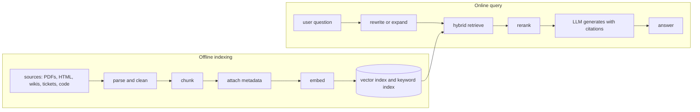

# Ingestion, parsing and chunking strategies

> **Before this lesson:** you should know what an embedding is and how similarity search finds the
> closest vectors
> ([Embeddings and similarity](#/lesson/llm-practice/embeddings-similarity)), and how a vector index
> or vector database stores them with metadata
> ([ANN indexes and vector databases](#/lesson/llm-practice/ann-indexes)). Knowing what a token is
> ([Subword tokenizers](#/lesson/llm-practice/subword-tokenizers)) helps with chunk sizes.

## In plain words

**RAG** (retrieval-augmented generation) means: before the model answers a question, search your own
documents for the relevant passages and paste them into the prompt, so the answer is based on your
facts rather than on whatever the model half-remembers. This lesson covers the first and least
glamorous half: getting documents into a searchable shape. That means pulling clean text out of PDFs
and web pages (**parsing**), cutting it into passage-sized pieces (**chunking**), labelling each
piece (**metadata**) and storing it in an index (**ingestion** is the name for the whole process).

Think of preparing index cards for an open-book exam. If the photocopies are smudged, no amount of
clever searching helps. If each card holds a whole chapter, you cannot find the one line you need;
if each card holds three words, the line makes no sense on its own. And if the cards carry no
chapter or page labels, you cannot cite your source. Good ingestion is good index cards.

Why it matters for a job: most RAG products that "hallucinate" (state things that are not true) are
actually failing at this stage: the right passage never reached the model. Teams that measure and
fix ingestion get large quality gains cheaply. "How would you choose a chunk size?" is a common
interview question, and a good answer shows you know it is a trade-off you measure, not a magic
number.

## Where quality is lost

The AI Engineering track explains *why* RAG exists (models lack private and fresh knowledge,
**hallucinate** less when **grounded**, meaning when given source text to base the answer on, and
context windows are finite). Here we build one. Most RAG quality problems are not in the LLM at all:
they are in **ingestion** (garbage text extracted from PDFs), **chunking** (answers split across
chunks, or buried in giant ones) and **retrieval** (next lesson). Fix the pipeline from the bottom up.

## 1. The two pipelines

A **pipeline** is a chain of processing steps where each step's output is the next step's input. A
RAG system has two. The **offline** pipeline prepares the documents ahead of time, without any user
waiting. The **online** pipeline runs while a user waits for an answer.



Walking the diagram: on the offline side, documents from many **sources** are parsed and cleaned,
cut into chunks, labelled with metadata, embedded, and stored in both a vector index and a keyword
index. On the online side, the user's question may be rewritten (for example, expanding an
abbreviation), both indexes are searched (hybrid retrieval), the candidates are re-ordered by a more
careful model (reranking), and the LLM writes an answer that cites its sources. The next lesson
covers the online side.

The offline half runs on a schedule or on change events and must be **idempotent**: running it twice
on the same input leaves the same result as running it once. Re-ingesting the same document should
update, not duplicate, its chunks.

## 2. Parsing: text quality is retrieval quality

**Parsing** means extracting the text, and ideally its structure (headings, lists, tables), from a
file. Every file type has its own traps:

- **HTML**: strip navigation, footers and cookie banners (the trafilatura and readability libraries
  do this), keep headings and lists, convert to **Markdown** (the plain-text format with `#`
  headings and `-` bullets that this lesson is written in) so structure survives.
- **PDF**: the hard one. A PDF stores characters at positions on a page, not sentences in order.
  Text-layer extraction (pypdf, PyMuPDF) loses reading order in multi-column layouts, mangles tables
  and hyphenation, and returns nothing for **scans** (pages that are only photographs of text).
  **Layout-aware** parsers, which look at where things sit on the page (Docling, Unstructured,
  Marker, LlamaParse, Azure Document Intelligence), or **vision-language models** (models that read
  images as well as text) produce Markdown with tables. For visually rich documents, **ColPali**-style
  retrieval embeds page *images* directly.
- **Tables**: keep them whole and **serialise** them (write them out as text) in Markdown or HTML; add
  a natural-language summary chunk so questions like "which plan includes SSO?" match.
- **Code**: chunk by function/class using a parser (tree-sitter, a library that understands the
  grammar of many programming languages), keeping the file path and **signature** (the function's
  name and arguments).
- **Conversations / tickets**: keep thread structure and timestamps; strip signatures and quoted replies.

Always inspect a random sample of parsed output by eye. Many "the model hallucinated" bugs are "the
parser dropped the second column".

**Cleaning**: normalise Unicode and whitespace, remove **boilerplate** (text repeated on every page,
such as headers and page numbers), **deduplicate** (exact copies are found by comparing **hashes**,
short fingerprints computed from the text; near-copies with a technique called MinHash, which
estimates how many word sequences two texts share), and **redact** (remove or mask) **PII**
(personally identifiable information: names, emails, phone numbers) or secrets if the index will be
shared more broadly than the source.

## 3. Why chunk at all?

A **chunk** is one piece of a document stored and retrieved as a unit. Why not store whole
documents?

1. Embedding models have a maximum input length (often 512 tokens) and a single vector represents a
   long text poorly.
2. Retrieval precision: returning a 30-page document for a one-line fact wastes the context budget and
   distracts the model (module 9).
3. Citations: smaller units make "which passage supports this claim?" answerable.

But chunks that are too small lose context ("it increased by 4%": what did?). Chunk size is a real
trade-off, and the right value depends on your documents and questions. Typical starting points: 200
to 800 tokens with 10 to 20 percent overlap. Then **measure** (lesson 12).

## 4. Chunking strategies

### Fixed-size by tokens, with overlap

The baseline: a sliding window of `size` tokens advancing by `size - overlap`. Overlap reduces the
chance that a fact straddling a boundary is lost from both chunks.

```python-run
def chunk_tokens(tokens, size, overlap):
    if size <= 0 or overlap < 0 or overlap >= size:
        return []
    step, chunks, start = size - overlap, [], 0
    while start < len(tokens):
        chunks.append(tokens[start:start + size])
        if start + size >= len(tokens):
            break                       # last window already reached the end
        start += step
    return chunks

toks = "the kv cache stores keys and values so decode does not recompute the prefix".split()
for c in chunk_tokens(toks, size=6, overlap=2):
    print(c)
```

**Reading this code line by line**

- The first `if` rejects impossible settings: a size of zero, a negative overlap, or an overlap as big
  as the window (which would never move forward). Returning an empty list is safer than looping
  forever.
- `step = size - overlap` is how far each window moves. With size 6 and overlap 2 the step is 4.
- `tokens[start:start + size]` cuts one window. If that window already reaches the end of the list,
  the loop stops, so no tiny leftover chunk is produced.
- The demo splits a 14-word sentence into three chunks: words 0 to 5, 4 to 9 and 8 to 13. Notice that
  "keys and" ends the first chunk and starts the second: that is the overlap.

Always count in the **embedding model's tokens**, not characters or words; this module's
`llm-chunk-overlap` problem formalises the edge cases.

### Recursive / structure-aware splitting

Split on the strongest boundary first, falling back to weaker ones only when a piece is still too
big: sections (headings), then paragraphs (`\n\n`), then lines, then sentences, then words. This is
LangChain's `RecursiveCharacterTextSplitter` idea, and Markdown/HTML header splitters do the same
using document structure. Chunks then align with how humans wrote the document.

```python-run
import re

def recursive_split(text, max_words, seps=("\n## ", "\n\n", ". ", " ")):
    if len(text.split()) <= max_words:
        return [text.strip()] if text.strip() else []
    if not seps:
        w = text.split()
        return [" ".join(w[i:i + max_words]) for i in range(0, len(w), max_words)]
    sep, rest = seps[0], seps[1:]
    parts = text.split(sep)
    out, buf = [], ""
    for i, p in enumerate(parts):
        piece = (sep.lstrip("\n") if i and sep.startswith("\n## ") else "") + p
        cand = (buf + (" " if buf and sep == ". " else "\n" if buf else "") + piece) if buf else piece
        if len(cand.split()) <= max_words:
            buf = cand
        else:
            if buf:
                out.append(buf.strip())
            if len(piece.split()) > max_words:
                out.extend(recursive_split(piece, max_words, rest)); buf = ""
            else:
                buf = piece
    if buf.strip():
        out.append(buf.strip())
    return out

doc = """# LoRA guide
## Idea
LoRA freezes the base weights. It learns a low-rank update BA. The rank r is small.

## Hyperparameters
Use r between 8 and 64. Alpha scales the update. Target all linear layers for best quality.

## Merging
After training you can merge BA into W so inference has no extra latency."""
for c in recursive_split(doc, max_words=20):
    print("---\n" + c)
```

How the function works: if the text already fits in `max_words`, it is returned as one chunk. If no
separators remain, the text is cut into word windows as a last resort. Otherwise the text is split on
the strongest remaining separator (first `"\n## "`, a level-2 heading; then a blank line; then a
sentence end; then a space). The loop greedily packs consecutive parts into a buffer `buf` while they
fit; when the next part would overflow, the buffer becomes a chunk. A part that is too big on its own
is passed back into `recursive_split` with the weaker separators, which is what makes the function
**recursive** (it calls itself on smaller inputs). The `## ` marker that the split removed is put
back at the start of each section, so every section keeps its heading.

The output has four chunks: the document title on its own, then each `##` section whole, because
each section fits in 20 words. The sections were never cut mid-sentence. (The title-only chunk shows
a typical side effect, a tiny chunk with no content, which the debugging checklist in section 9
catches.)

### Semantic chunking

Embed each sentence, and start a new chunk where the similarity between consecutive sentences drops
sharply (a topic shift). It can help with unstructured prose but costs an embedding call per sentence
and gives inconsistent chunk sizes; studies have found it often does not beat good recursive splitting.
Treat it as an experiment, not a default.

### Context-enriched chunks

The biggest wins usually come from making each chunk **self-explanatory**:

- **Header path prefixing**: prepend `"LoRA guide > Hyperparameters:"` to the chunk text before
  embedding.
- **Contextual retrieval** (Anthropic, 2024): ask an LLM to write a one or two sentence situating
  context for each chunk given the whole document ("This chunk is from ACME's Q2 2023 10-Q; it
  discusses revenue growth versus Q1"; a 10-Q is a company's quarterly financial report), prepend it,
  then embed and BM25-index the result (BM25 is the keyword-scoring formula of the next lesson).
  Anthropic reported a 35 percent reduction in retrieval failures from contextual embeddings and 49
  percent combined with contextual BM25, rising to 67 percent with reranking. **Prompt caching**
  (lesson 23: the provider stores the processed start of a prompt and charges much less to reuse it)
  makes the per-chunk LLM calls affordable because the document is the shared prefix.
- **Late chunking**: run a long-context embedder over the whole document, then pool token embeddings
  per chunk, so each chunk vector "saw" the full document.

The problem all three solve: a chunk such as "It increased by 4 percent over the prior quarter" is
useless on its own. Once it carries "ACME 10-Q, Q2 2023, revenue" in its text, both the embedding and
the keyword index can match it to a question about ACME's revenue.

### Parent-child (small-to-big) retrieval

Index **small** chunks (precise matching) but return their **parent** section or a window of
neighbouring chunks to the LLM (enough context to answer). Store `parent_id` and `position` in each
chunk's metadata to make this cheap.

## 5. Metadata: the underrated half

**Metadata** is data about the data: where a chunk came from, when, who may read it, and how it was
made. Every chunk should carry metadata such as:

```json
{"chunk_id": "handbook.pdf#p12#c3", "doc_id": "handbook.pdf", "title": "Employee handbook",
 "section": "Leave > Parental", "page": 12, "position": 3, "parent_id": "handbook.pdf#p12",
 "source_url": "https://intranet/handbook.pdf", "updated_at": "2026-03-01", "lang": "en",
 "acl": ["group:all-staff"], "content_hash": "sha256:9f1c...", "embed_model": "bge-small-en-v1.5"}
```

Most fields are self-explanatory. `acl` is an **access-control list**: the groups allowed to read this
chunk. `content_hash` is a SHA-256 fingerprint of the text (SHA-256 is a standard hash function: the
same text always gives the same 64-character code, and any change gives a different one).
`embed_model` records which embedding model produced the vector.

It enables:

- **Filtering**: tenant, access control (never retrieve what the user may not read: enforce ACLs at
  retrieval time, not in the prompt), product, language, date ranges.
- **Citations**: title, URL and page for the answer's references.
- **Freshness**: prefer recent versions; delete or supersede old ones.
- **Incremental updates**: `content_hash` lets re-ingestion skip unchanged chunks and delete orphaned
  ones; `embed_model` tells you what to re-embed after a model change.
- **Self-querying**: an LLM can translate "policies changed after March" into a metadata filter.

```python-run
import hashlib, json

def upsert_plan(old_index, new_chunks):
    """Return which chunk ids to embed (new/changed) and which to delete (gone)."""
    new = {c["chunk_id"]: hashlib.sha256(c["text"].encode()).hexdigest()[:12] for c in new_chunks}
    to_embed = [cid for cid, h in new.items() if old_index.get(cid) != h]
    to_delete = [cid for cid in old_index if cid not in new]
    return to_embed, to_delete

old = {"a#1": hashlib.sha256(b"LoRA freezes weights").hexdigest()[:12], "a#2": "stale", "a#3": "x"}
chunks = [{"chunk_id": "a#1", "text": "LoRA freezes weights"},
          {"chunk_id": "a#2", "text": "LoRA rank is usually 8 to 64"},
          {"chunk_id": "a#4", "text": "QLoRA quantises the base to 4-bit"}]
print(json.dumps(dict(zip(["embed", "delete"], upsert_plan(old, chunks)))))
```

What `upsert_plan` does: `new` maps each incoming chunk id to the first 12 characters of the hash of
its text. A chunk needs embedding if its id is new or its hash differs from the stored one
(`old_index.get(cid) != h`; `.get` returns `None` for unknown ids, which never equals a hash). A
stored chunk must be deleted if its id no longer appears. In the example, `a#1` is unchanged and
skipped, `a#2` changed, `a#4` is new, and `a#3` disappeared, so the output is
`{"embed": ["a#2", "a#4"], "delete": ["a#3"]}`. Only two embedding calls are needed instead of three,
and the orphan is cleaned up.

## 6. Ingestion code sketch

Putting the pieces together, here is a static sketch of an ingestion function. It reuses
`recursive_split` from section 4, prefixes each chunk with its title and section path, builds
**deterministic** ids (the same document, section and position always give the same id), embeds all
chunks in batches, and upserts them into a persistent Chroma collection (`PersistentClient` saves to
the `rag_db` folder, so the data survives restarts).

```python
from sentence_transformers import SentenceTransformer
import chromadb, hashlib

embedder = SentenceTransformer("BAAI/bge-small-en-v1.5")
col = chromadb.PersistentClient("rag_db").get_or_create_collection("kb", metadata={"hnsw:space": "cosine"})

def ingest(doc_id, title, sections):          # sections: list of (heading_path, text)
    ids, texts, metas = [], [], []
    for s_idx, (path, text) in enumerate(sections):
        for c_idx, chunk in enumerate(recursive_split(text, max_words=250)):
            enriched = f"{title} > {path}\n{chunk}"
            ids.append(f"{doc_id}#{s_idx}#{c_idx}")
            texts.append(enriched)
            metas.append({"doc_id": doc_id, "section": path, "position": c_idx,
                          "hash": hashlib.sha256(enriched.encode()).hexdigest()})
    vecs = embedder.encode(texts, normalize_embeddings=True, batch_size=64)
    col.upsert(ids=ids, documents=texts, embeddings=vecs.tolist(), metadatas=metas)
```

## 7. Pitfalls

- Chunking by characters while the embedder truncates by tokens: the tail of long chunks silently
  disappears from the vector.
- No overlap and no header context: answers that span a boundary become unretrievable.
- Re-ingesting creates duplicates because chunk ids are random **UUIDs** (universally unique
  identifiers, random codes that differ every time) instead of deterministic.
- Losing tables and multi-column order in PDF extraction.
- Enforcing permissions only in the prompt ("do not reveal HR docs") instead of filtering retrieval.

## 8. Experiment: how chunk size trades recall against context cost

The claim "chunk size is a trade-off" is easy to verify. The simulation below builds documents in which
each answer is a short span of tokens, chunks them at several sizes with and without overlap, and
measures two things: how often the **whole** answer span lands inside a single chunk (a proxy for
"retrievable and usable"), and how many tokens you must send to the LLM if you pass the top 5 chunks.

```python-run
import numpy as np
rng = np.random.default_rng(0)
DOC_LEN, N = 6000, 4000
starts = rng.integers(0, DOC_LEN - 60, N)
spans = np.stack([starts, starts + rng.integers(15, 60, N)], axis=1)      # answer = 15 to 60 tokens

def intact_rate(size, overlap):
    step = size - overlap
    chunk_starts = np.arange(0, DOC_LEN, step)
    ok = 0
    for s, e in spans:
        c = chunk_starts[(chunk_starts <= s)]                 # chunks starting at or before the answer
        ok += bool(len(c)) and bool(((c + size) >= e).any())  # ...one of which also covers its end
    return ok / N

print("size  overlap  answer intact  tokens for top-5")
for size in [64, 128, 256, 512, 1024]:
    for overlap in [0, size // 8]:
        print(f"{size:5d} {overlap:7d}      {intact_rate(size, overlap):.3f}        {5 * size:5d}")
```

How the simulation works: each of 4,000 answers is a span of 15 to 60 tokens starting somewhere in a
6,000-token document. For a given size and overlap, `chunk_starts` lists where every window begins.
An answer counts as intact if some window starts at or before the answer's first token and ends at or
after its last token. The last column is the cost of sending five chunks of that size to the LLM.

The numbers: at 64 tokens without overlap only 44 percent of answers survive in one piece; 128 tokens
with 16 of overlap reaches 83 percent; 256 with 32 of overlap reaches 97 percent for 1,280 tokens of
context; 512 with overlap reaches 100 percent but costs 2,560 tokens.

Reading the table: tiny chunks split a large share of answers across a boundary; overlap repairs a good
part of that damage at every size; large chunks keep answers intact but multiply the tokens you send
(and blur each chunk's embedding, which this simulation does not model). That is the quantitative case
for the usual advice: a few hundred tokens with 10 to 20 percent overlap, or small chunks for matching
plus parent expansion for context.

## 9. Debugging ingestion: a checklist that finds most problems

When retrieval is poor, work down this list before touching the embedding model:

1. **Look at ten random chunks** exactly as they are stored. Are there page headers, navigation text,
   broken tables, hyphen-split words, or two columns interleaved line by line?
2. **Search for a sentence you know is in the corpus** with exact-match (keyword) search. If it is not
   found, the problem is parsing or ingestion coverage, not retrieval.
3. **Check chunk length distribution** in the embedder's tokens. A spike at the maximum length means
   truncation; a long tail of five-token chunks means over-splitting (headings indexed alone).
4. **Count chunks per document** and look for outliers: zero chunks (a failed parse or a scanned PDF)
   or thousands (a table exploded into rows).
5. **Check for duplicates**: the same paragraph ingested from several versions crowds the top-k with
   copies and hides other evidence.
6. **Verify metadata** on a sample: correct source URL, page, section path and access-control fields.
7. **Re-run ingestion twice** and confirm the chunk count does not change (idempotency).

```python-run
import numpy as np
from collections import Counter
chunks = [{"doc": "handbook.pdf", "text": "Parental leave is 16 weeks at full pay. " * 3},
          {"doc": "handbook.pdf", "text": "Page 12 of 80"},
          {"doc": "handbook.pdf", "text": "Parental leave is 16 weeks at full pay. " * 3},
          {"doc": "faq.html", "text": "Home | Products | About | Contact"},
          {"doc": "faq.html", "text": "How do I reset my API key? Go to Settings and click Rotate. " * 40},
          {"doc": "scan.pdf", "text": ""}]
MAX_TOKENS = 256
tok = lambda s: s.split()
lengths = np.array([len(tok(c["text"])) for c in chunks])
dupes = [t for t, n in Counter(c["text"] for c in chunks).items() if n > 1 and t]
print("empty chunks            :", int((lengths == 0).sum()))
print("tiny chunks (< 8 tokens):", [c["text"] for c, n in zip(chunks, lengths) if 0 < n < 8])
print("over the embedder limit :", int((lengths > MAX_TOKENS).sum()), "chunk(s) will be silently truncated")
print("exact duplicate texts   :", len(dupes))
print("chunks per document     :", dict(Counter(c["doc"] for c in chunks)))
```

The demo runs four of the checklist's checks on six made-up chunks, using word counts as a stand-in
for tokens. `Counter` counts how often each text appears, which finds exact duplicates. The output
flags one empty chunk (the scanned PDF that produced no text), two tiny chunks (a page footer and a
navigation bar, both boilerplate), one chunk over the 256-token limit (the FAQ answer repeated 40
times, whose tail the embedder would never see), one duplicated paragraph, and the chunk count per
document.

A report like this, run after every ingestion job and tracked over time, catches most **regressions**
(things that used to work and silently broke; for example a
parser upgrade that starts emitting boilerplate, a source that silently became scanned images) long
before users notice worse answers.

> [!INTERVIEW]
> **"How would you choose a chunk size?"** It depends on document structure and question type; start
> with structure-aware splitting at a few hundred tokens with about 15 percent overlap, keep chunks
> within the embedder's max length, prepend header/context, consider small-to-big retrieval, then
> sweep sizes against a labelled query set measuring recall@k and end-to-end answer quality. Mention
> contextual retrieval and that parsing quality often matters more than the chunker.

## Summary

- RAG has an offline indexing pipeline and an online query pipeline; make ingestion idempotent.
- Parsing quality (especially PDFs and tables) caps everything downstream.
- Chunking trades precision against context: fixed windows with overlap, structure-aware recursive
  splits, semantic splits, context enrichment, parent-child retrieval.
- Rich metadata powers filtering, ACLs, citations, freshness and incremental updates.

## Glossary

- **RAG (retrieval-augmented generation)**: answering with a model after retrieving relevant passages
  from your own documents.
- **Ingestion**: the offline process of parsing, cleaning, chunking, labelling, embedding and storing
  documents.
- **Parsing**: extracting text and structure from a file such as a PDF or web page.
- **Layout-aware parser**: a parser that uses where text sits on the page to recover reading order and
  tables.
- **Boilerplate**: text repeated on every page or screen, such as headers, footers and menus.
- **Deduplication / MinHash**: removing copies / a fast way to estimate how similar two texts are.
- **PII**: personally identifiable information.
- **Chunk / chunking**: a retrievable piece of a document / cutting documents into such pieces.
- **Overlap**: tokens shared by neighbouring chunks so boundary-crossing facts stay whole.
- **Recursive splitting**: cutting on the strongest boundary first and on weaker ones only if needed.
- **Semantic chunking**: cutting where the topic changes, detected with sentence embeddings.
- **Contextual retrieval**: prepending an LLM-written situating sentence to each chunk before indexing.
- **Parent-child (small-to-big) retrieval**: match small chunks, return their larger parent section.
- **Metadata / ACL**: data about a chunk / the list of who may read it.
- **Hash (SHA-256)**: a fixed-length fingerprint that changes whenever the text changes.
- **Idempotent**: giving the same result however many times it is run.
- **Deterministic id**: an id computed from the content's position, so re-runs reuse it.
- **Regression**: something that used to work and silently stopped working.

## Check yourself

```quiz
[
  {"q": "Tokens = 10, chunk size = 4, overlap = 1. How many chunks does the sliding window produce?",
   "options": ["3", "4", "2", "5"], "answer": 0,
   "explain": "Step is 3: windows start at 0, 3, 6; the window at 6 covers tokens 6-9 and reaches the end."},
  {"q": "Why is overlap used in fixed-size chunking?",
   "options": ["So facts spanning a boundary appear whole in at least one chunk", "To increase the index size", "To make embeddings normalised", "To speed up ingestion"], "answer": 0,
   "explain": "Overlap gives boundary-straddling content a second chance to be captured intact."},
  {"q": "What does contextual retrieval add to each chunk before indexing?",
   "options": ["An LLM-written sentence situating the chunk within its document", "A random id", "The full document", "A summary of the whole corpus"], "answer": 0,
   "explain": "The situating context makes isolated chunks self-explanatory for both embeddings and BM25."},
  {"q": "Where should document access control be enforced in a RAG system?",
   "options": ["At retrieval time via metadata filters", "In the system prompt", "In the reranker", "After generation"], "answer": 0,
   "explain": "If unauthorised chunks reach the prompt, a prompt instruction cannot reliably keep them secret."},
  {"q": "What is parent-child (small-to-big) retrieval?",
   "options": ["Match on small chunks but return their larger parent section to the LLM", "Use two embedding models", "Retrieve only document titles", "Split queries into sub-queries"], "answer": 0,
   "explain": "Small units match precisely; their parents give enough context to answer."},
  {"q": "Why store a content hash with each chunk?",
   "options": ["To skip unchanged chunks and detect deletions during re-ingestion", "To encrypt it", "To compute similarity", "To dedupe queries"], "answer": 0,
   "explain": "Hashes make re-indexing incremental and idempotent."},
  {"q": "Your embedder truncates at 512 tokens and your chunks are 1,500 tokens. What happens?",
   "options": ["Text beyond 512 tokens is ignored in the vector", "The model averages three windows automatically", "An error is always raised", "Nothing; embedders have no limit"], "answer": 0,
   "explain": "Most embedders silently truncate, so the end of each chunk is invisible to retrieval."}
]
```

> **Source:** Anthropic, "Introducing Contextual Retrieval" (2024, https://www.anthropic.com/news/contextual-retrieval);
> Hugging Face Cookbook, "Advanced RAG" (https://huggingface.co/learn/cookbook/advanced_rag);
> LangChain text splitter docs; Docling docs; Huyen, *AI Engineering*, ch. 6 "RAG and Agents"
> (retrieval optimisation: chunking strategy, query rewriting, contextual retrieval).
