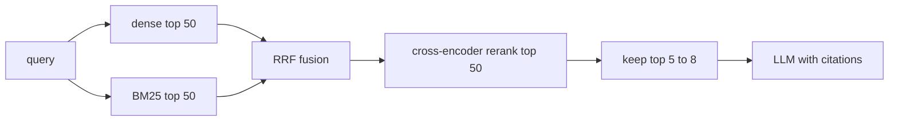

# Hybrid retrieval, fusion, reranking and grounded generation

> **Before this lesson:** you should know how embeddings and cosine similarity find related text, and
> what recall@k and precision mean
> ([Embeddings and similarity](#/lesson/llm-practice/embeddings-similarity)), and how documents are
> parsed, chunked and stored with metadata in the offline half of a RAG system
> ([Ingestion, parsing and chunking strategies](#/lesson/llm-practice/ingestion-chunking)).

## In plain words

The previous lesson filled the library. This one is the librarian at the desk when a question
arrives. The job has three steps: quickly pull a generous pile of possibly useful passages, look at
each one carefully to put the best few on top, and hand those few to the language model with the
instruction "answer only from these, and say which one you used".

Picture a lawyer preparing for a hearing. A paralegal first runs two quick searches through the
archive, one by exact case numbers and keywords, one by topic, and brings back fifty files. The
lawyer then reads each file properly and keeps the six that matter. Finally the lawyer writes the
argument with a footnote on every claim, and a careful colleague checks that each footnote really
says what the argument claims it says. Those are hybrid retrieval, reranking, grounded generation
and citation checking.

Why it matters for a job: this is the part of a RAG system that decides whether users get right
answers with sources or confident nonsense. "Design retrieval for a support assistant" is one of the
most common AI-engineering system-design questions, and the expected answer uses every stage in this
lesson.

## The three jobs of the online pipeline

With a clean, well-chunked index in hand, the online pipeline has three jobs: find candidates with
high **recall** (most of the relevant passages are somewhere in the pile; done by cheap
**retrievers**, the fast search components), order them with high **precision** (the few passages at
the top are really relevant; done by an expensive **reranker**), and make the LLM answer **only from
them, with citations** (references saying which passage supports each claim). This lesson builds
each stage.

## 1. Why dense retrieval alone is not enough

**Dense retrieval** is search with embedding vectors (lesson 8). Dense embeddings excel at paraphrase
("how do I cancel" matches "terminating your subscription") but are weak at:

- exact identifiers: error codes `E-4021`, **SKUs** (stock-keeping units, product codes), function
  names, ticket numbers,
- rare proper nouns and fresh jargon the embedder never saw,
- negation ("not covered" and "covered" have very similar vectors) and exact numbers.

**Lexical retrieval** (matching the actual words; BM25 is the standard method) is the opposite:
precise on exact terms, blind to **synonyms** (different words with the same meaning). Combining
them, **hybrid search**, is the most reliable default in production RAG and consistently beats
either alone.

## 2. BM25 in one formula

BM25 ("Best Matching 25", the 25th formula in a line of research) scores a document by the query
words it contains. Three ideas hide in the formula. A word that appears more often in the document
counts more, but with diminishing returns. A word that is rare across the whole collection counts
much more than a common one ("E-4021" is far more telling than "the"). And a long document gets a
slight penalty, because it contains many words by sheer size.

For query terms $t$ and document $D$ of length $|D|$ (its number of words) in a corpus of $N$
documents with average length $\text{avgdl}$:

$$
\text{BM25}(D, Q) = \sum_{t \in Q} \text{IDF}(t)\cdot
\frac{f(t, D)\,(k_1 + 1)}{f(t, D) + k_1\left(1 - b + b\,\frac{|D|}{\text{avgdl}}\right)},\quad
\text{IDF}(t) = \ln\!\left(1 + \frac{N - n_t + 0.5}{n_t + 0.5}\right)
$$

- $f(t, D)$: **term frequency**, how many times term $t$ occurs in $D$. The fraction **saturates**
  (the 10th mention adds much less than the 1st), controlled by $k_1$ (about 1.2 to 2.0).
- $b$ (about 0.75): length normalisation, so long documents do not win merely by being long. The
  factor $|D| / \text{avgdl}$ is above 1 for longer-than-average documents, which shrinks their score.
- $n_t$ is the **document frequency** of $t$, the number of documents containing it. **IDF**
  (inverse document frequency) is large when $n_t$ is small, so it rewards rare terms. $\ln$ is the
  natural logarithm.

The demo implements the formula on four tiny support articles:

```python-run
import math, re
from collections import Counter

docs = {
  "d1": "Error E-4021 means the API key expired. Rotate the key in settings.",
  "d2": "To cancel your subscription, open billing and choose terminate plan.",
  "d3": "API keys can be rotated. Expired keys return an authentication error.",
  "d4": "Our billing plans include monthly and annual subscriptions.",
}
tok = lambda s: re.findall(r"[a-z0-9\-]+", s.lower())
D = {k: tok(v) for k, v in docs.items()}
N = len(D); avgdl = sum(map(len, D.values())) / N
df = Counter(t for ws in D.values() for t in set(ws))

def bm25(query, k1=1.5, b=0.75):
    q = tok(query); scores = {}
    for doc, ws in D.items():
        tf = Counter(ws); s = 0.0
        for t in q:
            if t not in tf: continue
            idf = math.log(1 + (N - df[t] + 0.5) / (df[t] + 0.5))
            s += idf * tf[t] * (k1 + 1) / (tf[t] + k1 * (1 - b + b * len(ws) / avgdl))
        scores[doc] = round(s, 3)
    return sorted(scores.items(), key=lambda x: -x[1])

print(bm25("what does E-4021 mean"))
print(bm25("how do I stop my membership"))   # lexical miss: no shared terms with d2
```

**Reading this code line by line**

- `tok` lowercases and keeps runs of letters, digits and hyphens, so `E-4021` stays one term.
- `D` holds each document's term list, `N` the document count and `avgdl` the average length.
- `df` counts, for every term, how many documents contain it; `set(ws)` makes sure a document counts
  once however often it repeats the term.
- Inside `bm25`, `Counter(ws)` gives the term frequencies of one document, and the loop adds the
  formula's contribution for each query term found in it. Terms the document lacks contribute 0.
- The first query prints `d1` with a score of about 1.12 and every other document at 0: only `d1`
  contains `e-4021`. Notice that "mean" did not match "means"; plain BM25 sees different words.
  Real systems add **stemming** (reducing words to a common root, so "means" and "mean" match).
- The second query prints four zeros.

The second query shows BM25's blind spot: "stop my membership" shares no words with the cancellation
document. A dense retriever would catch it.

Libraries: `rank_bm25` and `bm25s` in Python, Elasticsearch/OpenSearch, Tantivy, Postgres full-text
search, and **learned sparse** models such as SPLADE that expand documents with related terms.

## 3. Fusing ranked lists: Reciprocal Rank Fusion

Hybrid search runs both retrievers and gets two ranked lists. **Fusion** merges them into one list.
Dense scores (cosine around 0.3 to 0.9) and BM25 scores (unbounded: any positive number) are not
comparable, so averaging raw scores is fragile. **Reciprocal Rank Fusion (RRF)** ignores scores and
uses only ranks. "Reciprocal" means "one divided by", so each list gives a document one over (a
constant plus its rank):

$$
\text{RRF}(d) = \sum_{r \in \text{rankers}} \frac{1}{k + \text{rank}_r(d)}
$$

with ranks starting at 1 and $k = 60$ by convention (it damps the dominance of top positions).
A document missing from a list receives nothing from that list. RRF is simple, robust and
needs no tuning, which is why Elasticsearch, OpenSearch, Qdrant, Weaviate and others offer it built in.
(Alternatives: normalise each list's scores, either **min-max** (rescale so the lowest is 0 and the
highest 1) or **z-score** (subtract the mean and divide by the standard deviation), then take a
weighted sum; tune the weight on labelled data.)

Why $k = 60$ matters: without it, rank 1 would score 1 and rank 2 only 0.5, so a single list's top
pick would swamp everything. With $k = 60$, rank 1 scores $1/61 \approx 0.0164$ and rank 2
$1/62 \approx 0.0161$: nearly the same, so appearing in *several* lists counts for more than being
first in one.

```python-run
from collections import defaultdict

def rrf(ranked_lists, k=60):
    score = defaultdict(float)
    for lst in ranked_lists:
        for rank, doc in enumerate(lst, start=1):
            score[doc] += 1.0 / (k + rank)
    return sorted(score.items(), key=lambda x: (-x[1], x[0]))

dense = ["d2", "d4", "d3", "d1"]
bm25_ = ["d1", "d3", "d4"]
for doc, s in rrf([dense, bm25_]):
    print(doc, round(s, 5))
```

The code: `defaultdict(float)` is a dictionary whose missing entries start at 0.0, so scores can be
added without checking. `enumerate(lst, start=1)` numbers each list from rank 1. The final sort
orders by score, highest first, and breaks exact ties alphabetically by document id so the output
is the same every run. The printed scores are `d1 0.03202`, `d3 0.032`, `d4 0.032`, `d2 0.01639`:
`d1` gets $1/64 + 1/61$, `d3` gets $1/63 + 1/62$, `d4` gets $1/62 + 1/63$, and `d2` only $1/61$.

`d1` (first in BM25, last in dense) edges ahead; `d3` and `d4`, found by both retrievers, beat `d2`, which only the dense retriever liked. Agreement between retrievers is rewarded. This
module's `llm-rrf` problem asks you to implement RRF exactly, including duplicate handling and ties.

## 4. Query transformations

What the user types is often a poor search query: too short, full of pronouns, or phrased as a
question when the documents are phrased as statements. Before retrieval, it often pays to rewrite the
query, usually with a small, cheap LLM call:

- **Conversational rewriting**: "what about the annual one?" becomes "What is the price of the annual
  subscription plan?" using chat history. Essential for **multi-turn** assistants (ones that hold a
  conversation over several messages), because the follow-up question alone retrieves nothing.
- **Multi-query / decomposition**: generate several phrasings or sub-questions, retrieve for each,
  fuse with RRF.
- **HyDE** (hypothetical document embeddings): ask the LLM to write a plausible answer and embed
  *that*, because answers look more like documents than questions do.
- **Step-back prompting**: ask a more general question first to retrieve background.
- **Metadata extraction (self-query)**: turn "Q3 2025 reports from legal" into a filter.

Each adds latency and cost; measure whether it improves your recall.

## 5. Reranking with cross-encoders

A **bi-encoder** (embedding model) encodes query and document *separately*, so documents can be
pre-embedded. A **cross-encoder** feeds the pair *together* through one transformer, letting every
query token attend to every document token, then outputs a relevance score. It is far more accurate
but must run once per (query, candidate) pair at query time, so we use it only on the top 20 to 100
candidates.



```python
from sentence_transformers import CrossEncoder

reranker = CrossEncoder("BAAI/bge-reranker-v2-m3")          # or cross-encoder/ms-marco-MiniLM-L6-v2
pairs = [(query, c["text"]) for c in candidates]
scores = reranker.predict(pairs, batch_size=32)
reranked = [c for _, c in sorted(zip(scores, candidates), key=lambda x: -x[0])][:6]
```

Line by line: `CrossEncoder(name)` loads a reranking model. `pairs` builds one (query, passage) tuple
per candidate. `reranker.predict(pairs, batch_size=32)` runs the model on every pair, 32 at a time,
and returns one relevance score per pair. The last line sorts the candidates by score, highest first,
and keeps six. (`zip(scores, candidates)` pairs each score with its candidate so they move together
during the sort.)

Hosted rerankers (Cohere Rerank, Voyage rerank, Jina) and **LLM-as-reranker** (ask a small LLM to
score or order passages) are alternatives. A typical stack: retrieve 50 to 100 with hybrid search,
rerank to 5 to 10, send those to the LLM.

The simulation below shows why the two-stage design works. For each of 200 queries, three of 1,000
documents are relevant. The first stage gives relevant documents a modest boost hidden in a lot of
noise; the reranker gives them a big boost with little noise, but is only allowed to look at the
first stage's top 50:

```python-run
import numpy as np
# Simulated: why rerank? Recall@50 of the cheap stage vs precision@5 after reranking
rng = np.random.default_rng(0)
n_q, n_docs = 200, 1000
hits_cheap, hits_rerank = [], []
for _ in range(n_q):
    rel = set(rng.choice(n_docs, 3, replace=False))
    cheap = rng.normal(0, 1, n_docs); cheap[list(rel)] += 1.8          # noisy first-stage scores
    top50 = np.argsort(-cheap)[:50]
    precise = rng.normal(0, 1, n_docs) * 0.4; precise[list(rel)] += 2.5  # sharper cross-encoder
    top5 = top50[np.argsort(-precise[top50])[:5]]
    hits_cheap.append(len(rel & set(np.argsort(-cheap)[:5])) / 3)
    hits_rerank.append(len(rel & set(top5)) / 3)
print("recall@5 first stage only :", round(np.mean(hits_cheap), 3))
print("recall@5 after reranking  :", round(np.mean(hits_rerank), 3))
```

The output: taking the first stage's own top 5 finds about 24 percent of the relevant documents;
reranking its top 50 and keeping 5 finds about 57 percent. The relevant documents were usually
*somewhere* in the top 50 (good recall) but rarely in its top 5 (poor precision); the reranker fixes
the order. It can never rescue a document the first stage missed, which is why the first stage is
tuned for recall.

## 6. Grounded generation and citations

**Grounded generation** means the model writes its answer from supplied source text rather than from
memory. Assemble the prompt so the model can (a) tell sources apart, (b) cite them, and (c) refuse
when the answer is absent. Wrapping each passage in XML-style tags with a number and a source, as
below, does all three:

```text
<documents>
<document index="1" source="handbook.pdf" page="12">
Parental leave is 16 weeks at full pay for all employees...
</document>
<document index="2" source="policy-update-2026.md">
From 1 March 2026, parental leave increases to 20 weeks...
</document>
</documents>

Answer the question using only the documents above. Cite sources like [1] after each claim.
If the documents do not contain the answer, say you don't know. Prefer the most recent policy.
Question: How long is parental leave?
```

Practical guidance:

- **Order matters.** Models attend best to the start and end of long contexts. A 2023 study named the
  effect **"lost in the middle"**: facts placed in the middle of a long prompt are used less reliably.
  Put the best passages first (or first and last), and keep the count modest.
- **Quote-then-answer**: for long documents, ask the model to first extract relevant quotes into a
  tag, then answer from the quotes. It improves **faithfulness** (every claim in the answer is
  supported by the sources) and makes citations verifiable.
- **Verify citations** in code: check that each cited index exists and, ideally, that the cited
  passage actually contains supporting text (string overlap, or a judge: an **NLI** model, short for
  natural language inference, which decides whether one sentence follows from another, or an LLM
  asked the same question). Character offsets from tokenizers or the API let you highlight spans in
  the UI.
- Some APIs offer native citations: Anthropic's Messages API accepts `document` content blocks with
  `citations: {"enabled": true}` and returns answer text blocks annotated with the exact cited spans;
  Cohere and others have similar features.
- **Handle "no answer"** explicitly, and track how often it happens: it tells you where the corpus has
  gaps.

```python-run
import re
answer = "Parental leave is 20 weeks from March 2026 [2], up from 16 weeks [1]. It is paid in full [3]."
docs = {1: "Parental leave is 16 weeks at full pay", 2: "From 1 March 2026, parental leave increases to 20 weeks"}
cited = [int(n) for n in re.findall(r"\[(\d+)\]", answer)]
bad = [n for n in cited if n not in docs]
print("citations:", cited, " invalid:", bad)
for sent in re.split(r"(?<=\.)\s+", answer):
    ids = [int(n) for n in re.findall(r"\[(\d+)\]", sent)]
    nums = re.findall(r"\d+ weeks", sent)
    ok = all(any(x in docs.get(i, "") for i in ids) for x in nums)
    print(f"{sent!r:70}  numbers supported: {ok}")
```

**Reading this code line by line**

- `re.findall(r"\[(\d+)\]", answer)` finds every `[number]` in the answer; the brackets in the
  pattern are escaped because they are special in regular expressions, and `(\d+)` captures the
  digits. The result is `[2, 1, 3]`.
- `bad` keeps cited numbers that are not keys of `docs`. Only two documents exist, so `[3]` is
  invalid: the model cited a source it was never given, a strong sign of an invented claim.
- The loop splits the answer into sentences (`(?<=\.)\s+` means "whitespace that follows a full
  stop") and, for each, checks that every "N weeks" figure appears in at least one of the documents
  that sentence cites.
- The first sentence passes: "20 weeks" is in document 2 and "16 weeks" in document 1. The second
  sentence also prints `True`, but only because it contains no numbers, and `all()` of an empty list
  is `True`. That is a useful warning: a check that finds nothing to check passes silently. This is
  why the invalid-citation test exists separately, and why real systems combine several checks.

## 7. Putting it together (static)

The function below strings every stage of this lesson together. Read it top to bottom: rewrite the
question using the conversation, build an access-control filter from the user's groups, run dense and
BM25 search with that filter, fuse with RRF, fetch the chunk texts, rerank and keep six, build the
numbered prompt, call the LLM at temperature 0 (for steady, repeatable answers), and validate the
citations before returning.

```python
def answer(question, history, user):
    q = rewrite_with_history(question, history)                       # LLM call, small model
    flt = {"acl": {"$in": user.groups}}
    dense = vector_index.search(embed_query(q), k=50, filter=flt)
    sparse = bm25_index.search(q, k=50, filter=flt)
    fused = rrf([[d.id for d in dense], [d.id for d in sparse]])[:50]
    cands = fetch_chunks([doc_id for doc_id, _ in fused])
    top = rerank(q, cands)[:6]
    prompt = build_prompt(question, top)                              # numbered documents
    resp = llm(prompt, temperature=0)
    return validate_citations(resp, top)
```

> [!INTERVIEW]
> **"Design retrieval for a support assistant over 2M documents with product codes."** Hybrid search
> (BM25 for codes, dense for paraphrases) fused with RRF, metadata filters for product/version and ACLs,
> conversational query rewriting, cross-encoder reranking of the top 50 to about 6, numbered context
> with citation instructions and an "I don't know" path, citation validation, and offline evaluation of
> recall@k and faithfulness (next lesson). Mention latency budget: each stage is tens of milliseconds
> except the LLM.

## Summary

- Dense retrieval handles meaning; BM25 handles exact terms; hybrid with RRF is the robust default.
- RRF sums $1/(k + \text{rank})$ across lists and needs no score calibration.
- Query rewriting, multi-query and HyDE can raise recall at extra cost.
- Cross-encoders rerank a shortlist with much higher precision than bi-encoders.
- Ground the generation: numbered sources, citation instructions, refusals, ordering, and programmatic
  citation checks.

## Glossary

- **Retriever**: a fast component that returns candidate passages for a query.
- **Dense / lexical retrieval**: search by embedding similarity / by matching the actual words.
- **Hybrid search**: running dense and lexical retrieval together and merging the results.
- **BM25**: the standard keyword-scoring formula, combining term frequency, rarity and length.
- **Term frequency / document frequency / IDF**: how often a word occurs in one document / how many
  documents contain it / a weight that is high for rare words.
- **Stemming**: reducing words to a shared root so "means" matches "mean".
- **Fusion / RRF**: merging ranked lists / summing $1/(k + \text{rank})$ across lists.
- **Query rewriting / multi-query / HyDE**: improving the query before search / searching with several
  phrasings / searching with a hypothetical answer.
- **Reranker / cross-encoder**: a slower, more accurate scorer / a model that reads query and passage
  together.
- **Grounded generation**: answering from supplied sources rather than from memory.
- **Citation**: a reference showing which source supports a claim.
- **Faithfulness**: every claim in the answer is supported by the sources.
- **Lost in the middle**: models use facts in the middle of a long prompt less reliably.
- **NLI**: natural language inference, deciding whether one text follows from another.

## Check yourself

```quiz
[
  {"q": "Why combine BM25 with dense retrieval?",
   "options": ["BM25 catches exact terms and IDs that embeddings miss, while dense catches paraphrases", "BM25 is always more accurate", "Dense retrieval cannot handle long documents", "To reduce index size"], "answer": 0,
   "explain": "Their failure modes are complementary, so hybrid search improves recall."},
  {"q": "With k=60, a document ranked 1st in one list and absent from another gets which RRF score?",
   "options": ["1/61", "1/60 + 1/60", "2/61", "1"], "answer": 0,
   "explain": "Rank 1 gives 1/(60+1); absence contributes nothing."},
  {"q": "Why is RRF preferred over averaging raw scores?",
   "options": ["Scores from different retrievers are on incomparable scales", "It is more accurate than any reranker", "It uses the LLM", "It needs labelled data"], "answer": 0,
   "explain": "Rank-based fusion avoids calibrating cosine against BM25 scores."},
  {"q": "What makes a cross-encoder more accurate but slower than a bi-encoder?",
   "options": ["It processes query and document jointly, so it must run per pair at query time", "It uses a bigger vocabulary", "It uses BM25 internally", "It stores token vectors"], "answer": 0,
   "explain": "Joint attention captures interactions, but documents cannot be pre-encoded."},
  {"q": "What does HyDE embed for retrieval?",
   "options": ["A hypothetical answer generated by the LLM", "The query with synonyms", "Only the query keywords", "The previous conversation"], "answer": 0,
   "explain": "A fake answer resembles real documents more than a short question does."},
  {"q": "Given 'lost in the middle', where should the most relevant passages go?",
   "options": ["At the start (or start and end) of the context", "Exactly in the middle", "Randomly", "Only in the system prompt"], "answer": 0,
   "explain": "Models recall information at the edges of long contexts more reliably."},
  {"q": "Which is a cheap programmatic check on a RAG answer?",
   "options": ["Verify every cited index exists and its passage supports the claim", "Ask the user", "Increase temperature", "Re-embed the corpus"], "answer": 0,
   "explain": "Invalid or unsupported citations are a strong hallucination signal."}
]
```

> **Source:** Robertson & Zaragoza, "The Probabilistic Relevance Framework: BM25 and Beyond" (2009);
> Cormack et al., "Reciprocal Rank Fusion" (SIGIR 2009); Gao et al. 2022 (HyDE); Liu et al. 2023 ("Lost
> in the Middle"); Sentence Transformers cross-encoder docs (https://sbert.net/docs/cross_encoder);
> Anthropic docs on citations and long-context tips (https://docs.claude.com); HF Cookbook "Advanced RAG";
> Huyen, *AI Engineering*, ch. 6 (term-based vs embedding-based retrieval, hybrid search, reranking,
> query rewriting).
