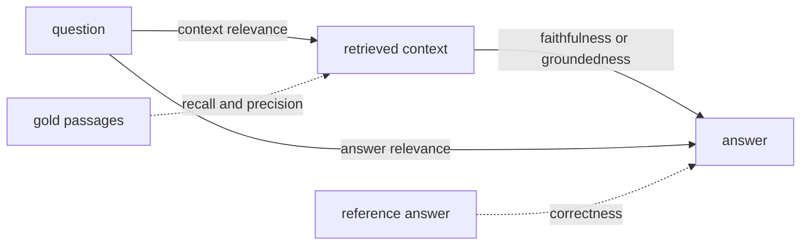
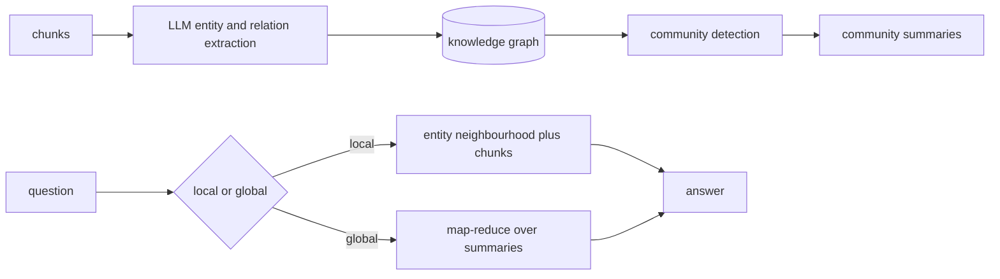

# Evaluating RAG; GraphRAG and agentic RAG

A RAG system has two places to fail: retrieval can miss the right passage, or generation can ignore,
misread or embellish it. If you only measure the final answer you cannot tell which, and you will tune
the wrong knob. This lesson builds a component-wise evaluation harness (RAGAS-style metrics, computed
by hand so you know what they mean), then surveys the advanced architectures: GraphRAG and agentic
RAG. The AI Engineering track covers evaluation methodology in general (AI-as-judge, rubric design,
benchmarks); here we apply it to retrieval pipelines.

## 1. The RAG triad



| metric | question it answers | needs |
|---|---|---|
| context recall | did we retrieve the passages needed? | gold passages or reference answer |
| context precision | are the retrieved passages relevant, and ranked high? | relevance labels (human or LLM) |
| faithfulness / groundedness | is every claim in the answer supported by the context? | answer + context |
| answer relevance | does the answer address the question? | question + answer |
| answer correctness | does it match the reference? | reference answer |

RAGAS, TruLens, DeepEval, Arize Phoenix and LangSmith all implement variants of these, mostly with an
LLM judge underneath. Understand the definitions before trusting their numbers.

## 2. Retrieval metrics (no LLM needed)

Given a ranked list of retrieved ids and a set of relevant ids:

- **Recall@k** $= |\text{relevant} \cap \text{top-}k| / |\text{relevant}|$
- **Precision@k** $= |\text{relevant} \cap \text{top-}k| / k$
- **Hit rate@k**: 1 if any relevant item is in the top $k$.
- **MRR**: mean over queries of $1/\text{rank}$ of the first relevant item.
- **nDCG@k**: graded relevance with a $\log_2$ position discount, normalised by the ideal ordering.
- **Context precision (RAGAS-style)**: the mean of precision@i taken at every rank $i$ where a relevant
  chunk appears, i.e. average precision, which rewards putting relevant chunks first.

```python-run
import numpy as np

def recall_at_k(ranked, rel, k): return len(set(ranked[:k]) & rel) / len(rel)
def precision_at_k(ranked, rel, k): return len(set(ranked[:k]) & rel) / k
def mrr(ranked, rel):
    for i, d in enumerate(ranked, 1):
        if d in rel: return 1 / i
    return 0.0
def avg_precision(ranked, rel, k):
    hits, s = 0, 0.0
    for i, d in enumerate(ranked[:k], 1):
        if d in rel:
            hits += 1; s += hits / i
    return s / max(1, min(len(rel), k)) if hits else 0.0
def ndcg(ranked, grades, k):
    dcg = sum(grades.get(d, 0) / np.log2(i + 1) for i, d in enumerate(ranked[:k], 1))
    ideal = sorted(grades.values(), reverse=True)[:k]
    idcg = sum(g / np.log2(i + 1) for i, g in enumerate(ideal, 1))
    return dcg / idcg if idcg else 0.0

ranked = ["c7", "c2", "c9", "c4", "c1"]
rel = {"c2", "c4", "c8"}
print("recall@5", recall_at_k(ranked, rel, 5), " precision@5", precision_at_k(ranked, rel, 5))
print("MRR", mrr(ranked, rel), " AP@5", round(avg_precision(ranked, rel, 5), 3))
print("nDCG@5", round(ndcg(ranked, {"c2": 3, "c4": 2, "c8": 3}, 5), 3))
```

These are cheap, deterministic and fast enough to run on every commit. Retrieval recall at the depth
you feed the reranker (say recall@50) is the ceiling for the whole system: no reranker or LLM can use a
passage that was never retrieved.

## 3. Building the evaluation set

1. **Collect real questions** from logs, support tickets or subject experts. 50 to 200 well-chosen
   questions beat 5,000 synthetic ones.
2. **Label gold passages** (chunk ids) and a reference answer for each. Use stable chunk ids so labels
   survive re-chunking, or label at the document/section level.
3. **Augment synthetically**: have an LLM read a chunk and write a question it answers (and harder
   multi-hop ones from two chunks). Filter out questions that are trivially lexical copies of the
   chunk, and spot-check by hand.
4. **Include negative cases**: questions the corpus cannot answer, where the right behaviour is "I
   don't know", and adversarial ones (prompt injection inside documents, module 10).
5. **Slice** by question type, document type and difficulty so a regression in "tables" is not
   averaged away.

## 4. Generation metrics with an LLM judge

**Faithfulness** (RAGAS definition): decompose the answer into atomic claims with an LLM, then check
each claim against the context; score = supported claims / total claims.

```python-run
# A mock judge to show the computation; in practice judge() is an LLM call with a strict rubric.
context = "LoRA freezes the pretrained weights and trains low-rank matrices A and B. Typical ranks are 8 to 64."
answer_claims = [
    "LoRA freezes the pretrained weights.",
    "LoRA trains low-rank matrices.",
    "LoRA typically uses rank 512.",
    "LoRA was invented in 2021.",
]
def judge(claim, ctx):     # toy: supported if all content words appear in the context
    words = [w.strip(".").lower() for w in claim.split() if len(w) > 3]
    return all(w in ctx.lower() for w in words)
verdicts = [judge(c, context) for c in answer_claims]
for c, v in zip(answer_claims, verdicts):
    print(("SUPPORTED  " if v else "UNSUPPORTED"), c)
print("faithfulness =", sum(verdicts) / len(verdicts))
```

Note the last claim may be *true* yet still unfaithful: it is not in the context. Faithfulness measures
grounding, not truth; correctness against a reference measures truth.

**Answer relevance** (RAGAS): have the LLM generate a few questions that the answer would answer, embed
them, and average their cosine similarity to the real question. Evasive or off-topic answers score low.

**Making judges trustworthy**: use a strong model, a precise rubric with examples, binary or
three-level scores instead of 1 to 10, ask for reasoning before the verdict, randomise order in
pairwise comparisons, and **calibrate against 50 to 100 human labels**, reporting agreement. Re-check
whenever you change the judge model.

## 5. Diagnosing with the triad

| symptom | likely culprit | fix |
|---|---|---|
| low context recall | parsing, chunking, embedder, missing hybrid, query phrasing | fix ingestion, add BM25, query rewriting, bigger k |
| good recall, low precision | ranking | add or improve reranker, metadata filters |
| good context, low faithfulness | generation | stronger prompt (quote-then-answer), lower temperature, better model, fewer passages |
| faithful but wrong | stale or conflicting documents | freshness metadata, dedupe, conflict instructions |
| relevant answer, low correctness on unanswerables | over-answering | explicit refusal instructions and tests |

## 6. Evaluation in practice (static)

```python
# RAGAS-style run (API names vary across versions; check the docs of the version you install)
from ragas import evaluate, EvaluationDataset
from ragas.metrics import Faithfulness, ResponseRelevancy, LLMContextPrecisionWithReference, LLMContextRecall

rows = [{"user_input": q, "retrieved_contexts": ctxs, "response": ans, "reference": ref}
        for q, ctxs, ans, ref in run_pipeline_over(eval_questions)]
result = evaluate(EvaluationDataset.from_list(rows),
                  metrics=[Faithfulness(), ResponseRelevancy(), LLMContextPrecisionWithReference(), LLMContextRecall()],
                  llm=judge_llm, embeddings=judge_embeddings)
print(result.to_pandas().groupby("question_type").mean(numeric_only=True))
```

Run retrieval metrics on every change; run judge-based metrics nightly or before releases; gate merges
on regressions beyond a threshold (module 10 covers evals in CI).

## 7. GraphRAG

Vector RAG retrieves **local** facts well but struggles with **global** questions ("what are the main
themes across these 5,000 reports?") and multi-hop relations ("which suppliers of our top customer
had incidents?"). **GraphRAG** (Microsoft Research, 2024) adds structure:

1. **Extract** entities and relationships from every chunk with an LLM (plus claims and descriptions).
2. **Build a knowledge graph**, merge duplicate entities.
3. **Detect communities** hierarchically (Leiden algorithm) and have an LLM write a **summary of each
   community** at each level.
4. Query in two modes:
   - **Local search**: find entities related to the query, gather their neighbourhoods, relationships
     and source chunks.
   - **Global search**: map-reduce over community summaries to answer corpus-wide questions.



Trade-offs: indexing is expensive (LLM calls over the whole corpus), extraction quality varies, and the
graph must be maintained as documents change. Lighter variants (LightRAG, LazyGraphRAG) cut indexing
cost. Use it when relationships and corpus-level synthesis matter; plain hybrid RAG is better for
look-up questions. If your data is already a graph or a database, consider **text-to-SQL / text-to-
Cypher** tools instead of extraction.

## 8. Agentic RAG

Classic RAG retrieves once, up front. **Agentic RAG** gives the model retrieval as a **tool** and lets
it decide when, what and how often to search:

- decompose a complex question, search for each part, notice gaps, search again;
- choose between sources (vector index, SQL database, web search, an API) by tool descriptions;
- verify its own draft against fresh retrievals before answering;
- stop when it has enough evidence.

```python
# smolagents-style sketch (module 7 covers agents in depth)
from smolagents import CodeAgent, InferenceClientModel, tool

@tool
def search_kb(query: str, top_k: int = 5) -> str:
    """Search the internal knowledge base and return numbered passages with sources.
    Args:
        query: a focused search query; rephrase and retry if results look irrelevant.
        top_k: number of passages to return (max 10).
    """
    hits = hybrid_search(query, k=top_k)
    return "\n".join(f"[{i}] ({h.source}) {h.text}" for i, h in enumerate(hits, 1))

agent = CodeAgent(tools=[search_kb], model=InferenceClientModel("Qwen/Qwen3-32B"), max_steps=6)
agent.run("Compare our 2025 and 2026 parental leave policies and cite sources.")
```

Related patterns: **Self-RAG** (the model emits reflection tokens deciding whether to retrieve and
whether passages support its output), **Corrective RAG** (grade retrieved documents and fall back to
web search when they are poor), **adaptive RAG** (route easy questions to no-retrieval or single-shot
paths). Agentic RAG costs more tokens and latency and is harder to evaluate, so measure it against a
well-tuned single-shot pipeline before adopting it. Claude Code's own design is a notable data point:
it explores codebases with tools like grep and file reads ("just-in-time" retrieval, module 9) rather
than a pre-built vector index.

> [!INTERVIEW]
> **"Your RAG bot gives wrong answers. How do you debug it?"** Split the failure: measure retrieval
> (recall@k against gold passages) separately from generation (faithfulness given the retrieved
> context). If the right passage is not retrieved, fix parsing, chunking, hybrid search, query
> rewriting. If it is retrieved but ranked low, add a reranker. If it is in context but the answer is
> unfaithful, fix the prompt, ordering, model or temperature. Back every change with a labelled eval
> set, sliced by question type, with judge metrics calibrated against human labels.

## Summary

- Evaluate retrieval and generation separately: context recall/precision, faithfulness, answer
  relevance, correctness.
- Retrieval metrics (recall@k, MRR, nDCG, AP) are cheap and deterministic; recall at reranker depth caps
  the system.
- LLM-judge metrics need precise rubrics and human calibration; faithfulness is grounding, not truth.
- GraphRAG adds entity graphs and community summaries for multi-hop and global questions at high
  indexing cost.
- Agentic RAG turns retrieval into a tool the model calls iteratively; powerful, costlier, harder to
  evaluate.

```quiz
[
  {"q": "Retrieved: [c7, c2, c9, c4, c1]; relevant: {c2, c4, c8}. What is recall@5?",
   "options": ["2/3", "2/5", "1/2", "1"], "answer": 0,
   "explain": "Two of the three relevant chunks appear in the top 5."},
  {"q": "In the same example, what is the MRR contribution of this query?",
   "options": ["0.5", "1", "0.25", "0.2"], "answer": 0,
   "explain": "The first relevant item, c2, is at rank 2, so the reciprocal rank is 1/2."},
  {"q": "An answer states a true fact that is not in the retrieved context. Its faithfulness is...",
   "options": ["Reduced, because faithfulness measures support by the context, not truth", "Unaffected", "Increased", "Undefined"], "answer": 0,
   "explain": "Unsupported claims count against faithfulness even if they happen to be correct."},
  {"q": "High context recall but low faithfulness points to a problem in...",
   "options": ["Generation", "Chunking", "Embedding model", "BM25"], "answer": 0,
   "explain": "The right information reached the model, which then failed to stick to it."},
  {"q": "Which question type motivates GraphRAG's global search?",
   "options": ["Corpus-wide themes or summaries across many documents", "Looking up a single error code", "Spelling correction", "Translating a sentence"], "answer": 0,
   "explain": "Community summaries let map-reduce answer questions no single chunk covers."},
  {"q": "What best defines agentic RAG?",
   "options": ["The model calls retrieval as a tool, deciding when and what to search iteratively", "Retrieving once before generation", "Fine-tuning on the corpus", "Using a bigger embedding model"], "answer": 0,
   "explain": "Retrieval becomes part of an agent loop rather than a fixed preprocessing step."},
  {"q": "What is the most important step to make an LLM judge trustworthy?",
   "options": ["Calibrate its verdicts against a set of human labels", "Use a 1-10 scale", "Use the same model as the generator", "Set temperature to 1"], "answer": 0,
   "explain": "Agreement with humans on a sample is the evidence that the judge measures what you think."}
]
```

> **Source:** RAGAS docs, metrics definitions (https://docs.ragas.io); Edge et al., "From Local to
> Global: A GraphRAG Approach to Query-Focused Summarization" (Microsoft, 2024); Asai et al. 2023
> (Self-RAG); Yan et al. 2024 (Corrective RAG); Hugging Face Agents Course, agentic RAG unit
> (https://huggingface.co/learn/agents-course); Huyen, *AI Engineering*, ch. 3 and 4 (evaluation, AI as a
> judge) and ch. 6 (evaluating retrieval: context precision and recall).
