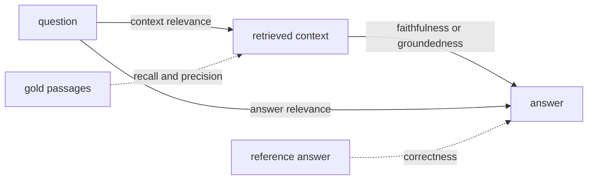
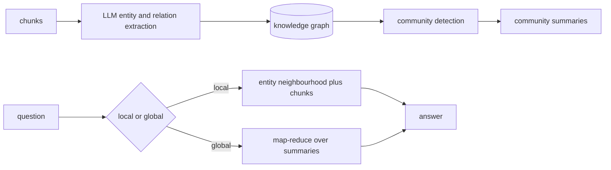

# Evaluating RAG; GraphRAG and agentic RAG

> **Before this lesson:** you should know the full RAG pipeline: ingestion and chunking
> ([Ingestion, parsing and chunking strategies](#/lesson/llm-practice/ingestion-chunking)) and
> hybrid retrieval, reranking and citations
> ([Hybrid retrieval, fusion, reranking and grounded generation](#/lesson/llm-practice/hybrid-retrieval-reranking)).
> Recall@k, precision and MRR were introduced in
> [Embeddings and similarity](#/lesson/llm-practice/embeddings-similarity) and are revisited here.

## In plain words

Building a RAG system takes a day; knowing whether it works takes discipline. **Evaluation** means
measuring quality with numbers on a fixed set of test questions, so that every change (a new chunk
size, a new model, a new prompt) can be judged as better or worse instead of "it feels better". The
key idea of this lesson is to measure the *search* step and the *writing* step separately, because
they fail for different reasons and are fixed in different ways.

Think of a student who gets an exam question wrong in an open-book exam. Either they looked in the
wrong chapter (a search failure) or they found the right page and misread it, or added things that
were not there (a writing failure). A good teacher checks which, because the remedy is different:
"learn to use the index" versus "read more carefully". The second half of the lesson looks at two
advanced designs: GraphRAG, which builds a map of who-relates-to-what across all documents, and
agentic RAG, where the model decides for itself when and what to search.

Why it matters for a job: "Your RAG bot gives wrong answers; how do you debug it?" is perhaps the
single most common applied-LLM interview question. Teams that ship RAG to customers live or die by
their evaluation sets.

## Two places to fail

A RAG system has two places to fail: retrieval can miss the right passage, or generation can ignore,
misread or embellish it. If you only measure the final answer you cannot tell which, and you will tune
the wrong knob. This lesson builds a component-wise evaluation **harness** (a reusable program that
runs the system over test questions and scores it), using RAGAS-style metrics computed by hand so you
know what they mean. **RAGAS** is a popular open-source library of RAG metrics. Then it surveys the
advanced architectures: GraphRAG and agentic RAG. The AI Engineering track covers evaluation
methodology in general (AI-as-judge, rubric design, benchmarks); here we apply it to retrieval
pipelines.

## 1. The RAG triad

Three things can be compared pairwise: the question, the retrieved context and the answer. Each pair
gives one check, together called the **RAG triad**. Two extra checks become possible when you also
have labelled **gold** data (the known correct passages, or a reference answer written by a person).



| metric | question it answers | needs |
|---|---|---|
| context recall | did we retrieve the passages needed? | gold passages or reference answer |
| context precision | are the retrieved passages relevant, and ranked high? | relevance labels (human or LLM) |
| faithfulness / groundedness | is every claim in the answer supported by the context? | answer + context |
| answer relevance | does the answer address the question? | question + answer |
| answer correctness | does it match the reference? | reference answer |

RAGAS, TruLens, DeepEval, Arize Phoenix and LangSmith all implement variants of these, mostly with an
**LLM judge** underneath (a language model prompted to grade an output against a rubric, a written
set of scoring rules). Understand the definitions before trusting their numbers.

## 2. Retrieval metrics (no LLM needed)

Given a ranked list of retrieved ids and a set of relevant ids, the following metrics need nothing but
counting. In the formulas, $\cap$ means "the items in both sets" and $|\cdot|$ means "how many":

- **Recall@k** $= |\text{relevant} \cap \text{top-}k| / |\text{relevant}|$: what share of the relevant
  items made it into the top $k$.
- **Precision@k** $= |\text{relevant} \cap \text{top-}k| / k$: what share of the top $k$ is relevant.
- **Hit rate@k**: 1 if any relevant item is in the top $k$, else 0.
- **MRR**: mean over queries of $1/\text{rank}$ of the first relevant item.
- **nDCG@k** (normalised discounted cumulative gain): each relevant item earns its **graded
  relevance** (for example 3 for "answers the question", 1 for "related"), divided by $\log_2$ of its
  position plus one, so items lower down earn less (the "discount"). The total is divided by the
  best possible total, the score of the ideal ordering, so 1.0 means perfect.
- **Context precision (RAGAS-style)**: the mean of precision@i taken at every rank $i$ where a relevant
  chunk appears, in other words **average precision**, which rewards putting relevant chunks first.

```python-run
import numpy as np

def recall_at_k(ranked, rel, k): return len(set(ranked[:k]) & rel) / len(rel)
def precision_at_k(ranked, rel, k): return len(set(ranked[:k]) & rel) / k
def mrr(ranked, rel):
    for i, d in enumerate(ranked, 1):
        if d in rel: return 1 / i
    return 0.0
def avg_precision(ranked, rel, k):
    hits, s = 0, 0.0
    for i, d in enumerate(ranked[:k], 1):
        if d in rel:
            hits += 1; s += hits / i
    return s / max(1, min(len(rel), k)) if hits else 0.0
def ndcg(ranked, grades, k):
    dcg = sum(grades.get(d, 0) / np.log2(i + 1) for i, d in enumerate(ranked[:k], 1))
    ideal = sorted(grades.values(), reverse=True)[:k]
    idcg = sum(g / np.log2(i + 1) for i, g in enumerate(ideal, 1))
    return dcg / idcg if idcg else 0.0

ranked = ["c7", "c2", "c9", "c4", "c1"]
rel = {"c2", "c4", "c8"}
print("recall@5", recall_at_k(ranked, rel, 5), " precision@5", precision_at_k(ranked, rel, 5))
print("MRR", mrr(ranked, rel), " AP@5", round(avg_precision(ranked, rel, 5), 3))
print("nDCG@5", round(ndcg(ranked, {"c2": 3, "c4": 2, "c8": 3}, 5), 3))
```

Working the example by hand is the best way to own these metrics. The retrieved list is
`c7, c2, c9, c4, c1` and the relevant set is `{c2, c4, c8}`.

- Two of the three relevant chunks (`c2`, `c4`) appear in the top 5, so recall@5 is $2/3 \approx 0.667$;
  two of the five returned chunks are relevant, so precision@5 is $2/5 = 0.4$.
- The first relevant chunk is at rank 2, so the reciprocal rank (MRR for this one query) is $0.5$.
- Average precision: at rank 2 the precision so far is $1/2$; at rank 4 it is $2/4$. Their sum, $1.0$,
  is divided by the number of relevant items that could have been found, 3, giving $0.333$. The missing
  `c8` drags the score down.
- nDCG: the list earns $3/\log_2 3 + 2/\log_2 5 \approx 2.75$; the ideal list (`c2`, `c8`, `c4` with
  grades 3, 3, 2 in the top three slots) would earn about $5.89$; the ratio is $0.467$.

In the code, `enumerate(ranked, 1)` numbers positions from 1, and `set(ranked[:k]) & rel` is the
intersection of the top $k$ with the relevant set. `max(1, ...)` in `avg_precision` avoids dividing by
zero.

These are cheap, **deterministic** (the same input always gives the same score) and fast enough to run
on every **commit** (every saved code change). Retrieval recall at the depth you feed the reranker (say
recall@50) is the ceiling for the whole system: no reranker or LLM can use a passage that was never
retrieved.

## 3. Building the evaluation set

An **evaluation set** (eval set) is the fixed list of test questions, each with its expected passages
and answer, that every version of the system is scored on. It is the most valuable asset in a RAG
project, and it is built in five steps:

1. **Collect real questions** from logs, support tickets or subject experts. 50 to 200 well-chosen
   questions beat 5,000 **synthetic** ones (questions generated by a model rather than asked by people).
2. **Label gold passages** (chunk ids) and a reference answer for each. Use stable chunk ids so labels
   survive re-chunking, or label at the document/section level.
3. **Augment synthetically**: have an LLM read a chunk and write a question it answers (and harder
   **multi-hop** ones, which need facts from two chunks combined, from two chunks). Filter out
   questions that copy the chunk's wording almost word for word (they are too easy for keyword search
   and flatter the system), and spot-check by hand.
4. **Include negative cases**: questions the corpus cannot answer, where the right behaviour is "I
   don't know", and adversarial ones (prompt injection inside documents, module 10).
5. **Slice** by question type, document type and difficulty so a regression in "tables" is not
   averaged away. A **slice** is a subset of the eval set sharing one property; reporting scores per
   slice shows *where* quality changed.

## 4. Generation metrics with an LLM judge

Retrieval can be scored by counting, but judging whether a written answer is supported needs reading
comprehension, so these metrics use an LLM as the judge.

**Faithfulness** (RAGAS definition): decompose the answer into **atomic claims** (the smallest
statements that are each true or false on their own) with an LLM, then check each claim against the
context; score = supported claims / total claims. The demo replaces the LLM with a crude word-matching
rule so you can watch the arithmetic:

```python-run
# A mock judge to show the computation; in practice judge() is an LLM call with a strict rubric.
context = "LoRA freezes the pretrained weights and trains low-rank matrices A and B. Typical ranks are 8 to 64."
answer_claims = [
    "LoRA freezes the pretrained weights.",
    "LoRA trains low-rank matrices.",
    "LoRA typically uses rank 512.",
    "LoRA was invented in 2021.",
]
def judge(claim, ctx):     # toy: supported if all content words appear in the context
    words = [w.strip(".").lower() for w in claim.split() if len(w) > 3]
    return all(w in ctx.lower() for w in words)
verdicts = [judge(c, context) for c in answer_claims]
for c, v in zip(answer_claims, verdicts):
    print(("SUPPORTED  " if v else "UNSUPPORTED"), c)
print("faithfulness =", sum(verdicts) / len(verdicts))
```

The toy `judge` keeps the words longer than three letters, strips full stops, and calls a claim
supported only if every such word occurs in the context. The first two claims pass; "rank 512" fails
because "512" is not in the context; "invented in 2021" fails because neither "invented" nor "2021"
is. Two of four claims are supported, so faithfulness is 0.5. A real LLM judge would understand
paraphrases ("keeps the weights fixed" for "freezes the weights") that this toy rejects.

Note the last claim may be *true* yet still unfaithful: it is not in the context. Faithfulness measures
grounding, not truth; correctness against a reference measures truth.

**Answer relevance** (RAGAS): have the LLM generate a few questions that the answer would answer, embed
them, and average their cosine similarity to the real question. Evasive or off-topic answers score low,
because the questions they would answer differ from the one that was asked.

**Making judges trustworthy**: a judge is itself a model and can be wrong, biased or inconsistent. Use
a strong model, a precise rubric with examples, binary or three-level scores instead of 1 to 10 (people
and models both use long scales inconsistently), ask for reasoning before the verdict, randomise order
in **pairwise comparisons** (where the judge picks the better of two answers, and tends to favour
whichever comes first), and **calibrate against 50 to 100 human labels**: have people grade the same
answers and report how often the judge agrees with them. Re-check whenever you change the judge model.

## 5. Diagnosing with the triad

The payoff of measuring each stage separately is that the pattern of scores points at the broken
part. Read the table row by row as "if you see this, look here first":

| symptom | likely culprit | fix |
|---|---|---|
| low context recall | parsing, chunking, embedder, missing hybrid, query phrasing | fix ingestion, add BM25, query rewriting, bigger k |
| good recall, low precision | ranking | add or improve reranker, metadata filters |
| good context, low faithfulness | generation | stronger prompt (quote-then-answer), lower temperature, better model, fewer passages |
| faithful but wrong | stale or conflicting documents | freshness metadata, dedupe, conflict instructions |
| relevant answer, low correctness on unanswerables | over-answering | explicit refusal instructions and tests |

## 6. Evaluation in practice (static)

```python
# RAGAS-style run (API names vary across versions; check the docs of the version you install)
from ragas import evaluate, EvaluationDataset
from ragas.metrics import Faithfulness, ResponseRelevancy, LLMContextPrecisionWithReference, LLMContextRecall

rows = [{"user_input": q, "retrieved_contexts": ctxs, "response": ans, "reference": ref}
        for q, ctxs, ans, ref in run_pipeline_over(eval_questions)]
result = evaluate(EvaluationDataset.from_list(rows),
                  metrics=[Faithfulness(), ResponseRelevancy(), LLMContextPrecisionWithReference(), LLMContextRecall()],
                  llm=judge_llm, embeddings=judge_embeddings)
print(result.to_pandas().groupby("question_type").mean(numeric_only=True))
```

What the sketch does: `run_pipeline_over` (your own function) runs the RAG system on every eval
question and yields the question, the retrieved passages, the answer and the reference answer. Each
row is a dictionary with the field names RAGAS expects. `evaluate` scores every row with four metrics
(faithfulness, answer relevance, and LLM-judged context precision and recall), using `judge_llm` as
the grading model and `judge_embeddings` for the similarity-based metric. The last line turns the
results into a pandas table and averages each metric per question type, which is slicing in practice.

Run retrieval metrics on every change; run judge-based metrics nightly or before releases; **gate**
merges (block a code change from being accepted) on regressions beyond a threshold (module 10 covers
evals in CI).

## 7. GraphRAG

Vector RAG retrieves **local** facts well (facts that sit in one or two passages) but struggles with
**global** questions ("what are the main themes across these 5,000 reports?") and multi-hop relations
("which suppliers of our top customer had incidents?"). No single chunk contains those answers.
**GraphRAG** (Microsoft Research, 2024) adds structure. Some vocabulary first: an **entity** is a
named thing (a person, company, product, place); a **relationship** links two entities ("supplies",
"works for"); a **knowledge graph** stores entities as nodes and relationships as edges; and a
**community** is a group of entities more densely linked to each other than to the rest of the graph.

1. **Extract** entities and relationships from every chunk with an LLM (plus claims and descriptions).
2. **Build a knowledge graph**, merge duplicate entities ("ACME Corp" and "ACME" are one company).
3. **Detect communities** hierarchically (the Leiden algorithm finds groups, then groups of groups) and
   have an LLM write a **summary of each community** at each level.
4. Query in two modes:
   - **Local search**: find entities related to the query, gather their neighbourhoods, relationships
     and source chunks.
   - **Global search**: **map-reduce** over community summaries to answer corpus-wide questions. In
     the "map" step the LLM answers the question from each summary separately; in the "reduce" step it
     combines those partial answers into one.



Trade-offs: indexing is expensive (LLM calls over the whole corpus), extraction quality varies, and the
graph must be maintained as documents change. Lighter variants (LightRAG, LazyGraphRAG) cut indexing
cost. Use it when relationships and corpus-level synthesis matter; plain hybrid RAG is better for
look-up questions. If your data is already a graph or a database, consider **text-to-SQL / text-to-
Cypher** tools instead of extraction: the LLM writes a database query (SQL for tables, Cypher for
graph databases such as Neo4j) and the database returns exact answers.

## 8. Agentic RAG

An **agent** is an LLM that works in a loop: it decides on an action (such as calling a tool), sees
the result, and decides the next action, until it judges the task done. A **tool** is a function your
program exposes to the model, described by a name and a short explanation (lesson 15 covers both in
depth).

Classic RAG retrieves once, up front. **Agentic RAG** gives the model retrieval as a **tool** and lets
it decide when, what and how often to search:

- decompose a complex question, search for each part, notice gaps, search again;
- choose between sources (vector index, SQL database, web search, an API) by tool descriptions;
- verify its own draft against fresh retrievals before answering;
- stop when it has enough evidence.

```python
# smolagents-style sketch (module 7 covers agents in depth)
from smolagents import CodeAgent, InferenceClientModel, tool

@tool
def search_kb(query: str, top_k: int = 5) -> str:
    """Search the internal knowledge base and return numbered passages with sources.
    Args:
        query: a focused search query; rephrase and retry if results look irrelevant.
        top_k: number of passages to return (max 10).
    """
    hits = hybrid_search(query, k=top_k)
    return "\n".join(f"[{i}] ({h.source}) {h.text}" for i, h in enumerate(hits, 1))

agent = CodeAgent(tools=[search_kb], model=InferenceClientModel("Qwen/Qwen3-32B"), max_steps=6)
agent.run("Compare our 2025 and 2026 parental leave policies and cite sources.")
```

How the sketch works: the `@tool` **decorator** (a line starting with `@` that wraps the function
below it) registers `search_kb` as a tool. smolagents reads the type hints (`query: str`) and the
**docstring** (the text in triple quotes) to describe the tool to the model, so the `Args:` section is
written for the model to read: it even tells the model to rephrase and retry on poor results. The
function returns numbered passages so the model can cite them. `CodeAgent` is a smolagents agent that
acts by writing short Python snippets that call its tools; `max_steps=6` caps how many rounds it may
take, a vital guard against runaway loops and bills. `agent.run(...)` gives it the task.

Related patterns: **Self-RAG** (the model emits reflection tokens deciding whether to retrieve and
whether passages support its output), **Corrective RAG** (grade retrieved documents and fall back to
web search when they are poor), **adaptive RAG** (route easy questions to no-retrieval or single-shot
paths). Agentic RAG costs more tokens and latency and is harder to evaluate, so measure it against a
well-tuned single-shot pipeline before adopting it. Claude Code's own design is a notable data point:
it explores codebases with tools like grep and file reads ("just-in-time" retrieval, module 9) rather
than a pre-built vector index.

> [!INTERVIEW]
> **"Your RAG bot gives wrong answers. How do you debug it?"** Split the failure: measure retrieval
> (recall@k against gold passages) separately from generation (faithfulness given the retrieved
> context). If the right passage is not retrieved, fix parsing, chunking, hybrid search, query
> rewriting. If it is retrieved but ranked low, add a reranker. If it is in context but the answer is
> unfaithful, fix the prompt, ordering, model or temperature. Back every change with a labelled eval
> set, sliced by question type, with judge metrics calibrated against human labels.

## Summary

- Evaluate retrieval and generation separately: context recall/precision, faithfulness, answer
  relevance, correctness.
- Retrieval metrics (recall@k, MRR, nDCG, AP) are cheap and deterministic; recall at reranker depth caps
  the system.
- LLM-judge metrics need precise rubrics and human calibration; faithfulness is grounding, not truth.
- GraphRAG adds entity graphs and community summaries for multi-hop and global questions at high
  indexing cost.
- Agentic RAG turns retrieval into a tool the model calls iteratively; powerful, costlier, harder to
  evaluate.

## Glossary

- **Evaluation set**: the fixed list of test questions with expected passages and answers.
- **Gold passages / reference answer**: the known correct chunks / a person-written correct answer.
- **RAG triad**: context relevance, faithfulness and answer relevance, the three pairwise checks.
- **Context recall / context precision**: did retrieval find what was needed / is what it found
  relevant and ranked high.
- **Faithfulness (groundedness)**: the share of an answer's claims supported by the retrieved context.
- **Answer relevance / correctness**: does the answer address the question / does it match the
  reference.
- **Hit rate@k / nDCG / average precision**: any relevant item in the top $k$ / a graded,
  position-discounted score / mean precision at each relevant hit.
- **LLM judge / rubric**: a model that grades outputs / the written scoring rules it follows.
- **Calibration**: checking how often a judge agrees with human labels.
- **Synthetic question / multi-hop question**: one written by a model / one needing facts from several
  passages.
- **Slice**: a subset of the eval set sharing one property, scored separately.
- **Atomic claim**: the smallest statement that is true or false on its own.
- **Entity / knowledge graph / community**: a named thing / entities linked by relationships / a densely
  linked group of entities.
- **GraphRAG / map-reduce**: graph-based RAG with community summaries / answer per part, then combine.
- **Agent / agentic RAG**: an LLM acting in a loop / RAG where the model calls retrieval as a tool.

## Check yourself

```quiz
[
  {"q": "Retrieved: [c7, c2, c9, c4, c1]; relevant: {c2, c4, c8}. What is recall@5?",
   "options": ["2/3", "2/5", "1/2", "1"], "answer": 0,
   "explain": "Two of the three relevant chunks appear in the top 5."},
  {"q": "In the same example, what is the MRR contribution of this query?",
   "options": ["0.5", "1", "0.25", "0.2"], "answer": 0,
   "explain": "The first relevant item, c2, is at rank 2, so the reciprocal rank is 1/2."},
  {"q": "An answer states a true fact that is not in the retrieved context. Its faithfulness is...",
   "options": ["Reduced, because faithfulness measures support by the context, not truth", "Unaffected", "Increased", "Undefined"], "answer": 0,
   "explain": "Unsupported claims count against faithfulness even if they happen to be correct."},
  {"q": "High context recall but low faithfulness points to a problem in...",
   "options": ["Generation", "Chunking", "Embedding model", "BM25"], "answer": 0,
   "explain": "The right information reached the model, which then failed to stick to it."},
  {"q": "Which question type motivates GraphRAG's global search?",
   "options": ["Corpus-wide themes or summaries across many documents", "Looking up a single error code", "Spelling correction", "Translating a sentence"], "answer": 0,
   "explain": "Community summaries let map-reduce answer questions no single chunk covers."},
  {"q": "What best defines agentic RAG?",
   "options": ["The model calls retrieval as a tool, deciding when and what to search iteratively", "Retrieving once before generation", "Fine-tuning on the corpus", "Using a bigger embedding model"], "answer": 0,
   "explain": "Retrieval becomes part of an agent loop rather than a fixed preprocessing step."},
  {"q": "What is the most important step to make an LLM judge trustworthy?",
   "options": ["Calibrate its verdicts against a set of human labels", "Use a 1-10 scale", "Use the same model as the generator", "Set temperature to 1"], "answer": 0,
   "explain": "Agreement with humans on a sample is the evidence that the judge measures what you think."}
]
```

> **Source:** RAGAS docs, metrics definitions (https://docs.ragas.io); Edge et al., "From Local to
> Global: A GraphRAG Approach to Query-Focused Summarization" (Microsoft, 2024); Asai et al. 2023
> (Self-RAG); Yan et al. 2024 (Corrective RAG); Hugging Face Agents Course, agentic RAG unit
> (https://huggingface.co/learn/agents-course); Huyen, *AI Engineering*, ch. 3 and 4 (evaluation, AI as a
> judge) and ch. 6 (evaluating retrieval: context precision and recall).
