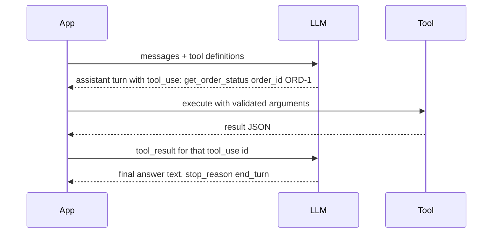

# Function calling: schemas, the tool loop and parsing

An LLM on its own can only emit text. **Tool use** (function calling) lets it act: query a database,
call an API, run code, read a file. The model does not execute anything; it emits a structured
**request** to call a named tool with JSON arguments, your code executes it, and you feed the result
back. Everything in agents (this module), MCP (module 8) and context engineering (module 9) rests on
this loop, so we build it carefully.

## 1. The contract: a tool definition

Every major API describes a tool the same way: a **name**, a natural-language **description**, and a
**JSON Schema** for its input.

```json
{
  "name": "get_order_status",
  "description": "Look up the shipping status of a customer order by its order id. Use this when the user asks where their order is. Returns status, carrier and ETA. Does not work for refunds.",
  "input_schema": {
    "type": "object",
    "properties": {
      "order_id": {"type": "string", "description": "Order id like 'ORD-12345'"},
      "include_items": {"type": "boolean", "description": "Also return line items", "default": false}
    },
    "required": ["order_id"],
    "additionalProperties": false
  }
}
```

(Anthropic's Messages API calls the field `input_schema`; OpenAI's uses `parameters` inside a
`function` object; MCP uses `inputSchema`. The schema itself is the same JSON Schema.)

The description is **prompt engineering**: the model decides *whether* and *how* to call the tool
mostly from it. Good descriptions say what the tool does, when to use it (and when not), what each
parameter means with examples and formats, and what comes back. Anthropic's guidance is to write them
as you would for a new colleague, often three or four sentences or more for non-trivial tools.

## 2. The loop



With the Anthropic Python SDK (static code):

```python
import anthropic, json
client = anthropic.Anthropic()

tools = [{
    "name": "get_order_status",
    "description": "Look up the shipping status of an order by id. Returns status, carrier and ETA.",
    "input_schema": {"type": "object", "properties": {"order_id": {"type": "string"}},
                     "required": ["order_id"]},
}]
HANDLERS = {"get_order_status": lambda order_id: {"status": "shipped", "carrier": "DHL", "eta": "2026-11-22"}}

messages = [{"role": "user", "content": "Where is my order ORD-1?"}]
while True:
    resp = client.messages.create(model="claude-sonnet-4-5", max_tokens=1024, tools=tools, messages=messages)
    messages.append({"role": "assistant", "content": resp.content})     # keep the tool_use blocks!
    if resp.stop_reason != "tool_use":
        break
    results = []
    for block in resp.content:
        if block.type == "tool_use":
            try:
                out = HANDLERS[block.name](**block.input)
                results.append({"type": "tool_result", "tool_use_id": block.id, "content": json.dumps(out)})
            except Exception as e:
                results.append({"type": "tool_result", "tool_use_id": block.id,
                                "content": f"Error: {e}", "is_error": True})
    messages.append({"role": "user", "content": results})
print(resp.content[-1].text)
```

(Model ids change; check your provider's current model list. Anthropic's SDK also offers a tool
runner helper that runs this loop for you.)

Key details that trip people up:

- **Append the assistant message containing the tool calls** before the results; results reference
  the call by id (`tool_use_id`, or `tool_call_id` in OpenAI's format).
- A single model turn can contain **several parallel tool calls**. Execute them (concurrently if
  independent) and return all results in the next message.
- **Return errors as results** (with `is_error: true`) so the model can recover, e.g. retry with a
  corrected argument. Raising an exception and killing the loop wastes the model's ability to adapt.
- **Cap iterations** (e.g. 10 to 25 steps) and total tokens; log every call.
- `tool_choice` controls whether the model may (`auto`), must (`any`), must use a specific tool, or
  must not (`none`) call tools. Forcing a specific tool is a classic way to get structured output.

## 3. Validate before you execute

The model's arguments are **untrusted input**. Even with schema-constrained decoding, validate types,
ranges, enums, and business rules (does this user own this order?) before executing. JSON Schema
validation in Python is one call with the `jsonschema` package; this module's
`llm-json-schema-validate` problem has you implement the core subset yourself:

```python-run
def validate(value, schema, path="$"):
    errs = []
    t = schema.get("type")
    checks = {"object": dict, "array": list, "string": str, "boolean": bool}
    if t == "integer":
        ok = isinstance(value, int) and not isinstance(value, bool)
    elif t == "number":
        ok = isinstance(value, (int, float)) and not isinstance(value, bool)
    elif t in checks:
        ok = isinstance(value, checks[t])
    else:
        ok = True
    if not ok:
        return [f"{path}: expected {t}"]
    if "enum" in schema and value not in schema["enum"]:
        errs.append(f"{path}: not in enum")
    if t == "object":
        props = schema.get("properties", {})
        for r in schema.get("required", []):
            if r not in value:
                errs.append(f"{path}.{r}: required")
        for k, v in value.items():
            if k in props:
                errs += validate(v, props[k], f"{path}.{k}")
            elif schema.get("additionalProperties") is False:
                errs.append(f"{path}.{k}: unexpected")
    if t in ("integer", "number"):
        if "minimum" in schema and value < schema["minimum"]: errs.append(f"{path}: below minimum")
        if "maximum" in schema and value > schema["maximum"]: errs.append(f"{path}: above maximum")
    if t == "array" and "items" in schema:
        for i, item in enumerate(value):
            errs += validate(item, schema["items"], f"{path}[{i}]")
    return errs

schema = {"type": "object", "required": ["city", "days"], "additionalProperties": False,
          "properties": {"city": {"type": "string"}, "days": {"type": "integer", "minimum": 1, "maximum": 14},
                         "units": {"type": "string", "enum": ["metric", "imperial"]}}}
print(validate({"city": "Oslo", "days": 3}, schema))
print(validate({"city": "Oslo", "days": 30, "units": "kelvin", "debug": True}, schema))
print(validate({"days": "3"}, schema))
```

Feed these messages back to the model as a tool error: it will usually fix the call on the next turn.

## 4. How function calling works inside the model

Under the hood there is no magic channel. The chat template (module 2) renders the tool schemas into
the prompt, typically in a system section, and the model was post-trained to emit calls in a specific
textual format, for example Hermes/Qwen style:

```text
<tool_call>
{"name": "get_order_status", "arguments": {"order_id": "ORD-1"}}
</tool_call>
```

Llama 3.1 emits JSON (or `<|python_tag|>` for built-ins), Mistral uses `[TOOL_CALLS]`, and hosted APIs
parse their internal format into structured `tool_use` blocks for you. When you serve open models
yourself, a **tool-call parser** (e.g. vLLM's `--tool-call-parser hermes`) extracts these blocks from
the generated text. Writing a robust one is this module's `llm-tool-call-parser` problem:

```python-run
import json, re

def parse_tool_calls(text):
    calls = []
    for raw in re.findall(r"<tool_call>(.*?)</tool_call>", text, re.S):
        try:
            obj = json.loads(raw.strip())
            calls.append({"name": obj["name"], "arguments": obj.get("arguments", {})})
        except (json.JSONDecodeError, KeyError, TypeError):
            calls.append({"name": None, "error": "malformed", "raw": raw.strip()})
    content = re.sub(r"<tool_call>.*?</tool_call>", "", text, flags=re.S).strip()
    return content, calls

out = ('Let me check both.\n<tool_call>\n{"name": "get_weather", "arguments": {"city": "Oslo"}}\n</tool_call>\n'
       '<tool_call>{"name": "get_weather", "arguments": {"city": "Bergen"}</tool_call>')
content, calls = parse_tool_calls(out)
print(repr(content))
for c in calls:
    print(c)
```

The second call is missing a closing brace: a malformed call should be reported back to the model, not
silently dropped.

**Constrained decoding** (grammar-guided generation with tools like Outlines, XGrammar or
llguidance, and "strict" modes in hosted APIs) masks invalid tokens at each step so the arguments are
guaranteed to parse and match the schema. It removes syntax errors, not semantic ones.

## 5. Tool design principles (preview of module 9)

- **Few, well-separated tools** beat many overlapping ones. If a human engineer could not say which
  tool to use, neither can the model.
- **Consolidate workflows**: one `schedule_meeting` tool that finds availability and books is better
  than three primitive calls the model must chain.
- **Namespacing**: prefix related tools (`github_create_issue`, `jira_create_issue`) when many sources
  coexist.
- **Return meaningful, compact results**: names rather than opaque UUIDs, only the fields the model
  needs, paginated or truncated with a note on how to get more.
- **Actionable errors**: "date must be in the future; today is 2026-11-20" beats "400 Bad Request".
- **Poka-yoke the interface**: make mistakes hard (absolute paths instead of relative ones, enums
  instead of free text, ids validated server-side).

## 6. Security: tools are where prompt injection bites

A tool call executes with *your* credentials, triggered by a model that may have just read
attacker-controlled text (a web page, an email, a document). Treat it accordingly:

- least privilege per tool (read-only tokens, scoped API keys, row-level authorisation in the tool),
- human confirmation for consequential actions (send, pay, delete, deploy),
- never let model output flow unescaped into shells, SQL or HTML,
- sandbox code execution (containers, no network by default),
- log every call with arguments and results for audit.

Module 10 develops these defences.

> [!INTERVIEW]
> **"Walk me through the function-calling loop and its failure modes."** Send messages plus tool
> schemas; the model returns tool-use blocks with ids and JSON arguments; validate and execute them
> (parallel calls allowed); append the assistant turn and the tool results keyed by id; repeat until
> the model ends its turn, with a step cap. Failure modes: malformed or hallucinated arguments (validate,
> return actionable errors), wrong tool choice (better descriptions, fewer tools), infinite loops (caps,
> loop detection), oversized results flooding context (truncate, paginate), and injection via tool
> results (least privilege, confirmations).

## Summary

- A tool = name + description + JSON Schema; the description is prompt engineering.
- The loop: model proposes calls, your code validates and executes, results return keyed by id, repeat.
- Return errors to the model, support parallel calls, cap steps.
- Open models emit calls as text in a family-specific format; servers parse it; constrained decoding
  guarantees syntax.
- Design few, clear, consolidated tools with compact results and actionable errors; secure them with
  least privilege and confirmations.

```quiz
[
  {"q": "Who executes the function in LLM function calling?",
   "options": ["Your application code, after the model proposes the call", "The model provider automatically", "The tokenizer", "The vector database"], "answer": 0,
   "explain": "The model only emits a structured request; execution happens in your code (unless you use a provider-hosted tool)."},
  {"q": "The model emits two tool_use blocks in one turn. What should you send back?",
   "options": ["Both results, each tagged with its tool_use id, in the next user message", "Only the first result", "A new system prompt", "Nothing until both finish separately in two turns"], "answer": 0,
   "explain": "Parallel calls are answered together, matched by id."},
  {"q": "A tool raises an exception because the date argument is malformed. Best practice?",
   "options": ["Return the error text as a tool result marked is_error so the model can retry", "Crash the loop", "Silently return an empty result", "Retry the same call forever"], "answer": 0,
   "explain": "Actionable errors let the model self-correct."},
  {"q": "What does constrained (grammar-guided) decoding guarantee for tool arguments?",
   "options": ["Syntactically valid JSON that matches the schema", "Correct business logic", "That the right tool is chosen", "Lower latency always"], "answer": 0,
   "explain": "It masks invalid tokens but cannot ensure the values are semantically right."},
  {"q": "Which tool set is easiest for a model to use correctly?",
   "options": ["A few clearly distinct tools with detailed descriptions", "Dozens of overlapping tools", "One tool per HTTP endpoint", "Tools with one-word descriptions"], "answer": 0,
   "explain": "Ambiguity between tools is a leading cause of wrong tool selection."},
  {"q": "How do open-weight models usually express a tool call?",
   "options": ["As text in a trained format such as <tool_call>JSON</tool_call>, parsed by the server", "Through a special GPU instruction", "By calling Python directly", "Via embeddings"], "answer": 0,
   "explain": "The chat template renders schemas into the prompt, and a parser extracts calls from the output."},
  {"q": "Why validate tool arguments even when the model was given a schema?",
   "options": ["Model output is untrusted input and may violate the schema or business rules", "It is required by JSON", "To reduce tokens", "To speed up the model"], "answer": 0,
   "explain": "Validation protects against both mistakes and injected malicious arguments."}
]
```

> **Source:** Anthropic docs, "Tool use with Claude" (https://docs.claude.com/en/docs/agents-and-tools/tool-use/overview);
> Anthropic Engineering, "Writing effective tools for agents" (https://www.anthropic.com/engineering/writing-tools-for-agents);
> Transformers docs, "Tool use" in chat templates (https://huggingface.co/docs/transformers/chat_extras);
> vLLM tool-calling docs; JSON Schema 2020-12 (https://json-schema.org); Huyen, *AI Engineering*, ch. 6
> "Agents" (tools, function calling).
