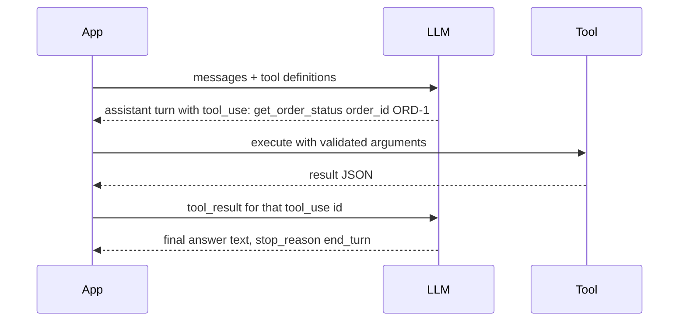

# Function calling: schemas, the tool loop and parsing

> **Before this lesson:** you should know how a chat model receives a list of messages with roles and
> how the chat template renders them, including tool definitions
> ([Special tokens, chat templates and tokenizer pitfalls](#/lesson/llm-practice/special-tokens-chat-templates)).
> Basic Python dictionaries, lists, `try`/`except` and regular expressions are used in the code. No
> earlier agent lesson is needed: this is the first lesson of the agents module.

## In plain words

A language model can only write text. It cannot look up today's order status, read your calendar or
send an email. **Function calling** (also called **tool use**) bridges that gap: you tell the model
which functions exist, and when it needs one it writes a short, structured request such as "call
`get_order_status` with order id ORD-1". Your program runs the function and passes the result back,
and the model continues with real data in hand.

Think of a manager who never leaves the office and an assistant who runs errands. The manager writes
a note, "check the warehouse for order 1", the assistant goes, comes back with the answer, and the
manager writes the reply to the customer. The manager never touches the warehouse; the assistant
never decides what to tell the customer. The model is the manager, your code is the assistant, and
the note follows a strict form so nothing is misread.

Why it matters for a job: every AI agent, coding assistant and "chat with your data" product is built
on this loop, and so is the Model Context Protocol of module 8. Interviewers ask candidates to walk
through the loop, explain what happens with parallel calls and errors, and say how to stop a tool
from being abused by malicious text.

## How tool use works in one paragraph

An LLM on its own can only emit text. **Tool use** (function calling) lets it act: query a database,
call an **API** (application programming interface: a set of functions another program offers over a
network), run code, read a file. The model does not execute anything; it emits a structured
**request** to call a named tool with **JSON** arguments (JSON is the plain-text data format of
`{"key": "value"}` objects and `[...]` lists), your code executes it, and you feed the result back.
Everything in agents (this module), MCP (module 8) and context engineering (module 9) rests on this
loop, so we build it carefully.

## 1. The contract: a tool definition

Every major API describes a tool the same way: a **name**, a natural-language **description**, and a
**JSON Schema** for its input. JSON Schema is a standard way of describing what a valid JSON object
looks like, written itself in JSON. Its main keywords: `type` (object, string, integer, number,
boolean, array), `properties` (the allowed fields and the schema of each), `required` (fields that
must be present), `enum` (a fixed list of allowed values), `minimum`/`maximum` for numbers, and
`additionalProperties: false` (no fields other than those listed).

```json
{
  "name": "get_order_status",
  "description": "Look up the shipping status of a customer order by its order id. Use this when the user asks where their order is. Returns status, carrier and ETA. Does not work for refunds.",
  "input_schema": {
    "type": "object",
    "properties": {
      "order_id": {"type": "string", "description": "Order id like 'ORD-12345'"},
      "include_items": {"type": "boolean", "description": "Also return line items", "default": false}
    },
    "required": ["order_id"],
    "additionalProperties": false
  }
}
```

(Anthropic's Messages API calls the field `input_schema`; OpenAI's uses `parameters` inside a
`function` object; MCP uses `inputSchema`. The schema itself is the same JSON Schema.)

Reading the example: the tool takes an object with a required string `order_id` and an optional
boolean `include_items` that defaults to `false`; no other fields are allowed. The description says
what the tool does, when to use it, what it returns and what it cannot do.

The description is **prompt engineering** (writing the text a model reads so that it behaves as you
want): the model decides *whether* and *how* to call the tool mostly from it. Good descriptions say what the tool does, when to use it (and when not), what each
parameter means with examples and formats, and what comes back. Anthropic's guidance is to write them
as you would for a new colleague, often three or four sentences or more for non-trivial tools.

## 2. The loop

The conversation between your app, the model and the tool goes round in a loop. Your app sends the
messages and tool definitions; the model replies with a **tool call** (in Anthropic's format a
`tool_use` block holding the tool name, the arguments and a unique **id**); your app runs the tool
and sends back a **tool result** that quotes the same id; the model either calls another tool or
writes its final answer. The sequence diagram shows one round:



With the Anthropic Python **SDK** (software development kit: the official library for calling the
API; static code, since it needs an API key):

```python
import anthropic, json
client = anthropic.Anthropic()

tools = [{
    "name": "get_order_status",
    "description": "Look up the shipping status of an order by id. Returns status, carrier and ETA.",
    "input_schema": {"type": "object", "properties": {"order_id": {"type": "string"}},
                     "required": ["order_id"]},
}]
HANDLERS = {"get_order_status": lambda order_id: {"status": "shipped", "carrier": "DHL", "eta": "2026-11-22"}}

messages = [{"role": "user", "content": "Where is my order ORD-1?"}]
while True:
    resp = client.messages.create(model="claude-sonnet-4-5", max_tokens=1024, tools=tools, messages=messages)
    messages.append({"role": "assistant", "content": resp.content})     # keep the tool_use blocks!
    if resp.stop_reason != "tool_use":
        break
    results = []
    for block in resp.content:
        if block.type == "tool_use":
            try:
                out = HANDLERS[block.name](**block.input)
                results.append({"type": "tool_result", "tool_use_id": block.id, "content": json.dumps(out)})
            except Exception as e:
                results.append({"type": "tool_result", "tool_use_id": block.id,
                                "content": f"Error: {e}", "is_error": True})
    messages.append({"role": "user", "content": results})
print(resp.content[-1].text)
```

(Model ids change; check your provider's current model list. Anthropic's SDK also offers a tool
runner helper that runs this loop for you.)

**Reading this code line by line**

- `tools` is the list of tool definitions, and `HANDLERS` maps each tool name to the Python function
  that really does the work (here a fake that always says "shipped").
- `messages` starts with the user's question. The `while True` loop keeps calling the model until it
  stops asking for tools.
- `client.messages.create(...)` sends the conversation and the tool list. The reply's `content` is a
  list of **blocks**: text blocks and `tool_use` blocks.
- The whole reply is appended to `messages` as an assistant turn, tool calls included. The API needs
  to see the call before it sees the result.
- `resp.stop_reason` says why the model stopped writing. `"tool_use"` means "I am waiting for tool
  results"; anything else (normally `"end_turn"`) means the answer is finished, so the loop breaks.
- For each `tool_use` block, `HANDLERS[block.name](**block.input)` calls the matching function with
  the model's arguments unpacked as keyword arguments. The result goes into a `tool_result` block
  carrying the same `tool_use_id`. If the function raises an exception, the error text is sent back
  instead, flagged with `is_error`.
- All results go back together as one user message, and the loop repeats. When it ends,
  `resp.content[-1].text` is the final answer.

Key details that trip people up:

- **Append the assistant message containing the tool calls** before the results; results reference
  the call by id (`tool_use_id`, or `tool_call_id` in OpenAI's format).
- A single model turn can contain **several parallel tool calls**. Execute them (**concurrently**,
  at the same time, if they do not depend on each other) and return all results in the next message.
- **Return errors as results** (with `is_error: true`) so the model can recover, e.g. retry with a
  corrected argument. Raising an exception and killing the loop wastes the model's ability to adapt.
- **Cap iterations** (e.g. 10 to 25 steps) and total tokens; log every call.
- `tool_choice` controls whether the model may (`auto`), must (`any`), must use a specific tool, or
  must not (`none`) call tools. Forcing a specific tool is a classic way to get structured output.

## 3. Validate before you execute

The model's arguments are **untrusted input**: data you did not produce and cannot assume is correct
or harmless. Even with schema-constrained decoding, validate types, ranges, enums, and **business
rules** (the application's own requirements, such as "does this user own this order?") before
executing. JSON Schema validation in Python is one call with the `jsonschema` package; this module's
`llm-json-schema-validate` problem has you implement the core subset yourself:

```python-run
def validate(value, schema, path="$"):
    errs = []
    t = schema.get("type")
    checks = {"object": dict, "array": list, "string": str, "boolean": bool}
    if t == "integer":
        ok = isinstance(value, int) and not isinstance(value, bool)
    elif t == "number":
        ok = isinstance(value, (int, float)) and not isinstance(value, bool)
    elif t in checks:
        ok = isinstance(value, checks[t])
    else:
        ok = True
    if not ok:
        return [f"{path}: expected {t}"]
    if "enum" in schema and value not in schema["enum"]:
        errs.append(f"{path}: not in enum")
    if t == "object":
        props = schema.get("properties", {})
        for r in schema.get("required", []):
            if r not in value:
                errs.append(f"{path}.{r}: required")
        for k, v in value.items():
            if k in props:
                errs += validate(v, props[k], f"{path}.{k}")
            elif schema.get("additionalProperties") is False:
                errs.append(f"{path}.{k}: unexpected")
    if t in ("integer", "number"):
        if "minimum" in schema and value < schema["minimum"]: errs.append(f"{path}: below minimum")
        if "maximum" in schema and value > schema["maximum"]: errs.append(f"{path}: above maximum")
    if t == "array" and "items" in schema:
        for i, item in enumerate(value):
            errs += validate(item, schema["items"], f"{path}[{i}]")
    return errs

schema = {"type": "object", "required": ["city", "days"], "additionalProperties": False,
          "properties": {"city": {"type": "string"}, "days": {"type": "integer", "minimum": 1, "maximum": 14},
                         "units": {"type": "string", "enum": ["metric", "imperial"]}}}
print(validate({"city": "Oslo", "days": 3}, schema))
print(validate({"city": "Oslo", "days": 30, "units": "kelvin", "debug": True}, schema))
print(validate({"days": "3"}, schema))
```

**Reading this code line by line**

- `path` tracks where in the object we are, written like `$.days` (`$` is the root). Every error
  message starts with it, so the model knows exactly which field is wrong.
- The first block checks the type. `integer` and `number` need care because in Python `True` is also
  an `int`, so booleans are explicitly excluded. The other types map to Python classes through
  `checks`. A wrong type returns immediately: there is no point checking the range of a string.
- `enum` is checked next, then, for objects, every `required` field, then every supplied field: known
  fields are validated **recursively** with their own sub-schema, and unknown fields are reported
  when `additionalProperties` is `False`.
- Numbers are checked against `minimum` and `maximum`; arrays have every item validated against
  `items`.
- Output, one line per test: the valid call gives `[]` (no errors). The second gives three errors:
  `days` is 30 (above 14), `units` is not one of the allowed values, and `debug` is not a known field.
  The third reports the missing `city` and that `days` is the string `"3"` rather than an integer, a
  very common model mistake.

Feed these messages back to the model as a tool error: it will usually fix the call on the next turn.

## 4. How function calling works inside the model

Under the hood there is no magic channel. The chat template (module 2) renders the tool schemas into
the prompt, typically in a system section, and the model was post-trained to emit calls in a specific
textual format, for example Hermes/Qwen style:

```text
<tool_call>
{"name": "get_order_status", "arguments": {"order_id": "ORD-1"}}
</tool_call>
```

Llama 3.1 emits JSON (or `<|python_tag|>` for built-ins), Mistral uses `[TOOL_CALLS]`, and hosted APIs
parse their internal format into structured `tool_use` blocks for you. When you serve open models
yourself, a **tool-call parser** (e.g. vLLM's `--tool-call-parser hermes`) extracts these blocks from
the generated text. Writing a robust one is this module's `llm-tool-call-parser` problem:

```python-run
import json, re

def parse_tool_calls(text):
    calls = []
    for raw in re.findall(r"<tool_call>(.*?)</tool_call>", text, re.S):
        try:
            obj = json.loads(raw.strip())
            calls.append({"name": obj["name"], "arguments": obj.get("arguments", {})})
        except (json.JSONDecodeError, KeyError, TypeError):
            calls.append({"name": None, "error": "malformed", "raw": raw.strip()})
    content = re.sub(r"<tool_call>.*?</tool_call>", "", text, flags=re.S).strip()
    return content, calls

out = ('Let me check both.\n<tool_call>\n{"name": "get_weather", "arguments": {"city": "Oslo"}}\n</tool_call>\n'
       '<tool_call>{"name": "get_weather", "arguments": {"city": "Bergen"}</tool_call>')
content, calls = parse_tool_calls(out)
print(repr(content))
for c in calls:
    print(c)
```

How the parser works: `re.findall(r"<tool_call>(.*?)</tool_call>", text, re.S)` returns the text
between every pair of tags. `.*?` is a **non-greedy** match (it stops at the first closing tag, so two
calls are not swallowed as one) and `re.S` lets `.` match newlines. Each piece is parsed with
`json.loads`; if parsing fails or the `name` key is missing, an error entry keeps the raw text so it
can be shown to the model. `re.sub(...)` removes the tool-call blocks to leave the ordinary text. The
output: the content `'Let me check both.'`, one good call for Oslo, and one `malformed` entry for
Bergen.

The second call is missing a closing brace: a malformed call should be reported back to the model, not
silently dropped.

**Constrained decoding** (grammar-guided generation with tools like Outlines, XGrammar or
llguidance, and "strict" modes in hosted APIs) masks invalid tokens at each step so the arguments are
guaranteed to parse and match the schema. Masking means setting a token's probability to zero, as the
top-k filter of lesson 6 does, but here the rule is "would this token break the JSON?". It removes
syntax errors, not **semantic** ones (errors of meaning, such as a valid-looking but wrong order id).

## 5. Tool design principles (preview of module 9)

- **Few, well-separated tools** beat many overlapping ones. If a human engineer could not say which
  tool to use, neither can the model.
- **Consolidate workflows**: one `schedule_meeting` tool that finds availability and books is better
  than three primitive calls the model must chain.
- **Namespacing**: prefix related tools (`github_create_issue`, `jira_create_issue`) when many sources
  coexist.
- **Return meaningful, compact results**: names rather than opaque UUIDs (random identifiers that mean
  nothing to a reader), only the fields the model needs, **paginated** (returned one page at a time) or
  truncated with a note on how to get more.
- **Actionable errors**: "date must be in the future; today is 2026-11-20" beats "400 Bad Request".
- **Poka-yoke the interface** (a Japanese manufacturing term for "mistake-proofing"): make mistakes
  hard (absolute paths instead of relative ones, enums instead of free text, ids validated
  server-side).

## 6. Security: tools are where prompt injection bites

A tool call executes with *your* **credentials** (the keys and passwords that grant access), triggered
by a model that may, moments earlier, have read attacker-controlled text (a web page, an email, a document). Text
that tries to steer the model this way is **prompt injection** (lesson 5 showed one form). Treat
every tool accordingly:

- **least privilege** per tool, meaning each tool gets only the access it needs (read-only tokens,
  scoped API keys, row-level authorisation in the tool),
- human confirmation for consequential actions (send, pay, delete, deploy),
- never let model output flow **unescaped** (inserted without neutralising special characters) into
  shells, SQL or HTML, where it could run as a command,
- **sandbox** code execution (run it in an isolated environment such as a container, with no network
  by default),
- log every call with arguments and results for **audit** (later review of who did what).

Module 10 develops these defences.

## 7. The whole loop, runnable, with a scripted model

The API code in section 2 needs a key. Here is the same control flow with a scripted stand-in for the
model, so you can run it and trace three behaviours at once: **parallel calls**, an **error that the
model recovers from**, and the **step cap**.

```python-run
import json

TOOLS = {
    "get_order": {"required": ["order_id"],
                  "fn": lambda order_id: {"id": order_id, "status": "shipped", "carrier": "DHL"} if order_id.startswith("ORD-")
                        else (_ for _ in ()).throw(ValueError("order_id must look like 'ORD-12345'"))},
    "get_weather": {"required": ["city"], "fn": lambda city: {"city": city, "temp_c": 3}},
}

SCRIPT = iter([   # what a real model would emit turn by turn
    {"text": "I'll look up both.", "calls": [{"id": "c1", "name": "get_order", "input": {"order_id": "12345"}},
                                             {"id": "c2", "name": "get_weather", "input": {"city": "Oslo"}}]},
    {"text": "The id needs a prefix; retrying.", "calls": [{"id": "c3", "name": "get_order", "input": {"order_id": "ORD-12345"}}]},
    {"text": "Your order shipped with DHL, and it is 3 C in Oslo.", "calls": []},
])
def model(messages):
    return next(SCRIPT)

def execute(call):
    tool = TOOLS.get(call["name"])
    if tool is None:
        return {"tool_use_id": call["id"], "is_error": True, "content": f"Unknown tool {call['name']}. Available: {sorted(TOOLS)}"}
    missing = [a for a in tool["required"] if a not in call["input"]]
    if missing:
        return {"tool_use_id": call["id"], "is_error": True, "content": f"Missing arguments: {missing}"}
    try:
        return {"tool_use_id": call["id"], "is_error": False, "content": json.dumps(tool["fn"](**call["input"]))}
    except Exception as e:                                   # report, do not crash the loop
        return {"tool_use_id": call["id"], "is_error": True, "content": f"{type(e).__name__}: {e}"}

def run(user_text, max_steps=5):
    messages = [{"role": "user", "content": user_text}]
    for step in range(1, max_steps + 1):
        turn = model(messages)
        messages.append({"role": "assistant", "content": turn})          # keep the calls in history
        print(f"step {step}: assistant says {turn['text']!r} and makes {len(turn['calls'])} call(s)")
        if not turn["calls"]:
            return turn["text"]
        results = [execute(c) for c in turn["calls"]]                    # all results go back together
        for r in results:
            print("   ", "ERROR " if r["is_error"] else "ok    ", r["tool_use_id"], r["content"])
        messages.append({"role": "user", "content": results})
    return "Stopped: step limit reached."

print("FINAL:", run("Where is order 12345, and what's the weather in Oslo?"))
```

How the pieces fit: `TOOLS` lists each tool's required arguments and its function. The odd-looking
`(_ for _ in ()).throw(ValueError(...))` is a trick for raising an exception inside a `lambda`, which
cannot contain a `raise` statement; the real tool would raise in the same way. `SCRIPT` is an iterator
of pre-written model turns, and `model()` returns the next one, standing in for the API call.
`execute` turns *every* problem (unknown tool, missing arguments, an exception inside the tool) into an
error result rather than a crash, and keeps the call id on every result. `run` is the loop of section
2 with a `for` loop that stops after `max_steps`.

Trace it: in step 1 the model makes two calls in one turn; `c1` fails validation inside the tool and
comes back as an error result while `c2` succeeds, and **both** results are returned together. In step 2
the model reads the error message, fixes the argument and retries. In step 3 it has what it needs and
answers. Notice how much the quality of the error text matters: "order_id must look like 'ORD-12345'"
tells the model exactly how to recover, where "invalid input" would have produced a guess.

## 8. tool_choice and other controls

`tool_choice` is a request setting that tells the model how free it is to use tools. The names differ
slightly between providers (`any` in Anthropic's API, `required` in OpenAI's):

| setting | behaviour | typical use |
|---|---|---|
| `auto` (default) | the model decides whether to call a tool | general assistants |
| `any` / `required` | the model must call some tool | routers, pipelines where a call is always needed |
| a specific tool | the model must call that tool | structured extraction: the tool's schema is the output format |
| `none` | tools are visible but may not be called | a final "answer now from what you have" turn |
| parallel calls disabled | at most one call per turn | tools with ordering dependencies or side effects |

Two details worth knowing. Forcing a tool usually suppresses any explanatory text before the call, so do
not expect the model to "think aloud" first in that mode. And changing the tool list or `tool_choice`
between turns changes the prompt prefix, which invalidates prompt caches (module 9): prefer keeping the
tool set stable for a whole conversation.

## 9. Diagnosing tool-use failures

| symptom | likely cause | fix |
|---|---|---|
| model answers from memory instead of calling the tool | description does not say when to use it; question looks answerable | state the trigger conditions in the description and system prompt |
| wrong tool chosen | overlapping tools, vague names | merge or rename; add "use X for A, Y for B" guidance |
| hallucinated ids or enum values | free-text parameters; opaque ids | enums, examples, a search tool that returns valid ids |
| same failing call repeated | error message not actionable | say what was wrong and show a valid example |
| API rejects the conversation | assistant tool-call turn missing, or result ids do not match | append the assistant message verbatim; return one result per call id |
| context fills with tool output | tools return everything | pagination, filtering, concise formats, truncation notices |
| loop never ends | no step cap; the model is waiting for information it cannot get | cap steps, detect repeated calls, let the model ask the user |

When you debug, read the **transcript** (every prompt, call and result) rather than only the final
answer; almost every tool-use bug is visible there within a minute.

> [!INTERVIEW]
> **"Walk me through the function-calling loop and its failure modes."** Send messages plus tool
> schemas; the model returns tool-use blocks with ids and JSON arguments; validate and execute them
> (parallel calls allowed); append the assistant turn and the tool results keyed by id; repeat until
> the model ends its turn, with a step cap. Failure modes: malformed or hallucinated arguments (validate,
> return actionable errors), wrong tool choice (better descriptions, fewer tools), infinite loops (caps,
> loop detection), oversized results flooding context (truncate, paginate), and injection via tool
> results (least privilege, confirmations).

## Summary

- A tool = name + description + JSON Schema; the description is prompt engineering.
- The loop: model proposes calls, your code validates and executes, results return keyed by id, repeat.
- Return errors to the model, support parallel calls, cap steps.
- Open models emit calls as text in a family-specific format; servers parse it; constrained decoding
  guarantees syntax.
- Design few, clear, consolidated tools with compact results and actionable errors; secure them with
  least privilege and confirmations.

## Glossary

- **Function calling (tool use)**: the model asks your code to run a named function with JSON
  arguments.
- **Tool**: a function exposed to the model through a name, a description and an input schema.
- **API / SDK**: a set of functions a service offers over the network / the official library for
  calling it.
- **JSON / JSON Schema**: a plain-text data format / a standard for describing valid JSON.
- **`tool_use` block / tool result**: the model's structured call with an id / your reply quoting
  that id.
- **`stop_reason`**: why the model stopped writing; `tool_use` means it is waiting for results.
- **Parallel tool calls**: several calls in one model turn, answered together.
- **`tool_choice`**: the setting that allows, forces, or forbids tool calls.
- **Untrusted input**: data you did not produce, such as model-written arguments.
- **Business rules**: application-specific checks, such as whether a user owns a record.
- **Tool-call parser**: server code that extracts calls from an open model's generated text.
- **Non-greedy match**: a regular-expression match that stops at the first possible end.
- **Constrained decoding**: masking tokens that would break a required format.
- **Prompt injection**: text from an untrusted source that tries to steer the model.
- **Least privilege**: giving each tool only the access it needs.
- **Sandbox**: an isolated environment for running untrusted code.
- **Poka-yoke**: designing an interface so mistakes are hard to make.

## Check yourself

```quiz
[
  {"q": "Who executes the function in LLM function calling?",
   "options": ["Your application code, after the model proposes the call", "The model provider automatically", "The tokenizer", "The vector database"], "answer": 0,
   "explain": "The model only emits a structured request; execution happens in your code (unless you use a provider-hosted tool)."},
  {"q": "The model emits two tool_use blocks in one turn. What should you send back?",
   "options": ["Both results, each tagged with its tool_use id, in the next user message", "Only the first result", "A new system prompt", "Nothing until both finish separately in two turns"], "answer": 0,
   "explain": "Parallel calls are answered together, matched by id."},
  {"q": "A tool raises an exception because the date argument is malformed. Best practice?",
   "options": ["Return the error text as a tool result marked is_error so the model can retry", "Crash the loop", "Silently return an empty result", "Retry the same call forever"], "answer": 0,
   "explain": "Actionable errors let the model self-correct."},
  {"q": "What does constrained (grammar-guided) decoding guarantee for tool arguments?",
   "options": ["Syntactically valid JSON that matches the schema", "Correct business logic", "That the right tool is chosen", "Lower latency always"], "answer": 0,
   "explain": "It masks invalid tokens but cannot ensure the values are semantically right."},
  {"q": "Which tool set is easiest for a model to use correctly?",
   "options": ["A few clearly distinct tools with detailed descriptions", "Dozens of overlapping tools", "One tool per HTTP endpoint", "Tools with one-word descriptions"], "answer": 0,
   "explain": "Ambiguity between tools is a leading cause of wrong tool selection."},
  {"q": "How do open-weight models usually express a tool call?",
   "options": ["As text in a trained format such as <tool_call>JSON</tool_call>, parsed by the server", "Through a special GPU instruction", "By calling Python directly", "Via embeddings"], "answer": 0,
   "explain": "The chat template renders schemas into the prompt, and a parser extracts calls from the output."},
  {"q": "Why validate tool arguments even when the model was given a schema?",
   "options": ["Model output is untrusted input and may violate the schema or business rules", "It is required by JSON", "To reduce tokens", "To speed up the model"], "answer": 0,
   "explain": "Validation protects against both mistakes and injected malicious arguments."}
]
```

> **Source:** Anthropic docs, "Tool use with Claude" (https://docs.claude.com/en/docs/agents-and-tools/tool-use/overview);
> Anthropic Engineering, "Writing effective tools for agents" (https://www.anthropic.com/engineering/writing-tools-for-agents);
> Transformers docs, "Tool use" in chat templates (https://huggingface.co/docs/transformers/chat_extras);
> vLLM tool-calling docs; JSON Schema 2020-12 (https://json-schema.org); Huyen, *AI Engineering*, ch. 6
> "Agents" (tools, function calling).
