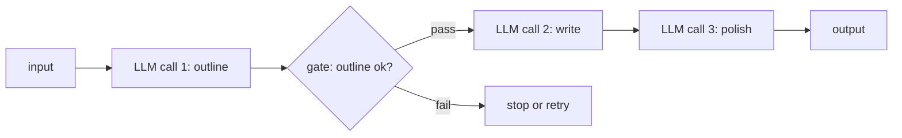
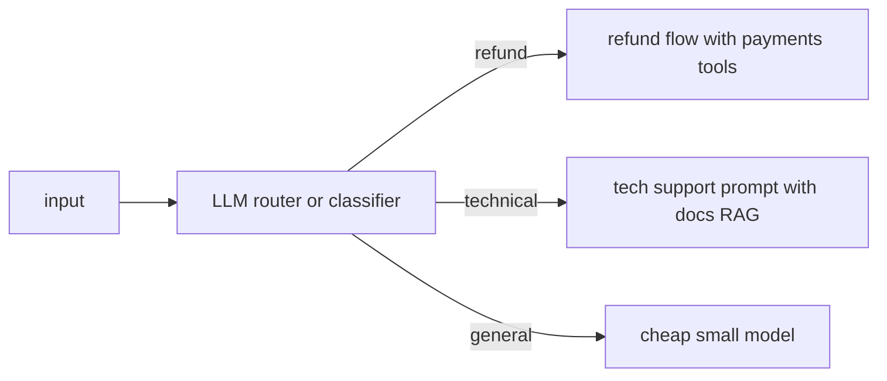
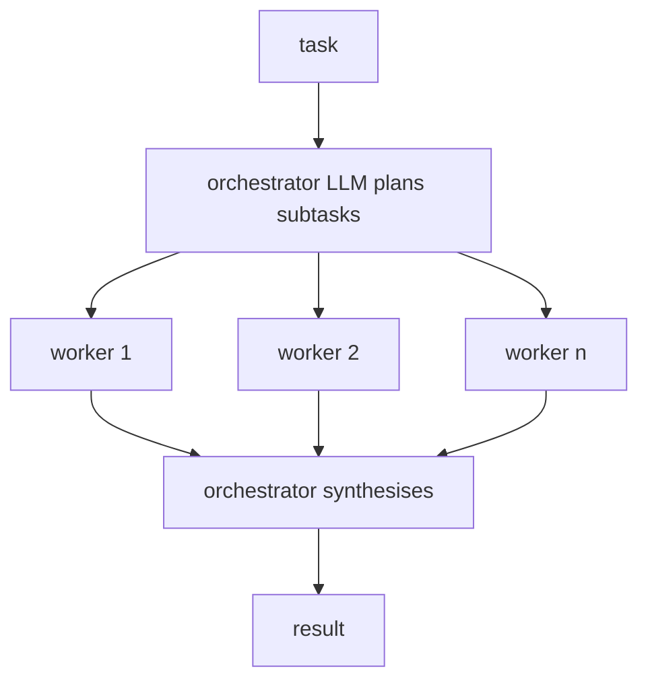
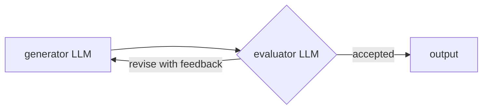

# Workflows vs agents: the five patterns

"Agent" is the most overloaded word in AI engineering. Anthropic's widely cited post *Building
effective agents* (Schluntz & Zhang, December 2024) cuts through it with a useful distinction and a
small catalogue of composable patterns. This lesson implements each pattern as runnable Python with a
mock LLM, so you can see the control flow that the diagrams describe.

## 1. Workflows versus agents

- **Workflows**: LLMs and tools orchestrated through **predefined code paths**. You, the engineer,
  decide the steps; the LLM fills them in.
- **Agents**: the LLM **dynamically directs its own process** and tool use, deciding the steps itself,
  in a loop, based on feedback from the environment.

Both are "agentic systems". The core advice: find the **simplest solution possible** and add complexity
only when it demonstrably improves outcomes. Many applications need nothing more than a single LLM
call with retrieval and good examples. Workflows give predictability and consistency for well-defined
tasks; agents give flexibility for open-ended ones, at the cost of latency, money and compounding
errors.

The building block for everything is the **augmented LLM**: a model with retrieval, tools and memory
available, which it can use by generating its own queries and calls.

```python-run
# A tiny mock LLM used by all demos in this lesson: deterministic rules standing in for model calls.
def llm(prompt):
    p = prompt.lower()
    if p.startswith("classify"):
        return "refund" if "refund" in p or "money back" in p else ("technical" if "error" in p else "general")
    if p.startswith("outline"):
        return "1. Problem\n2. Approach\n3. Results"
    if p.startswith("check outline"):
        return "PASS" if p.count("\n") >= 2 else "FAIL"
    if p.startswith("write"):
        return "Draft based on: " + prompt.split(":", 1)[1].strip()[:40]
    if p.startswith("review"):
        return "vulnerable" if "eval(" in p else "safe"
    if p.startswith("grade"):
        return "ACCEPT" if "v3" in p else "REVISE: add a concrete example"
    if p.startswith("improve"):
        n = int(p.split("v")[-1][0]) + 1 if " v" in p else 2
        return f"essay v{n}"
    return "ok"
print(llm("classify: I want my money back"), "|", llm("classify: error 500 on login"))
```

## 2. Prompt chaining

Decompose a task into a **fixed sequence** of LLM calls, each consuming the previous output, with
optional programmatic **gates** that check intermediate results.



Use when the task cleanly splits into fixed subtasks; you trade latency for accuracy because each call
is easier. Examples: generate marketing copy then translate it; outline, validate the outline against
criteria, then write.

```python-run
def llm(prompt):
    p = prompt.lower()
    if p.startswith("outline"): return "1. Problem\n2. Approach\n3. Results"
    if p.startswith("check outline"): return "PASS" if p.count("\n") >= 2 else "FAIL"
    if p.startswith("write"): return "Draft based on: " + prompt.split(":", 1)[1].strip()[:40]
    return "ok"

def chain(topic):
    outline = llm(f"Outline a short report on {topic}")
    if "PASS" not in llm(f"Check outline:\n{outline}"):         # programmatic gate
        return "Outline rejected"
    draft = llm(f"Write the report from this outline: {outline}")
    return draft

print(chain("KV caching"))
```

## 3. Routing

**Classify** the input, then send it to a specialised prompt, tool set or model.



Use when inputs fall into distinct categories that are better handled separately, and classification is
reliable (by an LLM or a traditional classifier). Also the basis of **model routing**: easy queries to
a small, cheap model, hard ones to a frontier model (the AI Engineering track covers routers and
gateways for cost).

```python-run
def classify(text):
    t = text.lower()
    return "refund" if ("refund" in t or "money back" in t) else ("technical" if "error" in t else "general")

ROUTES = {
    "refund":    lambda q: f"[refund-agent, tools=payments] handling: {q}",
    "technical": lambda q: f"[support-rag, model=large] handling: {q}",
    "general":   lambda q: f"[faq, model=small] handling: {q}",
}
for q in ["I want my money back", "Error 500 when I log in", "What are your opening hours?"]:
    print(ROUTES[classify(q)](q))
```

## 4. Parallelization

Run LLM calls **simultaneously** and aggregate programmatically. Two variants:

- **Sectioning**: split into independent subtasks run in parallel. Example: one call answers the user
  while another screens the input for policy violations (guardrails run as a separate call do better
  than one prompt doing both); or evaluate several aspects of an output in parallel.
- **Voting**: run the same task several times (or with different prompts) and aggregate, e.g. several
  reviewers flag a code vulnerability, or majority vote / threshold for content moderation to balance
  false positives and negatives.

```python-run
from collections import Counter

def review(code, persona):
    # stand-in for an LLM reviewer with a persona-specific prompt
    if persona == "lenient":
        return "safe"
    return "vulnerable" if "eval(" in code or "os.system(" in code else "safe"

code = "user = input(); eval(user)"
personas = ["security expert", "senior dev", "lenient", "pentester", "static analyst"]
# Voting: the same task with different prompts. Here the calls run one after another (the browser
# sandbox has no threads); real reviewers are independent, so production code sends them in parallel.
votes = [review(code, p) for p in personas]
tally = Counter(votes)
print(votes, "->", "BLOCK" if tally["vulnerable"] >= 2 else "ALLOW")   # threshold tuned for recall
```

In real code use `asyncio.gather` with an async client, and set per-call timeouts.

## 5. Orchestrator-workers

A central **orchestrator LLM dynamically decides** the subtasks, delegates each to **worker** LLM calls,
and synthesises their results. Unlike sectioning, the subtasks are **not known in advance**: they depend
on the input.



Use for complex tasks where you cannot predict the subtasks, e.g. a coding change touching an unknown
set of files, or research that must gather from multiple sources. Anthropic's multi-agent research
system is this pattern with agents as workers (next lesson).

```python-run
import json

def orchestrator_plan(task):
    # stand-in: an LLM would return this JSON plan after reading the task and repo layout
    files = [f for f in ["auth.py", "api.py", "tests/test_auth.py"] if "auth" in task or f == "api.py"]
    return [{"file": f, "instruction": f"apply '{task}' to {f}"} for f in files]

def worker(sub):
    return {"file": sub["file"], "diff": f"--- {sub['file']} (+3 -1)"}

def synthesise(results):
    return "Changed: " + ", ".join(r["file"] for r in results)

task = "rename auth token header"
plan = orchestrator_plan(task)
print(json.dumps(plan, indent=1))
print(synthesise([worker(s) for s in plan]))
```

## 6. Evaluator-optimizer

One LLM **generates**, another **evaluates** and gives feedback, in a loop until the evaluator accepts
or a budget is reached.



Use when there are **clear evaluation criteria** and iteration measurably helps, analogous to a writer
revising after an editor's notes: literary translation nuance, complex search needing multiple rounds,
code that must pass tests (where the "evaluator" can be a test runner, an even better signal).

```python-run
def generate(task, feedback=None, version=1):
    return f"essay v{version}" + (f" (addressed: {feedback})" if feedback else "")

def evaluate(draft):
    return ("ACCEPT", None) if draft.startswith("essay v3") else ("REVISE", "add a concrete example")

draft, feedback = generate("explain RoPE"), None
for step in range(1, 6):                       # always bound the loop
    verdict, feedback = evaluate(draft)
    print(f"step {step}: {draft!r} -> {verdict}")
    if verdict == "ACCEPT":
        break
    draft = generate("explain RoPE", feedback, version=step + 1)
```

## 7. Autonomous agents

When the steps cannot be hard-coded at all, let the model run a loop: act with tools, observe results
("ground truth from the environment", such as tool outputs or test results), decide the next step,
optionally pause for human feedback at checkpoints, and stop on completion or a budget.

```python-run
def agent(goal, tools, max_steps=8):
    memory = [f"GOAL: {goal}"]
    for step in range(max_steps):
        action, arg = policy(memory)                 # an LLM call in reality
        if action == "finish":
            return arg, memory
        obs = tools[action](arg)                     # environment feedback
        memory.append(f"{action}({arg}) -> {obs}")
    return "stopped: step budget exhausted", memory

def policy(memory):                                   # toy policy: run tests, fix, rerun
    last = memory[-1]
    if last.startswith("GOAL"): return "run_tests", "all"
    if "2 failed" in last: return "edit_file", "fix off-by-one in chunker"
    if last.startswith("edit_file"): return "run_tests", "all"
    if "0 failed" in last: return "finish", "All tests pass."
    return "finish", "unsure"

state = {"fixed": False}
tools = {"run_tests": lambda _: "0 failed" if state["fixed"] else "2 failed",
         "edit_file": lambda _: state.update(fixed=True) or "edited"}
answer, trace = agent("make the test suite pass", tools)
print("\n".join(trace)); print("=>", answer)
```

Use agents for open-ended problems where you cannot predict the number of steps and you can trust the
model's decisions within a sandbox: coding agents (SWE-bench-style tasks) and computer use are the
canonical examples. Their autonomy means higher cost and the potential for **compounding errors**, so
test extensively in sandboxes with guardrails.

## 8. Three principles

1. **Simplicity**: keep the agent's design simple; avoid framework abstractions that obscure prompts and
   responses (if you use a framework, understand the code underneath).
2. **Transparency**: show the agent's planning steps explicitly.
3. **Carefully craft the agent-computer interface (ACI)**: invest in tool documentation and testing as
   much as in prompts, and **poka-yoke** tools (change arguments so mistakes are harder; Anthropic
   reports switching a tool to require absolute file paths after the model kept getting relative paths
   wrong).

## 9. Choosing a pattern

| need | pattern |
|---|---|
| fixed decomposition, accuracy over latency | prompt chaining |
| distinct input categories, cost tiers | routing |
| independent subtasks, or confidence via multiple samples | parallelization (sectioning / voting) |
| subtasks depend on the input | orchestrator-workers |
| clear quality criteria, iterative refinement | evaluator-optimizer |
| open-ended, unpredictable steps, trusted environment | autonomous agent |

These compose: a router can send hard cases to an orchestrator whose workers are evaluator-optimizer
loops.

> [!INTERVIEW]
> **"When would you NOT build an agent?"** When the steps are known: a chain or router is cheaper,
> faster, easier to test and debug. Agents make sense when steps cannot be predetermined, there is a
> reliable feedback signal (tests, tool results), the cost of errors is bounded (sandboxing, human
> checkpoints), and the value justifies more tokens and latency. Name the five workflow patterns with
> one use case each.

## Summary

- Workflows follow code paths you define; agents choose their own steps in a loop.
- Prompt chaining, routing, parallelization, orchestrator-workers and evaluator-optimizer cover most
  needs; patterns compose.
- Start simple; add agency only when it measurably helps.
- Keep designs simple and transparent, and engineer the agent-computer interface (tools) carefully.

```quiz
[
  {"q": "What distinguishes an agent from a workflow in Anthropic's terminology?",
   "options": ["An agent's LLM dynamically directs its own steps and tool use", "Agents use tools; workflows never do", "Workflows use several models", "Agents are always multi-agent"], "answer": 0,
   "explain": "Workflows follow predefined code paths; agents decide the process themselves."},
  {"q": "A support bot must send refund requests, tech issues and general questions to different prompts and tools. Pattern?",
   "options": ["Routing", "Evaluator-optimizer", "Voting", "Prompt chaining"], "answer": 0,
   "explain": "Classify the input, then dispatch to a specialised handler."},
  {"q": "Running a guardrail check in a separate parallel call from the main response is an example of...",
   "options": ["Parallelization (sectioning)", "Voting", "Routing", "Orchestrator-workers"], "answer": 0,
   "explain": "Independent subtasks run simultaneously and are combined programmatically."},
  {"q": "How does orchestrator-workers differ from sectioning?",
   "options": ["The subtasks are decided dynamically by the orchestrator based on the input", "It is always sequential", "It uses no LLM", "Workers vote on one answer"], "answer": 0,
   "explain": "Sectioning has fixed, predefined subtasks; orchestrators plan them per input."},
  {"q": "Which situation best suits evaluator-optimizer?",
   "options": ["Clear evaluation criteria and iterative refinement measurably helps", "Inputs fall into categories", "Subtasks are independent", "Exact latency limits of 50 ms"], "answer": 0,
   "explain": "A feedback loop pays off when an evaluator can articulate useful critiques."},
  {"q": "What does poka-yoke mean for agent tools?",
   "options": ["Designing tool interfaces so mistakes are hard to make", "Adding more tools", "Using voting", "Caching tool results"], "answer": 0,
   "explain": "E.g. requiring absolute paths, enums or validated ids prevents whole classes of model errors."},
  {"q": "What is the main risk that grows with agent autonomy?",
   "options": ["Compounding errors and higher cost", "Lower recall in retrieval", "Tokenizer mismatch", "Smaller context windows"], "answer": 0,
   "explain": "Each step can build on earlier mistakes; sandboxes, caps and checkpoints mitigate this."}
]
```

> **Source:** Anthropic Engineering, "Building effective agents" (Schluntz & Zhang, 2024,
> https://www.anthropic.com/engineering/building-effective-agents) and its cookbook examples; Hugging
> Face Agents Course, unit 1 "Introduction to agents" (https://huggingface.co/learn/agents-course);
> Huyen, *AI Engineering*, ch. 6 "Agents" (planning, failure modes) and ch. 10 (routers, gateways).
