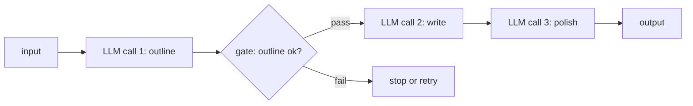
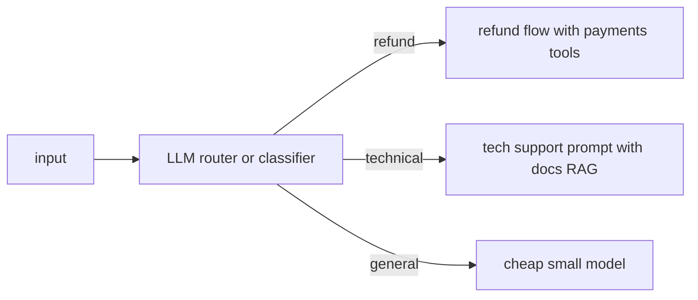
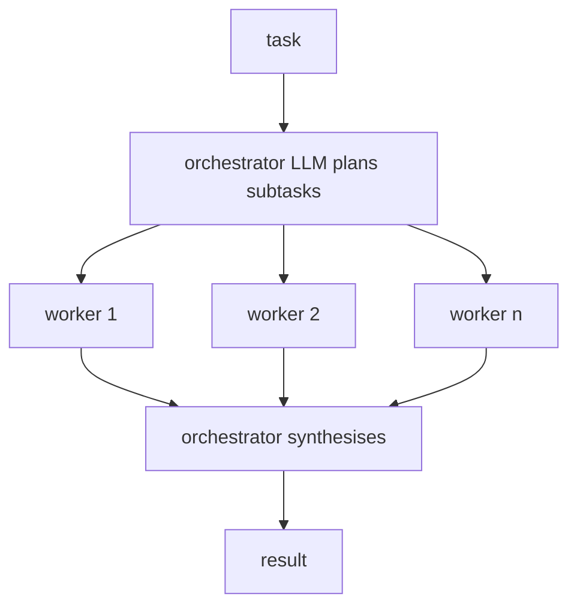
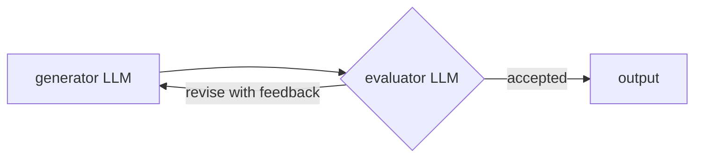

# Workflows vs agents: the five patterns

> **Before this lesson:** you should know the tool-calling loop (the model asks for a tool, your code
> runs it and returns the result) from
> [Function calling: schemas, the tool loop and parsing](#/lesson/llm-practice/function-calling).
> The routing and RAG examples assume the idea of retrieval from
> [Hybrid retrieval, fusion, reranking and grounded generation](#/lesson/llm-practice/hybrid-retrieval-reranking).
> The code is plain Python: functions, dictionaries, loops and `lambda`.

## In plain words

Once a model can call tools, there are two broad ways to build an application around it. In a
**workflow**, you write the recipe: step 1 call the model to do this, step 2 check the result, step 3
call it again to do that. In an **agent**, you hand the model a goal and some tools and let it decide
the steps itself, in a loop, until it thinks it is done. This lesson presents five standard workflow
recipes and the agent loop, each as a few lines of runnable Python.

An analogy: a restaurant kitchen. A fixed menu with a set sequence of courses is a workflow: every
plate goes through the same stations in the same order, and the result is predictable. A private
chef told "cook something good with what is in the fridge" is an agent: more flexible, sometimes
brilliant, harder to predict, and more expensive. Most restaurants run mostly on fixed recipes for
good reason.

Why it matters for a job: "agent" is the most hyped word in the field, and interviewers want to see
that you can tell when an agent is the right tool and when a two-step chain would be cheaper, faster
and more reliable. Naming these patterns, with one use case each, is a standard system-design
answer.

## Where the vocabulary comes from

"Agent" is the most overloaded word in AI engineering. Anthropic's widely cited post *Building
effective agents* (Schluntz & Zhang, December 2024) cuts through it with a useful distinction and a
small catalogue of **composable** patterns (patterns that can be combined like building blocks). This
lesson implements each pattern as runnable Python with a **mock** LLM (a fake stand-in that returns
fixed answers, so the code runs without a real model), so you can see the control flow that the
diagrams describe.

## 1. Workflows versus agents

- **Workflows**: LLMs and tools **orchestrated** (coordinated) through **predefined code paths**. You,
  the engineer, decide the steps; the LLM fills them in.
- **Agents**: the LLM **dynamically directs its own process** and tool use, deciding the steps itself,
  in a loop, based on feedback from the **environment** (everything outside the model that it acts
  on and observes: tool results, files, test outcomes).

Both are "agentic systems". The core advice: find the **simplest solution possible** and add complexity
only when it demonstrably improves outcomes. Many applications need nothing more than a single LLM
call with retrieval and good examples. Workflows give predictability and consistency for well-defined
tasks; agents give flexibility for open-ended ones, at the cost of latency, money and **compounding
errors** (a small mistake early in a long chain of steps gets built upon, so errors grow with the
number of steps).

The building block for everything is the **augmented LLM**: a model with retrieval, tools and memory
available, which it can use by generating its own queries and calls. **Memory** here means
information kept between steps or conversations, such as notes or earlier results.

The mock LLM below recognises a prompt by its first word and returns a canned answer. It lets every
demo in this lesson run instantly while keeping the shape of real code, where each `llm(...)` call
would be an API request:

```python-run
# A tiny mock LLM used by all demos in this lesson: deterministic rules standing in for model calls.
def llm(prompt):
    p = prompt.lower()
    if p.startswith("classify"):
        return "refund" if "refund" in p or "money back" in p else ("technical" if "error" in p else "general")
    if p.startswith("outline"):
        return "1. Problem\n2. Approach\n3. Results"
    if p.startswith("check outline"):
        return "PASS" if p.count("\n") >= 2 else "FAIL"
    if p.startswith("write"):
        return "Draft based on: " + prompt.split(":", 1)[1].strip()[:40]
    if p.startswith("review"):
        return "vulnerable" if "eval(" in p else "safe"
    if p.startswith("grade"):
        return "ACCEPT" if "v3" in p else "REVISE: add a concrete example"
    if p.startswith("improve"):
        n = int(p.split("v")[-1][0]) + 1 if " v" in p else 2
        return f"essay v{n}"
    return "ok"
print(llm("classify: I want my money back"), "|", llm("classify: error 500 on login"))
```

The printed line, `refund | technical`, shows the mock classifying two messages: "money back" maps to
`refund`, "error 500" to `technical`.

## 2. Prompt chaining

Decompose a task into a **fixed sequence** of LLM calls, each consuming the previous output, with
optional programmatic **gates**: ordinary code (not a model) that checks an intermediate result and
stops or retries the chain if it is not good enough.



Use when the task cleanly splits into fixed subtasks; you trade latency for accuracy because each call
is easier. Examples: generate marketing copy then translate it; outline, validate the outline against
criteria, then write.

```python-run
def llm(prompt):
    p = prompt.lower()
    if p.startswith("outline"): return "1. Problem\n2. Approach\n3. Results"
    if p.startswith("check outline"): return "PASS" if p.count("\n") >= 2 else "FAIL"
    if p.startswith("write"): return "Draft based on: " + prompt.split(":", 1)[1].strip()[:40]
    return "ok"

def chain(topic):
    outline = llm(f"Outline a short report on {topic}")
    if "PASS" not in llm(f"Check outline:\n{outline}"):         # programmatic gate
        return "Outline rejected"
    draft = llm(f"Write the report from this outline: {outline}")
    return draft

print(chain("KV caching"))
```

How it runs: `chain` asks for an outline, passes the outline to a checking prompt, and only if the
check says `PASS` asks for the full report. The gate here is a model call whose answer is tested with
plain code (`"PASS" not in ...`); it could equally be a length check or a regular expression. The
output is the "draft", which in this mock repeats the beginning of the outline. Each call has one
small job, which is why chains are more accurate than one giant prompt, at the cost of three calls'
worth of waiting.

## 3. Routing

**Classify** the input (decide which category it belongs to), then send it to a specialised prompt,
tool set or model.



Use when inputs fall into distinct categories that are better handled separately, and classification is
reliable (by an LLM or a traditional **classifier**, a small model trained only to assign labels). Also
the basis of **model routing**: easy queries to a small, cheap model, hard ones to a **frontier model**
(the largest, most capable and most expensive models available; the AI Engineering track covers routers
and gateways for cost).

In the demo, `ROUTES` is a dictionary from category to handler, and `ROUTES[classify(q)](q)` looks up
the handler for the question's category and calls it. Each of the three questions lands in a different
handler, as the three printed lines show. Real handlers would differ in their prompt, their tools and
the model they call.

```python-run
def classify(text):
    t = text.lower()
    return "refund" if ("refund" in t or "money back" in t) else ("technical" if "error" in t else "general")

ROUTES = {
    "refund":    lambda q: f"[refund-agent, tools=payments] handling: {q}",
    "technical": lambda q: f"[support-rag, model=large] handling: {q}",
    "general":   lambda q: f"[faq, model=small] handling: {q}",
}
for q in ["I want my money back", "Error 500 when I log in", "What are your opening hours?"]:
    print(ROUTES[classify(q)](q))
```

## 4. Parallelization

Run LLM calls **simultaneously** and aggregate programmatically. Two variants:

- **Sectioning**: split into independent subtasks run in parallel. Example: one call answers the user
  while another screens the input for policy violations (guardrails run as a separate call do better
  than one prompt doing both); or evaluate several aspects of an output in parallel.
- **Voting**: run the same task several times (or with different prompts) and aggregate, e.g. several
  reviewers flag a code vulnerability, or majority vote / threshold for content moderation to balance
  **false positives** (harmless content wrongly flagged) and **false negatives** (harmful content
  wrongly let through).

**Guardrails** are checks that run alongside or around the model to catch unsafe inputs or outputs
(lesson 25). The demo shows voting: five reviewer "personas" (the same reviewer prompted to take
different points of view) judge one line of code that passes user input to `eval`, which would run
whatever the user typed:

```python-run
from collections import Counter

def review(code, persona):
    # stand-in for an LLM reviewer with a persona-specific prompt
    if persona == "lenient":
        return "safe"
    return "vulnerable" if "eval(" in code or "os.system(" in code else "safe"

code = "user = input(); eval(user)"
personas = ["security expert", "senior dev", "lenient", "pentester", "static analyst"]
# Voting: the same task with different prompts. Here the calls run one after another (the browser
# sandbox has no threads); real reviewers are independent, so production code sends them in parallel.
votes = [review(code, p) for p in personas]
tally = Counter(votes)
print(votes, "->", "BLOCK" if tally["vulnerable"] >= 2 else "ALLOW")   # threshold tuned for recall
```

Four of five reviewers say `vulnerable` and the lenient one says `safe`. `Counter` tallies the votes,
and because the threshold is only two "vulnerable" votes, the verdict is `BLOCK`. A low threshold
favours **recall** (catching every real problem) at the cost of more false alarms, which is the right
trade for security.

In real code use `asyncio.gather` with an async client, and set per-call timeouts. (`asyncio` is
Python's library for running many waiting tasks at once without threads; `gather` starts several
calls together and waits for all of them. A **timeout** abandons a call that takes too long.)

## 5. Orchestrator-workers

A central **orchestrator LLM dynamically decides** the subtasks, delegates each to **worker** LLM calls,
and **synthesises** (combines) their results. Unlike sectioning, the subtasks are **not known in
advance**: they depend on the input.



Use for complex tasks where you cannot predict the subtasks, e.g. a coding change touching an unknown
set of files, or research that must gather from multiple sources. Anthropic's multi-agent research
system is this pattern with agents as workers (next lesson).

```python-run
import json

def orchestrator_plan(task):
    # stand-in: an LLM would return this JSON plan after reading the task and repo layout
    files = [f for f in ["auth.py", "api.py", "tests/test_auth.py"] if "auth" in task or f == "api.py"]
    return [{"file": f, "instruction": f"apply '{task}' to {f}"} for f in files]

def worker(sub):
    return {"file": sub["file"], "diff": f"--- {sub['file']} (+3 -1)"}

def synthesise(results):
    return "Changed: " + ", ".join(r["file"] for r in results)

task = "rename auth token header"
plan = orchestrator_plan(task)
print(json.dumps(plan, indent=1))
print(synthesise([worker(s) for s in plan]))
```

What happens: `orchestrator_plan` stands in for an LLM that reads the task and decides which files
need changing; because the task mentions "auth", it picks all three files and writes one instruction
per file. Each `worker` call handles one file and returns a **diff** (a summary of lines added and
removed). `synthesise` combines the workers' results into one report. The printed JSON plan is the
point: the list of subtasks was produced at run time from the input, not written into the code.

## 6. Evaluator-optimizer

One LLM **generates**, another **evaluates** and gives feedback, in a loop until the evaluator accepts
or a **budget** (a maximum number of rounds, tokens or money) is reached.



Use when there are **clear evaluation criteria** and iteration measurably helps, analogous to a writer
revising after an editor's notes: literary translation nuance, complex search needing multiple rounds,
code that must pass tests (where the "evaluator" can be a test runner, an even better signal).

```python-run
def generate(task, feedback=None, version=1):
    return f"essay v{version}" + (f" (addressed: {feedback})" if feedback else "")

def evaluate(draft):
    return ("ACCEPT", None) if draft.startswith("essay v3") else ("REVISE", "add a concrete example")

draft, feedback = generate("explain RoPE"), None
for step in range(1, 6):                       # always bound the loop
    verdict, feedback = evaluate(draft)
    print(f"step {step}: {draft!r} -> {verdict}")
    if verdict == "ACCEPT":
        break
    draft = generate("explain RoPE", feedback, version=step + 1)
```

The trace: version 1 is sent back with the note "add a concrete example"; version 2 addresses it but is
still sent back; version 3 is accepted at step 3 and the loop ends. `for step in range(1, 6)` is the
budget: even if the evaluator never accepted, the loop would stop after five rounds.

## 7. Autonomous agents

When the steps cannot be hard-coded at all, let the model run a loop: act with tools, observe results
(**ground truth** from the environment: facts that come from the real world rather than from the
model's guesses, such as tool outputs or test results), decide the next step, optionally pause for
human feedback at **checkpoints**, and stop on completion or a budget. The function that picks the
next action is called the **policy**, the same word as in lesson 14; in a real agent it is an LLM call
that reads the history so far.

```python-run
def agent(goal, tools, max_steps=8):
    memory = [f"GOAL: {goal}"]
    for step in range(max_steps):
        action, arg = policy(memory)                 # an LLM call in reality
        if action == "finish":
            return arg, memory
        obs = tools[action](arg)                     # environment feedback
        memory.append(f"{action}({arg}) -> {obs}")
    return "stopped: step budget exhausted", memory

def policy(memory):                                   # toy policy: run tests, fix, rerun
    last = memory[-1]
    if last.startswith("GOAL"): return "run_tests", "all"
    if "2 failed" in last: return "edit_file", "fix off-by-one in chunker"
    if last.startswith("edit_file"): return "run_tests", "all"
    if "0 failed" in last: return "finish", "All tests pass."
    return "finish", "unsure"

state = {"fixed": False}
tools = {"run_tests": lambda _: "0 failed" if state["fixed"] else "2 failed",
         "edit_file": lambda _: state.update(fixed=True) or "edited"}
answer, trace = agent("make the test suite pass", tools)
print("\n".join(trace)); print("=>", answer)
```

How the loop works: `memory` is the history, starting with the goal. Each turn, `policy(memory)`
chooses an action and an argument; `finish` ends the loop with an answer, and any other action is
looked up in `tools` and run, with the observation appended to memory. The toy policy reads only the
last entry: start by running the tests; if two fail, edit the file; after an edit, rerun the tests; if
none fail, finish. The `edit_file` tool flips `state["fixed"]` (`state.update(...)` returns `None`, so
`or "edited"` supplies the return value). The printed trace shows four entries ending in "0 failed" and
the answer "All tests pass.". Notice that the code never says "run the tests twice": the number of
steps emerged from the feedback.

Use agents for open-ended problems where you cannot predict the number of steps and you can trust the
model's decisions within a sandbox: coding agents (SWE-bench-style tasks, a benchmark of real GitHub
issues that an agent must fix so the project's tests pass) and **computer use** (a model operating a
desktop or browser through screenshots and clicks) are the canonical examples. Their autonomy means higher cost and the potential for **compounding errors**, so
test extensively in sandboxes with guardrails.

## 8. Three principles

1. **Simplicity**: keep the agent's design simple; avoid framework **abstractions** (layers of library
   code that hide the details) that obscure prompts and responses (if you use a framework, understand
   the code underneath).
2. **Transparency**: show the agent's planning steps explicitly.
3. **Carefully craft the agent-computer interface (ACI)**: invest in tool documentation and testing as
   much as in prompts, and **poka-yoke** tools (change arguments so mistakes are harder; Anthropic
   reports switching a tool to require absolute file paths after the model kept getting relative paths
   wrong).

## 9. Choosing a pattern

| need | pattern |
|---|---|
| fixed decomposition, accuracy over latency | prompt chaining |
| distinct input categories, cost tiers | routing |
| independent subtasks, or confidence via multiple samples | parallelization (sectioning / voting) |
| subtasks depend on the input | orchestrator-workers |
| clear quality criteria, iterative refinement | evaluator-optimizer |
| open-ended, unpredictable steps, trusted environment | autonomous agent |

These compose: a router can send hard cases to an orchestrator whose workers are evaluator-optimizer
loops.

> [!INTERVIEW]
> **"When would you NOT build an agent?"** When the steps are known: a chain or router is cheaper,
> faster, easier to test and debug. Agents make sense when steps cannot be predetermined, there is a
> reliable feedback signal (tests, tool results), the cost of errors is bounded (sandboxing, human
> checkpoints), and the value justifies more tokens and latency. Name the five workflow patterns with
> one use case each.

## Summary

- Workflows follow code paths you define; agents choose their own steps in a loop.
- Prompt chaining, routing, parallelization, orchestrator-workers and evaluator-optimizer cover most
  needs; patterns compose.
- Start simple; add agency only when it measurably helps.
- Keep designs simple and transparent, and engineer the agent-computer interface (tools) carefully.

## Glossary

- **Workflow**: LLM calls and tools arranged in steps that your code defines.
- **Agent**: an LLM that chooses its own steps and tool calls in a loop until it decides it is done.
- **Agentic system**: the umbrella term covering both workflows and agents.
- **Augmented LLM**: a model given retrieval, tools and memory.
- **Environment / ground truth**: what the agent acts on / real-world feedback such as test results.
- **Compounding errors**: early mistakes that later steps build on.
- **Mock**: a fake stand-in used to run code without the real component.
- **Prompt chaining / gate**: a fixed sequence of calls / a code check between steps.
- **Routing / classifier**: sending each input to a specialised handler / the component that picks
  the category.
- **Model routing / frontier model**: sending easy queries to cheap models / the largest, most capable
  models.
- **Parallelization (sectioning, voting)**: running independent subtasks, or repeated attempts, at the
  same time.
- **False positive / false negative**: flagging something harmless / missing something harmful.
- **Orchestrator-workers**: one LLM plans subtasks at run time and other calls carry them out.
- **Evaluator-optimizer**: a generate-critique-revise loop.
- **Budget / step cap**: the limit on rounds, tokens or money a loop may spend.
- **Policy**: the component (an LLM call, in practice) that chooses an agent's next action.
- **ACI (agent-computer interface)**: the tools and their documentation, as seen by the model.

## Check yourself

```quiz
[
  {"q": "What distinguishes an agent from a workflow in Anthropic's terminology?",
   "options": ["An agent's LLM dynamically directs its own steps and tool use", "Agents use tools; workflows never do", "Workflows use several models", "Agents are always multi-agent"], "answer": 0,
   "explain": "Workflows follow predefined code paths; agents decide the process themselves."},
  {"q": "A support bot must send refund requests, tech issues and general questions to different prompts and tools. Pattern?",
   "options": ["Routing", "Evaluator-optimizer", "Voting", "Prompt chaining"], "answer": 0,
   "explain": "Classify the input, then dispatch to a specialised handler."},
  {"q": "Running a guardrail check in a separate parallel call from the main response is an example of...",
   "options": ["Parallelization (sectioning)", "Voting", "Routing", "Orchestrator-workers"], "answer": 0,
   "explain": "Independent subtasks run simultaneously and are combined programmatically."},
  {"q": "How does orchestrator-workers differ from sectioning?",
   "options": ["The subtasks are decided dynamically by the orchestrator based on the input", "It is always sequential", "It uses no LLM", "Workers vote on one answer"], "answer": 0,
   "explain": "Sectioning has fixed, predefined subtasks; orchestrators plan them per input."},
  {"q": "Which situation best suits evaluator-optimizer?",
   "options": ["Clear evaluation criteria and iterative refinement measurably helps", "Inputs fall into categories", "Subtasks are independent", "Exact latency limits of 50 ms"], "answer": 0,
   "explain": "A feedback loop pays off when an evaluator can articulate useful critiques."},
  {"q": "What does poka-yoke mean for agent tools?",
   "options": ["Designing tool interfaces so mistakes are hard to make", "Adding more tools", "Using voting", "Caching tool results"], "answer": 0,
   "explain": "E.g. requiring absolute paths, enums or validated ids prevents whole classes of model errors."},
  {"q": "What is the main risk that grows with agent autonomy?",
   "options": ["Compounding errors and higher cost", "Lower recall in retrieval", "Tokenizer mismatch", "Smaller context windows"], "answer": 0,
   "explain": "Each step can build on earlier mistakes; sandboxes, caps and checkpoints mitigate this."}
]
```

> **Source:** Anthropic Engineering, "Building effective agents" (Schluntz & Zhang, 2024,
> https://www.anthropic.com/engineering/building-effective-agents) and its cookbook examples; Hugging
> Face Agents Course, unit 1 "Introduction to agents" (https://huggingface.co/learn/agents-course);
> Huyen, *AI Engineering*, ch. 6 "Agents" (planning, failure modes) and ch. 10 (routers, gateways).
