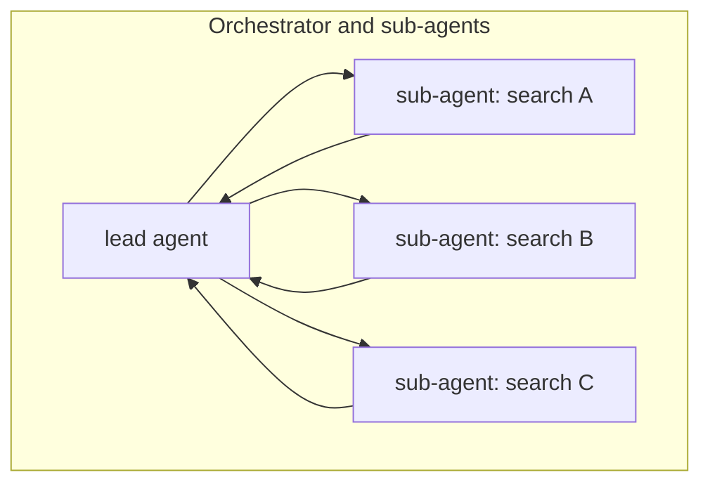

# ReAct, planning, multi-agent systems and frameworks

> **Before this lesson:** you should know the tool-calling loop
> ([Function calling: schemas, the tool loop and parsing](#/lesson/llm-practice/function-calling))
> and the difference between workflows and agents, including the orchestrator-workers pattern
> ([Workflows vs agents: the five patterns](#/lesson/llm-practice/workflow-patterns)). The code uses
> regular expressions and Python dictionaries.

## In plain words

The previous lesson treated the agent loop as a box: the model picks an action, sees the result,
picks again. This lesson opens the box. It shows the classic recipe for that loop (**ReAct**: think,
act, look at the result, repeat), the habits that keep an agent from wandering off course, the idea
of letting an agent write small programs as its actions, how teams of agents are organised, and
which software libraries (**frameworks**) package all of this.

An analogy: a detective working a case. They think aloud ("I need to know where the suspect was on
Tuesday"), take an action (phone the hotel), note what they learn ("checked out Monday"), and think
again. A good detective keeps a written plan, checks facts rather than trusting hunches, and knows
when to stop and report. A big case is run by a lead detective who sends junior detectives to follow
separate leads and then combines their reports. That is ReAct, planning and verification, and a
multi-agent system.

Why it matters for a job: agents are the fastest-growing area of applied AI, and interviews now
include "design a research agent" or "how would you evaluate a coding agent?". Knowing the loop's
failure modes, the cost of multi-agent designs and how to measure reliability separates engineers who
have built agents from those who have only read about them.

## The agent loop up close

The previous lesson covered *which* agentic pattern to use. This one opens up the agent loop itself:
how ReAct interleaves reasoning with actions, how agents plan and recover, why "code as action" (the
smolagents approach) works so well, how multi-agent systems are structured, and how today's frameworks
compare.

## 1. ReAct: reason, act, observe

ReAct ("reasoning and acting", Yao et al. 2022) prompts a model to alternate **Thought** (free-text
reasoning), **Action** (a tool call) and **Observation** (the tool result appended by the **runtime**,
the surrounding program that runs the loop), until it emits a final answer. Read the example below
from top to bottom; only the Thought and Action lines are written by the model:

```text
Question: Which is older, the transformer paper or the LoRA paper, and by how many years?
Thought: I need the publication years of both.
Action: search["Attention Is All You Need publication year"]
Observation: Published June 2017 at NeurIPS 2017.
Thought: Now LoRA.
Action: search["LoRA low-rank adaptation paper year"]
Observation: Hu et al., arXiv June 2021.
Thought: 2021 - 2017 = 4.
Final Answer: The transformer paper is older, by 4 years.
```

The thought steps let the model plan, track progress and handle surprises; the observations ground it
in reality and reduce **hallucination** (stating invented facts) compared with **chain-of-thought**
alone (asking the model to reason step by step in text, with no way to check facts). Modern APIs make
this native: the model emits text (or hidden "thinking") plus tool-use blocks, and observations come
back as tool results. **Reasoning models** (models trained to think at length before answering) with
**interleaved thinking** can reason between tool calls without you prompting for "Thought:".

Below is a complete ReAct runtime with a scripted "model", so the parsing and loop logic are real.

```python-run
import re

TOOLS = {
    "search": lambda q: {"transformer": "Published 2017.", "lora": "Published 2021."}.get(
        next((k for k in ["transformer", "lora"] if k in q.lower()), ""), "No results."),
    "calculate": lambda expr: str(eval(expr, {"__builtins__": {}}, {})),   # demo only: never eval untrusted text
}
SCRIPT = iter([
    'Thought: find both years.\nAction: search["transformer paper year"]',
    'Thought: now LoRA.\nAction: search["LoRA paper year"]',
    'Thought: subtract.\nAction: calculate["2021 - 2017"]',
    'Thought: done.\nFinal Answer: The transformer paper is older by 4 years.',
])
def model(transcript):          # stand-in for an LLM call on the whole transcript
    return next(SCRIPT)

def react(question, max_steps=6):
    transcript = f"Question: {question}\n"
    for _ in range(max_steps):
        out = model(transcript)
        transcript += out + "\n"
        if m := re.search(r"Final Answer:\s*(.*)", out):
            return m.group(1), transcript
        m = re.search(r'Action:\s*(\w+)\["(.*)"\]', out)
        if not m or m.group(1) not in TOOLS:
            transcript += "Observation: invalid action, use a listed tool.\n"; continue
        transcript += f"Observation: {TOOLS[m.group(1)](m.group(2))}\n"
    return "gave up", transcript

answer, log = react("Which is older, the transformer paper or LoRA, and by how much?")
print(log); print("ANSWER:", answer)
```

**Reading this code line by line**

- `TOOLS` has two tools. `search` looks for "transformer" or "lora" in the query and returns a canned
  fact. `calculate` evaluates arithmetic with `eval`, with built-in functions removed; the comment
  matters: never `eval` text you did not write, which is why real agents sandbox code.
- `SCRIPT` holds the four replies a real model might write, and `model()` hands them out one by one.
- `react` keeps the whole conversation as one growing string, `transcript`. Each round it asks the
  model for the next piece and appends it.
- `if m := re.search(r"Final Answer:\s*(.*)", out)` uses the **walrus operator** `:=`, which assigns
  and tests in one step: if the reply contains "Final Answer:", the captured text is returned.
- Otherwise `re.search(r'Action:\s*(\w+)\["(.*)"\]', out)` extracts the tool name and its argument from
  a line like `Action: search["LoRA paper year"]`. An unknown tool or an unparseable line produces a
  corrective observation instead of a crash, giving the model a chance to fix itself.
- The tool's result is appended as `Observation: ...`, and the loop goes round, at most `max_steps`
  times.
- The printed transcript shows three actions (two searches and a calculation, whose observation is
  `4`) followed by the final answer.

## 2. Planning and recovery

Agent failure modes (also catalogued in the AI Engineering track): invalid tool or arguments, wrong
**goal decomposition** (splitting the task into the wrong sub-steps), getting stuck in loops,
premature "done", and **compounding errors** over many steps. Techniques:

- **Plan-then-execute**: ask for an explicit plan (a to-do list) first, execute steps, re-plan when an
  observation invalidates the plan. Writing the plan to a file or a to-do tool also helps long tasks
  survive context resets (module 9).
- **Reflection / self-critique** (Reflexion): after a failure, have the model write what went wrong and
  keep that note for the next attempt.
- **Verification with ground truth**: tests, **linters** (programs that flag suspicious code), **type
  checkers** (programs that check that values are used consistently with their declared types),
  re-reading the edited file, re-running the query. The best agents check their work against the
  environment, not their own opinion.
- **Budgets and guards**: max steps, max tokens, max **wall-clock time** (real elapsed time), loop
  detection (same call with same arguments three times), and **escalation** to a human (handing the
  task to a person when the agent is stuck).
- **Checkpoints**: snapshot state (git commits, files) so a bad branch can be **rolled back** (returned
  to the saved state).

## 3. Code as action: smolagents

Hugging Face's **smolagents** library offers two agent types:

- `ToolCallingAgent`: classic JSON tool calls, one action per step.
- `CodeAgent`: the model writes **Python code** as its action, which can call tools as functions,
  loop, branch, store intermediate variables and combine several tool calls in one step. Research
  (Wang et al. 2024, "Executable Code Actions") found code actions need fewer steps and achieve higher
  success than JSON, because code is composable and LLMs have seen vast amounts of it.

```python
from smolagents import CodeAgent, ToolCallingAgent, InferenceClientModel, WebSearchTool, tool

@tool
def get_fx_rate(base: str, quote: str) -> float:
    """Return the latest exchange rate from base currency to quote currency.
    Args:
        base: ISO currency code to convert from, e.g. 'EUR'.
        quote: ISO currency code to convert to, e.g. 'JPY'.
    """
    return fetch_rate(base, quote)

model = InferenceClientModel(model_id="Qwen/Qwen3-32B")       # or LiteLLMModel, TransformersModel, OpenAIModel...
agent = CodeAgent(tools=[get_fx_rate, WebSearchTool()], model=model,
                  additional_authorized_imports=["math"], max_steps=8,
                  executor_type="docker")                    # sandbox: local, docker, e2b, modal, wasm...
agent.run("If I convert 250 EUR to JPY and then to USD, how many USD do I get?")
```

Line by line: `@tool` turns `get_fx_rate` into a tool, with the type hints and the `Args:` docstring
describing it to the model. `InferenceClientModel` picks the model that drives the agent (here through
Hugging Face's Inference Providers). `CodeAgent(...)` receives two tools (the custom one and a ready-made
web search), the model, a list of extra Python modules the generated code may import, a step cap,
and `executor_type="docker"`, which runs the generated code inside a Docker container rather than in
your own process. `agent.run(...)` starts the loop. For this question the model might write a few
lines that call `get_fx_rate` twice and multiply, all in one step, where a JSON agent would need
several.

Each step, the CodeAgent's code runs, its prints and return values become the observation, and
`final_answer(...)` ends the run. Because the agent executes generated code, **sandboxing** is
essential: the default local executor restricts imports and builtins, but a container or remote
sandbox is the safe choice for anything exposed to untrusted input. smolagents also supports
multi-agent setups (managed agents passed to a manager agent), Hub-shared tools, MCP tools via
`ToolCollection.from_mcp(...)`, and OpenTelemetry tracing. **Tracing** records every step of a run
(prompts, tool calls, timings) so it can be inspected later; **OpenTelemetry** is the open standard
format for such records (lesson 26).

## 4. Multi-agent systems

A **multi-agent system** is several agents, each with its own prompt, tools and context, working on
parts of one task. Why use several agents? Separate contexts (each **sub-agent** works in a clean
**context window**, the limited amount of text a model can read at once, and returns a condensed
result), parallelism, specialisation (different prompts, tools or models per role) and security
boundaries (a **quarantined** agent reads untrusted content without access to dangerous tools).

The ways agents can be connected are called **topologies**. The diagram shows the most common, a lead
agent with sub-agents:



- **Orchestrator / sub-agents (hierarchical)**: the most proven design. Anthropic's Research feature
  uses a lead agent that plans, spawns parallel sub-agents with explicit task descriptions (objective,
  output format, tools, boundaries), and synthesises; a citation agent attributes claims afterwards.
  Anthropic reported the multi-agent system beat a single agent by about 90 percent on their internal
  research eval, but used roughly 15 times the tokens of a chat interaction; token usage itself
  explained most of the performance variance. Worth it for high-value, parallelisable, breadth-first
  tasks; not for tightly coupled ones such as most coding.
- **Pipeline / handoffs**: agent A completes a stage then hands off to agent B (OpenAI Agents SDK
  "handoffs", triage-to-specialist).
- **Debate / critic**: agents argue or critique each other; a judge decides.
- **Swarm / peer-to-peer**: agents message each other freely; flexible but hard to control and debug.

Lessons reported by teams building these: teach the orchestrator **how to delegate** (vague sub-tasks
cause duplicated or missed work), **scale effort to query complexity** (one agent for simple facts,
many for broad research), give sub-agents **clear output contracts**, let them write large outputs to a
filesystem and return references instead of copying everything through the lead's context, and invest
heavily in **observability** (the ability to see what the system did and why, through logs and traces)
because **nondeterministic** multi-agent runs (runs that can differ each time, even with the same
input) are hard to reproduce.

Inter-agent **protocols** (agreed message formats and rules that let independent programs talk) are
emerging too: **A2A** (Agent2Agent, originated by Google, now a Linux Foundation project) standardises
how independent agents discover each other (through **agent cards**, small public documents describing
what an agent can do) and exchange tasks, complementing **MCP**, which standardises agent-to-tool/data
connections (module 8).

## 5. The framework landscape

An **agent framework** is a library that provides the loop, tool plumbing, memory and tracing so you
do not write them yourself. Some terms in the table: a **state graph** describes an application as
nodes (steps) joined by edges (transitions), with shared data passed along; **durable execution** means
a run can survive a crash and resume where it stopped; **human-in-the-loop** means the run can pause
for a person to approve or edit; **LiteLLM** is a library that gives many model providers one common
interface.

| framework | style | notes |
|---|---|---|
| **smolagents** (HF) | minimal, code agents | small core, model-agnostic, sandboxed executors, Hub tools |
| **LangGraph** (LangChain) | explicit state graphs | nodes and edges with persisted state, checkpoints, human-in-the-loop, durable execution |
| **LlamaIndex** (Workflows, agents) | data/RAG-centric | strong ingestion and retrieval tooling, event-driven workflows |
| **OpenAI Agents SDK** | agents, handoffs, guardrails, sessions | lightweight, tracing built in, provider-agnostic via LiteLLM |
| **Claude Agent SDK** | the harness behind Claude Code | agent loop, context management/compaction, file and shell tools, subagents, MCP, permissions |
| **Google ADK**, **Microsoft Agent Framework** (AutoGen + Semantic Kernel lineage), **CrewAI**, **Pydantic AI**, **DSPy** | various | role-based crews, typed outputs, programmatic prompt optimisation |

How to choose: start with direct API calls for simple loops (often under 100 lines); adopt a framework
when you need its specific strengths (durable state and checkpoints, multi-agent orchestration,
tracing, sandboxed code execution). Whatever you choose, make sure you can **see the exact prompts and
tool calls**; hidden prompt layers are a top source of agent bugs.

```python
# LangChain/LangGraph v1 agent (a compiled LangGraph graph), for comparison (static)
from langchain.agents import create_agent
from langgraph.checkpoint.memory import InMemorySaver

def get_weather(city: str) -> str:
    """Get the current weather for a city."""
    return f"Sunny in {city}"

agent = create_agent(model="anthropic:claude-sonnet-4-5", tools=[get_weather],
                     checkpointer=InMemorySaver())
cfg = {"configurable": {"thread_id": "user-42"}}
agent.invoke({"messages": [{"role": "user", "content": "Weather in Oslo?"}]}, cfg)
```

The LangGraph snippet builds the same kind of ReAct agent in one call. `create_agent` (in LangChain v1;
older tutorials use the earlier `langgraph.prebuilt.create_react_agent`) returns a compiled LangGraph
graph. It receives the model (as a `provider:model` string), the tools (a plain Python function whose
docstring becomes the description), and a **checkpointer**, which saves the conversation state after
every step.
`InMemorySaver` keeps it in memory; production would use a database. The `thread_id` in the config
names the conversation, so a later `invoke` with the same id continues where this one left off.

## 6. Evaluating agents

An agent is judged both on where it ends up and on how it got there. A **trajectory** is the full
sequence of steps an agent took on one task.

- **Outcome metrics**: task success rate on a suite of realistic tasks (with **end-state checks**,
  which inspect the world after the run: e.g. the tests pass, the DB row exists), cost and latency per
  task, number of steps.
- **Trajectory metrics**: correct tool selection, argument validity rate, redundant calls, recovery
  after errors.
- **pass@k vs pass^k**: succeeding at least once in k tries versus succeeding in all k tries; the second
  matters for reliability (tau-bench popularised it). The gap is large. If each attempt independently
  succeeds 80 percent of the time, pass@3 is $1 - 0.2^3 = 0.992$ but pass^3 is $0.8^3 = 0.512$: the
  agent "can" do the task almost always, yet a customer who uses it three times has only an even chance
  of three good experiences.
- Benchmarks to know: SWE-bench Verified (coding), tau-bench (tool-using customer service), GAIA
  (general assistants), WebArena / OSWorld (web and computer use), Terminal-Bench (tasks in a
  command-line terminal).

> [!INTERVIEW]
> **"Design a research agent."** Orchestrator-workers: a lead agent plans and spawns parallel search
> sub-agents with precise briefs and output formats, each with search/fetch tools and its own clean
> context, returning condensed findings with sources; the lead synthesises and a citation pass verifies
> attributions. Add budgets, effort scaling by query complexity, tracing of every tool call, an eval set
> with end-state checks and LLM-judge rubrics, and note the token cost (multi-agent is much more
> expensive than single-agent).

## Summary

- ReAct interleaves reasoning, actions and observations; modern tool-use APIs and interleaved thinking
  make it native.
- Robust agents plan explicitly, verify against ground truth, and run under budgets with loop detection.
- Code actions (smolagents `CodeAgent`) compose tools in fewer steps but demand sandboxing.
- Multi-agent orchestrator/sub-agent designs buy parallelism and clean contexts at a high token cost.
- Pick frameworks for specific needs; always keep prompts and tool calls observable.

## Glossary

- **ReAct**: a loop of Thought, Action and Observation until a final answer.
- **Runtime**: the program around the model that runs the loop and executes tools.
- **Chain-of-thought**: step-by-step reasoning written out as text.
- **Reasoning model / interleaved thinking**: a model trained to think before answering / thinking
  between tool calls.
- **Hallucination**: a confident statement of something false or invented.
- **Plan-then-execute**: writing an explicit plan first and re-planning when observations contradict
  it.
- **Reflection (Reflexion)**: having the model write down what went wrong and reuse the note.
- **Loop detection / escalation**: spotting repeated identical calls / handing the task to a person.
- **Code as action (CodeAgent)**: the agent writes Python that calls tools, instead of one JSON call
  per step.
- **Executor / sandbox**: where generated code runs / an isolated place to run it safely.
- **Multi-agent system / sub-agent**: several cooperating agents / an agent working for a lead agent.
- **Topology**: how agents are connected (hierarchical, pipeline, debate, swarm).
- **Handoff**: one agent passing the conversation to another.
- **Tracing / OpenTelemetry**: recording every step of a run / the standard format for those records.
- **Observability**: being able to see what a system did and why.
- **A2A / agent card**: a protocol for agents to discover and task each other / an agent's public
  description.
- **State graph / checkpointer / durable execution**: steps as nodes and edges / saving state after each
  step / resuming after a crash.
- **Trajectory**: the full sequence of steps an agent took on a task.
- **pass@k / pass^k**: success in at least one of k tries / in all k tries.

## Check yourself

```quiz
[
  {"q": "What does the Observation step in ReAct contain?",
   "options": ["The result returned by the tool, appended by the runtime", "The model's private reasoning", "The final answer", "The system prompt"], "answer": 0,
   "explain": "Observations ground the next Thought in real environment feedback."},
  {"q": "Why can a CodeAgent solve tasks in fewer steps than a JSON tool-calling agent?",
   "options": ["Code can call several tools, loop and store variables in a single action", "It uses a bigger model", "It needs no tools", "It skips observations"], "answer": 0,
   "explain": "Code actions compose naturally, while JSON calls are one action per step."},
  {"q": "What is the most important safety measure for code-executing agents?",
   "options": ["Run generated code in a sandbox with restricted imports and resources", "Use temperature 0", "Use more tools", "Use a bigger context window"], "answer": 0,
   "explain": "Generated code is untrusted; containers or remote sandboxes contain the damage."},
  {"q": "According to Anthropic's report on its multi-agent research system, what was a major cost?",
   "options": ["About 15x the tokens of a chat interaction", "Lower accuracy than a single agent", "No parallelism", "Inability to use tools"], "answer": 0,
   "explain": "It outperformed a single agent substantially, but at much higher token usage."},
  {"q": "What does pass^k measure for an agent?",
   "options": ["Succeeding on all k independent attempts: reliability", "Succeeding at least once in k attempts", "Average steps per task", "Token cost per task"], "answer": 0,
   "explain": "pass^k drops quickly for inconsistent agents, which matters in production."},
  {"q": "How do A2A and MCP relate?",
   "options": ["A2A connects agents to agents; MCP connects agents to tools and data", "They are the same protocol", "A2A replaces JSON-RPC", "MCP is only for images"], "answer": 0,
   "explain": "They are complementary layers of the agent ecosystem."},
  {"q": "Which is a recommended practice when an orchestrator delegates to sub-agents?",
   "options": ["Give each sub-agent a clear objective, output format, tools and boundaries", "Give all sub-agents the same vague instruction", "Share one context window among all", "Avoid any output format"], "answer": 0,
   "explain": "Vague delegation leads to duplicated or missing work."}
]
```

> **Source:** Yao et al., "ReAct" (2022); Shinn et al., "Reflexion" (2023); Wang et al., "Executable
> Code Actions Elicit Better LLM Agents" (2024); smolagents docs (https://huggingface.co/docs/smolagents)
> and the Hugging Face Agents Course units 1 and 2 (https://huggingface.co/learn/agents-course);
> Anthropic Engineering, "How we built our multi-agent research system" (2025); LangGraph docs; Huyen,
> *AI Engineering*, ch. 6 "Agents" (planning, reflection, tool selection, failure modes and evaluation).
